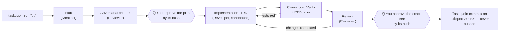
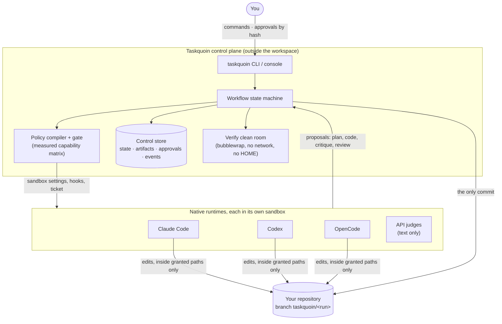
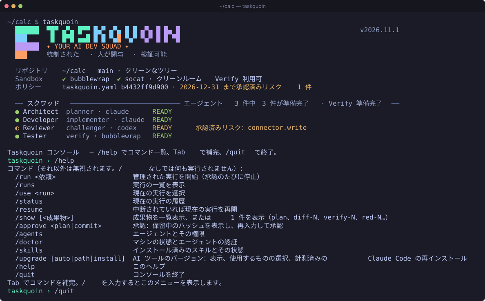
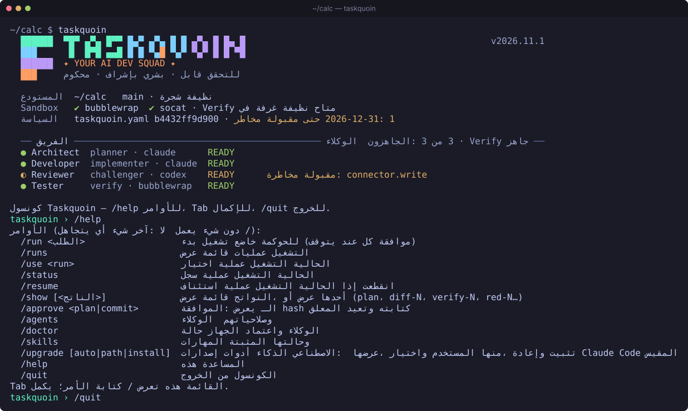

# Taskquoin

**Governed execution for AI coding agents.** Taskquoin lets Claude Code, OpenAI Codex, OpenCode and any
OpenAI-compatible model work on your repository — under rules that are **enforced, measured and approved by you**,
not merely written in a prompt.


> **Status: 2026.11.1 — alpha.** Tested on Linux (WSL2, ext4) with Claude Code 2.1.327, Codex 0.157.1 and
> OpenCode 1.19.5; macOS and Windows are not verified yet. Screens in this README come from a demo repository with
> simulated AI agents; every command shown is the real CLI.

**[Documentation](docs/README.md)** · **[Tutorial](docs/getting-started/first-run.md)** ·
[Français](docs/tutorial/fr.md) · [Español](docs/tutorial/es.md) · [Deutsch](docs/tutorial/de.md) ·
[日本語](docs/tutorial/ja.md) · [简体中文](docs/tutorial/zh-CN.md) · [22 languages](#the-tutorial-in-your-language)

---

## The concept

A coding agent can do whatever its tools allow: write anywhere, run any command, read your `.env`, commit, push,
and declare "done" when it thinks it is. Instructions in `CLAUDE.md` or `AGENTS.md` ask it not to — and they fade as
the context fills.

Taskquoin puts a **control plane** between you and the agents. A *quoin* is the cornerstone of a wall: the stone
the rest is aligned on. Taskquoin is that stone for agentic development:

1. **The agents act, Taskquoin decides.** Agents propose a plan, code, critiques and reviews; only Taskquoin moves the
   run forward, and only Taskquoin commits — on a dedicated branch, never pushed.
2. **Rules are enforced, and the enforcement is measured.** Every capability an agent receives (write here, run that
   command, no network…) is compiled to the runtime's own sandbox and hooks, and is accepted only if it was
   **measured** on that exact runtime version. A rule that is only *advisory* is never presented as *enforced*.
3. **You decide at two gates, bound to what you read.** You approve the plan, then the exact tree to commit — each by
   its hash. If anything changes after you read it, the approval no longer applies.
4. **"Done" is proven, not claimed.** Your tests run in a clean room with no network and no secrets, and a
   **RED proof** shows that the new tests fail without the change — so a test that proves nothing is refused.

## How a run works



Retries are bounded (3 implementation attempts — 5 for an OpenCode implementer — and 2 review reworks); past them, the
run stops and hands back to you (`needs-human`). Nothing is committed in that case.

## Architecture at a glance



The control store lives in `~/.local/state/taskquoin`, outside the repository: agents cannot write it, so they cannot
approve, change the policy or forge a result. Details: [Architecture](docs/concepts/architecture.md).

## What it guarantees — and the evidence

Every line below is backed by a measurement with the real runtimes (files in `docs/reports/`) or by an end-to-end
scenario that runs on every test run (`features/`, scenario names in French).

| When an agent works alone, it can… | With Taskquoin | Evidence |
|---|---|---|
| write outside your repository | refused by the runtime's sandbox (ENFORCED); inside it, the Write/Edit tools are limited to the granted paths by the PreToolUse hook | `evidence-live-claude-2.1.327-2026-11-18.txt`: `forbidden/no.txt=false`, `outside=false`, `/tmp` blocked — limit measured too: a Bash command can still write anywhere *inside* the repository |
| read `.env` and other secrets | reads denied; secrets never put in a prompt | same file: `.env read blocked by sandbox.filesystem.denyRead`; canary not leaked |
| chain shell commands past an allow-list (`&&`, `;`, `$( )`, backticks) | each chained form denied | same file: `bash-operators` denials |
| commit or push, even with `--no-verify` | agents never commit; `git commit` blocked | same file: `hooks C git` — commit refused |
| reach the network from a command | no network for commands (Codex sandbox, Claude Bash sandbox) | same file: `M2 codex read-only`, network probe `hits=0` |
| change the rules it runs under | `taskquoin.yaml` and agent config files are protected; a run that touches them never lands | scenario "Une modification de configuration protégée n'atterrit jamais" |
| say "tests pass" when they fail | Taskquoin runs your tests itself, in a clean room | scenario "Des tests rouges déclenchent au plus deux reprises…" |
| write a test that proves nothing | RED proof: the new tests must fail without the change | scenario "Des tests qui passent sans le changement… (preuve RED)" |
| land code nobody read | two human gates, bound to the hash of what you read | scenarios on wrong, stale and replayed hashes |

What it does **not** protect against, and what it costs, is in [Why Taskquoin](docs/concepts/why-taskquoin.md). A
comparative live benchmark (Claude Code alone, Codex alone, GitHub Copilot, through Taskquoin) is planned and has
**no numbers yet**.

## Quick start

```bash
# 1. Install (Linux / WSL2)
sudo apt install -y bubblewrap socat
git clone <this repository> ~/taskquoin && cd ~/taskquoin
npm install --ignore-scripts
bin/taskquoin setup                      # puts `taskquoin` on your PATH (~/.local/bin)

# 2. Prepare your repository
cd ~/my-project                          # a git repository with a test command
taskquoin init                           # writes taskquoin.yaml for the detected stack
git add taskquoin.yaml && git commit -m "taskquoin init"   # a run needs a clean tree
taskquoin doctor                         # certifies each agent; says where your code goes
```

If `doctor` reports the Codex reviewer as refused on `connector.write` (the restriction is claimed by Codex but not
measured), read why in [Agents and runtimes](docs/guides/agents-and-runtimes.md), then accept that exact risk if it
fits your project:

```bash
taskquoin accept-risk challenger connector.write --reason "Codex reviews read-only; no connector configured" --expires 2026-12-31 --as you
```

```bash
# 3. Run, read, approve
taskquoin run "Add a sum function"       # plan → critique → waits for you
taskquoin status <run>                   # shows the exact approve command and hash
taskquoin show <run> plan                # read the plan
taskquoin approve <run> plan --expect <hash> --as you
taskquoin show <run> diff-1              # read the exact diff (and verify-1, red-1, review-1)
taskquoin approve <run> commit --expect <hash> --as you   # commit on taskquoin/<run>; merge it yourself
```


The full walk-through, every step with its screen, is the [tutorial](docs/getting-started/first-run.md).

> [!IMPORTANT]
> A Claude Code version that Taskquoin has not measured is refused (NOT READY), by design. `doctor` tells you which
> version is measured. If the measured version is still installed, Taskquoin uses it automatically; `taskquoin upgrade`
> shows and fixes the rest ([Upgrade](docs/guides/upgrade.md)); see also [Troubleshooting](docs/guides/troubleshooting.md).

> [!WARNING]
> Your tests run in a clean room without your `HOME` and without network: a test toolchain installed under `HOME`
> (nvm, pyenv, `~/.m2`…) is not visible there. See [Verify and the RED proof](docs/guides/verify-and-red-proof.md).

## The console

`taskquoin` alone opens an interactive console: the quoin logo, the repository context, the squad with each agent's real verdict, a
timeline of the run in your local time, `/` commands with Tab completion, and `/approve`, which shows what is bound and asks you to retype the hash. Nothing starts without a `/`
command. See [The console](docs/getting-started/console.md).

## Dashboard

`taskquoin dashboard` (or `/dashboard` in the console) is a live, read-only screen of a run: the pipeline, the approval
that waits for you, the runs, the agents and the log, with a diff viewer that remembers what you read. No key approves:
the approval center asks you to retype the hash, then starts the usual `taskquoin approve` in a separate process.


See [The Dashboard](docs/guides/dashboard.md).

## The tutorial in your language

| | | | |
|---|---|---|---|
| [English](docs/getting-started/first-run.md) | [Français](docs/tutorial/fr.md) | [Español](docs/tutorial/es.md) | [Português (Brasil)](docs/tutorial/pt-BR.md) |
| [Deutsch](docs/tutorial/de.md) | [Italiano](docs/tutorial/it.md) | [Nederlands](docs/tutorial/nl.md) | [Polski](docs/tutorial/pl.md) |
| [Русский](docs/tutorial/ru.md) | [Українська](docs/tutorial/uk.md) | [Türkçe](docs/tutorial/tr.md) | [العربية](docs/tutorial/ar.md) |
| [فارسی](docs/tutorial/fa.md) | [עברית](docs/tutorial/he.md) | [हिन्दी](docs/tutorial/hi.md) | [Bahasa Indonesia](docs/tutorial/id.md) |
| [Tiếng Việt](docs/tutorial/vi.md) | [ไทย](docs/tutorial/th.md) | [简体中文](docs/tutorial/zh-CN.md) | [繁體中文](docs/tutorial/zh-TW.md) |
| [日本語](docs/tutorial/ja.md) | [한국어](docs/tutorial/ko.md) | | |

Each tutorial shows the screens in its own language. The console, the CLI and the agents' prose follow your
language (`TASKQUOIN_LANG`, otherwise your locale): [Languages](docs/guides/languages.md).

The console speaks your language: English, 日本語 and العربية below, and 19 more.

<p>
  
  
  
</p>

## Documentation

| | |
|---|---|
| **Getting started** | [Installation](docs/getting-started/installation.md) · [Tutorial](docs/getting-started/first-run.md) · [The console](docs/getting-started/console.md) |
| **Concepts** | [Why Taskquoin](docs/concepts/why-taskquoin.md) · [Architecture](docs/concepts/architecture.md) |
| **Guides** | [Configuration](docs/guides/configuration.md) · [Agents and runtimes](docs/guides/agents-and-runtimes.md) · [The Dashboard](docs/guides/dashboard.md) · [Approvals](docs/guides/approvals.md) · [Verify and the RED proof](docs/guides/verify-and-red-proof.md) · [Security](docs/guides/security.md) · [Upgrade](docs/guides/upgrade.md) · [Skills](docs/guides/skills.md) · [Memory](docs/guides/memory.md) · [Languages](docs/guides/languages.md) · [Troubleshooting](docs/guides/troubleshooting.md) · [Best practices](docs/guides/best-practices.md) |
| **Reference** | [CLI](docs/reference/cli.md) · [Console commands](docs/reference/console-commands.md) · [Configuration](docs/reference/configuration.md) · [Runs, artifacts and events](docs/reference/runs-artifacts-events.md) · [Capabilities](docs/reference/capabilities.md) |
| **Decisions** | [ADRs](docs/adr/) · [Measured evidence](docs/reports/) · [Threat model](docs/security/threat-model.md) · [SECURITY.md](SECURITY.md) · [CHANGELOG](CHANGELOG.md) |

## Requirements

- Node ≥ 22.18 (runs TypeScript natively) and git.
- Linux: `bubblewrap` and `socat` (sandboxes and the clean room).
- At least one coding runtime: Claude Code (signed in), or OpenCode 1.19.5 (`taskquoin connect opencode`); Codex CLI
  for the default reviewer; API keys (environment variables) for any API judge you add.

## Develop

```bash
npm install --ignore-scripts
npm run typecheck && npm test            # offline; live tests: TQ_E2E=1 npm test (uses your Claude / Codex sign-in)
npm run package                          # the npm package, in dist/package
node scripts/docs-screens/build.mjs <work-dir>   # rebuilds every documentation screen from the real CLI
```

Nothing is written outside the repository; Taskquoin never modifies `~/.claude` or `~/.codex`. The executable
specification of every command and of the whole chain is in `features/` (`npm run features`).

## License

Apache-2.0 (`LICENSE`).

## Acknowledgements

Two ideas come from [ai-craftsman-superpowers](https://github.com/BULDEE/ai-craftsman-superpowers) (Apache-2.0):
measuring what each runtime really enforces on a given machine ([ADR-0002](docs/adr/0002-enforcement-classes.md)), and
enforcing rules with hooks rather than prose ([ADR-0003](docs/adr/0003-hooks-enforce-prose-asks.md)). Taskquoin
re-implements them; no code is copied from that project. The other projects studied, and their licences, are listed in
[docs/research/licensing.md](docs/research/licensing.md).
