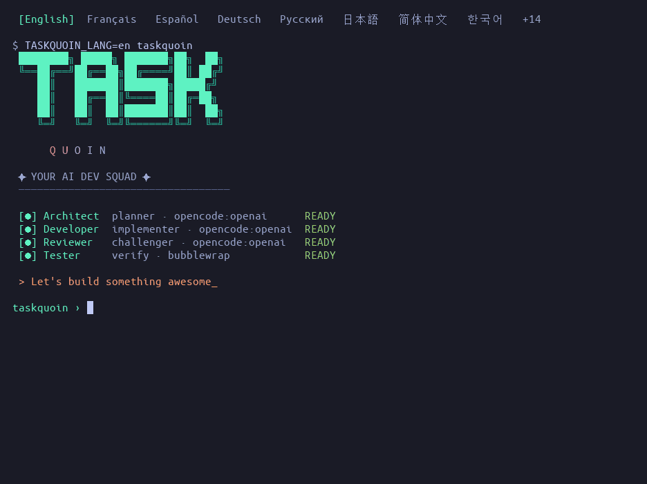

# Taskquoin


**Governed execution for coding agents.** Taskquoin runs a software-engineering workflow over **Claude Code**, **OpenAI Codex** and **any OpenAI-compatible AI**, where every file write, shell command and "it's done" claim is either *enforced by a mechanism we can name and test*, *approved by a human who is bound to the exact hash they read*, or *explicitly labeled advisory*.

> **Status: 2026.11.0 — first public release (alpha).** Tested on Linux (WSL2, ext4) with Claude Code 2.1.327 and Codex 0.157.1; macOS and Windows are not verified yet. Everything runs on your machine: only the AI providers you configure receive code.

## Why
Instructions in `CLAUDE.md` / `AGENTS.md` decay as context fills. Taskquoin puts the checks *in the loop* (sandboxes, hooks, a clean room for your tests, human gates bound to hashes) and refuses to compile a mandatory rule it cannot enforce on your runtime version.

## How a run works
```
taskquoin run "Add a sum function"
  plan (Claude) → critique (Codex or any AI) → YOU approve the plan, by hash
  → implementation in TDD (Claude, sandboxed, no network)
  → Verify: your tests in a clean room + RED proof (the new tests fail without the change)
  → review (Codex or any AI) → YOU approve the exact diff, by hash
  → Taskquoin commits on branch taskquoin/<run>. It never pushes.
```

## What you get
- **Two human gates**, each bound to the hash of what you read; agents never commit (`docs/adr/0011`, `0013`).
- **Measured enforcement**: a capability matrix per runtime version (`adapters/*/src/capabilities.json`), printed by `taskquoin doctor`; a mandatory restriction that is only advisory on your runtime refuses to compile.
- **Clean-room Verify** and a mechanical **RED proof** recorded in the commit (`RED-Proof:` trailer, `docs/adr/0014`).
- **Judges by API** (`docs/adr/0016`): any OpenAI-compatible provider — OpenRouter, Mistral, DeepSeek, Gemini, OpenAI, a local Ollama… — can critique the plan and review the diff. Text only: judges never receive secret files, binaries or your keys, and `taskquoin doctor` lists every destination of your code.
- **OpenCode for planning and coding** (`docs/adr/0017`): with only a ChatGPT subscription, OpenCode can plan, implement and review (other sign-ins — API keys, Copilot, local models — are refused until their hosts are measured) — in Taskquoin's sandbox, **without any command** (Taskquoin runs your tests), with its own connection (`taskquoin connect opencode`).
- **Console** (above): `taskquoin` alone opens an interactive shell (`/run`, `/status`, `/show`, `/approve`, Tab completion).
- **22 languages** (below): the console and the CLI speak your language, and the agents write the plan, the critique and the review in it.
- **Skills**: pinned first-party skills (planning contract, TDD, code review, security review). Third-party skills are imported from a local directory into quarantine, audited, and approved by you — Taskquoin never downloads.
- **Memory** (optional): a structured summary of each finished run goes to your local [claude-mem](https://github.com/thedotmack/claude-mem) worker.
- **Clean removal**: `taskquoin uninstall` removes only what Taskquoin created and you did not modify.

## Languages


English, Français, Español, Português (Brasil), Deutsch, Italiano, Nederlands, Polski, Русский, Українська, Türkçe, العربية, فارسی, עברית, हिन्दी, Bahasa Indonesia, Tiếng Việt, ไทย, 简体中文, 繁體中文, 日本語, 한국어.

- **Choice**: `TASKQUOIN_LANG`, otherwise your system locale (`LC_ALL`, `LC_MESSAGES`, `LANG`), otherwise English. Example: `TASKQUOIN_LANG=ja taskquoin`.
- **Quality**: English and French are written by hand. The other 20 are machine translations, checked by tests: every placeholder and `/command` is kept, and plurals follow each language's rules.
- **Layout**: columns stay aligned with Chinese, Japanese and Korean characters.
- **What stays English**: every `--json` output (byte-identical in every language), the run journal, artifacts, commit trailers, the agents' `VERDICT:` line, and the brand: the banner's tagline, slogan, role names and READY / NOT READY.

## Requirements
- Node ≥ 22.18 (runs TypeScript natively) and git
- Linux: `bubblewrap` and `socat` (command sandbox)
- Claude Code, signed in (`claude auth login`) — planner and implementer (or OpenCode, below)
- Optional: Codex CLI (signed in); OpenCode 1.19.5 (`npm install -g opencode-ai@1.19.5`, then `taskquoin connect opencode`) — it can replace Claude Code; API keys for the judges you add, as environment variables

## Install
```bash
sudo apt install -y bubblewrap socat
git clone <this repository> ~/taskquoin && cd ~/taskquoin
npm install --ignore-scripts
bin/taskquoin setup        # puts `taskquoin` on your PATH (~/.local/bin); also done at first launch
```

## Use
```bash
cd <your git repo>
taskquoin init                      # taskquoin.yaml for the detected stack; detected AIs are proposed, commented out
taskquoin doctor                    # certify every agent; shows where your code is sent
taskquoin run "Add a sum function"  # plan → critique → waits for you
taskquoin show <run> plan           # read it
taskquoin approve <run> plan --expect <hash> --as <you>
taskquoin show <run> diff-1         # read the exact diff
taskquoin approve <run> commit --expect <hash> --as <you>   # commit on taskquoin/<run>, never pushed
taskquoin status [<run>]
```
`taskquoin help` lists every command. Full guide (French): `docs/guide-developpeur.md`. Executable specification of every command and of the whole chain: `features/` (`npm run features`).

## Develop
```bash
npm install --ignore-scripts
npm run typecheck && npm test       # offline; live tests: TQ_E2E=1 npm test (uses your Claude / Codex sign-in)
npm run package                     # the npm package, in dist/package
```
Nothing is written outside the repository. Taskquoin never modifies `~/.claude` or `~/.codex`.

## Docs
`docs/architecture.md` · `docs/implementation-plan.md` (roadmap) · `docs/security/threat-model.md` · `docs/adr/` (decisions) · `docs/reports/` (live evidence) · `docs/research/` · `SECURITY.md` · `CHANGELOG.md`.

## License
Apache-2.0 (`LICENSE`). Practices credited to [ai-craftsman-superpowers](https://github.com/BULDEE/ai-craftsman-superpowers) (Apache-2.0) and others listed in `docs/research/licensing.md`.
