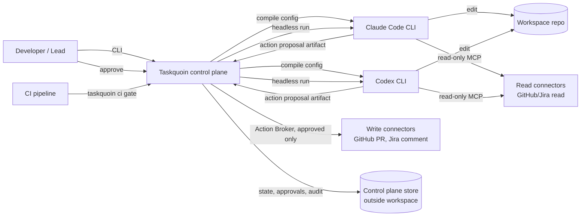

# Architecture — v0.2

**Status:** Proposal v0.2 (2026-11-15), revised after Codex NO-GO on v0.1 (`reviews/`). Pending human decisions listed in §13.
Name: **Taskquoin** (decided 2026-11-15).

## 0. The one promise

> **Governed execution:** run an engineering workflow across Claude Code and Codex where every write to disk, every shell command, every external side effect and every "it's done" claim is either *enforced by a mechanism we can name and test*, *brokered through an approval bound to the exact action*, or *explicitly labeled advisory*.

Secondary (enablers, not promises): portable configuration, craftsmanship skills, independent cross-model review.
Out of scope: own LLM loop, model gateway, offensive security, protection against a hostile process running as the same OS user.

## 1. Design principles (inherited + learned)

| Principle | Source | Consequence |
|---|---|---|
| **A prompt asks; a hook enforces.** Instructions decay with context; checks in the loop don't. | ai-craftsman-superpowers | Rules that matter are PreToolUse hooks exiting 2, not CLAUDE.md prose |
| **One engine, three seats.** Same rule set runs as editor hook, CI gate and reviewer criteria. | ai-craftsman-superpowers | `packages/rules` consumed by hooks, `taskquoin ci`, and review agent |
| **Measured capability matrix.** A declared hook on an event the host doesn't load is not a control. | ai-craftsman `host-capabilities.json` | `runtimes/<name>/capabilities.json` with version, date, evidence |
| **Fail closed, never exit 1.** A gate that cannot run refuses. | ai-craftsman ADR-0029 | Hooks: 0 allow / 2 deny; malformed input → deny for sensitive ops |
| **Enforcement classes, not portability labels.** | Codex review P0 | `ENFORCED / BROKERED / ADVISORY / UNSUPPORTED` on every compiled capability |
| **Agents propose; the broker acts.** | Codex review P0 | No write credential ever reaches a model process |
| **Deterministic first, model second.** Regex/AST graders before LLM judges; evals measure effects, not phrases. | ai-craftsman evals, Codex | `tests/` offline & free; `evals/` paid & explicit |
| **Decisions are ADRs.** | ai-craftsman (31 ADRs) | `docs/adr/` from day one |
| **Simplicity.** DDD/hexagonal only where complexity is justified. | spec, ponytail | Default profile = 3 agents, 1 workflow |

## 2. System context



## 3. Layered view (hexagonal)

```text
apps/cli                       thin: parse args → application use case → print
apps/hooks                     shell/py entrypoints invoked by runtimes (PreToolUse…) → call rules engine
packages/application           use cases + PORTS (owned here)
  ├─ InitProject, CompileRuntimes, Doctor, RunWorkflow, ApproveAction, ImportSkill, AuditSkill, Uninstall
  └─ ports: RuntimeExecutor, RuntimeConfigInstaller, RunStore, ArtifactStore, ActionBroker, SkillSource, Scanner, Clock, Approver
packages/domain                pure: Workflow state machine, Policy evaluation, Capability mapping, Approval binding, Trust state, Risk tier
packages/rules                 pure deterministic rule engine (layer violations, forbidden paths, dangerous shell) — shared by hooks, CI, reviewer
adapters/
  ├─ runtime-claude            compile → .claude/*, run → `claude -p …`, capabilities.json
  ├─ runtime-codex             compile → .agents/skills, .codex/config.toml, run → `codex exec …`, capabilities.json
  ├─ store-fs                  control-plane store under $XDG_STATE_HOME (atomic writes, journal)
  ├─ broker-github             fine-grained token, idempotency keys
  ├─ skill-source-github       tarball by full SHA, safe extraction
  └─ scanners                  builtin auditor; optional gitleaks/semgrep/osv/SkillSpector if present
```

Dependency rule enforced by a test: `domain` imports nothing; `application` imports `domain`; adapters import `application` ports; apps import application + adapters. `packages/rules` imports nothing (it must run inside a 50 ms hook).

## 4. Capability model & enforcement classes

Canonical capabilities: `fs.read(globs)`, `fs.write(globs)`, `shell.run(patterns)`, `net.egress(hosts)`, `vcs.commit`, `vcs.push`, `connector.read(id)`, `connector.write(id)`, `config.modify`.

Each runtime adapter publishes a **measured mapping** (`capabilities.json`, versioned):

| Capability | Claude Code 2.1.327 | Codex 0.157.1 |
|---|---|---|
| `fs.write` outside globs | PreToolUse hook deny (ENFORCED, exit 2) + `permissions.deny` `Edit(path)` rules | Sandbox `workspace-write` = workspace only (ENFORCED by OS sandbox); finer globs via PreToolUse hook (ENFORCED if hooks trusted, else UNSUPPORTED) |
| `shell.run` patterns | `permissions.allow/deny Bash(...)` (ENFORCED for model-issued commands; **ADVISORY for what the command itself does**) | Sandbox governs effects (ENFORCED), `approval_policy=never` in headless |
| `net.egress` | **ADVISORY** on host; ENFORCED only with `profile: container` | `workspace-write` denies network by default (ENFORCED) |
| `connector.write` | Not compiled into agent config → **BROKERED** | same |
| `config.modify` (`.claude/`, `.codex/`, `taskquoin.yaml`) | `permissions.deny` + config-protection hook (ENFORCED) | hook (ENFORCED if trusted) |
| `vcs.push` | deny `Bash(git push*)` + git-bypass-guard hook | sandbox has no network → ENFORCED |

Compile rule: a policy marked `mandatory: true` that resolves to ADVISORY/UNSUPPORTED on the target runtime **fails compilation** with a precise message and the remediation (e.g. "run with `--profile container` or trust hooks in Codex `/hooks`"). `doctor` prints the effective matrix.

## 5. Control plane store (outside the workspace)

```text
$XDG_STATE_HOME/taskquoin/<repo-id>/      # repo-id = sha256(git remote url || abs path)
├── policy.effective.yaml                   # frozen merge: builtin > org profile > project
├── approvals/<nonce>.json                  # bound approvals, single-use
├── runs/<run-id>/
│   ├── manifest.json                       # runtime versions, effective settings snapshot, policy digest
│   ├── state.json                          # node state machine, attempts
│   ├── artifacts/<sha256>                  # immutable, content-addressed
│   └── events.jsonl                        # metadata-only audit
├── skills/{quarantine,approved}/<name>@<sha>/
├── skills.lock                             # also mirrored read-only into repo for review
└── broker.journal.jsonl                    # intent → executed → confirmed
```

In-repo (versioned, reviewable): `taskquoin.yaml`, `.taskquoin/workflows/*.yaml`, `.taskquoin/agents/*.yaml`, `.taskquoin/skills.lock` (mirror), generated runtime files (tracked in `.taskquoin/manifest.json` for uninstall).
Protection: Codex sandbox cannot write outside workspace; Claude: `permissions.deny` on the store path + hook. Same-user attacker: out of scope, stated in SECURITY.md.

## 6. Execution contract v1 (`RuntimeExecutor`)

```ts
interface RunRequest  { runtime: 'claude'|'codex'; runtimeVersion: string; agent: AgentSpec; task: TaskSpec;
                        cwd: string; env: Record<string,string> /* allowlist only */; inputs: ArtifactRef[];
                        timeoutMs: number; maxOutputBytes: number; approvalChannel: 'none' }   // headless: none
interface RunResult   { status: 'completed'|'failed'|'timeout'|'cancelled'|'denied'|'unknown';
                        exitCode?: number; terminalMessage?: ArtifactRef; outputs: ArtifactRef[];
                        events: EventCoverage; usage?: {inputTokens, outputTokens, costUsd};
                        effectiveConfigDigest: string }
```

Concrete invocations (verified against installed CLIs):
- Claude: `claude -p --agent af-<id> --permission-mode dontAsk --output-format stream-json --verbose --max-turns N` — denied ops fail fast instead of waiting for a prompt.
- Codex: `codex exec --json --sandbox workspace-write -c approval_policy="never" -c model="..." -o <last-message-file>` ; per-agent overrides via `-c`, **never** `--profile`.
- Process tree killed on timeout; env is an allowlist (`PATH`, `HOME`, runtime auth vars only); `RunResult.status='unknown'` if the stream ends without a terminal event.

**"Done" is never the model's word.** A `Verify` node re-runs the declared verification commands itself (`npm test`, `phpunit`…) and parses exit codes — in a clean room (ADR-0014): the exact tree materialized outside the workspace, only the dependency directories inherited read-only (frozen for agents, fingerprinted).

## 7. Workflow = small fixed DAG + persisted state machine

MVP template `feature-governed`:

```text
plan(claude) ─▶ challenge(codex, read-only) ─▶ [human approves plan] ─▶ implement(claude, TDD) ─▶ verify(deterministic)
     ▲                                                                      │ fail (≤2)   │ pass
     │                                              red-check(base + test changes must FAIL) ◀┘
     │                                                       │ passes (≤2)        │ fails = RED proven
     └──────────────────────────────── rework ◀──────────────┴──── review(codex, read-only) ◀┘
                                                                            │ approve
                                                              propose PR (artifact) ─▶ [human approves action] ─▶ broker: open PR
```

Node states: `PENDING → RUNNING → DONE | FAILED | NEEDS_HUMAN | NEEDS_RECONCILIATION`. Mutating nodes are **serialized**; read-only nodes may run in parallel. Each node has `max_attempts`; state persisted after every transition; resume = replay from state, never re-execute a node whose broker intent is `executed`.
Risk tier (`lite | standard | strict`) chosen from the request **and re-evaluated from the actual diff** before the PR proposal (auth/payment/infra paths, dependency changes → strict adds threat-model node + mandatory second reviewer).

## 8. Agents (default profile: 3)

| Agent | Runtime | Capabilities | Done when |
|---|---|---|---|
| `implementer` | claude | `fs.write(src/**, tests/**)`, `shell.run(test runners)`, `vcs.commit` | tests declared in plan exist and pass (verified by Verify node) |
| `challenger` | codex | read-only sandbox | produces `review.md` with blocking/non-blocking findings |
| `verifier` | none (deterministic) | runs commands | exit codes + rule engine report |

The 20-role catalog is shipped as **opt-in YAML** with the same schema; each role is enabled only by a workflow that references it. Agent frontmatter is generated (name, description, tools, model) — Claude identifies agents by frontmatter, not filename.

## 9. Hooks (the enforcement seat)

Compiled into `.claude/settings.json` (project) and offered to Codex via its hooks mechanism (shown as untrusted until the user reviews them in `/hooks`; `doctor` reports trust status):

| Hook | Event | Behaviour | Credit |
|---|---|---|---|
| `config-protection` | PreToolUse Write/Edit | deny writes to `.claude/`, `.codex/`, `taskquoin.yaml`, linter/CI configs, control store; resolves symlinks/`..` | ai-craftsman |
| `write-scope` | PreToolUse Write/Edit | deny paths outside agent's `fs.write` globs | — |
| `git-bypass-guard` | PreToolUse Bash(git*) | deny `--no-verify`, `core.hooksPath`, `HUSKY=0`, `git push` | ai-craftsman |
| `rules-gate` | PreToolUse Write/Edit | layer violations / forbidden imports from `packages/rules` (project-configured) | ai-craftsman |
| `test-dismissal-guard` | Stop | refuse ending a turn that waves away a red test without a ticket | ai-craftsman |
| `secrets-path-guard` | PreToolUse Read/Bash | deny `~/.ssh`, `~/.aws`, `.env*`, `/mnt/c/Users/*/.aws` (WSL symlinks noted) | — |

All hooks: bash + python3 stdlib, exit 0/2, read stdin only, no network, no writes to source tree.

## 10. Action Broker (external side effects)

1. Agent writes `actions/<n>.json` artifact: `{type:"github.pr.create", target:{repo}, args:{title, body, head, base}}`.
2. Broker validates: connector enabled, target ∈ allowed set (repo id compared to configured, not to text), args schema, policy.
3. Approval binding created: `sha256(type|target|normalizedArgs|baseRevision|policyDigest)`, `expiresAt`, `nonce`; human approves via `taskquoin approve <nonce>` (later: inbox UI).
4. Execute with idempotency key; journal `intent → executed → confirmed`. HTTP timeout after send ⇒ `NEEDS_RECONCILIATION` (query by idempotency key / search), never blind retry.
5. Credentials: env var or OS keychain reference, fine-grained per connector, **never** present in agent env.
Read connectors (GitHub/Jira read MCP servers) are compiled into agent config with allow-rules on reviewed tool schema snapshots.

## 11. Skill supply chain

`add (full SHA) → safe-extract to quarantine (outside workspace) → scan (builtin rules + optional scanners, versions recorded) → human approve → copy to approved/ → compile (copy, not symlink)`.
Tree hash = sha256 over sorted `(path, execBit, sha256(bytes))`; re-hashed at compile and at every run start; mismatch or block ⇒ compiled copies removed. Trust record keeps `scan`, `approval`, `revocation` separate. Markdown-only skills are *not* low-risk by default.

## 12. Observability

`events.jsonl` metadata-only by default: `run.start/end`, `node.transition`, `tool.call{name, pathHash}`, `verify.result`, `policy.decision`, `approval`, `broker.intent/executed`, `usage`. Body capture is opt-in per run (`--capture`) with retention days. Session summary = render of state + events. Viewers (Studio read-only, Agent Standup) are Phase B.

## 13. Roadmap (not MVP) & human decisions

- **Phase B** — Studio *viewer* (runs timeline, approvals inbox; browser threat model in `reviews/`), Jira read + brokered comment, Graphify/Archify as optional skills.
- **Phase C** — Studio *editor* (React Flow ⇄ YAML) **only if** pilots hand-author ≥3 custom workflows; stack packs; agent catalog evals; RTK (guarded); Agent Standup.
- **Separate project** — PentAGI extension.

Decisions required from the human: (1) confirm the one promise in §0; (2) same-user compromise out of scope; (3) Studio editor deferred to Phase C; (4) supported runtime versions at launch (proposal: Claude Code ≥2.1.3xx, Codex ≥0.157); (5) name.
