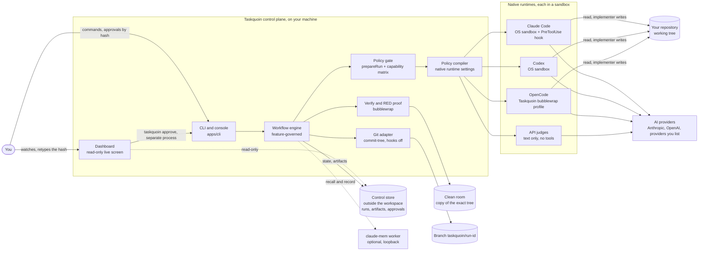
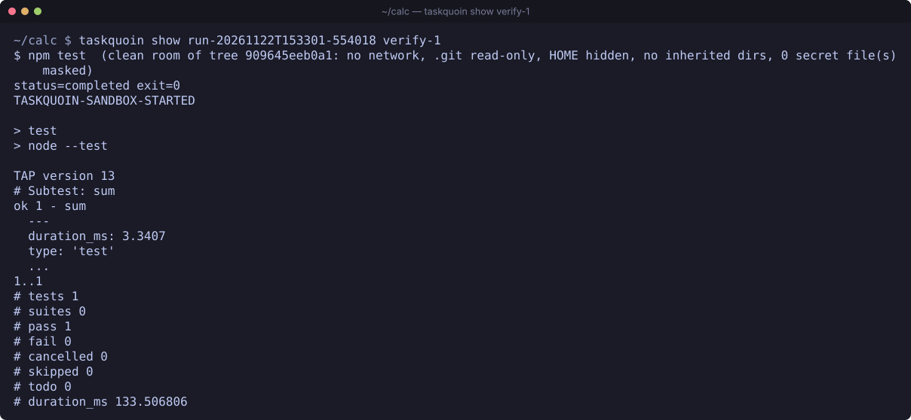
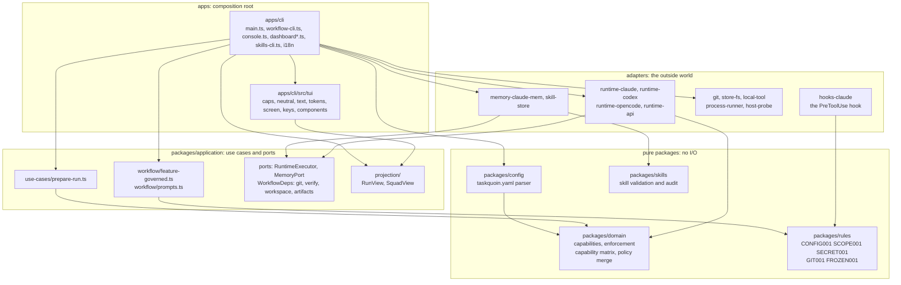
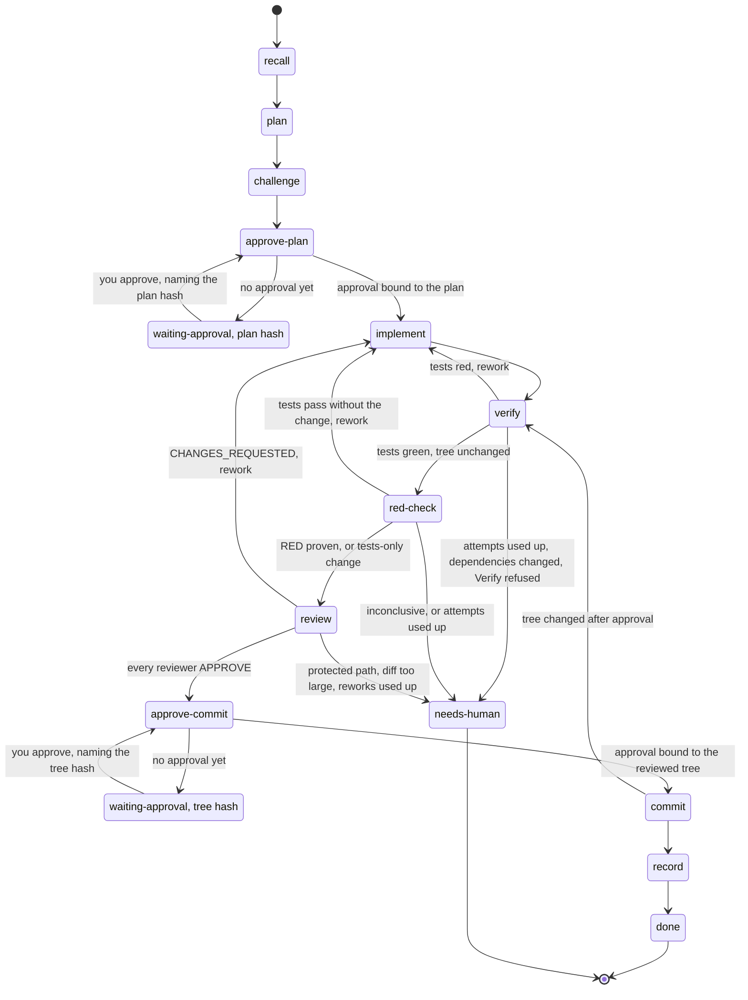
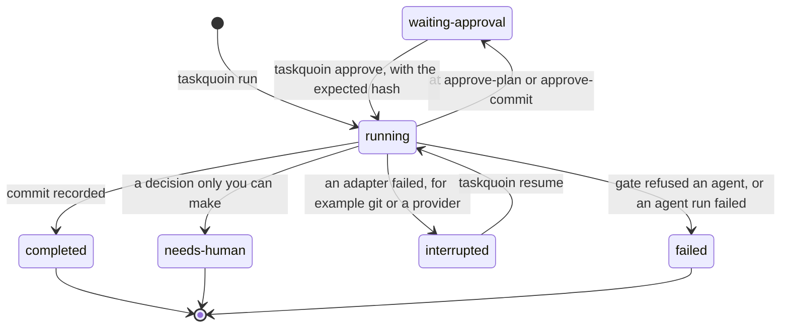
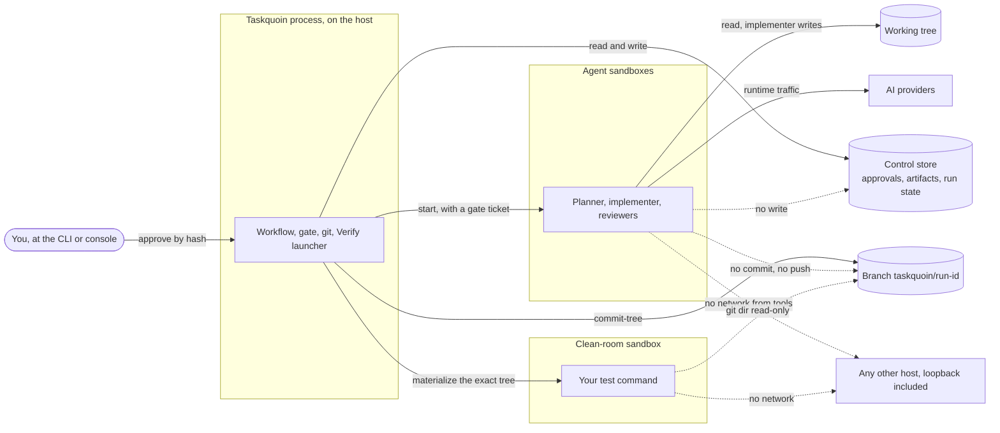

# Architecture

Taskquoin is a control plane, not another coding agent. It has no model loop of its own: it starts the agents you
already use (Claude Code, Codex, OpenCode) and text-only judges reached through an API, each inside a sandbox that
Taskquoin configures. It keeps three decisions for itself: whether your tests pass, what a human approved, and what
gets committed. This page shows the parts, how the code is layered, how a run moves from your request to a commit, and
which boundaries an agent cannot cross.

- [The big picture](#the-big-picture)
- [The parts, one by one](#the-parts-one-by-one)
- [The hexagonal layers](#the-hexagonal-layers)
- [The workflow](#the-workflow)
- [Trust boundaries](#trust-boundaries)
- [Learn more](#learn-more)

Screens come from a demo repository with simulated AI agents (the test doubles of Taskquoin's own test suite); every
command is the real Taskquoin CLI.

## The big picture



Read the diagram from left to right:

1. **You talk to Taskquoin only**, through the CLI or the console. No agent receives these commands
   ([ADR-0015](../adr/0015-console-human-only.md)).
2. **The workflow engine** drives one run of the `feature-governed` workflow. Before it starts any agent, it asks the
   **policy gate** whether that agent may run on the runtime version you have installed.
3. **The policy compiler** turns the grants of `taskquoin.yaml` into each runtime's own flags and settings. The runtime
   then starts headless, in its sandbox ([ADR-0001](../adr/0001-control-plane-over-native-runtimes.md)).
4. **Agents read your working tree; only the implementer writes it.** Their only network destination is their AI
   provider ([ADR-0010](../adr/0010-local-first-no-leak.md)).
5. **Taskquoin reruns your tests itself**, in a clean room: a copy of the exact tree, materialized outside the
   workspace ([ADR-0014](../adr/0014-verify-in-a-clean-room.md)).
6. **After your second approval, Taskquoin writes the commit** on the branch `taskquoin/<run>`. It never pushes
   ([ADR-0011](../adr/0011-agents-never-commit.md)).
7. **Everything Taskquoin must remember** (run state, artifacts, approvals, per-run policies) lives in the control
   store, outside the repository, where no agent can write ([ADR-0005](../adr/0005-control-plane-outside-workspace.md)).

> [!NOTE]
> Taskquoin runs on your machine, as your OS user. A hostile process that already runs as you is out of scope
> ([ADR-0007](../adr/0007-human-decisions-2026-11-15.md)): it already has your files and credentials. Use a separate
> user, a VM or a container if you need that boundary.

## The parts, one by one

### The CLI and the console

`apps/cli/src/main.ts` is the composition root: it parses the command, builds the adapters and calls the application
layer, where the workflow logic lives (`apps/cli/src/workflow-cli.ts` wires that workflow to the real adapters). The
main commands are `init`, `doctor`, `check`, `run`, `status`, `show`, `approve`, `resume`, `accept-risk`, `skills`,
`connect`, `uninstall` and `console`; `taskquoin help` lists them all.

`taskquoin dashboard` (`apps/cli/src/dashboard.ts`) is a live, read-only screen over the control store; see
[The Dashboard layer](#the-dashboard-layer).

`taskquoin console` (`apps/cli/src/console.ts`) is a small interactive shell over the same functions. Nothing starts
without a `/` command, and `/approve` asks you to retype the 12-character hash it shows. The console is never
installed as a slash command inside Claude Code or Codex, so a model cannot type it through its own tools.

### The workflow engine

`packages/application/src/workflow/feature-governed.ts` is a small, fixed graph driven by a persisted state machine.
The state is saved after every transition, and every save bumps a revision that the CLI uses for compare-and-swap; a
per-run lock serialises concurrent CLI calls. [The workflow](#the-workflow) section below walks through it.

### The policy gate and the policy compiler

Each runtime adapter ships a **capability matrix** measured on one runtime version:
`adapters/runtime-claude/src/capabilities.json` (Claude Code 2.1.327), `adapters/runtime-codex/src/capabilities.json`
(Codex 0.157.1), `adapters/runtime-opencode/src/capabilities.json` (OpenCode 1.19.5) and
`adapters/runtime-api/src/capabilities.json`. Every entry names a mechanism, an enforcement class (`ENFORCED`,
`BROKERED`, `ADVISORY` or `UNSUPPORTED`) and how it is known (`measured`, `documented` or `inferred`)
([ADR-0002](../adr/0002-enforcement-classes.md), [ADR-0008](../adr/0008-evidence-is-bound-to-a-mechanism.md)).

Before every agent, the gate `prepareRun` (`packages/application/src/use-cases/prepare-run.ts`) resolves each
mandatory restriction against that matrix:

- The mandatory floor is `fs.write`, `net.egress`, `config.modify`, `connector.write`, `vcs.commit` and `vcs.push`.
  `taskquoin.yaml` can add restrictions; it can never remove one.
- Only a `measured` mechanism certifies a restriction. Anything else refuses the agent, unless you recorded a dated risk
  acceptance with `taskquoin accept-risk`. That acceptance is stored in the control store and bound to the exact
  failure and runtime version.
- An installed runtime version that differs from the matrix version fails every mandatory restriction closed.
- When the gate passes, it issues a ticket bound to the agent, the runtime version and a digest of the capabilities,
  valid for 15 minutes. Executors refuse to start a runtime without a matching ticket.

The executor then compiles the grants into the runtime's own settings:

| Runtime | What Taskquoin compiles | Code |
|---|---|---|
| Claude Code | `--setting-sources ""` (no user, project or local settings: none of your hooks, no repository hook), inline `--settings` with `permissions.allow` / `deny` and `dontAsk`, `--tools` limited to the grants, `--strict-mcp-config` with no MCP server, Bash inside Claude Code's OS sandbox (empty network allowlist, `failIfUnavailable`), and Taskquoin's PreToolUse hook with `onFailure: block` | `adapters/runtime-claude/src/command.ts` |
| Codex | `codex exec --sandbox read-only` or `workspace-write`, `--ignore-user-config`, `--ignore-rules`, `--strict-config`, `approval_policy="never"`, `web_search="disabled"`, `network_access=false`, 12 model-side features disabled | `adapters/runtime-codex/src/command.ts` |
| OpenCode | A generated configuration with no command tool, no MCP server and no external plugin, run inside Taskquoin's bubblewrap profile (HOME hidden, secrets and instruction files masked, `.git` read-only) | `adapters/runtime-opencode/src/config.ts` |
| API judge | One HTTPS `POST <url>/chat/completions` per judgement: no tools, redirects refused | `adapters/runtime-api/src/executor.ts` |

`taskquoin doctor` prints the result of the gate for every agent. With the default profile, the Codex challenger is
refused because one of its restrictions is not measured:

```shell
$ taskquoin doctor
Taskquoin doctor — ~/calc
Runtime claude: 2.1.327 (/usr/local/bin/claude) ✔
Runtime codex: 0.157.1 (/usr/local/bin/codex) ✔
Bash sandbox (bubblewrap + socat): ✔
…
Agent planner (claude)
  ✔ fs.write ENFORCED — --tools lists no Edit/Write/Bash: the agent cannot write any file
  ✔ net.egress ENFORCED — --tools lists no WebFetch, WebSearch or Bash: the agent has no network-capable tool
  …
Agent challenger (codex)
  ✔ fs.write ENFORCED — read-only sandbox: no filesystem writes
  ✖ connector.write — mandatory restriction "connector.write" (deny-all) on codex 0.157.1: claimed ENFORCED but the mechanism is not measured (inferred). Execution refused (ADR-0002).
  …
Verdict: 2 of 3 agents can run — refused agents will not be started.
```

### The runtimes and their roles

`taskquoin init` writes three agents. This excerpt is the real file for a Node project, with comments added:

```yaml
agents:
  planner:
    runtime: claude
    capabilities:
      fs.read:
        - "**"            # read-only: no Edit, Write or Bash tool
  implementer:
    runtime: claude
    capabilities:
      fs.read:
        - "**"
      fs.write:
        - "**"
      shell.run:          # the only commands the model may issue
        - npm test
        - npm test -- *
        - node --test *
  challenger:
    runtime: codex        # read-only sandbox; critiques the plan and reviews the diff
    capabilities:
      fs.read:
        - "**"
policy:
  mandatory:              # the built-in floor; you can add to it, never remove from it
    - fs.write
    - net.egress
    - config.modify
    - connector.write
    - vcs.commit
    - vcs.push
```

You can add judges reached through any OpenAI-compatible API ([ADR-0016](../adr/0016-judges-by-api.md)), or run the
planner, implementer and reviewer on OpenCode ([ADR-0017](../adr/0017-opencode-without-commands.md)). The planner and
every judge must stay read-only: an independent reviewer that can write is not independent.

### Verify: the clean room

After the implementer finishes, Taskquoin computes the candidate tree with `git write-tree` on a temporary index (your
own index is never touched). It materializes that tree with `git checkout-index` into a fresh directory in the control
store, and runs your test command in bubblewrap, mounted at the repository's path so the tests see the usual working
directory:

- no network, its own PID namespace, `.git` read-only;
- HOME hidden, `/run` and the control store masked, project secret files masked;
- the dependency directories of your stack (`node_modules`, `vendor`, `.venv`), plus any path you list under
  `verify.inherit`, inherited **read-only**; every other ignored file is absent.

Then comes the **RED proof**: Taskquoin builds the base tree plus only the changed test files, runs the same suite in
its own clean room, and requires a conclusive failure. If those tests pass without the production change, they do not
test it ([ADR-0013](../adr/0013-tree-based-governance.md) §6).



### Git: the commit

Every git call Taskquoin makes on the host runs with `core.hooksPath=/dev/null`, `core.fsmonitor=false` and no rename
detection (`adapters/git/src/git.ts`), so git never runs repository code, such as a hook, on your machine. The commit is
`git commit-tree <approved tree> -p <expected parent>` followed by a compare-and-swap `update-ref` on the run's
branch: byte for byte the tree that passed Verify, was reviewed and was approved. Its trailers say so
(`Taskquoin-Tree:`, `Plan-Approved-By:`, `Commit-Approved-By:`, `Verified:`, `RED-Proof:`, `Reviewed-By:`).

### The control store

The control store lives at `$XDG_STATE_HOME/taskquoin/repos/<id>/` (by default under `~/.local/state/taskquoin`):

| Path | What it holds |
|---|---|
| `runs/<run>/` | the run state (`state.json`, your two approvals included) and a metadata-only event log (`events.jsonl`) |
| `artifacts/` | plans, critiques, logs and diffs, content-addressed by SHA-256, written once and verified on every read |
| `approvals/` | the risk acceptances recorded with `taskquoin accept-risk` |
| `policies/` | the per-run policy the PreToolUse hook reads |
| `verify/` | the clean rooms, deleted after each Verify |
| `manifest.json` | what `taskquoin init` created, so `uninstall` removes only that |

Every directory of the store must be trusted: no symlink, owned by you, not writable by group or others, and not
inside the workspace (`adapters/store-fs/src/trusted-dir.ts`).

### Memory (optional)

If you use [claude-mem](https://github.com/thedotmack/claude-mem), the `recall` node queries its local worker before
the plan, and the agent receives the excerpt as untrusted reference data. After a commit, the `record` node stores a
summary that Taskquoin writes itself (status, files, decisions), never prompts or raw model output. Memory never
blocks a run, and claude-mem's own hooks, MCP server and observer are never loaded into governed runs
([ADR-0009](../adr/0009-claude-mem-as-memory.md)).

## The hexagonal layers

The code follows a hexagonal (ports and adapters) layout. Pure rules sit in the middle, use cases around them, and
everything that touches a process, a file or the network lives in an adapter.



| Layer | What lives there | Rule |
|---|---|---|
| `packages/domain` | the capability vocabulary, enforcement classes, matrix validation, `resolveEnforcement`, policy-layer merge (a lower layer may only tighten) | imports nothing outside itself |
| `packages/rules` | the deterministic rule engine shared by the hook and the permission compiler: protected paths (CONFIG001), write scope (SCOPE001), secrets (SECRET001), git bypasses (GIT001), frozen dependencies (FROZEN001); the protected, secret and test path lists | imports nothing outside itself, so it can run inside a hook |
| `packages/config`, `packages/skills` | strict `taskquoin.yaml` parsing with per-stack defaults; Agent Skills validation and a deterministic audit | no file or network access: they receive text and return values |
| `packages/application` | the workflow state machine, the agent prompts, the policy gate, the projections `RunView` and `SquadView` (`projection/`: pure functions from a run's state and events, or the agents' gate verdicts, to what a screen shows), and the ports it owns (`RuntimeExecutor`, `MemoryPort`, and the `WorkflowDeps` it needs: git, verify, workspace, artifacts) | imports only itself, `@taskquoin/domain`, `@taskquoin/rules` and `node:` built-ins, never an adapter |
| `adapters/*` | one package per outside system: each runtime, the hook, git, the control store, the bubblewrap launcher (`local-tool`), the process runner, host probing, claude-mem, the skill store | never imports `apps` |
| `apps/cli` | parses arguments, wires the adapters into the ports, prints; `src/tui/` draws terminal screens (home, console, Dashboard) from the projections | the only place that knows every package |

The dependency rules of `packages/domain`, `packages/rules`, `packages/application` and `adapters/*` are checked on
every test run by a fitness test, `tests/architecture/boundaries.test.ts`. It reads static imports; it does not detect
imports built from computed strings.

> [!TIP]
> Because the workflow only knows its ports, the 64 end-to-end scenarios in `features/` run the real CLI, real git and
> real bubblewrap with simulated agents (`features/support/fakes/`): zero tokens, every run. The runtimes' own
> sandboxes are proven separately by the live tests in `tests/live-*.e2e.test.ts`.

### The Dashboard layer

The Dashboard ([guide](../guides/dashboard.md)) adds no workflow logic. It is a read-only view with a strict direction of
data:

```mermaid
flowchart LR
    files[("Control store<br/>state.json, events.jsonl,<br/>artifacts")]
    watch["dashboard-data.ts<br/>read-only watcher<br/>500 ms stat poll"]
    proj["application projection<br/>RunView, SquadView"]
    neut["tui/neutral.ts<br/>one neutraliser"]
    frame["tui/components<br/>pure renderers"]
    scr["tui/screen.ts<br/>draws changed rows"]
    keys["tui/keys.ts<br/>key decoder"]
    loop["dashboard.ts<br/>the loop"]
    form["dashboard-approve.ts<br/>approval form"]
    appr["taskquoin approve<br/>separate process"]
    files -->|"stat, read when the stamp changed"| watch
    watch --> proj
    proj --> neut
    neut -->|DashboardModel, neutral text only| frame
    frame --> scr
    keys --> loop
    loop --> frame
    loop --> form
    form -->|"retyped hash, binding re-read"| appr
    appr -->|"the usual approval path"| files
```



- `dashboard-data.ts` opens the store read-only (`openRepoStoreReadOnly`), polls with `stat`, reads a file only when its
  stamp changed, projects it with `RunView` and `SquadView`, and neutralises every outside string once. The renderers
  receive the resulting model.
- `src/tui/components/*` are pure functions of the model, the UI state, the terminal's capabilities and the clock: they
  read and write nothing. `tui/screen.ts` is the only code that writes to the terminal, and only changed rows.
- The only way back into the store is the last arrow: the approval form starts `taskquoin approve` as its own process,
  which takes the lock and records the approval as it would from your shell. The Dashboard process itself never writes
  to the control store (proven under `node --permission`, see the [developer guide](../guide-developpeur.md#7-tester-le-dashboard)).

## The workflow

### Nodes and loops

A run moves through twelve nodes. Three of them can send the work back to `implement`; the two approval nodes stop and
wait for you.



What each node does:

| Node | Who | What happens |
|---|---|---|
| `recall` | Taskquoin | optional: fetches past decisions from claude-mem |
| `plan` | planner (read-only) | writes a test-first plan; stored as the `plan` artifact |
| `challenge` | every challenger | critiques the plan; each answer ends with a `VERDICT:` line |
| `approve-plan` | **you** | approval bound to the SHA-256 of the plan you read |
| `implement` | implementer | changes the working tree; never commits. Before the first attempt, Taskquoin fingerprints the dependency directories and the ignored files |
| `verify` | Taskquoin | your test command in the clean room, on the candidate tree |
| `red-check` | Taskquoin | base tree + changed test files only, which must fail conclusively |
| `review` | every reviewer | reads the diff, the Verify log and the RED log; every reviewer must give a strict `APPROVE` |
| `approve-commit` | **you** | approval bound to the git tree id that was verified and reviewed |
| `commit` | Taskquoin | `commit-tree` of the approved tree, or back to `verify` if the tree changed since |
| `record` | Taskquoin | optional: a structured summary to claude-mem |
| `done` | — | the run is `completed` |

The loops have limits: three attempts in all (the first implementation and two reworks), and at most two reworks
asked by reviewers. An OpenCode implementer has no commands and cannot see its own tests fail, so it gets five attempts
when Taskquoin's tests fail, still with two review reworks. When the limit is reached, the run stops in `needs-human`.

### Run statuses: where a run stops

A node is *where* the run is; the status is *whether* it moves. There are six statuses
(`WorkflowStatus` in `feature-governed.ts`):



| Status | Meaning | What you do |
|---|---|---|
| `running` | the engine is moving between nodes | wait |
| `waiting-approval` | stopped at a human gate | read with `taskquoin show`, then `taskquoin approve <run> <plan\|commit> --expect <hash> --as <name>` |
| `needs-human` | Taskquoin will not decide alone: tests still red, RED proof inconclusive, a protected path changed, dependencies changed, a plan or diff too large for a reviewer | read the reason in `taskquoin status`, then start a new run |
| `failed` | the policy gate refused an agent, or an agent did not complete | fix the cause shown (often `taskquoin doctor`), then start a new run |
| `interrupted` | an adapter threw (git, the store, Verify infrastructure, a provider that kept failing) | `taskquoin resume <run>` continues from the same node; judges that already answered are not asked again |
| `completed` | committed on `taskquoin/<run>` | review the branch and merge it yourself |

### What an approval binds to

An approval is not "the next gate". It names the gate **and** the hash of what you read:

- `approve-plan` binds to the SHA-256 of the `plan` artifact;
- `approve-commit` binds to the git tree id that Verify tested and the reviewers approved.

`--expect` takes at least 12 hexadecimal characters and must be a prefix of that hash. If the working tree changes
after your commit approval, the approval is dropped, Verify and the review run again, and you approve the new tree.
Taskquoin also refuses to start a run on a repository with uncommitted changes. The scenarios in
`features/workflow-gouverne.feature` prove each of these on every test run.

## Trust boundaries

This diagram shows what crosses each boundary. Solid arrows are allowed; dotted arrows are blocked by a mechanism
outside the model.



The five boundaries are the ones of the [threat model](../security/threat-model.md): model process and host
filesystem (runtime sandbox and hook), workspace and control store, agent and external systems, quarantine and approved
skills, Taskquoin and the runtime CLIs (environment allowlist, gate ticket).

### What each agent can reach

| Who | Writes | Runs commands | Network | Reads |
|---|---|---|---|---|
| Planner (Claude Code, read-only) | nothing: no Edit, Write or Bash tool | none | no network-capable tool | the workspace through Read, Grep and Glob; secret files denied by permission rules |
| Implementer (Claude Code) | Edit and Write within its `fs.write` globs; its commands can write the whole workspace, but never outside it, `/tmp`, `.git`, protected configuration, frozen dependencies or the control store | only the granted patterns, inside Claude Code's OS sandbox | none for commands, loopback included | the Read tool: the workspace; its commands: any path your user can read, except listed secret files and the control store |
| Challenger (Codex, read-only sandbox) | nothing | Codex always has a shell; the sandbox bounds its effects | none | not restricted by the sandbox: anything your user can read |
| OpenCode roles | the repository (writer) or nothing (read-only); `.git` and frozen dependencies read-only | none: no command tool | no network tool; the OpenCode process itself reaches its provider's measured hosts | HOME hidden; secrets, instruction files and the control store masked |
| API judge | nothing | nothing | none: Taskquoin sends one request to the provider you listed | only the text Taskquoin sends: the plan, or the diff with secret files and binaries replaced by placeholders |
| Your tests, in Verify | the clean-room copy and a throw-away `/tmp`; `.git` and dependencies read-only | your test command, in its own PID namespace | none | HOME hidden, secret files masked; other host paths stay visible |

The classes and the evidence behind each cell are in the capability matrices and in
[Why Taskquoin](why-taskquoin.md). Two cells are weaker than the others, and Taskquoin says so: reads are not
confined for an implementer with a shell or for Codex (the matrices mark them `ADVISORY`), and the implementer's
commands can write anywhere in the workspace, not only inside its globs. The review and the landing gate, which refuses
any change to a protected path, cover what lands in the commit.

### What no agent can change

- **The control store.** Agents cannot write outside the workspace, so they cannot record an approval through any
  interface, including the console.
- **Your git history.** `.git` is read-only for agents and for your tests; only Taskquoin commits, after your approval.
- **Your global configuration.** Claude Code runs with `--setting-sources ""` and Codex with `--ignore-user-config`;
  Taskquoin never modifies `~/.claude` or `~/.codex`.
- **Remote services.** Agent runs are configured with no MCP server (measured for Claude Code; Codex exposes no
  inventory to measure, hence the risk acceptance `doctor` asks for). Writes to GitHub, Jira or GitLab are designed as
  proposals that an Action Broker executes after an approval bound to the exact action
  ([ADR-0004](../adr/0004-agents-propose-broker-acts.md), [ADR-0012](../adr/0012-remote-connectors-by-exception.md)).

> [!IMPORTANT]
> The Action Broker is not implemented yet. Today Taskquoin opens no pull request, comments on no issue and pushes
> nothing: the commit stays on your machine until you merge or push it yourself.

## Learn more

- [Why Taskquoin](why-taskquoin.md): the measured guarantees, what they cost, and the limits
- [Documentation home](../README.md)
- Guides: [The Dashboard](../guides/dashboard.md), [Approvals](../guides/approvals.md), [Verify and the RED proof](../guides/verify-and-red-proof.md),
  [Agents and runtimes](../guides/agents-and-runtimes.md); reference: [Capabilities](../reference/capabilities.md),
  [Runs, artifacts and events](../reference/runs-artifacts-events.md)
- [Threat model](../security/threat-model.md) and [SECURITY.md](../../SECURITY.md)
- ADRs: [0001 control plane over native runtimes](../adr/0001-control-plane-over-native-runtimes.md),
  [0002 enforcement classes](../adr/0002-enforcement-classes.md),
  [0003 hooks enforce, prose asks](../adr/0003-hooks-enforce-prose-asks.md),
  [0005 control plane outside the workspace](../adr/0005-control-plane-outside-workspace.md),
  [0008 evidence bound to a mechanism](../adr/0008-evidence-is-bound-to-a-mechanism.md),
  [0010 local first, no leak](../adr/0010-local-first-no-leak.md),
  [0011 agents never commit](../adr/0011-agents-never-commit.md),
  [0013 tree-based governance](../adr/0013-tree-based-governance.md),
  [0014 Verify in a clean room](../adr/0014-verify-in-a-clean-room.md),
  [0015 console for humans only](../adr/0015-console-human-only.md),
  [0016 judges by API](../adr/0016-judges-by-api.md),
  [0017 OpenCode without commands](../adr/0017-opencode-without-commands.md)
- The executable specification: [`features/`](../../features/README.md)
