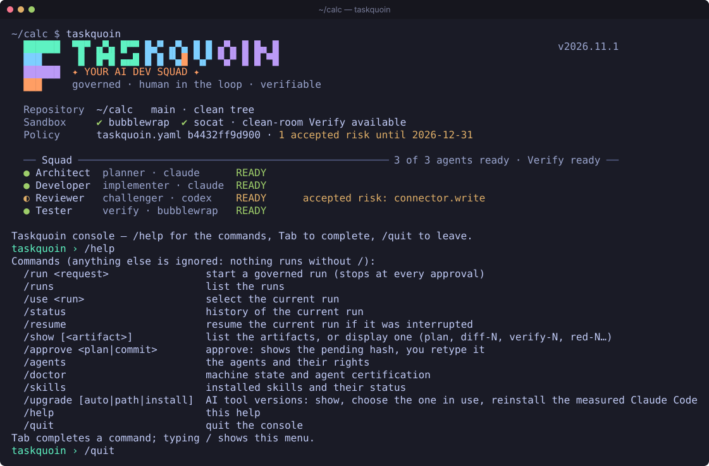

# The interactive console

The console is an interactive shell over the same commands you have seen in the [first run](first-run.md). You type
`/run`, read the plan, `/approve` it, and so on, without retyping the run id each time. It adds no workflow logic: every
`/command` calls the same code as the matching `taskquoin` command. It is made for humans only, and its design makes
that hard to get wrong.

- [Start the console](#start-the-console)
- [The banner and the squad](#the-banner-and-the-squad)
- [The commands](#the-commands)
- [Tab completion and the / menu](#tab-completion-and-the--menu)
- [Approving in the console](#approving-in-the-console)
- [Ctrl+C, quitting and input you did not mean to send](#ctrlc-quitting-and-input-you-did-not-mean-to-send)
- [Scripting the console with piped input](#scripting-the-console-with-piped-input)
- [Languages](#languages)
- [Learn more](#learn-more)

> [!NOTE]
> Screens come from a demo repository with simulated AI agents (the test doubles of Taskquoin's own test suite); every
> command is the real Taskquoin CLI.

## Start the console

Inside a git repository that has a `taskquoin.yaml`:

```shell
$ taskquoin
```

With no arguments, in a terminal, `taskquoin` opens the console, the way `claude` or `codex` do. `taskquoin console`
does the same, and also works when you want to be explicit. In a script or a pipe, `taskquoin` alone prints the help
instead.

In a terminal with colors, the logo animates for about a second before the banner appears. Two environment variables
change the display:

| Variable | Effect |
|---|---|
| `TASKQUOIN_NO_ANIMATION=1` | No start-up animation |
| `NO_COLOR` (any value) | No colors, and so no animation |

The console reads `taskquoin.yaml` once, when it starts. If the file changes or disappears while the console is open,
every command is refused with `taskquoin.yaml changed since the console was opened: /quit, then run taskquoin console
again`. This avoids running a command with a stale configuration.

## The banner and the squad



Under the logo, the banner shows **the squad: your real agents and their real status**. Each line is
`[marker] Role  agent · runtime  status`:

```text
 [●] Architect  planner · claude      READY
 [●] Developer  implementer · claude  READY
 [●] Reviewer   challenger · codex    READY (accepted risk: connector.write)
 [●] Tester     verify · bubblewrap   READY
```

The role is the agent's job: `planner` is the Architect, `implementer` the Developer, `challenger` the Reviewer and
`security` the Security reviewer; any other agent shows its own name. After the runtime, an API judge shows
`api:<provider>` and an OpenCode agent `opencode:<provider>`.

The status is never decorative. It is the same gate verdict that `taskquoin doctor` computes:

| Status | Meaning |
|---|---|
| `READY` (green, `[●]`) | The agent is certified on this machine: every mandatory restriction is enforced by a measured mechanism |
| `READY (accepted risk: …)` (amber) | It can run, but only thanks to a risk you accepted with `taskquoin accept-risk`. The capability is named |
| `NOT READY` plus a reason (red, `[○]`) | It will not start. The reason is the start of the gate's message, or `<runtime> not found` when the tool is not installed |

The last line, the **Tester**, is not an AI. It is Taskquoin's own clean-room Verify (`verify · bubblewrap`), the thing
that runs your tests. It is `READY` when bubblewrap is available and `NOT READY — bubblewrap unavailable` when it is
not; without it no run can be verified. Install the packages as described in [Installation](installation.md).

The banner's brand (the tagline, the slogan, the role names, `READY` and `NOT READY`) stays in English in every
language; the notes that follow are translated. Use `/doctor` for the full detail behind any status.

## The commands

Plain text never starts anything. Only lines beginning with `/` do anything; anything else answers `Nothing starts
without a command: type /run <request> to start a run, or /help.` This is deliberate: a stray sentence must never
launch a paid agent run.

```text
Commands (anything else is ignored: nothing runs without /):
  /run <request>          start a governed run (stops at every approval)
  /runs                   list the runs
  /use <run>              select the current run
  /status                 history of the current run
  /show [<artifact>]      list the artifacts, or display one (plan, diff-N, verify-N, red-N…)
  /approve <plan|commit>  approve: shows the pending hash, you retype it
  /resume                 resume the current run if it was interrupted
  /agents                 the agents and their rights
  /doctor                 machine state and agent certification
  /skills                 installed skills and their status
  /help                   this help
  /quit                   quit the console
Tab completes a command; typing / shows this menu.
```

One by one:

**`/run <request>`** starts a governed run, exactly like `taskquoin run "<request>"`. It stops at the first approval and
makes that run the **current run**: the prompt changes to `taskquoin [7be43f] ›`, showing the last six characters of
the run id. `/run` without a request prints its usage. Starting a run first forgets the previously selected one, so a
command can never fall back silently to an older run. If the run could not be created (a dirty working tree, say), no
run is selected and you are told so.

```text
taskquoin › /run Add a sum function
Run run-20261122T132829-7be43f — waiting-approval at approve-plan (attempt 0, branch taskquoin/run-20261122T132829-7be43f)
  …
(current run: run-20261122T132829-7be43f)
taskquoin [7be43f] ›
```

**`/runs`** lists every run with its status, node and request, like `taskquoin status`.

**`/use <run>`** selects an existing run as the current one, by its full id. An unknown id answers
`unknown run: <id> — /runs for the list`. Use it to come back to a run from another session.

**`/status`** shows the history of the current run and, at a gate, the pending approval, like
`taskquoin status <run>`.

**`/show [<artifact>]`** with no argument lists the current run's artifacts with their sizes. With one, it prints it:
`/show plan`, `/show challenge`, `/show diff-1`, `/show verify-1`, `/show red-1`, `/show review-1`, and
`/show ignored-1` when it exists.

**`/approve <plan|commit>`** approves the pending gate. It does more than the command-line version asks of you; see the
next section.

**`/resume`** continues the current run if it was interrupted (like `taskquoin resume <run>`). On a run that is not
interrupted it says so and does nothing.

**`/agents`** lists the agents, their runtime, their capabilities and their skills:

```text
planner      claude  fs.read  — skills: planning-contract
implementer  claude  fs.read, fs.write, shell.run  — skills: tdd
challenger   codex   fs.read  — skills: code-review
```

**`/doctor`** is `taskquoin doctor`: machine state, where your code is sent, and every agent's certification.

**`/skills`** is `taskquoin skills list`: the pinned first-party skills and any you imported.

**`/help`** prints the list above, in your language. **`/quit`** (or `/exit`) leaves the console.

Commands that need a run (`/status`, `/show`, `/approve`, `/resume`) answer `no run selected: /run <request> or /use <run>`
until you have started or selected one. An unknown command answers `unknown command: /foo — /help for the list`.

Imports, risk acceptances and OpenCode connection stay on the command line (`taskquoin skills import`,
`taskquoin accept-risk`, `taskquoin connect opencode`): they are setup decisions, not part of the day-to-day loop.

## Tab completion and the / menu

Type `/` and a menu of the commands appears under the input line. It narrows as you type: `/s` shows `/status`,
`/show` and `/skills`, with their descriptions. The menu is only drawn while the prompt is waiting for input and
disappears when you press Enter.

**Tab** completes a command name: `/ap` then Tab gives `/approve `. Only command names are completed. Free text, run
ids and artifact names are not, and the menu disappears as soon as you type a space (you are now in the arguments).

The command list, the menu, the completion and `/help` all come from one table in `apps/cli/src/console.ts`, so they
cannot disagree. Command names are never translated, only their descriptions.

## Approving in the console

Approval is where the console is stricter than the command line. In the command line you copy the hash from `status`.
In the console you must **retype it**, which forces you to look at it.

```text
taskquoin [7be43f] › /show plan
…
taskquoin [7be43f] › /approve plan
Your name (recorded in the approval): alice
To approve: plan of run run-20261122T132829-7be43f — hash 964c04e09ebe
Read first: /show plan  (and: challenge)
Retype 964c04e09ebe to approve (Enter to cancel):
```

What happens, step by step:

1. **The run must be waiting for that gate.** `/approve commit` on a run waiting for the plan answers
   `run … is not waiting for the commit approval (it is waiting for: plan)` and asks for nothing. `/approve` with
   anything other than `plan` or `commit` prints its usage.
2. **Your name is asked once per session**, *before* the hash, so that the last thing you type before approving is the
   hash. It is recorded with the approval as `alice (via taskquoin console)`, which tells a reader which door was used.
   A line starting with `/` is never accepted as a name: it cancels (`cancelled: a command is not a name — nothing is
   approved.`). Later `/approve` calls in the same session do not ask again.
3. **The pending hash is re-read** just before it is shown, so what you see is what can be approved. The prompt tells
   you which artifacts to read first (`/show plan`, or `diff-N, verify-N, red-N, review-N`).
4. **You retype the 12-character hash.** An empty line cancels (`cancelled: nothing is approved.`). Any other text that is
   not exactly the hash answers `the hash does not match: nothing is approved.`, and nothing happens.
5. **If it matches**, the console runs the same approval as `taskquoin approve <run> <gate> --expect <hash>` and
   prints the result: for the plan, the run continues through implementation, Verify and review and stops at the commit
   gate; for the commit, it prints the commit.

```text
taskquoin [7be43f] › /approve commit
To approve: commit of run run-20261122T132829-7be43f — hash 909645eeb0a1
Read first: /show diff-N, verify-N, red-N, review-N (and ignored-N if it exists)
Retype 909645eeb0a1 to approve (Enter to cancel):
```

> [!WARNING]
> Read before you retype. The hash binds your approval to the artifact (the plan, or the git tree), but only reading it
> makes the approval meaningful. The console cannot read for you.

### Why the console is human-only

The console is never installed as slash commands inside Claude Code or Codex, where a model could type them
([ADR-0015](../adr/0015-console-human-only.md)). The boundary that really matters is the control store: agents cannot
write to it, so they cannot approve at all. The console makes the human path safe on top of that: nothing starts without
a `/`, and an approval needs your name and the retyped hash.

### Type-ahead is discarded

A `/run` can take minutes. Anything you type while it works is waiting in the terminal's buffer, and it must not answer
an approval question that appears later. In a terminal, lines typed before a prompt is shown are **discarded** with a
notice:

```text
(2 lines typed before the prompt were ignored)
```

So an approval is always answered after the question has been displayed, never by keys pressed earlier.

## Ctrl+C, quitting and input you did not mean to send

- **Ctrl+C does not quit the console.** It prints `(Ctrl+C is ignored here: /quit to leave. A run in progress continues
  until its next approval.)`. Use `/quit` (or `/exit`) to leave. This protects you from killing a run half-way by
  reflex.
- **End of input** (Ctrl+D in a terminal, the end of a pipe) leaves the console, too.
- **Exit code.** The console exits with `0` if everything succeeded and `1` if any command or approval failed during the
  session, so a script can tell.
- Leaving the console does not stop the state of a run: a run waiting for approval stays waiting, and you can approve it
  from the command line or from a new console session (`/use <run>`).

## Scripting the console with piped input

When standard input is not a terminal, the console reads lines from the pipe, shows no menu, does not animate, and
**keeps** the lines (no one is there to discard type-ahead). That makes the console scriptable and is how Taskquoin
tests it:

```shell
$ printf '/help\n/runs\n/quit\n' | taskquoin console
```

A script can drive a whole approval by providing the answers in order: the command, the name, the hash. Piped input is
treated like `taskquoin approve --expect` in a script: you chose the hash in advance. Note that every line is consumed
as the answer to the prompt that is waiting: a `/show` sent where the hash was expected counts as a wrong hash and
cancels the approval.

```shell
$ printf '/use run-20261122T132829-7be43f\n/approve plan\nalice\n964c04e09ebe\n/quit\n' | taskquoin console
```

> [!TIP]
> For unattended use, the command-line `taskquoin approve <run> <gate> --expect <hash> --as <name>` is simpler than the
> console, and `taskquoin status <run> --json` gives a machine-readable state. `--json` outputs are English and
> identical in every language.

## Languages

The console and the CLI speak 22 languages: English, French, Spanish, Brazilian Portuguese, German, Italian, Dutch,
Polish, Russian, Ukrainian, Turkish, Arabic, Persian, Hebrew, Hindi, Indonesian, Vietnamese, Thai, Simplified and
Traditional Chinese, Japanese and Korean. The language is chosen in this order:

1. the `TASKQUOIN_LANG` environment variable (`TASKQUOIN_LANG=ja taskquoin`);
2. the saved preference in `preferences.json` in the state directory
   (`${XDG_STATE_HOME:-~/.local/state}/taskquoin/`), for example `{"language":"fr"}`;
3. your system locale (`LC_ALL`, `LC_MESSAGES`, `LANG`; `C` and `POSIX` give English);
4. English.

English and French are written by hand; the other 20 are machine translations checked by tests (every placeholder and
`/command` is kept, and plural forms follow each language's rules). Columns stay aligned with Chinese, Japanese and
Korean characters. The planner, the critique and the review are also written in the run's language.

What always stays in English: every `--json` output, the run journal, the artifacts, the commit trailers, the agents'
`VERDICT:` line, the engine's run messages (`failed`, `needs-human`, `interrupted`) and the banner's brand. A reader on
another team can therefore audit a commit made in any language.

## Learn more

- [Your first governed run](first-run.md): the same workflow with commands, step by step
- [Installation](installation.md)
- [ADR-0015, the console is human-only](../adr/0015-console-human-only.md)
- [ADR-0013, tree-based governance](../adr/0013-tree-based-governance.md)
- [ADR-0011, agents never commit](../adr/0011-agents-never-commit.md)
