# Your first governed run

This tutorial takes you from an empty folder to a verified commit made by Taskquoin, one command at a time. You will
create a tiny project with a failing test, let Taskquoin plan and implement a fix with AI agents, and approve the work
twice: once when you have read the plan, once when you have read the exact diff. At each step you see what Taskquoin
does, why it stops, and what you are signing.

- [What you will build](#what-you-will-build)
- [Step 1: create a project with a failing test](#step-1-create-a-project-with-a-failing-test)
- [Step 2: initialize Taskquoin](#step-2-initialize-taskquoin)
- [Step 3: commit the configuration](#step-3-commit-the-configuration)
- [Step 4: check the machine with doctor](#step-4-check-the-machine-with-doctor)
- [Accept a risk you understand](#accept-a-risk-you-understand)
- [Step 5: start the run](#step-5-start-the-run)
- [Step 6: read and approve the plan](#step-6-read-and-approve-the-plan)
- [Step 7: implementation, Verify and review](#step-7-implementation-verify-and-review)
- [Step 8: read and approve the commit](#step-8-read-and-approve-the-commit)
- [Step 9: merge the result](#step-9-merge-the-result)
- [Follow a run in the Dashboard](#follow-a-run-in-the-dashboard)
- [When things do not go as planned](#when-things-do-not-go-as-planned)
- [Learn more](#learn-more)

> [!NOTE]
> Screens come from a demo repository with simulated AI agents (the test doubles of Taskquoin's own test suite); every
> command is the real Taskquoin CLI. With real Claude Code and Codex the wording of the plan and the review is the
> agents' own, and a run takes a few minutes instead of seconds. Everything else is identical.

Before you start, [install Taskquoin](installation.md) and make sure Node 22.18+, git, `bubblewrap` and `socat` are
available and that at least Claude Code (and ideally Codex) is installed and signed in.

## What you will build

A run is a fixed workflow. The two diamonds are the two human approvals; nothing moves past them without you.

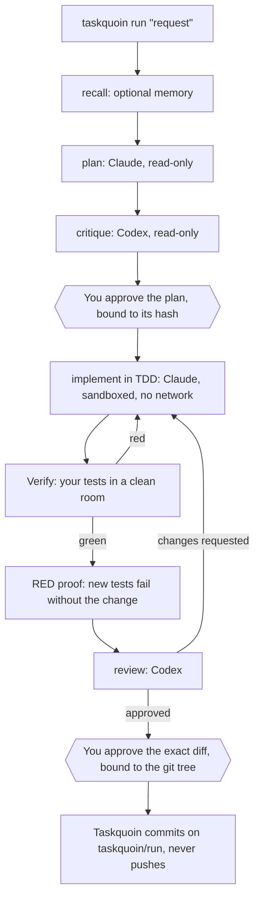

Three ideas run through the whole tutorial:

- **Agents propose, Taskquoin acts.** Agents never commit. The commit is built by Taskquoin from the tree that was
  verified, reviewed and approved ([ADR-0011](../adr/0011-agents-never-commit.md)).
- **Your approval is bound to a hash.** You approve exactly what you read, not "the run"
  ([ADR-0013](../adr/0013-tree-based-governance.md)).
- **Tests run in a clean room.** The model never tells Taskquoin that tests pass; Taskquoin runs them itself
  ([ADR-0014](../adr/0014-verify-in-a-clean-room.md)).

## Step 1: create a project with a failing test

The project is a one-function calculator. The test exists; the function does not.

```shell
$ mkdir calc && cd calc
$ git init -q -b main
```

Create `package.json`:

```json
{
  "name": "calc",
  "private": true,
  "scripts": { "test": "node --test" }
}
```

Create `sum.test.js`:

```js
const test = require('node:test');
const assert = require('node:assert');

test('sum', () => {
  const sum = require('./sum.js');
  assert.strictEqual(sum(2, 3), 5);
});
```

Create `.gitignore` (dependencies and build output are never part of a Taskquoin diff):

```text
node_modules/
```

Commit it:

```shell
$ git add .
$ git commit -m "calc: a failing test for sum"
$ npm test
not ok 1 - sum
  error: Cannot find module './sum.js'
```

The test is red, as expected. A git repository with a clean working tree is the one precondition Taskquoin has for a
project: `taskquoin run` refuses to start when you have uncommitted changes, because it never mixes its changes with
yours.

## Step 2: initialize Taskquoin

```shell
$ taskquoin init
```

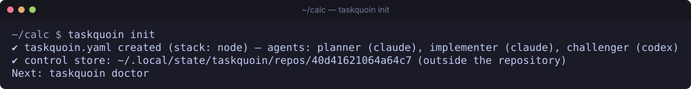

`init` did three things:

1. It detected the stack (`node`; it also knows `npm test`, PHPUnit, pytest, `go test`, Maven and others) and wrote
   `taskquoin.yaml` at the root of the repository.
2. It looked for AI tools on your machine and chose agents: here `planner` and `implementer` on Claude Code and
   `challenger` on Codex. If a tool is missing, the file says so; with only Claude Code the reviewer is Claude as well.
   With only OpenCode, `init` writes an all-OpenCode configuration.
3. It created a **control store** outside the repository, under `${XDG_STATE_HOME:-~/.local/state}/taskquoin/`. This is
   where run state, approvals and risk acceptances live. Agents cannot write there, which is what makes an approval
   unforgeable ([ADR-0005](../adr/0005-control-plane-outside-workspace.md)).

`init` never overwrites an existing `taskquoin.yaml`. If you ran `init` with other AIs available (an API key in your
environment, a local Ollama), it lists them and proposes them as **comments** in the file: uncommenting them is your
decision, because it means that project's code will be sent to them.

### The generated `taskquoin.yaml`

Open it. It is short, and you can read all of it. Here it is, section by section.

```yaml
# Taskquoin project configuration — see docs/architecture.md. Protected: agents can never edit this file.
version: 1
stack: node
```

`version` is the schema version. `stack` selects the defaults for the clean room: which dependency directories are
mounted read-only for your tests (for `node`: `node_modules`). The first comment is a promise: **agents can never edit
this file.** If one touches it during a run, the run stops and nothing is committed.

```yaml
agents:
  planner:
    runtime: claude
    description: "Read-only planner: turns a request into a minimal, test-first implementation plan."
    prompt: You plan; you never modify files. Read the repository, then produce the plan requested.
    capabilities:
      fs.read:
        - "**"
    maxTurns: 30
    skills:
      - planning-contract
```

An **agent** is a role bound to a runtime (`claude`, `codex`, `opencode`, or `api` for a judge). `capabilities` is
what the agent is allowed to do: the planner can read everything (`fs.read: "**"`) and nothing else, so it has no
shell and no write tool. `skills` are instructions pinned by hash (`planning-contract` is first-party). `maxTurns` caps
the agent's turns.

```yaml
  implementer:
    runtime: claude
    description: Implements an approved task with strict TDD (RED → GREEN → REFACTOR).
    prompt: "You implement exactly the approved task. Write a failing test first, make it pass with the simplest change, then refactor. Never commit: Taskquoin verifies and commits."
    capabilities:
      fs.read:
        - "**"
      fs.write:
        - "**"
      shell.run:
        - npm test
        - npm test -- *
        - node --test *
    maxTurns: 40
    skills:
      - tdd
```

The implementer can write files and run a small allowlist of test commands (`shell.run`) so it can work test-first.
Those commands run inside the runtime's own OS sandbox, with no network. Even so, its test run is only for its own
feedback: the result that counts is the one Taskquoin produces in Verify.

```yaml
  challenger:
    runtime: codex
    description: Independent, read-only adversarial reviewer of plans and diffs.
    prompt: "You are an independent reviewer. Challenge the plan or diff: correctness, security, missing tests, over-engineering. Report blocking and non-blocking findings with file:line. Do not modify files."
    capabilities:
      fs.read:
        - "**"
    skills:
      - code-review
```

The **challenger** critiques the plan and reviews the diff. It is a different vendor from the implementer on purpose,
and it is read-only: it must not be able to "fix" what it criticizes.

```yaml
policy:
  mandatory:
    - fs.write
    - net.egress
    - config.modify
    - connector.write
    - vcs.commit
    - vcs.push
connectors: {}
memory:
  claudeMem:
    enabled: true
```

`policy.mandatory` lists the restrictions that **must** be enforced by a mechanism for an agent to start: no write
outside its scope, no network, no change to protected configuration, no remote write, no commit, no push. If the
runtime version you have cannot enforce one of them, the agent is refused instead of started with a rule that is only
advice ([ADR-0002](../adr/0002-enforcement-classes.md), [ADR-0003](../adr/0003-hooks-enforce-prose-asks.md)).
`connectors` is empty: no remote system is connected ([ADR-0012](../adr/0012-remote-connectors-by-exception.md)).
`memory.claudeMem` is optional: when enabled, a structured summary of each finished run is sent to your local
[claude-mem](https://github.com/thedotmack/claude-mem) worker, and a short recall is read at the start of a run. Set it
to `false` if you do not run claude-mem. (The screens in this tutorial use `false`.)

> [!TIP]
> If your tests need an ignored file that is not a dependency directory, such as a built `dist/` or a `.env.test`, add
> it explicitly. It is then mounted read-only in the clean room and frozen for the agent:
>
> ```yaml
> verify:
>   inherit:
>     - dist
> ```
>
> A project whose tests are not run by `npm test` can set `verify.command`.

You can also use other AIs as judges (any OpenAI-compatible provider) or OpenCode as planner and implementer; see
[ADR-0016](../adr/0016-judges-by-api.md) and [ADR-0017](../adr/0017-opencode-without-commands.md).

## Step 3: commit the configuration

`taskquoin.yaml` is part of your project, so commit it. This also gives Taskquoin the clean working tree it needs:

```shell
$ git add taskquoin.yaml
$ git commit -m "chore: taskquoin"
```

## Step 4: check the machine with doctor

```shell
$ taskquoin doctor
```


`doctor` is the honest part of Taskquoin. Read it top to bottom:

- The first block lists the runtimes found, with versions and a check mark when the version is the one Taskquoin has
  measured, then the sandboxes (bubblewrap and socat) and the hook.
- **This project's code is sent to** lists every vendor that will receive your code, per agent. Taskquoin runs on your
  machine; only the AIs you configure see anything ([ADR-0010](../adr/0010-local-first-no-leak.md)).
- Then, per agent, each mandatory restriction with its class and **the mechanism that enforces it**, for example
  `net.egress ENFORCED — Bash subprocesses run in the native OS sandbox with an empty network allowlist`. A check mark
  means it is certified for that runtime version; a cross means the agent will not start.
- The last line is the verdict: `Verdict: all 3 agents can run.` or `Verdict: 2 of 3 agents can run — refused agents will not be started.`

In the demo, one line is a cross:

```text
Agent challenger (codex)
  …
  ✖ connector.write — mandatory restriction "connector.write" (deny-all) on codex 0.157.1: claimed ENFORCED but the mechanism is not measured (inferred). Execution refused (ADR-0002).
```

Codex says it enforces `connector.write` (no writes to remote connectors), but Taskquoin has no way to measure that
claim, so it does not count it as enforced. The challenger is refused: a run would end as `failed at challenge` with
`gate refused agent challenger`. For this one, you have a decision to make.

## Accept a risk you understand

An **accepted risk** is your signed, dated, scoped decision to run an agent despite one restriction that cannot be
measured. It is the owner's call, not the developer's and never the agent's:

```shell
$ taskquoin accept-risk challenger connector.write \
    --reason "Codex reviews read-only; no connector configured" \
    --expires 2026-12-31 --as you
```

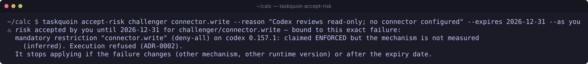

All four options are required: `--reason`, `--expires` (a real future date, `YYYY-MM-DD`) and `--as` (your name), plus
the agent and the capability. Notice what the acceptance is:

- **Bound to the exact failure.** It stores a digest of the failure message. If the runtime version changes, or the
  mechanism changes, the failure is no longer the same one, and the acceptance stops applying.
- **Dated.** It also stops applying after the expiry date.
- **Stored outside the repository**, in the control store. Nobody can add one by editing `taskquoin.yaml`, and no agent
  can write it.
- **Narrow.** It only applies to this agent and this capability. It is refused for a capability that is not failing,
  and it is not available for API judges (they are always checked).

Run `doctor` again. The line is now a warning instead of a cross, and the verdict is `all 3 agents can run`:

```text
  ⚠ connector.write accepted risk (approved by you until 2026-12-31: Codex reviews read-only; no connector configured) — mandatory restriction "connector.write" (deny-all) on codex 0.157.1: claimed ENFORCED but the mechanism is not measured (inferred). Execution refused (ADR-0002).
```

`taskquoin check challenger` shows the same detail for one agent:


> [!IMPORTANT]
> Accept a risk only when you understand it and the situation matches your reason: here Codex reviews read-only and
> your project has no connector, so a "connector write" cannot happen anyway. Do not accept a risk to make a red
> line go away. In particular:
>
> - never for `fs.write`, `net.egress`, `vcs.commit` or `vcs.push` on an agent that really writes or runs commands,
>   unless you can name the compensating control;
> - never with a vague reason: it is recorded in the approval and shown by `doctor`;
> - prefer a short expiry: the acceptance is a reminder to re-check after an upgrade;
> - if a mechanism is *measured as failing*, upgrade or change runtime instead.

Running `taskquoin accept-risk` yourself is deliberate: if the console or an agent could do it, the control would mean
nothing.

## Step 5: start the run

```shell
$ taskquoin run "Add a sum function"
```

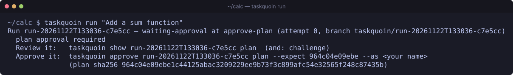

Your terminal is quiet while the agents work, then prints where it stopped. In order, Taskquoin did this:

1. **Preflight.** Taskquoin checked that the configuration defines every role, that the skills are usable, that the
   read-only roles really are read-only, and that API judges have their keys. The working tree must be clean. Each
   agent also passes the same gate as `doctor` just before it is first used: a refused agent ends the run as `failed`.
2. **Branch.** It created the branch `taskquoin/run-20261122T132108-d17040` and switched to it. Your `main` is
   untouched.
3. **Recall.** It asked the memory worker, if enabled, for relevant notes. The journal shows `recall no-memory` when
   there is none.
4. **Plan.** The `planner` (Claude, read-only) read the repository and wrote a plan: goal, the test to write first,
   files, steps, risks.
5. **Critique.** The `challenger` (Codex, read-only) challenged that plan independently and ended with a
   `VERDICT:` line.
6. **Gate.** The workflow stopped at `approve-plan`. It will wait as long as you like.

The run id (`run-20261122T132108-d17040`) is a timestamp and a random suffix. You use it in every following command.
`taskquoin status` with no argument lists the runs:

```shell
$ taskquoin status
run-20261122T132108-d17040  waiting-approval approve-plan    Add a sum function
```

## Step 6: read and approve the plan

`status <run>` shows the history of one run and, at a gate, the exact command that approves it:

```shell
$ taskquoin status run-20261122T132108-d17040
```

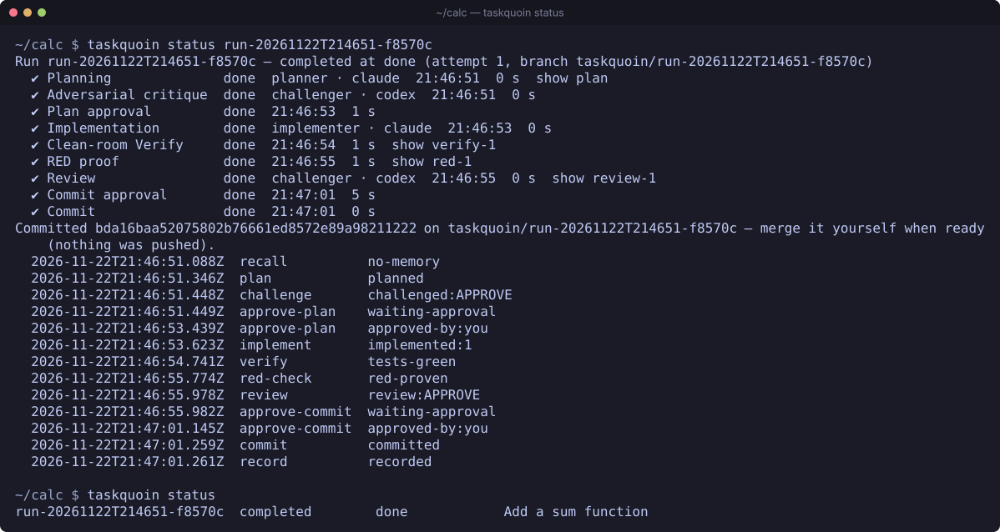

Each history line is a step of the workflow with its outcome (`planned`, `challenged:APPROVE`, `waiting-approval`).

Now **read what you are about to approve**:

```shell
$ taskquoin show run-20261122T132108-d17040 plan
```

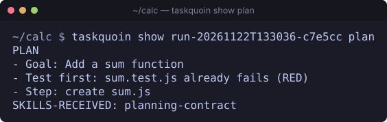

```shell
$ taskquoin show run-20261122T132108-d17040 challenge
Review: plan checked.
VERDICT: APPROVE
```

`show <run>` with no artifact lists everything stored so far, with its size in bytes. A plan from a real agent also
covers the files to touch, the tests to write first, and the risks. The challenge is the independent second opinion: it
may list blocking and non-blocking findings. If the plan is wrong, do not approve it: start a new run with a more
precise request.

### Why the hash

The line that matters is the last one of `status`:

```text
Approve it:  taskquoin approve run-20261122T132108-d17040 plan --expect 964c04e09ebe --as <your name>
             (plan sha256 964c04e09ebe1c44125abac3209229ee9b73f3c899afc54e32565f248c87435b)
```

`964c04e09ebe` is the start of the SHA-256 of the plan file you just read. Approving does not mean "I approve this
run"; it means "I approve **the plan whose hash is 964c04e09ebe**". If the plan could change between your reading and
your approval (a retry, another process, a compromised tool), the hash would no longer match and Taskquoin would refuse.
It is also what the commit records, so anyone can audit later what a person approved.

> [!NOTE]
> `--expect` is not a password. It is a proof that you looked at the artifact the system is about to act on: you copy
> it from `status` after reading. In the [console](console.md), you retype it to confirm.

Approve:

```shell
$ taskquoin approve run-20261122T132108-d17040 plan --expect 964c04e09ebe --as you
```

`--as` is your name; it is recorded as `Plan-Approved-By` in the commit. Approving the plan resumes the workflow, which
continues until the next gate.

### A wrong hash is refused

Try a hash that is not the pending one:

```shell
$ taskquoin approve run-20261122T132108-d17040 plan --expect 000000000000 --as you
taskquoin approve: expected 000000000000 does not match the pending artifact 964c04e09ebe… — re-read it before approving
```

Nothing was approved and the run is unchanged. The same happens if you approve a gate the run is not waiting for. The
screenshot below was taken after the run had completed, so it shows that variant of the refusal:

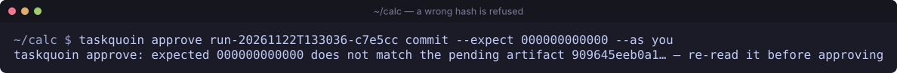

The exit code of a refusal is 1. A mistyped command (a missing `--expect` or `--as`) exits with 2.

## Step 7: implementation, Verify and review

After `approve … plan`, Taskquoin works without you:

1. **Implementation in TDD.** The `implementer` (Claude) works on the branch, in the runtime's sandbox, with no network
   and no way to commit. It writes or adjusts tests first, then the simplest code that makes them pass.
2. **Verify, in a clean room.** Taskquoin takes the exact tree the implementer left and runs your tests (`npm test`)
   itself, in a throw-away copy outside your repository: no network, `.git` read-only, your HOME hidden, secret files
   masked, and only the stack's dependency directories (and your `verify.inherit`) mounted read-only. A passing test
   that depended on something not committed fails here, which is the point.
3. **RED proof.** Taskquoin then removes the production change and runs the changed tests again. They must **fail**. A
   test that passes without the change tests nothing. The proof is mechanical: it does not show that the test asserts
   the right behavior (that is what the review, and you, are for).
4. **Review.** The `challenger` reviews the diff against the plan, with the verify and RED logs. It ends with a
   `VERDICT:` line.

If tests are red, or the RED proof fails, or the review asks for changes, Taskquoin sends the feedback to the
implementer for an automatic rework (up to 3 implementation attempts, with at most 2 rework rounds after a refused
review). The run then stops at the second gate.

## Step 8: read and approve the commit

The run is now waiting again. Look at it:

```shell
$ taskquoin status run-20261122T132108-d17040
Run run-20261122T132108-d17040 — waiting-approval at approve-commit (attempt 1, branch taskquoin/run-20261122T132108-d17040)
  commit approval required (bound to the exact tree)
  Review it:   taskquoin show run-20261122T132108-d17040 diff-1  (and: verify-1, red-1, review-1)
  Approve it:  taskquoin approve run-20261122T132108-d17040 commit --expect 909645eeb0a1 --as <your name>
               (git tree 909645eeb0a1716e60fd724784ede536fbea048f)
```

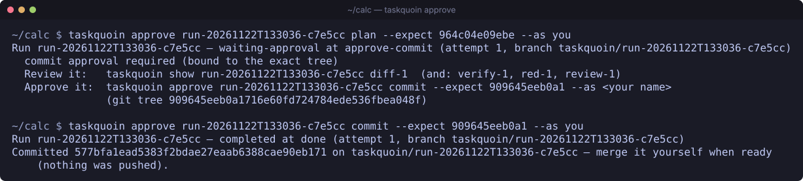

This time the hash is the **git tree** that passed Verify and the review. Read the four artifacts of attempt 1. The
number is the attempt; after a rework you read the highest one.

### `diff-1`: the exact change

```shell
$ taskquoin show run-20261122T132108-d17040 diff-1
```

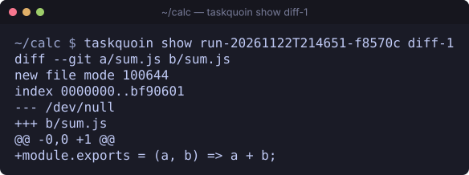

This is what will be committed, nothing more. If the agent changed a protected file (your CI, `.claude/`,
`AGENTS.md`, `taskquoin.yaml`) the run would have stopped with `protected configuration changed`. Files that your
`.gitignore` hides but that the agent created are listed in `ignored-1`; they are not in the diff, not verified, and not
committed.

### `verify-1`: your tests, run by Taskquoin

```shell
$ taskquoin show run-20261122T132108-d17040 verify-1
```

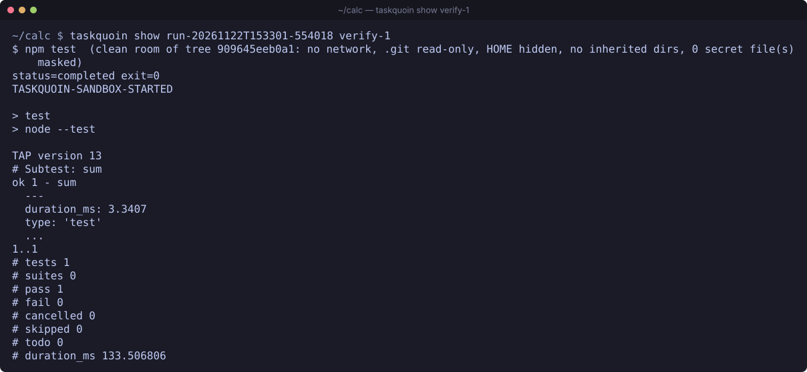

The header says what the clean room was (`no network, .git read-only, HOME hidden, … 0 secret file(s) masked`) and for
which tree (`909645eeb0a1`, the same hash you will approve). `exit=0` and `# pass 1` come from the test runner, not
from a model's claim.

### `red-1`: the proof that the test matters

```shell
$ taskquoin show run-20261122T132108-d17040 red-1
TASKQUOIN RED PROOF — tests run on base + test changes only (tree 9848f565e24c); they must FAIL.
RESULT: they failed as required (RED proven).

$ npm test  (clean room of tree 9848f565e24c: no network, .git read-only, HOME hidden, no inherited dirs, 0 secret file(s) masked)
status=failed exit=1
…
not ok 1 - sum
  error: Cannot find module './sum.js'
  code: 'MODULE_NOT_FOUND'
```

Here the new production file `sum.js` was removed, the test could not load it, and it failed. That failure is the
RED proof. Taskquoin treats an import error from a feature in a *new* file as the expected RED. If only test files
changed (a pure test addition), the proof is recorded as "not applicable".

### `review-1`: the second opinion

```shell
$ taskquoin show run-20261122T132108-d17040 review-1
Review: diff checked against the plan.
VERDICT: APPROVE
```

Read the findings, not only the verdict. `ignored-1` appears in the list only when there is something to read.

### Approve the commit

If you are satisfied, approve with the hash from `status`:

```shell
$ taskquoin approve run-20261122T132108-d17040 commit --expect 909645eeb0a1 --as you
Run run-20261122T132108-d17040 — completed at done (attempt 1, branch taskquoin/run-20261122T132108-d17040)
Committed a3c6b801de5f4356750f53870557e2fdd19958ee on taskquoin/run-20261122T132108-d17040 — merge it yourself when ready (nothing was pushed).
```

`approve … commit` must be run while the repository is on the run's branch (`taskquoin/<run>`); otherwise it answers
`switch to taskquoin/<run> first`. Taskquoin re-reads the working tree before committing. If anything changed since you
looked, your approval no longer applies: it re-verifies, re-reviews, and asks you to approve the new tree.

Taskquoin then builds the commit **from the approved git tree itself**, not from `git add`. It looks like this:

```shell
$ git log -1 taskquoin/run-20261122T132108-d17040
```

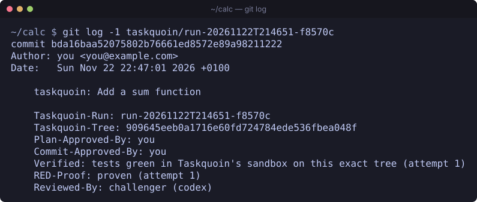

```text
taskquoin: Add a sum function

Taskquoin-Run: run-20261122T132108-d17040
Taskquoin-Tree: 909645eeb0a1716e60fd724784ede536fbea048f
Plan-Approved-By: you
Commit-Approved-By: you
Verified: tests green in Taskquoin's sandbox on this exact tree (attempt 1)
RED-Proof: proven (attempt 1)
Reviewed-By: challenger (codex)
```

The trailers are the audit trail, in the commit itself:

| Trailer | Meaning |
|---|---|
| `Taskquoin-Run` | The run that made this commit |
| `Taskquoin-Tree` | The git tree that was verified, reviewed and approved. It is the tree of this commit |
| `Plan-Approved-By` | The name given with `--as` at the plan gate |
| `Commit-Approved-By` | The name given with `--as` at the commit gate |
| `Verified` | Tests were green in the clean room on this exact tree |
| `RED-Proof` | The changed tests failed without the change (`proven`, or `not applicable` for test-only changes) |
| `Reviewed-By` | The agents that reviewed and approved; an API judge adds its own line |

`taskquoin status <run>` at the end shows the whole journal, from `recall` to `commit` and `record`.

## Step 9: merge the result

Taskquoin **never pushes** and never merges into your branch. The commit is on `taskquoin/<run>`, the branch you are
on. Merge it yourself, or open a pull request from it:

```shell
$ git switch main
$ git merge --ff-only taskquoin/run-20261122T132108-d17040
$ npm test
```

> [!WARNING]
> Taskquoin does not run your repository's commit hooks, because they could contain code the agent modified. Run your
> hooks, linters and CI yourself when you merge.

`taskquoin/<run>` branches are yours: delete them when you do not need them (`git branch -d taskquoin/<run>`).

## Follow a run in the Dashboard

While a run works, open a second terminal in the same repository and start the Dashboard. It only reads: it shows the pipeline, the approval that waits for you (with the start of its hash), the agents and the log.

```shell
$ taskquoin dashboard
```

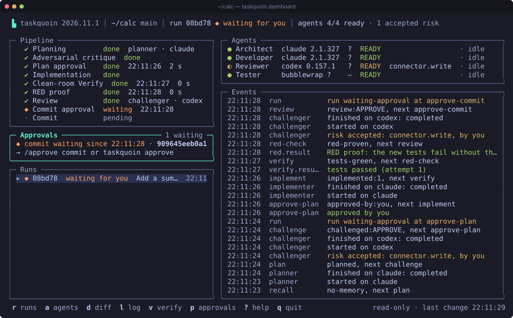

Press `d` to read the diff: `/` searches, `n` and `N` jump between matches, and a file counts as read once you have scrolled to its end.

Press `p` to open the approval center. No key approves by itself: you type your name, then retype the 12 characters of the hash. Quit with `q`; a run you approved keeps going. [Dashboard guide](../guides/dashboard.md).

## When things do not go as planned

Taskquoin's error messages follow your language, but the run's engine messages (`failed`, `needs-human`,
`interrupted`) are always English. The table lists what you will meet most.

| What you see | What it means | What to do |
|---|---|---|
| `taskquoin run: the working tree has uncommitted changes` | Taskquoin never mixes its changes with yours | Commit or stash your changes |
| `failed … gate refused agent X` | An agent cannot be certified on this machine | `taskquoin doctor` says why: runtime version, missing sandbox, a risk you have not accepted |
| `needs-human … tests still failing after 3 attempts` | Three attempts did not give green tests | Take over on the run branch, or start a new run with a more precise request |
| `needs-human … no failing test demonstrates the change` | The tests pass even without the production change, so they do not test it | Read `red-N`; write (or ask for) a test that fails before the change. A refactor or a doc change with no new test ends here: commit it yourself from the branch |
| `needs-human … RED proof inconclusive` | The proof could not run properly (timeout, sandbox, a tree that could not be rebuilt). It is not a proof | Read `red-N`. Your working folder is untouched |
| `needs-human … review still requests changes after N attempts` | The reviewer kept refusing | Read `review-N` and decide; the branch has the work |
| `needs-human … dependencies changed during the run` | `node_modules` (or `vendor`, `.venv`) changed during the run, so nothing is verified with it | Reinstall (`npm ci`) and start a new run. Do not run `npm install` during a run |
| `needs-human … protected configuration changed` | The agent touched protected configuration (CI, `.claude/`, `AGENTS.md`, `taskquoin.yaml`) | Nothing was committed; inspect the branch |
| Tests pass for you but fail in Verify | They use an ignored file absent from the clean room | Add it to `verify.inherit` |
| `does not match the pending artifact` | The hash you gave is not the pending one | Read with `show`, copy the hash from `status` |
| `switch to taskquoin/<run> first` | You are not on the run's branch | `git switch taskquoin/<run>` |
| `taskquoin.yaml changed since the run started` | The configuration changed mid-run | Start a new run |
| `interrupted` | A technical error (git, disk, a judge's HTTP 503) stopped the run | `taskquoin resume <run>` |

### When the tests stay red

If Verify fails, Taskquoin gives the implementer the failing log and the review and tries again, up to three
implementation attempts (an OpenCode implementer, which has no command of its own, gets more reworks). If the tests are
still red, the run ends with the status `needs-human` and the reason `tests still failing after 3 attempts`. There is no
commit and no approval prompt.

Everything is kept: `taskquoin show <run> verify-3` has the last log, and the branch `taskquoin/<run>` holds the
agent's work. You can continue by hand on that branch, or start a new run with a more precise request. A `needs-human`
run is not resumed automatically.

### `resume`: after an interruption

A run is `interrupted` when something outside the workflow broke it (a network error reaching a judge, a full disk, your
machine going to sleep). The state is saved at every step, and judges' answers are saved one by one, so resuming never
calls, or pays, a judge twice:

```shell
$ taskquoin resume run-20261122T132108-d17040
```

`resume` only accepts a run whose status is `interrupted`. For any other status it tells you so, for example
`taskquoin resume: only an interrupted run can be resumed (status completed)`. If the status is `needs-human` or
`failed`, start a new run.

### A rule of thumb

If you do not know what to do, run `taskquoin status <run>`: it prints the status, the journal, and the exact next
command. `taskquoin doctor` answers any question about the machine.

## Learn more

- [The interactive console](console.md): the same workflow, with `/run` and `/approve`
- [Installation](installation.md)
- [ADR-0011, agents never commit](../adr/0011-agents-never-commit.md)
- [ADR-0013, tree-based governance](../adr/0013-tree-based-governance.md)
- [ADR-0014, Verify in a clean room](../adr/0014-verify-in-a-clean-room.md)
- [ADR-0002, enforcement classes](../adr/0002-enforcement-classes.md)
- [ADR-0005, control plane outside the workspace](../adr/0005-control-plane-outside-workspace.md)
- [ADR-0016, judges by API](../adr/0016-judges-by-api.md) and [ADR-0017, OpenCode without commands](../adr/0017-opencode-without-commands.md)
