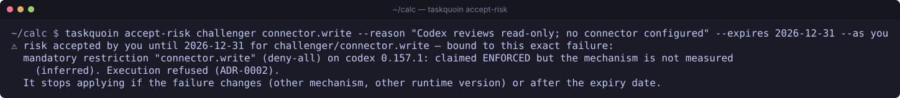

# Agents and runtimes

Taskquoin does not trust any AI to police itself. It gives each **role** to an agent, runs that agent on a
**runtime** (Claude Code, Codex, OpenCode or a plain API), and refuses to start an agent unless the restrictions it
must obey are *measured* to hold on this machine, with this runtime version. This page explains the roles, what each
runtime can do and how it is confined, and what to do when a restriction cannot be certified.

- [The roles](#the-roles)
- [Enforcement classes](#enforcement-classes)
- [Claude Code](#claude-code)
- [Codex](#codex)
- [OpenCode](#opencode)
- [API judges](#api-judges)
- [Measured versions](#measured-versions)
- [What doctor and check print](#what-doctor-and-check-print)
- [Accepted risks](#accepted-risks)
- [Learn more](#learn-more)

## The roles

| Role | Agent id | Who does it | What it may do |
|---|---|---|---|
| Architect | `planner` | an AI agent | Reads the repository and writes the plan. Read-only. |
| Developer | `implementer` | an AI agent | Writes code with strict TDD. Never commits, never pushes. |
| Reviewer | `challenger` (and any other judge you add) | an AI agent, ideally a different model from the implementer | Challenges the plan, then reviews the diff. Read-only. |
| Tester | none (this is **Verify**) | Taskquoin itself, not an AI | Runs your test command in a clean room and checks the RED proof. |

The planner and every judge must be read-only: Taskquoin refuses to start them if their configuration grants
writing, commands, network, commits, pushes, connector writes or configuration changes. The Tester being Taskquoin is
deliberate: the test result you rely on is never reported by the model that wrote the code. See
[Verify and the RED proof](verify-and-red-proof.md).

Two roles are always required (`planner`, `implementer`); judges are whoever `workflow` names (the `challenger` by
default). See [Configuration](configuration.md#workflow).

> [!TIP]
> Use a reviewer from a different model family than the implementer. When they are the same runtime, `doctor` warns:
> `the reviewer challenger uses the same model as the implementer (claude): add an independent judge`.

## Enforcement classes

Every restriction on every runtime is measured and labelled with one of four classes (stored per runtime version in
`adapters/runtime-*/src/capabilities.json`, with the evidence file that backs it):

| Class | Meaning |
|---|---|
| `ENFORCED` | An operating-system or runtime mechanism stops it, measured on this version. |
| `BROKERED` | The agent cannot do it directly; Taskquoin does it on request, under policy. |
| `ADVISORY` | Only a prompt or permission rule asks the agent not to. Not a guarantee. |
| `UNSUPPORTED` | No mechanism known on this version. |

A **mandatory** restriction (the six in `policy.mandatory`) that is not `ENFORCED` or `BROKERED`, or whose mechanism
is only *inferred* rather than measured, makes the gate refuse the agent. That is the "NOT READY" state. See
[ADR-0002](../adr/0002-enforcement-classes.md) and [ADR-0008](../adr/0008-evidence-is-bound-to-a-mechanism.md).

## Claude Code

Default runtime for the planner and the implementer.

- **Planner.** Started with a tool list that has no `Edit`, `Write`, `Bash`, `WebFetch` or `WebSearch`: it can read
  and nothing else.
- **Implementer.** Its shell commands run in Claude Code's native sandbox (bubblewrap and socat on Linux and WSL) with
  an empty network allowlist, `failIfUnavailable`, and no unsandboxed escape. The sandbox lets commands write the
  workspace but not outside it, and keeps `.git` read-only, so the agent cannot commit or push. Protected files,
  the control store and every nested `CLAUDE.md` or `AGENTS.md` are denied for writing.
- **No MCP servers** are loaded in agent runs (the init inventory is recorded per run).
- **Hooks.** A PreToolUse hook enforces the protected-path rules at write time.
- **Limits.** Reads are *advisory* where the agent has a shell: an allowed command such as `npm test` runs repository
  code that can read anything your user can read, apart from the secret files and control store the sandbox masks.
  Per-glob scope on `fs.write` is not enforceable for subprocesses, which is why the implementer is granted `"**"`.
- **Needs:** `claude` on the PATH, and bubblewrap and socat for any agent with a shell.

```shell
$ sudo apt install -y bubblewrap socat
```

## Codex

Default runtime for the reviewer (`challenger`).

- A read-only Codex agent runs in Codex's `read-only` sandbox: no filesystem writes, `network_access=false`, web
  search and plugin, app and browser features off.
- The sandbox keeps `.git` read-only: `git commit` fails (measured), and a push reaches no remote.
- Codex's `workspace-write` mode cannot keep Taskquoin's frozen dependency paths read-only, so **Codex cannot be the
  implementer**: Taskquoin refuses with `codex workspace-write cannot keep frozen paths read-only`. Use Codex for
  read-only roles.
- Reads are advisory: a Codex agent reads files through its shell.
- Today `doctor` reports `connector.write` as not certified for Codex (the mechanism is inferred, not measured). The
  default setup therefore needs one [accepted risk](#accepted-risks) for `challenger`. This is the only failure a
  stock Claude Code plus Codex setup shows.

## OpenCode

OpenCode is an open-source coding agent that talks to many providers. It has no operating-system sandbox of its own,
so Taskquoin supplies one. This lets a project run **without Claude Code**: every role on OpenCode.

- OpenCode runs inside Taskquoin's bubblewrap profile: HOME hidden, project secrets and instruction files masked, the
  repository's own OpenCode configuration masked and protected, `.git` and frozen paths read-only. It keeps network
  access, because it must reach its provider; no tool of its own uses the network (measured).
- Taskquoin generates its configuration: it denies everything not listed (read, list, glob, grep, and edit for a writer);
  no update check, sharing, LSP, formatter, MCP server or plugin.
- It gets **no command**. An OpenCode agent holds only `fs.read` and `fs.write`; Taskquoin runs your tests itself
  (`verify.command`, required for an OpenCode implementer) and returns the log. Because the agent cannot run the
  suite, it may rework up to 4 times when Taskquoin's tests fail (2 when reviewers refuse).
- Each agent needs `model: <provider>/<model>`.

Connect it with Taskquoin's own OpenCode sign-in (your personal OpenCode is not touched):

```shell
$ npm install -g opencode-ai@1.19.5
$ taskquoin connect opencode
$ taskquoin init
$ taskquoin doctor
```

`taskquoin connect opencode --remove` deletes the connection. If `opencode` is not on the PATH, `connect` says so.

> [!IMPORTANT]
> Only **measured** connections are certified, because only for those are the contacted hosts known. Today that is the
> ChatGPT sign-in (`openai`, type `oauth`). Any other connection (an OpenRouter key, Copilot, Ollama) is refused by
> `doctor`: `connection "<provider>" (<type>) is not measured with OpenCode 1.19.5 — Taskquoin sends no code through it`.
> With a ChatGPT connection only some models are accepted (measured: `openai/gpt-6-astra`).

If the provider is not connected: `provider "openai" is not connected for Taskquoin — run: taskquoin connect opencode`.
`doctor` shows where the code goes, for example `openai via OpenCode (openai/gpt-6-astra) — hosts: chatgpt.com`.

## API judges

Any AI that speaks the OpenAI-compatible chat API (DeepSeek, Mistral, Gemini, OpenRouter, a local Ollama) can be a
judge. It is **text-only**: Taskquoin sends it the request, the plan or the diff and the new text of changed files,
and it answers with a verdict. It has no tools and no access to your machine, so every restriction holds by
construction (there is no tool path to restrict); this is proven by deterministic tests against a local fake
provider (`adapters/runtime-api/test/executor.test.ts`).

- Secrets and binary files are replaced by placeholders in what it receives. You, the human, still approve the full diff.
- A request that fails with HTTP 429, a 5xx, a timeout or a network error is retried twice (after 2 s, then 8 s, or a
  `Retry-After` under 30 s). Then the run is `interrupted`, and `taskquoin resume` asks only the judges that have not
  answered yet.
- Redirects are refused: the code never goes to another host.
- A missing key refuses the run before anything starts: `<NAME> is missing — define it in your environment (the key is never written to the repository)`.
- An API judge can never be the planner or the implementer.
- API usage is billed by the provider.

Configuration: [`providers`](configuration.md#providers) and [`workflow`](configuration.md#workflow).

## Measured versions

A capability matrix is valid for **one exact runtime version**. If the installed version differs, every mandatory
restriction becomes `UNSUPPORTED` with `capability matrix measured for <runtime> <measured>, installed <installed>`
and the agent is refused until the version is measured (or you install the measured one).

| Runtime | Measured version | Measured on | Evidence |
|---|---|---|---|
| Claude Code | 2.1.327 | 2026-11-18 | `docs/reports/evidence-live-claude-2.1.327-2026-11-18.txt` |
| Codex | 0.157.1 | 2026-11-15 | `docs/reports/evidence-live-contract-R1.2-2026-11-15.txt` |
| OpenCode | 1.19.5 | 2026-11-16 | `docs/reports/evidence-live-opencode-2026-11-16.txt`, `docs/reports/opencode-interface-1.19.5.md` |
| API judge | by construction | 2026-11-16 | `adapters/runtime-api/test/executor.test.ts` |

## What doctor and check print

```shell
$ taskquoin doctor
$ taskquoin check <agent> [--json]
```


Read the output top to bottom:

1. **Runtime lines.** `Runtime claude: 2.1.327 (/usr/local/bin/claude) ✔` means the installed version is the measured
   one. Otherwise you see `✖ matrix measured for 2.1.327`, or `✖ not found on PATH`.
2. **Sandboxes.** `Bash sandbox (bubblewrap + socat)` and `File sandbox (bubblewrap)`. Without them,
   `agents with a shell are refused` and `Verify and OpenCode agents are refused`; install with `apt install bubblewrap socat`.
   `Local tool isolation (unshare -rn)` and the `PreToolUse hook entry` are checked too.
3. **Where the code goes.** One line per destination, for example `Anthropic (Claude Code) — planner, implementer` and
   `OpenAI (Codex) — challenger`. A local provider is marked `(stays on this machine)`.
4. **Connectors and memory.**
5. **Each agent.** `✔ <capability> ENFORCED — <mechanism>` for every restriction that holds; `✖ <capability> — <reason>` for
   one that does not; `⚠ <capability> accepted risk (approved by …)` for an accepted risk. Skills are listed with the hash of the
   content that will be injected.
6. **The verdict.** `Verdict: all 3 agents can run.` or `Verdict: 2 of 3 agents can run — refused agents will not be started.`

`check <agent>` prints the section for one agent and exits 0 or 1. With `--json` it prints `{ agent, ok, runtimeFound, failures, acceptedRisks, resolved, warnings }`,
which is what to use in a script or in CI.


Screens come from a demo repository with simulated AI agents (the test doubles of Taskquoin's own test suite); every
command is the real Taskquoin CLI.

## Accepted risks

Some restrictions cannot be certified on a given runtime version (for example `connector.write` on Codex today). When
you have judged that the residual risk is acceptable for your project, the **owner** records an acceptance:

```shell
$ taskquoin accept-risk challenger connector.write \
    --reason "Codex reviews read-only; no connector configured" \
    --expires 2026-12-31 --as you
```



An acceptance is deliberately narrow:

- **Bound to the exact failure.** It stores the agent, the capability and a digest of the failure message, which names
  the mechanism and the runtime version. If the failure changes in any way, the acceptance stops applying.
- **Bound to the runtime version.** After an upgrade of the runtime, you must accept again, on purpose.
- **Expires.** `--expires YYYY-MM-DD` is required, must be a real date and not in the past; it holds until the end
  of that day (UTC). After that the agent is refused again, with `(owner exception expired on <date>)`.
- **Stored outside the repository**, in the control store. It cannot be added through `taskquoin.yaml`, so no agent
  and no pull request can grant it.
- **Visible.** `doctor` and `check` show a `⚠` line, and each run records a `risk.accepted` event.
- **Only for a failing restriction.** `accept-risk` refuses when the capability is not currently failing for that
  agent, and refuses API judges (their restrictions hold by construction; a missing key is fixed by defining it).

An acceptance never certifies anything: the restriction stays uncertified, the run is simply allowed to proceed.

### When it is acceptable, and when it is not

Accept a risk when **all** of these hold:

- the failing capability is irrelevant to what the agent does in your setup (a read-only reviewer and no connector
  configured, as in the default example);
- the reason is that the mechanism is *not yet measured* rather than *known to be absent*;
- you can write the reason in one sentence, and you set a short expiry.

Do not accept a risk when:

- the agent can write files or run commands and the failing capability is `net.egress`, `vcs.push` or `config.modify`: that is
  the exact exposure Taskquoin exists to prevent;
- the cause is something you can fix: a missing sandbox (install bubblewrap and socat), a missing key, an unconnected provider, a
  runtime version that has a measured sibling (install the measured version);
- you would accept it only to "get unblocked" without reading the failure message.

## Learn more

- [Configuration](configuration.md) and [Approvals](approvals.md).
- [Troubleshooting](troubleshooting.md) for each refusal message.
- [ADR-0002](../adr/0002-enforcement-classes.md), [ADR-0008](../adr/0008-evidence-is-bound-to-a-mechanism.md), [ADR-0016](../adr/0016-judges-by-api.md), [ADR-0017](../adr/0017-opencode-without-commands.md).
