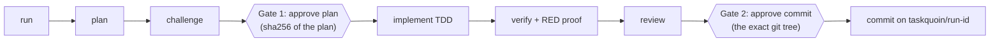
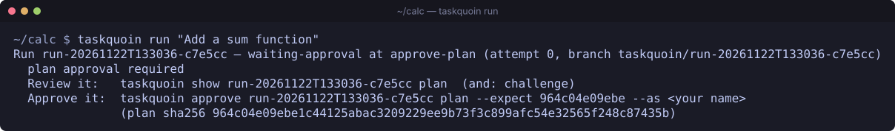
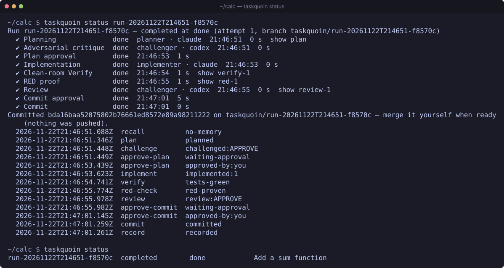
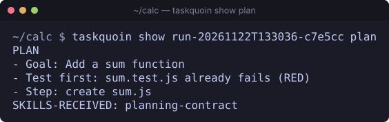
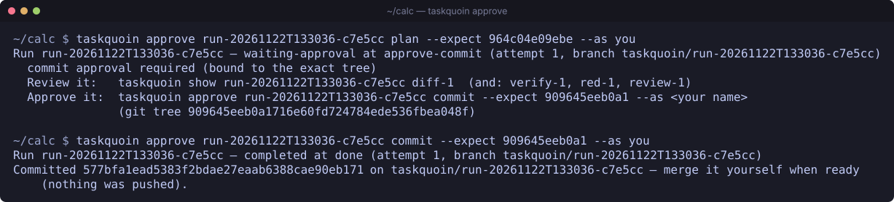
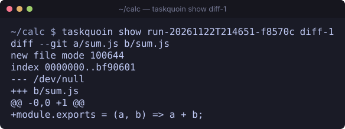
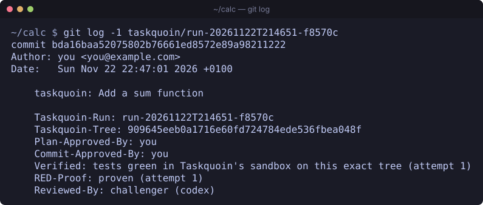

# Approvals

A Taskquoin run stops twice and waits for you. The first stop approves the **plan**; the second approves the
**commit**. Each approval is not a vague "go ahead": it is bound to a hash of exactly what you were shown, so you can
only ever approve what you read, and anything that changes afterwards invalidates your approval.

- [The two gates](#the-two-gates)
- [What is bound](#what-is-bound)
- [The flow: status, show, approve](#the-flow-status-show-approve)
- [Approving in the console](#approving-in-the-console)
- [Refusals](#refusals)
- [What an approval records](#what-an-approval-records)
- [Resume](#resume)
- [Learn more](#learn-more)



## The two gates

| Gate | When | You are approving | Name in the CLI |
|---|---|---|---|
| Plan | after the Architect's plan and the Reviewer's challenge | the work the Developer will be allowed to do | `plan` |
| Commit | after the tests passed in the clean room, the RED proof held and the reviewers approved | the exact change that will be committed | `commit` |

Between the gates, nothing needs you: Taskquoin retries failing tests and reviewer refusals by itself, within limits
(see [Verify and the RED proof](verify-and-red-proof.md#retries-and-their-limits)). The challenge is advice: it is
shown to you, and you decide.

## What is bound

- **Plan: the SHA-256 of the plan text.** If the plan were different, the hash would be different.
- **Commit: the exact git tree id** that passed the tests and the review. Taskquoin commits that tree with
  `git commit-tree`, so the commit is, byte for byte, what was verified, reviewed and approved. No repository hook
  runs on the host.

Because the commit approval is bound to a tree, not to "the diff at the moment you looked", an edit made after your
approval cannot slip in.

## The flow: status, show, approve

Start the run. It stops at the plan gate:

```shell
$ taskquoin run "Add a sum function"
```



`status` lists runs, or shows one run with its history and **the exact approval command**, including the hash:

```shell
$ taskquoin status run-20261122T132559-8697a2
Run run-20261122T132559-8697a2 — waiting-approval at approve-plan (attempt 0, branch taskquoin/run-20261122T132559-8697a2)
  plan approval required
  Review it:   taskquoin show run-20261122T132559-8697a2 plan  (and: challenge)
  Approve it:  taskquoin approve run-20261122T132559-8697a2 plan --expect 964c04e09ebe --as <your name>
               (plan sha256 964c04e09ebe1c44125abac3209229ee9b73f3c899afc54e32565f248c87435b)
```



Read what you are approving with `show`. Without an artifact name it lists what exists:

```shell
$ taskquoin show run-20261122T132559-8697a2 plan
$ taskquoin show run-20261122T132559-8697a2 challenge
```



Then approve, naming the hash you read (at least 12 hexadecimal characters, copied from `status`) and your name:

```shell
$ taskquoin approve run-20261122T132559-8697a2 plan --expect 964c04e09ebe --as alice
```

The run continues: the Developer implements, Taskquoin verifies, the reviewers review, and it stops again at the
commit gate. The artifacts to read there are `diff-N`, `verify-N`, `red-N`, `review-N` and, if present, `ignored-N`:

```shell
$ taskquoin show run-20261122T132559-8697a2 diff-1
$ taskquoin show run-20261122T132559-8697a2 verify-1
$ taskquoin show run-20261122T132559-8697a2 red-1
$ taskquoin show run-20261122T132559-8697a2 review-1
$ taskquoin approve run-20261122T132559-8697a2 commit --expect 909645eeb0a1 --as alice
```





You must be on the run's branch (`taskquoin/<run id>`, created by `run`) to approve the commit. When it completes:

```
Committed <commit> on taskquoin/<run id> — merge it yourself when ready (nothing was pushed).
```



Screens come from a demo repository with simulated AI agents (the test doubles of Taskquoin's own test suite); every
command is the real Taskquoin CLI.

> [!IMPORTANT]
> Taskquoin never pushes and never opens a pull request. Merge the branch yourself, and run your repository's commit
> hooks then: Taskquoin does not execute them.

## Approving in the console

`taskquoin` with no arguments opens the interactive console. It starts nothing unless a line begins with `/`:

```
taskquoin › /run Add a sum function
taskquoin › /show plan
taskquoin › /approve plan
To approve: plan of run run-… — hash 964c04e09ebe
Retype 964c04e09ebe to approve (Enter to cancel):
```

`/approve` asks for your name once per session, shows the hash, and approves **only when you retype that hash**. Enter
cancels; a different hash prints `the hash does not match: nothing is approved.` Your name is recorded as
`<name> (via taskquoin console)`.


The console is never installed as commands inside Claude Code or Codex: a model must not be able to type your
approvals. The real boundary is the control store, which agents cannot write.

## Refusals

Approval fails closed. Each message below is exact.

| You see | Why | What to do |
|---|---|---|
| `expected 000000000000 does not match the pending artifact 964c04e09ebe… — re-read it before approving` | the hash is not the pending one | read with `show`, copy the hash from `status` |
| `the expected hash must have at least 12 hex characters (copy it from taskquoin status)` | too short, or not hexadecimal | copy it from `status` |
| `run <id> is not waiting for approve-plan (status failed, at challenge)` | the run is not at that gate (failed, already approved, or the other gate) | `taskquoin status <run>` |
| `switch to taskquoin/<run id> first` | you are on another branch | `git switch taskquoin/<run id>` |
| `taskquoin.yaml changed since the run started — start a new run` | the configuration's digest differs from the one recorded at the start | start a new run |
| `working tree changed after approval — re-verified and re-reviewed; approve the new tree` | the tree changed after you approved the commit (see below) | read the new `diff-N`, approve the new hash |
| `agent <id> cannot start — <reasons>` | a judge cannot run now (missing key, unconnected provider) | fix it, then approve again |

The refusals for a wrong hash and another branch happen **before** anything changes.

### A tree that changed after approval

Right before committing, Taskquoin recomputes the tree of the working directory. If it is not the tree you approved,
your approval is **discarded**, the change is verified again and reviewed again, and the run stops at the commit gate
with a new hash. In this second round there are no more automatic reworks: you read the new `diff-N` and decide.

## What an approval records

- In the run state (in the control store, outside the repository): `approvedBy`, the time, and the bound hash, for each gate, plus an
  `approval` event in the run's log. `approvedBy` is the `--as` value, or `<name> (via taskquoin console)`.
- In the commit message, as trailers:

```
taskquoin: Add a sum function

Taskquoin-Run: run-20261122T132559-8697a2
Taskquoin-Tree: 909645eeb0a1716e60fd724784ede536fbea048f
Plan-Approved-By: alice
Commit-Approved-By: alice
Verified: tests green in Taskquoin's sandbox on this exact tree (attempt 1)
RED-Proof: proven (attempt 1)
Reviewed-By: challenger (codex)
```

`RED-Proof:` reads `not applicable (only files classified as tests changed)` when the change only touched test files.
`--as` is a label you type, not an identity check: Taskquoin runs as you, on your machine.

## Resume

A technical error (a git or disk failure, a judge's API being down) leaves the run `interrupted`, with a state you can
continue:

```shell
$ taskquoin resume run-20261122T132559-8697a2
```

Resume re-checks the branch and the configuration digest, then continues from the node where the run stopped; judges
that already answered are not asked (or paid) again. Only an `interrupted` run can be resumed: `failed` and
`needs-human` runs cannot. For `needs-human`, take over on the run's branch or start a new run with a more precise request.

## Learn more

- [Verify and the RED proof](verify-and-red-proof.md): what stands behind the second approval.
- [Best practices](best-practices.md#read-before-you-approve).
- [Troubleshooting](troubleshooting.md).
- [ADR-0013: tree-based governance](../adr/0013-tree-based-governance.md), [ADR-0011: agents never commit](../adr/0011-agents-never-commit.md), [ADR-0015: the console is human-only](../adr/0015-console-human-only.md).
