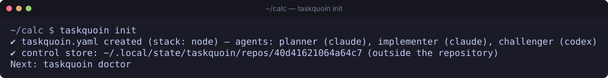
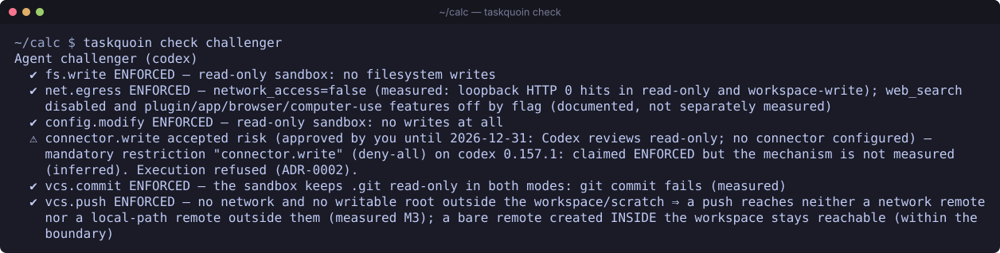

# Configuration

Everything Taskquoin does in a project is described by one file at the root of the repository: `taskquoin.yaml`. It
says which agents exist, which AI runs each of them, what each one may do, who judges the plan and the diff, and which
command proves that the tests pass. `taskquoin init` writes a working file for you; this page explains every key so
you can change it with confidence.

The file is strict and fail-closed: an unknown key, a wrong type or a missing agent is an error, never a silent
default. It is also **protected**: agents can never edit it.

- [Create the file](#create-the-file)
- [A complete annotated example](#a-complete-annotated-example)
- [The keys, step by step](#the-keys-step-by-step)
- [The protected file rule](#the-protected-file-rule)
- [Validate your configuration](#validate-your-configuration)
- [Learn more](#learn-more)

## Create the file

Run `init` once, in a git repository, from a clean tree:

```shell
$ taskquoin init
```



`init` detects your stack from the project files (`package.json` gives `node`, `composer.json` gives `php`,
`pyproject.toml`, `requirements.txt` or `setup.py` give `python`, `go.mod` gives `go`, `pom.xml` gives `java-maven`,
`build.gradle[.kts]` gives `java-gradle`, anything else gives `unknown`) and looks at which agent CLIs are installed:

| Installed on this machine | What `init` writes |
|---|---|
| Claude Code and Codex | planner and implementer on `claude`, challenger on `codex` |
| Claude Code only | all three on `claude` (the reviewer is the same model as the implementer: `doctor` warns you) |
| OpenCode only | all three on `opencode`, with a `model` and a `verify.command` |

`init` never overwrites an existing file. It also creates the **control store**, a directory outside your repository
where Taskquoin keeps run state, artifacts and risk acceptances. Agents cannot write there.

> [!NOTE]
> `init` only looks at which key variables exist in your environment (`DEEPSEEK_API_KEY`, `MISTRAL_API_KEY`,
> `OPENROUTER_API_KEY`, `GEMINI_API_KEY`, `OPENAI_API_KEY`, `ANTHROPIC_API_KEY`) and at a local Ollama. It never reads
> a key value into the file. What it detects is added as **comments**: uncommenting them is your consent to send the
> project's code to that provider.

Commit the file before your first run (`run` refuses a dirty tree):

```shell
$ git add taskquoin.yaml && git commit -m "chore: taskquoin"
```

## A complete annotated example

This is what `taskquoin init` writes for a Node project when Claude Code and Codex are installed (comments added
here for explanation; the real file has one header comment). The `verify` and `workflow` sections are optional and
are not written by default; they appear below because you will often add them.

```yaml
# Taskquoin project configuration. Protected: agents can never edit this file.
version: 1                      # the only schema version
stack: node                     # node | php | python | go | java-maven | java-gradle | unknown

agents:
  planner:                      # the Architect: reads the repository, writes the plan
    runtime: claude             # claude | codex | opencode | api
    description: "Read-only planner: turns a request into a minimal, test-first implementation plan."
    prompt: You plan; you never modify files. Read the repository, then produce the plan requested.
    capabilities:
      fs.read: ["**"]           # the only thing a planner may be granted
    maxTurns: 30                # agent loop bound, 1..200
    skills: [planning-contract] # first-party skills added to the agent's instructions

  implementer:                  # the Developer: strict TDD, never commits
    runtime: claude
    description: Implements an approved task with strict TDD (RED → GREEN → REFACTOR).
    prompt: "You implement exactly the approved task. Write a failing test first, make it pass with the simplest change, then refactor. Never commit: Taskquoin verifies and commits."
    capabilities:
      fs.read: ["**"]
      fs.write: ["**"]
      shell.run:                # commands the agent may run; the first one is the full suite
        - npm test
        - npm test -- *
        - node --test *
    maxTurns: 40
    skills: [tdd]

  challenger:                   # the Reviewer: independent, read-only
    runtime: codex
    description: Independent, read-only adversarial reviewer of plans and diffs.
    prompt: "You are an independent reviewer. Challenge the plan or diff: correctness, security, missing tests, over-engineering. Report blocking and non-blocking findings with file:line. Do not modify files."
    capabilities:
      fs.read: ["**"]
    skills: [code-review]

policy:
  mandatory:                    # restrictions that MUST be enforced, for every agent
    - fs.write
    - net.egress
    - config.modify
    - connector.write
    - vcs.commit
    - vcs.push

connectors: {}                  # remote services (none by default)
memory:
  claudeMem:
    enabled: true               # a summary of each finished run goes to your local claude-mem

# Optional sections, not written by default:
verify:
  inherit: [dist]               # extra ignored paths carried into the clean room, read-only
  command: npm test             # the command Verify runs (default: the implementer's first shell.run)
workflow:
  challengers: [challenger]     # who challenges the plan
  reviewers: [challenger]       # who reviews the diff; every reviewer must APPROVE
```

> [!NOTE]
> `memory.claudeMem.enabled` is `true` in a file written by `init`. If no claude-mem worker is running, runs proceed
> without memory (`doctor` says so).

## The keys, step by step

### `version`

Always `1`. Any other value is refused.

### `stack`

One of `node`, `php`, `python`, `go`, `java-maven`, `java-gradle`, `unknown`. It decides two defaults:

| Stack | Test commands `init` grants the implementer | Dependency directories carried into Verify |
|---|---|---|
| `node` | `npm test`, `npm test -- *`, `node --test *` | `**/node_modules` |
| `php` | `vendor/bin/phpunit`, `vendor/bin/phpunit *` | `vendor` |
| `python` | `pytest`, `pytest *` | `.venv`, `venv` |
| `go` | `go test ./...`, `go test *` | none |
| `java-maven` | `mvn -q test`, `mvn -q test *` | none |
| `java-gradle` | `./gradlew test`, `./gradlew test *` | none |
| `unknown` | none | none |

With `unknown`, set `verify.command` yourself, or Verify has nothing to run and fails closed.

### `agents`

A mapping from an agent id (lowercase letters, digits and hyphens, starting with a letter, 48 characters at most) to
its definition. Two ids are required: `planner` and `implementer`. Any other agent can be a judge (see
[`workflow`](#workflow)). The default judge is called `challenger`.

| Key | Required | Meaning |
|---|---|---|
| `runtime` | yes | `claude`, `codex`, `opencode` or `api`. See [Agents and runtimes](agents-and-runtimes.md). |
| `description` | yes | One line, shown to the agent and in the console. |
| `prompt` | yes | The agent's standing instructions. |
| `capabilities` | yes | What the agent may do (below). Use `{}` for an `api` judge. |
| `model` | `opencode` only | `<provider>/<model>`, for example `openai/gpt-6-astra`. Optional for `claude` and `codex`. |
| `provider` | `api` only | The id of an entry in `providers`. |
| `maxTurns` | no | Integer from 1 to 200. Not allowed on `api` judges (one request, one answer). |
| `skills` | no | Skill names (lowercase, hyphens). Run `taskquoin skills list` to see them. |

**Capabilities** map a capability name to a list of globs or command patterns. The known names are `fs.read`,
`fs.write`, `shell.run`, `net.egress`, `vcs.commit`, `vcs.push`, `connector.read`, `connector.write` and
`config.modify`. An unknown name is an error.

Some rules are checked when the configuration is read, others when a run starts:

- `planner` and every judge must stay read-only. If one is granted `fs.write`, `shell.run`, `net.egress`,
  `vcs.commit`, `vcs.push`, `connector.write` or `config.modify`, the run refuses with `agent <id> must be read-only (it plans or reviews independently) but is granted <list>`.
- `planner` and `implementer` cannot use `runtime: api` (an API judge has no tools).
- An `opencode` agent may hold only `fs.read` and `fs.write`, and has no commands. If the implementer is on
  OpenCode, `verify.command` is required.
- Per-glob scope on `fs.write` is not enforceable for subprocesses, so the implementer is granted `"**"` and the
  protected files stay denied regardless (see [below](#the-protected-file-rule)).

### `policy`

```yaml
policy:
  mandatory: [fs.write, net.egress, config.modify, connector.write, vcs.commit, vcs.push]
```

`mandatory` lists capabilities whose restriction must be **enforced** (not merely advised) on every agent. The six
above are a built-in floor: you can add more capabilities to the list, but removing one has no effect, because the
floor always applies. An agent whose restriction cannot be enforced on this machine is refused (see
[`doctor`](#validate-your-configuration)).

> [!IMPORTANT]
> `policy.exceptions` is rejected: `risk acceptances are not read from the repository`. An exception recorded in a
> file that agents could influence would defeat the point. Use [`taskquoin accept-risk`](agents-and-runtimes.md#accepted-risks),
> which stores the decision outside the repository.

### `workflow`

```yaml
workflow:
  challengers: [challenger]
  reviewers: [challenger, security]
```

`challengers` critique the plan before you approve it; `reviewers` review the diff before you approve the commit.
Each list needs at least one existing agent, with no duplicates. **Every reviewer must APPROVE**; a missing or
malformed `VERDICT` line counts as `CHANGES_REQUESTED`. Without a `workflow` section, the `challenger` agent does both
jobs.

### `providers`

A provider is an OpenAI-compatible chat API that may receive this project's code. **Listing it here is the project's
consent.** Providers serve `runtime: api` judges.

```yaml
providers:
  deepseek:
    url: https://api.deepseek.com/v1
    model: deepseek-chat
    key: env:DEEPSEEK_API_KEY      # a reference, never the key itself
  local:
    url: http://localhost:11434/v1 # Ollama: nothing leaves the machine
    model: qwen2.5-coder:7b
agents:
  security:
    runtime: api
    provider: deepseek
    description: Independent security review of the diff
    prompt: You are an independent security reviewer of the diff. Report every security defect with file:line and a fix.
    capabilities: {}
    skills: [security-review]
```

| Key | Default | Rules |
|---|---|---|
| `url` | required | `https` only (plain `http` is accepted for `localhost`, `127.0.0.1` and `[::1]`); no credentials, query string or fragment in the URL. |
| `model` | required | The model id at the provider. |
| `key` | none | `env:NAME`. Omit it for a keyless local provider. The key stays in your environment. |
| `maxOutputTokens` | `4000` | 1 to 1,000,000. Reasoning models need room: raise it (`init` suggests `16000` for OpenAI). |
| `timeoutSeconds` | `300` | 1 to 3600. |
| `tokenField` | `max_tokens` | `max_tokens` or `max_completion_tokens` (OpenAI's newer models). |
| `maxInputChars` | none | 1000 to 50,000,000. A request longer than this is refused before anything is sent. |

If the key variable is missing at run time, the run refuses to start. An API judge never sees secrets or binary
files: they are replaced by placeholders in what it receives.

### `verify`

```yaml
verify:
  inherit:
    - dist
  command: npm test
```

Verify runs your tests in a [clean room](verify-and-red-proof.md). Only the stack's dependency directories are
carried in. If your tests need another ignored path (a built `dist/`, a `.env.test`), add it to `inherit`: it is
mounted read-only and frozen for agents. Entries must be relative paths inside the repository; `.git`, absolute
paths, `..` and "everything" (`**`) are refused.

`command` is the command Verify (and the RED proof) runs. When absent, Taskquoin uses the implementer's first
`shell.run` entry. It is required when the implementer is on OpenCode.

### `connectors`

Remote services (a tracker, a forge) reached through Taskquoin's broker, never directly by an agent. Empty by default.

```yaml
connectors:
  tracker:
    host: tracker.example.com
    scope: project-x
    read: [issues.get]
    write: []
    credentialRef: env:TRACKER_TOKEN   # env:NAME or keychain:NAME, never the secret
```

`host` must be a plain hostname. `read` and `write` list explicit operations. See
[ADR-0012](../adr/0012-remote-connectors-by-exception.md): remote connectors are an exception, and `doctor` lists
every configured connector.

### `memory`

```yaml
memory:
  claudeMem:
    enabled: true
```

When enabled and a local claude-mem worker is running, Taskquoin recalls relevant memories before planning and
records a structured summary of each finished run. `doctor` refuses memory that is not local-only. See
[ADR-0009](../adr/0009-claude-mem-as-memory.md).

## The protected file rule

`taskquoin.yaml` is on Taskquoin's list of protected paths, together with `.claude/`, `.codex/`, `.agents/`,
`.taskquoin/`, `.git/`, `CLAUDE.md` and `AGENTS.md` (at any depth), `.mcp.json`, CI and hook configuration
(`.github/workflows/`, `.gitlab-ci.yml`, `.husky/`, `.pre-commit-config.yaml`, `lefthook.yml`), `.gitattributes`,
`.gitmodules`, and OpenCode's own configuration. The rule has three layers:

1. **Write time.** Runtimes are configured so agents cannot write these paths (the Claude sandbox denies the writes; read-only roles cannot write at all).
2. **Landing time.** Whatever an agent did, a change to a protected path is never committed. The run stops as
   `needs-human` with `protected configuration changed: <paths> — Taskquoin never commits such changes`.
3. **Run time.** Taskquoin records a SHA-256 digest of `taskquoin.yaml` when a run starts. `approve` and `resume`
   refuse if it differs: `taskquoin.yaml changed since the run started — start a new run`.

So the policy a run started under is the policy it finishes under. To change the configuration, change it yourself,
commit it, and start a new run.

## Validate your configuration

Two commands validate the file. Both parse it strictly first, so a mistake is reported with its exact path:

```shell
$ taskquoin doctor
taskquoin: config.agents.planner.maxTurns: expected an integer 1..200
```

When the file is valid, `doctor` checks the whole machine and every agent; `check <agent>` does the same for one
agent, and `check <agent> --json` prints the machine-readable result for scripts and CI.

```shell
$ taskquoin doctor
```


`doctor` prints, in order: the three runtimes with their version (`✔` when it is the measured version), the sandboxes
(bubblewrap and socat), the PreToolUse hook entry, **where this project's code is sent**, connectors, memory, then
each agent with one line per mandatory restriction, and a final verdict. It exits with status 1 when at least one
agent cannot run. See [Agents and runtimes](agents-and-runtimes.md#what-doctor-and-check-print) for how to read it.

```shell
$ taskquoin check challenger
```



Screens come from a demo repository with simulated AI agents (the test doubles of Taskquoin's own test suite); every
command is the real Taskquoin CLI.

## Learn more

- [Agents and runtimes](agents-and-runtimes.md): what each runtime can do and how it is sandboxed.
- [Approvals](approvals.md) and [Verify and the RED proof](verify-and-red-proof.md).
- [Troubleshooting](troubleshooting.md): every refusal message and its fix.
- [ADR-0002: enforcement classes](../adr/0002-enforcement-classes.md), [ADR-0014: clean-room Verify](../adr/0014-verify-in-a-clean-room.md), [ADR-0016: judges by API](../adr/0016-judges-by-api.md), [ADR-0017: OpenCode without commands](../adr/0017-opencode-without-commands.md).
