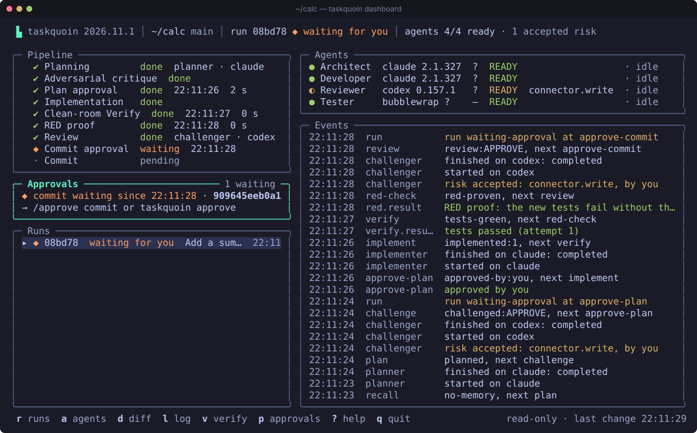
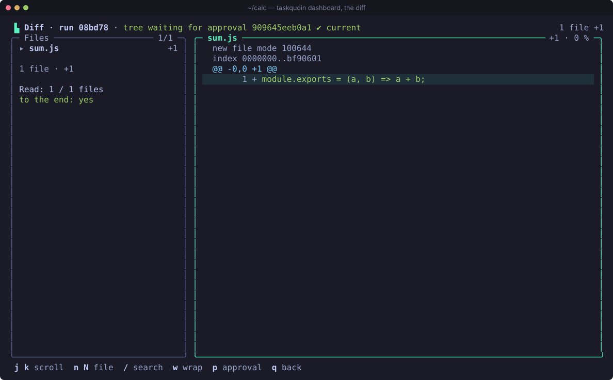
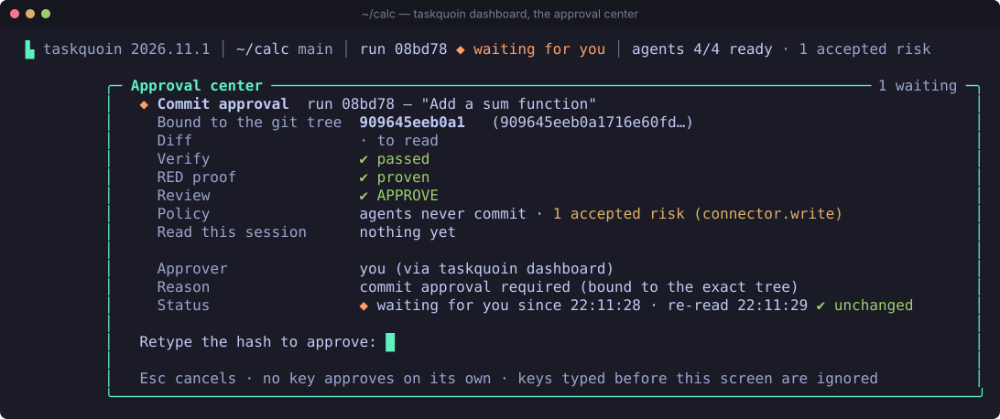

# The Dashboard

The Dashboard is a live screen for watching a run: where it is, what it waits for, which agents work, what the log says,
and what the diff really contains before you approve it. It **reads** the control store and draws it; it never writes
it. The one thing it can start — and only after you retype a hash — is the ordinary `taskquoin approve`, in a separate
process.

- [What it is for](#what-it-is-for)
- [Opening it](#opening-it)
- [Layouts](#layouts)
- [The panels](#the-panels)
- [Keys](#keys)
- [The diff and artifact viewer](#the-diff-and-artifact-viewer)
- [The approval center](#the-approval-center)
- [Read-only guarantees](#read-only-guarantees)
- [Live updates](#live-updates)
- [Colours, plain terminals and no terminal](#colours-plain-terminals-and-no-terminal)
- [Text from outside is neutralised](#text-from-outside-is-neutralised)
- [Performance](#performance)
- [Troubleshooting](#troubleshooting)
- [Learn more](#learn-more)

> [!NOTE]
> Screens come from a demo repository with simulated AI agents (the test doubles of Taskquoin's own test suite); every
> frame is drawn by the Dashboard's own renderers over the demo's real control store.



## What it is for

`taskquoin status` and `taskquoin show` answer one question each and exit. The Dashboard keeps the answers on screen
while a run moves: you see a gate appear, you read the diff in a viewer that remembers what you read, and you approve
from the same screen — by typing the hash, as everywhere else in Taskquoin ([Approvals](approvals.md)).

It replaces nothing: every state it shows is the control store's, and every command it names (`taskquoin approve`,
`taskquoin resume`, `taskquoin show`) works the same outside it.

## Opening it

```console
$ taskquoin dashboard [<run>]
```

From the [console](../getting-started/console.md), `/dashboard` opens the same screen in its own process on the run
selected in the console (none: as below), then the console draws its prompt again.

- Without a run, the Dashboard selects the newest run that is running or waiting for approval, else the newest run.
- With a run id, it opens on that run; an unknown id fails (`unknown run <id>`, exit `1`).
- Quit with `q` or `Ctrl-C`: exit `0`.

It needs a repository with a `taskquoin.yaml`, a control store (start a run first), and an interactive terminal.
Without a store it prints `no control store for this repository yet — start a run with taskquoin run` and exits `1`;
without a terminal it prints a refusal that names `taskquoin status` and exits `1` ([below](#colours-plain-terminals-and-no-terminal)).

## Layouts

The layout follows the size of the terminal, and changes while you resize it.

| Terminal | Layout |
|---|---|
| 120 columns × 30 rows or more | **Wide**: Pipeline, Approvals and Runs on the left; Agents and Events on the right |
| 80 to 119 columns (or 120 or more with fewer than 30 rows), at least 12 rows | **Stacked**: Pipeline and Approvals, then one lower panel with tabs (Runs, Agents, Events) |
| 40 to 79 columns, at least 12 rows | **Narrow**: no borders, a one-line header with the run and what it waits for, one panel at a time |
| Under 40 columns or 12 rows | One message: `Taskquoin dashboard needs 40 × 12 — this terminal is <columns> × <rows>. Enlarge it, or use: taskquoin status` |

Enlarging the terminal brings the panels back; the Dashboard redraws every row once after a resize.

## The panels

Every state is a glyph **and** a word, never a colour alone: `●` ready, `◐` ready with an accepted risk, `○` blocked,
`◉` running, `◆` waiting for you, `✔` done, `✖` failed, `‖` interrupted, `·` pending, `?` unknown (`[ok] [~] [x] [>] [!]
[v] [x] [=] [ ] [?]` on an ASCII terminal).

| Panel | Shows |
|---|---|
| Header | version, repository, branch, the selected run and its status, `agents <ready>/<total> ready`, the accepted risks in force |
| **Pipeline** | the steps of the selected run — planning, critique, plan approval, implementation, clean-room Verify, RED proof, review, commit approval, commit — each with its state, agent, time and duration; a retry adds a nested line. A count of neutralised characters appears in its title when there is one |
| **Approvals** | the human's next action for the selected run: the waiting gate, since when, and the first 12 characters of its hash; for a failed, needs-human or interrupted run, the reason and the command (`taskquoin resume <run>`); the commit once done; otherwise `none waiting` |
| **Runs** | the 50 newest runs: state, short id, request, start time; the selected run is marked `▸`; moving the cursor selects the run |
| **Agents** | each agent of the squad: role, runtime and version, last model recorded for this run (`?` when none, `—` when it does not apply), `READY` or `NOT READY` from the agent's own gate, its note, and `working · <time>` or `idle` |
| **Events** | the run's log, newest first: `HH:MM:SS  subject  text`. Hostile characters, unreadable lines and older events not shown are counted on screen |
| Footer | the keys, then `read-only · last change HH:MM:SS` (or a red `read failed HH:MM:SS`) |

A run that the store says is running but whose process is gone is shown `? not running?` with `taskquoin resume <run>`,
never `◉ running`.

## Keys

This is the table of the help overlay (`?`); the loop is tested against it, so help cannot name a key that does nothing.
Upper case equals lower case, except `G`.

| Key | Does |
|---|---|
| `r` | focus Runs (the Runs tab when stacked) |
| `a` | focus Agents |
| `l` | focus Events (the log) |
| `d` | open the diff viewer |
| `v` | open the Verify viewer |
| `p` | open the approval center for the selected run's waiting gate; with none waiting, focus Approvals (`none waiting`) |
| `?` | help |
| `q` | quit |
| `Tab` | next panel (Pipeline, Approvals, Runs, Agents, Events) |
| `Shift+Tab` | previous |
| `j` `k` | move down, up |
| `g` `G` | top, bottom |
| `PgUp` `PgDn` | page (10 rows) |
| `Esc` | close help, clear a notice |

`Ctrl-C` quits like `q` (it closes help first when help is open). Arrow keys, `Home` and `End` move like `j k g G`. A
paste does nothing here. **No key approves.**

## The diff and artifact viewer

`d` opens the diff of the selected run — or its plan and challenge when it waits at the plan gate or has no diff yet —
and `v` opens its latest Verify result and RED proof. Files are listed on the left (`+added −removed`), the text on the
right with line numbers (old and new for a diff) and coloured `+` and `−` lines.

| Key | Does |
|---|---|
| `j` `k` | scroll |
| `g` `G` | top, bottom |
| `PgUp` `PgDn` | page |
| `/` | search: type the text (case-insensitive, 100 characters at most); matches are found as you type; `Enter` keeps the search, `Esc` clears it |
| `n` `N` | next / previous match; with no search, next / previous file |
| `w` | wrap long lines |
| `d` `v` | switch to the other viewer |
| `p` | the approval center |
| `?` | help |
| `q` `Esc` | back |



- **Read to the end.** A file counts as read once its last line was on screen. The side panel shows
  `Read: <k> / <n> files` and `to the end: yes|no`; the approval center lists what you read in this session.
- **The binding.** At the commit gate the header says which tree the diff belongs to: `tree waiting for approval
  <hash> ✔ current`.
- **The stale marker.** If the tree waiting for approval, or the artifact itself, changes while the viewer is open, the
  marker turns red: `✖ changed since opened — d reloads`. Press `d` to read what is now waiting.
- **Limits.** An artifact over 4 MiB is not loaded (`too large for the viewer: taskquoin show <run> <artifact>`); an
  artifact that does not match its hash is not shown; a document keeps its first 100 000 lines and each line its first
  20 000 characters, and says so on screen. Binary files are listed but not shown.

## The approval center

The approval center is where the Dashboard hands your approval to Taskquoin. Open it with `p` (or `p` from a viewer)
while the selected run waits at a gate.



1. **Nothing approves on a key.** `y`, `Enter`, `Space` and every other key do nothing in the main view. Keys typed
   before the center is on screen are ignored.
2. **Your name** is asked once per session (not empty, 64 characters at most, never starting with `/` or `-`, no
   control or invisible character) and recorded as `<name> (via taskquoin dashboard)`. It is never read from the system.
3. **Retype the 12 characters** of the hash shown, one key at a time, then press `Enter`. A paste, or several keys in
   one chunk, fills the field but never submits. A wrong hash clears the field and approves nothing; an empty field
   cancels.
4. **The binding is read again** from the store when the center opens, when the hash step starts, and after your last
   keystroke. If the gate has gone, or its hash changed, nothing is sent: `Refused: the tree changed since it was
   shown` (or `the plan`), then `Nothing was approved. Read the new diff: d`.
5. **`Esc` cancels** at any step: `Cancelled: nothing was approved.` One exception: below 40 × 12 the center shows only
   the too-small message and drops every key, `Esc`, `q` and `Ctrl-C` included — enlarge the terminal first; what
   you had typed is still there.

Once the hash is right, the Dashboard starts `taskquoin approve <run> <gate> --expect=<hash> --as="<name> (via taskquoin
dashboard)"` **in a separate process** (no shell; detached; its output goes to a private log file, mode `0600` in a
`0700` temporary directory, never to a pipe a closing Dashboard could break) — the same command you would type. All its
checks apply as usual. Then the Dashboard only watches:

| Line | Meaning |
|---|---|
| `◉ taskquoin approve started (pid N) — waiting for it to record the approval` | the process was started |
| `✔ approved by <name> at HH:MM:SS · the run continues (pid N) until its next gate; this dashboard only watches` | the approval is in the store (an `approval` event for that gate, that hash and that approver) |
| `✖ taskquoin approve refused (exit N)`, the last 3 lines of its log, `nothing was approved` | the process ended and recorded nothing (a busy run, a changed gate…) |

If `taskquoin approve` exits non-zero **after** the approval was recorded, the screen still says approved: the run's
later failure shows in Pipeline. An approval recorded by any process this Dashboard started is reported, even after a
later one (for another run) was refused. Pressing `p` again on a run whose approval is still in flight shows that
approval's line; it never starts a second process.

**Quitting keeps the run going — and says so.** The approved run continues in its own process until its next gate. If
you press `q` or `Ctrl-C` while that process is alive, the Dashboard asks first: `The run <short> continues in process
<pid> until its next gate — quitting does not stop it · q quit · Esc stay`. After the terminal is restored, it prints
the run, the pid and the log path on stderr.

## Read-only guarantees

- The Dashboard opens the control store **read-only**: it creates no directory, takes no lock, writes no file, and
  never opens a run's lock for writing. It stats files and reads one when its stamp changed, except for three reads
  made on every 500 ms poll whatever the stamps say: while the approval center asks for the hash, that run's
  `state.json` (the binding, re-checked); while an approval started here waits to be recorded, that run's
  `state.json` and `events.jsonl`; while the selected run is running, its `lock` file (the pid whose process is
  checked).
- Each file is opened once, never through a symbolic link and never blocking: a FIFO, a device or a link in the store
  is unreadable, and the Dashboard goes on. A `state.json` whose fields have the wrong types, that names another run,
  or whose binding is not a hash is an `unreadable` run.
- This is proven, not promised: the test suite runs the real loop under `node --permission --allow-fs-read=*` — a
  process that cannot write anything to disk — over a seeded store, browsing every run, every panel and the help.
  Opening and cancelling the approval center is part of that run.
- At start-up, before its first frame, it runs the same host checks as the console: the runtimes' `--version` and
  `git rev-parse --show-toplevel` (the host probe), the sandbox check (`bwrap`), and `git branch --show-current` and
  `git status --porcelain`. After that it starts no process except `taskquoin approve`, and only from the approval
  center after the hash was retyped.
- Nothing it does on a timer, a poll or a resize can approve: only the retyped hash, at the Enter of the approval center.

## Live updates

- Every **500 ms** it checks the `state.json` stamps (modification time and size) of the newest runs and the
  `events.jsonl` size of the selected run. A file is read only when its stamp changed (except the three reads listed
  under the read-only guarantees), and a frame is drawn only when something changed.
- The selected run's last **1 000 events** are kept (newest first); older ones are not shown, and the panel says so.
  Lines that cannot be read are skipped and counted.
- While the selected run has a live running step, the elapsed times are redrawn once a second; an idle Dashboard writes
  nothing to the terminal.
- A held escape sequence is decoded 50 ms after the last input, so a bare `Esc` works.

## Colours, plain terminals and no terminal

- `NO_COLOR` (non-empty) turns colours off; every state keeps its glyph and its word. `TERM=dumb` and `TASKQUOIN_PLAIN=1`
  are not terminals for the Dashboard.
- A locale that is not UTF-8 draws with ASCII glyphs and marks (`[ok]`, `->`, `...`) instead of the Unicode ones.
- The Dashboard refuses to start without an interactive terminal on both input and output, under `TERM=dumb`, or in
  plain mode: `taskquoin dashboard needs an interactive terminal (and not TERM=dumb or plain mode). Use: taskquoin
  status`, exit `1`. This also holds from a pipe or a script.

## Text from outside is neutralised

A terminal executes what it prints. Everything from outside — an agent's text, a request, a file name, a diff, an
artifact, a reason — is made inert **once**, when it is read: every control, escape, bidirectional or invisible
character becomes a visible marker such as `‹ESC›` or `‹U+202E›`, and is counted. Nothing is stripped silently.
Counts appear in the Pipeline title (`N neutralised`), under an event (`N characters neutralised`) and on a file of the
viewer (`N characters neutralised in this file`).

## Performance

Measured by the test suite on the development machine; the tests assert a looser bound.

| What | Measured | Asserted |
|---|---|---|
| Drawing a frame at 120 × 40 over a store of 10 000 events | about 2.3 ms (p95) | under 5 ms |
| A key to the frame on screen, while a run appends an event every 10 ms | about 4 ms (p95) | under 50 ms |
| A static store, 5 000 ms after the first frame | 0 writes | 0 writes |
| A live running run, 5 000 ms | at most 5 frames, changed rows only | at most 5 |
| Heap over 100 000 event lines and 50 polls | under 20 MB growth | under 20 MB |

## Troubleshooting

| You see | Cause | Do |
|---|---|---|
| `no control store for this repository yet` | no run was ever started here | `taskquoin run "<request>"` |
| `needs an interactive terminal` | no TTY, `TERM=dumb`, or `TASKQUOIN_PLAIN=1` | use a terminal, or `taskquoin status` |
| `unknown run <id>` | the id is not in this repository's store | `taskquoin status` lists the runs |
| `Taskquoin dashboard needs 40 × 12` | the terminal is too small | enlarge it, or `taskquoin status` |
| `? not running?` on a run | the run says running but its process is gone | `taskquoin resume <run>` |
| a red `read failed HH:MM:SS` in the footer | the store could not be read at that time | the last good frame stays; it recovers on the next poll |
| `N unreadable lines skipped` in Events | `events.jsonl` has lines that are not valid events (a line being written is normal) | none needed; `taskquoin show` for the artifacts |
| `✖ changed since opened — d reloads` | the tree or artifact changed under the viewer | press `d` |
| `Refused: … changed since it was shown` | the gate changed between the screen and your Enter | read again with `d`, retype the new hash |
| `No longer waiting — approved or changed elsewhere` | someone approved from another terminal | nothing to approve here |
| `taskquoin approve refused (exit N)` | the separate process refused (for example the run is busy) | read the lines shown; nothing was approved |

## Learn more

- [Approvals](approvals.md) · [Console commands](../reference/console-commands.md) · [CLI reference](../reference/cli.md)
- [Security](security.md) · [Troubleshooting](troubleshooting.md) · [Architecture](../concepts/architecture.md)
