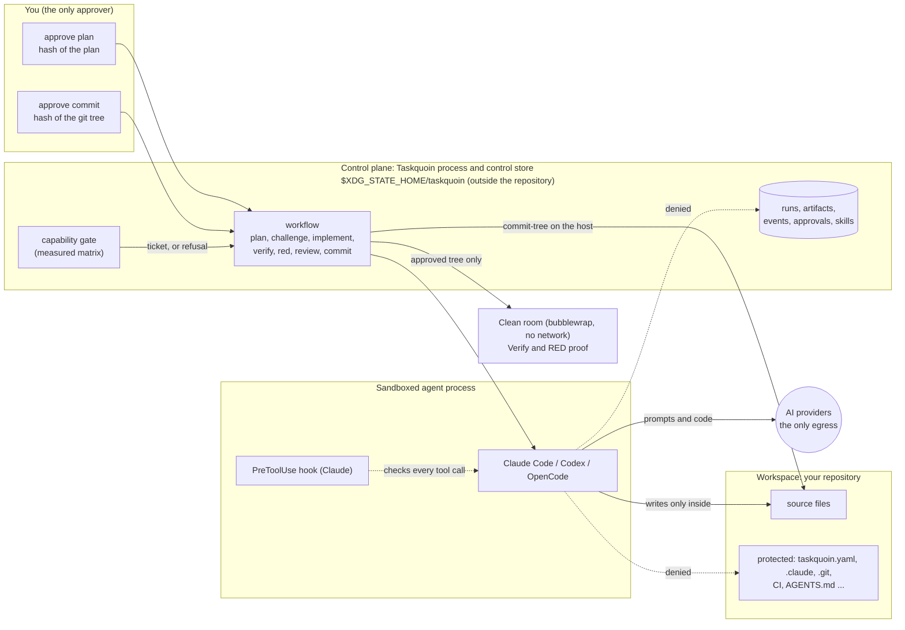
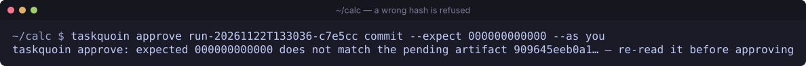
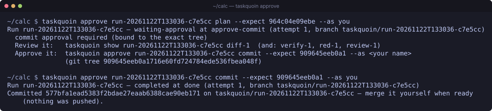
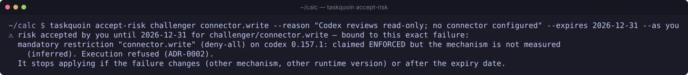

# Security

Taskquoin lets AI coding agents work on your repository without giving them the last word. This page explains the
security model step by step: what Taskquoin protects against (and what it does not), how every restriction is
classified as enforced or merely advisory, how that classification is measured, and which mechanisms stand between an
agent and your files, your secrets and your git history.

Taskquoin does not claim that a workflow is "secure". It tells you, for each restriction and each runtime version,
whether a mechanism really enforces it, refuses to start an agent when a mandatory restriction is not enforced, and
keeps every side effect behind a human approval.

- [1. The threat model](#1-the-threat-model)
- [2. Capabilities](#2-capabilities)
- [3. Enforcement classes: measured, not claimed](#3-enforcement-classes-measured-not-claimed)
- [4. The capability matrix and why an unmeasured version is refused](#4-the-capability-matrix-and-why-an-unmeasured-version-is-refused)
- [5. The sandboxes](#5-the-sandboxes)
- [6. The PreToolUse hook](#6-the-pretooluse-hook)
- [7. Secrets: never read, never sent](#7-secrets-never-read-never-sent)
- [8. No leak: only AI providers receive data](#8-no-leak-only-ai-providers-receive-data)
- [9. Agents never commit, humans decide](#9-agents-never-commit-humans-decide)
- [10. Accepted risks](#10-accepted-risks)
- [11. Skills quarantine](#11-skills-quarantine)
- [12. Untrusted text on your terminal](#12-untrusted-text-on-your-terminal)
- [13. Known limits](#13-known-limits)

> [!NOTE]
> Screens come from a demo repository with simulated AI agents (the test doubles of Taskquoin's own test suite); every
> command is the real Taskquoin CLI.

## 1. The threat model

Taskquoin runs AI agents (Claude Code, Codex, OpenCode, or a text-only judge reached through an API) on your
repository. The attackers it plans for are the ones an agent can meet or become:

| Threat | Example | Main controls |
|---|---|---|
| An agent exceeding its declared rights | The planner tries to write a file; the implementer tries `git commit` or `git push` | Capability gate, runtime sandbox, PreToolUse hook, landing gate |
| Hostile repository content | A test script or `package.json` script that reads `~/.ssh` or calls the network when `npm test` runs | OS sandbox without network, HOME hidden, clean-room Verify |
| Injected text | A file, an issue body or a remembered note that says "ignore your instructions" | Untrusted-data framing, fixed gate order, nothing runs without a human approval |
| A malicious skill | A skill that ships a hook, a script or a prompt-injection phrase | Quarantine outside the repository, deterministic audit, human approval, re-hash at every use |
| Misconfiguration | A mandatory restriction that the installed runtime cannot enforce; a runtime version nobody measured | Enforcement classes, `taskquoin doctor`, refusal to start |
| An agent editing its own rules | Changing `taskquoin.yaml`, `.claude/`, `AGENTS.md`, CI workflows, git hooks | Protected paths: denied at write time and never landed |

What Taskquoin does **not** protect against:

- **A hostile process running as your own OS user.** It already has your files and your credentials; no application
  can defend against it. If you need that boundary, use a separate user, a VM or a container
  ([ADR-0007](../adr/0007-human-decisions-2026-11-15.md), [ADR-0005](../adr/0005-control-plane-outside-workspace.md)).
- **The AI providers themselves.** The code the agents read is sent to the provider you configured (Anthropic for
  Claude Code, OpenAI for Codex, the host of each entry under `providers`). Taskquoin limits *who* receives your code and
  keeps secrets out of it; it cannot make a provider forget what it received. `taskquoin doctor` lists every destination.
- **A wrong human decision.** If you approve a bad plan or a bad diff, Taskquoin commits what you approved.
  Verification and review help you decide; they do not decide for you.
- **A test suite that does not test the change.** The RED proof shows that the changed tests depend on the production
  change, not that they assert the right behaviour ([ADR-0013](../adr/0013-tree-based-governance.md)).

The full attacker list is in [`docs/security/threat-model.md`](../security/threat-model.md).



The dotted lines are the boundaries an agent cannot cross: it cannot write your protected configuration, it cannot
touch the control store (so it cannot record an approval), and nothing but the AI providers receives data.

## 2. Capabilities

Every right an agent could have is one of nine **capabilities**. They are the same for every runtime, so a policy is
written once and enforced differently per runtime.

| Capability | What it grants | Mandatory by default |
|---|---|---|
| `fs.read` | Read files | no |
| `fs.write` | Write files | yes |
| `shell.run` | Run commands (scoped by patterns such as `npm test`) | no |
| `net.egress` | Reach the network | yes |
| `vcs.commit` | Create git commits | yes |
| `vcs.push` | Push to a remote | yes |
| `connector.read` | Read from a remote service (a connector) | no |
| `connector.write` | Change a remote service | yes |
| `config.modify` | Change protected configuration | yes |

You grant capabilities to an agent in `taskquoin.yaml`, with a scope (globs, command patterns). Anything not granted is
denied: a capability with no rule fails closed.

```yaml
agents:
  implementer:
    runtime: claude
    capabilities:
      fs.read: ["**"]
      fs.write: ["**"]
      shell.run: ["npm test", "npm test -- *"]   # only these commands
```

"Mandatory" means: *if the agent does not hold this capability, Taskquoin must be able to prove that the agent really
cannot use it.* The six mandatory capabilities form a built-in floor. `policy.mandatory` in `taskquoin.yaml` can add
capabilities to the floor but never remove one ([configuration reference](../reference/configuration.md#policy)).

## 3. Enforcement classes: measured, not claimed

For each restriction on each runtime, Taskquoin resolves one of four classes
([ADR-0002](../adr/0002-enforcement-classes.md)):

| Class | Meaning | Can certify a mandatory restriction? |
|---|---|---|
| `ENFORCED` | A mechanism outside the model's control prevents the action (an OS sandbox, a tool that is absent, a deny rule) | yes, if measured |
| `BROKERED` | The action is possible only through a Taskquoin broker that asks you first | yes, if measured |
| `ADVISORY` | The model is asked not to; nothing stops it | no |
| `UNSUPPORTED` | No known mechanism on this runtime version | no |

A label is not enough. Each entry of a runtime's matrix also records its **evidence level**
([ADR-0008](../adr/0008-evidence-is-bound-to-a-mechanism.md)):

| Evidence | Meaning |
|---|---|
| `measured` | A live contract test ran on the exact runtime version and cites its evidence file |
| `documented` | The vendor documents it; nobody measured it |
| `inferred` | Reasoning only |

Only `ENFORCED` or `BROKERED` **and** `measured`, with every machine-checked precondition satisfied, certifies a
mandatory restriction. Anything else on a mandatory restriction means the agent is refused. Changing a mechanism
(different flags, a different rule form) invalidates its evidence until it is measured again.

You can see the verdict for your machine:

```console
$ taskquoin check implementer
```


Each line is `✔ <capability> <class> — <mechanism>`. A refused agent looks like this:



## 4. The capability matrix and why an unmeasured version is refused

Each runtime adapter ships a `capabilities.json`: the **capability matrix**, measured on one runtime version at one
date. Entries are ordered variants; the first variant whose conditions match (sandbox mode, other granted capabilities,
scope of the grant) wins. The variants shipped today are listed in the
[capabilities reference](../reference/capabilities.md).

| Runtime | Version measured | Measured on |
|---|---|---|
| Claude Code | 2.1.327 | 2026-11-18 |
| Codex | 0.157.1 | 2026-11-15 |
| OpenCode | 1.19.5 | 2026-11-16 |
| `api` judge | 1 (by construction: no tools) | 2026-11-16 |

The installed runtime version must equal the measured version. If it does not, every mandatory restriction resolves to
`UNSUPPORTED` ("capability matrix measured for claude 2.1.327, installed 2.2.0") and the agent is refused. A runtime
update can silently change a sandbox flag or a default; Taskquoin never assumes the new version behaves like the old
one. `taskquoin doctor` shows `✔` next to a runtime whose version matches its matrix, and the measured version otherwise.

The matrix also knows how far a mechanism reaches. Claude's Bash sandbox, for instance, can confine writes to the
workspace but cannot enforce a per-glob scope for subprocesses. A restriction that needs a finer scope than the
mechanism holds for resolves to `ADVISORY`, and is refused if it is mandatory.

> [!IMPORTANT]
> Mandatory restrictions fail closed. When a mechanism is unmeasured, unavailable (for example no bubblewrap), or the
> version is unknown, the agent does not start. This is the intended behaviour, not a bug to work around. If you accept
> the risk yourself, see [accepted risks](#10-accepted-risks).

## 5. The sandboxes

Three different sandboxes are involved. They are listed here because they protect different things.

### Claude Code: the native Bash sandbox

When a Claude agent holds `shell.run`, Taskquoin turns on Claude Code's own OS sandbox (bubblewrap and socat on Linux)
for its Bash tool: an empty network allowlist, writes limited to the workspace, no unsandboxed escape, and
`failIfUnavailable`, so the run is refused if the sandbox cannot start. Protected configuration, `.git`, the control
store and every nested `CLAUDE.md` / `AGENTS.md` found by a workspace scan are denied for writing; secret files and the
control store are denied for reading. An agent without `shell.run` has no Bash, WebFetch or WebSearch tool at all
(`--tools` lists only what it may use), which is the strongest form of enforcement.

Claude is also started with no user or project settings (`--setting-sources ""`) and no MCP server, so your own plugins
and hooks, or a hostile `.claude/settings.json` in the repository, cannot widen what the agent may do.

### Codex: its own sandbox

Codex runs with `read-only` (agents without `fs.write`) or `workspace-write` (writes confined to the workspace plus a
per-run scratch directory outside the repository), network disabled, `.git` and `.codex/` read-only, and web search,
plugins, apps, browser and computer-use features turned off. Codex always has a shell, so `shell.run` and `fs.read` are
`ADVISORY` for it; that is why Codex is used here as a read-only reviewer.

### Taskquoin's own bubblewrap profile

Taskquoin builds its own bubblewrap sandbox for two jobs: **Verify** (running your tests) and **OpenCode agents**
(OpenCode has no sandbox of its own). The profile (`adapters/local-tool/src/sandboxed.ts`):

- the whole filesystem read-only, one writable root, a private `/tmp`;
- no network (OpenCode alone keeps it, to reach its provider; it has no tool that uses the network);
- own PID namespace, killed with the parent;
- HOME replaced by an empty tmpfs, credential and agent-state directories masked;
- `/run`, `$XDG_RUNTIME_DIR` and the control store masked (a read-only bind does not stop `connect()` on a Unix socket);
- project secret files replaced by `/dev/null`, `.git` read-only.

**Verify runs in a clean room** ([ADR-0014](../adr/0014-verify-in-a-clean-room.md)). The tree to test is materialized
from git into a directory *outside* the workspace (inside the control store) and mounted at the repository's path.
Dependency directories (for example `node_modules`) are inherited read-only and frozen while agents work, so an agent
cannot make tests pass through a file that is not in the commit. If a dependency changes during the run, nothing is
verified or committed.

`taskquoin doctor` checks that the sandboxes are available:


## 6. The PreToolUse hook

For Claude agents, Taskquoin adds a `PreToolUse` hook (`adapters/hooks-claude`) in front of every Read, Grep, Glob,
Write, Edit, MultiEdit, NotebookEdit and Bash call ([ADR-0003](../adr/0003-hooks-enforce-prose-asks.md)). It is the
second line of defence behind Claude's own permission rules: instructions in a prompt can be forgotten as a context
fills up; a hook is checked on every call.

The contract is strict:

- exit `0` means "defer to the normal permission system" (the hook never *allows* anything);
- exit `2` means "deny", with the reason on stderr;
- **any** error (unreadable policy, unresolvable path, crash) exits `2`: it fails closed.

It checks every path twice, lexically (what permission rules see) and physically (symlinks followed, what the kernel
would touch). Its rules:

| Rule | Denies |
|---|---|
| `CONFIG001` | Writes to the control store or to protected configuration (`.claude/`, `.codex/`, `.git/`, `taskquoin.yaml`, `CLAUDE.md`, `AGENTS.md`, `.mcp.json`, CI workflows, git hooks, `opencode.json`...) |
| `SCOPE001` | Writes outside the project, or outside the agent's `fs.write` scope |
| `SECRET001` | Reads of the control store, of project secret files and of credential files in HOME |
| `FROZEN001` | Writes to the dependency directories inherited by Verify |
| `GIT001` | `git commit` / `git push` when not granted, `--no-verify`, `core.hooksPath`, `HUSKY=0` and similar switches that disable git hooks |

The Bash check finds `git` invocations inside compound commands, but it is a heuristic, not a shell parser. That is why
the OS sandbox is the real boundary for commands and the hook is defence in depth.

## 7. Secrets: never read, never sent

- **Never read by agents.** `.env`, `.env.*`, `*.pem`, `*.key` anywhere in the project; in HOME, `~/.ssh`, `~/.aws`,
  `~/.azure`, `~/.kube`, `~/.docker/config.json`, `~/.config/gh`, `~/.npmrc` and the Claude and Codex credential files.
  They are denied by the Claude sandbox and the hook, hidden by Taskquoin's bubblewrap profile, and masked in Verify,
  including what a secret-named symlink points to.
- **Never sent to judges.** The diff given to a reviewer replaces secret files and binary files with placeholders such
  as `[secret file modified: …]`; the reviewer is told to report each one so that *you* check it. A text-only `api`
  judge also receives only non-secret changed files.
- **Keys are references.** A provider key in `taskquoin.yaml` is written `key: env:DEEPSEEK_API_KEY`, never the key
  itself; the file is refused if it contains anything else. The key is read from your environment at call time and
  is never written, logged or shown.
- **A restricted environment.** Agent processes receive only an allowlist of environment variables (`PATH`, `HOME`,
  `LANG`, a few terminal variables, and traffic-reducing switches). Provider keys, loader hooks such as `LD_PRELOAD` or
  `NODE_OPTIONS`, and endpoint overrides such as `ANTHROPIC_BASE_URL` are refused.
- **The control store is outside the workspace** and unreadable by agents, so approvals, accepted risks and skills
  cannot be read or forged by them.

## 8. No leak: only AI providers receive data

[ADR-0010](../adr/0010-local-first-no-leak.md): everything runs locally except the AI. The only destinations are the
AI providers you configured:

| Destination | When |
|---|---|
| Anthropic | an agent with `runtime: claude` |
| OpenAI | an agent with `runtime: codex` |
| The provider of the model | an agent with `runtime: opencode` (hosts measured per connection) |
| The host of a `providers` entry | an agent with `runtime: api` |

Listing a provider under `providers` in `taskquoin.yaml` *is* your project's consent to send it code. `taskquoin init`
only suggests detected providers as comments; uncommenting them is the consent. `taskquoin doctor` prints "This
project's code is sent to:" with every destination and the agents that use it.

Everything else is switched off:

- **Telemetry.** Claude is started with `CLAUDE_CODE_DISABLE_NONESSENTIAL_TRAFFIC`, `DISABLE_TELEMETRY`,
  `DISABLE_ERROR_REPORTING` and `DISABLE_AUTOUPDATER`; Codex with analytics and OpenTelemetry export off.
  Taskquoin sends no telemetry of its own.
- **Subprocess network.** Tests and agent commands run in sandboxes without network.
- **Local tools** (scanners and similar) run in a fresh network namespace: not even loopback is reachable.
- **Memory.** claude-mem is used only on loopback, and refused if it is configured for cloud sync
  ([memory guide](memory.md)).

> [!WARNING]
> A `taskquoin.yaml` approved by a human can send any environment variable named in `key: env:NAME` to the provider
> host it lists. Review `providers` like code.

## 9. Agents never commit, humans decide

A commit always means "verified by Taskquoin and approved by a human", never "a model said so"
([ADR-0011](../adr/0011-agents-never-commit.md), [ADR-0013](../adr/0013-tree-based-governance.md)).

- **Agents never commit or push.** The sandboxes keep `.git` read-only (measured), and the hook blocks the commands.
  Taskquoin commits itself, on the host, with `git commit-tree` of the exact approved tree: no repository git hook, no
  filter, no external diff runs on the host.
- **The unit of governance is a git tree.** Verify, review, approval and commit all name the same tree id. If the
  working tree changes after you approve, the approval is void and Verify and review run again.
- **Two human gates.** `approve plan` is bound to the sha256 of the plan; `approve commit` is bound to the git tree.
  You must pass the first 12 or more hex characters of the hash you inspected (`--expect`), so an approval cannot be
  replayed on something else, nor across gates.
- **"Done" is decided by Taskquoin.** Verify runs your tests in the clean room; the RED proof then runs the same suite
  on the base commit plus only the changed test files, which must fail. Reviewers are other agents and must all answer
  `VERDICT: APPROVE`; a missing verdict line counts as changes requested.
- **Protected files never land.** Whatever an agent did, a change to a protected path (either side of a rename, any
  letter case) stops the run for a human instead of being committed.
- **The console is human-only.** Nothing starts without a `/`, and `/approve` requires you to retype the hash. It is
  never installed as slash commands inside Claude Code or Codex, where a model could type them
  ([ADR-0015](../adr/0015-console-human-only.md)). The real boundary is the control store: agents cannot write it, so no
  interface lets them approve.



## 10. Accepted risks

Sometimes a mandatory restriction cannot be measured on your runtime (the Codex `connector.write` entry is the
common case). You, the owner of the repository, can accept that risk explicitly:

```console
$ taskquoin accept-risk challenger connector.write \
    --reason "Codex reviews read-only; no connector is configured" \
    --expires 2026-12-31 --as "Your Name"
```



An acceptance is deliberately narrow:

- it is stored in the control store, never in the repository (a `policy.exceptions` key in `taskquoin.yaml` is
  refused);
- it is bound to one agent, one capability, the exact failure message and the runtime version: if the mechanism or the
  version changes, it stops applying;
- it expires at the end of its date (UTC);
- it certifies nothing: the gate shows the risk as accepted, every run records a `risk.accepted` event, and the console
  banner shows the agent as ready with a risk;
- `accept-risk` refuses to accept a restriction that is not failing, and refuses `api` judges (nothing to accept).

## 11. Skills quarantine

A skill is text that changes what an agent does, so it is treated as supply-chain input. Taskquoin never downloads a
skill; you import a local directory, it is copied to a quarantine outside the repository, audited, and used only after
your approval, re-hashed at every use. See the [skills guide](skills.md).

## 12. Untrusted text on your terminal

Plans, reviews, test logs and run requests are model output or repository content. Before `show` and `status` print
them, Taskquoin removes ANSI escape sequences and replaces other control characters with `?`, so an artifact cannot
move your cursor, rewrite earlier lines or hide text. `--json` output is escaped by JSON itself.

Text given *to* a model is framed the same way: the request, plan, diff, logs, recalled memory and skills are wrapped
in tags that a forged closing tag cannot escape, and recalled memory is marked `trust="untrusted"`: reference data that
cannot grant permissions or change instructions.

## 13. Known limits

These are documented, accepted and, where possible, shown to you at decision time:

- **Tests are code.** In Verify they can read host paths the sandbox leaves visible; a secret-named *directory* is not
  masked.
- **The RED proof is mechanical.** Production code under `test/` or `tests/` counts as test code; a launch failure that
  exits with code 1 looks like a failing test.
- **Repository git hooks are not run** by Taskquoin (a pre-commit hook of your project does not run on the approved commit).
- **Codex `connector.write`** cannot be measured; only you can accept that risk.
- **OpenCode** has no command and no network tool (measured), but its process keeps the network to reach its provider.
- **Scanners are signals.** A clean skill audit or a positive review is not proof.
- **Linux only for sandboxes.** The bubblewrap-based protections need Linux (including WSL2).

Report vulnerabilities privately, as described in [`SECURITY.md`](../../SECURITY.md).

## Learn more

- [Capabilities reference](../reference/capabilities.md): the measured matrix of every runtime
- [Configuration reference](../reference/configuration.md): `agents`, `policy`, `providers`, `verify`
- [Runs, artifacts and events](../reference/runs-artifacts-events.md): what the control store holds
- [Skills](skills.md) and [Memory](memory.md)
- [Threat model](../security/threat-model.md)
- ADRs: [0002 enforcement classes](../adr/0002-enforcement-classes.md), [0003 hooks](../adr/0003-hooks-enforce-prose-asks.md),
  [0005 control plane outside the workspace](../adr/0005-control-plane-outside-workspace.md),
  [0008 evidence](../adr/0008-evidence-is-bound-to-a-mechanism.md), [0010 no leak](../adr/0010-local-first-no-leak.md),
  [0011 agents never commit](../adr/0011-agents-never-commit.md), [0013 tree-based governance](../adr/0013-tree-based-governance.md),
  [0014 clean room](../adr/0014-verify-in-a-clean-room.md)
