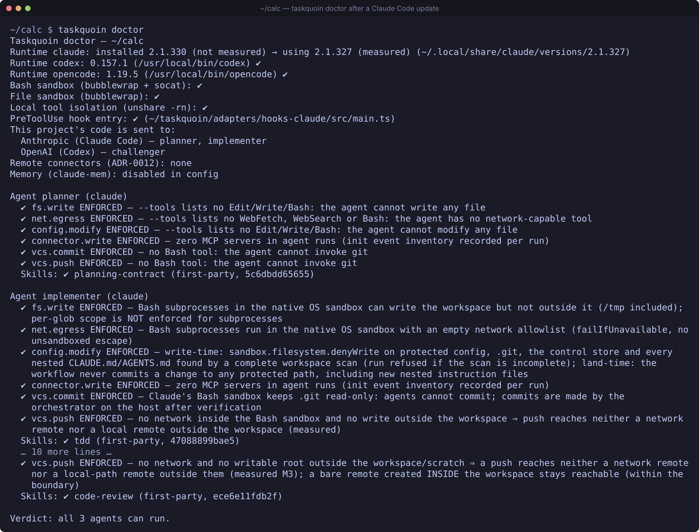
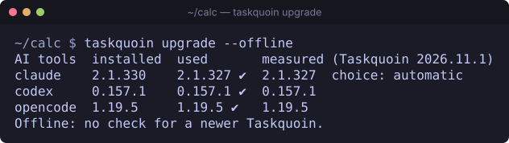

# Runtime versions and upgrades

Claude Code updates itself, and Taskquoin runs a governed agent only on the exact runtime version it has measured
([ADR-0002](../adr/0002-enforcement-classes.md), [ADR-0008](../adr/0008-evidence-is-bound-to-a-mechanism.md)). This page
explains what happens when the two disagree, what Taskquoin does about it on its own, and how `taskquoin upgrade` (or
`/upgrade` in the console) shows and fixes the rest.

- [Why an update makes agents NOT READY](#why-an-update-makes-agents-not-ready)
- [What Taskquoin does automatically](#what-taskquoin-does-automatically)
- [What doctor and the console say](#what-doctor-and-the-console-say)
- [The upgrade command](#the-upgrade-command)
- [Choosing the binary: auto and path](#choosing-the-binary-auto-and-path)
- [Reinstalling the measured Claude Code](#reinstalling-the-measured-claude-code)
- [Codex and OpenCode](#codex-and-opencode)
- [The online check](#the-online-check)
- [Installed but not used](#installed-but-not-used)
- [Exit codes](#exit-codes)
- [Learn more](#learn-more)

> [!NOTE]
> Screens come from a demo repository with simulated AI agents (the test doubles of Taskquoin's own test suite); every
> command is the real Taskquoin CLI.

## Why an update makes agents NOT READY

A capability matrix (what an agent can and cannot do, measured) holds for **one exact version** of a runtime. When
Claude Code moves from the measured `2.1.327` to `2.1.330`, nothing proves the new version still enforces the same
restrictions, so the gate refuses the agents that need it: the Architect and the Developer show `NOT READY` in the
console banner and `doctor`. This is the system working as designed; the gate does not change
([measured versions](agents-and-runtimes.md#measured-versions)).

Measuring a new version is work for Taskquoin's maintainers (live tests, evidence, matrix). Until it is done, you have
two ways forward, and Taskquoin does the first one for you when it can.

## What Taskquoin does automatically

Claude's native installer keeps the previous versions side by side in `~/.local/share/claude/versions/<version>`. If the
`claude` on your `PATH` is not the measured version but the measured one is still in that folder, Taskquoin runs that
file instead. Your own `claude` is untouched.

Before using the file, Taskquoin checks that it is trustworthy. The file must be:

- a regular file (not a link), named with the exact measured version;
- executable and owned by you;
- not writable by group or others, and neither is its folder;
- able to answer `--version` with exactly the measured version (the version is read again, it is never taken from the name).

If any check fails, the file is not used and the PATH binary is refused as before; see
[Installed but not used](#installed-but-not-used). The executor still re-reads the version before every run.

## What doctor and the console say

`taskquoin doctor` shows both versions on the runtime line:



The console banner adds one line when the measured version is used instead of the installed one:

```text
⬆ Claude Code 2.1.330 installed, not measured yet — Taskquoin uses 2.1.327 (measured) · /upgrade
```

When Claude Code is not measured and the measured version is not installed either, the banner (and `doctor`) asks for an
action:

```text
◆ Action required  Claude Code 2.1.330 is not measured and 2.1.327 is not installed — /upgrade to reinstall it
```

In a shell the same line says `run taskquoin upgrade install to reinstall it`.

## The upgrade command

```console
$ taskquoin upgrade
```

In the console, type `/upgrade`. It prints a table of the installed, used and measured version of each AI tool:



| Column | Meaning |
|---|---|
| `installed` | the version found on your `PATH` |
| `used` | the version Taskquoin runs; `✔` when it is the measured one |
| `measured (Taskquoin <version>)` | the version this Taskquoin release measured |

Under the Claude row, `choice: automatic` or `choice: PATH only` shows your current [choice](#choosing-the-binary-auto-and-path).

## Choosing the binary: auto and path

```console
$ taskquoin upgrade auto
$ taskquoin upgrade path
```

- `auto` (the default): use the measured version still installed when the PATH one is not measured, after the trust checks.
- `path`: always use the `claude` on your `PATH`; a version that is not measured is then refused.

The choice is a preference of the machine, stored in `preferences.json` in the Taskquoin state directory
(`$XDG_STATE_HOME/taskquoin`, default `~/.local/state/taskquoin`). It is never in `taskquoin.yaml`: a repository cannot
choose which binary runs on your machine. If the file cannot be written, Taskquoin says so and exits `1`.

## Reinstalling the measured Claude Code

```console
$ taskquoin upgrade install
```

Use it when the measured version is not installed. Taskquoin shows the exact command, warns you and waits for a typed
confirmation:

```text
Command: ~/.local/share/claude/versions/2.1.330 install 2.1.327
Warning: the version of your interactive Claude Code may change until its next update.
Type yes to run (Enter to cancel):
```

The command is `claude install <measured version>` for a native install, or `npm install -g
@anthropic-ai/claude-code@<measured version>` for an npm install. Type `yes` (or the translated word); anything else
cancels and nothing runs.

Know what this does:

- **It is your own Claude Code, not a governed run.** The gate's rules do not apply to it.
- **It runs outside the repository**, in your home directory, so no repository setting applies. Without an absolute
  home directory the install is refused and nothing runs.
- **It uses the network**, whatever `--offline` says: that option covers only the [registry check](#the-online-check).
- **It may change the version of your interactive Claude Code** until its next update.
- **Consent covers exactly what is shown.** A command that cannot be shown exactly as it would run (control or invisible
  characters) is refused before the question.

In the console the installer gets the terminal, so Ctrl+C stops it. When the measured version is already in use,
`install` prints `Nothing to do` and runs nothing.

## Codex and OpenCode

When Codex or OpenCode is installed with a version other than the measured one, `taskquoin upgrade` prints the command to
update it, and never runs it:

```text
To update codex (never run by Taskquoin): npm install -g @openai/codex@0.157.1
```

For OpenCode the package is `opencode-ai`.

## The online check

`taskquoin upgrade` also looks for a newer Taskquoin. This is the **only** network read of the command, and it happens
**only when you type it**: never at start-up, in the background or during a run
([ADR-0010](../adr/0010-local-first-no-leak.md)).

- It reads `https://registry.npmjs.org/taskquoin/latest` with a plain GET: no cookie, no identifier, `user-agent:
  taskquoin`, a 5 second timeout and a 1 MB limit. The answer is validated strictly and never executed.
- `--offline`, or `TASKQUOIN_OFFLINE=1` in your environment, skips it (`Offline: no check for a newer Taskquoin.`).
  `taskquoin console --offline` holds for `/upgrade` too.
- The update command is shown only for an npm install; a copy from source is told to run `git pull`.
- Today the package is not on npm yet, so the check answers `No Taskquoin version is published on npm yet.`

## Installed but not used

Sometimes the measured version is installed but Taskquoin does not use it. `doctor` and the banner then name the reason
and the one command that fixes it:

```text
◆ Action required  Claude Code 2.1.327 is installed but not used: it or its folder is writable by group or others — run chmod go-w <folder> <file>
```

| Reason shown | Fix |
|---|---|
| it or its folder is writable by group or others | `chmod go-w` on the folder and the file, as printed |
| the choice is PATH only | `taskquoin upgrade auto` |
| it is a symbolic link, not a regular file, not executable, owned by another user, unreadable, or its `--version` does not answer that version | `taskquoin upgrade install` |

## Exit codes

| Exit | When |
|---|---|
| `0` | the table was shown, the choice was saved, or the install was confirmed and succeeded (or cancelled) |
| `1` | the installer failed (its code is printed), the install was refused, or the choice could not be saved |
| `2` | usage error: `usage: /upgrade [auto\|path\|install]` |

## Learn more

- [ADR-0018: run a measured runtime version, and `/upgrade`](../adr/0018-measured-runtime-and-upgrade.md)
- [ADR-0002: enforcement classes](../adr/0002-enforcement-classes.md)
- [Agents and runtimes](agents-and-runtimes.md) · [Troubleshooting](troubleshooting.md) · [CLI reference](../reference/cli.md#upgrade)
