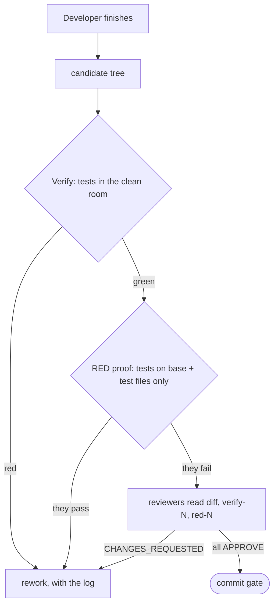
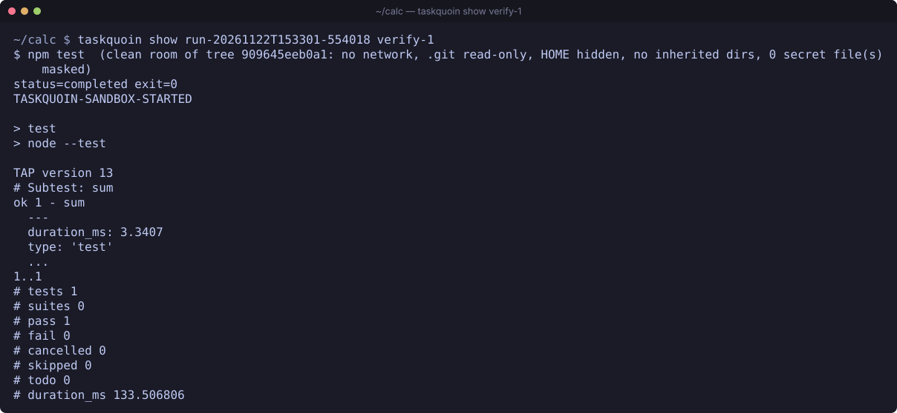

# Verify and the RED proof

When the Developer says "the tests pass", Taskquoin does not take its word. **Verify** is the Tester role, and it is
Taskquoin itself, not an AI: it runs your test command on the exact candidate tree in a clean room, then proves the
new tests really fail without the change (the **RED proof**). Both results are saved as artifacts you can read before
you approve the commit.

- [The clean room](#the-clean-room)
- [The RED proof](#the-red-proof)
- [Retries and their limits](#retries-and-their-limits)
- [What ends as needs-human](#what-ends-as-needs-human)
- [The artifacts](#the-artifacts)
- [Learn more](#learn-more)



## The clean room

Your working directory is full of things that make tests lie: a stale `dist/`, a `.env`, caches, a modified
dependency. Verify avoids all of them. For each check it:

1. **Materializes the candidate git tree outside your workspace**, in the control store (agents cannot write there),
   and mounts it at the repository's path. Your working directory is never touched.
2. **Carries in only the dependency directories**: the stack's defaults (`**/node_modules`, `vendor`, `.venv`,
   `venv`) plus your `verify.inherit` entries, read-only and frozen for agents. No other ignored file comes along.
3. **Scans for secrets** (`.env`, `.env.*`, `*.pem`, `*.key`, in the tree and in the inherited directories) and masks
   them. If the scan cannot finish, Verify refuses: `clean-room scan incomplete … cannot mask every secret`.
4. **Probes every symlink** inside the very sandbox the tests will get, resolving each one physically. A link that
   points outside the repository is refused, because Verify would run code that is not in the tree (and cannot freeze
   what it points to). `npm link` is the classic cause.
5. **Cuts the network** and runs in bubblewrap with `.git` read-only, HOME hidden, the control store and `/run` masked, and
   the repository as the only writable root.
6. **Runs your test command**: `verify.command`, or the implementer's first `shell.run` entry. A marker is printed
   inside the sandbox before the command, so a run that never started cannot pass. The limits are 15 minutes and 2 MB
   of output. With no test command at all, Verify fails closed.

A test run is **conclusive** only if the sandbox started, the command exited by itself with a test result (not
"command not found", not a signal), and its whole output was kept.

Consequences you will notice:

- Tests that need the network, files in HOME, or secret files **fail in Verify**, by design.
- **The test toolchain must be visible inside the clean room.** The clean room has no HOME (a temporary folder is
  mounted over it) and no network. A runner that lives under your HOME (Node from nvm or volta, `~/.npm-global`,
  pyenv, `~/.m2`, `~/.gradle`, the Go module cache) is invisible there. Install the toolchain outside HOME (for
  example under `/usr/local` or `/opt`, on the `PATH`) or inside the repository (`node_modules/.bin`, a virtualenv),
  and list its directory in `verify.inherit` if it is ignored by git. The Maven and Gradle wrappers (`./mvnw`,
  `./gradlew`) download their distribution under HOME over the network, so they do not work as such: they run only
  offline, with the distribution and the caches inside the repository (`MAVEN_USER_HOME` or `GRADLE_USER_HOME` set in
  `verify.command` to a folder listed in `verify.inherit`).
  To check before a run: `taskquoin doctor` for the agents, then run your `verify.command` by hand from a shell with
  an empty HOME, for example `env -i PATH="$PATH" HOME=/nonexistent sh -c '<your command>'`. This is only an
  approximation of the clean room (no mount namespace, no network cut): if it says `not found` there, Verify cannot
  run it either, but a pass there does not prove Verify will.
- **A command that cannot run is not red tests.** Any exit code of 126 or more (126 not executable, 127 `not found`,
  134 or 139 for a crash, 255 for a runner that gave up), a kill other than the timeout, or a sandbox that did not
  start make the run unrunnable. Verify stops once with `needs-human` and the reason
  `Verify could not run the test command (exit <n>): <first line of its output>`, without using any rework attempt,
  because no change to the code could fix it. A runner whose exit code counts its failures (mocha, for example) stops
  the same way once 126 or more tests fail.
- **A timeout is red tests** (a rework, within the attempt limit). **A log too large to keep is judged by its exit
  code**: a red run whose log was cut reworks, and a green run whose log was cut passes (exit 0 is the authority; the
  RED proof still needs a complete run of its own).
- A test that works on your machine but fails in Taskquoin usually reads an ignored file that is not in the clean
  room: add it to `verify.inherit`.
- If the dependencies change during a run (`npm install` while an agent works), the run stops: nothing can be verified
  with a moving target. Work in another clone or a `git worktree` meanwhile.
- If the tests modify tracked files of the clean room, the attempt fails with `verification modified tracked files`.
- Submodules are not supported: `submodules are not supported in governed runs`.

## The RED proof

A test that passes both with and without the change proves nothing. After a green Verify, Taskquoin builds a **red
tree**: the base commit plus **only the test files** the Developer changed. It runs the same suite on it in its own
clean room, and requires a **conclusive failure**.

- Files count as tests when their path says so: `**/*.test.*`, `**/*.spec.*`, `**/*_test.go`, `**/*_test.py`,
  `**/test_*.py`, and anything under `test/`, `tests/` or `__tests__/`.
- **They failed**: RED is proven. The commit gets `RED-Proof: proven (attempt N)`.
- **They passed**: the tests do not depend on the change, so they do not test it. The Developer reworks, with the
  `red-N` log as feedback.
- **Inconclusive** (timeout, sandbox failure, a signal, truncated output, a tree that cannot be rebuilt): this is not
  evidence. The run stops as `needs-human`.
- **Only test files changed**: there is no production change to demonstrate; the proof is skipped and the commit says
  `RED-Proof: not applicable (only files classified as tests changed)`. The reviewers are told to check that none of
  those files is production code.

New production files do not exist in the red tree, so an import error for a file the change adds is the expected
failure for new code; the reviewers are told that any other missing file is no proof.

> [!WARNING]
> The RED proof is mechanical. It proves the changed tests fail without the change. It does **not** prove they assert
> the right behaviour: a test that fails on a missing helper or an import error looks red too. That judgement belongs
> to the reviewers and to you, with `red-N` in hand. Read it before you approve.

## Retries and their limits

| Situation | Automatic reworks | Then |
|---|---|---|
| Tests red, or RED not proven | 2 (3 attempts in all) | `needs-human` |
| Implementer without commands (OpenCode, or no `shell.run`): Taskquoin runs the tests | 4 (5 attempts) | `needs-human` |
| A reviewer returns `CHANGES_REQUESTED` | 2 | `needs-human` |
| Tree changed after your approval | 0 | back to the commit gate with a new hash |

Each rework receives the previous `verify-N`, `red-N` and `review-N` logs. A judge that does not end with a strict
`VERDICT` line counts as `CHANGES_REQUESTED`. With several reviewers, every one of them must approve.

## What ends as needs-human

`needs-human` means Taskquoin stops rather than guess. Nothing is committed. The run's branch and artifacts are yours
to inspect (`taskquoin show <run>`). The reasons, exactly as printed:

| Message | Meaning |
|---|---|
| `tests still failing after N attempts` | the limit above was reached |
| `no failing test demonstrates the change (attempt N)` | the RED proof never held |
| `RED proof inconclusive: <why>` | the proof could not run properly |
| `Verify could not run the test command (exit <n>): <first line of output>` | the command exited with 126 or more (not executable, not found, a crash), was killed other than by the timeout, or the sandbox did not start: fix the toolchain, no attempt was used |
| `Verify refused: <why>` | a link outside the repository, an incomplete secret scan, an inherited path behind a symlink |
| `dependencies changed during the run: <paths> — Verify inherits them…` | reinstall them and start a new run |
| `protected configuration changed: <paths> — Taskquoin never commits such changes` | the agent touched a protected file |
| `diff too large to review completely (N chars > 200000) — split the task` | the reviewers must see the whole diff |
| `trop gros pour le relecteur <id> (N caractères > maxInputChars M) — …` | the request exceeds an API judge's `maxInputChars` (this message is in French in every language; nothing was sent) |
| `review still requests changes after N attempts` | the reviewers kept refusing |
| `submodules are not supported in governed runs (…)` | a gitlink is in the tree |

A refactor or a docs-only change that adds no failing test can also end here with `no failing test demonstrates the
change`: the `feature-governed` workflow is built for behaviour changes. Commit such work yourself from the branch.

## The artifacts

`taskquoin show <run>` lists them with their size; `taskquoin show <run> <name>` prints one.

| Artifact | Content |
|---|---|
| `plan`, `challenge` | the Architect's plan and the challengers' critique |
| `implement-N` | the Developer's closing message for attempt N |
| `diff-N` | the exact diff of the candidate tree. This is what you approve. |
| `verify-N` | the test command, the clean-room header, `status=… exit=…` and the full output, run by Taskquoin |
| `red-N` | `TASKQUOIN RED PROOF` header, `RESULT: they failed as required (RED proven)` (or why not), and the log |
| `review-N` | the reviewers' answers and their `VERDICT` |
| `ignored-N` | ignored files created (`+`), changed (`~`) or removed (`-`) in your working directory since the run began. Present only when there are some. |

`ignored-N` deserves attention: those files are **not in the diff, not verified and not committed**, but they stay on
your disk (for example a generated file the agent left behind).

```shell
$ taskquoin show run-20261122T132559-8697a2 verify-1
```



Screens come from a demo repository with simulated AI agents (the test doubles of Taskquoin's own test suite); every
command is the real Taskquoin CLI.

Here is the RED proof of the same run, where the test fails before the change because `sum.js` does not exist yet:

```shell
$ taskquoin show run-20261122T132559-8697a2 red-1
TASKQUOIN RED PROOF — tests run on base + test changes only (tree 9848f565e24c); they must FAIL.
RESULT: they failed as required (RED proven).

$ npm test  (clean room of tree 9848f565e24c: no network, .git read-only, HOME hidden, no inherited dirs, 0 secret file(s) masked)
status=failed exit=1
…
    Cannot find module './sum.js'
```

## Learn more

- [Approvals](approvals.md): the second gate is bound to the tree this page verifies.
- [Configuration](configuration.md#verify): `verify.inherit` and `verify.command`.
- [Troubleshooting](troubleshooting.md).
- [ADR-0013: tree-based governance](../adr/0013-tree-based-governance.md) and [ADR-0014: Verify in a clean room](../adr/0014-verify-in-a-clean-room.md).
