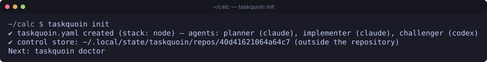
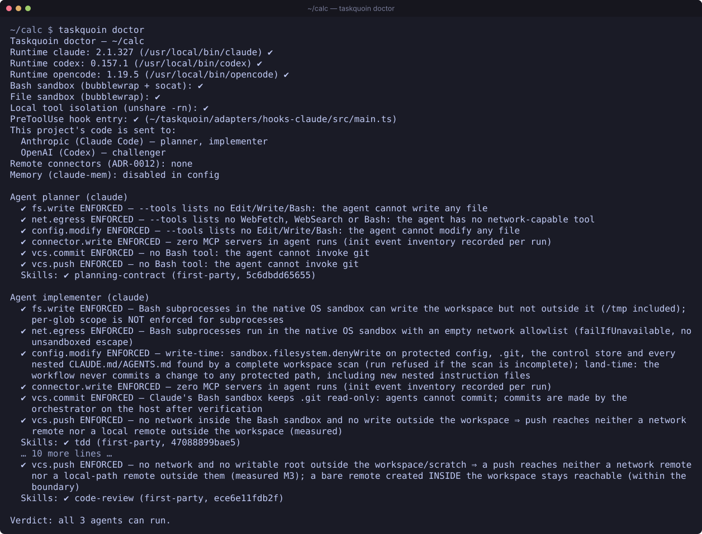
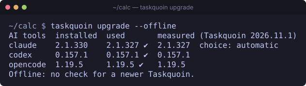
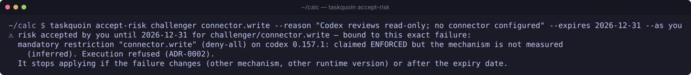
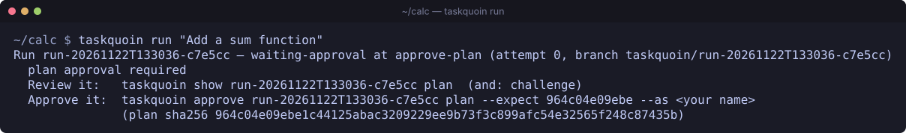
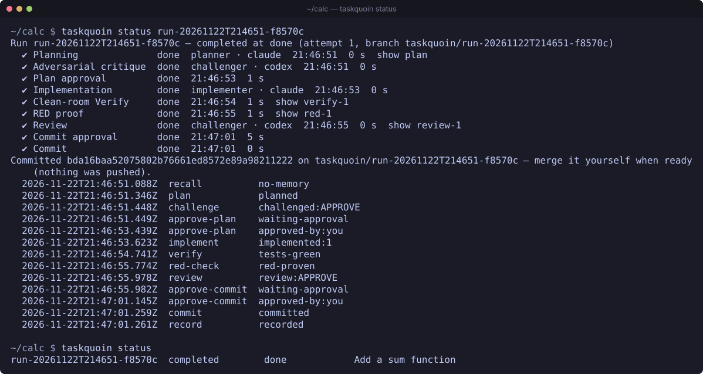
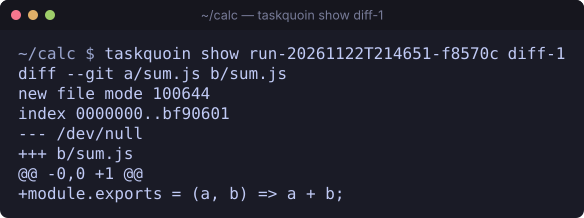
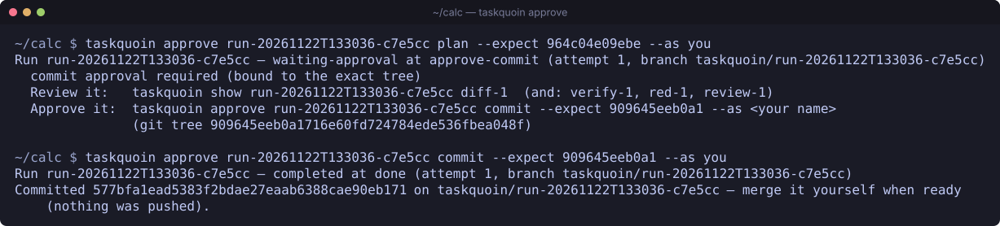
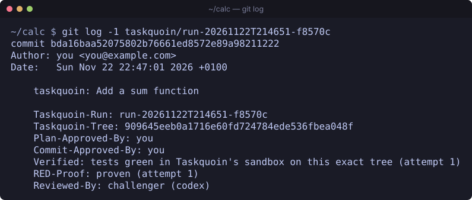

# CLI reference

Every `taskquoin` command with its synopsis, options, what it prints and its exit codes. Run `taskquoin help` (or
`taskquoin --help`) for the same list in your language.

- [Conventions](#conventions)
- [Setup commands](#setup-commands): [`init`](#init), [`doctor`](#doctor), [`upgrade`](#upgrade), [`check`](#check), [`accept-risk`](#accept-risk), [`version`](#version)
- [Workflow commands](#workflow-commands): [`console`](#console), [`run`](#run), [`status`](#status), [`show`](#show), [`approve`](#approve), [`resume`](#resume)
- [Skills](#skills)
- [Shortcut and connection](#shortcut-and-connection): [`connect`](#connect), [`setup`](#setup)
- [Removal](#removal): [`uninstall`](#uninstall)
- [Environment variables](#environment-variables)

> [!NOTE]
> Screens come from a demo repository with simulated AI agents (the test doubles of Taskquoin's own test suite); every
> command is the real Taskquoin CLI.

## Conventions

- **Exit codes**: `0` success, `1` refused or failed (a failed check, a refused agent, an unknown run, a run that did not
  reach a gate or the end), `2` usage error (missing argument, unknown option, missing required option).
- **Where to run**: every command except `help`, `version`, `setup` and `connect` must run inside a git repository
  (`taskquoin: not inside a git repository`, exit `1`). Every command except `init`, `help`, `version`, `setup`, `connect`,
  `uninstall` and `skills` needs a `taskquoin.yaml` (`taskquoin.yaml not found — run "taskquoin init"`, exit `1`).
- **Options** may appear anywhere: `--json`, `--reason`, `--expires`, `--as`, `--expect`, `--source`, `--accept-findings`,
  `--remove`, `--purge-state`, `--offline`, and `-h` / `--help`. An unknown option prints the error and the help, exit `2`.
- **No arguments**: `taskquoin` alone opens the [console](#console) in a terminal; with a pipe or in a script it prints the
  help and exits `0`.
- **Unknown command**: prints the usage line, exit `2`.
- **Language**: messages follow your language ([languages guide](../guides/languages.md)); `--json` output does not.
- **Names and hashes**: `--as` takes your name (it is recorded as the approver); a hash is given by its first 12 or more
  hexadecimal characters.

## Setup commands

### `init`

```console
$ taskquoin init
```

Creates `taskquoin.yaml` in the repository root, for the stack it detects (`package.json` gives `node`, `composer.json`
`php`, `pyproject.toml` / `requirements.txt` / `setup.py` `python`, `go.mod` `go`, `pom.xml` `java-maven`,
`build.gradle[.kts]` `java-gradle`, otherwise `unknown`). The agents depend on the tools it finds on your machine:
Claude Code and Codex give the default `planner`, `implementer` (Claude) and `challenger` (Codex); Claude Code alone
makes the challenger a Claude agent too; OpenCode alone puts every role on OpenCode.

On an `unknown` stack, `init` cannot guess the test command: it says to set `shell.run` (the commands the implementer
may run) and `verify.command` (your test command) in `taskquoin.yaml`, or only `verify.command` when the implementer is
an OpenCode agent (OpenCode has no commands). Until then a run is refused before it starts (see [`run`](#run)).

It also creates the [control store](runs-artifacts-events.md#where-the-control-store-lives) outside the repository and a manifest of
what it created. If it finds AI provider keys in your environment (`DEEPSEEK_API_KEY`, `MISTRAL_API_KEY`,
`OPENROUTER_API_KEY`, `GEMINI_API_KEY`, `OPENAI_API_KEY`, `ANTHROPIC_API_KEY`; values are never read into the file) or a
local Ollama, it adds them to the file as **comments**: uncommenting them is your consent to send the project's code
there.



| Exit | When |
|---|---|
| `0` | file created |
| `1` | `taskquoin.yaml` already exists (it is never overwritten), or not a git repository |

### `doctor`

```console
$ taskquoin doctor
```

Prints the state of the machine and certifies every agent of the configuration:

1. each runtime found on the `PATH` with its version, `✔` when it equals the measured version of its
   [capability matrix](capabilities.md), otherwise the version the matrix was measured on;
2. the Bash sandbox (bubblewrap and socat), the file sandbox (bubblewrap), local tool isolation (`unshare -rn`) and the
   PreToolUse hook entry;
3. **where the project's code is sent**: every destination with the agents that use it (`(stays on this machine)` for a local one);
4. a warning when a reviewer runs on the same runtime as the implementer;
5. connectors and the memory state;
6. per agent, one line per mandatory restriction (`✔ capability CLASS — mechanism`, or `✖`), accepted risks and the
   state of its skills;
7. `Verdict: all N agents can run.` or `Verdict: K of N agents can run — refused agents will not be started.`



| Exit | When |
|---|---|
| `0` | every agent can run |
| `1` | at least one agent is refused, its runtime is not installed, or one of its skills is unusable |

### `upgrade`

```console
$ taskquoin upgrade [auto|path|install] [--offline]
```

Shows the installed, used and measured version of Claude Code, Codex and OpenCode, and lets you act on them. Full
explanation: [Runtime versions and upgrades](../guides/upgrade.md).



| Sub-command | Effect |
|---|---|
| *(none)* | prints the table, the Codex and OpenCode update commands when their version is not the measured one (printed, never run), and the online check |
| `auto` | uses the measured Claude Code still installed when the PATH one is not measured (default); stored in the machine's `preferences.json`, never in `taskquoin.yaml` |
| `path` | always uses the `claude` on the `PATH` |
| `install` | shows the exact command that reinstalls the measured Claude Code, and runs it only after you type `yes`; it runs in your home directory, uses the network and may change your interactive Claude Code |

`--offline` (or `TASKQUOIN_OFFLINE=1`) skips the check for a newer Taskquoin on the npm registry, the only network read
of this command (it happens only when you type it). It does not affect `install`, which uses the network.

| Exit | When |
|---|---|
| `0` | table shown, choice saved, install cancelled or succeeded |
| `1` | the installer failed, the install was refused (no absolute home, command that cannot be shown exactly), or the choice could not be saved |
| `2` | unknown sub-command (`usage: /upgrade [auto\|path\|install]`) |

### `check`

```console
$ taskquoin check <agent> [--json]
```

Runs the policy gate for one agent: the same lines as `doctor` for that agent.

With `--json`, prints one object whose keys are always present:

| Key | Content |
|---|---|
| `agent` | agent id |
| `ok` | `true` when the agent may run and its runtime is installed |
| `runtimeFound` | whether the runtime binary was found |
| `failures` | list of `{ capability, class, message }` |
| `acceptedRisks` | list of risks you accepted that apply |
| `resolved` | per mandatory restriction: `capability`, `mandatory`, `class`, `scope`, `mechanism`, `certified` |
| `warnings` | non-mandatory restrictions that are not enforced |

The JSON is in English whatever your language.

```console
$ taskquoin check implementer
```


| Exit | When |
|---|---|
| `0` | the agent can run |
| `1` | a mandatory restriction is not certified, an API key or OpenCode connection is missing, or the runtime is missing |
| `2` | no agent given, or unknown agent (the message lists the known ones) |

### `accept-risk`

```console
$ taskquoin accept-risk <agent> <capability> --reason "<why>" --expires YYYY-MM-DD --as <name>
```

Records **your** acceptance of the *current* failure of one mandatory restriction of one agent. All three options are
required. The acceptance is stored in the control store (never in the repository), bound to the agent, the capability,
the exact failure message and the runtime version, and applies until the end of `--expires` (UTC). It certifies
nothing: the gate lists the risk as accepted and every run records a `risk.accepted` event. See
[Security: accepted risks](../guides/security.md#10-accepted-risks).

```console
$ taskquoin accept-risk challenger connector.write --reason "read-only reviewer, no connector" --expires 2026-12-31 --as "Your Name"
⚠ risk accepted by Your Name until 2026-12-31 for challenger/connector.write — bound to this exact failure:
  mandatory restriction "connector.write" (deny-all) on codex 0.157.1: claimed ENFORCED but the mechanism is not measured (inferred). Execution refused (ADR-0002).
  It stops applying if the failure changes (other mechanism, other runtime version) or after the expiry date.
```



| Exit | When |
|---|---|
| `0` | recorded |
| `1` | the restriction is not currently failing for this agent, or the agent is an `api` judge, or `taskquoin.yaml` is missing |
| `2` | missing agent, capability, `--reason`, `--as`, or a valid `--expires` date; `--expires` in the past |

### `version`

```console
$ taskquoin version
taskquoin 2026.11.1
```

Exit `0`.

## Workflow commands

### `console`

```console
$ taskquoin console
```

An interactive shell over the commands below, with `/` commands, Tab completion and a menu. Also started by `taskquoin`
alone in a terminal. See [Console commands](console-commands.md). The exit code is `0`, or `1` if any command or approval
in the session failed (so a piped session is usable in scripts).


### `run`

```console
$ taskquoin run "<request>"
$ taskquoin run Add a sum function
```

Starts the governed workflow for a request. Every word after `run` is the request, joined by single spaces, so the
quotes are optional; quote it anyway when it holds a word that starts with `--` (it would be read as an option) or
characters your shell interprets. Before anything changes, Taskquoin checks that:

- the configuration defines `planner` and `implementer`, and every agent named in `workflow` (or `challenger` by default);
- every skill of those agents can be loaded;
- the planner, the challengers and the reviewers are read-only (no `fs.write`, `shell.run`, `net.egress`, `vcs.commit`,
  `vcs.push`, `connector.write` or `config.modify`);
- every `api` or OpenCode judge can run (key present, provider connected);
- the gate of **every** agent the workflow will call (planner, implementer, challengers, reviewers) passes, so a refusal
  known in advance costs no model call and creates no branch. When a remedy exists, the line after the refusal names
  it: `taskquoin upgrade` for a runtime version that was not measured; `taskquoin accept-risk <agent> <capability> …`
  for an unmeasured restriction of a **read-only** agent (one line per capability); for an implementer without
  `shell.run`, the configuration (`shell.run` and `verify.command`), never a waiver for the agent that writes. A runtime
  that is not installed is said as such (`runtime codex for agent challenger is not installed`);
- the working tree is clean: Taskquoin never mixes its changes with yours.

It then creates the branch `taskquoin/<run-id>` and drives the workflow (recall, plan, challenge) up to the **plan gate**,
where it stops and prints what to review and the exact command to approve:

```text
Run run-20261122T132603-7b8841 — waiting-approval at approve-plan (attempt 0, branch taskquoin/run-20261122T132603-7b8841)
  plan approval required
  Review it:   taskquoin show run-20261122T132603-7b8841 plan  (and: challenge)
  Approve it:  taskquoin approve run-20261122T132603-7b8841 plan --expect bb8543009fa8 --as <your name>
               (plan sha256 bb8543009fa8942b037ea8653153c9826a54a5b110d82186e795cedcb8bf925c)
```



The run id is `run-<UTC date>T<time>-<6 hex>`. A run keeps the language you started it in for the agents' prose, and
records a digest of `taskquoin.yaml`.

| Exit | When |
|---|---|
| `0` | the run is waiting at a gate or completed |
| `1` | a pre-check refused it, the working tree is dirty, or the run ended `failed`, `needs-human` or `interrupted` |
| `2` | no request |

### `status`

```console
$ taskquoin status [<run>] [--json]
```

- Without a run: one line per run, `<id>  <status>  <node>  <request>` (first line of the request, 60 characters, control
  characters removed). Empty output when there is no run.
- With a run: the report (status, node, attempt, branch, what to review and approve), the judges when the project
  configures `workflow`, then the history `<time>  <node>  <outcome>`.
- `--json` without a run: a list of `{ runId, status, current, attempts, branch, commit, request }`. With a run: the same
  fields plus `history`, `pendingApproval` (`{ gate, expectedHash }` or `null`) and `reason` (why the run stopped, as in
  the report: English engine text whatever the language, `null` when unset). Every key is always present (`null` when unset).
- A run whose Taskquoin process was killed (Ctrl+C, a closed terminal, SIGKILL, a reboot) still reads `running` in its
  state; `status` reports it as `interrupted` with the reason `process gone (the run was killed)`, in the text and in
  `--json`. It is detected from the run's lock: the pid it names no longer exists, or now belongs to a process that
  started later. A run whose lock holder is alive stays `running`.



| Exit | When |
|---|---|
| `0` | printed |
| `1` | unknown run |

### `show`

```console
$ taskquoin show <run> [<artifact>]
```

- `show <run>` lists the artifacts of the run with their size in bytes.
- `show <run> <artifact>` prints one: `plan`, `challenge`, `diff-N`, `verify-N`, `red-N`, `ignored-N`, `review-N`,
  `implement-N`, `memory` (and the per-judge parts such as `review-1-challenger`). See
  [Runs, artifacts and events](runs-artifacts-events.md#artifacts).

Artifact text is model output and repository content: terminal escape sequences are removed and other control characters
shown as `?`.



| Exit | When |
|---|---|
| `0` | printed |
| `1` | unknown run, or no such artifact (the message lists the available ones) |
| `2` | no run given |

### `approve`

```console
$ taskquoin approve <run> <plan|commit> --expect <hash> --as <name>
```

Approves one gate. `--expect` is the hash you inspected (at least 12 hex characters) as printed by `status`: the sha256
of the plan for `plan`, the git tree id for `commit`. If it does not match what is pending, nothing is approved. After
the plan approval Taskquoin implements, runs Verify and the RED proof, and asks the reviewers, then stops at the commit
gate; after the commit approval it commits exactly the approved tree on the run's branch and pushes nothing.

```console
$ taskquoin approve run-20261122T132603-7b8841 commit --expect 909645eeb0a1 --as "Your Name"
Run run-20261122T132603-7b8841 — completed at done (attempt 1, branch taskquoin/run-20261122T132603-7b8841)
Committed 2f78acc5f97ab34e7ac8bebdda97c1fa259273e1 on taskquoin/run-20261122T132603-7b8841 — merge it yourself when ready (nothing was pushed).
```





`approve` refuses when you are not on the run's branch (`switch to <branch> first`), when `taskquoin.yaml` changed since
the run started, when the run is not waiting for that gate, or when another Taskquoin process holds the run.

| Exit | When |
|---|---|
| `0` | the run reached the next gate or completed |
| `1` | refused (wrong hash, wrong gate, wrong branch, changed config, unknown run) or the run ended `failed` / `needs-human` / `interrupted` |
| `2` | missing run, gate (`plan` or `commit`), `--expect` or `--as` |

### `resume`

```console
$ taskquoin resume <run>
```

Continues an `interrupted` run from the node where it stopped (an adapter failure, a provider timeout, or a Taskquoin
process that was killed). Judges that already answered are not asked, or paid, again. Only an interrupted run can be
resumed; the same branch and configuration checks as `approve` apply.

For a killed run, `resume` first takes the run's lock (a lock whose holder is dead is taken over; a live one never is:
`run <id> is busy`), records the interruption (a `run.interrupted` event and an `interrupted` history entry), then
continues at the same node with the approvals kept. A run killed during its implementation keeps the workspace
baseline taken before the implementer started, so what the killed attempt changed in the dependencies or the ignored
files is still detected ([ADR-0014](../adr/0014-verify-in-a-clean-room.md)). A lock that names no process, or a takeover
that was itself killed, is never cleared automatically: the command answers `run <id> is blocked by <file>` and you
delete that file once no Taskquoin process is running.

| Exit | When |
|---|---|
| `0` | the run reached a gate or completed |
| `1` | not resumable, refused, or ended `failed` / `needs-human` / `interrupted` again |
| `2` | no run |

## Skills

See the [skills guide](../guides/skills.md). `skills` needs a git repository (the quarantine is per repository) but no
`taskquoin.yaml`.

| Command | What it does |
|---|---|
| `taskquoin skills list` | first-party (pinned) skills, then imported ones: `<name> <status> findings=<n> <hash12>` |
| `taskquoin skills audit <dir>` | validate against the Agent Skills specification and audit a local directory, importing nothing |
| `taskquoin skills import <dir> --source "<owner/repo@commit>"` | copy into quarantine in the control store and write the audit report; `--source` is required |
| `taskquoin skills approve <name> --as <name> [--accept-findings]` | approve the latest quarantined import; `--accept-findings` is required for `high` findings; `critical` findings and invalid skills cannot be approved |
| `taskquoin skills revoke <name> --as <name>` | withdraw an approval |

| Exit | When |
|---|---|
| `0` | done; `audit`: no spec error and no critical finding |
| `1` | `audit`: spec error or critical finding; `import`: invalid skill; `approve` / `revoke`: refused (nothing to approve, blocked, not approved); a directory that cannot be read |
| `2` | missing `<dir>`, `<name>`, `--source` or `--as`; unknown subcommand |

## Shortcut and connection

### `connect`

```console
$ taskquoin connect opencode [--remove]
```

Signs OpenCode in for **Taskquoin's own** OpenCode directory (your personal OpenCode is not touched), so agents with
`runtime: opencode` can use your provider (a ChatGPT sign-in, GitHub Copilot, a key, a local Ollama). It runs OpenCode's own
login and then lists the connected providers; secrets are never printed. `--remove` deletes Taskquoin's connection.

| Exit | When |
|---|---|
| `0` | connected, or removed |
| `1` | OpenCode not on the `PATH`, sign-in failed or cancelled, or no provider connected |
| `2` | target other than `opencode` |

### `setup`

```console
$ taskquoin setup [--remove]
```

For a source checkout: links `~/.local/bin/taskquoin` to Taskquoin's launcher (no sudo) and, if that directory is not on your
`PATH`, adds one marked block to `~/.bashrc`. It also happens automatically the first time you run Taskquoin in a terminal,
unless `TASKQUOIN_NO_SETUP` is set or you ran `setup --remove` (which removes exactly what was created and stops the
automatic setup). It never overwrites a file it did not create. An npm installation has `taskquoin` on the `PATH`
already: the command says so and exits `0`.

| Exit | When |
|---|---|
| `0` | installed, already installed, removed, or npm installation |
| `1` | `~/.local/bin/taskquoin` exists and is not Taskquoin's |

## Removal

### `uninstall`

```console
$ taskquoin uninstall [--purge-state]
```

Removes what `init` created (`taskquoin.yaml`) **if you did not modify it** since: a modified file, or a symlink, is kept
and reported. The manifest is validated before anything is touched. The control store (runs, artifacts, approvals, skills)
is kept for audit; `--purge-state` deletes it, also after a previous `uninstall` already removed the manifest.

| Exit | When |
|---|---|
| `0` | everything recorded was removed |
| `1` | no manifest (without `--purge-state`), an invalid manifest, a file was kept (modified or a link), or a purge was refused outside the state directory |

## Environment variables

| Variable | Effect |
|---|---|
| `TASKQUOIN_LANG` | Language of the messages, first in the [selection order](../guides/languages.md#how-the-language-is-chosen) |
| `XDG_STATE_HOME` | Where the control store lives (`$XDG_STATE_HOME/taskquoin`, default `~/.local/state/taskquoin`) |
| `NO_COLOR` | Console without colours |
| `TASKQUOIN_NO_ANIMATION` | Console banner without the start-up animation |
| `TASKQUOIN_OFFLINE` | `1` skips the registry check of `taskquoin upgrade` and `/upgrade` (same as `--offline`) |
| `TASKQUOIN_NO_SETUP` | Do not put `taskquoin` on the `PATH` automatically at first launch |
| `LC_ALL`, `LC_MESSAGES`, `LANG` | Fallbacks for the language |

Provider keys named in `taskquoin.yaml` (`key: env:NAME`) are read from your environment when an `api` judge is called.

## Learn more

- [Console commands](console-commands.md) · [Configuration](configuration.md) · [Runs, artifacts and events](runs-artifacts-events.md)
- [Upgrade guide](../guides/upgrade.md) · [Security](../guides/security.md) · [Skills](../guides/skills.md) · [Languages](../guides/languages.md)
