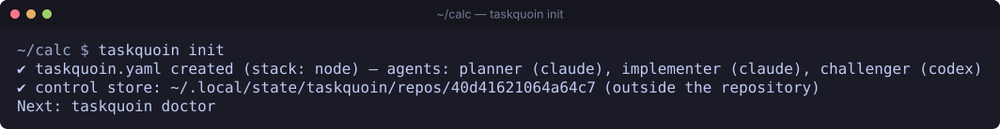

# Configuration reference

Everything Taskquoin needs to know about a project is in one file at the repository root: `taskquoin.yaml`. This page lists
every key with its type, default, allowed values and an example.

- [Rules of the file](#rules-of-the-file)
- [What `taskquoin init` writes](#what-taskquoin-init-writes)
- [`version`](#version) · [`stack`](#stack)
- [`agents`](#agents)
- [`policy`](#policy)
- [`connectors`](#connectors)
- [`memory`](#memory)
- [`verify`](#verify)
- [`providers`](#providers)
- [`workflow`](#workflow)
- [A complete example](#a-complete-example)

## Rules of the file

- **Strict.** An unknown key is an error that names the key and the allowed ones (`config.agents.planner.foo: unknown key
  (allowed: ...)`). Duplicate keys, YAML anchors and aliases are refused. The file may not exceed 256 KiB.
- **Fail-closed.** A configuration that does not validate stops every command that needs it (`taskquoin: config...`, exit `1`).
- **Protected.** Agents can never write `taskquoin.yaml`, and a change to it can never be committed by a run. If you edit
  it while a run exists, `approve` and `resume` refuse (`taskquoin.yaml changed since the run started — start a new
  run`), and an open console refuses commands until restarted.
- **No secrets.** Keys are references to environment variables (`env:NAME`), never values.
- **Risk acceptances are not here.** A `policy.exceptions` key is refused; use [`taskquoin accept-risk`](cli.md#accept-risk),
  which stores them outside the repository.

## What `taskquoin init` writes

On a Node project with Claude Code and Codex installed (the demo repository):

```yaml
# Taskquoin project configuration — see docs/architecture.md. Protected: agents can never edit this file.
version: 1
stack: node
agents:
  planner:
    runtime: claude
    description: "Read-only planner: turns a request into a minimal, test-first implementation plan."
    prompt: You plan; you never modify files. Read the repository, then produce the plan requested.
    capabilities:
      fs.read:
        - "**"
    maxTurns: 30
    skills:
      - planning-contract
  implementer:
    runtime: claude
    description: Implements an approved task with strict TDD (RED → GREEN → REFACTOR).
    prompt: "You implement exactly the approved task. ..."
    capabilities:
      fs.read:
        - "**"
      fs.write:
        - "**"
      shell.run:
        - npm test
        - npm test -- *
        - node --test *
    maxTurns: 40
    skills:
      - tdd
  challenger:
    runtime: codex
    description: Independent, read-only adversarial reviewer of plans and diffs.
    prompt: "You are an independent reviewer. ..."
    capabilities:
      fs.read:
        - "**"
    skills:
      - code-review
policy:
  mandatory:
    - fs.write
    - net.egress
    - config.modify
    - connector.write
    - vcs.commit
    - vcs.push
connectors: {}
memory:
  claudeMem:
    enabled: true
```



> [!NOTE]
> Screens come from a demo repository with simulated AI agents (the test doubles of Taskquoin's own test suite); every
> command is the real Taskquoin CLI.

## `version`

| | |
|---|---|
| Type | integer |
| Required | yes |
| Allowed | `1` |

## `stack`

| | |
|---|---|
| Type | string |
| Required | yes |
| Allowed | `node`, `php`, `python`, `go`, `java-maven`, `java-gradle`, `unknown` |

`init` detects it from `package.json`, `composer.json`, `pyproject.toml` / `requirements.txt` / `setup.py`, `go.mod`,
`pom.xml`, `build.gradle[.kts]`. The stack sets the default test commands written by `init` and the dependency
directories [inherited by Verify](#verify):

| Stack | Test commands granted to the implementer | Inherited by default |
|---|---|---|
| `node` | `npm test`, `npm test -- *`, `node --test *` | `**/node_modules` |
| `php` | `vendor/bin/phpunit`, `vendor/bin/phpunit *` | `vendor` |
| `python` | `pytest`, `pytest *` | `.venv`, `venv` |
| `go` | `go test ./...`, `go test *` | none |
| `java-maven` | `mvn -q test`, `mvn -q test *` | none |
| `java-gradle` | `./gradlew test`, `./gradlew test *` | none |
| `unknown` | none | none |

## `agents`

| | |
|---|---|
| Type | mapping of agent id to agent |
| Required | yes, at least one |
| Agent id | lowercase letters, digits and hyphens, starting with a letter, 1 to 48 characters |

A governed run needs two ids: **`planner`** (read-only) and **`implementer`**. Judges are the agents named in
[`workflow`](#workflow), or `challenger` by default. You can add any other agent (for example `security`) and name it in
`workflow`.

### `agents.<id>.runtime`

Required. One of:

| Value | Meaning |
|---|---|
| `claude` | Claude Code |
| `codex` | Codex |
| `opencode` | OpenCode in Taskquoin's bubblewrap profile, without commands |
| `api` | A text-only judge reached through an OpenAI-compatible HTTP API (see [`providers`](#providers)) |

### `agents.<id>.description`, `agents.<id>.prompt`

Required, non-empty strings: what the agent is, and its role instructions.

### `agents.<id>.capabilities`

Required mapping from a [capability](capabilities.md) to a list of scopes. A capability that is absent, or has an empty
list, is **not granted**.

| Capability | Scope is | Example |
|---|---|---|
| `fs.read`, `fs.write` | globs relative to the repository | `["**"]`, `["src/**"]` |
| `shell.run` | command patterns | `["npm test", "npm test -- *"]` |
| `net.egress` | hosts | `["registry.npmjs.org"]` |
| `connector.read`, `connector.write` | connector ids | `["github"]` |
| `vcs.commit`, `vcs.push`, `config.modify` | a list of strings; the default profile grants none of them | |

Granting one of the mandatory capabilities means the runtime must enforce what you granted; see
[Security](../guides/security.md#4-the-capability-matrix-and-why-an-unmeasured-version-is-refused).

Constraints:

- an unknown capability name is an error (known: `fs.read`, `fs.write`, `shell.run`, `net.egress`, `vcs.commit`, `vcs.push`,
  `connector.read`, `connector.write`, `config.modify`);
- `opencode` agents may hold only `fs.read` and `fs.write` (no commands: Taskquoin runs your tests);
- `api` agents must have `capabilities: {}`;
- the planner, challengers and reviewers must be read-only; `taskquoin run` refuses an agent granted `fs.write`, `shell.run`,
  `net.egress`, `vcs.commit`, `vcs.push`, `connector.write` or `config.modify` in those roles.

```yaml
capabilities:
  fs.read: ["**"]
  fs.write: ["src/**", "test/**"]
  shell.run: ["npm test"]
```

### `agents.<id>.model`

| | |
|---|---|
| Type | string |
| Default | the runtime's own default |
| Required | for `opencode`: `<provider>/<model>`, for example `openai/gpt-6-astra` |

### `agents.<id>.maxTurns`

| | |
|---|---|
| Type | integer, 1 to 200 |
| Default | none; Claude Code uses 20 when it is omitted |
| Not allowed | for `api` agents |

Codex does not support a turn limit; the setting is reported as unsupported for it.

### `agents.<id>.provider`

| | |
|---|---|
| Type | string |
| Required | for `runtime: api`: an id from [`providers`](#providers) |
| Not allowed | for any other runtime |

An `api` agent cannot be `planner` or `implementer` (they need tools).

### `agents.<id>.skills`

| | |
|---|---|
| Type | list of skill names |
| Default | none |
| Names | lowercase letters, digits and single hyphens |

First-party skills (`planning-contract`, `tdd`, `code-review`, `security-review`) or skills you imported and approved. If one
cannot be loaded, the agent cannot start. See the [skills guide](../guides/skills.md).

```yaml
agents:
  security:
    runtime: api
    provider: deepseek
    description: Independent security review of the diff
    prompt: You are an independent security reviewer of the diff. Report every security defect with file:line and a fix.
    capabilities: {}
    skills: [security-review]
```

## `policy`

### `policy.mandatory`

| | |
|---|---|
| Type | list of capabilities |
| Required | yes (may be `[]`) |
| Default written by `init` | `fs.write`, `net.egress`, `config.modify`, `connector.write`, `vcs.commit`, `vcs.push` |

Capabilities whose restriction must be **certified** (enforced and measured) before an agent may run. Taskquoin has a
built-in floor with those six that cannot be removed: this list can only add to it, for example `fs.read` or
`shell.run`, which makes read and command restrictions mandatory too.

```yaml
policy:
  mandatory: [fs.write, net.egress, config.modify, connector.write, vcs.commit, vcs.push, fs.read]
```

## `connectors`

| | |
|---|---|
| Type | mapping of connector id to connector |
| Required | yes (`{}` when none) |

A connector declares one remote service, one scope and explicit operations
([ADR-0012](../adr/0012-remote-connectors-by-exception.md)). Agents in this version run with no MCP server, so a connector is
declared and listed by `doctor` (`Remote connectors: <id> → <host> [<scope>] read=<n> write=<n> (brokered)`), not handed to
an agent.

| Key | Type | Rule |
|---|---|---|
| `host` | string | a plain hostname such as `api.github.com` |
| `scope` | string | what the connector may touch, e.g. `org/repo` |
| `read` | list of strings | read operations |
| `write` | list of strings | write operations |
| `credentialRef` | string | `env:NAME` or `keychain:NAME`, never the secret |

```yaml
connectors:
  github:
    host: api.github.com
    scope: acme/calc
    read: [issues.get]
    write: [issues.comment]
    credentialRef: env:GITHUB_TOKEN
```

## `memory`

### `memory.claudeMem.enabled`

| | |
|---|---|
| Type | boolean |
| Required | yes |
| Default written by `init` | `true` |

`true`: recall notes before the plan and record a summary after the commit, through the local claude-mem worker; `false`:
never contact it. See the [memory guide](../guides/memory.md).

```yaml
memory:
  claudeMem:
    enabled: false
```

## `verify`

Optional. Controls the clean-room Verify and the RED proof ([ADR-0014](../adr/0014-verify-in-a-clean-room.md)).

### `verify.command`

| | |
|---|---|
| Type | string |
| Default | the implementer's **first** `shell.run` entry |
| Required | when the implementer is an `opencode` agent (it has no commands) |

The command Taskquoin runs in the sandbox to verify a tree, and again for the RED proof. If there is none, Verify fails
closed (`no test command configured`).

### `verify.inherit`

| | |
|---|---|
| Type | list of relative paths or globs |
| Default | `[]`, on top of the stack's defaults (see [`stack`](#stack)) |

Ignored paths (dependencies, caches) carried from your working directory into the clean room, **read-only**, and frozen for
agents during the run. A path must be relative to the repository, without `..` or empty segments, never `.git`, never
only `*` or `**` (that would defeat the clean room), and may not go through a symlink.

```yaml
verify:
  command: npm test
  inherit:
    - .cache/tool
```

## `providers`

Optional. The AI services allowed to receive this project's code, reached through an OpenAI-compatible
`POST <url>/chat/completions`. **Listing a provider here is your consent** to send it code; `init` only suggests detected
ones as comments ([ADR-0016](../adr/0016-judges-by-api.md)).

Provider ids follow the same pattern as agent ids. Each provider has:

| Key | Type | Default | Allowed |
|---|---|---|---|
| `url` | string | required | absolute `https://` URL; `http://` only for `localhost`, `127.0.0.1`, `[::1]`; no credentials, query or fragment |
| `model` | string | required | the provider's model name |
| `key` | string | none (for a local server) | `env:NAME` where `NAME` matches `[A-Z_][A-Z0-9_]*` |
| `maxOutputTokens` | integer | `4000` | 1 to 1,000,000 |
| `timeoutSeconds` | integer | `300` | 1 to 3600 |
| `tokenField` | string | `max_tokens` | `max_tokens`, `max_completion_tokens` |
| `maxInputChars` | integer | none | 1000 to 50,000,000; a task above it is refused before anything is sent |

```yaml
providers:
  deepseek:
    url: https://api.deepseek.com/v1
    model: deepseek-chat
    key: env:DEEPSEEK_API_KEY
  local:
    url: http://localhost:11434/v1
    model: llama3
```

A provider that is not referenced by an `api` agent is not used. Secret files and binaries are never put in a judge's prompt.

## `workflow`

Optional. Who challenges the plan and who reviews the diff.

| Key | Type | Rule |
|---|---|---|
| `challengers` | list of agent ids | at least one, no duplicate, each defined under `agents` |
| `reviewers` | list of agent ids | same; **every** reviewer must give a strict `VERDICT: APPROVE` |

Default when omitted: `challengers: [challenger]` and `reviewers: [challenger]`.

```yaml
workflow:
  challengers: [challenger]
  reviewers: [challenger, security]
```

`doctor` and `status` print the judges and where the code goes for them. A reviewer on the same runtime as the implementer
gets a warning: add an independent one.

## A complete example

A Node project reviewed by Codex and by an independent API judge:

```yaml
version: 1
stack: node
agents:
  planner:
    runtime: claude
    description: Read-only planner
    prompt: You plan; you never modify files.
    capabilities: { fs.read: ["**"] }
    maxTurns: 30
    skills: [planning-contract]
  implementer:
    runtime: claude
    description: Implements an approved task with strict TDD
    prompt: You implement exactly the approved task. Never commit.
    capabilities:
      fs.read: ["**"]
      fs.write: ["**"]
      shell.run: ["npm test", "npm test -- *"]
    maxTurns: 40
    skills: [tdd]
  challenger:
    runtime: codex
    description: Independent, read-only reviewer
    prompt: You are an independent reviewer.
    capabilities: { fs.read: ["**"] }
    skills: [code-review]
  security:
    runtime: api
    provider: deepseek
    description: Independent security review of the diff
    prompt: You are an independent security reviewer of the diff.
    capabilities: {}
    skills: [security-review]
policy:
  mandatory: [fs.write, net.egress, config.modify, connector.write, vcs.commit, vcs.push]
connectors: {}
memory:
  claudeMem: { enabled: true }
providers:
  deepseek:
    url: https://api.deepseek.com/v1
    model: deepseek-chat
    key: env:DEEPSEEK_API_KEY
workflow:
  challengers: [challenger]
  reviewers: [challenger, security]
```

## Learn more

- [CLI reference](cli.md) · [Capabilities](capabilities.md) · [Runs, artifacts and events](runs-artifacts-events.md)
- [Security](../guides/security.md) · [Skills](../guides/skills.md) · [Memory](../guides/memory.md)
- [ADR-0012](../adr/0012-remote-connectors-by-exception.md) · [ADR-0014](../adr/0014-verify-in-a-clean-room.md) · [ADR-0016](../adr/0016-judges-by-api.md) · [ADR-0017](../adr/0017-opencode-without-commands.md)
