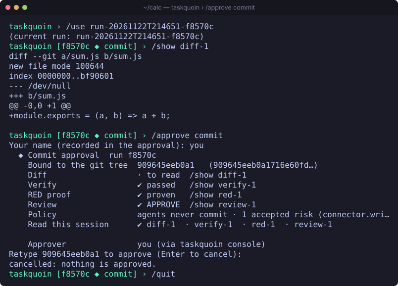

# Console commands

`taskquoin console` is an interactive shell over the same commands as the CLI, with `/` commands. Open it with
`taskquoin console`, or by running `taskquoin` alone in a terminal. It adds no workflow logic: each `/` line calls the
same function as the matching CLI command.

- [Principles](#principles)
- [The home screen](#the-home-screen)
- [Commands](#commands)
- [Approving in the console](#approving-in-the-console)
- [Keys and completion](#keys-and-completion)
- [Behaviours worth knowing](#behaviours-worth-knowing)
- [Exit code](#exit-code)

> [!NOTE]
> Screens come from a demo repository with simulated AI agents (the test doubles of Taskquoin's own test suite); every
> command is the real Taskquoin CLI.


## Principles

- **Human-only.** The console is for you, never for a model. It is not installed as slash commands inside Claude Code or
  Codex, where an agent could type them through its own tools ([ADR-0015](../adr/0015-console-human-only.md)). The real
  boundary stays the control store, which agents cannot write.
- **Nothing starts without a `/`.** Plain text prints a hint and does nothing: `Nothing starts without a command: type
  /run <request> to start a run, or /help.`
- **Command names are never translated**; their descriptions follow your [language](../guides/languages.md).

## The home screen

At start the console shows the quoin logo and the version, the context (repository, sandbox, policy) and the squad as
it really is: each agent of `taskquoin.yaml` with its role, runtime and the verdict of its gate, plus Taskquoin's own
sandboxed Verify as the tester. It is never decorative: a role that cannot run says why. The squad of the demo
repository, 100 columns wide:

```text
  ── Squad ─────────────────────────────────────────────────── 3 of 3 agents ready · Verify ready ──
  ● Architect  planner · claude      READY
  ● Developer  implementer · claude  READY
  ◐ Reviewer   challenger · codex    READY      accepted risk: connector.write
  ● Tester     verify · bubblewrap   READY
```

| Mark | Status | Meaning |
|---|---|---|
| `●` | `READY` | certified on this machine |
| `◐` | `READY` and `accepted risk: <capability>` | runs thanks to a risk you accepted with `taskquoin accept-risk` |
| `○` | `NOT READY` and the reason | will not start; `/doctor` gives the detail |

A blocked agent also adds an **Action required** line. The screen is Full (about 100 columns, 24 rows, colours),
Compact (70 to 99 columns or 16 to 23 rows) or Minimal (narrower, no colours, plain mode or an ASCII locale: one line
per agent). The logo is revealed once the screen is ready, only in a terminal with colours. `NO_COLOR` (set, not empty)
turns colours off, `TASKQUOIN_NO_ANIMATION=1` the animation; `TERM=dumb` turns off colours, the animation and the `/`
menu, so that no escape code is written at all.

## Commands

| Command | Arguments | What it does | CLI equivalent |
|---|---|---|---|
| `/run` | `<request>` | Starts a governed run and selects it. Stops at every approval. | `taskquoin run` |
| `/runs` | | Lists the runs. | `taskquoin status` |
| `/use` | `<run>` | Selects the current run (a run id from `/runs`). | |
| `/status` | | Shows the history of the current run and what to approve. | `taskquoin status <run>` |
| `/show` | `[<artifact>]` | Lists the artifacts of the current run, or prints one (`plan`, `diff-N`, `verify-N`, `red-N`...). | `taskquoin show <run> [<artifact>]` |
| `/approve` | `<plan\|commit>` | Approves the pending gate after you retype its hash. | `taskquoin approve` |
| `/resume` | | Resumes the current run if it was interrupted. | `taskquoin resume <run>` |
| `/dashboard` | | Opens the live, read-only [Dashboard](../guides/dashboard.md) on the current run, in its own process; the console draws its prompt again when you quit it (`q`). Needs a terminal: without one it prints the refusal and the console goes on. | `taskquoin dashboard` |
| `/agents` | | Lists the agents with their runtime, capabilities and skills. | |
| `/doctor` | | Machine state and certification of each agent. | `taskquoin doctor` |
| `/upgrade` | `[auto\|path\|install]` | Installed, used and measured versions of the AI tools; `auto` or `path` chooses the Claude Code binary, `install` reinstalls the measured Claude Code after you type `yes` (it uses the network). Only an explicit `/upgrade` reads the npm registry; `taskquoin console --offline` skips that. | `taskquoin upgrade` |
| `/skills` | | Installed skills and their status. | `taskquoin skills list` |
| `/help` | `[<command>]` | Lists these commands, or explains one (`/help approve`). | |
| `/quit` | | Leaves the console (`/exit` also works). | |

The prompt shows the current run by its last six characters: `taskquoin [235eaf] ›`; without a run it is
`taskquoin ›`. While the current run waits for an approval it shows `◆` and the gate: `taskquoin [235eaf ◆ commit] ›`.

Details:

- **`/run <request>`** without a request prints the usage and runs nothing. It first forgets the previously selected
  run, so a failed start never silently falls back to an old run; when the new run exists, it becomes current
  (`(current run: <id>)`).
- **`/use <run>`** needs the exact id of an existing run; otherwise `unknown run: <id> — /runs for the list`.
- **`/status`, `/show`, `/resume`, `/approve`** act on the current run and say `no run selected: /run <request> or /use <run>`
  when there is none.
- **`/agents`** prints one line per agent: `<id>  <runtime>  <capabilities>  — skills: <list>`.

## Approving in the console

`/approve plan` and `/approve commit` are deliberately slower than the CLI so that the last thing you type is the hash:

1. The gate must be the one the run is waiting for; otherwise the console says which gate it waits for, or that it is not
   waiting.
2. The first time in a session, it asks for **your name**. A line starting with `/` is never taken as a name (it cancels).
   The name is recorded as `<name> (via taskquoin console)`.
3. It shows what the approval is **bound to**, as the run recorded it (the plan's hash, or the git tree Verify and the
   review saw), then **what there is to read** with the state of each item and its `/show` hint: for the plan, `plan`
   and the critique; for the commit, `diff-N`, `verify-N`, `red-N`, `review-N`, and `ignored-N` (**Ignored files**,
   `outside the diff`, amber) when the agent created, changed or removed git-ignored files. Then **what you read in this
   session** with `/show`, the policy line and the approver.
4. It asks you to **retype the hash**. Empty input cancels; a different hash approves nothing.
5. After your last key it reads the pending approval again. If it changed since the screen was shown, nothing is
   approved: `the tree waiting for approval changed after it was shown: nothing is approved — run /approve commit again
   to see the new one.` (or the same for the plan). Otherwise it calls the same approval as `taskquoin approve <run>
   <gate> --expect <hash>`, with the same checks and messages: another branch gives `switch to taskquoin/<run id>
   first`, and a working tree that differs from the reviewed one (an untracked file, say) is re-verified and
   re-reviewed before any commit, then waits for a new approval.

```text
taskquoin [235eaf ◆ plan] › /approve plan
Your name (recorded in the approval): alice
  ◆ Plan approval  run 235eaf
    Bound to the plan  964c04e09ebe   (964c04e09ebe1c44125a…)
    Plan               · to read  /show plan
    Critique           ✔ APPROVE  /show challenge
    Policy             agents never commit · 1 accepted risk (connector.write)
    Read this session  ✔ plan  · challenge

    Approver           alice (via taskquoin console)
Retype 964c04e09ebe to approve (Enter to cancel): 964c04e09ebe
```



Because an approval must follow what is shown, lines you typed *before* a prompt appeared (type-ahead during a long
`/run`) are discarded in a terminal, with a notice. Piped input, used by scripts and tests, is kept.

## Keys and completion

| Key | Effect |
|---|---|
| `/` | Shows a menu of the commands under Run, Review, Diagnose and Console, each with its description, filtered as you type (never with `TERM=dumb`, in plain mode or in a pipe) |
| `Tab` | Completes a command (`/ap` becomes `/approve `), then its argument: the run id after `/use`, the current run's artifact after `/show`, the gate the run really waits for after `/approve`, the command after `/help`; free text gets no completion |
| `↑` `↓` | The commands typed before in this repository (in a terminal): only `/` lines, the last 500; a name or a retyped hash is never kept |
| `Ctrl-C` | Does not quit: it prints `Ctrl+C is ignored here: /quit to leave. A run in progress continues until its next approval.` |
| `Ctrl-D` | End of input: leaves the console |

## Behaviours worth knowing

- **The configuration is read once.** If `taskquoin.yaml` changes (or disappears) while the console is open, commands are
  refused with `taskquoin.yaml changed since the console was opened: /quit, then run taskquoin console again`, instead of
  running with a stale configuration.
- **No TTY required.** The console also reads from a pipe, so the real flow can be scripted and tested; the menu and
  completion appear only in a terminal.
- **Unknown command**: a typo close to a command is answered with a suggestion
  (`unknown command /stauts — did you mean /status?`); anything else with `unknown command: /xyz — /help for the list`.
- **A command that fails does not close the console**; it is remembered for the exit code.

## Exit code

`0` when every command of the session succeeded, `1` if any command or approval failed (or the console could not start,
for example without `taskquoin.yaml`).

## Learn more

- [CLI reference](cli.md) · [Runs, artifacts and events](runs-artifacts-events.md) · [The Dashboard](../guides/dashboard.md)
- [Runtime versions and upgrades](../guides/upgrade.md)
- [Security: the console is human-only](../guides/security.md#9-agents-never-commit-humans-decide)
- [ADR-0015](../adr/0015-console-human-only.md)
