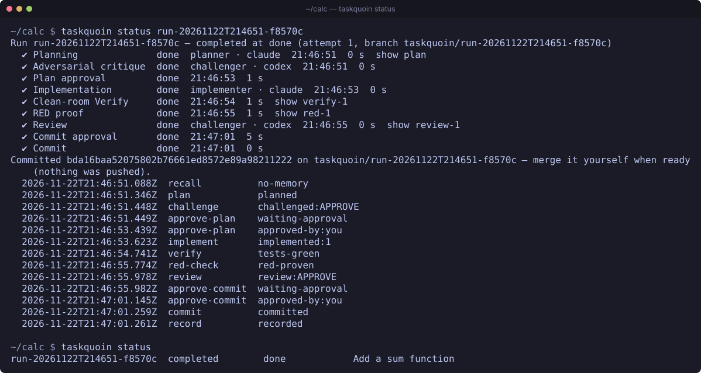
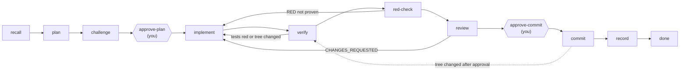
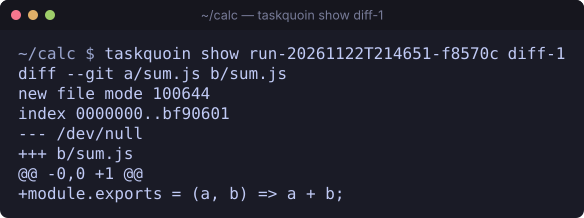
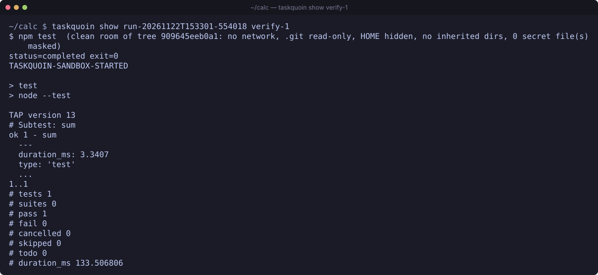
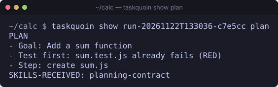
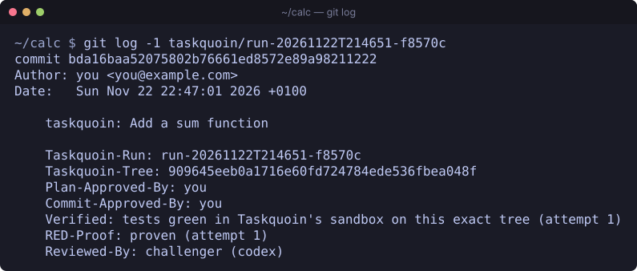

# Runs, artifacts and events

A **run** is one governed pass of the `feature-governed` workflow for one request. This page lists what a run can be
(statuses and nodes), what it produces (artifacts), what it records (events), and where all of it lives on disk.

- [Run statuses](#run-statuses)
- [Workflow nodes](#workflow-nodes)
- [Outcomes in the history](#outcomes-in-the-history)
- [Artifacts](#artifacts)
- [Events in `events.jsonl`](#events-in-eventsjsonl)
- [Where the control store lives](#where-the-control-store-lives)
- [What each file is](#what-each-file-is)

> [!NOTE]
> Screens come from a demo repository with simulated AI agents (the test doubles of Taskquoin's own test suite); every
> command is the real Taskquoin CLI.

## Run statuses

`taskquoin status` shows the status of every run.

| Status | Meaning | What you do |
|---|---|---|
| `running` | Taskquoin is driving the workflow | wait |
| `waiting-approval` | stopped at a human gate | review, then `taskquoin approve` |
| `completed` | committed on the run's branch | merge it yourself when ready (nothing is pushed) |
| `failed` | an agent ended abnormally or its gate refused it (the reason is printed) | fix the cause, start a new run |
| `needs-human` | Taskquoin stopped for a decision it will not take: tests still failing after the allowed attempts, review still requesting changes, a refusal by Verify, protected configuration changed, a diff too large to review, submodules, dependencies changed during the run | read the reason, decide, start a new run |
| `interrupted` | an adapter failed (git, the store, a provider timeout); the state is saved | `taskquoin resume <run>` |

A run id looks like `run-20261122T132603-7b8841`; its work happens on the branch `taskquoin/<run-id>`.



## Workflow nodes



| Node | What happens | Who acts |
|---|---|---|
| `recall` | Asks the local memory worker for related notes (artifact `memory`) | Taskquoin |
| `plan` | The planner writes the plan (artifact `plan`) | planner agent |
| `challenge` | Each challenger critiques the plan (artifact `challenge`) | challenger agents |
| `approve-plan` | **Gate 1.** Waits for your approval, bound to the sha256 of the plan | you |
| `implement` | The implementer changes the working tree (artifact `implement-N`) | implementer agent |
| `verify` | Taskquoin runs your tests on the candidate tree in the clean room (artifact `verify-N`) | Taskquoin |
| `red-check` | The same tests on the base commit plus only the changed test files must fail (artifact `red-N`) | Taskquoin |
| `review` | Taskquoin stores the diff, then each reviewer judges it (artifacts `diff-N`, `review-N`) | reviewer agents |
| `approve-commit` | **Gate 2.** Waits for your approval, bound to the git tree id | you |
| `commit` | Commits exactly the approved tree on the run's branch | Taskquoin |
| `record` | Saves a summary to memory (never blocks) | Taskquoin |
| `done` | The run is `completed` | |

Details that matter:

- **Gate before every agent.** Each agent is re-checked by the capability gate right before it starts; a refusal ends the run
  `failed`.
- **Rework.** If Verify fails, the tree changed during Verify, the RED proof does not hold, or the reviewers ask for changes,
  the run returns to `implement` with the logs and the review as feedback. An attempt is one pass through `implement`. At most
  **3** attempts (the first and 2 reworks); an implementer without commands (OpenCode) gets up to **5** attempts, but only
  when Taskquoin's tests fail: reviewer refusals still allow just 2 reworks. After that the run ends `needs-human`.
- **RED proof.** If only test files changed there is nothing to demonstrate: `red-N` says "not applicable" and the commit
  message says so. If the red run is inconclusive (timeout, sandbox failure, truncated output), the run stops for a human.
- **Landing gate.** Before the review, any change to a protected path stops the run (`needs-human`).
- **Tree changed after approval.** If the working tree no longer equals the approved tree at `commit`, the approval is
  dropped, Verify and review run again, and you approve the new tree.
- **Reviewers.** Every reviewer must answer a strict `VERDICT: APPROVE`; anything else, including a missing verdict line,
  is `CHANGES_REQUESTED`.

## Outcomes in the history

`status <run>` ends with the history, one line per node, `<time>  <node>  <outcome>`:

| Outcome | Node | Meaning |
|---|---|---|
| `recalled` / `no-memory` | `recall` | notes found / none (disabled, worker down, nothing relevant) |
| `planned` | `plan` | plan written |
| `challenged:APPROVE` | `challenge` | verdicts of the challengers (`challenged:a=APPROVE,b=CHANGES_REQUESTED` with several) |
| `waiting-approval` | `approve-plan`, `approve-commit` | stopped at a gate |
| `approved-by:<name>` | `approve-plan`, `approve-commit` | you approved |
| `implemented:N` | `implement` | attempt N finished |
| `tests-green` | `verify` | tests passed in the clean room |
| `tests-red:rework`, `tree-changed:rework` | `verify` | back to `implement` |
| `red-proven` | `red-check` | the changed tests fail without the production change |
| `red-not-applicable:tests-only` | `red-check` | only test files changed |
| `red-not-proven:rework` | `red-check` | the tests pass without the change: back to `implement` |
| `review:APPROVE` | `review` | every reviewer approved |
| `review:CHANGES_REQUESTED:rework` | `review` | back to `implement` |
| `tree-changed-after-approval` | `commit` | approval dropped, back to `verify` |
| `committed` | `commit` | commit created |
| `recorded` | `record` | memory step done |
| `failed`, `needs-human`, `interrupted` | the node it stopped at | the run stopped |

## Artifacts

Artifacts are what you read at the gates. Print them with `taskquoin show <run> <name>`; `taskquoin show <run>` lists
them with their size in bytes.

| Artifact | Produced by | Content |
|---|---|---|
| `memory` | `recall` | recalled notes, framed as untrusted (only when notes were found) |
| `plan` | `plan` | the plan. **Gate 1 is bound to its sha256.** |
| `challenge` | `challenge` | the challengers' answer(s); with several, one section per judge |
| `challenge-<agent>` | `challenge` | one challenger's raw answer |
| `workspace-baseline` | first `implement` | the frozen dependency roots and fingerprints of ignored files, taken once per run |
| `implement-N` | `implement` | the implementer's final message for attempt N |
| `ignored-N` | `verify` | ignored files created (`+`), changed (`~`) or removed (`-`) in your working directory since the run started: not in the diff, not verified, not committed, but still on your disk. Present only when there are some |
| `verify-N` | `verify` | the test command, the clean-room description and the complete output, with `status=` and `exit=` |
| `red-N` | `red-check` | the RED proof: `RESULT: they failed as required (RED proven)`, `they PASSED ...`, `INCONCLUSIVE ...` or `not applicable`, then the log |
| `diff-N` | `review` | the diff of the tree that was verified. **Gate 2 is bound to the git tree id**; this is what you read |
| `review-N` | `review` | the reviewers' answer(s) |
| `review-N-<agent>` | `review` | one reviewer's raw answer |

`N` is the attempt number. Reviewers receive a version of the diff in which secret files and binaries are replaced by
placeholders; you read the full `diff-N`.







Artifacts are **write-once and content-addressed**: the file is named by the sha256 of its bytes, stored read-only, and
the hash is checked every time it is read (`hash mismatch` means tampering). A run's `state.json` maps each artifact name
to its hash.

Text printed by `show` has terminal escape sequences removed and control characters shown as `?`.

## Events in `events.jsonl`

Each run appends one JSON object per line to `runs/<run-id>/events.jsonl`. Events are an audit trail of **metadata only**:
only strings, numbers, booleans and `null` are kept (strings are cut at 256 characters), and any field that could carry
free text or file content (`prompt`, `task`, `output`, `content`, `stdin`, `stdout`, `stderr`, `terminalMessage`,
`resultText`, `message`, `input`) is dropped. Every event has a `ts` (UTC, ISO 8601). The file is mode `0600`.

| `type` | Written when | Fields |
|---|---|---|
| `node.transition` | a node finishes | `runId`, `node`, `outcome`, `next`, `attempts` |
| `agent.finished` | an agent ran | `runId`, `agent`, `runtime`, `label`, `status`, `costUsd` (`null` when the runtime does not report it), `digest` (digest of the effective invocation) |
| `risk.accepted` | an agent ran thanks to an accepted risk | `runId`, `agent`, `capability`, `approvedBy`, `expires` |
| `run.waiting-approval`, `run.failed`, `run.needs-human`, `run.interrupted` | the run stops | `runId`, `node` |
| `approval` | you approved a gate | `node` (`approve-plan` or `approve-commit`), `approvedBy`, `binding` (the full hash) |
| `verify.result` | Verify finished | `runId`, `attempt`, `passed`, `exitCode`, `tree`, `ignoredChanges` |
| `red.result` | the RED proof finished | `runId`, `attempt`, `redFailed` (`true`, `false` or `null`), `inconclusive` (when true), `tree` |

An example, from a completed demo run (shortened):

```json
{"ts":"2026-11-22T13:26:04.165Z","type":"risk.accepted","runId":"run-20261122T132603-7b8841","agent":"challenger","capability":"connector.write","approvedBy":"you","expires":"2030-01-01"}
{"ts":"2026-11-22T13:26:05.008Z","type":"approval","node":"approve-plan","approvedBy":"you","binding":"bb8543009fa8942b037ea8653153c9826a54a5b110d82186e795cedcb8bf925c"}
{"ts":"2026-11-22T13:26:06.098Z","type":"verify.result","runId":"run-20261122T132603-7b8841","attempt":1,"passed":true,"exitCode":0,"tree":"909645eeb0a1716e60fd724784ede536fbea048f","ignoredChanges":0}
{"ts":"2026-11-22T13:26:07.010Z","type":"red.result","runId":"run-20261122T132603-7b8841","attempt":1,"redFailed":true,"tree":"9848f565e24c7a44a7aac20e4b244ddc85822d41"}
```

Because the log holds no prompts or output, you can share it safely; the artifacts, which do hold them, stay in the
control store.

### The commit

The commit Taskquoin creates carries the evidence in its message:

```text
taskquoin: add a sum function

Taskquoin-Run: run-20261122T132603-7b8841
Taskquoin-Tree: 909645eeb0a1716e60fd724784ede536fbea048f
Plan-Approved-By: you
Commit-Approved-By: you
Verified: tests green in Taskquoin's sandbox on this exact tree (attempt 1)
RED-Proof: proven (attempt 1)
Reviewed-By: challenger (codex)
```



## Where the control store lives

The control store is **outside your repository**, where agents cannot write it (that is what makes approvals
unforgeable). It is under `$XDG_STATE_HOME/taskquoin`, which is `~/.local/state/taskquoin` when `XDG_STATE_HOME` is not set.
Each repository gets its own directory named by the first 16 hex characters of the sha256 of its physical path:

```text
$XDG_STATE_HOME/taskquoin/
├── preferences.json            # your language (and other per-user choices)
├── machine.json                # the PATH shortcut, so that `setup --remove` removes exactly what it created
├── opencode/                   # Taskquoin's own OpenCode connection and per-run directories
└── repos/
    └── <16-hex repository id>/
        ├── manifest.json       # what `init` created, with hashes, for `uninstall`
        ├── runs/
        │   └── <run-id>/
        │       ├── state.json  # the run's state
        │       ├── events.jsonl
        │       └── lock        # present while a Taskquoin process works on the run
        ├── artifacts/
        │   ├── <sha256>            # an artifact's bytes
        │   └── <sha256>.meta.json  # its media type, producer, size, creation time
        ├── policies/           # the per-run policy read by the PreToolUse hook
        ├── approvals/
        │   └── risk-acceptances.json
        ├── skills/
        │   ├── quarantine/<name>-<hash12>/   # files/ and report.json
        │   ├── approved/<name>-<hash12>/
        │   └── skills.lock.json
        ├── verify/             # clean rooms, created for Verify and deleted afterwards
        └── scratch/            # temporary files of Taskquoin's git calls
```

Every directory is created `0700`. Before using one, Taskquoin checks that it is a real directory (not a symlink), owned by
you, not writable by group or others, and not inside the repository; otherwise it refuses.

> [!TIP]
> `taskquoin uninstall` keeps this directory for audit. `taskquoin uninstall --purge-state` deletes the repository's part of it.

## What each file is

| File | Role |
|---|---|
| `runs/<id>/state.json` | The run's state, rewritten atomically (temp file and rename, mode `0600`) at every step. Fields below. |
| `runs/<id>/events.jsonl` | The audit trail described above. |
| `runs/<id>/lock` | The PID of the process working on the run, so two commands cannot change the same run at once. A lock left by a dead process is taken over. |
| `artifacts/<sha256>` | An artifact, read-only (`0400`). |
| `artifacts/<sha256>.meta.json` | `mediaType`, `producer`, `size`, `createdAt`. |
| `approvals/risk-acceptances.json` | The list written by `taskquoin accept-risk`: `agent`, `capability`, `reason`, `expires`, `approvedBy`, `runtimeVersion`, `failureDigest`, `createdAt`. One per agent and capability. |
| `skills/skills.lock.json` | The approved and revoked skills: `name`, `source`, `treeHash`, `status`, `approvedBy`, `approvedAt`, `acceptedFindings`, `revokedBy`, `revokedAt`. |
| `manifest.json` | Files `init` created and their sha256, so `uninstall` removes only what you did not modify. |

`state.json` holds:

| Field | Content |
|---|---|
| `runId`, `workflow`, `request` | identity (`workflow` is always `feature-governed`) |
| `status`, `current`, `reason` | the status, the current node, and why the run stopped |
| `attempts`, `reviewReworks`, `revision` | counters; `revision` increases at every save |
| `artifacts` | artifact name to sha256 |
| `approvals` | for `approve-plan` and `approve-commit`: `approvedBy`, `at`, `binding` |
| `verifiedTree`, `reviewedTree` | the git tree that passed Verify, and the one reviewed (and approvable) |
| `lastVerify`, `lastVerdict`, `redProof` | latest results (`proven` or `not-applicable` for the RED proof) |
| `inheritedRoots` | the dependency directories Verify inherits, fixed at the first implementation |
| `judged` | judges' answers already obtained, so a resume never asks or pays twice |
| `branch`, `base`, `commit` | the run's branch, the commit it started from, and the commit created |
| `configDigest`, `proseLanguage` | digest of `taskquoin.yaml` at the start; the language of the agents' prose (absent for English) |
| `history` | `{ node, outcome, at }` per step |

## Learn more

- [CLI reference](cli.md): `run`, `status`, `show`, `approve`, `resume`
- [Configuration](configuration.md) · [Capabilities](capabilities.md)
- [Security](../guides/security.md#9-agents-never-commit-humans-decide)
- ADRs: [0005 control plane outside the workspace](../adr/0005-control-plane-outside-workspace.md),
  [0013 tree-based governance](../adr/0013-tree-based-governance.md), [0014 clean room](../adr/0014-verify-in-a-clean-room.md)
