# أول تشغيل خاضع للحوكمة

هذا الدليل ترجمة [للصفحة المرجعية الإنجليزية](../getting-started/first-run.md). هو ترجمة آلية تحقق منها اختبارات القائمين على الصيانة على مستوى الأوامر، وليس مراجعًا ناطقًا أصليًا باللغة.

يأخذك هذا الدليل من مجلد فارغ إلى commit موثّق أنشأه Taskquoin، أمرًا بعد أمر. ستنشئ مشروعًا صغيرًا باختبار فاشل، وتترك Taskquoin يخطط ويطبق إصلاحًا بواسطة وكلاء الذكاء الاصطناعي، وتوافق على العمل مرتين: مرة بعد قراءة الخطة، ومرة بعد قراءة الـ diff بالضبط. في كل خطوة ترى ما يفعله Taskquoin، ولماذا يتوقف، وما الذي توقّع عليه.

- [ما الذي ستبنيه](#ما-الذي-ستبنيه)
- [الخطوة 1: أنشئ مشروعًا باختبار فاشل](#الخطوة-1-أنشئ-مشروعًا-باختبار-فاشل)
- [الخطوة 2: هيّئ Taskquoin](#الخطوة-2-هيّئ-taskquoin)
- [الخطوة 3: نفّذ commit للإعدادات](#الخطوة-3-نفّذ-commit-للإعدادات)
- [الخطوة 4: افحص الجهاز بـ doctor](#الخطوة-4-افحص-الجهاز-بـ-doctor)
- [اقبل مخاطرة تفهمها](#اقبل-مخاطرة-تفهمها)
- [الخطوة 5: ابدأ التشغيل](#الخطوة-5-ابدأ-التشغيل)
- [الخطوة 6: اقرأ الخطة ووافق عليها](#الخطوة-6-اقرأ-الخطة-ووافق-عليها)
- [الخطوة 7: التنفيذ وVerify والمراجعة](#الخطوة-7-التنفيذ-وverify-والمراجعة)
- [الخطوة 8: اقرأ الـ commit ووافق عليه](#الخطوة-8-اقرأ-الـ-commit-ووافق-عليه)
- [الخطوة 9: ادمج النتيجة](#الخطوة-9-ادمج-النتيجة)
- [متابعة تشغيل في Dashboard](#متابعة-تشغيل-في-dashboard)
- [حين لا تسير الأمور كما هو مخطط](#حين-لا-تسير-الأمور-كما-هو-مخطط)
- [اعرف المزيد](#اعرف-المزيد)

> [!NOTE]
> الشاشات مأخوذة من مستودع تجريبي يستخدم وكلاء ذكاء اصطناعي محاكين (النسخ البديلة للاختبار من مجموعة اختبارات Taskquoin نفسها)؛ وكل أمر هو واجهة Taskquoin الحقيقية. مع Claude Code وCodex الحقيقيين تكون صياغة الخطة والمراجعة من الوكلاء أنفسهم، ويستغرق التشغيل بضع دقائق بدل ثوانٍ. كل ما عدا ذلك مطابق.

قبل أن تبدأ، [ثبّت Taskquoin](../getting-started/installation.md) وتأكد من توفر Node 22.18+ وgit و`bubblewrap` و`socat`، ومن تثبيت Claude Code على الأقل (ويفضّل Codex أيضًا) وتسجيل الدخول إليه.

## ما الذي ستبنيه

التشغيل (run) سير عمل ثابت. المعيّنان هما الموافقتان البشريتان؛ لا يتجاوزهما شيء من دونك.

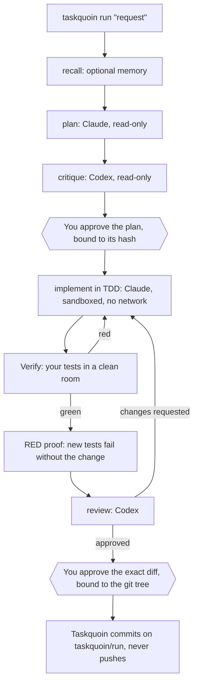

تمر ثلاث أفكار عبر الدليل كله:

- **الوكلاء يقترحون، وTaskquoin ينفّذ.** لا يقوم الوكلاء بأي commit أبدًا. يبني Taskquoin الـ commit من الشجرة التي جرى التحقق منها ومراجعتها والموافقة عليها ([ADR-0011](../adr/0011-agents-never-commit.md)).
- **موافقتك مرتبطة بـ hash.** أنت توافق على ما قرأته بالضبط، لا على "التشغيل" ([ADR-0013](../adr/0013-tree-based-governance.md)).
- **الاختبارات تعمل في غرفة نظيفة.** لا يخبر النموذجُ Taskquoin أبدًا بأن الاختبارات نجحت؛ بل يشغّلها Taskquoin بنفسه ([ADR-0014](../adr/0014-verify-in-a-clean-room.md)).

## الخطوة 1: أنشئ مشروعًا باختبار فاشل

المشروع حاسبة من دالة واحدة. الاختبار موجود، والدالة غير موجودة.

```shell
$ mkdir calc && cd calc
$ git init -q -b main
```

أنشئ `package.json`:

```json
{
  "name": "calc",
  "private": true,
  "scripts": { "test": "node --test" }
}
```

أنشئ `sum.test.js`:

```js
const test = require('node:test');
const assert = require('node:assert');

test('sum', () => {
  const sum = require('./sum.js');
  assert.strictEqual(sum(2, 3), 5);
});
```

أنشئ `.gitignore` (لا تكون الاعتماديات ومخرجات البناء جزءًا من diff في Taskquoin أبدًا):

```text
node_modules/
```

نفّذ commit له (مخرجات الأوامر أدناه معروضة بالإنجليزية):

```shell
$ git add .
$ git commit -m "calc: a failing test for sum"
$ npm test
not ok 1 - sum
  error: Cannot find module './sum.js'
```

الاختبار أحمر كما هو متوقع. الشرط المسبق الوحيد لدى Taskquoin لأي مشروع هو مستودع git بشجرة عمل نظيفة: يرفض `taskquoin run` البدء إذا كانت لديك تغييرات غير مُنفَّذة بـ commit، لأنه لا يخلط تغييراته بتغييراتك أبدًا.

## الخطوة 2: هيّئ Taskquoin

```shell
$ taskquoin init
```

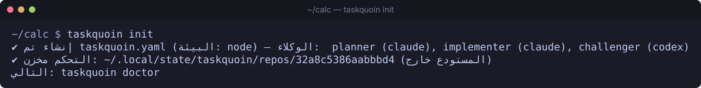

أنجز `init` ثلاثة أمور:

1. اكتشف الحزمة التقنية (`node`؛ وهو يعرف أيضًا `npm test` وPHPUnit وpytest و`go test` وMaven وغيرها) وكتب `taskquoin.yaml` في جذر المستودع.
2. بحث عن أدوات الذكاء الاصطناعي على جهازك واختار الوكلاء: هنا `planner` و`implementer` على Claude Code، و`challenger` على Codex. إذا كانت أداة مفقودة يذكر الملف ذلك؛ ومع وجود Claude Code فقط يكون المراجع Claude أيضًا. ومع وجود OpenCode فقط يكتب `init` إعدادًا بالكامل على OpenCode.
3. أنشأ **مخزن تحكم** خارج المستودع، تحت `${XDG_STATE_HOME:-~/.local/state}/taskquoin/`. هنا تقيم حالة التشغيل والموافقات وقبولات المخاطر. لا يستطيع الوكلاء الكتابة هناك، وهذا ما يجعل الموافقة غير قابلة للتزوير ([ADR-0005](../adr/0005-control-plane-outside-workspace.md)).

لا يكتب `init` فوق ملف `taskquoin.yaml` موجود أبدًا. وإذا شغّلت `init` وكانت هناك أنظمة ذكاء اصطناعي أخرى متاحة (مفتاح API في بيئتك، أو Ollama محلي)، فإنه يعرضها ويقترحها على شكل **تعليقات** في الملف: إلغاء التعليق قرارك، لأنه يعني أن شيفرة ذلك المشروع ستُرسل إليها.

### ملف `taskquoin.yaml` المُولَّد

افتحه. هو قصير ويمكنك قراءته كله. إليك إياه قسمًا قسمًا.

```yaml
# Taskquoin project configuration — see docs/architecture.md. Protected: agents can never edit this file.
version: 1
stack: node
```

`version` هو إصدار المخطط. يحدد `stack` القيم الافتراضية للغرفة النظيفة: أي مجلدات اعتماديات تُركَّب للقراءة فقط لاختباراتك (لـ `node`: `node_modules`). التعليق الأول وعد: **لا يستطيع الوكلاء تعديل هذا الملف أبدًا.** إذا لمسه أحدهم أثناء التشغيل يتوقف التشغيل ولا يُنفَّذ أي commit.

```yaml
agents:
  planner:
    runtime: claude
    description: "Read-only planner: turns a request into a minimal, test-first implementation plan."
    prompt: You plan; you never modify files. Read the repository, then produce the plan requested.
    capabilities:
      fs.read:
        - "**"
    maxTurns: 30
    skills:
      - planning-contract
```

**الوكيل** دور مرتبط ببيئة تشغيل (`claude` أو `codex` أو `opencode` أو `api` للحكم). `capabilities` هي ما يُسمح للوكيل بفعله: يستطيع planner قراءة كل شيء (`fs.read: "**"`) ولا شيء غير ذلك، فليس لديه shell ولا أداة كتابة. `skills` تعليمات مثبّتة بـ hash (`planning-contract` من إنتاج الجهة الأولى). يحدّ `maxTurns` من عدد أدوار الوكيل.

```yaml
  implementer:
    runtime: claude
    description: Implements an approved task with strict TDD (RED → GREEN → REFACTOR).
    prompt: "You implement exactly the approved task. Write a failing test first, make it pass with the simplest change, then refactor. Never commit: Taskquoin verifies and commits."
    capabilities:
      fs.read:
        - "**"
      fs.write:
        - "**"
      shell.run:
        - npm test
        - npm test -- *
        - node --test *
    maxTurns: 40
    skills:
      - tdd
```

يستطيع implementer كتابة الملفات وتشغيل قائمة سماح صغيرة من أوامر الاختبار (`shell.run`) ليعمل بأسلوب الاختبار أولًا. تعمل هذه الأوامر داخل صندوق حماية نظام التشغيل الخاص ببيئة التشغيل، من دون شبكة. ومع ذلك، فإن تشغيله للاختبارات لتغذيته الراجعة فقط: النتيجة المعتمدة هي التي ينتجها Taskquoin في Verify.

```yaml
  challenger:
    runtime: codex
    description: Independent, read-only adversarial reviewer of plans and diffs.
    prompt: "You are an independent reviewer. Challenge the plan or diff: correctness, security, missing tests, over-engineering. Report blocking and non-blocking findings with file:line. Do not modify files."
    capabilities:
      fs.read:
        - "**"
    skills:
      - code-review
```

يقوم **challenger** بنقد الخطة ومراجعة الـ diff. هو من مزوّد مختلف عن implementer عن قصد، وهو للقراءة فقط: يجب ألا يستطيع "إصلاح" ما ينتقده.

```yaml
policy:
  mandatory:
    - fs.write
    - net.egress
    - config.modify
    - connector.write
    - vcs.commit
    - vcs.push
connectors: {}
memory:
  claudeMem:
    enabled: true
```

يسرد `policy.mandatory` القيود التي **يجب** أن تُفرض بآلية حتى يبدأ الوكيل: لا كتابة خارج نطاقه، ولا شبكة، ولا تغيير للإعدادات المحمية، ولا كتابة عن بُعد، ولا commit، ولا push. إذا كان إصدار بيئة التشغيل لديك لا يستطيع فرض أحدها فإن الوكيل يُرفض بدل أن يبدأ بقاعدة ليست سوى نصيحة ([ADR-0002](../adr/0002-enforcement-classes.md)، [ADR-0003](../adr/0003-hooks-enforce-prose-asks.md)). `connectors` فارغ: لا نظام بعيد متصل ([ADR-0012](../adr/0012-remote-connectors-by-exception.md)). `memory.claudeMem` اختياري: عند تفعيله يُرسل ملخص منظَّم لكل تشغيل منتهٍ إلى عامل [claude-mem](https://github.com/thedotmack/claude-mem) المحلي لديك، ويُقرأ تذكير قصير عند بدء التشغيل. اجعله `false` إذا كنت لا تشغّل claude-mem. (الشاشات في هذا الدليل تستخدم `false`.)

> [!TIP]
> إذا كانت اختباراتك تحتاج إلى ملف مُتجاهَل ليس مجلد اعتماديات، مثل `dist/` مبني أو `.env.test`، فأضفه صراحةً. عندها يُركَّب للقراءة فقط في الغرفة النظيفة ويُجمَّد بالنسبة إلى الوكيل:
>
```yaml
verify:
  inherit:
    - dist
```
>
> يمكن لمشروع لا تُشغَّل اختباراته بـ `npm test` أن يضبط `verify.command`.

يمكنك أيضًا استخدام أنظمة ذكاء اصطناعي أخرى كحكّام (أي مزوّد متوافق مع OpenAI) أو OpenCode كـ planner وimplementer؛ راجع [ADR-0016](../adr/0016-judges-by-api.md) و[ADR-0017](../adr/0017-opencode-without-commands.md).

## الخطوة 3: نفّذ commit للإعدادات

`taskquoin.yaml` جزء من مشروعك، لذا نفّذ commit له. وهذا يمنح Taskquoin أيضًا شجرة العمل النظيفة التي يحتاجها:

```shell
$ git add taskquoin.yaml
$ git commit -m "chore: taskquoin"
```

## الخطوة 4: افحص الجهاز بـ doctor

```shell
$ taskquoin doctor
```

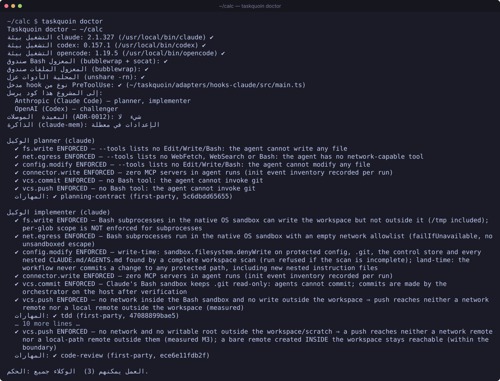

`doctor` هو الجزء الصادق في Taskquoin. اقرأه من الأعلى إلى الأسفل:

- تسرد الكتلة الأولى بيئات التشغيل التي عُثر عليها مع إصداراتها وعلامة صح عندما يكون الإصدار هو الذي قاسه Taskquoin، ثم صناديق الحماية (bubblewrap وsocat) والـ hook.
- **This project's code is sent to** يسرد كل مزوّد سيتلقى شيفرتك، لكل وكيل. يعمل Taskquoin على جهازك؛ ولا يرى شيئًا إلا أنظمة الذكاء الاصطناعي التي تضبطها ([ADR-0010](../adr/0010-local-first-no-leak.md)).
- ثم، لكل وكيل، كل قيد إلزامي مع فئته و**الآلية التي تفرضه**، مثل `net.egress ENFORCED — Bash subprocesses run in the native OS sandbox with an empty network allowlist`. علامة الصح تعني أنه معتمد لإصدار بيئة التشغيل هذا؛ وعلامة الخطأ تعني أن الوكيل لن يبدأ.
- السطر الأخير هو الحكم: `Verdict: all 3 agents can run.` أو `Verdict: 2 of 3 agents can run — refused agents will not be started.`

في العرض التجريبي يوجد سطر واحد بعلامة خطأ (المخرجات معروضة بالإنجليزية):

```text
Agent challenger (codex)
  …
  ✖ connector.write — mandatory restriction "connector.write" (deny-all) on codex 0.157.1: claimed ENFORCED but the mechanism is not measured (inferred). Execution refused (ADR-0002).
```

يقول Codex إنه يفرض `connector.write` (لا كتابة على الموصلات البعيدة)، لكن Taskquoin لا يملك طريقة لقياس هذا الادعاء، لذلك لا يحتسبه مفروضًا. يُرفض challenger: سينتهي التشغيل بـ `failed at challenge` مع `gate refused agent challenger`. وفي هذه الحالة عليك اتخاذ قرار.

## اقبل مخاطرة تفهمها

**المخاطرة المقبولة** هي قرارك الموقَّع والمؤرَّخ والمحدَّد النطاق بتشغيل وكيل رغم قيد واحد لا يمكن قياسه. هو قرار المالك، لا المطوّر، ولا الوكيل أبدًا:

```shell
$ taskquoin accept-risk challenger connector.write \
    --reason "Codex reviews read-only; no connector configured" \
    --expires 2026-12-31 --as you
```

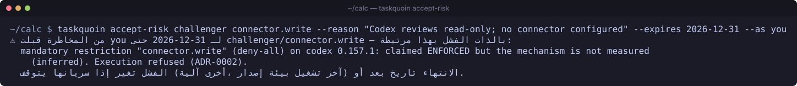

الخيارات الأربعة كلها مطلوبة: `--reason` و`--expires` (تاريخ مستقبلي حقيقي بصيغة `YYYY-MM-DD`) و`--as` (اسمك)، إضافة إلى الوكيل والـ capability. لاحظ ماهية القبول:

- **مرتبط بالإخفاق نفسه بالضبط.** يخزّن بصمة لرسالة الإخفاق. إذا تغيّر إصدار بيئة التشغيل أو الآلية فلن يكون الإخفاق هو نفسه، ويتوقف القبول عن السريان.
- **مؤرَّخ.** ويتوقف أيضًا عن السريان بعد تاريخ الانتهاء.
- **مخزَّن خارج المستودع**، في مخزن التحكم. لا يستطيع أحد إضافته بتعديل `taskquoin.yaml`، ولا يستطيع أي وكيل كتابته.
- **ضيق.** يسري فقط على هذا الوكيل وهذه الـ capability. يُرفض لـ capability لا تخفق، وهو غير متاح لحكّام API (فهم يُفحصون دائمًا).

شغّل `doctor` مرة أخرى. السطر الآن تحذير بدل علامة خطأ، والحكم هو `all 3 agents can run` (المخرجات معروضة بالإنجليزية):

```text
  ⚠ connector.write accepted risk (approved by you until 2026-12-31: Codex reviews read-only; no connector configured) — mandatory restriction "connector.write" (deny-all) on codex 0.157.1: claimed ENFORCED but the mechanism is not measured (inferred). Execution refused (ADR-0002).
```

يعرض `taskquoin check challenger` التفاصيل نفسها لوكيل واحد:

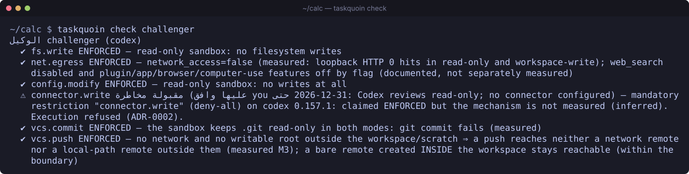

> [!IMPORTANT]
> لا تقبل مخاطرة إلا حين تفهمها ويطابق الوضع سببك: هنا يراجع Codex للقراءة فقط ولا يملك مشروعك موصِّلًا، فلا يمكن أن تحدث "كتابة على موصِّل" أصلًا. لا تقبل مخاطرة لمجرد إزالة سطر أحمر. على وجه الخصوص:
>
> - لا تقبلها أبدًا لـ `fs.write` أو `net.egress` أو `vcs.commit` أو `vcs.push` لوكيل يكتب فعلًا أو يشغّل أوامر، ما لم تستطع تسمية الضابط التعويضي؛
> - لا تقبلها أبدًا بسبب غامض: فهو يُسجَّل في الموافقة ويعرضه `doctor`؛
> - فضّل انتهاءً قريبًا: القبول تذكير بإعادة الفحص بعد الترقية؛
> - إذا كانت الآلية *مقيسة على أنها تخفق* فقم بالترقية أو غيّر بيئة التشغيل بدلًا من ذلك.

تشغيلك `taskquoin accept-risk` بنفسك أمر مقصود: لو استطاعت الوحدة التفاعلية أو وكيل فعل ذلك لما كان للضبط أي معنى.

## الخطوة 5: ابدأ التشغيل

```shell
$ taskquoin run "Add a sum function"
```

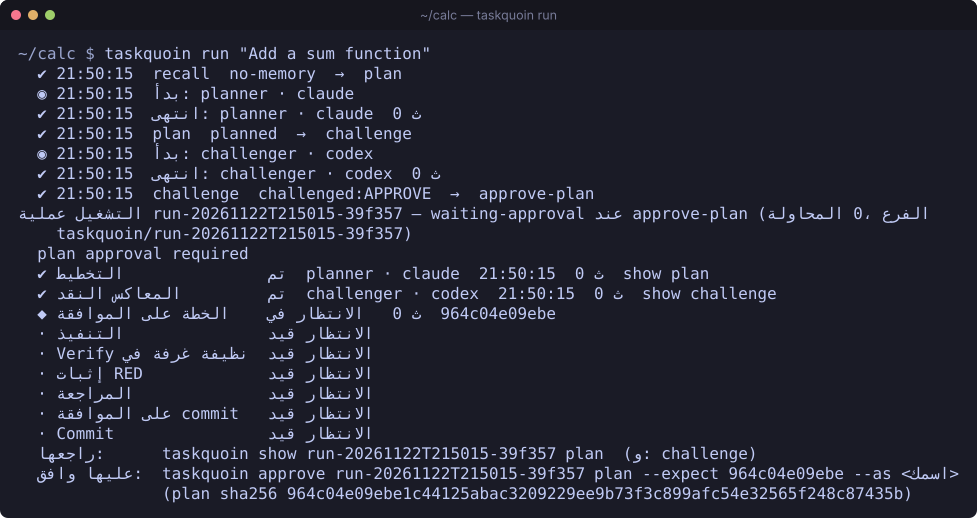

تبقى الطرفية صامتة أثناء عمل الوكلاء، ثم تطبع أين توقف. بالترتيب، فعل Taskquoin ما يلي:

1. **Preflight.** تحقق Taskquoin من أن الإعدادات تعرّف كل دور، وأن المهارات صالحة للاستخدام، وأن الأدوار للقراءة فقط هي فعلًا للقراءة فقط، وأن لدى حكّام API مفاتيحهم. يجب أن تكون شجرة العمل نظيفة. كما يمر كل وكيل بالبوابة نفسها التي يمر بها `doctor` قبل أول استخدام له مباشرة: الوكيل المرفوض ينهي التشغيل بحالة `failed`.
2. **الفرع.** أنشأ الفرع `taskquoin/run-20261122T132108-d17040` وانتقل إليه. فرعك `main` لم يُمَس.
3. **Recall.** سأل عامل الذاكرة، إن كان مفعّلًا، عن ملاحظات ذات صلة. يظهر في السجل `recall no-memory` عندما لا توجد ملاحظات.
4. **الخطة.** قرأ `planner` (Claude، للقراءة فقط) المستودع وكتب خطة: الهدف، والاختبار الواجب كتابته أولًا، والملفات، والخطوات، والمخاطر.
5. **النقد.** تحدّى `challenger` (Codex، للقراءة فقط) تلك الخطة باستقلال وختم بسطر `VERDICT:`.
6. **البوابة.** توقف سير العمل عند `approve-plan`. سينتظر ما شئت من الوقت.

معرّف التشغيل (`run-20261122T132108-d17040`) طابع زمني مع لاحقة عشوائية. تستخدمه في كل الأوامر التالية. يسرد `taskquoin status` بلا وسيط عمليات التشغيل (المخرجات معروضة بالإنجليزية):

```shell
$ taskquoin status
run-20261122T132108-d17040  waiting-approval approve-plan    Add a sum function
```

## الخطوة 6: اقرأ الخطة ووافق عليها

يعرض `status <run>` سجل تشغيل واحد، وعند البوابة الأمر الدقيق الذي يوافق عليها:

```shell
$ taskquoin status run-20261122T132108-d17040
```

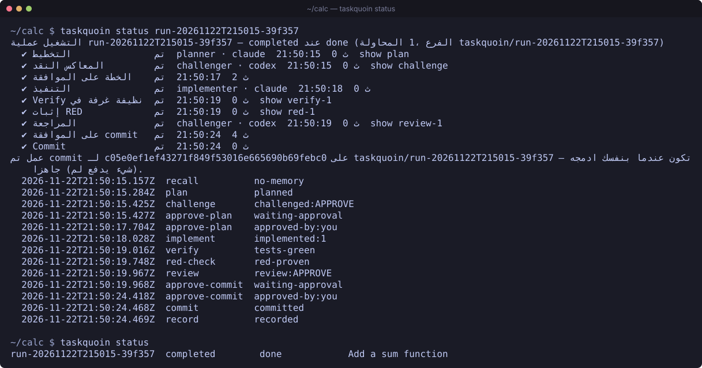

كل سطر في السجل هو خطوة من سير العمل مع نتيجتها (`planned` و`challenged:APPROVE` و`waiting-approval`).

والآن **اقرأ ما أنت على وشك الموافقة عليه**:

```shell
$ taskquoin show run-20261122T132108-d17040 plan
```

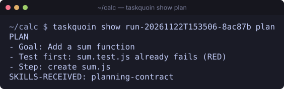

مخرجات الأوامر معروضة بالإنجليزية كما تطبعها واجهة سطر الأوامر:

```shell
$ taskquoin show run-20261122T132108-d17040 challenge
Review: plan checked.
VERDICT: APPROVE
```

يسرد `show <run>` بلا اسم artifact كل ما خُزّن حتى الآن مع حجمه بالبايت. وتشمل الخطة الصادرة عن وكيل حقيقي أيضًا الملفات المراد تعديلها، والاختبارات الواجب كتابتها أولًا، والمخاطر. الـ challenge هو الرأي الثاني المستقل: قد يسرد ملاحظات حاجزة وغير حاجزة. إذا كانت الخطة خاطئة فلا توافق عليها: ابدأ run جديدًا بطلب أدق.

### لماذا الـ hash

السطر المهم هو الأخير في `status` (المخرجات معروضة بالإنجليزية):

```text
Approve it:  taskquoin approve run-20261122T132108-d17040 plan --expect 964c04e09ebe --as <your name>
             (plan sha256 964c04e09ebe1c44125abac3209229ee9b73f3c899afc54e32565f248c87435b)
```

`964c04e09ebe` هو بداية SHA-256 لملف الخطة الذي قرأته للتو. الموافقة لا تعني "أوافق على هذا التشغيل"، بل تعني "أوافق على **الخطة التي hash الخاص بها 964c04e09ebe**". لو أمكن أن تتغير الخطة بين قراءتك وموافقتك (إعادة محاولة، أو عملية أخرى، أو أداة مخترَقة) فلن يتطابق الـ hash بعد ذلك وسيرفض Taskquoin. وهو أيضًا ما يسجله الـ commit، فيستطيع أي شخص لاحقًا تدقيق ما وافق عليه شخص ما.

> [!NOTE]
> `--expect` ليس كلمة مرور. إنه دليل على أنك اطلعت على الـ artifact الذي يوشك النظام أن يتصرف بناءً عليه: تنسخه من `status` بعد القراءة. في [الوحدة التفاعلية](../getting-started/console.md) تعيد كتابته للتأكيد.

وافق:

```shell
$ taskquoin approve run-20261122T132108-d17040 plan --expect 964c04e09ebe --as you
```

`--as` هو اسمك؛ يُسجَّل بوصفه `Plan-Approved-By` في الـ commit. تؤدي الموافقة على الخطة إلى استئناف سير العمل، الذي يستمر حتى البوابة التالية.

### الـ hash الخاطئ مرفوض

جرّب hash ليس هو المعلَّق (المخرجات معروضة بالإنجليزية):

```shell
$ taskquoin approve run-20261122T132108-d17040 plan --expect 000000000000 --as you
taskquoin approve: expected 000000000000 does not match the pending artifact 964c04e09ebe… — re-read it before approving
```

لم يُوافَق على شيء ولم يتغير التشغيل. يحدث الشيء نفسه إذا وافقت على بوابة لا ينتظرها التشغيل. أُخذت لقطة الشاشة أدناه بعد اكتمال التشغيل، لذا تعرض هذا النوع من الرفض:

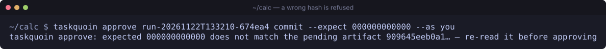

رمز الخروج عند الرفض هو 1. أما الأمر المكتوب خطأً (غياب `--expect` أو `--as`) فيخرج بالرمز 2.

## الخطوة 7: التنفيذ وVerify والمراجعة

بعد `approve … plan` يعمل Taskquoin من دونك:

1. **التنفيذ بأسلوب TDD.** يعمل `implementer` (Claude) على الفرع، داخل صندوق حماية بيئة التشغيل، من دون شبكة ومن دون قدرة على إجراء commit. يكتب الاختبارات أو يعدلها أولًا، ثم أبسط شيفرة تجعلها تنجح.
2. **Verify، في غرفة نظيفة.** يأخذ Taskquoin الشجرة بالضبط كما تركها implementer ويشغّل اختباراتك (`npm test`) بنفسه في نسخة مؤقتة خارج مستودعك: بلا شبكة، و`.git` للقراءة فقط، وHOME مخفي، والملفات السرية محجوبة، ولا يُركَّب للقراءة فقط إلا مجلدات اعتماديات الحزمة التقنية (و`verify.inherit` لديك). الاختبار الناجح الذي اعتمد على شيء غير مُنفَّذ بـ commit يفشل هنا، وهذا هو المقصود.
3. **RED proof.** ثم يزيل Taskquoin تغيير شيفرة الإنتاج ويعيد تشغيل الاختبارات المتغيرة. يجب أن **تفشل**. الاختبار الذي ينجح من دون التغيير لا يختبر شيئًا. والإثبات ميكانيكي: لا يبيّن أن الاختبار يؤكد السلوك الصحيح (هذا هو دور المراجعة وأنت).
4. **المراجعة.** يراجع `challenger` الـ diff مقابل الخطة، مع سجلات verify وRED. ويختم بسطر `VERDICT:`.

إذا كانت الاختبارات حمراء، أو فشل RED proof، أو طلبت المراجعة تغييرات، يرسل Taskquoin الملاحظات إلى implementer لإعادة عمل تلقائية (حتى 3 محاولات تنفيذ، وبحد أقصى جولتي إعادة عمل بعد مراجعة مرفوضة). ثم يتوقف التشغيل عند البوابة الثانية.

## الخطوة 8: اقرأ الـ commit ووافق عليه

التشغيل ينتظر الآن مجددًا. انظر إليه (المخرجات معروضة بالإنجليزية):

```shell
$ taskquoin status run-20261122T132108-d17040
Run run-20261122T132108-d17040 — waiting-approval at approve-commit (attempt 1, branch taskquoin/run-20261122T132108-d17040)
  commit approval required (bound to the exact tree)
  Review it:   taskquoin show run-20261122T132108-d17040 diff-1  (and: verify-1, red-1, review-1)
  Approve it:  taskquoin approve run-20261122T132108-d17040 commit --expect 909645eeb0a1 --as <your name>
               (git tree 909645eeb0a1716e60fd724784ede536fbea048f)
```

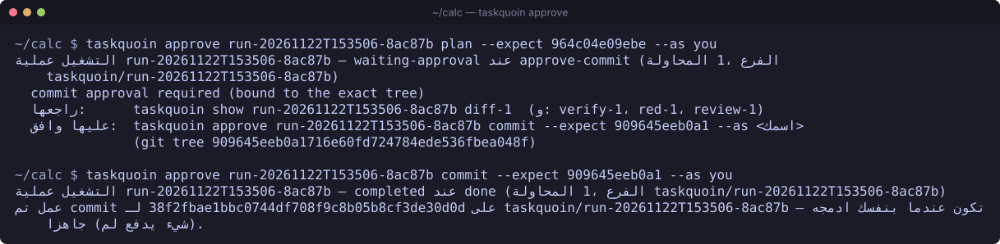

هذه المرة الـ hash هو **شجرة git** التي اجتازت Verify والمراجعة. اقرأ الـ artifacts الأربعة للمحاولة 1. الرقم هو رقم المحاولة؛ وبعد إعادة العمل تقرأ الأعلى.

### `diff-1`: التغيير بالضبط

```shell
$ taskquoin show run-20261122T132108-d17040 diff-1
```

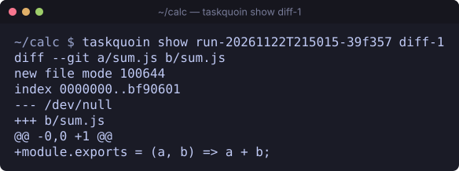

هذا ما سيُنفَّذ بـ commit، لا أكثر. لو غيّر الوكيل ملفًا محميًا (CI لديك، أو `.claude/`، أو `AGENTS.md`، أو `taskquoin.yaml`) لتوقف التشغيل مع `protected configuration changed`. الملفات التي يخفيها `.gitignore` لديك لكن أنشأها الوكيل مدرجة في `ignored-1`؛ وليست في الـ diff، ولا يُتحقق منها، ولا يُنفَّذ لها commit.

### `verify-1`: اختباراتك، يشغّلها Taskquoin

```shell
$ taskquoin show run-20261122T132108-d17040 verify-1
```

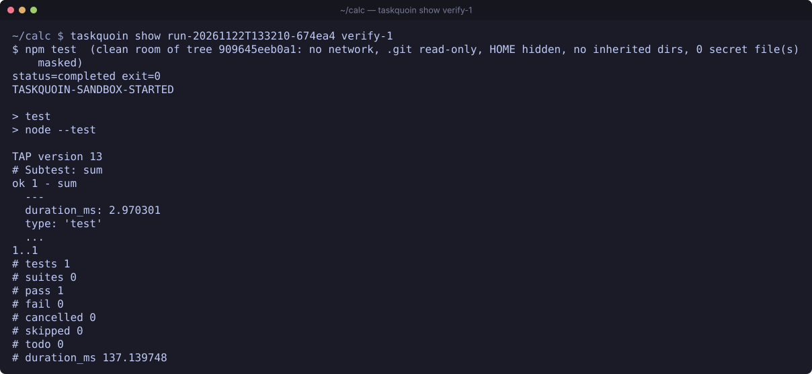

يذكر الترويس ما كانت عليه الغرفة النظيفة (`no network, .git read-only, HOME hidden, … 0 secret file(s) masked`) ولأي شجرة (`909645eeb0a1`، وهو الـ hash نفسه الذي ستوافق عليه). `exit=0` و`# pass 1` يأتيان من مشغّل الاختبارات، لا من ادعاء نموذج.

### `red-1`: الدليل على أهمية الاختبار

مخرجات الأوامر معروضة بالإنجليزية كما تطبعها واجهة سطر الأوامر:

```shell
$ taskquoin show run-20261122T132108-d17040 red-1
TASKQUOIN RED PROOF — tests run on base + test changes only (tree 9848f565e24c); they must FAIL.
RESULT: they failed as required (RED proven).

$ npm test  (clean room of tree 9848f565e24c: no network, .git read-only, HOME hidden, no inherited dirs, 0 secret file(s) masked)
status=failed exit=1
…
not ok 1 - sum
  error: Cannot find module './sum.js'
  code: 'MODULE_NOT_FOUND'
```

هنا أُزيل ملف الإنتاج الجديد `sum.js`، فلم يستطع الاختبار تحميله وفشل. هذا الفشل هو RED proof. يعامل Taskquoin خطأ الاستيراد الناتج عن ميزة في ملف *جديد* على أنه RED المتوقع. وإذا لم تتغير إلا ملفات الاختبار (إضافة اختبارات فقط) يُسجَّل الإثبات بأنه "not applicable".

### `review-1`: الرأي الثاني

مخرجات الأوامر معروضة بالإنجليزية كما تطبعها واجهة سطر الأوامر:

```shell
$ taskquoin show run-20261122T132108-d17040 review-1
Review: diff checked against the plan.
VERDICT: APPROVE
```

اقرأ الملاحظات، لا الحكم وحده. يظهر `ignored-1` في القائمة فقط عندما يكون هناك ما يُقرأ.

### وافق على الـ commit

إذا كنت راضيًا فوافق بالـ hash المأخوذ من `status` (المخرجات معروضة بالإنجليزية):

```shell
$ taskquoin approve run-20261122T132108-d17040 commit --expect 909645eeb0a1 --as you
Run run-20261122T132108-d17040 — completed at done (attempt 1, branch taskquoin/run-20261122T132108-d17040)
Committed a3c6b801de5f4356750f53870557e2fdd19958ee on taskquoin/run-20261122T132108-d17040 — merge it yourself when ready (nothing was pushed).
```

يجب تنفيذ `approve … commit` والمستودع على فرع التشغيل (`taskquoin/<run>`)؛ وإلا فإنه يجيب `switch to taskquoin/<run> first`. يعيد Taskquoin قراءة شجرة العمل قبل الـ commit. وإذا تغير أي شيء منذ نظرت، فلا تعود موافقتك سارية: يعيد التحقق والمراجعة ويطلب منك الموافقة على الشجرة الجديدة.

ثم يبني Taskquoin الـ commit **من شجرة git الموافَق عليها نفسها**، لا من `git add`. ويبدو هكذا:

```shell
$ git log -1 taskquoin/run-20261122T132108-d17040
```

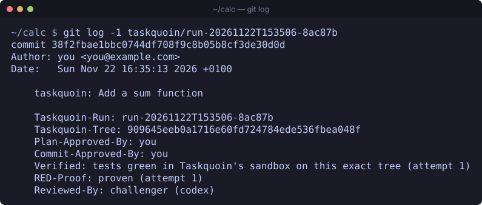

مخرجات الأوامر معروضة بالإنجليزية كما تطبعها واجهة سطر الأوامر:

```text
taskquoin: Add a sum function

Taskquoin-Run: run-20261122T132108-d17040
Taskquoin-Tree: 909645eeb0a1716e60fd724784ede536fbea048f
Plan-Approved-By: you
Commit-Approved-By: you
Verified: tests green in Taskquoin's sandbox on this exact tree (attempt 1)
RED-Proof: proven (attempt 1)
Reviewed-By: challenger (codex)
```

التذييلات (trailers) هي سجل التدقيق داخل الـ commit نفسه:

| التذييل | المعنى |
|---|---|
| `Taskquoin-Run` | التشغيل الذي أنتج هذا الـ commit |
| `Taskquoin-Tree` | شجرة git التي جرى التحقق منها ومراجعتها والموافقة عليها. هي شجرة هذا الـ commit |
| `Plan-Approved-By` | الاسم المعطى بـ `--as` عند بوابة الخطة |
| `Commit-Approved-By` | الاسم المعطى بـ `--as` عند بوابة الـ commit |
| `Verified` | كانت الاختبارات خضراء في الغرفة النظيفة على هذه الشجرة بالضبط |
| `RED-Proof` | فشلت الاختبارات المتغيرة من دون التغيير (`proven`، أو `not applicable` للتغييرات التي تخص الاختبارات فقط) |
| `Reviewed-By` | الوكلاء الذين راجعوا ووافقوا؛ ويضيف حكم API سطره الخاص |

في النهاية يعرض `taskquoin status <run>` السجل كله، من `recall` إلى `commit` و`record`.

## الخطوة 9: ادمج النتيجة

لا يقوم Taskquoin **بـ push أبدًا** ولا يدمج في فرعك أبدًا. الـ commit موجود على `taskquoin/<run>`، وهو الفرع الذي أنت عليه. ادمجه بنفسك، أو افتح pull request منه:

```shell
$ git switch main
$ git merge --ff-only taskquoin/run-20261122T132108-d17040
$ npm test
```

> [!WARNING]
> لا يشغّل Taskquoin hooks الـ commit في مستودعك، لأنها قد تحتوي شيفرة عدّلها الوكيل. شغّل hooks وأدوات lint وCI بنفسك عند الدمج.

فروع `taskquoin/<run>` ملكك: احذفها عندما لا تحتاج إليها (`git branch -d taskquoin/<run>`).

## متابعة تشغيل في Dashboard

أثناء عمل التشغيل، افتح طرفية ثانية في المستودع نفسه وشغّل Dashboard. إنه للقراءة فقط: يعرض خط المعالجة، والموافقة التي تنتظرك (مع بداية الـ hash الخاص بها)، والوكلاء، والسجل.

```shell
$ taskquoin dashboard
```

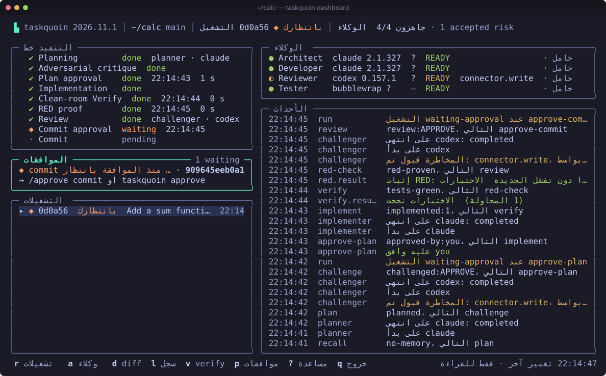

اضغط `d` لقراءة الـ diff: يبحث `/`، وينتقل `n` و`N` بين النتائج، ويُعدّ الملف مقروءًا حين تصل إلى نهايته.

اضغط `p` لفتح مركز الموافقة. لا يوافق أي مفتاح من تلقاء نفسه: تكتب اسمك ثم تعيد كتابة الأحرف الاثني عشر من الـ hash. اخرج بـ `q`؛ يستمر التشغيل الذي وافقت عليه. [دليل Dashboard (بالإنجليزية)](../guides/dashboard.md).

## حين لا تسير الأمور كما هو مخطط

تتبع رسائل الخطأ في Taskquoin لغتك، لكن رسائل محرك التشغيل (`failed` و`needs-human` و`interrupted`) تكون دائمًا بالإنجليزية. يسرد الجدول ما ستصادفه في أغلب الأحيان.

| ما تراه | معناه | ما تفعله |
|---|---|---|
| `taskquoin run: the working tree has uncommitted changes` | لا يخلط Taskquoin تغييراته بتغييراتك أبدًا | نفّذ commit لتغييراتك أو خزّنها بـ stash |
| `failed … gate refused agent X` | تعذّر اعتماد وكيل على هذا الجهاز | يقول `taskquoin doctor` السبب: إصدار بيئة التشغيل، أو صندوق حماية مفقود، أو مخاطرة لم تقبلها |
| `needs-human … tests still failing after 3 attempts` | لم تعطِ ثلاث محاولات اختبارات خضراء | تولَّ الأمر يدويًا على فرع التشغيل، أو ابدأ run جديدًا بطلب أدق |
| `needs-human … no failing test demonstrates the change` | تنجح الاختبارات حتى من دون تغيير الإنتاج، فهي لا تختبره | اقرأ `red-N`؛ اكتب (أو اطلب) اختبارًا يفشل قبل التغيير. إعادة الهيكلة أو تعديل التوثيق بلا اختبار جديد ينتهي هنا: نفّذ له commit بنفسك من الفرع |
| `needs-human … RED proof inconclusive` | تعذّر تشغيل الإثبات على نحو صحيح (مهلة، أو صندوق حماية، أو شجرة تعذّرت إعادة بنائها). هذا ليس إثباتًا | اقرأ `red-N`. مجلد عملك لم يُمَس |
| `needs-human … review still requests changes after N attempts` | ظل المراجع يرفض | اقرأ `review-N` وقرّر؛ العمل موجود في الفرع |
| `needs-human … dependencies changed during the run` | تغيّر `node_modules` (أو `vendor` أو `.venv`) أثناء التشغيل، فلم يُتحقق من شيء به | أعد التثبيت (`npm ci`) وابدأ run جديدًا. لا تشغّل `npm install` أثناء التشغيل |
| `needs-human … protected configuration changed` | لمس الوكيل إعدادات محمية (CI أو `.claude/` أو `AGENTS.md` أو `taskquoin.yaml`) | لم يُنفَّذ أي commit؛ افحص الفرع |
| تنجح الاختبارات عندك لكنها تفشل في Verify | تستخدم ملفًا مُتجاهَلًا غائبًا عن الغرفة النظيفة | أضفه إلى `verify.inherit` |
| `does not match the pending artifact` | الـ hash الذي أعطيته ليس المعلَّق | اقرأ بـ `show` وانسخ الـ hash من `status` |
| `switch to taskquoin/<run> first` | لست على فرع التشغيل | `git switch taskquoin/<run>` |
| `taskquoin.yaml changed since the run started` | تغيّرت الإعدادات أثناء التشغيل | ابدأ run جديدًا |
| `interrupted` | أوقف خطأ تقني (git، أو القرص، أو HTTP 503 من حكم) التشغيل | `taskquoin resume <run>` |

### حين تبقى الاختبارات حمراء

إذا فشل Verify يعطي Taskquoin الـ implementer سجل الفشل والمراجعة ويحاول مجددًا، حتى ثلاث محاولات تنفيذ (يحصل implementer على OpenCode، الذي ليس له أمر خاص به، على مزيد من إعادات العمل). فإذا ظلت الاختبارات حمراء ينتهي التشغيل بالحالة `needs-human` والسبب `tests still failing after 3 attempts`. لا يوجد commit ولا طلب موافقة.

يُحفظ كل شيء: يحتوي `taskquoin show <run> verify-3` على آخر سجل، ويحتفظ الفرع `taskquoin/<run>` بعمل الوكيل. يمكنك المتابعة يدويًا على ذلك الفرع، أو بدء run جديد بطلب أدق. التشغيل بحالة `needs-human` لا يُستأنف تلقائيًا.

### `resume`: بعد انقطاع

يصبح التشغيل `interrupted` حين يعطّله شيء خارج سير العمل (خطأ شبكة أثناء الوصول إلى حكم، أو قرص ممتلئ، أو دخول جهازك في السكون). تُحفظ الحالة في كل خطوة، وتُحفظ إجابات الحكّام واحدة واحدة، لذا لا يستدعي الاستئناف حكمًا مرتين ولا يدفع له مرتين:

```shell
$ taskquoin resume run-20261122T132108-d17040
```

لا يقبل `resume` إلا تشغيلًا حالته `interrupted`. وفي أي حالة أخرى يخبرك بذلك، مثل `taskquoin resume: only an interrupted run can be resumed (status completed)`. إذا كانت الحالة `needs-human` أو `failed` فابدأ run جديدًا.

### قاعدة عملية

إذا كنت لا تعرف ماذا تفعل، شغّل `taskquoin status <run>`: يطبع الحالة والسجل والأمر التالي بدقة. ويجيب `taskquoin doctor` عن أي سؤال يتعلق بالجهاز.

## اعرف المزيد

- [الوحدة التفاعلية](../getting-started/console.md): سير العمل نفسه مع `/run` و`/approve`
- [التثبيت](../getting-started/installation.md)
- [ADR-0011, agents never commit](../adr/0011-agents-never-commit.md)
- [ADR-0013, tree-based governance](../adr/0013-tree-based-governance.md)
- [ADR-0014, Verify in a clean room](../adr/0014-verify-in-a-clean-room.md)
- [ADR-0002, enforcement classes](../adr/0002-enforcement-classes.md)
- [ADR-0005, control plane outside the workspace](../adr/0005-control-plane-outside-workspace.md)
- [ADR-0016, judges by API](../adr/0016-judges-by-api.md) و[ADR-0017, OpenCode without commands](../adr/0017-opencode-without-commands.md)
