# Ihr erster kontrollierter Lauf

> Dieses Tutorial ist eine Übersetzung der [englischen Referenzseite](../getting-started/first-run.md). Es handelt sich um eine maschinelle Übersetzung, die von den Maintainern durch Tests der Befehle geprüft wurde, nicht von einem muttersprachlichen Reviewer.

Dieses Tutorial führt Sie Befehl für Befehl von einem leeren Ordner zu einem verifizierten Commit, den Taskquoin erstellt. Sie
legen ein winziges Projekt mit einem fehlschlagenden Test an, lassen Taskquoin mit KI-Agenten einen Fix planen und
implementieren und geben die Arbeit zweimal frei: einmal, wenn Sie den Plan gelesen haben, und einmal, wenn Sie den exakten
Diff gelesen haben. Bei jedem Schritt sehen Sie, was Taskquoin tut, warum es anhält und was Sie unterschreiben.

- [Was Sie bauen werden](#was-sie-bauen-werden)
- [Schritt 1: Projekt mit fehlschlagendem Test anlegen](#schritt-1-projekt-mit-fehlschlagendem-test-anlegen)
- [Schritt 2: Taskquoin initialisieren](#schritt-2-taskquoin-initialisieren)
- [Schritt 3: Konfiguration committen](#schritt-3-konfiguration-committen)
- [Schritt 4: Rechner mit doctor prüfen](#schritt-4-rechner-mit-doctor-prüfen)
- [Ein Risiko akzeptieren, das Sie verstehen](#ein-risiko-akzeptieren-das-sie-verstehen)
- [Schritt 5: Lauf starten](#schritt-5-lauf-starten)
- [Schritt 6: Plan lesen und freigeben](#schritt-6-plan-lesen-und-freigeben)
- [Schritt 7: Implementierung, Verify und Review](#schritt-7-implementierung-verify-und-review)
- [Schritt 8: Commit lesen und freigeben](#schritt-8-commit-lesen-und-freigeben)
- [Schritt 9: Ergebnis mergen](#schritt-9-ergebnis-mergen)
- [Einen Lauf im Dashboard verfolgen](#einen-lauf-im-dashboard-verfolgen)
- [Wenn nicht alles wie geplant läuft](#wenn-nicht-alles-wie-geplant-läuft)
- [Mehr erfahren](#mehr-erfahren)

> [!NOTE]
> Die Screens stammen aus einem Demo-Repository mit simulierten KI-Agenten (den Testdoubles der Testsuite von Taskquoin
> selbst); jeder Befehl ist die echte Taskquoin-CLI. Mit echtem Claude Code und Codex stammt der Wortlaut von Plan und
> Review von den Agenten selbst, und ein Lauf dauert einige Minuten statt Sekunden. Alles andere ist identisch.

Bevor Sie beginnen, [installieren Sie Taskquoin](../getting-started/installation.md) und stellen Sie sicher, dass Node 22.18+, git,
`bubblewrap` und `socat` verfügbar sind und dass mindestens Claude Code (idealerweise auch Codex) installiert und
angemeldet ist.

## Was Sie bauen werden

Ein Lauf ist ein fester Workflow. Die beiden Rauten sind die beiden menschlichen Freigaben; ohne Sie geht nichts an
ihnen vorbei.

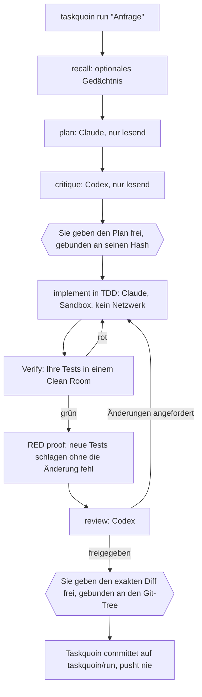

Drei Ideen ziehen sich durch das ganze Tutorial:

- **Agenten schlagen vor, Taskquoin handelt.** Agenten committen nie. Der Commit wird von Taskquoin aus dem Tree gebaut,
  der verifiziert, geprüft und freigegeben wurde ([ADR-0011](../adr/0011-agents-never-commit.md)).
- **Ihre Freigabe ist an einen Hash gebunden.** Sie geben genau das frei, was Sie gelesen haben, nicht „den Lauf"
  ([ADR-0013](../adr/0013-tree-based-governance.md)).
- **Tests laufen in einem Clean Room.** Das Modell sagt Taskquoin nie, dass Tests bestehen; Taskquoin führt sie selbst aus
  ([ADR-0014](../adr/0014-verify-in-a-clean-room.md)).

## Schritt 1: Projekt mit fehlschlagendem Test anlegen

Das Projekt ist ein Taschenrechner mit einer einzigen Funktion. Der Test existiert; die Funktion nicht.

```shell
$ mkdir calc && cd calc
$ git init -q -b main
```

Legen Sie `package.json` an:

```json
{
  "name": "calc",
  "private": true,
  "scripts": { "test": "node --test" }
}
```

Legen Sie `sum.test.js` an:

```js
const test = require('node:test');
const assert = require('node:assert');

test('sum', () => {
  const sum = require('./sum.js');
  assert.strictEqual(sum(2, 3), 5);
});
```

Legen Sie `.gitignore` an (Abhängigkeiten und Build-Ausgaben sind nie Teil eines Taskquoin-Diffs):

```text
node_modules/
```

Committen Sie alles:

```shell
$ git add .
$ git commit -m "calc: a failing test for sum"
$ npm test
not ok 1 - sum
  error: Cannot find module './sum.js'
```

Der Test ist erwartungsgemäß rot. Ein Git-Repository mit sauberem Arbeitsverzeichnis ist die einzige Voraussetzung, die
Taskquoin an ein Projekt stellt: `taskquoin run` weigert sich zu starten, wenn Sie nicht committete Änderungen haben,
denn es vermischt seine Änderungen nie mit Ihren.

## Schritt 2: Taskquoin initialisieren

```shell
$ taskquoin init
```

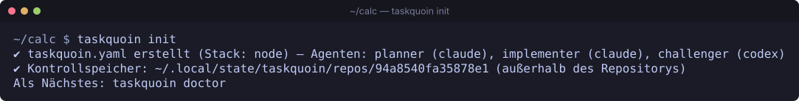

`init` hat drei Dinge getan:

1. Es hat den Stack erkannt (`node`; es kennt auch `npm test`, PHPUnit, pytest, `go test`, Maven und weitere) und
   `taskquoin.yaml` im Wurzelverzeichnis des Repositorys geschrieben.
2. Es hat auf Ihrem Rechner nach KI-Werkzeugen gesucht und Agenten gewählt: hier `planner` und `implementer` auf Claude
   Code und `challenger` auf Codex. Fehlt ein Werkzeug, steht das in der Datei; mit nur Claude Code ist auch der Reviewer
   Claude. Mit nur OpenCode schreibt `init` eine reine OpenCode-Konfiguration.
3. Es hat einen **Control Store** außerhalb des Repositorys angelegt, unter `${XDG_STATE_HOME:-~/.local/state}/taskquoin/`.
   Dort liegen Laufzustand, Freigaben und Risikoakzeptanzen. Agenten können dort nicht schreiben, und genau das macht eine
   Freigabe fälschungssicher ([ADR-0005](../adr/0005-control-plane-outside-workspace.md)).

`init` überschreibt nie eine vorhandene `taskquoin.yaml`. Wenn Sie `init` ausgeführt haben, während weitere KIs verfügbar
waren (ein API-Schlüssel in Ihrer Umgebung, ein lokales Ollama), listet es diese auf und schlägt sie als **Kommentare** in
der Datei vor: Sie zu aktivieren ist Ihre Entscheidung, denn dann wird der Code dieses Projekts an sie gesendet.

### Die generierte `taskquoin.yaml`

Öffnen Sie sie. Sie ist kurz, und Sie können sie ganz lesen. Hier ist sie, Abschnitt für Abschnitt.

```yaml
# Taskquoin project configuration — see docs/architecture.md. Protected: agents can never edit this file.
version: 1
stack: node
```

`version` ist die Schemaversion. `stack` wählt die Standardwerte für den Clean Room: welche Abhängigkeitsverzeichnisse für
Ihre Tests schreibgeschützt eingebunden werden (bei `node`: `node_modules`). Der erste Kommentar ist ein Versprechen:
**Agenten können diese Datei nie bearbeiten.** Berührt einer sie während eines Laufs, stoppt der Lauf und es wird nichts
committet.

```yaml
agents:
  planner:
    runtime: claude
    description: "Read-only planner: turns a request into a minimal, test-first implementation plan."
    prompt: You plan; you never modify files. Read the repository, then produce the plan requested.
    capabilities:
      fs.read:
        - "**"
    maxTurns: 30
    skills:
      - planning-contract
```

Ein **Agent** ist eine Rolle, die an eine Runtime gebunden ist (`claude`, `codex`, `opencode` oder `api` für einen Judge).
`capabilities` legt fest, was der Agent tun darf: Der Planner kann alles lesen (`fs.read: "**"`) und sonst nichts, er hat
also weder Shell noch Schreibwerkzeug. `skills` sind per Hash fixierte Anweisungen (`planning-contract` stammt vom
Projekt selbst). `maxTurns` begrenzt die Züge des Agenten.

```yaml
  implementer:
    runtime: claude
    description: Implements an approved task with strict TDD (RED → GREEN → REFACTOR).
    prompt: "You implement exactly the approved task. Write a failing test first, make it pass with the simplest change, then refactor. Never commit: Taskquoin verifies and commits."
    capabilities:
      fs.read:
        - "**"
      fs.write:
        - "**"
      shell.run:
        - npm test
        - npm test -- *
        - node --test *
    maxTurns: 40
    skills:
      - tdd
```

Der Implementer kann Dateien schreiben und eine kleine Allowlist von Testbefehlen (`shell.run`) ausführen, damit er
testgetrieben arbeiten kann. Diese Befehle laufen in der eigenen OS-Sandbox der Runtime, ohne Netzwerk. Dennoch dient sein
Testlauf nur seinem eigenen Feedback: Maßgeblich ist das Ergebnis, das Taskquoin in Verify erzeugt.

```yaml
  challenger:
    runtime: codex
    description: Independent, read-only adversarial reviewer of plans and diffs.
    prompt: "You are an independent reviewer. Challenge the plan or diff: correctness, security, missing tests, over-engineering. Report blocking and non-blocking findings with file:line. Do not modify files."
    capabilities:
      fs.read:
        - "**"
    skills:
      - code-review
```

Der **Challenger** kritisiert den Plan und prüft den Diff. Er stammt absichtlich von einem anderen Anbieter als der
Implementer und ist nur lesend: Er darf nicht in der Lage sein, das zu „reparieren“, was er kritisiert.

```yaml
policy:
  mandatory:
    - fs.write
    - net.egress
    - config.modify
    - connector.write
    - vcs.commit
    - vcs.push
connectors: {}
memory:
  claudeMem:
    enabled: true
```

`policy.mandatory` listet die Einschränkungen auf, die durch einen Mechanismus durchgesetzt werden **müssen**, damit ein
Agent starten darf: kein Schreiben außerhalb seines Bereichs, kein Netzwerk, keine Änderung geschützter Konfiguration,
kein Schreiben auf entfernte Systeme, kein Commit, kein Push. Kann die vorhandene Runtime-Version eine davon nicht
durchsetzen, wird der Agent abgelehnt, statt mit einer Regel zu starten, die nur ein Ratschlag ist
([ADR-0002](../adr/0002-enforcement-classes.md), [ADR-0003](../adr/0003-hooks-enforce-prose-asks.md)).
`connectors` ist leer: Es ist kein entferntes System angebunden ([ADR-0012](../adr/0012-remote-connectors-by-exception.md)).
`memory.claudeMem` ist optional: Ist es aktiviert, wird eine strukturierte Zusammenfassung jedes beendeten Laufs an Ihren
lokalen [claude-mem](https://github.com/thedotmack/claude-mem)-Worker gesendet, und zu Beginn eines Laufs wird eine kurze
Erinnerung gelesen. Setzen Sie es auf `false`, wenn Sie claude-mem nicht betreiben. (Die Screens in diesem Tutorial
verwenden `false`.)

> [!TIP]
> Wenn Ihre Tests eine ignorierte Datei benötigen, die kein Abhängigkeitsverzeichnis ist, etwa ein gebautes `dist/` oder
> eine `.env.test`, fügen Sie sie ausdrücklich hinzu. Sie wird dann im Clean Room schreibgeschützt eingebunden und für den
> Agenten eingefroren:
>
> ```yaml
> verify:
>   inherit:
>     - dist
> ```
>
> Ein Projekt, dessen Tests nicht über `npm test` laufen, kann `verify.command` setzen.

Sie können auch andere KIs als Judges verwenden (jeden OpenAI-kompatiblen Anbieter) oder OpenCode als Planner und
Implementer; siehe [ADR-0016](../adr/0016-judges-by-api.md) und [ADR-0017](../adr/0017-opencode-without-commands.md).

## Schritt 3: Konfiguration committen

`taskquoin.yaml` gehört zu Ihrem Projekt, also committen Sie sie. Das verschafft Taskquoin auch das saubere
Arbeitsverzeichnis, das es braucht:

```shell
$ git add taskquoin.yaml
$ git commit -m "chore: taskquoin"
```

## Schritt 4: Rechner mit doctor prüfen

```shell
$ taskquoin doctor
```

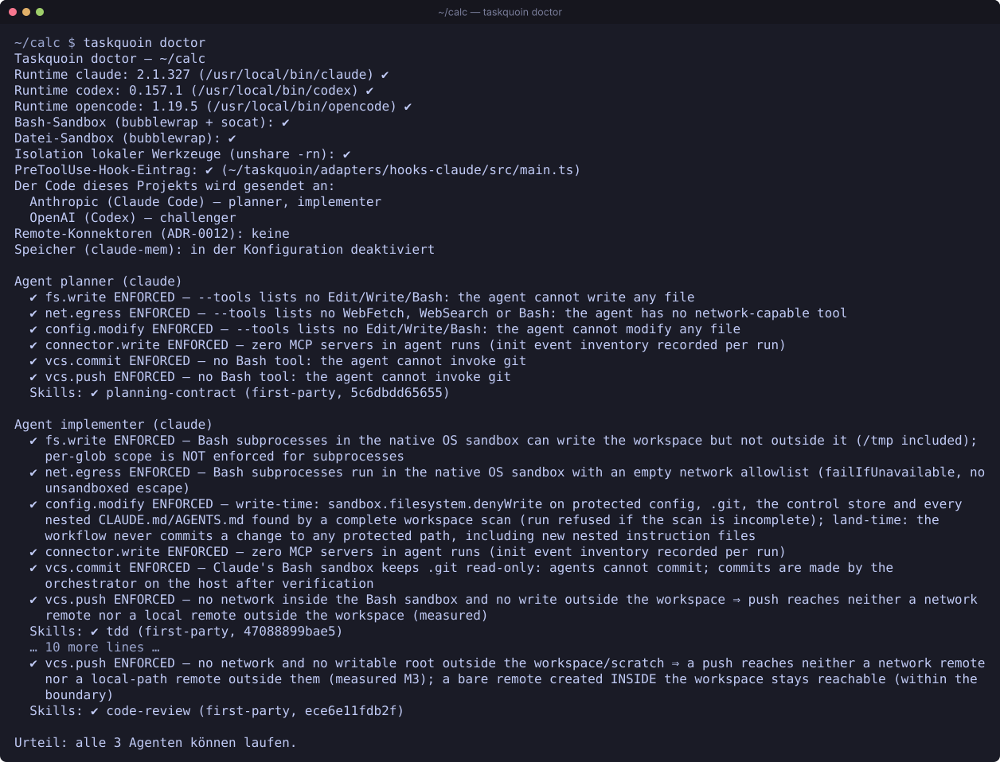

`doctor` ist der ehrliche Teil von Taskquoin. Lesen Sie die Ausgabe von oben nach unten:

- Der erste Block listet die gefundenen Runtimes mit Versionen und einem Häkchen, wenn die Version die ist, die Taskquoin
  gemessen hat, dann die Sandboxes (bubblewrap und socat) und den Hook.
- **This project's code is sent to** listet pro Agent jeden Anbieter auf, der Ihren Code erhält. Taskquoin läuft auf Ihrem
  Rechner; nur die KIs, die Sie konfigurieren, sehen etwas ([ADR-0010](../adr/0010-local-first-no-leak.md)).
- Danach folgt pro Agent jede verpflichtende Einschränkung mit ihrer Klasse und **dem Mechanismus, der sie durchsetzt**,
  zum Beispiel `net.egress ENFORCED — Bash subprocesses run in the native OS sandbox with an empty network allowlist`. Ein
  Häkchen bedeutet, dass sie für diese Runtime-Version zertifiziert ist; ein Kreuz bedeutet, dass der Agent nicht startet.
- Die letzte Zeile ist das Urteil: `Verdict: all 3 agents can run.` oder `Verdict: 2 of 3 agents can run — refused agents will not be started.`

Die Ausgabe der CLI wird hier auf Englisch gezeigt (die lokalisierten Screenshots zeigen die lokalisierte Ausgabe). In der
Demo ist eine Zeile ein Kreuz:

```text
Agent challenger (codex)
  …
  ✖ connector.write — mandatory restriction "connector.write" (deny-all) on codex 0.157.1: claimed ENFORCED but the mechanism is not measured (inferred). Execution refused (ADR-0002).
```

Codex sagt, es setze `connector.write` durch (kein Schreiben auf entfernte Connectors), aber Taskquoin kann diese
Behauptung nicht messen und zählt sie daher nicht als durchgesetzt. Der Challenger wird abgelehnt: Ein Lauf würde als
`failed at challenge` mit `gate refused agent challenger` enden. Hier müssen Sie eine Entscheidung treffen.

## Ein Risiko akzeptieren, das Sie verstehen

Ein **akzeptiertes Risiko** ist Ihre signierte, datierte und begrenzte Entscheidung, einen Agenten trotz einer
Einschränkung auszuführen, die sich nicht messen lässt. Es ist die Entscheidung des Owners, nicht des Entwicklers und nie
des Agenten:

```shell
$ taskquoin accept-risk challenger connector.write \
    --reason "Codex reviews read-only; no connector configured" \
    --expires 2026-12-31 --as you
```

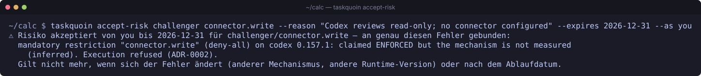

Alle vier Optionen sind erforderlich: `--reason`, `--expires` (ein echtes zukünftiges Datum, `YYYY-MM-DD`) und `--as`
(Ihr Name), dazu der Agent und die Capability. Beachten Sie, was die Akzeptanz ist:

- **An genau diesen Fehler gebunden.** Sie speichert einen Digest der Fehlermeldung. Ändert sich die Runtime-Version oder
  der Mechanismus, ist der Fehler nicht mehr derselbe, und die Akzeptanz gilt nicht mehr.
- **Datiert.** Sie gilt nach dem Ablaufdatum ebenfalls nicht mehr.
- **Außerhalb des Repositorys gespeichert**, im Control Store. Niemand kann eine durch Bearbeiten von `taskquoin.yaml`
  hinzufügen, und kein Agent kann sie schreiben.
- **Eng gefasst.** Sie gilt nur für diesen Agenten und diese Capability. Für eine Capability, die nicht fehlschlägt, wird
  sie abgelehnt, und für API-Judges ist sie nicht verfügbar (sie werden immer geprüft).

Führen Sie `doctor` erneut aus. Die Zeile ist jetzt eine Warnung statt eines Kreuzes, und das Urteil lautet `all 3 agents can run`:

```text
  ⚠ connector.write accepted risk (approved by you until 2026-12-31: Codex reviews read-only; no connector configured) — mandatory restriction "connector.write" (deny-all) on codex 0.157.1: claimed ENFORCED but the mechanism is not measured (inferred). Execution refused (ADR-0002).
```

`taskquoin check challenger` zeigt dasselbe Detail für einen einzelnen Agenten:

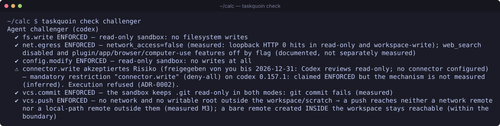

> [!IMPORTANT]
> Akzeptieren Sie ein Risiko nur, wenn Sie es verstehen und die Lage zu Ihrer Begründung passt: Hier prüft Codex nur
> lesend, und Ihr Projekt hat keinen Connector, also kann ein „connector write“ ohnehin nicht stattfinden. Akzeptieren Sie
> kein Risiko, nur damit eine rote Zeile verschwindet. Insbesondere:
>
> - nie für `fs.write`, `net.egress`, `vcs.commit` oder `vcs.push` bei einem Agenten, der wirklich schreibt oder Befehle
>   ausführt, es sei denn, Sie können die kompensierende Kontrolle benennen;
> - nie mit einer vagen Begründung: Sie wird in der Freigabe festgehalten und von `doctor` angezeigt;
> - bevorzugen Sie ein kurzes Ablaufdatum: Die Akzeptanz ist eine Erinnerung, nach einem Upgrade erneut zu prüfen;
> - wenn ein Mechanismus *als fehlschlagend gemessen* wurde, aktualisieren Sie oder wechseln Sie die Runtime.

Dass Sie `taskquoin accept-risk` selbst ausführen, ist Absicht: Könnten die Konsole oder ein Agent es tun, wäre die
Kontrolle wertlos.

## Schritt 5: Lauf starten

```shell
$ taskquoin run "Add a sum function"
```

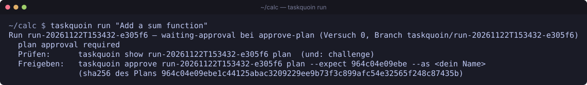

Ihr Terminal bleibt still, während die Agenten arbeiten, und gibt dann aus, wo es angehalten hat. In dieser Reihenfolge
hat Taskquoin Folgendes getan:

1. **Preflight.** Taskquoin hat geprüft, dass die Konfiguration jede Rolle definiert, dass die Skills nutzbar sind, dass
   die nur lesenden Rollen wirklich nur lesend sind und dass API-Judges ihre Schlüssel haben. Das Arbeitsverzeichnis muss
   sauber sein. Jeder Agent durchläuft außerdem kurz vor seiner ersten Verwendung dasselbe Gate wie `doctor`: Ein
   abgelehnter Agent beendet den Lauf als `failed`.
2. **Branch.** Es hat den Branch `taskquoin/run-20261122T132108-d17040` angelegt und gewechselt. Ihr `main` bleibt
   unberührt.
3. **Recall.** Es hat, falls aktiviert, den Memory-Worker nach relevanten Notizen gefragt. Das Journal zeigt
   `recall no-memory`, wenn es keine gibt.
4. **Plan.** Der `planner` (Claude, nur lesend) hat das Repository gelesen und einen Plan geschrieben: Ziel, den zuerst zu
   schreibenden Test, Dateien, Schritte, Risiken.
5. **Critique.** Der `challenger` (Codex, nur lesend) hat diesen Plan unabhängig geprüft und mit einer `VERDICT:`-Zeile
   abgeschlossen.
6. **Gate.** Der Workflow hielt bei `approve-plan` an. Er wartet so lange, wie Sie wollen.

Die Run-ID (`run-20261122T132108-d17040`) besteht aus einem Zeitstempel und einem zufälligen Suffix. Sie verwenden sie in
jedem folgenden Befehl. `taskquoin status` ohne Argument listet die Läufe auf (die CLI-Ausgabe wird hier auf Englisch gezeigt):

```shell
$ taskquoin status
run-20261122T132108-d17040  waiting-approval approve-plan    Add a sum function
```

## Schritt 6: Plan lesen und freigeben

`status <run>` zeigt den Verlauf eines Laufs und, an einem Gate, den exakten Befehl, der es freigibt:

```shell
$ taskquoin status run-20261122T132108-d17040
```

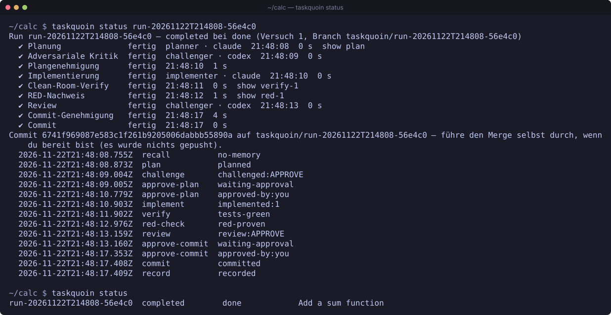

Jede Verlaufszeile ist ein Schritt des Workflows mit seinem Ergebnis (`planned`, `challenged:APPROVE`,
`waiting-approval`).

Jetzt **lesen Sie, was Sie freigeben wollen**:

```shell
$ taskquoin show run-20261122T132108-d17040 plan
```

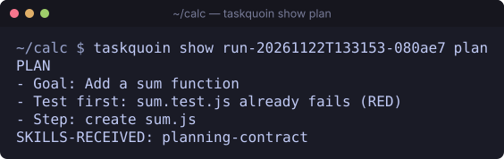

```shell
$ taskquoin show run-20261122T132108-d17040 challenge
Review: plan checked.
VERDICT: APPROVE
```

`show <run>` ohne Artefakt listet alles auf, was bisher gespeichert wurde, mit seiner Größe in Bytes. Ein Plan eines
echten Agenten enthält außerdem die zu ändernden Dateien, die zuerst zu schreibenden Tests und die Risiken. Die Challenge
ist die unabhängige zweite Meinung: Sie kann blockierende und nicht blockierende Befunde auflisten. Ist der Plan falsch,
geben Sie ihn nicht frei: Starten Sie einen neuen Lauf mit einer genaueren Anfrage.

### Warum der Hash

Die entscheidende Zeile ist die letzte von `status`:

```text
Approve it:  taskquoin approve run-20261122T132108-d17040 plan --expect 964c04e09ebe --as <your name>
             (plan sha256 964c04e09ebe1c44125abac3209229ee9b73f3c899afc54e32565f248c87435b)
```

`964c04e09ebe` ist der Anfang des SHA-256 der Plandatei, die Sie gerade gelesen haben. Freigeben bedeutet nicht „Ich gebe
diesen Lauf frei“, sondern „Ich gebe **den Plan mit dem Hash 964c04e09ebe** frei“. Könnte sich der Plan zwischen Ihrem
Lesen und Ihrer Freigabe ändern (ein Retry, ein anderer Prozess, ein kompromittiertes Werkzeug), würde der Hash nicht mehr
passen, und Taskquoin würde ablehnen. Er wird auch im Commit festgehalten, sodass jeder später prüfen kann, was eine
Person freigegeben hat.

> [!NOTE]
> `--expect` ist kein Passwort. Es ist ein Nachweis, dass Sie sich das Artefakt angesehen haben, auf dem das System
> gleich handelt: Sie kopieren es nach dem Lesen aus `status`. In der [Konsole](../getting-started/console.md) tippen Sie ihn zur Bestätigung
> erneut ein.

Freigeben:

```shell
$ taskquoin approve run-20261122T132108-d17040 plan --expect 964c04e09ebe --as you
```

`--as` ist Ihr Name; er wird als `Plan-Approved-By` im Commit festgehalten. Die Freigabe des Plans setzt den Workflow
fort, der bis zum nächsten Gate weiterläuft.

### Ein falscher Hash wird abgelehnt

Probieren Sie einen Hash, der nicht der ausstehende ist:

```shell
$ taskquoin approve run-20261122T132108-d17040 plan --expect 000000000000 --as you
taskquoin approve: expected 000000000000 does not match the pending artifact 964c04e09ebe… — re-read it before approving
```

Es wurde nichts freigegeben, und der Lauf ist unverändert. Dasselbe passiert, wenn Sie ein Gate freigeben, auf das der Lauf
nicht wartet. Der Screenshot unten wurde aufgenommen, nachdem der Lauf abgeschlossen war, und zeigt daher diese Variante
der Ablehnung:

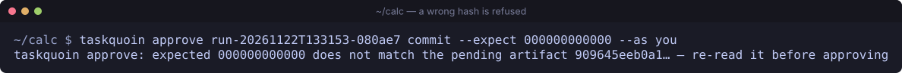

Der Exit-Code einer Ablehnung ist 1. Ein falsch getippter Befehl (ein fehlendes `--expect` oder `--as`) endet mit 2.

## Schritt 7: Implementierung, Verify und Review

Nach `approve … plan` arbeitet Taskquoin ohne Sie:

1. **Implementierung in TDD.** Der `implementer` (Claude) arbeitet auf dem Branch, in der Sandbox der Runtime, ohne
   Netzwerk und ohne Möglichkeit zu committen. Er schreibt oder passt zuerst Tests an, dann den einfachsten Code, der sie
   bestehen lässt.
2. **Verify, in einem Clean Room.** Taskquoin nimmt den exakten Tree, den der Implementer hinterlassen hat, und führt Ihre
   Tests (`npm test`) selbst aus, in einer Wegwerfkopie außerhalb Ihres Repositorys: kein Netzwerk, `.git` schreibgeschützt,
   Ihr HOME verborgen, Geheimnisdateien maskiert, und nur die Abhängigkeitsverzeichnisse des Stacks (und Ihr
   `verify.inherit`) schreibgeschützt eingebunden. Ein bestandener Test, der von etwas Nicht-Committetem abhing,
   schlägt hier fehl, und genau das ist der Sinn.
3. **RED proof.** Taskquoin entfernt dann die Produktionsänderung und führt die geänderten Tests erneut aus. Sie müssen
   **fehlschlagen**. Ein Test, der ohne die Änderung besteht, testet nichts. Der Nachweis ist mechanisch: Er zeigt nicht,
   dass der Test das richtige Verhalten prüft (dafür sind das Review und Sie da).
4. **Review.** Der `challenger` prüft den Diff gegen den Plan, mit den Verify- und RED-Logs. Er schließt mit einer
   `VERDICT:`-Zeile.

Sind Tests rot, schlägt der RED proof fehl oder fordert das Review Änderungen, schickt Taskquoin das Feedback zur
automatischen Überarbeitung an den Implementer (bis zu 3 Implementierungsversuche, mit höchstens 2 Überarbeitungsrunden
nach einem abgelehnten Review). Der Lauf hält dann am zweiten Gate an.

## Schritt 8: Commit lesen und freigeben

Der Lauf wartet nun wieder. Sehen Sie ihn sich an (die CLI-Ausgabe wird auf Englisch gezeigt):

```shell
$ taskquoin status run-20261122T132108-d17040
Run run-20261122T132108-d17040 — waiting-approval at approve-commit (attempt 1, branch taskquoin/run-20261122T132108-d17040)
  commit approval required (bound to the exact tree)
  Review it:   taskquoin show run-20261122T132108-d17040 diff-1  (and: verify-1, red-1, review-1)
  Approve it:  taskquoin approve run-20261122T132108-d17040 commit --expect 909645eeb0a1 --as <your name>
               (git tree 909645eeb0a1716e60fd724784ede536fbea048f)
```

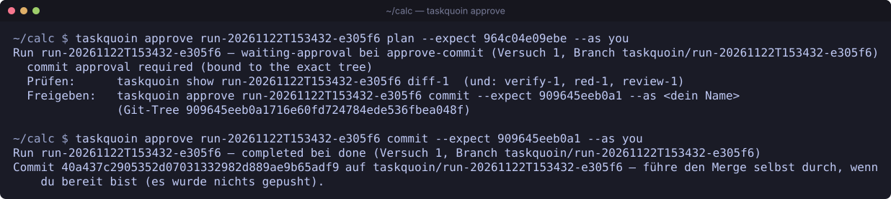

Diesmal ist der Hash der **Git-Tree**, der Verify und das Review bestanden hat. Lesen Sie die vier Artefakte von Versuch 1.
Die Zahl ist der Versuch; nach einer Überarbeitung lesen Sie die höchste.

### `diff-1`: die exakte Änderung

```shell
$ taskquoin show run-20261122T132108-d17040 diff-1
```

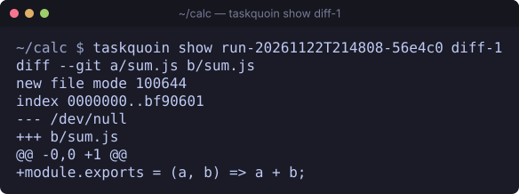

Das wird committet, nicht mehr. Hätte der Agent eine geschützte Datei geändert (Ihr CI, `.claude/`, `AGENTS.md`,
`taskquoin.yaml`), wäre der Lauf mit `protected configuration changed` gestoppt. Dateien, die Ihre `.gitignore` verbirgt,
die der Agent aber erzeugt hat, stehen in `ignored-1`; sie sind nicht im Diff, nicht verifiziert und nicht committet.

### `verify-1`: Ihre Tests, ausgeführt von Taskquoin

```shell
$ taskquoin show run-20261122T132108-d17040 verify-1
```

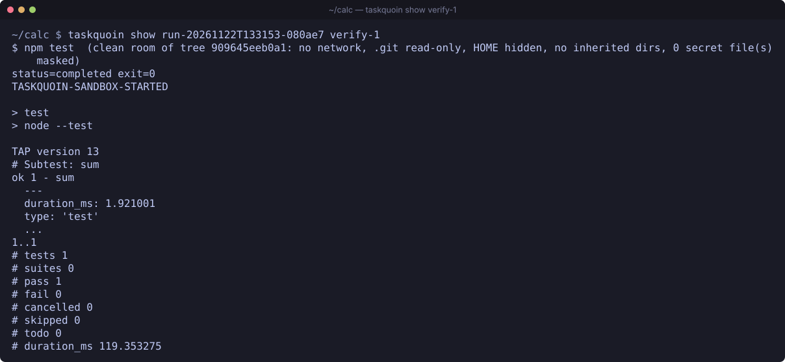

Der Header sagt, was der Clean Room war (`no network, .git read-only, HOME hidden, … 0 secret file(s) masked`) und für
welchen Tree (`909645eeb0a1`, derselbe Hash, den Sie freigeben werden). `exit=0` und `# pass 1` stammen vom Test-Runner,
nicht von der Behauptung eines Modells.

### `red-1`: der Nachweis, dass der Test zählt

```shell
$ taskquoin show run-20261122T132108-d17040 red-1
TASKQUOIN RED PROOF — tests run on base + test changes only (tree 9848f565e24c); they must FAIL.
RESULT: they failed as required (RED proven).

$ npm test  (clean room of tree 9848f565e24c: no network, .git read-only, HOME hidden, no inherited dirs, 0 secret file(s) masked)
status=failed exit=1
…
not ok 1 - sum
  error: Cannot find module './sum.js'
  code: 'MODULE_NOT_FOUND'
```

Hier wurde die neue Produktionsdatei `sum.js` entfernt, der Test konnte sie nicht laden und schlug fehl. Dieses Fehlschlagen
ist der RED proof. Taskquoin behandelt einen Importfehler bei einem Feature in einer *neuen* Datei als das erwartete RED.
Haben sich nur Testdateien geändert (ein reines Hinzufügen von Tests), wird der Nachweis als „not applicable“ vermerkt.

### `review-1`: die zweite Meinung

```shell
$ taskquoin show run-20261122T132108-d17040 review-1
Review: diff checked against the plan.
VERDICT: APPROVE
```

Lesen Sie die Befunde, nicht nur das Urteil. `ignored-1` erscheint in der Liste nur, wenn es etwas zu lesen gibt.

### Den Commit freigeben

Wenn Sie zufrieden sind, geben Sie mit dem Hash aus `status` frei:

```shell
$ taskquoin approve run-20261122T132108-d17040 commit --expect 909645eeb0a1 --as you
Run run-20261122T132108-d17040 — completed at done (attempt 1, branch taskquoin/run-20261122T132108-d17040)
Committed a3c6b801de5f4356750f53870557e2fdd19958ee on taskquoin/run-20261122T132108-d17040 — merge it yourself when ready (nothing was pushed).
```

`approve … commit` muss ausgeführt werden, während das Repository auf dem Branch des Laufs (`taskquoin/<run>`) steht;
andernfalls antwortet es `switch to taskquoin/<run> first`. Taskquoin liest das Arbeitsverzeichnis vor dem Commit erneut
ein. Hat sich seit Ihrem Lesen etwas geändert, gilt Ihre Freigabe nicht mehr: Es verifiziert und prüft erneut und bittet
Sie, den neuen Tree freizugeben.

Taskquoin baut den Commit dann **aus dem freigegebenen Git-Tree selbst**, nicht per `git add`. So sieht er aus:

```shell
$ git log -1 taskquoin/run-20261122T132108-d17040
```

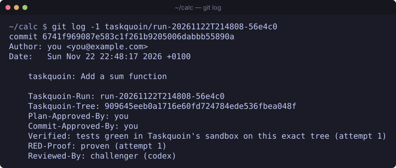

```text
taskquoin: Add a sum function

Taskquoin-Run: run-20261122T132108-d17040
Taskquoin-Tree: 909645eeb0a1716e60fd724784ede536fbea048f
Plan-Approved-By: you
Commit-Approved-By: you
Verified: tests green in Taskquoin's sandbox on this exact tree (attempt 1)
RED-Proof: proven (attempt 1)
Reviewed-By: challenger (codex)
```

Die Trailer sind der Audit-Trail, im Commit selbst:

| Trailer | Bedeutung |
|---|---|
| `Taskquoin-Run` | Der Lauf, der diesen Commit erstellt hat |
| `Taskquoin-Tree` | Der Git-Tree, der verifiziert, geprüft und freigegeben wurde. Es ist der Tree dieses Commits |
| `Plan-Approved-By` | Der Name, der mit `--as` am Plan-Gate angegeben wurde |
| `Commit-Approved-By` | Der Name, der mit `--as` am Commit-Gate angegeben wurde |
| `Verified` | Die Tests waren im Clean Room auf genau diesem Tree grün |
| `RED-Proof` | Die geänderten Tests schlugen ohne die Änderung fehl (`proven`, oder `not applicable` bei reinen Teständerungen) |
| `Reviewed-By` | Die Agenten, die geprüft und freigegeben haben; ein API-Judge fügt eine eigene Zeile hinzu |

`taskquoin status <run>` zeigt am Ende das gesamte Journal, von `recall` bis `commit` und `record`.

## Schritt 9: Ergebnis mergen

Taskquoin **pusht nie** und mergt nie in Ihren Branch. Der Commit liegt auf `taskquoin/<run>`, dem Branch, auf dem Sie
stehen. Mergen Sie ihn selbst, oder eröffnen Sie von ihm aus einen Pull Request:

```shell
$ git switch main
$ git merge --ff-only taskquoin/run-20261122T132108-d17040
$ npm test
```

> [!WARNING]
> Taskquoin führt die Commit-Hooks Ihres Repositorys nicht aus, weil sie Code enthalten könnten, den der Agent verändert
> hat. Führen Sie Ihre Hooks, Linter und Ihr CI beim Mergen selbst aus.

Die `taskquoin/<run>`-Branches gehören Ihnen: Löschen Sie sie, wenn Sie sie nicht mehr brauchen
(`git branch -d taskquoin/<run>`).

## Einen Lauf im Dashboard verfolgen

Während ein Lauf arbeitet, öffnen Sie ein zweites Terminal im selben Repository und starten das Dashboard. Es liest nur: Es zeigt die Pipeline, die Freigabe, die auf Sie wartet (mit dem Anfang ihres Hashs), die Agenten und das Protokoll.

```shell
$ taskquoin dashboard
```

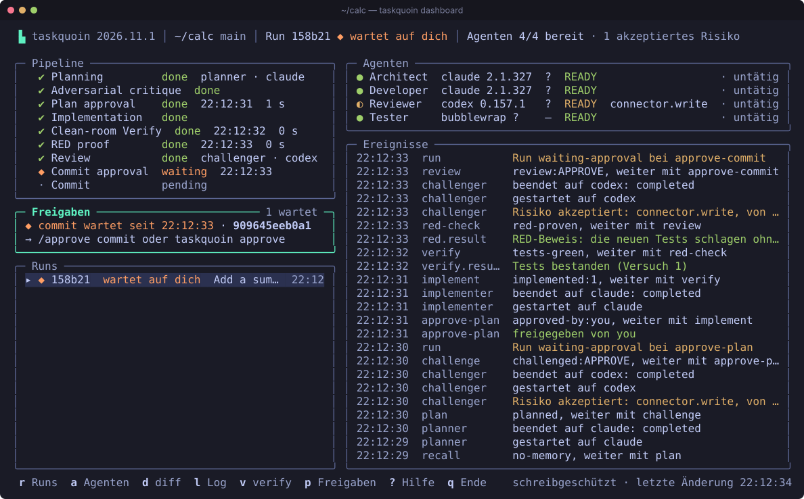

Drücken Sie `d`, um das Diff zu lesen: `/` sucht, `n` und `N` springen zwischen den Treffern, und eine Datei gilt als gelesen, sobald Sie bis zu ihrem Ende gescrollt haben.

Drücken Sie `p`, um das Freigabezentrum zu öffnen. Keine Taste gibt von selbst frei: Sie tippen Ihren Namen und geben dann die 12 Zeichen des Hashs erneut ein. Mit `q` beenden Sie; ein freigegebener Lauf läuft weiter. [Dashboard-Anleitung (auf Englisch)](../guides/dashboard.md).

## Wenn nicht alles wie geplant läuft

Die Fehlermeldungen von Taskquoin folgen Ihrer Sprache, aber die Meldungen der Engine des Laufs (`failed`, `needs-human`,
`interrupted`) sind immer auf Englisch. Die Tabelle listet auf, was Ihnen am häufigsten begegnet.

| Was Sie sehen | Was es bedeutet | Was zu tun ist |
|---|---|---|
| `taskquoin run: the working tree has uncommitted changes` | Taskquoin vermischt seine Änderungen nie mit Ihren | Committen oder stashen Sie Ihre Änderungen |
| `failed … gate refused agent X` | Ein Agent kann auf diesem Rechner nicht zertifiziert werden | `taskquoin doctor` sagt warum: Runtime-Version, fehlende Sandbox, ein nicht akzeptiertes Risiko |
| `needs-human … tests still failing after 3 attempts` | Drei Versuche ergaben keine grünen Tests | Übernehmen Sie auf dem Run-Branch, oder starten Sie einen neuen Lauf mit einer genaueren Anfrage |
| `needs-human … no failing test demonstrates the change` | Die Tests bestehen auch ohne die Produktionsänderung, testen sie also nicht | Lesen Sie `red-N`; schreiben Sie (oder fordern Sie) einen Test, der vor der Änderung fehlschlägt. Ein Refactoring oder eine Doku-Änderung ohne neuen Test endet hier: Committen Sie sie selbst vom Branch aus |
| `needs-human … RED proof inconclusive` | Der Nachweis konnte nicht richtig laufen (Timeout, Sandbox, ein Tree, der nicht neu aufgebaut werden konnte). Er ist kein Nachweis | Lesen Sie `red-N`. Ihr Arbeitsordner ist unberührt |
| `needs-human … review still requests changes after N attempts` | Der Reviewer lehnte weiter ab | Lesen Sie `review-N` und entscheiden Sie; der Branch enthält die Arbeit |
| `needs-human … dependencies changed during the run` | `node_modules` (oder `vendor`, `.venv`) hat sich während des Laufs geändert, daher ist nichts damit verifiziert | Installieren Sie neu (`npm ci`) und starten Sie einen neuen Lauf. Führen Sie während eines Laufs kein `npm install` aus |
| `needs-human … protected configuration changed` | Der Agent hat geschützte Konfiguration berührt (CI, `.claude/`, `AGENTS.md`, `taskquoin.yaml`) | Es wurde nichts committet; prüfen Sie den Branch |
| Tests bestehen bei Ihnen, schlagen aber in Verify fehl | Sie nutzen eine ignorierte Datei, die im Clean Room fehlt | Fügen Sie sie zu `verify.inherit` hinzu |
| `does not match the pending artifact` | Der angegebene Hash ist nicht der ausstehende | Lesen Sie mit `show`, kopieren Sie den Hash aus `status` |
| `switch to taskquoin/<run> first` | Sie sind nicht auf dem Branch des Laufs | `git switch taskquoin/<run>` |
| `taskquoin.yaml changed since the run started` | Die Konfiguration hat sich mitten im Lauf geändert | Starten Sie einen neuen Lauf |
| `interrupted` | Ein technischer Fehler (git, Festplatte, ein HTTP 503 eines Judges) hat den Lauf gestoppt | `taskquoin resume <run>` |

### Wenn die Tests rot bleiben

Schlägt Verify fehl, gibt Taskquoin dem Implementer das fehlgeschlagene Log und das Review und versucht es erneut, bis zu
drei Implementierungsversuche (ein OpenCode-Implementer, der keinen eigenen Befehl hat, bekommt mehr Überarbeitungen).
Sind die Tests weiterhin rot, endet der Lauf mit dem Status `needs-human` und dem Grund
`tests still failing after 3 attempts`. Es gibt keinen Commit und keine Freigabeaufforderung.

Alles bleibt erhalten: `taskquoin show <run> verify-3` enthält das letzte Log, und der Branch `taskquoin/<run>` enthält die
Arbeit des Agenten. Sie können auf diesem Branch von Hand weitermachen oder einen neuen Lauf mit einer genaueren Anfrage
starten. Ein Lauf mit `needs-human` wird nicht automatisch fortgesetzt.

### `resume`: nach einer Unterbrechung

Ein Lauf ist `interrupted`, wenn etwas außerhalb des Workflows ihn unterbrochen hat (ein Netzwerkfehler beim Zugriff auf
einen Judge, eine volle Festplatte, ein Rechner im Ruhezustand). Der Zustand wird bei jedem Schritt gespeichert, und die
Antworten der Judges werden einzeln gespeichert, sodass ein Fortsetzen nie einen Judge zweimal aufruft oder bezahlt:

```shell
$ taskquoin resume run-20261122T132108-d17040
```

`resume` akzeptiert nur einen Lauf mit dem Status `interrupted`. Bei jedem anderen Status sagt es Ihnen das, zum Beispiel
`taskquoin resume: only an interrupted run can be resumed (status completed)`. Ist der Status `needs-human` oder
`failed`, starten Sie einen neuen Lauf.

### Eine Faustregel

Wenn Sie nicht wissen, was zu tun ist, führen Sie `taskquoin status <run>` aus: Es gibt den Status, das Journal und den
exakten nächsten Befehl aus. `taskquoin doctor` beantwortet jede Frage zum Rechner.

## Mehr erfahren

- [Die interaktive Konsole](../getting-started/console.md): derselbe Workflow, mit `/run` und `/approve`
- [Installation](../getting-started/installation.md)
- [ADR-0011, Agenten committen nie](../adr/0011-agents-never-commit.md)
- [ADR-0013, Tree-basierte Governance](../adr/0013-tree-based-governance.md)
- [ADR-0014, Verify in einem Clean Room](../adr/0014-verify-in-a-clean-room.md)
- [ADR-0002, Durchsetzungsklassen](../adr/0002-enforcement-classes.md)
- [ADR-0005, Control Plane außerhalb des Workspace](../adr/0005-control-plane-outside-workspace.md)
- [ADR-0016, Judges per API](../adr/0016-judges-by-api.md) und [ADR-0017, OpenCode ohne Befehle](../adr/0017-opencode-without-commands.md)
