# Tu primera ejecución gobernada

> Este tutorial es una traducción de la [página de referencia en inglés](../getting-started/first-run.md). Es una traducción automática, comprobada por las pruebas de los mantenedores sobre los comandos, no por un revisor nativo.

Este tutorial te lleva desde una carpeta vacía hasta un commit verificado hecho por Taskquoin, un comando a la vez. Vas a
crear un proyecto minúsculo con una prueba que falla, dejar que Taskquoin planifique e implemente la corrección con
agentes de IA, y aprobar el trabajo dos veces: una al leer el plan y otra al leer el diff exacto. En cada paso verás qué
hace Taskquoin, por qué se detiene y qué estás firmando.

- [Qué vas a construir](#qué-vas-a-construir)
- [Paso 1: crea un proyecto con una prueba que falla](#paso-1-crea-un-proyecto-con-una-prueba-que-falla)
- [Paso 2: inicializa Taskquoin](#paso-2-inicializa-taskquoin)
- [Paso 3: haz commit de la configuración](#paso-3-haz-commit-de-la-configuración)
- [Paso 4: revisa la máquina con doctor](#paso-4-revisa-la-máquina-con-doctor)
- [Acepta un riesgo que entiendes](#acepta-un-riesgo-que-entiendes)
- [Paso 5: inicia la ejecución](#paso-5-inicia-la-ejecución)
- [Paso 6: lee y aprueba el plan](#paso-6-lee-y-aprueba-el-plan)
- [Paso 7: implementación, Verify y revisión](#paso-7-implementación-verify-y-revisión)
- [Paso 8: lee y aprueba el commit](#paso-8-lee-y-aprueba-el-commit)
- [Paso 9: fusiona el resultado](#paso-9-fusiona-el-resultado)
- [Cuando las cosas no salen como esperabas](#cuando-las-cosas-no-salen-como-esperabas)
- [Más información](#más-información)

> [!NOTE]
> Las pantallas provienen de un repositorio de demostración con agentes de IA simulados (los dobles de prueba de la
> propia suite de pruebas de Taskquoin); todos los comandos son la CLI real de Taskquoin. Con Claude Code y Codex reales,
> la redacción del plan y de la revisión es la de los propios agentes, y una ejecución tarda unos minutos en lugar de
> segundos. Todo lo demás es idéntico.

Antes de empezar, [instala Taskquoin](../getting-started/installation.md) y asegúrate de tener Node 22.18+, git, `bubblewrap` y `socat`, y de
que al menos Claude Code (e idealmente Codex) esté instalado y con la sesión iniciada.

Nota: los bloques que reproducen la salida de la CLI se muestran en inglés; las capturas de pantalla muestran la salida localizada.

## Qué vas a construir

Una ejecución es un flujo de trabajo fijo. Los dos rombos son las dos aprobaciones humanas; nada avanza más allá de ellos sin ti.

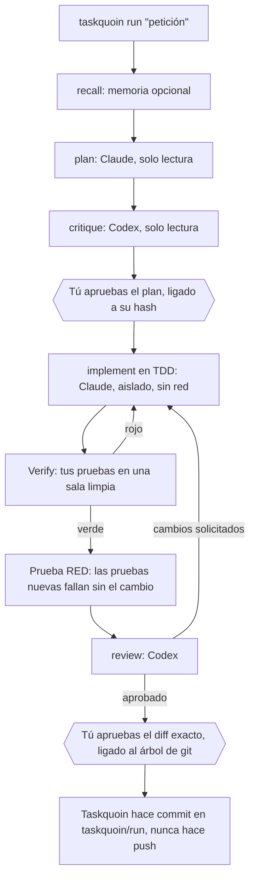

Tres ideas recorren todo el tutorial:

- **Los agentes proponen, Taskquoin actúa.** Los agentes nunca hacen commit. El commit lo construye Taskquoin a partir
  del árbol que fue verificado, revisado y aprobado ([ADR-0011](../adr/0011-agents-never-commit.md)).
- **Tu aprobación está ligada a un hash.** Apruebas exactamente lo que leíste, no "la ejecución"
  ([ADR-0013](../adr/0013-tree-based-governance.md)).
- **Las pruebas se ejecutan en una sala limpia.** El modelo nunca le dice a Taskquoin que las pruebas pasan; Taskquoin
  las ejecuta él mismo ([ADR-0014](../adr/0014-verify-in-a-clean-room.md)).

## Paso 1: crea un proyecto con una prueba que falla

El proyecto es una calculadora de una sola función. La prueba existe; la función no.

```shell
$ mkdir calc && cd calc
$ git init -q -b main
```

Crea `package.json`:

```json
{
  "name": "calc",
  "private": true,
  "scripts": { "test": "node --test" }
}
```

Crea `sum.test.js`:

```js
const test = require('node:test');
const assert = require('node:assert');

test('sum', () => {
  const sum = require('./sum.js');
  assert.strictEqual(sum(2, 3), 5);
});
```

Crea `.gitignore` (las dependencias y los artefactos de compilación nunca forman parte de un diff de Taskquoin):

```text
node_modules/
```

Haz commit:

```shell
$ git add .
$ git commit -m "calc: a failing test for sum"
$ npm test
not ok 1 - sum
  error: Cannot find module './sum.js'
```

La prueba está en rojo, como se esperaba. Un repositorio git con el árbol de trabajo limpio es la única condición previa
que Taskquoin exige a un proyecto: `taskquoin run` se niega a empezar si tienes cambios sin commit, porque nunca mezcla
sus cambios con los tuyos.

## Paso 2: inicializa Taskquoin

```shell
$ taskquoin init
```

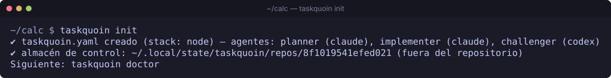

`init` hizo tres cosas:

1. Detectó el stack (`node`; también conoce `npm test`, PHPUnit, pytest, `go test`, Maven y otros) y escribió
   `taskquoin.yaml` en la raíz del repositorio.
2. Buscó herramientas de IA en tu máquina y eligió agentes: aquí `planner` e `implementer` en Claude Code y
   `challenger` en Codex. Si falta una herramienta, el archivo lo indica; con solo Claude Code, el revisor también es
   Claude. Con solo OpenCode, `init` escribe una configuración íntegramente OpenCode.
3. Creó un **almacén de control** fuera del repositorio, en `${XDG_STATE_HOME:-~/.local/state}/taskquoin/`. Allí viven
   el estado de las ejecuciones, las aprobaciones y las aceptaciones de riesgo. Los agentes no pueden escribir ahí, y eso
   es lo que hace que una aprobación sea infalsificable ([ADR-0005](../adr/0005-control-plane-outside-workspace.md)).

`init` nunca sobrescribe un `taskquoin.yaml` existente. Si ejecutaste `init` con otras IA disponibles (una clave de API
en tu entorno, un Ollama local), las lista y las propone como **comentarios** en el archivo: descomentarlas es decisión
tuya, porque significa que el código de ese proyecto se les enviará.

### El `taskquoin.yaml` generado

Ábrelo. Es corto y puedes leerlo entero. Aquí está, sección por sección.

```yaml
# Taskquoin project configuration — see docs/architecture.md. Protected: agents can never edit this file.
version: 1
stack: node
```

`version` es la versión del esquema. `stack` selecciona los valores por defecto de la sala limpia: qué directorios de
dependencias se montan en solo lectura para tus pruebas (para `node`: `node_modules`). El primer comentario es una
promesa: **los agentes nunca pueden editar este archivo.** Si uno lo toca durante una ejecución, la ejecución se detiene
y no se hace ningún commit.

```yaml
agents:
  planner:
    runtime: claude
    description: "Read-only planner: turns a request into a minimal, test-first implementation plan."
    prompt: You plan; you never modify files. Read the repository, then produce the plan requested.
    capabilities:
      fs.read:
        - "**"
    maxTurns: 30
    skills:
      - planning-contract
```

Un **agente** es un rol ligado a un runtime (`claude`, `codex`, `opencode`, o `api` para un juez). `capabilities` es lo
que el agente tiene permitido hacer: el planner puede leer todo (`fs.read: "**"`) y nada más, de modo que no tiene shell
ni herramienta de escritura. `skills` son instrucciones fijadas por hash (`planning-contract` es propia del proyecto).
`maxTurns` limita los turnos del agente.

```yaml
  implementer:
    runtime: claude
    description: Implements an approved task with strict TDD (RED → GREEN → REFACTOR).
    prompt: "You implement exactly the approved task. Write a failing test first, make it pass with the simplest change, then refactor. Never commit: Taskquoin verifies and commits."
    capabilities:
      fs.read:
        - "**"
      fs.write:
        - "**"
      shell.run:
        - npm test
        - npm test -- *
        - node --test *
    maxTurns: 40
    skills:
      - tdd
```

El implementer puede escribir archivos y ejecutar una pequeña lista de comandos de prueba permitidos (`shell.run`) para
trabajar primero con las pruebas. Esos comandos se ejecutan dentro del sandbox del sistema operativo del propio runtime,
sin red. Aun así, su ejecución de pruebas solo le sirve de retroalimentación: el resultado que cuenta es el que produce
Taskquoin en Verify.

```yaml
  challenger:
    runtime: codex
    description: Independent, read-only adversarial reviewer of plans and diffs.
    prompt: "You are an independent reviewer. Challenge the plan or diff: correctness, security, missing tests, over-engineering. Report blocking and non-blocking findings with file:line. Do not modify files."
    capabilities:
      fs.read:
        - "**"
    skills:
      - code-review
```

El **challenger** critica el plan y revisa el diff. Es de un proveedor distinto al del implementer a propósito, y es de
solo lectura: no debe poder "arreglar" lo que critica.

```yaml
policy:
  mandatory:
    - fs.write
    - net.egress
    - config.modify
    - connector.write
    - vcs.commit
    - vcs.push
connectors: {}
memory:
  claudeMem:
    enabled: true
```

`policy.mandatory` lista las restricciones que **deben** estar garantizadas por un mecanismo para que un agente pueda
arrancar: ninguna escritura fuera de su ámbito, ninguna red, ningún cambio en la configuración protegida, ninguna
escritura remota, ningún commit, ningún push. Si la versión del runtime que tienes no puede hacer cumplir alguna de
ellas, el agente es rechazado en lugar de arrancar con una regla que es solo un consejo
([ADR-0002](../adr/0002-enforcement-classes.md), [ADR-0003](../adr/0003-hooks-enforce-prose-asks.md)).
`connectors` está vacío: no hay ningún sistema remoto conectado ([ADR-0012](../adr/0012-remote-connectors-by-exception.md)).
`memory.claudeMem` es opcional: cuando está activado, se envía un resumen estructurado de cada ejecución terminada a tu
worker local de [claude-mem](https://github.com/thedotmack/claude-mem), y al inicio de una ejecución se lee un breve
recuerdo. Ponlo en `false` si no usas claude-mem. (Las pantallas de este tutorial usan `false`.)

> [!TIP]
> Si tus pruebas necesitan un archivo ignorado que no es un directorio de dependencias, como un `dist/` compilado o un
> `.env.test`, añádelo explícitamente. Entonces se monta en solo lectura en la sala limpia y queda congelado para el
> agente:
>
> ```yaml
> verify:
>   inherit:
>     - dist
> ```
>
> Un proyecto cuyas pruebas no se ejecutan con `npm test` puede definir `verify.command`.

También puedes usar otras IA como jueces (cualquier proveedor compatible con OpenAI) u OpenCode como planner e
implementer; consulta [ADR-0016](../adr/0016-judges-by-api.md) y [ADR-0017](../adr/0017-opencode-without-commands.md).

## Paso 3: haz commit de la configuración

`taskquoin.yaml` forma parte de tu proyecto, así que haz commit de él. Esto además le da a Taskquoin el árbol de trabajo
limpio que necesita:

```shell
$ git add taskquoin.yaml
$ git commit -m "chore: taskquoin"
```

## Paso 4: revisa la máquina con doctor

```shell
$ taskquoin doctor
```

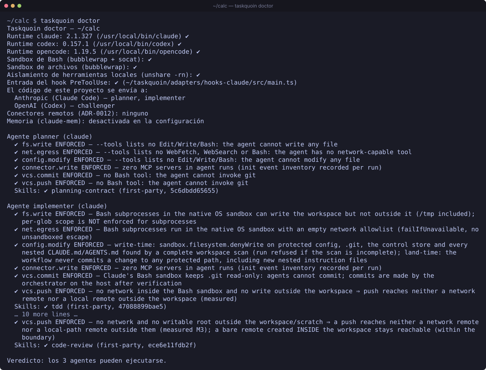

`doctor` es la parte honesta de Taskquoin. Léelo de arriba abajo:

- El primer bloque lista los runtimes encontrados, con sus versiones y una marca de verificación cuando la versión es la
  que Taskquoin ha medido; después los sandboxes (bubblewrap y socat) y el hook.
- **This project's code is sent to** lista cada proveedor que recibirá tu código, por agente. Taskquoin se ejecuta en tu
  máquina; solo las IA que configures ven algo ([ADR-0010](../adr/0010-local-first-no-leak.md)).
- Luego, por agente, cada restricción obligatoria con su clase y **el mecanismo que la hace cumplir**, por ejemplo
  `net.egress ENFORCED — Bash subprocesses run in the native OS sandbox with an empty network allowlist`. Una marca de
  verificación significa que está certificada para esa versión del runtime; una cruz significa que el agente no
  arrancará.
- La última línea es el veredicto: `Verdict: all 3 agents can run.` o `Verdict: 2 of 3 agents can run — refused agents will not be started.`

En la demostración, una línea lleva una cruz:

```text
Agent challenger (codex)
  …
  ✖ connector.write — mandatory restriction "connector.write" (deny-all) on codex 0.157.1: claimed ENFORCED but the mechanism is not measured (inferred). Execution refused (ADR-0002).
```

Codex afirma que hace cumplir `connector.write` (ninguna escritura en conectores remotos), pero Taskquoin no tiene forma
de medir esa afirmación, así que no la cuenta como garantizada. El challenger es rechazado: una ejecución terminaría como
`failed at challenge` con `gate refused agent challenger`. Para este caso, tienes una decisión que tomar.

## Acepta un riesgo que entiendes

Un **riesgo aceptado** es tu decisión firmada, fechada y acotada de ejecutar un agente a pesar de una restricción que no
se puede medir. Es decisión del propietario, no del desarrollador y nunca del agente:

```shell
$ taskquoin accept-risk challenger connector.write \
    --reason "Codex reviews read-only; no connector configured" \
    --expires 2026-12-31 --as you
```

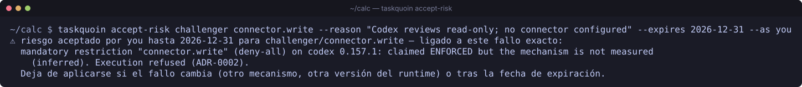

Las cuatro opciones son obligatorias: `--reason`, `--expires` (una fecha futura real, `YYYY-MM-DD`) y `--as` (tu
nombre), además del agente y la capacidad. Fíjate en lo que es la aceptación:

- **Ligada al fallo exacto.** Guarda un resumen (digest) del mensaje de fallo. Si cambia la versión del runtime o el
  mecanismo, el fallo ya no es el mismo y la aceptación deja de aplicarse.
- **Fechada.** También deja de aplicarse tras la fecha de caducidad.
- **Almacenada fuera del repositorio**, en el almacén de control. Nadie puede añadir una editando `taskquoin.yaml`, y
  ningún agente puede escribirla.
- **Estrecha.** Solo se aplica a este agente y a esta capacidad. Se rechaza para una capacidad que no está fallando, y no
  está disponible para los jueces por API (siempre se comprueban).

Ejecuta `doctor` de nuevo. La línea ahora es una advertencia en lugar de una cruz, y el veredicto es `all 3 agents can run`:

```text
  ⚠ connector.write accepted risk (approved by you until 2026-12-31: Codex reviews read-only; no connector configured) — mandatory restriction "connector.write" (deny-all) on codex 0.157.1: claimed ENFORCED but the mechanism is not measured (inferred). Execution refused (ADR-0002).
```

`taskquoin check challenger` muestra el mismo detalle para un solo agente:

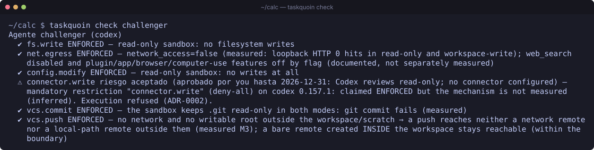

> [!IMPORTANT]
> Acepta un riesgo solo cuando lo entiendas y la situación coincida con tu motivo: aquí Codex revisa en solo lectura y tu
> proyecto no tiene ningún conector, así que una "escritura en conector" no puede ocurrir de todos modos. No aceptes un
> riesgo para hacer desaparecer una línea roja. En particular:
>
> - nunca para `fs.write`, `net.egress`, `vcs.commit` o `vcs.push` en un agente que realmente escribe o ejecuta
>   comandos, a menos que puedas nombrar el control compensatorio;
> - nunca con un motivo vago: queda registrado en la aprobación y `doctor` lo muestra;
> - prefiere una caducidad corta: la aceptación es un recordatorio para volver a comprobar tras una actualización;
> - si un mecanismo está *medido como fallido*, actualiza o cambia de runtime.

Ejecutar tú mismo `taskquoin accept-risk` es deliberado: si la consola o un agente pudieran hacerlo, el control no
significaría nada.

## Paso 5: inicia la ejecución

```shell
$ taskquoin run "Add a sum function"
```

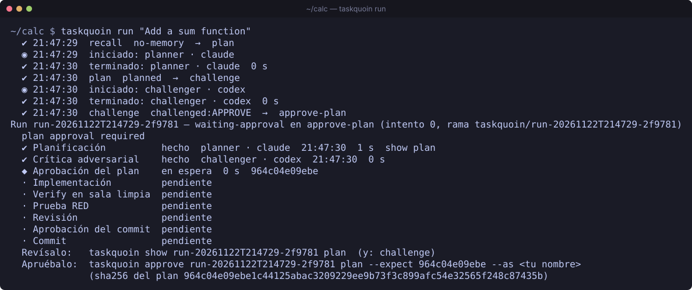

Tu terminal permanece en silencio mientras los agentes trabajan, y luego imprime dónde se detuvo. En orden, Taskquoin
hizo esto:

1. **Preflight.** Taskquoin comprobó que la configuración define todos los roles, que las skills son utilizables, que los
   roles de solo lectura lo son de verdad y que los jueces por API tienen sus claves. El árbol de trabajo debe estar
   limpio. Además, cada agente pasa la misma puerta que `doctor` justo antes de usarse por primera vez: un agente
   rechazado termina la ejecución como `failed`.
2. **Rama.** Creó la rama `taskquoin/run-20261122T132108-d17040` y cambió a ella. Tu `main` queda intacta.
3. **Recall.** Pidió al worker de memoria, si está activado, notas relevantes. El diario muestra `recall no-memory`
   cuando no hay ninguna.
4. **Plan.** El `planner` (Claude, solo lectura) leyó el repositorio y escribió un plan: objetivo, la prueba que se
   escribe primero, archivos, pasos, riesgos.
5. **Critique.** El `challenger` (Codex, solo lectura) cuestionó ese plan de forma independiente y terminó con una línea
   `VERDICT:`.
6. **Puerta.** El flujo se detuvo en `approve-plan`. Esperará todo lo que quieras.

El id de ejecución (`run-20261122T132108-d17040`) es una marca de tiempo más un sufijo aleatorio. Lo usas en todos los
comandos siguientes. `taskquoin status` sin argumento lista las ejecuciones:

```shell
$ taskquoin status
run-20261122T132108-d17040  waiting-approval approve-plan    Add a sum function
```

## Paso 6: lee y aprueba el plan

`status <run>` muestra el historial de una ejecución y, en una puerta, el comando exacto que la aprueba:

```shell
$ taskquoin status run-20261122T132108-d17040
```

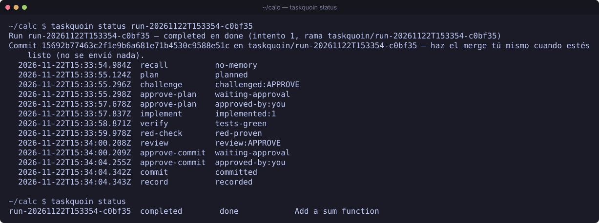

Cada línea del historial es un paso del flujo con su resultado (`planned`, `challenged:APPROVE`, `waiting-approval`).

Ahora **lee lo que estás a punto de aprobar**:

```shell
$ taskquoin show run-20261122T132108-d17040 plan
```

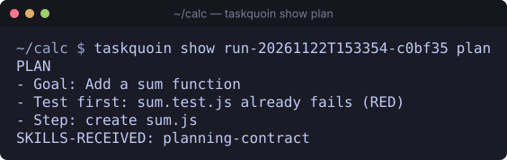

```shell
$ taskquoin show run-20261122T132108-d17040 challenge
Review: plan checked.
VERDICT: APPROVE
```

`show <run>` sin artefacto lista todo lo almacenado hasta el momento, con su tamaño en bytes. Un plan de un agente real
también cubre los archivos a tocar, las pruebas que se escriben primero y los riesgos. El challenge es la segunda opinión
independiente: puede listar hallazgos bloqueantes y no bloqueantes. Si el plan es incorrecto, no lo apruebes: inicia una
nueva ejecución con una petición más precisa.

### Por qué el hash

La línea que importa es la última de `status`:

```text
Approve it:  taskquoin approve run-20261122T132108-d17040 plan --expect 964c04e09ebe --as <your name>
             (plan sha256 964c04e09ebe1c44125abac3209229ee9b73f3c899afc54e32565f248c87435b)
```

`964c04e09ebe` es el comienzo del SHA-256 del archivo del plan que acabas de leer. Aprobar no significa "apruebo esta
ejecución"; significa "apruebo **el plan cuyo hash es 964c04e09ebe**". Si el plan pudiera cambiar entre tu lectura y tu
aprobación (un reintento, otro proceso, una herramienta comprometida), el hash ya no coincidiría y Taskquoin se negaría.
Es también lo que registra el commit, de modo que cualquiera puede auditar después qué aprobó una persona.

> [!NOTE]
> `--expect` no es una contraseña. Es una prueba de que miraste el artefacto sobre el que el sistema está a punto de
> actuar: lo copias de `status` después de leer. En la [consola](../getting-started/console.md), lo vuelves a escribir para confirmar.

Aprueba:

```shell
$ taskquoin approve run-20261122T132108-d17040 plan --expect 964c04e09ebe --as you
```

`--as` es tu nombre; se registra como `Plan-Approved-By` en el commit. Aprobar el plan reanuda el flujo, que continúa
hasta la siguiente puerta.

### Un hash incorrecto es rechazado

Prueba con un hash que no sea el pendiente:

```shell
$ taskquoin approve run-20261122T132108-d17040 plan --expect 000000000000 --as you
taskquoin approve: expected 000000000000 does not match the pending artifact 964c04e09ebe… — re-read it before approving
```

No se aprobó nada y la ejecución no cambia. Lo mismo ocurre si apruebas una puerta que la ejecución no está esperando. La
captura de abajo se tomó después de que la ejecución hubiera terminado, así que muestra esa variante del rechazo:

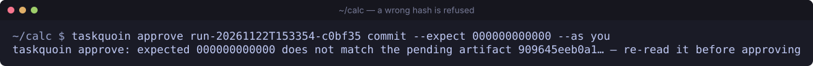

El código de salida de un rechazo es 1. Un comando mal escrito (falta `--expect` o `--as`) sale con 2.

## Paso 7: implementación, Verify y revisión

Tras `approve … plan`, Taskquoin trabaja sin ti:

1. **Implementación en TDD.** El `implementer` (Claude) trabaja en la rama, en el sandbox del runtime, sin red y sin
   posibilidad de hacer commit. Escribe o ajusta primero las pruebas y después el código más simple que las hace pasar.
2. **Verify, en una sala limpia.** Taskquoin toma el árbol exacto que dejó el implementer y ejecuta él mismo tus pruebas
   (`npm test`), en una copia desechable fuera de tu repositorio: sin red, `.git` en solo lectura, tu HOME oculto,
   archivos secretos enmascarados, y solo los directorios de dependencias del stack (y tu `verify.inherit`) montados en
   solo lectura. Una prueba que pasa porque dependía de algo sin commit falla aquí, y ese es el objetivo.
3. **Prueba RED.** Taskquoin elimina entonces el cambio de producción y vuelve a ejecutar las pruebas modificadas.
   Deben **fallar**. Una prueba que pasa sin el cambio no prueba nada. La prueba es mecánica: no demuestra que la prueba
   afirme el comportamiento correcto (para eso están la revisión y tú).
4. **Review.** El `challenger` revisa el diff contra el plan, con los logs de verify y RED. Termina con una línea
   `VERDICT:`.

Si las pruebas están en rojo, o la prueba RED falla, o la revisión pide cambios, Taskquoin envía la retroalimentación al
implementer para un reajuste automático (hasta 3 intentos de implementación, con como máximo 2 rondas de retrabajo tras
una revisión rechazada). La ejecución se detiene entonces en la segunda puerta.

## Paso 8: lee y aprueba el commit

La ejecución vuelve a estar en espera. Míralo:

```shell
$ taskquoin status run-20261122T132108-d17040
Run run-20261122T132108-d17040 — waiting-approval at approve-commit (attempt 1, branch taskquoin/run-20261122T132108-d17040)
  commit approval required (bound to the exact tree)
  Review it:   taskquoin show run-20261122T132108-d17040 diff-1  (and: verify-1, red-1, review-1)
  Approve it:  taskquoin approve run-20261122T132108-d17040 commit --expect 909645eeb0a1 --as <your name>
               (git tree 909645eeb0a1716e60fd724784ede536fbea048f)
```

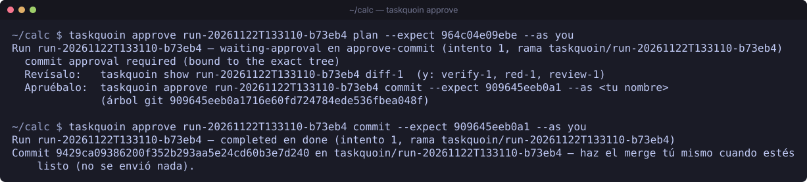

Esta vez el hash es el **árbol de git** que pasó Verify y la revisión. Lee los cuatro artefactos del intento 1. El número
es el intento; tras un retrabajo lees el más alto.

### `diff-1`: el cambio exacto

```shell
$ taskquoin show run-20261122T132108-d17040 diff-1
```

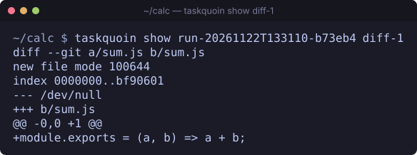

Esto es lo que se va a commitear, nada más. Si el agente hubiera cambiado un archivo protegido (tu CI, `.claude/`,
`AGENTS.md`, `taskquoin.yaml`), la ejecución se habría detenido con `protected configuration changed`. Los archivos que
tu `.gitignore` oculta pero que el agente creó aparecen en `ignored-1`; no están en el diff, no se verifican y no se
commitean.

### `verify-1`: tus pruebas, ejecutadas por Taskquoin

```shell
$ taskquoin show run-20261122T132108-d17040 verify-1
```

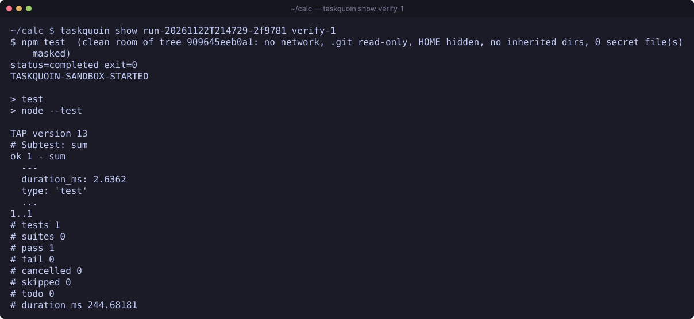

La cabecera dice qué fue la sala limpia (`no network, .git read-only, HOME hidden, … 0 secret file(s) masked`) y para
qué árbol (`909645eeb0a1`, el mismo hash que vas a aprobar). `exit=0` y `# pass 1` vienen del ejecutor de pruebas, no de
lo que afirme un modelo.

### `red-1`: la prueba de que el test importa

```shell
$ taskquoin show run-20261122T132108-d17040 red-1
TASKQUOIN RED PROOF — tests run on base + test changes only (tree 9848f565e24c); they must FAIL.
RESULT: they failed as required (RED proven).

$ npm test  (clean room of tree 9848f565e24c: no network, .git read-only, HOME hidden, no inherited dirs, 0 secret file(s) masked)
status=failed exit=1
…
not ok 1 - sum
  error: Cannot find module './sum.js'
  code: 'MODULE_NOT_FOUND'
```

Aquí se eliminó el nuevo archivo de producción `sum.js`, la prueba no pudo cargarlo y falló. Ese fallo es la prueba RED.
Taskquoin trata un error de importación de una funcionalidad en un archivo *nuevo* como el RED esperado. Si solo
cambiaron archivos de prueba (una adición pura de pruebas), la prueba se registra como "not applicable".

### `review-1`: la segunda opinión

```shell
$ taskquoin show run-20261122T132108-d17040 review-1
Review: diff checked against the plan.
VERDICT: APPROVE
```

Lee los hallazgos, no solo el veredicto. `ignored-1` aparece en la lista solo cuando hay algo que leer.

### Aprueba el commit

Si estás conforme, aprueba con el hash de `status`:

```shell
$ taskquoin approve run-20261122T132108-d17040 commit --expect 909645eeb0a1 --as you
Run run-20261122T132108-d17040 — completed at done (attempt 1, branch taskquoin/run-20261122T132108-d17040)
Committed a3c6b801de5f4356750f53870557e2fdd19958ee on taskquoin/run-20261122T132108-d17040 — merge it yourself when ready (nothing was pushed).
```

`approve … commit` debe ejecutarse mientras el repositorio está en la rama de la ejecución (`taskquoin/<run>`); si no,
responde `switch to taskquoin/<run> first`. Taskquoin vuelve a leer el árbol de trabajo antes de hacer commit. Si algo
cambió desde que lo miraste, tu aprobación ya no se aplica: vuelve a verificar, vuelve a revisar y te pide aprobar el
nuevo árbol.

Taskquoin construye entonces el commit **a partir del propio árbol de git aprobado**, no con `git add`. Tiene este
aspecto:

```shell
$ git log -1 taskquoin/run-20261122T132108-d17040
```

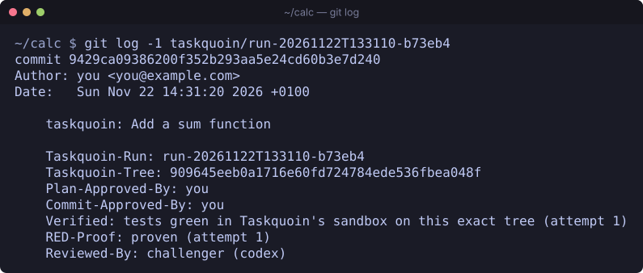

```text
taskquoin: Add a sum function

Taskquoin-Run: run-20261122T132108-d17040
Taskquoin-Tree: 909645eeb0a1716e60fd724784ede536fbea048f
Plan-Approved-By: you
Commit-Approved-By: you
Verified: tests green in Taskquoin's sandbox on this exact tree (attempt 1)
RED-Proof: proven (attempt 1)
Reviewed-By: challenger (codex)
```

Los trailers son el rastro de auditoría, dentro del propio commit:

| Trailer | Significado |
|---|---|
| `Taskquoin-Run` | La ejecución que hizo este commit |
| `Taskquoin-Tree` | El árbol de git que fue verificado, revisado y aprobado. Es el árbol de este commit |
| `Plan-Approved-By` | El nombre dado con `--as` en la puerta del plan |
| `Commit-Approved-By` | El nombre dado con `--as` en la puerta del commit |
| `Verified` | Las pruebas estuvieron en verde en la sala limpia sobre este árbol exacto |
| `RED-Proof` | Las pruebas modificadas fallaron sin el cambio (`proven`, o `not applicable` para cambios solo de pruebas) |
| `Reviewed-By` | Los agentes que revisaron y aprobaron; un juez por API añade su propia línea |

`taskquoin status <run>` al final muestra todo el diario, desde `recall` hasta `commit` y `record`.

## Paso 9: fusiona el resultado

Taskquoin **nunca hace push** y nunca fusiona en tu rama. El commit está en `taskquoin/<run>`, la rama en la que estás.
Fusiónalo tú mismo, o abre un pull request desde ella:

```shell
$ git switch main
$ git merge --ff-only taskquoin/run-20261122T132108-d17040
$ npm test
```

> [!WARNING]
> Taskquoin no ejecuta los hooks de commit de tu repositorio, porque podrían contener código que el agente modificó.
> Ejecuta tú mismo tus hooks, linters y CI al fusionar.

Las ramas `taskquoin/<run>` son tuyas: bórralas cuando no las necesites (`git branch -d taskquoin/<run>`).

## Cuando las cosas no salen como esperabas

Los mensajes de error de Taskquoin siguen tu idioma, pero los mensajes del motor de la ejecución (`failed`,
`needs-human`, `interrupted`) están siempre en inglés. La tabla lista lo que encontrarás con más frecuencia.

| Lo que ves | Qué significa | Qué hacer |
|---|---|---|
| `taskquoin run: the working tree has uncommitted changes` | Taskquoin nunca mezcla sus cambios con los tuyos | Haz commit o stash de tus cambios |
| `failed … gate refused agent X` | Un agente no puede certificarse en esta máquina | `taskquoin doctor` dice por qué: versión del runtime, sandbox ausente, un riesgo que no has aceptado |
| `needs-human … tests still failing after 3 attempts` | Tres intentos no dieron pruebas en verde | Toma el relevo en la rama de la ejecución, o inicia una nueva ejecución con una petición más precisa |
| `needs-human … no failing test demonstrates the change` | Las pruebas pasan incluso sin el cambio de producción, así que no lo prueban | Lee `red-N`; escribe (o pide) una prueba que falle antes del cambio. Un refactor o un cambio de documentación sin prueba nueva termina aquí: haz commit tú mismo desde la rama |
| `needs-human … RED proof inconclusive` | La prueba no pudo ejecutarse correctamente (timeout, sandbox, un árbol que no se pudo reconstruir). No es una prueba | Lee `red-N`. Tu carpeta de trabajo no se ha tocado |
| `needs-human … review still requests changes after N attempts` | El revisor siguió rechazando | Lee `review-N` y decide; la rama tiene el trabajo |
| `needs-human … dependencies changed during the run` | `node_modules` (o `vendor`, `.venv`) cambió durante la ejecución, así que nada se verifica con él | Reinstala (`npm ci`) e inicia una nueva ejecución. No ejecutes `npm install` durante una ejecución |
| `needs-human … protected configuration changed` | El agente tocó configuración protegida (CI, `.claude/`, `AGENTS.md`, `taskquoin.yaml`) | No se hizo commit de nada; inspecciona la rama |
| Las pruebas pasan para ti pero fallan en Verify | Usan un archivo ignorado ausente de la sala limpia | Añádelo a `verify.inherit` |
| `does not match the pending artifact` | El hash que diste no es el pendiente | Lee con `show`, copia el hash de `status` |
| `switch to taskquoin/<run> first` | No estás en la rama de la ejecución | `git switch taskquoin/<run>` |
| `taskquoin.yaml changed since the run started` | La configuración cambió a mitad de la ejecución | Inicia una nueva ejecución |
| `interrupted` | Un error técnico (git, disco, un HTTP 503 de un juez) detuvo la ejecución | `taskquoin resume <run>` |

### Cuando las pruebas siguen en rojo

Si Verify falla, Taskquoin da al implementer el log fallido y la revisión y lo intenta de nuevo, hasta tres intentos de
implementación (un implementer OpenCode, que no tiene comandos propios, recibe más retrabajos). Si las pruebas siguen en
rojo, la ejecución termina con el estado `needs-human` y el motivo `tests still failing after 3 attempts`. No hay commit
ni solicitud de aprobación.

Todo se conserva: `taskquoin show <run> verify-3` tiene el último log, y la rama `taskquoin/<run>` contiene el trabajo
del agente. Puedes continuar a mano en esa rama, o iniciar una nueva ejecución con una petición más precisa. Una
ejecución `needs-human` no se reanuda automáticamente.

### `resume`: tras una interrupción

Una ejecución queda `interrupted` cuando algo ajeno al flujo la rompió (un error de red al llegar a un juez, un disco
lleno, tu máquina entrando en suspensión). El estado se guarda en cada paso y las respuestas de los jueces se guardan una
a una, de modo que reanudar nunca llama, ni paga, a un juez dos veces:

```shell
$ taskquoin resume run-20261122T132108-d17040
```

`resume` solo acepta una ejecución cuyo estado sea `interrupted`. Para cualquier otro estado te lo dice, por ejemplo
`taskquoin resume: only an interrupted run can be resumed (status completed)`. Si el estado es `needs-human` o `failed`,
inicia una nueva ejecución.

### Una regla práctica

Si no sabes qué hacer, ejecuta `taskquoin status <run>`: imprime el estado, el diario y el siguiente comando exacto.
`taskquoin doctor` responde a cualquier pregunta sobre la máquina.

## Más información

- [La consola interactiva](../getting-started/console.md): el mismo flujo, con `/run` y `/approve`
- [Instalación](../getting-started/installation.md)
- [ADR-0011, los agentes nunca hacen commit](../adr/0011-agents-never-commit.md)
- [ADR-0013, gobernanza basada en árboles](../adr/0013-tree-based-governance.md)
- [ADR-0014, Verify en una sala limpia](../adr/0014-verify-in-a-clean-room.md)
- [ADR-0002, clases de cumplimiento](../adr/0002-enforcement-classes.md)
- [ADR-0005, plano de control fuera del espacio de trabajo](../adr/0005-control-plane-outside-workspace.md)
- [ADR-0016, jueces por API](../adr/0016-judges-by-api.md) y [ADR-0017, OpenCode sin comandos](../adr/0017-opencode-without-commands.md)
