# نخستین اجرای مدیریتشده شما

این آموزش ترجمهای از [صفحهٔ مرجع انگلیسی](../getting-started/first-run.md) است. ترجمهٔ ماشینی است و بهجای یک بازبین بومیزبان، با آزمونهای نگهدارندگان روی دستورها بررسی شده است.

این آموزش شما را از یک پوشهٔ خالی تا یک commit تأییدشده که Taskquoin ساخته است می برد، دستور به دستور. یک پروژهٔ کوچک با یک آزمون ناموفق می سازید، اجازه می دهید Taskquoin با عاملهای هوش مصنوعی یک اصلاح را برنامهریزی و پیادهسازی کند، و کار را دو بار تأیید می کنید: یک بار پس از خواندن برنامه، یک بار پس از خواندن diff دقیق. در هر گام می بینید Taskquoin چه می کند، چرا می ایستد و چه چیزی را امضا می کنید.

- [چه چیزی می سازید](#چه-چیزی-می-سازید)
- [گام ۱: ساخت پروژهای با یک آزمون ناموفق](#گام-۱-ساخت-پروژهای-با-یک-آزمون-ناموفق)
- [گام ۲: راهاندازی Taskquoin](#گام-۲-راهاندازی-taskquoin)
- [گام ۳: commit کردن پیکربندی](#گام-۳-commit-کردن-پیکربندی)
- [گام ۴: بررسی دستگاه با doctor](#گام-۴-بررسی-دستگاه-با-doctor)
- [ریسکی را که می فهمید بپذیرید](#ریسکی-را-که-می-فهمید-بپذیرید)
- [گام ۵: شروع اجرا](#گام-۵-شروع-اجرا)
- [گام ۶: خواندن و تأیید برنامه](#گام-۶-خواندن-و-تأیید-برنامه)
- [گام ۷: پیادهسازی، Verify و بازبینی](#گام-۷-پیادهسازی-verify-و-بازبینی)
- [گام ۸: خواندن و تأیید commit](#گام-۸-خواندن-و-تأیید-commit)
- [گام ۹: ادغام نتیجه](#گام-۹-ادغام-نتیجه)
- [دنبال کردن یک اجرا در Dashboard](#دنبال-کردن-یک-اجرا-در-dashboard)
- [وقتی همهچیز طبق برنامه پیش نمی رود](#وقتی-همهچیز-طبق-برنامه-پیش-نمی-رود)
- [بیشتر بدانید](#بیشتر-بدانید)

> [!NOTE]
> تصاویر صفحه از یک مخزن نمایشی با عاملهای هوش مصنوعی شبیهسازیشده (دوبلهای آزمون از مجموعهٔ آزمون خود Taskquoin) گرفته شدهاند؛ هر دستور همان CLI واقعی Taskquoin است. با Claude Code و Codex واقعی، عبارتبندی برنامه و بازبینی از خود عاملهاست و یک اجرا بهجای چند ثانیه چند دقیقه طول می کشد. هر چیز دیگر یکسان است.

پیش از شروع، [Taskquoin را نصب کنید](../getting-started/installation.md) و مطمئن شوید Node 22.18+، git، `bubblewrap` و `socat` در دسترساند و دستکم Claude Code (و ترجیحاً Codex) نصب و واردشده است.

## چه چیزی می سازید

یک اجرا (run) یک گردش کار ثابت است. دو لوزی همان دو تأیید انسانیاند؛ بدون شما هیچ چیز از آنها عبور نمی کند.

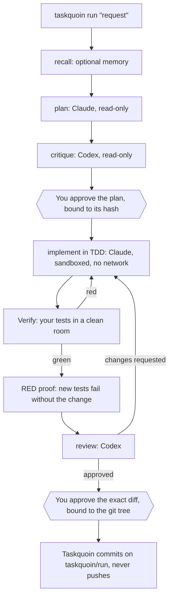

سه ایده در کل آموزش جاری است:

- **عاملها پیشنهاد می دهند، Taskquoin عمل می کند.** عاملها هرگز commit نمی کنند. commit را خود Taskquoin از درختی می سازد که تأیید، بازبینی و پذیرفته شده است ([ADR-0011](../adr/0011-agents-never-commit.md)).
- **تأیید شما به یک hash گره خورده است.** شما دقیقاً آنچه را خواندهاید تأیید می کنید، نه «اجرا» را ([ADR-0013](../adr/0013-tree-based-governance.md)).
- **آزمونها در اتاق پاک اجرا می شوند.** مدل هرگز به Taskquoin نمی گوید آزمونها قبول شدهاند؛ Taskquoin خودش آنها را اجرا می کند ([ADR-0014](../adr/0014-verify-in-a-clean-room.md)).

## گام ۱: ساخت پروژهای با یک آزمون ناموفق

پروژه یک ماشینحساب تکتابعی است. آزمون وجود دارد؛ تابع وجود ندارد.

```shell
$ mkdir calc && cd calc
$ git init -q -b main
```

`package.json` را بسازید:

```json
{
  "name": "calc",
  "private": true,
  "scripts": { "test": "node --test" }
}
```

`sum.test.js` را بسازید:

```js
const test = require('node:test');
const assert = require('node:assert');

test('sum', () => {
  const sum = require('./sum.js');
  assert.strictEqual(sum(2, 3), 5);
});
```

`.gitignore` را بسازید (وابستگیها و خروجی ساخت هرگز بخشی از diff در Taskquoin نیستند):

```text
node_modules/
```

آن را commit کنید (خروجی دستورها در ادامه به انگلیسی نمایش داده شده است):

```shell
$ git add .
$ git commit -m "calc: a failing test for sum"
$ npm test
not ok 1 - sum
  error: Cannot find module './sum.js'
```

آزمون همانطور که انتظار می رفت قرمز است. تنها پیششرط Taskquoin برای یک پروژه، یک مخزن git با درخت کاری تمیز است: `taskquoin run` اگر تغییرات commitنشده داشته باشید شروع نمی کند، زیرا هرگز تغییرات خود را با تغییرات شما قاطی نمی کند.

## گام ۲: راهاندازی Taskquoin

```shell
$ taskquoin init
```

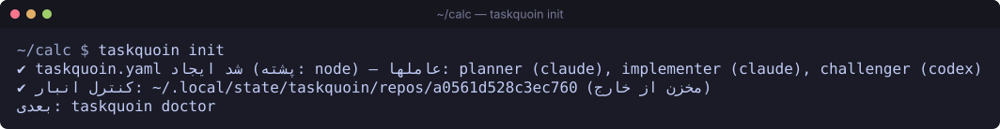

`init` سه کار انجام داد:

1. پشته را شناسایی کرد (`node`؛ همچنین `npm test`، PHPUnit، pytest، `go test`، Maven و موارد دیگر را می شناسد) و `taskquoin.yaml` را در ریشهٔ مخزن نوشت.
2. ابزارهای هوش مصنوعی روی دستگاه شما را جستوجو کرد و عاملها را برگزید: اینجا `planner` و `implementer` روی Claude Code و `challenger` روی Codex. اگر ابزاری نباشد، فایل این را می گوید؛ با فقط Claude Code، بازبین هم Claude است. با فقط OpenCode، `init` پیکربندی کاملاً مبتنی بر OpenCode می نویسد.
3. یک **مخزن کنترل** بیرون از مخزن پروژه، زیر `${XDG_STATE_HOME:-~/.local/state}/taskquoin/` ساخت. وضعیت اجرا، تأییدها و ریسکهای پذیرفتهشده اینجا نگهداری می شوند. عاملها نمی توانند اینجا بنویسند و همین است که تأیید را جعلناپذیر می کند ([ADR-0005](../adr/0005-control-plane-outside-workspace.md)).

`init` هرگز روی یک `taskquoin.yaml` موجود نمی نویسد. اگر `init` را با وجود هوشهای مصنوعی دیگر (یک کلید API در محیط شما، یک Ollama محلی) اجرا کرده باشید، آنها را فهرست می کند و بهصورت **کامنت** در فایل پیشنهاد می دهد: از حالت کامنت درآوردنشان تصمیم شماست، چون یعنی کد آن پروژه برایشان فرستاده خواهد شد.

### فایل `taskquoin.yaml` تولیدشده

بازش کنید. کوتاه است و می توانید همهاش را بخوانید. این هم بخش به بخش.

```yaml
# Taskquoin project configuration — see docs/architecture.md. Protected: agents can never edit this file.
version: 1
stack: node
```

`version` نسخهٔ طرحواره است. `stack` پیشفرضهای اتاق پاک را برمیگزیند: کدام پوشههای وابستگی برای آزمونهای شما فقطخواندنی سوار می شوند (برای `node`: `node_modules`). نخستین کامنت یک قول است: **عاملها هرگز نمی توانند این فایل را ویرایش کنند.** اگر یکی در طول اجرا به آن دست بزند، اجرا متوقف می شود و هیچ commitای انجام نمی شود.

```yaml
agents:
  planner:
    runtime: claude
    description: "Read-only planner: turns a request into a minimal, test-first implementation plan."
    prompt: You plan; you never modify files. Read the repository, then produce the plan requested.
    capabilities:
      fs.read:
        - "**"
    maxTurns: 30
    skills:
      - planning-contract
```

یک **عامل** نقشی است که به یک زماناجرا (`claude`، `codex`، `opencode` یا `api` برای یک داور) وصل شده است. `capabilities` همان کارهایی است که عامل اجازه دارد انجام دهد: planner می تواند همهچیز را بخواند (`fs.read: "**"`) و هیچ کار دیگری نمی تواند، پس نه شل دارد نه ابزار نوشتن. `skills` دستورالعملهایی هستند که با hash سنجاق شدهاند (`planning-contract` از خود پروژه است). `maxTurns` تعداد نوبتهای عامل را محدود می کند.

```yaml
  implementer:
    runtime: claude
    description: Implements an approved task with strict TDD (RED → GREEN → REFACTOR).
    prompt: "You implement exactly the approved task. Write a failing test first, make it pass with the simplest change, then refactor. Never commit: Taskquoin verifies and commits."
    capabilities:
      fs.read:
        - "**"
      fs.write:
        - "**"
      shell.run:
        - npm test
        - npm test -- *
        - node --test *
    maxTurns: 40
    skills:
      - tdd
```

implementer می تواند فایل بنویسد و فهرست کوچکی مجاز از دستورهای آزمون (`shell.run`) را اجرا کند تا بتواند آزمونمحور کار کند. این دستورها درون جعبهشنی سیستمعامل خود زماناجرا و بدون شبکه اجرا می شوند. با این حال، اجرای آزمون او فقط برای بازخورد خودش است: نتیجهای که به حساب می آید همان است که Taskquoin در Verify تولید می کند.

```yaml
  challenger:
    runtime: codex
    description: Independent, read-only adversarial reviewer of plans and diffs.
    prompt: "You are an independent reviewer. Challenge the plan or diff: correctness, security, missing tests, over-engineering. Report blocking and non-blocking findings with file:line. Do not modify files."
    capabilities:
      fs.read:
        - "**"
    skills:
      - code-review
```

**challenger** برنامه را نقد و diff را بازبینی می کند. عمداً از فروشندهای متفاوت با implementer است و فقطخواندنی است: نباید بتواند آنچه را نقد می کند «درست» کند.

```yaml
policy:
  mandatory:
    - fs.write
    - net.egress
    - config.modify
    - connector.write
    - vcs.commit
    - vcs.push
connectors: {}
memory:
  claudeMem:
    enabled: true
```

`policy.mandatory` محدودیتهایی را فهرست می کند که **باید** با یک سازوکار اعمال شوند تا عامل شروع شود: نوشتن بیرون از دامنهاش ممنوع، شبکه ممنوع، تغییر پیکربندی محافظتشده ممنوع، نوشتن روی سامانهٔ راه دور ممنوع، commit ممنوع، push ممنوع. اگر نسخهٔ زماناجرای شما نتواند یکی از آنها را اعمال کند، عامل رد می شود، نه اینکه با قاعدهای شروع شود که فقط توصیه است ([ADR-0002](../adr/0002-enforcement-classes.md)، [ADR-0003](../adr/0003-hooks-enforce-prose-asks.md)). `connectors` خالی است: هیچ سامانهٔ راه دوری متصل نیست ([ADR-0012](../adr/0012-remote-connectors-by-exception.md)). `memory.claudeMem` اختیاری است: وقتی فعال باشد، خلاصهٔ ساختاریافتهٔ هر اجرای پایانیافته به کارگر [claude-mem](https://github.com/thedotmack/claude-mem) محلی شما فرستاده می شود و در آغاز اجرا یک یادآوری کوتاه خوانده می شود. اگر claude-mem را اجرا نمی کنید `false` بگذارید. (تصاویر این آموزش از `false` استفاده می کنند.)

> [!TIP]
> اگر آزمونهای شما به یک فایل نادیدهگرفتهشده نیاز دارند که پوشهٔ وابستگی نیست، مثل یک `dist/` ساختهشده یا `.env.test`، آن را صریحاً اضافه کنید. آنگاه در اتاق پاک فقطخواندنی سوار می شود و برای عامل منجمد می گردد:
>
```yaml
verify:
  inherit:
    - dist
```
>
> پروژهای که آزمونهایش با `npm test` اجرا نمی شود می تواند `verify.command` را تنظیم کند.

می توانید از هوشهای مصنوعی دیگر هم بهعنوان داور (هر ارائهدهندهٔ سازگار با OpenAI) یا از OpenCode بهعنوان planner و implementer استفاده کنید؛ [ADR-0016](../adr/0016-judges-by-api.md) و [ADR-0017](../adr/0017-opencode-without-commands.md) را ببینید.

## گام ۳: commit کردن پیکربندی

`taskquoin.yaml` بخشی از پروژهٔ شماست، پس آن را commit کنید. این کار درخت کاری تمیزی را هم که Taskquoin نیاز دارد فراهم می کند:

```shell
$ git add taskquoin.yaml
$ git commit -m "chore: taskquoin"
```

## گام ۴: بررسی دستگاه با doctor

```shell
$ taskquoin doctor
```

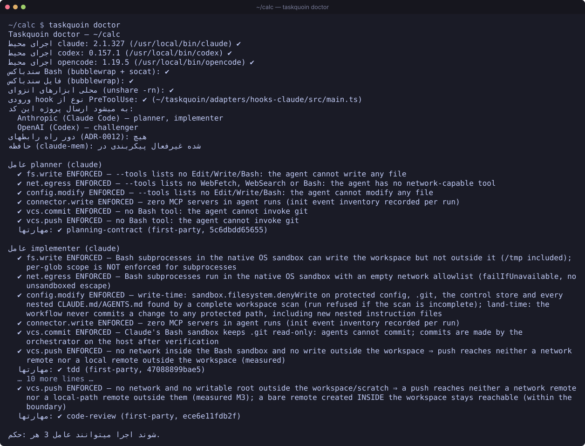

`doctor` بخش صادق Taskquoin است. از بالا به پایین بخوانیدش:

- بلوک نخست زماناجراهای پیداشده را با نسخههایشان و یک علامت تیک وقتی نسخه همان است که Taskquoin اندازه گرفته، سپس جعبهشنیها (bubblewrap و socat) و hook را فهرست می کند.
- **This project's code is sent to** هر فروشندهای را که کد شما را دریافت می کند، بهتفکیک عامل، فهرست می کند. Taskquoin روی دستگاه شما اجرا می شود؛ فقط هوشهای مصنوعی که پیکربندی می کنید چیزی می بینند ([ADR-0010](../adr/0010-local-first-no-leak.md)).
- سپس برای هر عامل، هر محدودیت اجباری با ردهاش و **سازوکاری که آن را اعمال می کند**، مثلاً `net.egress ENFORCED — Bash subprocesses run in the native OS sandbox with an empty network allowlist`. تیک یعنی برای آن نسخهٔ زماناجرا گواهی شده است؛ ضربدر یعنی عامل شروع نخواهد شد.
- آخرین خط حکم است: `Verdict: all 3 agents can run.` یا `Verdict: 2 of 3 agents can run — refused agents will not be started.`

در نمایش، یک خط ضربدر دارد (خروجی به انگلیسی نمایش داده شده است):

```text
Agent challenger (codex)
  …
  ✖ connector.write — mandatory restriction "connector.write" (deny-all) on codex 0.157.1: claimed ENFORCED but the mechanism is not measured (inferred). Execution refused (ADR-0002).
```

Codex می گوید `connector.write` (نوشتن روی کانکتورهای راه دور ممنوع) را اعمال می کند، اما Taskquoin راهی برای اندازهگیری این ادعا ندارد، پس آن را اعمالشده حساب نمی کند. challenger رد می شود: یک اجرا با `failed at challenge` و `gate refused agent challenger` پایان می یافت. برای این مورد باید تصمیمی بگیرید.

## ریسکی را که می فهمید بپذیرید

**ریسک پذیرفتهشده** تصمیم امضاشده، تاریخدار و با دامنهٔ محدود شماست برای اجرای یک عامل با وجود یک محدودیت که قابل اندازهگیری نیست. این تصمیم مالک است، نه توسعهدهنده و هرگز نه عامل:

```shell
$ taskquoin accept-risk challenger connector.write \
    --reason "Codex reviews read-only; no connector configured" \
    --expires 2026-12-31 --as you
```

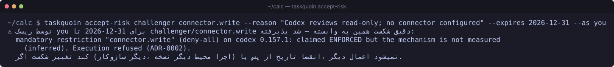

هر چهار گزینه لازماند: `--reason`، `--expires` (یک تاریخ واقعی در آینده، `YYYY-MM-DD`) و `--as` (نام شما)، بهعلاوهٔ عامل و capability. به ماهیت این پذیرش توجه کنید:

- **به همان شکست دقیق گره خورده است.** چکیدهای از پیام شکست را ذخیره می کند. اگر نسخهٔ زماناجرا یا سازوکار تغییر کند، شکست دیگر همان شکست نیست و پذیرش اعمال نمی شود.
- **تاریخدار است.** پس از تاریخ انقضا هم اعمال نمی شود.
- **بیرون از مخزن ذخیره می شود**، در مخزن کنترل. هیچکس نمی تواند با ویرایش `taskquoin.yaml` یکی اضافه کند و هیچ عاملی نمی تواند آن را بنویسد.
- **محدود است.** فقط برای همین عامل و همین capability اعمال می شود. برای capabilityای که شکست نمی خورد رد می شود و برای داورهای API در دسترس نیست (آنها همیشه بررسی می شوند).

دوباره `doctor` را اجرا کنید. آن خط اکنون بهجای ضربدر یک هشدار است و حکم `all 3 agents can run` است (خروجی به انگلیسی نمایش داده شده است):

```text
  ⚠ connector.write accepted risk (approved by you until 2026-12-31: Codex reviews read-only; no connector configured) — mandatory restriction "connector.write" (deny-all) on codex 0.157.1: claimed ENFORCED but the mechanism is not measured (inferred). Execution refused (ADR-0002).
```

`taskquoin check challenger` همین جزئیات را برای یک عامل نشان می دهد:

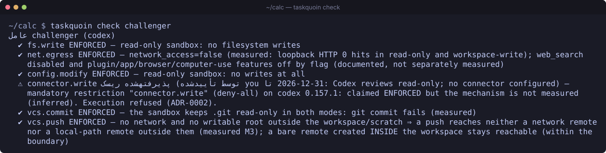

> [!IMPORTANT]
> ریسک را فقط وقتی بپذیرید که آن را می فهمید و وضعیت با دلیل شما می خواند: اینجا Codex فقطخواندنی بازبینی می کند و پروژهٔ شما کانکتوری ندارد، پس «نوشتن روی کانکتور» به هر حال رخ نمی دهد. برای از بین بردن یک خط قرمز ریسک نپذیرید. بهویژه:
>
> - هرگز برای `fs.write`، `net.egress`، `vcs.commit` یا `vcs.push` در عاملی که واقعاً می نویسد یا دستور اجرا می کند، مگر اینکه بتوانید کنترل جبرانی را نام ببرید؛
> - هرگز با دلیل مبهم: دلیل در تأیید ثبت می شود و `doctor` آن را نشان می دهد؛
> - انقضای کوتاه را ترجیح دهید: پذیرش یادآوری است برای بررسی دوباره پس از یک ارتقا؛
> - اگر سازوکاری *بهصورت شکستخورده اندازهگیری شده*، بهجایش ارتقا دهید یا زماناجرا را عوض کنید.

اجرای `taskquoin accept-risk` توسط خودتان عمدی است: اگر کنسول یا یک عامل می توانست آن را انجام دهد، این کنترل بیمعنا می شد.

## گام ۵: شروع اجرا

```shell
$ taskquoin run "Add a sum function"
```

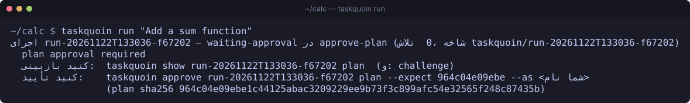

ترمینال شما در حالی که عاملها کار می کنند ساکت است، سپس می نویسد کجا ایستاده است. بهترتیب، Taskquoin این کارها را کرد:

1. **Preflight.** Taskquoin بررسی کرد که پیکربندی همهٔ نقشها را تعریف می کند، مهارتها قابل استفادهاند، نقشهای فقطخواندنی واقعاً فقطخواندنیاند و داورهای API کلیدهایشان را دارند. درخت کاری باید تمیز باشد. هر عامل همچنین درست پیش از نخستین استفاده از همان دروازهای عبور می کند که `doctor` از آن می گذرد: عاملِ ردشده اجرا را با `failed` پایان می دهد.
2. **شاخه.** شاخهٔ `taskquoin/run-20261122T132108-d17040` را ساخت و به آن رفت. `main` شما دستنخورده است.
3. **Recall.** اگر فعال باشد، از کارگر حافظه یادداشتهای مرتبط را خواست. وقتی چیزی نباشد، ژورنال `recall no-memory` را نشان می دهد.
4. **برنامه.** `planner` (Claude، فقطخواندنی) مخزن را خواند و یک برنامه نوشت: هدف، آزمونی که باید نخست نوشته شود، فایلها، گامها، ریسکها.
5. **نقد.** `challenger` (Codex، فقطخواندنی) آن برنامه را مستقلاً به چالش کشید و با یک خط `VERDICT:` پایان داد.
6. **دروازه.** گردش کار در `approve-plan` ایستاد. هر قدر بخواهید منتظر می ماند.

شناسهٔ اجرا (`run-20261122T132108-d17040`) یک مهر زمانی بهعلاوهٔ یک پسوند تصادفی است. در همهٔ دستورهای بعدی از آن استفاده می کنید. `taskquoin status` بدون آرگومان اجراها را فهرست می کند (خروجی به انگلیسی نمایش داده شده است):

```shell
$ taskquoin status
run-20261122T132108-d17040  waiting-approval approve-plan    Add a sum function
```

## گام ۶: خواندن و تأیید برنامه

`status <run>` تاریخچهٔ یک اجرا و، در یک دروازه، دستور دقیق تأیید آن را نشان می دهد:

```shell
$ taskquoin status run-20261122T132108-d17040
```

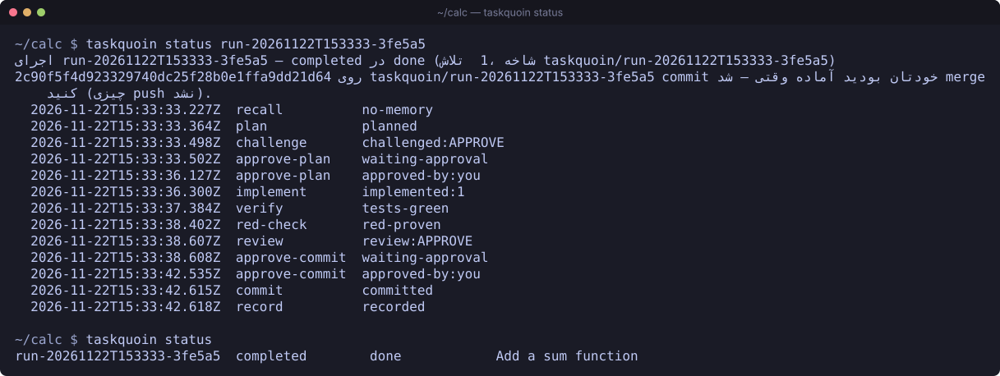

هر خط تاریخچه یک گام از گردش کار با نتیجهاش است (`planned`، `challenged:APPROVE`، `waiting-approval`).

اکنون **آنچه را می خواهید تأیید کنید بخوانید**:

```shell
$ taskquoin show run-20261122T132108-d17040 plan
```

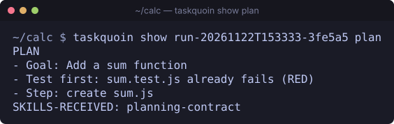

خروجی دستورها همانطور که CLI چاپ می کند، به انگلیسی نمایش داده شده است:

```shell
$ taskquoin show run-20261122T132108-d17040 challenge
Review: plan checked.
VERDICT: APPROVE
```

`show <run>` بدون نام artifact همهٔ آنچه تاکنون ذخیره شده را با اندازهاش به بایت فهرست می کند. برنامهای از یک عامل واقعی فایلهایی که باید تغییر کنند، آزمونهایی که باید نخست نوشته شوند و ریسکها را هم دربر می گیرد. challenge نظر دوم مستقل است: ممکن است یافتههای مسدودکننده و غیرمسدودکننده فهرست کند. اگر برنامه نادرست است آن را تأیید نکنید: با درخواستی دقیقتر یک run تازه شروع کنید.

### چرا hash

خطی که اهمیت دارد آخرین خط `status` است (خروجی به انگلیسی نمایش داده شده است):

```text
Approve it:  taskquoin approve run-20261122T132108-d17040 plan --expect 964c04e09ebe --as <your name>
             (plan sha256 964c04e09ebe1c44125abac3209229ee9b73f3c899afc54e32565f248c87435b)
```

`964c04e09ebe` ابتدای SHA-256 فایل برنامهای است که همین الان خواندید. تأیید یعنی «من **برنامهای را که hash آن 964c04e09ebe است** تأیید می کنم»، نه «این اجرا را تأیید می کنم». اگر برنامه می توانست بین خواندن و تأیید شما تغییر کند (یک تلاش دوباره، فرایندی دیگر، ابزاری آلوده)، hash دیگر نمی خواند و Taskquoin رد می کرد. همین چیز در commit هم ثبت می شود، پس هر کسی می تواند بعداً ممیزی کند که یک نفر چه چیزی را تأیید کرده است.

> [!NOTE]
> `--expect` یک گذرواژه نیست. گواهی است بر اینکه به artifactای که سامانه می خواهد روی آن اقدام کند نگاه کردهاید: آن را پس از خواندن از `status` کپی می کنید. در [کنسول](../getting-started/console.md) برای تأیید آن را دوباره تایپ می کنید.

تأیید کنید:

```shell
$ taskquoin approve run-20261122T132108-d17040 plan --expect 964c04e09ebe --as you
```

`--as` نام شماست؛ در commit بهعنوان `Plan-Approved-By` ثبت می شود. تأیید برنامه گردش کار را از سر می گیرد و تا دروازهٔ بعدی ادامه می یابد.

### hash نادرست رد می شود

hashای را امتحان کنید که همان در انتظار نیست (خروجی به انگلیسی نمایش داده شده است):

```shell
$ taskquoin approve run-20261122T132108-d17040 plan --expect 000000000000 --as you
taskquoin approve: expected 000000000000 does not match the pending artifact 964c04e09ebe… — re-read it before approving
```

هیچ چیز تأیید نشد و اجرا تغییری نکرد. اگر دروازهای را تأیید کنید که اجرا منتظرش نیست هم همین رخ می دهد. تصویر زیر پس از تکمیل اجرا گرفته شده، پس آن گونه از رد را نشان می دهد:

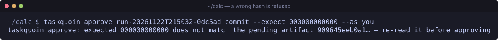

کد خروج یک رد برابر ۱ است. یک دستور غلطتایپشده (نبودن `--expect` یا `--as`) با کد ۲ خارج می شود.

## گام ۷: پیادهسازی، Verify و بازبینی

پس از `approve … plan` Taskquoin بدون شما کار می کند:

1. **پیادهسازی با TDD.** `implementer` (Claude) روی شاخه، درون جعبهشنی زماناجرا، بدون شبکه و بدون امکان commit کار می کند. نخست آزمونها را می نویسد یا تنظیم می کند، سپس سادهترین کدی را که آنها را قبول کند.
2. **Verify، در اتاق پاک.** Taskquoin همان درختی را که implementer باقی گذاشته برمیدارد و آزمونهای شما (`npm test`) را خودش در یک نسخهٔ دورریختنی بیرون از مخزن شما اجرا می کند: بدون شبکه، `.git` فقطخواندنی، HOME پنهان، فایلهای محرمانه پوشاندهشده، و فقط پوشههای وابستگی پشته (و `verify.inherit` شما) فقطخواندنی سوار شدهاند. آزمونی که قبول می شد اما به چیزی commitنشده وابسته بود اینجا شکست می خورد، و هدف همین است.
3. **RED proof.** سپس Taskquoin تغییر کد تولیدی را برمیدارد و آزمونهای تغییرکرده را دوباره اجرا می کند. آنها باید **شکست بخورند**. آزمونی که بدون تغییر قبول شود چیزی را آزمون نمی کند. اثبات مکانیکی است: نشان نمی دهد آزمون رفتار درست را بررسی می کند (برای این بازبینی و خود شما هستید).
4. **بازبینی.** `challenger` diff را در برابر برنامه، همراه با لاگهای verify و RED، بازبینی می کند. با یک خط `VERDICT:` پایان می دهد.

اگر آزمونها قرمز باشند، یا RED proof شکست بخورد، یا بازبینی تغییر بخواهد، Taskquoin بازخورد را برای بازکاری خودکار به implementer می فرستد (حداکثر ۳ تلاش پیادهسازی، با حداکثر ۲ دور بازکاری پس از یک بازبینی ردشده). سپس اجرا در دروازهٔ دوم می ایستد.

## گام ۸: خواندن و تأیید commit

اجرا اکنون دوباره منتظر است. به آن نگاه کنید (خروجی به انگلیسی نمایش داده شده است):

```shell
$ taskquoin status run-20261122T132108-d17040
Run run-20261122T132108-d17040 — waiting-approval at approve-commit (attempt 1, branch taskquoin/run-20261122T132108-d17040)
  commit approval required (bound to the exact tree)
  Review it:   taskquoin show run-20261122T132108-d17040 diff-1  (and: verify-1, red-1, review-1)
  Approve it:  taskquoin approve run-20261122T132108-d17040 commit --expect 909645eeb0a1 --as <your name>
               (git tree 909645eeb0a1716e60fd724784ede536fbea048f)
```

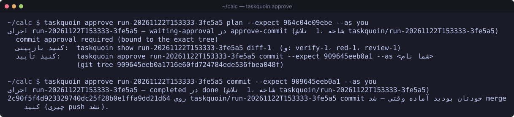

این بار hash همان **درخت git** است که از Verify و بازبینی گذشته. چهار artifact مربوط به تلاش ۱ را بخوانید. عدد شمارهٔ تلاش است؛ پس از بازکاری بالاترین را بخوانید.

### `diff-1`: تغییر دقیق

```shell
$ taskquoin show run-20261122T132108-d17040 diff-1
```

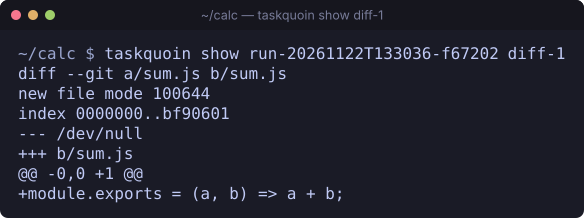

این همان چیزی است که commit خواهد شد، نه بیشتر. اگر عامل فایل محافظتشدهای (CI شما، `.claude/`، `AGENTS.md`، `taskquoin.yaml`) را تغییر می داد، اجرا با `protected configuration changed` متوقف می شد. فایلهایی که `.gitignore` شما پنهان می کند اما عامل ساخته در `ignored-1` فهرست می شوند؛ آنها در diff نیستند، تأیید نمی شوند و commit نمی شوند.

### `verify-1`: آزمونهای شما، اجراشده توسط Taskquoin

```shell
$ taskquoin show run-20261122T132108-d17040 verify-1
```

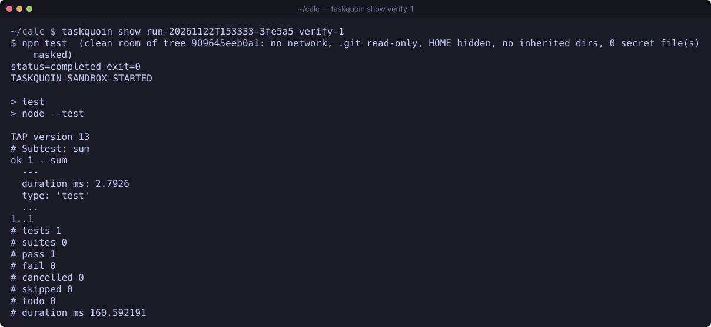

سرآیند می گوید اتاق پاک چه بود (`no network, .git read-only, HOME hidden, … 0 secret file(s) masked`) و برای کدام درخت (`909645eeb0a1`، همان hashای که تأیید خواهید کرد). `exit=0` و `# pass 1` از اجراکنندهٔ آزمون می آیند، نه از ادعای یک مدل.

### `red-1`: اثبات اینکه آزمون مهم است

خروجی دستورها همانطور که CLI چاپ می کند، به انگلیسی نمایش داده شده است:

```shell
$ taskquoin show run-20261122T132108-d17040 red-1
TASKQUOIN RED PROOF — tests run on base + test changes only (tree 9848f565e24c); they must FAIL.
RESULT: they failed as required (RED proven).

$ npm test  (clean room of tree 9848f565e24c: no network, .git read-only, HOME hidden, no inherited dirs, 0 secret file(s) masked)
status=failed exit=1
…
not ok 1 - sum
  error: Cannot find module './sum.js'
  code: 'MODULE_NOT_FOUND'
```

اینجا فایل تولیدی تازهٔ `sum.js` برداشته شد، آزمون نتوانست آن را بارگیری کند و شکست خورد. این شکست همان RED proof است. Taskquoin خطای import ناشی از یک قابلیت در یک فایل *تازه* را RED مورد انتظار می داند. اگر فقط فایلهای آزمون تغییر کرده باشند (افزودن صرف آزمون)، اثبات بهصورت «not applicable» ثبت می شود.

### `review-1`: نظر دوم

خروجی دستورها همانطور که CLI چاپ می کند، به انگلیسی نمایش داده شده است:

```shell
$ taskquoin show run-20261122T132108-d17040 review-1
Review: diff checked against the plan.
VERDICT: APPROVE
```

یافتهها را بخوانید، نه فقط حکم را. `ignored-1` فقط وقتی در فهرست ظاهر می شود که چیزی برای خواندن باشد.

### تأیید commit

اگر راضی هستید، با hashی که در `status` است تأیید کنید (خروجی به انگلیسی نمایش داده شده است):

```shell
$ taskquoin approve run-20261122T132108-d17040 commit --expect 909645eeb0a1 --as you
Run run-20261122T132108-d17040 — completed at done (attempt 1, branch taskquoin/run-20261122T132108-d17040)
Committed a3c6b801de5f4356750f53870557e2fdd19958ee on taskquoin/run-20261122T132108-d17040 — merge it yourself when ready (nothing was pushed).
```

`approve … commit` باید وقتی اجرا شود که مخزن روی شاخهٔ اجرا (`taskquoin/<run>`) باشد؛ در غیر این صورت پاسخ می دهد `switch to taskquoin/<run> first`. Taskquoin پیش از commit درخت کاری را دوباره می خواند. اگر از زمانی که نگاه کردید چیزی تغییر کرده باشد، تأیید شما دیگر اعمال نمی شود: دوباره تأیید و بازبینی می کند و از شما می خواهد درخت جدید را تأیید کنید.

سپس Taskquoin commit را **از خود درخت git تأییدشده** می سازد، نه از `git add`. اینگونه به نظر می رسد:

```shell
$ git log -1 taskquoin/run-20261122T132108-d17040
```

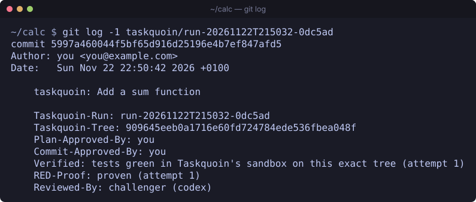

خروجی دستورها همانطور که CLI چاپ می کند، به انگلیسی نمایش داده شده است:

```text
taskquoin: Add a sum function

Taskquoin-Run: run-20261122T132108-d17040
Taskquoin-Tree: 909645eeb0a1716e60fd724784ede536fbea048f
Plan-Approved-By: you
Commit-Approved-By: you
Verified: tests green in Taskquoin's sandbox on this exact tree (attempt 1)
RED-Proof: proven (attempt 1)
Reviewed-By: challenger (codex)
```

trailerها مسیر ممیزی در خود commit هستند:

| Trailer | معنا |
|---|---|
| `Taskquoin-Run` | اجرایی که این commit را ساخت |
| `Taskquoin-Tree` | درخت git که تأیید، بازبینی و پذیرفته شد. همان درخت این commit است |
| `Plan-Approved-By` | نامی که در دروازهٔ برنامه با `--as` داده شد |
| `Commit-Approved-By` | نامی که در دروازهٔ commit با `--as` داده شد |
| `Verified` | آزمونها در اتاق پاک روی همین درخت دقیق سبز بودند |
| `RED-Proof` | آزمونهای تغییرکرده بدون تغییر شکست خوردند (`proven`، یا برای تغییرات فقطآزمون `not applicable`) |
| `Reviewed-By` | عاملهایی که بازبینی و تأیید کردند؛ یک داور API خط خودش را می افزاید |

`taskquoin status <run>` در پایان کل ژورنال را از `recall` تا `commit` و `record` نشان می دهد.

## گام ۹: ادغام نتیجه

Taskquoin **هرگز push نمی کند** و هرگز در شاخهٔ شما ادغام نمی کند. commit روی `taskquoin/<run>` است، شاخهای که روی آن هستید. خودتان ادغام کنید یا از آن یک pull request باز کنید:

```shell
$ git switch main
$ git merge --ff-only taskquoin/run-20261122T132108-d17040
$ npm test
```

> [!WARNING]
> Taskquoin hookهای commit مخزن شما را اجرا نمی کند، چون ممکن است حاوی کدی باشند که عامل تغییر داده است. هنگام ادغام، hookها، linterها و CI خود را خودتان اجرا کنید.

شاخههای `taskquoin/<run>` مال شما هستند: وقتی نیازی به آنها ندارید حذفشان کنید (`git branch -d taskquoin/<run>`).

## دنبال کردن یک اجرا در Dashboard

در حالی که یک اجرا کار می‌کند، ترمینال دومی را در همان مخزن باز کنید و Dashboard را راه بیندازید. فقط می‌خواند: خط لوله، تأییدی که منتظر شماست (با ابتدای hash آن)، عامل‌ها و گزارش را نشان می‌دهد.

```shell
$ taskquoin dashboard
```

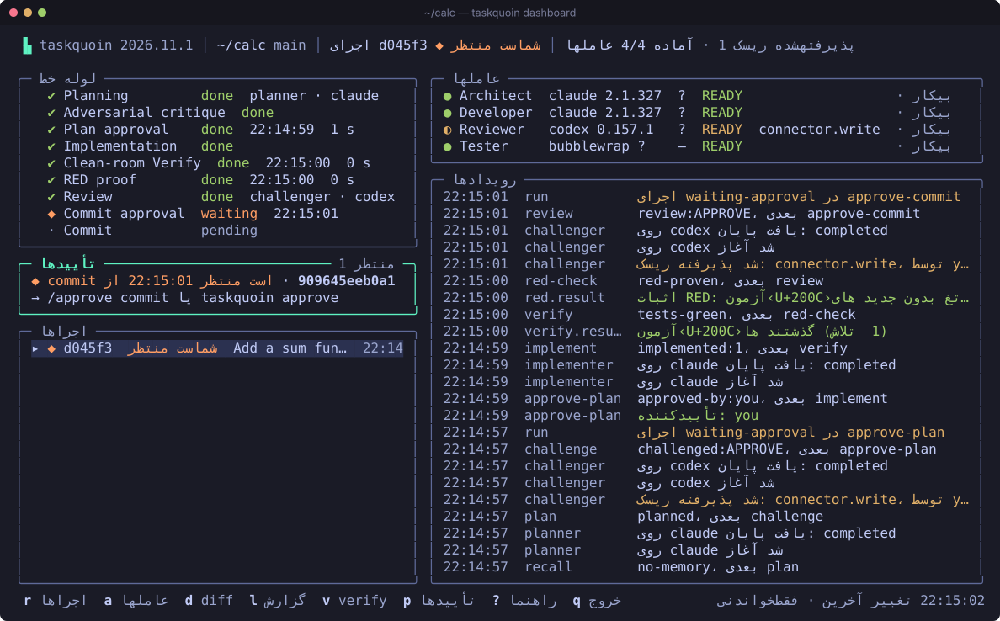

برای خواندن diff کلید `d` را بزنید: `/` جست‌وجو می‌کند، `n` و `N` میان نتیجه‌ها می‌پرند و وقتی تا پایان یک فایل پیمایش کنید آن فایل خوانده‌شده به حساب می‌آید.

برای باز کردن مرکز تأیید کلید `p` را بزنید. هیچ کلیدی خودش تأیید نمی‌کند: نام خود را می‌نویسید و سپس ۱۲ نویسهٔ hash را دوباره تایپ می‌کنید. با `q` خارج شوید؛ اجرای تأییدشده ادامه می‌یابد. [راهنمای Dashboard (به انگلیسی)](../guides/dashboard.md).

## وقتی همهچیز طبق برنامه پیش نمی رود

پیامهای خطای Taskquoin زبان شما را دنبال می کنند، اما پیامهای موتور اجرا (`failed`، `needs-human`، `interrupted`) همیشه انگلیسیاند. جدول آنچه بیشتر با آن روبهرو می شوید را فهرست می کند.

| آنچه می بینید | معنی آن | کاری که باید کرد |
|---|---|---|
| `taskquoin run: the working tree has uncommitted changes` | Taskquoin هرگز تغییرات خود را با تغییرات شما قاطی نمی کند | تغییراتتان را commit یا stash کنید |
| `failed … gate refused agent X` | یک عامل روی این دستگاه نمی تواند گواهی شود | `taskquoin doctor` دلیل را می گوید: نسخهٔ زماناجرا، جعبهشنی غایب، ریسکی که نپذیرفتهاید |
| `needs-human … tests still failing after 3 attempts` | سه تلاش آزمون سبز نداد | روی شاخهٔ اجرا دستی ادامه دهید، یا با درخواستی دقیقتر run تازهای شروع کنید |
| `needs-human … no failing test demonstrates the change` | آزمونها حتی بدون تغییر تولیدی هم قبول می شوند، پس آن را آزمون نمی کنند | `red-N` را بخوانید؛ آزمونی بنویسید (یا بخواهید) که پیش از تغییر شکست بخورد. بازآرایی یا تغییر مستندات بدون آزمون تازه اینجا تمام می شود: خودتان از روی شاخه commit کنید |
| `needs-human … RED proof inconclusive` | اثبات نتوانست درست اجرا شود (مهلت، جعبهشنی، درختی که بازسازی نشد). این یک اثبات نیست | `red-N` را بخوانید. پوشهٔ کاری شما دستنخورده است |
| `needs-human … review still requests changes after N attempts` | بازبین به رد کردن ادامه داد | `review-N` را بخوانید و تصمیم بگیرید؛ کار در شاخه است |
| `needs-human … dependencies changed during the run` | `node_modules` (یا `vendor`، `.venv`) در طول اجرا تغییر کرد، پس چیزی با آن تأیید نشده است | دوباره نصب کنید (`npm ci`) و run تازهای شروع کنید. در طول یک اجرا `npm install` اجرا نکنید |
| `needs-human … protected configuration changed` | عامل به پیکربندی محافظتشده (CI، `.claude/`، `AGENTS.md`، `taskquoin.yaml`) دست زد | هیچ چیز commit نشد؛ شاخه را بررسی کنید |
| آزمونها برای شما قبول می شوند اما در Verify شکست می خورند | از یک فایل نادیدهگرفتهشده استفاده می کنند که در اتاق پاک نیست | آن را به `verify.inherit` بیفزایید |
| `does not match the pending artifact` | hashای که دادید همان در انتظار نیست | با `show` بخوانید، hash را از `status` کپی کنید |
| `switch to taskquoin/<run> first` | روی شاخهٔ اجرا نیستید | `git switch taskquoin/<run>` |
| `taskquoin.yaml changed since the run started` | پیکربندی میانهٔ اجرا تغییر کرد | run تازهای شروع کنید |
| `interrupted` | یک خطای فنی (git، دیسک، HTTP 503 یک داور) اجرا را متوقف کرد | `taskquoin resume <run>` |

### وقتی آزمونها قرمز می مانند

اگر Verify شکست بخورد، Taskquoin لاگ شکست و بازبینی را به implementer می دهد و دوباره تلاش می کند، تا سه تلاش پیادهسازی (یک implementer روی OpenCode که دستور خودش را ندارد، بازکاری بیشتری می گیرد). اگر آزمونها همچنان قرمز باشند، اجرا با وضعیت `needs-human` و دلیل `tests still failing after 3 attempts` پایان می یابد. نه commitای هست و نه درخواست تأییدی.

همهچیز نگه داشته می شود: `taskquoin show <run> verify-3` آخرین لاگ را دارد و شاخهٔ `taskquoin/<run>` کار عامل را نگه می دارد. می توانید روی آن شاخه دستی ادامه دهید یا با درخواستی دقیقتر run تازهای شروع کنید. اجرایی با وضعیت `needs-human` خودکار از سر گرفته نمی شود.

### `resume`: پس از یک وقفه

اجرا وقتی `interrupted` می شود که چیزی بیرون از گردش کار آن را بشکند (خطای شبکه هنگام رسیدن به یک داور، دیسک پر، به خواب رفتن دستگاه). وضعیت در هر گام ذخیره می شود و پاسخ داورها یکبهیک ذخیره می شوند، پس از سرگیری هرگز یک داور را دوبار صدا نمی زند و دوبار هزینه نمی دهد:

```shell
$ taskquoin resume run-20261122T132108-d17040
```

`resume` فقط اجرایی را می پذیرد که وضعیتش `interrupted` است. برای هر وضعیت دیگر این را به شما می گوید، مثلاً `taskquoin resume: only an interrupted run can be resumed (status completed)`. اگر وضعیت `needs-human` یا `failed` است، run تازهای شروع کنید.

### یک قاعدهٔ سرانگشتی

اگر نمی دانید چه کنید، `taskquoin status <run>` را اجرا کنید: وضعیت، ژورنال و دستور دقیق بعدی را چاپ می کند. `taskquoin doctor` به هر پرسش دربارهٔ دستگاه پاسخ می دهد.

## بیشتر بدانید

- [کنسول تعاملی](../getting-started/console.md): همان گردش کار، با `/run` و `/approve`
- [نصب](../getting-started/installation.md)
- [ADR-0011, agents never commit](../adr/0011-agents-never-commit.md)
- [ADR-0013, tree-based governance](../adr/0013-tree-based-governance.md)
- [ADR-0014, Verify in a clean room](../adr/0014-verify-in-a-clean-room.md)
- [ADR-0002, enforcement classes](../adr/0002-enforcement-classes.md)
- [ADR-0005, control plane outside the workspace](../adr/0005-control-plane-outside-workspace.md)
- [ADR-0016, judges by API](../adr/0016-judges-by-api.md) و [ADR-0017, OpenCode without commands](../adr/0017-opencode-without-commands.md)
