# Votre première exécution gouvernée

> Ce tutoriel est la traduction de la [page de référence en anglais](../getting-started/first-run.md).

Ce tutoriel vous mène d'un dossier vide à un commit vérifié, réalisé par Taskquoin, une commande à la fois. Vous allez
créer un minuscule projet avec un test qui échoue, laisser Taskquoin planifier et implémenter un correctif avec des
agents IA, puis approuver le travail à deux reprises : une fois après avoir lu le plan, une fois après avoir lu le diff
exact. À chaque étape, vous voyez ce que fait Taskquoin, pourquoi il s'arrête et ce que vous signez.

- [Ce que vous allez construire](#ce-que-vous-allez-construire)
- [Étape 1 : créer un projet avec un test qui échoue](#étape-1--créer-un-projet-avec-un-test-qui-échoue)
- [Étape 2 : initialiser Taskquoin](#étape-2--initialiser-taskquoin)
- [Étape 3 : valider la configuration](#étape-3--valider-la-configuration)
- [Étape 4 : vérifier la machine avec doctor](#étape-4--vérifier-la-machine-avec-doctor)
- [Accepter un risque que vous comprenez](#accepter-un-risque-que-vous-comprenez)
- [Étape 5 : lancer l'exécution](#étape-5--lancer-lexécution)
- [Étape 6 : lire et approuver le plan](#étape-6--lire-et-approuver-le-plan)
- [Étape 7 : implémentation, Verify et revue](#étape-7--implémentation-verify-et-revue)
- [Étape 8 : lire et approuver le commit](#étape-8--lire-et-approuver-le-commit)
- [Étape 9 : fusionner le résultat](#étape-9--fusionner-le-résultat)
- [Quand les choses ne se passent pas comme prévu](#quand-les-choses-ne-se-passent-pas-comme-prévu)
- [Pour aller plus loin](#pour-aller-plus-loin)

> [!NOTE]
> Les captures d'écran proviennent d'un dépôt de démonstration avec des agents IA simulés (les doublures de test de la
> propre suite de tests de Taskquoin) ; chaque commande est la vraie CLI de Taskquoin. Avec les vrais Claude Code et
> Codex, la formulation du plan et de la revue est celle des agents eux-mêmes, et une exécution prend quelques minutes
> au lieu de quelques secondes. Tout le reste est identique.

Avant de commencer, [installez Taskquoin](../getting-started/installation.md) et assurez-vous que Node 22.18+, git, `bubblewrap` et `socat`
sont disponibles, et qu'au moins Claude Code (et idéalement Codex) est installé et connecté.

## Ce que vous allez construire

Une exécution (run) est un workflow fixe. Les deux losanges sont les deux approbations humaines ; rien ne les franchit
sans vous.

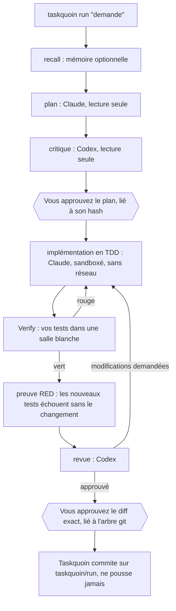

Trois idées parcourent tout le tutoriel :

- **Les agents proposent, Taskquoin agit.** Les agents ne commitent jamais. Le commit est construit par Taskquoin à
  partir de l'arbre qui a été vérifié, relu et approuvé ([ADR-0011](../adr/0011-agents-never-commit.md)).
- **Votre approbation est liée à un hash.** Vous approuvez exactement ce que vous avez lu, pas « l'exécution »
  ([ADR-0013](../adr/0013-tree-based-governance.md)).
- **Les tests s'exécutent dans une salle blanche.** Le modèle ne dit jamais à Taskquoin que les tests passent ;
  Taskquoin les lance lui-même ([ADR-0014](../adr/0014-verify-in-a-clean-room.md)).

## Étape 1 : créer un projet avec un test qui échoue

Le projet est une calculatrice à une seule fonction. Le test existe ; la fonction, non.

Les sorties de la CLI citées dans ce tutoriel (blocs de code) sont affichées en anglais ; les captures d'écran
montrent la sortie localisée en français.

```shell
$ mkdir calc && cd calc
$ git init -q -b main
```

Créez `package.json` :

```json
{
  "name": "calc",
  "private": true,
  "scripts": { "test": "node --test" }
}
```

Créez `sum.test.js` :

```js
const test = require('node:test');
const assert = require('node:assert');

test('sum', () => {
  const sum = require('./sum.js');
  assert.strictEqual(sum(2, 3), 5);
});
```

Créez `.gitignore` (les dépendances et les fichiers de build ne font jamais partie d'un diff Taskquoin) :

```text
node_modules/
```

Validez le tout :

```shell
$ git add .
$ git commit -m "calc: a failing test for sum"
$ npm test
not ok 1 - sum
  error: Cannot find module './sum.js'
```

Le test est rouge, comme prévu. Un dépôt git avec un arbre de travail propre est la seule condition préalable que
Taskquoin exige d'un projet : `taskquoin run` refuse de démarrer si vous avez des modifications non validées, car il ne
mélange jamais ses changements avec les vôtres.

## Étape 2 : initialiser Taskquoin

```shell
$ taskquoin init
```

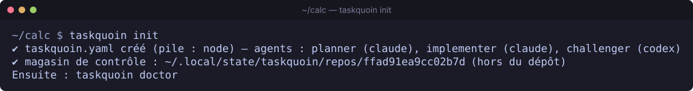

`init` a fait trois choses :

1. Il a détecté la stack (`node` ; il connaît aussi `npm test`, PHPUnit, pytest, `go test`, Maven et d'autres) et a
   écrit `taskquoin.yaml` à la racine du dépôt.
2. Il a cherché des outils IA sur votre machine et choisi des agents : ici `planner` et `implementer` sur Claude Code,
   et `challenger` sur Codex. Si un outil manque, le fichier le signale ; avec Claude Code seul, le relecteur est
   Claude lui aussi. Avec OpenCode seul, `init` écrit une configuration entièrement OpenCode.
3. Il a créé un **control store** (magasin de contrôle) en dehors du dépôt, sous
   `${XDG_STATE_HOME:-~/.local/state}/taskquoin/`. C'est là que vivent l'état des exécutions, les approbations et les
   acceptations de risque. Les agents ne peuvent pas y écrire, ce qui rend une approbation infalsifiable
   ([ADR-0005](../adr/0005-control-plane-outside-workspace.md)).

`init` n'écrase jamais un `taskquoin.yaml` existant. Si vous avez lancé `init` alors que d'autres IA sont disponibles
(une clé d'API dans votre environnement, un Ollama local), il les liste et les propose sous forme de **commentaires**
dans le fichier : les décommenter relève de votre décision, car cela signifie que le code de ce projet leur sera envoyé.

### Le `taskquoin.yaml` généré

Ouvrez-le. Il est court et vous pouvez le lire en entier. Le voici, section par section.

```yaml
# Taskquoin project configuration — see docs/architecture.md. Protected: agents can never edit this file.
version: 1
stack: node
```

`version` est la version du schéma. `stack` sélectionne les valeurs par défaut de la salle blanche : quels répertoires
de dépendances sont montés en lecture seule pour vos tests (pour `node` : `node_modules`). Le premier commentaire est une
promesse : **les agents ne peuvent jamais modifier ce fichier.** Si l'un d'eux y touche pendant une exécution, celle-ci
s'arrête et rien n'est commité.

```yaml
agents:
  planner:
    runtime: claude
    description: "Read-only planner: turns a request into a minimal, test-first implementation plan."
    prompt: You plan; you never modify files. Read the repository, then produce the plan requested.
    capabilities:
      fs.read:
        - "**"
    maxTurns: 30
    skills:
      - planning-contract
```

Un **agent** est un rôle lié à un runtime (`claude`, `codex`, `opencode`, ou `api` pour un juge). `capabilities` définit
ce que l'agent a le droit de faire : le planner peut tout lire (`fs.read: "**"`) et rien d'autre, il n'a donc ni shell ni
outil d'écriture. `skills` sont des instructions épinglées par hash (`planning-contract` est fourni par Taskquoin).
`maxTurns` plafonne le nombre de tours de l'agent.

```yaml
  implementer:
    runtime: claude
    description: Implements an approved task with strict TDD (RED → GREEN → REFACTOR).
    prompt: "You implement exactly the approved task. Write a failing test first, make it pass with the simplest change, then refactor. Never commit: Taskquoin verifies and commits."
    capabilities:
      fs.read:
        - "**"
      fs.write:
        - "**"
      shell.run:
        - npm test
        - npm test -- *
        - node --test *
    maxTurns: 40
    skills:
      - tdd
```

L'implementer peut écrire des fichiers et lancer une petite liste blanche de commandes de test (`shell.run`) afin de
travailler en test-first. Ces commandes s'exécutent dans le sandbox système propre au runtime, sans réseau. Malgré cela,
son exécution des tests ne sert qu'à son propre retour d'information : le résultat qui compte est celui que Taskquoin
produit dans Verify.

```yaml
  challenger:
    runtime: codex
    description: Independent, read-only adversarial reviewer of plans and diffs.
    prompt: "You are an independent reviewer. Challenge the plan or diff: correctness, security, missing tests, over-engineering. Report blocking and non-blocking findings with file:line. Do not modify files."
    capabilities:
      fs.read:
        - "**"
    skills:
      - code-review
```

Le **challenger** critique le plan et relit le diff. C'est volontairement un autre fournisseur que l'implementer, et il
est en lecture seule : il ne doit pas pouvoir « corriger » ce qu'il critique.

```yaml
policy:
  mandatory:
    - fs.write
    - net.egress
    - config.modify
    - connector.write
    - vcs.commit
    - vcs.push
connectors: {}
memory:
  claudeMem:
    enabled: true
```

`policy.mandatory` liste les restrictions qui **doivent** être appliquées par un mécanisme pour qu'un agent démarre :
pas d'écriture hors de son périmètre, pas de réseau, pas de modification de la configuration protégée, pas d'écriture
distante, pas de commit, pas de push. Si la version du runtime que vous avez ne peut pas appliquer l'une d'elles, l'agent
est refusé au lieu d'être démarré avec une règle qui n'est qu'un conseil
([ADR-0002](../adr/0002-enforcement-classes.md), [ADR-0003](../adr/0003-hooks-enforce-prose-asks.md)).
`connectors` est vide : aucun système distant n'est connecté ([ADR-0012](../adr/0012-remote-connectors-by-exception.md)).
`memory.claudeMem` est optionnel : s'il est activé, un résumé structuré de chaque exécution terminée est envoyé à votre
worker [claude-mem](https://github.com/thedotmack/claude-mem) local, et un court rappel est lu au début d'une exécution.
Mettez-le à `false` si vous n'utilisez pas claude-mem. (Les captures de ce tutoriel utilisent `false`.)

> [!TIP]
> Si vos tests ont besoin d'un fichier ignoré qui n'est pas un répertoire de dépendances, comme un `dist/` compilé ou un
> `.env.test`, ajoutez-le explicitement. Il est alors monté en lecture seule dans la salle blanche et figé pour l'agent :
>
> ```yaml
> verify:
>   inherit:
>     - dist
> ```
>
> Un projet dont les tests ne sont pas lancés par `npm test` peut définir `verify.command`.

Vous pouvez aussi utiliser d'autres IA comme juges (tout fournisseur compatible OpenAI) ou OpenCode comme planner et
implementer ; voir [ADR-0016](../adr/0016-judges-by-api.md) et [ADR-0017](../adr/0017-opencode-without-commands.md).

## Étape 3 : valider la configuration

`taskquoin.yaml` fait partie de votre projet : validez-le. Cela donne aussi à Taskquoin l'arbre de travail propre dont il
a besoin :

```shell
$ git add taskquoin.yaml
$ git commit -m "chore: taskquoin"
```

## Étape 4 : vérifier la machine avec doctor

```shell
$ taskquoin doctor
```

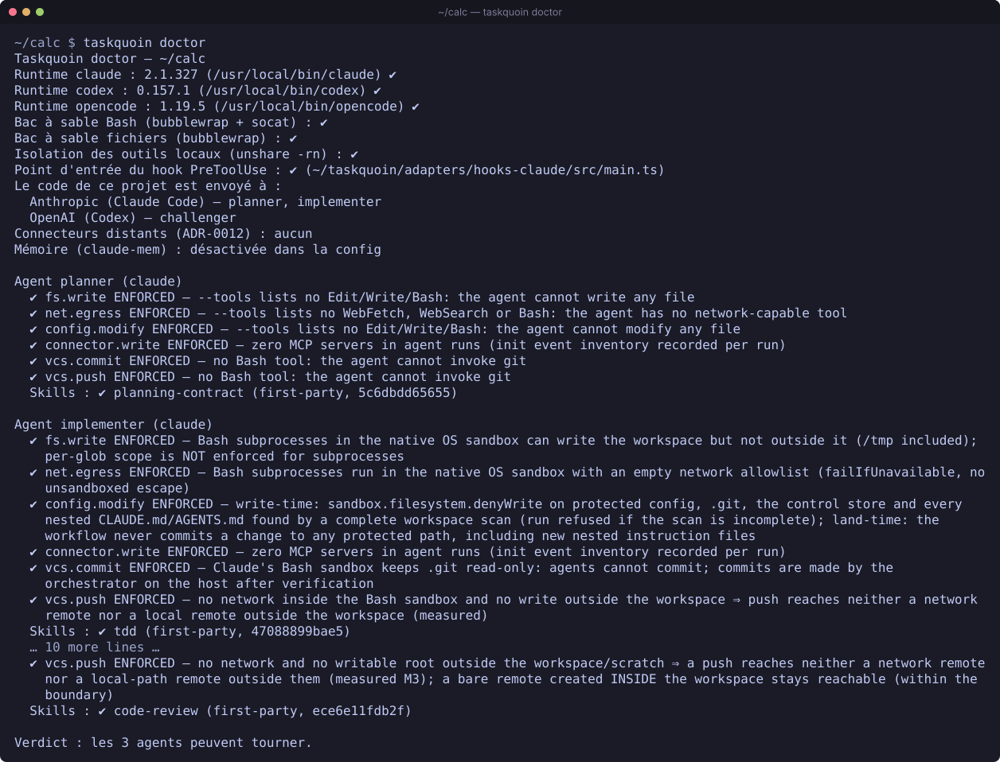

`doctor` est la partie honnête de Taskquoin. Lisez-le de haut en bas :

- Le premier bloc liste les runtimes trouvés, avec leurs versions et une coche lorsque la version est celle que
  Taskquoin a mesurée, puis les sandboxes (bubblewrap et socat) et le hook.
- **This project's code is sent to** liste chaque fournisseur qui recevra votre code, agent par agent. Taskquoin
  s'exécute sur votre machine ; seules les IA que vous configurez voient quoi que ce soit
  ([ADR-0010](../adr/0010-local-first-no-leak.md)).
- Ensuite, pour chaque agent, chaque restriction obligatoire avec sa classe et **le mécanisme qui l'applique**, par
  exemple `net.egress ENFORCED — Bash subprocesses run in the native OS sandbox with an empty network allowlist`. Une
  coche signifie que la restriction est certifiée pour cette version du runtime ; une croix signifie que l'agent ne
  démarrera pas.
- La dernière ligne est le verdict : `Verdict: all 3 agents can run.` ou `Verdict: 2 of 3 agents can run — refused agents will not be started.`

Dans la démo, une ligne porte une croix :

```text
Agent challenger (codex)
  …
  ✖ connector.write — mandatory restriction "connector.write" (deny-all) on codex 0.157.1: claimed ENFORCED but the mechanism is not measured (inferred). Execution refused (ADR-0002).
```

Codex affirme appliquer `connector.write` (pas d'écriture vers les connecteurs distants), mais Taskquoin n'a aucun moyen
de mesurer cette affirmation, il ne la compte donc pas comme appliquée. Le challenger est refusé : une exécution
se terminerait en `failed at challenge` avec `gate refused agent challenger`. Pour celui-ci, vous avez une décision à
prendre.

## Accepter un risque que vous comprenez

Un **risque accepté** est votre décision signée, datée et circonscrite, de lancer un agent malgré une restriction qui ne
peut pas être mesurée. C'est la décision du propriétaire, pas du développeur, et jamais de l'agent :

```shell
$ taskquoin accept-risk challenger connector.write \
    --reason "Codex reviews read-only; no connector configured" \
    --expires 2026-12-31 --as you
```

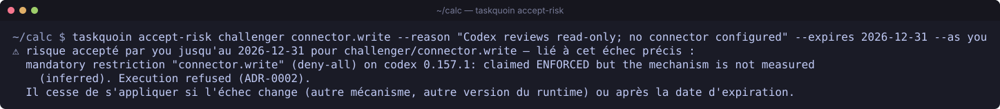

Les quatre options sont obligatoires : `--reason`, `--expires` (une vraie date future, `YYYY-MM-DD`) et `--as` (votre
nom), ainsi que l'agent et la capacité. Voyez ce qu'est cette acceptation :

- **Liée à l'échec exact.** Elle conserve l'empreinte du message d'échec. Si la version du runtime change, ou si le
  mécanisme change, l'échec n'est plus le même et l'acceptation cesse de s'appliquer.
- **Datée.** Elle cesse aussi de s'appliquer après la date d'expiration.
- **Stockée en dehors du dépôt**, dans le control store. Personne ne peut en ajouter une en modifiant `taskquoin.yaml`,
  et aucun agent ne peut l'écrire.
- **Étroite.** Elle ne s'applique qu'à cet agent et à cette capacité. Elle est refusée pour une capacité qui n'échoue
  pas, et elle n'est pas disponible pour les juges API (ils sont toujours contrôlés).

Relancez `doctor`. La ligne est maintenant un avertissement au lieu d'une croix, et le verdict est `all 3 agents can run` :

```text
  ⚠ connector.write accepted risk (approved by you until 2026-12-31: Codex reviews read-only; no connector configured) — mandatory restriction "connector.write" (deny-all) on codex 0.157.1: claimed ENFORCED but the mechanism is not measured (inferred). Execution refused (ADR-0002).
```

`taskquoin check challenger` montre le même détail pour un seul agent :

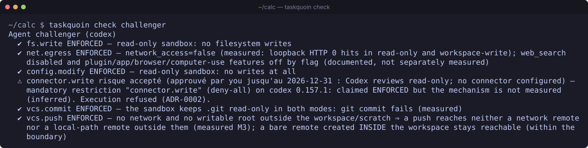

> [!IMPORTANT]
> N'acceptez un risque que si vous le comprenez et que la situation correspond à votre motif : ici, Codex relit en
> lecture seule et votre projet n'a aucun connecteur, une « écriture de connecteur » ne peut donc pas avoir lieu de toute
> façon. N'acceptez pas un risque pour faire disparaître une ligne rouge. En particulier :
>
> - jamais pour `fs.write`, `net.egress`, `vcs.commit` ou `vcs.push` sur un agent qui écrit ou exécute réellement des
>   commandes, sauf si vous pouvez nommer le contrôle compensatoire ;
> - jamais avec un motif vague : il est consigné dans l'approbation et affiché par `doctor` ;
> - préférez une expiration courte : l'acceptation est un rappel pour revérifier après une mise à niveau ;
> - si un mécanisme est *mesuré comme défaillant*, mettez à niveau ou changez de runtime à la place.

Lancer vous-même `taskquoin accept-risk` est délibéré : si la console ou un agent pouvait le faire, le contrôle ne
voudrait plus rien dire.

## Étape 5 : lancer l'exécution

```shell
$ taskquoin run "Add a sum function"
```

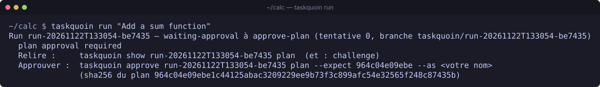

Votre terminal reste silencieux pendant que les agents travaillent, puis affiche l'endroit où l'exécution s'est
arrêtée. Dans l'ordre, voici ce que Taskquoin a fait :

1. **Preflight.** Taskquoin a vérifié que la configuration définit chaque rôle, que les skills sont utilisables, que les
   rôles en lecture seule le sont réellement et que les juges API ont leurs clés. L'arbre de travail doit être propre.
   Chaque agent passe aussi la même porte que `doctor` juste avant sa première utilisation : un agent refusé termine
   l'exécution en `failed`.
2. **Branche.** Il a créé la branche `taskquoin/run-20261122T132108-d17040` et s'y est placé. Votre `main` n'est pas
   touchée.
3. **Recall.** Il a demandé au worker de mémoire, s'il est activé, des notes pertinentes. Le journal affiche
   `recall no-memory` quand il n'y en a pas.
4. **Plan.** Le `planner` (Claude, lecture seule) a lu le dépôt et rédigé un plan : objectif, test à écrire en premier,
   fichiers, étapes, risques.
5. **Critique.** Le `challenger` (Codex, lecture seule) a challengé ce plan de manière indépendante et a terminé par une
   ligne `VERDICT:`.
6. **Porte (gate).** Le workflow s'est arrêté à `approve-plan`. Il attendra aussi longtemps que vous le voulez.

L'identifiant d'exécution (`run-20261122T132108-d17040`) est un horodatage suivi d'un suffixe aléatoire. Vous l'utilisez
dans chaque commande suivante. `taskquoin status` sans argument liste les exécutions :

```shell
$ taskquoin status
run-20261122T132108-d17040  waiting-approval approve-plan    Add a sum function
```

## Étape 6 : lire et approuver le plan

`status <run>` affiche l'historique d'une exécution et, à une porte, la commande exacte qui l'approuve :

```shell
$ taskquoin status run-20261122T132108-d17040
```

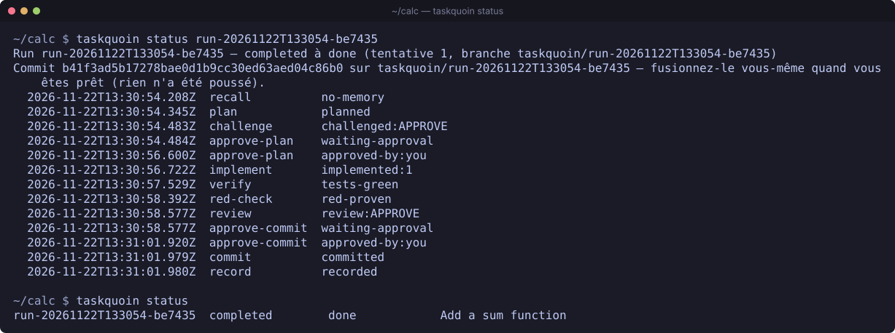

Chaque ligne d'historique est une étape du workflow avec son résultat (`planned`, `challenged:APPROVE`,
`waiting-approval`).

Maintenant, **lisez ce que vous êtes sur le point d'approuver** :

```shell
$ taskquoin show run-20261122T132108-d17040 plan
```

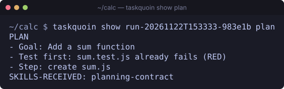

```shell
$ taskquoin show run-20261122T132108-d17040 challenge
Review: plan checked.
VERDICT: APPROVE
```

`show <run>` sans artefact liste tout ce qui est stocké jusqu'ici, avec sa taille en octets. Le plan d'un vrai agent
couvre aussi les fichiers à modifier, les tests à écrire en premier et les risques. La critique est le second avis
indépendant : elle peut lister des constats bloquants et non bloquants. Si le plan est faux, ne l'approuvez pas : lancez
une nouvelle exécution avec une demande plus précise.

### Pourquoi le hash

La ligne qui compte est la dernière de `status` :

```text
Approve it:  taskquoin approve run-20261122T132108-d17040 plan --expect 964c04e09ebe --as <your name>
             (plan sha256 964c04e09ebe1c44125abac3209229ee9b73f3c899afc54e32565f248c87435b)
```

`964c04e09ebe` est le début du SHA-256 du fichier de plan que vous venez de lire. Approuver ne signifie pas « j'approuve
cette exécution » ; cela signifie « j'approuve **le plan dont le hash est 964c04e09ebe** ». Si le plan pouvait changer
entre votre lecture et votre approbation (une nouvelle tentative, un autre processus, un outil compromis), le hash ne
correspondrait plus et Taskquoin refuserait. C'est aussi ce que le commit enregistre : n'importe qui peut ainsi
auditer plus tard ce qu'une personne a approuvé.

> [!NOTE]
> `--expect` n'est pas un mot de passe. C'est la preuve que vous avez regardé l'artefact sur lequel le système s'apprête
> à agir : vous le copiez depuis `status` après lecture. Dans la [console](../getting-started/console.md), vous le retapez pour confirmer.

Approuvez :

```shell
$ taskquoin approve run-20261122T132108-d17040 plan --expect 964c04e09ebe --as you
```

`--as` est votre nom ; il est enregistré comme `Plan-Approved-By` dans le commit. L'approbation du plan relance le
workflow, qui continue jusqu'à la porte suivante.

### Un mauvais hash est refusé

Essayez un hash qui n'est pas celui en attente :

```shell
$ taskquoin approve run-20261122T132108-d17040 plan --expect 000000000000 --as you
taskquoin approve: expected 000000000000 does not match the pending artifact 964c04e09ebe… — re-read it before approving
```

Rien n'a été approuvé et l'exécution est inchangée. Il en va de même si vous approuvez une porte que l'exécution
n'attend pas. La capture ci-dessous a été prise après la fin de l'exécution : elle montre donc cette variante du refus :

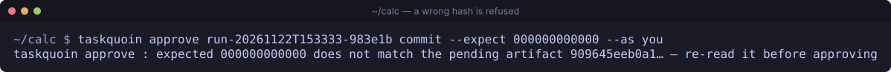

Le code de sortie d'un refus est 1. Une commande mal saisie (un `--expect` ou un `--as` manquant) sort avec le code 2.

## Étape 7 : implémentation, Verify et revue

Après `approve … plan`, Taskquoin travaille sans vous :

1. **Implémentation en TDD.** L'`implementer` (Claude) travaille sur la branche, dans le sandbox du runtime, sans réseau
   et sans moyen de commiter. Il écrit ou ajuste d'abord les tests, puis le code le plus simple qui les fait passer.
2. **Verify, dans une salle blanche.** Taskquoin prend l'arbre exact laissé par l'implementer et lance lui-même vos
   tests (`npm test`), dans une copie jetable en dehors de votre dépôt : pas de réseau, `.git` en lecture seule, votre
   HOME masqué, les fichiers secrets masqués, et seuls les répertoires de dépendances de la stack (et votre
   `verify.inherit`) montés en lecture seule. Un test qui passe grâce à quelque chose de non commité échoue ici, et c'est
   le but.
3. **Preuve RED.** Taskquoin retire ensuite le changement de production et relance les tests modifiés. Ils doivent
   **échouer**. Un test qui passe sans le changement ne teste rien. La preuve est mécanique : elle ne montre pas que le
   test vérifie le bon comportement (c'est le rôle de la revue, et le vôtre).
4. **Revue.** Le `challenger` relit le diff par rapport au plan, avec les journaux de Verify et de RED. Il termine par
   une ligne `VERDICT:`.

Si les tests sont rouges, si la preuve RED échoue ou si la revue demande des modifications, Taskquoin renvoie le retour
à l'implementer pour une reprise automatique (jusqu'à 3 tentatives d'implémentation, avec au plus 2 tours de reprise
après une revue refusée). L'exécution s'arrête ensuite à la seconde porte.

## Étape 8 : lire et approuver le commit

L'exécution est de nouveau en attente. Regardez-la :

```shell
$ taskquoin status run-20261122T132108-d17040
Run run-20261122T132108-d17040 — waiting-approval at approve-commit (attempt 1, branch taskquoin/run-20261122T132108-d17040)
  commit approval required (bound to the exact tree)
  Review it:   taskquoin show run-20261122T132108-d17040 diff-1  (and: verify-1, red-1, review-1)
  Approve it:  taskquoin approve run-20261122T132108-d17040 commit --expect 909645eeb0a1 --as <your name>
               (git tree 909645eeb0a1716e60fd724784ede536fbea048f)
```

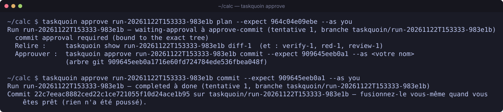

Cette fois, le hash est l'**arbre git** qui a passé Verify et la revue. Lisez les quatre artefacts de la tentative 1. Le
numéro est celui de la tentative ; après une reprise, vous lisez le plus élevé.

### `diff-1` : le changement exact

```shell
$ taskquoin show run-20261122T132108-d17040 diff-1
```

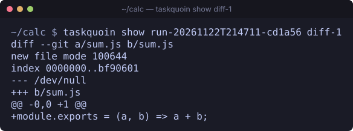

C'est ce qui sera commité, rien de plus. Si l'agent avait modifié un fichier protégé (votre CI, `.claude/`,
`AGENTS.md`, `taskquoin.yaml`), l'exécution se serait arrêtée avec `protected configuration changed`. Les fichiers que
votre `.gitignore` masque mais que l'agent a créés sont listés dans `ignored-1` ; ils ne sont ni dans le diff, ni
vérifiés, ni commités.

### `verify-1` : vos tests, lancés par Taskquoin

```shell
$ taskquoin show run-20261122T132108-d17040 verify-1
```

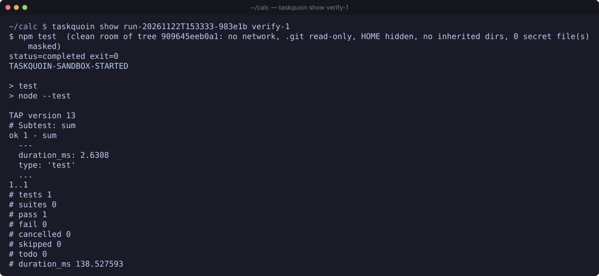

L'en-tête indique ce qu'était la salle blanche (`no network, .git read-only, HOME hidden, … 0 secret file(s) masked`) et
pour quel arbre (`909645eeb0a1`, le même hash que vous allez approuver). `exit=0` et `# pass 1` viennent du lanceur de
tests, pas de l'affirmation d'un modèle.

### `red-1` : la preuve que le test compte

```shell
$ taskquoin show run-20261122T132108-d17040 red-1
TASKQUOIN RED PROOF — tests run on base + test changes only (tree 9848f565e24c); they must FAIL.
RESULT: they failed as required (RED proven).

$ npm test  (clean room of tree 9848f565e24c: no network, .git read-only, HOME hidden, no inherited dirs, 0 secret file(s) masked)
status=failed exit=1
…
not ok 1 - sum
  error: Cannot find module './sum.js'
  code: 'MODULE_NOT_FOUND'
```

Ici, le nouveau fichier de production `sum.js` a été retiré, le test n'a pas pu le charger et a échoué. Cet échec est la
preuve RED. Taskquoin considère une erreur d'import d'une fonctionnalité située dans un *nouveau* fichier comme le RED
attendu. Si seuls des fichiers de test ont changé (un simple ajout de test), la preuve est consignée comme « not
applicable ».

### `review-1` : le second avis

```shell
$ taskquoin show run-20261122T132108-d17040 review-1
Review: diff checked against the plan.
VERDICT: APPROVE
```

Lisez les constats, pas seulement le verdict. `ignored-1` n'apparaît dans la liste que lorsqu'il y a quelque chose à lire.

### Approuver le commit

Si vous êtes satisfait, approuvez avec le hash de `status` :

```shell
$ taskquoin approve run-20261122T132108-d17040 commit --expect 909645eeb0a1 --as you
Run run-20261122T132108-d17040 — completed at done (attempt 1, branch taskquoin/run-20261122T132108-d17040)
Committed a3c6b801de5f4356750f53870557e2fdd19958ee on taskquoin/run-20261122T132108-d17040 — merge it yourself when ready (nothing was pushed).
```

`approve … commit` doit être lancé alors que le dépôt est sur la branche de l'exécution (`taskquoin/<run>`) ; sinon il
répond `switch to taskquoin/<run> first`. Taskquoin relit l'arbre de travail avant de commiter. Si quelque chose a changé
depuis votre lecture, votre approbation ne s'applique plus : il revérifie, relit à nouveau et vous demande d'approuver
le nouvel arbre.

Taskquoin construit ensuite le commit **à partir de l'arbre git approuvé lui-même**, pas à partir de `git add`. Voici à
quoi il ressemble :

```shell
$ git log -1 taskquoin/run-20261122T132108-d17040
```

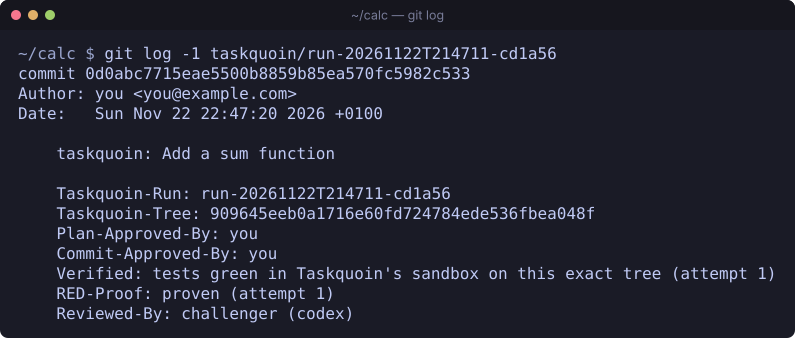

```text
taskquoin: Add a sum function

Taskquoin-Run: run-20261122T132108-d17040
Taskquoin-Tree: 909645eeb0a1716e60fd724784ede536fbea048f
Plan-Approved-By: you
Commit-Approved-By: you
Verified: tests green in Taskquoin's sandbox on this exact tree (attempt 1)
RED-Proof: proven (attempt 1)
Reviewed-By: challenger (codex)
```

Les trailers sont la piste d'audit, dans le commit lui-même :

| Trailer | Signification |
|---|---|
| `Taskquoin-Run` | L'exécution qui a produit ce commit |
| `Taskquoin-Tree` | L'arbre git qui a été vérifié, relu et approuvé. C'est l'arbre de ce commit |
| `Plan-Approved-By` | Le nom donné avec `--as` à la porte du plan |
| `Commit-Approved-By` | Le nom donné avec `--as` à la porte du commit |
| `Verified` | Les tests étaient verts dans la salle blanche sur cet arbre exact |
| `RED-Proof` | Les tests modifiés échouaient sans le changement (`proven`, ou `not applicable` pour les changements limités aux tests) |
| `Reviewed-By` | Les agents qui ont relu et approuvé ; un juge API ajoute sa propre ligne |

`taskquoin status <run>` à la fin affiche tout le journal, de `recall` à `commit` et `record`.

## Étape 9 : fusionner le résultat

Taskquoin **ne pousse jamais** et ne fusionne jamais dans votre branche. Le commit est sur `taskquoin/<run>`, la branche
sur laquelle vous êtes. Fusionnez-le vous-même, ou ouvrez une pull request depuis cette branche :

```shell
$ git switch main
$ git merge --ff-only taskquoin/run-20261122T132108-d17040
$ npm test
```

> [!WARNING]
> Taskquoin n'exécute pas les hooks de commit de votre dépôt, car ils pourraient contenir du code que l'agent a modifié.
> Lancez vous-même vos hooks, linters et CI au moment de la fusion.

Les branches `taskquoin/<run>` sont à vous : supprimez-les quand vous n'en avez plus besoin
(`git branch -d taskquoin/<run>`).

## Quand les choses ne se passent pas comme prévu

Les messages d'erreur de Taskquoin suivent votre langue, mais les messages du moteur d'exécution (`failed`,
`needs-human`, `interrupted`) sont toujours en anglais. Le tableau liste ce que vous rencontrerez le plus souvent.

| Ce que vous voyez | Ce que cela signifie | Que faire |
|---|---|---|
| `taskquoin run: the working tree has uncommitted changes` | Taskquoin ne mélange jamais ses changements avec les vôtres | Validez ou mettez de côté (stash) vos modifications |
| `failed … gate refused agent X` | Un agent ne peut pas être certifié sur cette machine | `taskquoin doctor` dit pourquoi : version du runtime, sandbox manquant, risque non accepté |
| `needs-human … tests still failing after 3 attempts` | Trois tentatives n'ont pas donné de tests verts | Reprenez la main sur la branche de l'exécution, ou lancez une nouvelle exécution avec une demande plus précise |
| `needs-human … no failing test demonstrates the change` | Les tests passent même sans le changement de production : ils ne le testent donc pas | Lisez `red-N` ; écrivez (ou demandez) un test qui échoue avant le changement. Un refactoring ou un changement de doc sans nouveau test finit ici : validez-le vous-même depuis la branche |
| `needs-human … RED proof inconclusive` | La preuve n'a pas pu s'exécuter correctement (délai dépassé, sandbox, arbre impossible à reconstruire). Ce n'est pas une preuve | Lisez `red-N`. Votre dossier de travail est intact |
| `needs-human … review still requests changes after N attempts` | Le relecteur a continué à refuser | Lisez `review-N` et décidez ; la branche contient le travail |
| `needs-human … dependencies changed during the run` | `node_modules` (ou `vendor`, `.venv`) a changé pendant l'exécution, donc rien n'est vérifié avec | Réinstallez (`npm ci`) et lancez une nouvelle exécution. Ne lancez pas `npm install` pendant une exécution |
| `needs-human … protected configuration changed` | L'agent a touché à la configuration protégée (CI, `.claude/`, `AGENTS.md`, `taskquoin.yaml`) | Rien n'a été commité ; inspectez la branche |
| Les tests passent chez vous mais échouent dans Verify | Ils utilisent un fichier ignoré absent de la salle blanche | Ajoutez-le à `verify.inherit` |
| `does not match the pending artifact` | Le hash que vous avez donné n'est pas celui en attente | Lisez avec `show`, copiez le hash depuis `status` |
| `switch to taskquoin/<run> first` | Vous n'êtes pas sur la branche de l'exécution | `git switch taskquoin/<run>` |
| `taskquoin.yaml changed since the run started` | La configuration a changé en cours d'exécution | Lancez une nouvelle exécution |
| `interrupted` | Une erreur technique (git, disque, un HTTP 503 d'un juge) a arrêté l'exécution | `taskquoin resume <run>` |

### Quand les tests restent rouges

Si Verify échoue, Taskquoin donne à l'implementer le journal en échec et la revue, puis réessaie, jusqu'à trois
tentatives d'implémentation (un implementer OpenCode, qui n'a pas de commande propre, obtient davantage de reprises). Si
les tests sont toujours rouges, l'exécution se termine avec le statut `needs-human` et la raison
`tests still failing after 3 attempts`. Il n'y a ni commit ni demande d'approbation.

Tout est conservé : `taskquoin show <run> verify-3` contient le dernier journal, et la branche `taskquoin/<run>` garde
le travail de l'agent. Vous pouvez continuer à la main sur cette branche, ou lancer une nouvelle exécution avec une
demande plus précise. Une exécution `needs-human` n'est pas reprise automatiquement.

### `resume` : après une interruption

Une exécution est `interrupted` quand quelque chose d'extérieur au workflow l'a interrompue (une erreur réseau en
joignant un juge, un disque plein, votre machine qui se met en veille). L'état est sauvegardé à chaque étape, et les
réponses des juges sont sauvegardées une à une : reprendre n'appelle donc jamais un juge deux fois, et ne le paie pas
deux fois :

```shell
$ taskquoin resume run-20261122T132108-d17040
```

`resume` n'accepte qu'une exécution dont le statut est `interrupted`. Pour tout autre statut, il vous l'indique, par
exemple `taskquoin resume: only an interrupted run can be resumed (status completed)`. Si le statut est `needs-human`
ou `failed`, lancez une nouvelle exécution.

### Une règle simple

Si vous ne savez pas quoi faire, lancez `taskquoin status <run>` : il affiche le statut, le journal et la prochaine
commande exacte. `taskquoin doctor` répond à toute question sur la machine.

## Pour aller plus loin

- [La console interactive](../getting-started/console.md) : le même workflow, avec `/run` et `/approve`
- [Installation](../getting-started/installation.md)
- [ADR-0011, agents never commit](../adr/0011-agents-never-commit.md)
- [ADR-0013, tree-based governance](../adr/0013-tree-based-governance.md)
- [ADR-0014, Verify in a clean room](../adr/0014-verify-in-a-clean-room.md)
- [ADR-0002, enforcement classes](../adr/0002-enforcement-classes.md)
- [ADR-0005, control plane outside the workspace](../adr/0005-control-plane-outside-workspace.md)
- [ADR-0016, judges by API](../adr/0016-judges-by-api.md) et [ADR-0017, OpenCode without commands](../adr/0017-opencode-without-commands.md)
