# ההרצה המנוהלת הראשונה שלכם

מדריך זה הוא תרגום של [דף ההפניה באנגלית](../getting-started/first-run.md). זהו תרגום מכונה שנבדק בבדיקות של המתחזקים על הפקודות, ולא על ידי סוקר דובר שפת אם.

מדריך זה מוביל אתכם מתיקייה ריקה ל-commit מאומת שנוצר על ידי Taskquoin, פקודה אחר פקודה. תיצרו פרויקט קטן עם בדיקה שנכשלת, תאפשרו ל-Taskquoin לתכנן וליישם תיקון בעזרת סוכני בינה מלאכותית, ותאשרו את העבודה פעמיים: פעם אחת לאחר קריאת התוכנית, ופעם אחת לאחר קריאת ה-diff המדויק. בכל שלב תראו מה Taskquoin עושה, מדוע הוא עוצר, ועל מה אתם חותמים.

- [מה תבנו](#מה-תבנו)
- [שלב 1: יצירת פרויקט עם בדיקה שנכשלת](#שלב-1-יצירת-פרויקט-עם-בדיקה-שנכשלת)
- [שלב 2: אתחול Taskquoin](#שלב-2-אתחול-taskquoin)
- [שלב 3: commit לתצורה](#שלב-3-commit-לתצורה)
- [שלב 4: בדיקת המחשב באמצעות doctor](#שלב-4-בדיקת-המחשב-באמצעות-doctor)
- [קבלת סיכון שאתם מבינים](#קבלת-סיכון-שאתם-מבינים)
- [שלב 5: התחלת ההרצה](#שלב-5-התחלת-ההרצה)
- [שלב 6: קריאת התוכנית ואישורה](#שלב-6-קריאת-התוכנית-ואישורה)
- [שלב 7: מימוש, Verify וסקירה](#שלב-7-מימוש-verify-וסקירה)
- [שלב 8: קריאת ה-commit ואישורו](#שלב-8-קריאת-ה-commit-ואישורו)
- [שלב 9: מיזוג התוצאה](#שלב-9-מיזוג-התוצאה)
- [מעקב אחר ריצה ב-Dashboard](#מעקב-אחר-ריצה-ב-dashboard)
- [כשהדברים לא מתנהלים כמתוכנן](#כשהדברים-לא-מתנהלים-כמתוכנן)
- [למידע נוסף](#למידע-נוסף)

> [!NOTE]
> צילומי המסך נלקחו ממאגר הדגמה עם סוכני בינה מלאכותית מדומים (מחליפי הבדיקה של חבילת הבדיקות של Taskquoin עצמו); כל פקודה היא ה-CLI האמיתי של Taskquoin. עם Claude Code ו-Codex אמיתיים, הניסוח של התוכנית והסקירה הוא של הסוכנים עצמם, והרצה אורכת כמה דקות במקום שניות. כל השאר זהה.

לפני שמתחילים, [התקינו את Taskquoin](../getting-started/installation.md) וודאו ש-Node 22.18+, git, `bubblewrap` ו-`socat` זמינים, ושלפחות Claude Code (ורצוי גם Codex) מותקן ומחובר.

## מה תבנו

הרצה (run) היא זרימת עבודה קבועה. שני המעוינים הם שני האישורים האנושיים; דבר אינו עובר אותם בלעדיכם.

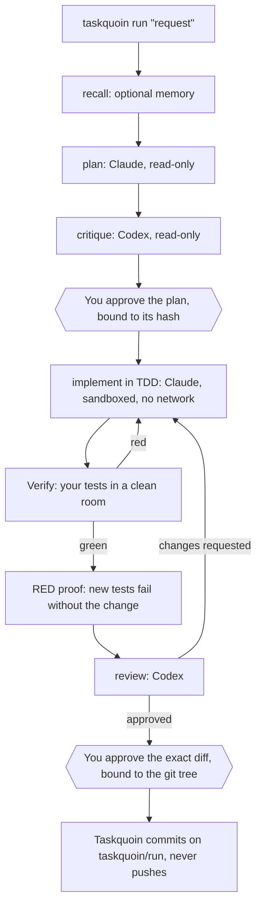

שלושה רעיונות עוברים לאורך כל המדריך:

- **סוכנים מציעים, Taskquoin פועל.** סוכנים לעולם אינם מבצעים commit. ה-commit נבנה על ידי Taskquoin מהעץ שאומת, נסקר ואושר ([ADR-0011](../adr/0011-agents-never-commit.md)).
- **האישור שלכם קשור ל-hash.** אתם מאשרים בדיוק את מה שקראתם, ולא "את ההרצה" ([ADR-0013](../adr/0013-tree-based-governance.md)).
- **בדיקות רצות בחדר נקי.** המודל לעולם אינו אומר ל-Taskquoin שהבדיקות עוברות; Taskquoin מריץ אותן בעצמו ([ADR-0014](../adr/0014-verify-in-a-clean-room.md)).

## שלב 1: יצירת פרויקט עם בדיקה שנכשלת

הפרויקט הוא מחשבון בעל פונקציה אחת. הבדיקה קיימת; הפונקציה לא.

```shell
$ mkdir calc && cd calc
$ git init -q -b main
```

צרו את `package.json`:

```json
{
  "name": "calc",
  "private": true,
  "scripts": { "test": "node --test" }
}
```

צרו את `sum.test.js`:

```js
const test = require('node:test');
const assert = require('node:assert');

test('sum', () => {
  const sum = require('./sum.js');
  assert.strictEqual(sum(2, 3), 5);
});
```

צרו את `.gitignore` (תלויות ותוצרי בנייה אינם חלק מ-diff של Taskquoin לעולם):

```text
node_modules/
```

בצעו לו commit (פלט הפקודות להלן מוצג באנגלית):

```shell
$ git add .
$ git commit -m "calc: a failing test for sum"
$ npm test
not ok 1 - sum
  error: Cannot find module './sum.js'
```

הבדיקה אדומה, כצפוי. התנאי המוקדם היחיד של Taskquoin לפרויקט הוא מאגר git עם עץ עבודה נקי: `taskquoin run` מסרב להתחיל כשיש לכם שינויים שלא בוצע להם commit, כי הוא אינו מערבב את השינויים שלו עם שלכם לעולם.

## שלב 2: אתחול Taskquoin

```shell
$ taskquoin init
```

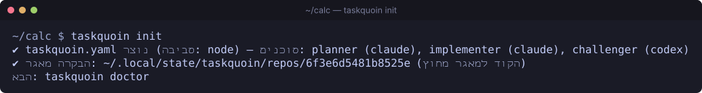

`init` עשה שלושה דברים:

1. זיהה את המחסנית (`node`; הוא מכיר גם את `npm test`, PHPUnit, pytest, `go test`, Maven ועוד) וכתב את `taskquoin.yaml` בשורש המאגר.
2. חיפש כלי בינה מלאכותית במחשב שלכם ובחר סוכנים: כאן `planner` ו-`implementer` על Claude Code, ו-`challenger` על Codex. אם כלי חסר, הקובץ אומר זאת; עם Claude Code בלבד גם הסוקר הוא Claude. עם OpenCode בלבד, `init` כותב תצורה מלאה על OpenCode.
3. יצר **מאגר בקרה** מחוץ למאגר הפרויקט, תחת `${XDG_STATE_HOME:-~/.local/state}/taskquoin/`. כאן שוכנים מצב ההרצה, האישורים וקבלות הסיכון. סוכנים אינם יכולים לכתוב לשם, וזה מה שהופך אישור לבלתי ניתן לזיוף ([ADR-0005](../adr/0005-control-plane-outside-workspace.md)).

`init` לעולם אינו דורס `taskquoin.yaml` קיים. אם הרצתם את `init` כשיש בינות מלאכותיות אחרות זמינות (מפתח API בסביבה שלכם, Ollama מקומי), הוא מפרט אותן ומציע אותן כ**הערות** בקובץ: הוצאתן מהערה היא החלטה שלכם, כי היא אומרת שקוד הפרויקט יישלח אליהן.

### קובץ ה-`taskquoin.yaml` שנוצר

פתחו אותו. הוא קצר ואפשר לקרוא אותו כולו. הנה הוא, קטע אחר קטע.

```yaml
# Taskquoin project configuration — see docs/architecture.md. Protected: agents can never edit this file.
version: 1
stack: node
```

`version` היא גרסת הסכמה. `stack` בוחר את ברירות המחדל של החדר הנקי: אילו ספריות תלויות מועלות לקריאה בלבד עבור הבדיקות שלכם (עבור `node`: `node_modules`). ההערה הראשונה היא הבטחה: **סוכנים לעולם אינם יכולים לערוך קובץ זה.** אם אחד מהם נוגע בו במהלך הרצה, ההרצה נעצרת ושום דבר אינו עובר commit.

```yaml
agents:
  planner:
    runtime: claude
    description: "Read-only planner: turns a request into a minimal, test-first implementation plan."
    prompt: You plan; you never modify files. Read the repository, then produce the plan requested.
    capabilities:
      fs.read:
        - "**"
    maxTurns: 30
    skills:
      - planning-contract
```

**סוכן** הוא תפקיד הקשור לסביבת ריצה (`claude`, `codex`, `opencode`, או `api` עבור שופט). `capabilities` הן מה שהסוכן רשאי לעשות: ה-planner יכול לקרוא הכול (`fs.read: "**"`) ולא דבר נוסף, כך שאין לו shell ואין לו כלי כתיבה. `skills` הן הנחיות הננעלות לפי hash (`planning-contract` הוא של הפרויקט עצמו). `maxTurns` מגביל את מספר התורות של הסוכן.

```yaml
  implementer:
    runtime: claude
    description: Implements an approved task with strict TDD (RED → GREEN → REFACTOR).
    prompt: "You implement exactly the approved task. Write a failing test first, make it pass with the simplest change, then refactor. Never commit: Taskquoin verifies and commits."
    capabilities:
      fs.read:
        - "**"
      fs.write:
        - "**"
      shell.run:
        - npm test
        - npm test -- *
        - node --test *
    maxTurns: 40
    skills:
      - tdd
```

ה-implementer יכול לכתוב קבצים ולהריץ רשימת היתרים קטנה של פקודות בדיקה (`shell.run`) כדי לעבוד בגישת הבדיקה-קודם. פקודות אלה רצות בתוך ארגז החול של מערכת ההפעלה של סביבת הריצה עצמה, ללא רשת. ועם זאת, הרצת הבדיקות שלו נועדה למשוב שלו בלבד: התוצאה הקובעת היא זו ש-Taskquoin מפיק ב-Verify.

```yaml
  challenger:
    runtime: codex
    description: Independent, read-only adversarial reviewer of plans and diffs.
    prompt: "You are an independent reviewer. Challenge the plan or diff: correctness, security, missing tests, over-engineering. Report blocking and non-blocking findings with file:line. Do not modify files."
    capabilities:
      fs.read:
        - "**"
    skills:
      - code-review
```

ה-**challenger** מבקר את התוכנית וסוקר את ה-diff. הוא בכוונה מספק שונה מה-implementer, והוא לקריאה בלבד: אסור שיוכל "לתקן" את מה שהוא מבקר.

```yaml
policy:
  mandatory:
    - fs.write
    - net.egress
    - config.modify
    - connector.write
    - vcs.commit
    - vcs.push
connectors: {}
memory:
  claudeMem:
    enabled: true
```

`policy.mandatory` מפרט את ההגבלות ש**חייבות** להיאכף באמצעות מנגנון כדי שסוכן יתחיל: אין כתיבה מחוץ לתחום שלו, אין רשת, אין שינוי בתצורה מוגנת, אין כתיבה למערכת מרוחקת, אין commit, אין push. אם גרסת סביבת הריצה שברשותכם אינה יכולה לאכוף אחת מהן, הסוכן נדחה במקום להתחיל עם כלל שהוא רק עצה ([ADR-0002](../adr/0002-enforcement-classes.md), [ADR-0003](../adr/0003-hooks-enforce-prose-asks.md)). `connectors` ריק: שום מערכת מרוחקת אינה מחוברת ([ADR-0012](../adr/0012-remote-connectors-by-exception.md)). `memory.claudeMem` אופציונלי: כשהוא מופעל, סיכום מובנה של כל הרצה שהסתיימה נשלח לעובד [claude-mem](https://github.com/thedotmack/claude-mem) המקומי שלכם, ותזכורת קצרה נקראת בתחילת הרצה. הגדירו `false` אם אינכם מריצים claude-mem. (צילומי המסך במדריך זה משתמשים ב-`false`.)

> [!TIP]
> אם הבדיקות שלכם זקוקות לקובץ שמתעלמים ממנו ואינו ספריית תלויות, כמו `dist/` שנבנה או `.env.test`, הוסיפו אותו במפורש. אז הוא מועלה לקריאה בלבד בחדר הנקי ומוקפא עבור הסוכן:
>
```yaml
verify:
  inherit:
    - dist
```
>
> פרויקט שהבדיקות שלו אינן רצות באמצעות `npm test` יכול להגדיר `verify.command`.

אפשר גם להשתמש בבינות מלאכותיות אחרות כשופטים (כל ספק תואם OpenAI) או ב-OpenCode כ-planner וכ-implementer; ראו [ADR-0016](../adr/0016-judges-by-api.md) ו-[ADR-0017](../adr/0017-opencode-without-commands.md).

## שלב 3: commit לתצורה

`taskquoin.yaml` הוא חלק מהפרויקט שלכם, ולכן בצעו לו commit. זה גם מספק ל-Taskquoin את עץ העבודה הנקי שהוא צריך:

```shell
$ git add taskquoin.yaml
$ git commit -m "chore: taskquoin"
```

## שלב 4: בדיקת המחשב באמצעות doctor

```shell
$ taskquoin doctor
```

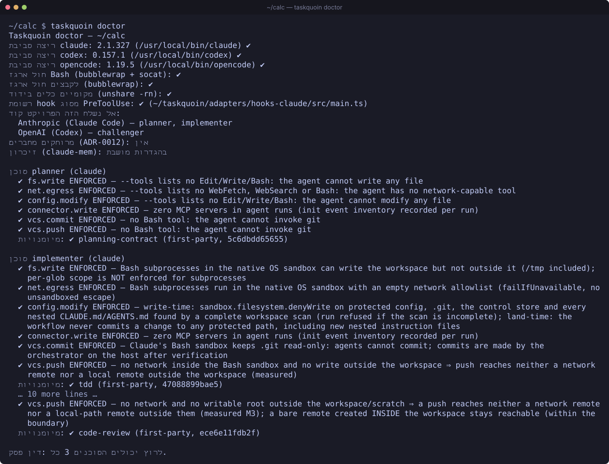

`doctor` הוא החלק הכן של Taskquoin. קראו אותו מלמעלה למטה:

- הבלוק הראשון מפרט את סביבות הריצה שנמצאו, עם גרסאות וסימן וי כשהגרסה היא זו ש-Taskquoin מדד, ואחר כך את ארגזי החול (bubblewrap ו-socat) ואת ה-hook.
- **This project's code is sent to** מפרט כל ספק שיקבל את הקוד שלכם, לפי סוכן. Taskquoin רץ במחשב שלכם; רק הבינות המלאכותיות שהגדרתם רואות משהו ([ADR-0010](../adr/0010-local-first-no-leak.md)).
- לאחר מכן, לכל סוכן, כל הגבלה חובה עם המחלקה שלה ו**המנגנון שאוכף אותה**, למשל `net.egress ENFORCED — Bash subprocesses run in the native OS sandbox with an empty network allowlist`. וי פירושו שהיא מוסמכת לגרסת סביבת הריצה הזו; איקס פירושו שהסוכן לא יתחיל.
- השורה האחרונה היא פסק הדין: `Verdict: all 3 agents can run.` או `Verdict: 2 of 3 agents can run — refused agents will not be started.`

בהדגמה, שורה אחת מסומנת באיקס (הפלט מוצג באנגלית):

```text
Agent challenger (codex)
  …
  ✖ connector.write — mandatory restriction "connector.write" (deny-all) on codex 0.157.1: claimed ENFORCED but the mechanism is not measured (inferred). Execution refused (ADR-0002).
```

Codex אומר שהוא אוכף את `connector.write` (אין כתיבה למחברים מרוחקים), אבל ל-Taskquoin אין דרך למדוד את הטענה הזו, ולכן הוא אינו סופר אותה כנאכפת. ה-challenger נדחה: הרצה הייתה מסתיימת כ-`failed at challenge` עם `gate refused agent challenger`. עבור זה עליכם לקבל החלטה.

## קבלת סיכון שאתם מבינים

**סיכון מקובל** הוא החלטה חתומה, מתוארכת ומוגבלת בהיקף שלכם להריץ סוכן למרות הגבלה אחת שאי אפשר למדוד. זו החלטת הבעלים, לא של המפתח ולעולם לא של הסוכן:

```shell
$ taskquoin accept-risk challenger connector.write \
    --reason "Codex reviews read-only; no connector configured" \
    --expires 2026-12-31 --as you
```

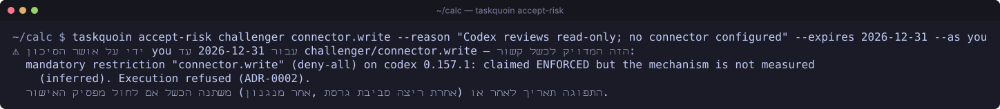

כל ארבע האפשרויות נדרשות: `--reason`, `--expires` (תאריך עתידי אמיתי, `YYYY-MM-DD`) ו-`--as` (שמכם), וכן הסוכן וה-capability. שימו לב מהי הקבלה:

- **קשורה לכשל המדויק.** היא שומרת תקציר של הודעת הכשל. אם גרסת סביבת הריצה או המנגנון משתנים, הכשל אינו עוד אותו כשל, והקבלה מפסיקה לחול.
- **מתוארכת.** היא מפסיקה לחול גם לאחר תאריך התפוגה.
- **נשמרת מחוץ למאגר**, במאגר הבקרה. אף אחד אינו יכול להוסיף אחת על ידי עריכת `taskquoin.yaml`, ושום סוכן אינו יכול לכתוב אותה.
- **צרה.** היא חלה רק על סוכן זה ועל ה-capability הזו. היא נדחית עבור capability שאינה נכשלת, והיא אינה זמינה עבור שופטי API (הם נבדקים תמיד).

הריצו שוב את `doctor`. השורה היא עכשיו אזהרה במקום איקס, ופסק הדין הוא `all 3 agents can run` (הפלט מוצג באנגלית):

```text
  ⚠ connector.write accepted risk (approved by you until 2026-12-31: Codex reviews read-only; no connector configured) — mandatory restriction "connector.write" (deny-all) on codex 0.157.1: claimed ENFORCED but the mechanism is not measured (inferred). Execution refused (ADR-0002).
```

`taskquoin check challenger` מציג את אותו פירוט עבור סוכן אחד:

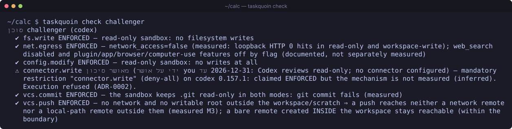

> [!IMPORTANT]
> קבלו סיכון רק כשאתם מבינים אותו והמצב תואם את הסיבה שלכם: כאן Codex סוקר לקריאה בלבד ולפרויקט שלכם אין מחבר, כך ש"כתיבה למחבר" לא יכולה לקרות בכל מקרה. אל תקבלו סיכון כדי לגרום לשורה אדומה להיעלם. בפרט:
>
> - לעולם לא עבור `fs.write`, `net.egress`, `vcs.commit` או `vcs.push` בסוכן שאכן כותב או מריץ פקודות, אלא אם אתם יכולים לנקוב בבקרה מפצה;
> - לעולם לא עם סיבה מעורפלת: היא נרשמת באישור ומוצגת על ידי `doctor`;
> - העדיפו תפוגה קצרה: הקבלה היא תזכורת לבדוק מחדש לאחר שדרוג;
> - אם מנגנון *נמדד ככושל*, שדרגו או החליפו סביבת ריצה במקום זאת.

הרצת `taskquoin accept-risk` בעצמכם היא מכוונת: אילו הקונסולה או סוכן יכלו לעשות זאת, הבקרה לא הייתה שווה דבר.

## שלב 5: התחלת ההרצה

```shell
$ taskquoin run "Add a sum function"
```

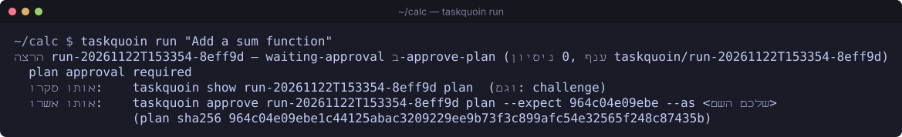

הטרמינל שלכם שקט בזמן שהסוכנים עובדים, ואז מדפיס היכן נעצר. לפי הסדר, Taskquoin עשה כך:

1. **Preflight.** Taskquoin בדק שהתצורה מגדירה כל תפקיד, שהכישורים שמישים, שתפקידי הקריאה בלבד אכן לקריאה בלבד, ושלשופטי ה-API יש מפתחות. עץ העבודה חייב להיות נקי. כל סוכן גם עובר את אותו שער כמו `doctor` רגע לפני השימוש הראשון בו: סוכן שנדחה מסיים את ההרצה כ-`failed`.
2. **ענף.** הוא יצר את הענף `taskquoin/run-20261122T132108-d17040` ועבר אליו. ה-`main` שלכם לא נגע.
3. **Recall.** הוא ביקש מעובד הזיכרון, אם הוא מופעל, הערות רלוונטיות. היומן מציג `recall no-memory` כשאין כאלה.
4. **תוכנית.** ה-`planner` (Claude, לקריאה בלבד) קרא את המאגר וכתב תוכנית: מטרה, הבדיקה שיש לכתוב ראשונה, קבצים, שלבים, סיכונים.
5. **ביקורת.** ה-`challenger` (Codex, לקריאה בלבד) ערער על התוכנית באופן עצמאי וסיים בשורת `VERDICT:`.
6. **שער.** זרימת העבודה נעצרה ב-`approve-plan`. היא תחכה כמה שתרצו.

מזהה ההרצה (`run-20261122T132108-d17040`) הוא חותמת זמן וסיומת אקראית. משתמשים בו בכל הפקודות הבאות. `taskquoin status` ללא ארגומנט מפרט את ההרצות (הפלט מוצג באנגלית):

```shell
$ taskquoin status
run-20261122T132108-d17040  waiting-approval approve-plan    Add a sum function
```

## שלב 6: קריאת התוכנית ואישורה

`status <run>` מציג את ההיסטוריה של הרצה אחת, ובשער את הפקודה המדויקת שמאשרת אותו:

```shell
$ taskquoin status run-20261122T132108-d17040
```

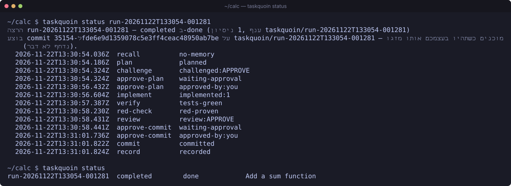

כל שורת היסטוריה היא שלב בזרימת העבודה עם תוצאתו (`planned`, `challenged:APPROVE`, `waiting-approval`).

עכשיו **קראו את מה שאתם עומדים לאשר**:

```shell
$ taskquoin show run-20261122T132108-d17040 plan
```

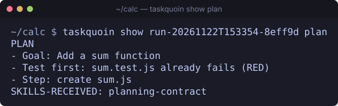

פלט הפקודות מוצג באנגלית, כפי שה-CLI מדפיס אותו:

```shell
$ taskquoin show run-20261122T132108-d17040 challenge
Review: plan checked.
VERDICT: APPROVE
```

`show <run>` ללא artifact מפרט את כל מה שנשמר עד כה, עם גודלו בבתים. תוכנית מסוכן אמיתי מכסה גם את הקבצים שיש לגעת בהם, את הבדיקות שיש לכתוב ראשונות ואת הסיכונים. ה-challenge הוא חוות הדעת השנייה העצמאית: ייתכן שיפרט ממצאים חוסמים ולא חוסמים. אם התוכנית שגויה, אל תאשרו אותה: התחילו run חדש עם בקשה מדויקת יותר.

### מדוע ה-hash

השורה שחשובה היא האחרונה של `status` (הפלט מוצג באנגלית):

```text
Approve it:  taskquoin approve run-20261122T132108-d17040 plan --expect 964c04e09ebe --as <your name>
             (plan sha256 964c04e09ebe1c44125abac3209229ee9b73f3c899afc54e32565f248c87435b)
```

`964c04e09ebe` הוא תחילת ה-SHA-256 של קובץ התוכנית שזה עתה קראתם. אישור אינו אומר "אני מאשר את ההרצה הזו"; הוא אומר "אני מאשר את **התוכנית שה-hash שלה הוא 964c04e09ebe**". אילו התוכנית יכלה להשתנות בין הקריאה לאישור (ניסיון חוזר, תהליך אחר, כלי שנפרץ), ה-hash כבר לא היה תואם ו-Taskquoin היה מסרב. זה גם מה שה-commit מתעד, כך שכל אחד יכול לבקר בהמשך מה אדם אישר.

> [!NOTE]
> `--expect` אינו סיסמה. זו הוכחה שהסתכלתם על ה-artifact שהמערכת עומדת לפעול עליו: מעתיקים אותו מ-`status` לאחר הקריאה. ב[קונסולה](../getting-started/console.md) מקלידים אותו מחדש לאישור.

אשרו:

```shell
$ taskquoin approve run-20261122T132108-d17040 plan --expect 964c04e09ebe --as you
```

`--as` הוא שמכם; הוא נרשם כ-`Plan-Approved-By` ב-commit. אישור התוכנית מחדש את זרימת העבודה, שנמשכת עד השער הבא.

### hash שגוי נדחה

נסו hash שאינו הממתין (הפלט מוצג באנגלית):

```shell
$ taskquoin approve run-20261122T132108-d17040 plan --expect 000000000000 --as you
taskquoin approve: expected 000000000000 does not match the pending artifact 964c04e09ebe… — re-read it before approving
```

שום דבר לא אושר וההרצה לא השתנתה. אותו דבר קורה אם מאשרים שער שההרצה אינה ממתינה לו. צילום המסך להלן צולם לאחר שההרצה הושלמה, ולכן הוא מראה את הווריאציה הזו של הסירוב:

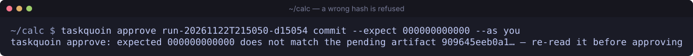

קוד היציאה של סירוב הוא 1. פקודה שהוקלדה בטעות (חסרים `--expect` או `--as`) יוצאת עם 2.

## שלב 7: מימוש, Verify וסקירה

לאחר `approve … plan` Taskquoin עובד בלעדיכם:

1. **מימוש ב-TDD.** ה-`implementer` (Claude) עובד על הענף, בארגז החול של סביבת הריצה, ללא רשת וללא יכולת לבצע commit. הוא כותב או מתאים בדיקות קודם, ואחר כך את הקוד הפשוט ביותר שגורם להן לעבור.
2. **Verify, בחדר נקי.** Taskquoin לוקח את העץ המדויק שה-implementer השאיר ומריץ בעצמו את הבדיקות שלכם (`npm test`) בעותק חד-פעמי מחוץ למאגר שלכם: ללא רשת, `.git` לקריאה בלבד, ה-HOME שלכם מוסתר, קבצים סודיים מוסווים, ורק ספריות התלויות של המחסנית (וה-`verify.inherit` שלכם) מועלות לקריאה בלבד. בדיקה שעברה אך הייתה תלויה במשהו שלא בוצע לו commit נכשלת כאן, וזו הכוונה.
3. **RED proof.** לאחר מכן Taskquoin מסיר את שינוי קוד הייצור ומריץ שוב את הבדיקות ששונו. הן חייבות **להיכשל**. בדיקה שעוברת בלי השינוי אינה בודקת דבר. ההוכחה מכנית: היא אינה מראה שהבדיקה מוודאת את ההתנהגות הנכונה (בשביל זה יש את הסקירה ואתכם).
4. **סקירה.** ה-`challenger` סוקר את ה-diff מול התוכנית, עם יומני verify ו-RED. הוא מסיים בשורת `VERDICT:`.

אם הבדיקות אדומות, או שה-RED proof נכשל, או שהסקירה מבקשת שינויים, Taskquoin שולח את המשוב ל-implementer לעבודה חוזרת אוטומטית (עד 3 ניסיונות מימוש, עם לכל היותר 2 סבבי עבודה חוזרת לאחר סקירה שנדחתה). אז ההרצה נעצרת בשער השני.

## שלב 8: קריאת ה-commit ואישורו

ההרצה ממתינה שוב. הסתכלו עליה (הפלט מוצג באנגלית):

```shell
$ taskquoin status run-20261122T132108-d17040
Run run-20261122T132108-d17040 — waiting-approval at approve-commit (attempt 1, branch taskquoin/run-20261122T132108-d17040)
  commit approval required (bound to the exact tree)
  Review it:   taskquoin show run-20261122T132108-d17040 diff-1  (and: verify-1, red-1, review-1)
  Approve it:  taskquoin approve run-20261122T132108-d17040 commit --expect 909645eeb0a1 --as <your name>
               (git tree 909645eeb0a1716e60fd724784ede536fbea048f)
```

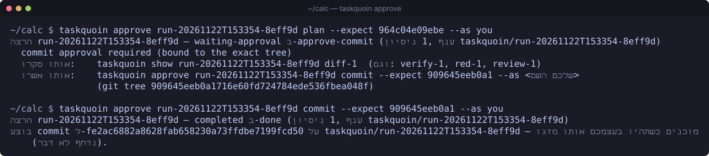

הפעם ה-hash הוא **עץ ה-git** שעבר את Verify ואת הסקירה. קראו את ארבעת ה-artifacts של ניסיון 1. המספר הוא מספר הניסיון; לאחר עבודה חוזרת קוראים את הגבוה ביותר.

### `diff-1`: השינוי המדויק

```shell
$ taskquoin show run-20261122T132108-d17040 diff-1
```

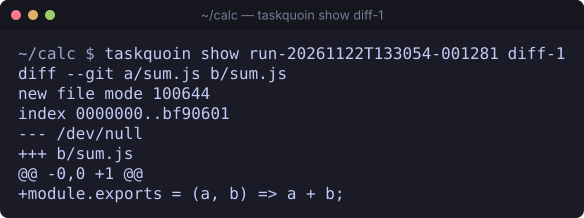

זה מה שיעבור commit, ותו לא. אילו הסוכן היה משנה קובץ מוגן (ה-CI שלכם, `.claude/`, `AGENTS.md`, `taskquoin.yaml`), ההרצה הייתה נעצרת עם `protected configuration changed`. קבצים ש-`.gitignore` שלכם מסתיר אך הסוכן יצר מפורטים ב-`ignored-1`; הם אינם ב-diff, אינם מאומתים ואינם עוברים commit.

### `verify-1`: הבדיקות שלכם, מורצות על ידי Taskquoin

```shell
$ taskquoin show run-20261122T132108-d17040 verify-1
```

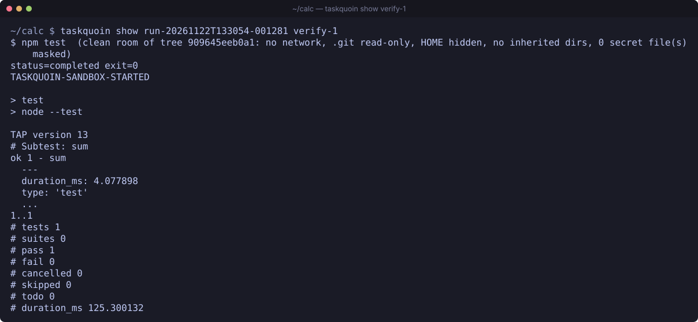

הכותרת אומרת איך נראה החדר הנקי (`no network, .git read-only, HOME hidden, … 0 secret file(s) masked`) ועבור איזה עץ (`909645eeb0a1`, אותו hash שתאשרו). `exit=0` ו-`# pass 1` מגיעים ממריץ הבדיקות, ולא מטענה של מודל.

### `red-1`: ההוכחה שהבדיקה חשובה

פלט הפקודות מוצג באנגלית, כפי שה-CLI מדפיס אותו:

```shell
$ taskquoin show run-20261122T132108-d17040 red-1
TASKQUOIN RED PROOF — tests run on base + test changes only (tree 9848f565e24c); they must FAIL.
RESULT: they failed as required (RED proven).

$ npm test  (clean room of tree 9848f565e24c: no network, .git read-only, HOME hidden, no inherited dirs, 0 secret file(s) masked)
status=failed exit=1
…
not ok 1 - sum
  error: Cannot find module './sum.js'
  code: 'MODULE_NOT_FOUND'
```

כאן קובץ הייצור החדש `sum.js` הוסר, הבדיקה לא הצליחה לטעון אותו ונכשלה. הכשל הזה הוא ה-RED proof. Taskquoin מתייחס לשגיאת ייבוא של פיצ'ר בקובץ *חדש* כ-RED הצפוי. אם רק קבצי בדיקה השתנו (הוספת בדיקות בלבד), ההוכחה נרשמת כ-"not applicable".

### `review-1`: חוות הדעת השנייה

פלט הפקודות מוצג באנגלית, כפי שה-CLI מדפיס אותו:

```shell
$ taskquoin show run-20261122T132108-d17040 review-1
Review: diff checked against the plan.
VERDICT: APPROVE
```

קראו את הממצאים, לא רק את פסק הדין. `ignored-1` מופיע ברשימה רק כשיש מה לקרוא.

### אישור ה-commit

אם אתם מרוצים, אשרו עם ה-hash מ-`status` (הפלט מוצג באנגלית):

```shell
$ taskquoin approve run-20261122T132108-d17040 commit --expect 909645eeb0a1 --as you
Run run-20261122T132108-d17040 — completed at done (attempt 1, branch taskquoin/run-20261122T132108-d17040)
Committed a3c6b801de5f4356750f53870557e2fdd19958ee on taskquoin/run-20261122T132108-d17040 — merge it yourself when ready (nothing was pushed).
```

את `approve … commit` יש להריץ כשהמאגר נמצא על ענף ההרצה (`taskquoin/<run>`); אחרת הוא עונה `switch to taskquoin/<run> first`. Taskquoin קורא מחדש את עץ העבודה לפני ה-commit. אם משהו השתנה מאז שהסתכלתם, האישור שלכם כבר אינו חל: הוא מאמת מחדש, סוקר מחדש ומבקש מכם לאשר את העץ החדש.

לאחר מכן Taskquoin בונה את ה-commit **מעץ ה-git המאושר עצמו**, ולא מ-`git add`. הוא נראה כך:

```shell
$ git log -1 taskquoin/run-20261122T132108-d17040
```

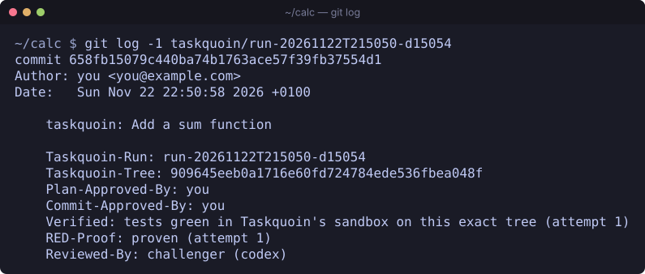

פלט הפקודות מוצג באנגלית, כפי שה-CLI מדפיס אותו:

```text
taskquoin: Add a sum function

Taskquoin-Run: run-20261122T132108-d17040
Taskquoin-Tree: 909645eeb0a1716e60fd724784ede536fbea048f
Plan-Approved-By: you
Commit-Approved-By: you
Verified: tests green in Taskquoin's sandbox on this exact tree (attempt 1)
RED-Proof: proven (attempt 1)
Reviewed-By: challenger (codex)
```

ה-trailers הם שביל הביקורת בתוך ה-commit עצמו:

| Trailer | משמעות |
|---|---|
| `Taskquoin-Run` | ההרצה שיצרה את ה-commit הזה |
| `Taskquoin-Tree` | עץ ה-git שאומת, נסקר ואושר. זהו העץ של ה-commit הזה |
| `Plan-Approved-By` | השם שניתן עם `--as` בשער התוכנית |
| `Commit-Approved-By` | השם שניתן עם `--as` בשער ה-commit |
| `Verified` | הבדיקות היו ירוקות בחדר הנקי על העץ המדויק הזה |
| `RED-Proof` | הבדיקות ששונו נכשלו בלי השינוי (`proven`, או `not applicable` לשינויי בדיקות בלבד) |
| `Reviewed-By` | הסוכנים שסקרו ואישרו; שופט API מוסיף שורה משלו |

`taskquoin status <run>` בסוף מציג את כל היומן, מ-`recall` ועד `commit` ו-`record`.

## שלב 9: מיזוג התוצאה

Taskquoin **לעולם אינו מבצע push** ולעולם אינו ממזג לענף שלכם. ה-commit נמצא ב-`taskquoin/<run>`, הענף שאתם עליו. מזגו אותו בעצמכם, או פתחו ממנו pull request:

```shell
$ git switch main
$ git merge --ff-only taskquoin/run-20261122T132108-d17040
$ npm test
```

> [!WARNING]
> Taskquoin אינו מריץ את ה-hooks של ה-commit במאגר שלכם, מפני שהם עלולים להכיל קוד שהסוכן שינה. הריצו בעצמכם את ה-hooks, ה-linters וה-CI כשאתם ממזגים.

ענפי `taskquoin/<run>` הם שלכם: מחקו אותם כשאינכם צריכים אותם (`git branch -d taskquoin/<run>`).

## מעקב אחר ריצה ב-Dashboard

בזמן שריצה פועלת, פתחו טרמינל שני באותו מאגר והפעילו את ה-Dashboard. הוא רק קורא: הוא מציג את הצינור, את האישור שממתין לכם (עם תחילת ה-hash שלו), את הסוכנים ואת היומן.

```shell
$ taskquoin dashboard
```

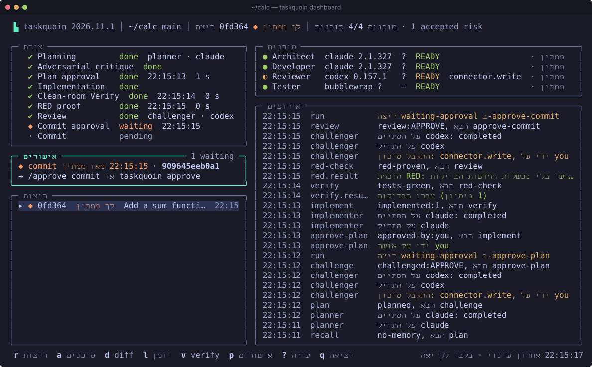

הקישו `d` כדי לקרוא את ה-diff: `/` מחפש, `n` ו-`N` קופצים בין התוצאות, וקובץ נחשב כנקרא כשגללתם עד סופו.

הקישו `p` כדי לפתוח את מרכז האישורים. אף מקש לא מאשר מעצמו: מקלידים את שמכם ואז מקלידים מחדש את 12 התווים של ה-hash. יוצאים עם `q`; ריצה שאושרה ממשיכה. [מדריך Dashboard (באנגלית)](../guides/dashboard.md).

## כשהדברים לא מתנהלים כמתוכנן

הודעות השגיאה של Taskquoin עוקבות אחר השפה שלכם, אבל הודעות מנוע ההרצה (`failed`, `needs-human`, `interrupted`) תמיד באנגלית. הטבלה מפרטת את מה שתפגשו הכי הרבה.

| מה שרואים | מה זה אומר | מה לעשות |
|---|---|---|
| `taskquoin run: the working tree has uncommitted changes` | Taskquoin אינו מערבב את השינויים שלו עם שלכם לעולם | בצעו commit או stash לשינויים שלכם |
| `failed … gate refused agent X` | אי אפשר להסמיך סוכן במחשב הזה | `taskquoin doctor` אומר מדוע: גרסת סביבת ריצה, ארגז חול חסר, סיכון שלא קיבלתם |
| `needs-human … tests still failing after 3 attempts` | שלושה ניסיונות לא נתנו בדיקות ירוקות | המשיכו ידנית על ענף ההרצה, או התחילו run חדש עם בקשה מדויקת יותר |
| `needs-human … no failing test demonstrates the change` | הבדיקות עוברות גם בלי שינוי הייצור, ולכן אינן בודקות אותו | קראו את `red-N`; כתבו (או בקשו) בדיקה שנכשלת לפני השינוי. רפקטורינג או שינוי תיעוד ללא בדיקה חדשה מסתיימים כאן: בצעו commit בעצמכם מהענף |
| `needs-human … RED proof inconclusive` | ההוכחה לא יכלה לרוץ כראוי (פסק זמן, ארגז חול, עץ שלא ניתן לבנות מחדש). זו אינה הוכחה | קראו את `red-N`. תיקיית העבודה שלכם לא נגעה |
| `needs-human … review still requests changes after N attempts` | הסוקר המשיך לסרב | קראו את `review-N` והחליטו; העבודה בענף |
| `needs-human … dependencies changed during the run` | `node_modules` (או `vendor`, `.venv`) השתנה במהלך ההרצה, ולכן דבר לא אומת איתו | התקינו מחדש (`npm ci`) והתחילו run חדש. אל תריצו `npm install` במהלך הרצה |
| `needs-human … protected configuration changed` | הסוכן נגע בתצורה מוגנת (CI, `.claude/`, `AGENTS.md`, `taskquoin.yaml`) | שום דבר לא עבר commit; בדקו את הענף |
| הבדיקות עוברות אצלכם אך נכשלות ב-Verify | הן משתמשות בקובץ שמתעלמים ממנו ואינו בחדר הנקי | הוסיפו אותו ל-`verify.inherit` |
| `does not match the pending artifact` | ה-hash שנתתם אינו הממתין | קראו עם `show`, העתיקו את ה-hash מ-`status` |
| `switch to taskquoin/<run> first` | אינכם על ענף ההרצה | `git switch taskquoin/<run>` |
| `taskquoin.yaml changed since the run started` | התצורה השתנתה באמצע ההרצה | התחילו run חדש |
| `interrupted` | שגיאה טכנית (git, דיסק, HTTP 503 של שופט) עצרה את ההרצה | `taskquoin resume <run>` |

### כשהבדיקות נשארות אדומות

אם Verify נכשל, Taskquoin נותן ל-implementer את יומן הכשל ואת הסקירה ומנסה שוב, עד שלושה ניסיונות מימוש (implementer על OpenCode, שאין לו פקודה משלו, מקבל יותר עבודות חוזרות). אם הבדיקות עדיין אדומות, ההרצה מסתיימת בסטטוס `needs-human` ובסיבה `tests still failing after 3 attempts`. אין commit ואין בקשת אישור.

הכול נשמר: ב-`taskquoin show <run> verify-3` נמצא היומן האחרון, והענף `taskquoin/<run>` מחזיק את עבודת הסוכן. אפשר להמשיך ידנית על הענף הזה, או להתחיל run חדש עם בקשה מדויקת יותר. הרצה בסטטוס `needs-human` אינה מתחדשת אוטומטית.

### `resume`: לאחר הפרעה

הרצה נעשית `interrupted` כשמשהו מחוץ לזרימת העבודה שבר אותה (שגיאת רשת בפנייה לשופט, דיסק מלא, המחשב שלכם נכנס למצב שינה). המצב נשמר בכל שלב, ותשובות השופטים נשמרות אחת אחת, ולכן חידוש לעולם אינו קורא לשופט פעמיים ואינו משלם לו פעמיים:

```shell
$ taskquoin resume run-20261122T132108-d17040
```

`resume` מקבל רק הרצה שסטטוס שלה `interrupted`. עבור כל סטטוס אחר הוא אומר זאת, למשל `taskquoin resume: only an interrupted run can be resumed (status completed)`. אם הסטטוס הוא `needs-human` או `failed`, התחילו run חדש.

### כלל אצבע

אם אינכם יודעים מה לעשות, הריצו `taskquoin status <run>`: הוא מדפיס את הסטטוס, את היומן ואת הפקודה הבאה המדויקת. `taskquoin doctor` עונה על כל שאלה על המחשב.

## למידע נוסף

- [הקונסולה האינטראקטיבית](../getting-started/console.md): אותה זרימת עבודה, עם `/run` ו-`/approve`
- [התקנה](../getting-started/installation.md)
- [ADR-0011, agents never commit](../adr/0011-agents-never-commit.md)
- [ADR-0013, tree-based governance](../adr/0013-tree-based-governance.md)
- [ADR-0014, Verify in a clean room](../adr/0014-verify-in-a-clean-room.md)
- [ADR-0002, enforcement classes](../adr/0002-enforcement-classes.md)
- [ADR-0005, control plane outside the workspace](../adr/0005-control-plane-outside-workspace.md)
- [ADR-0016, judges by API](../adr/0016-judges-by-api.md) ו-[ADR-0017, OpenCode without commands](../adr/0017-opencode-without-commands.md)
