# आपका पहला नियंत्रित रन

यह ट्यूटोरियल [अंग्रेज़ी संदर्भ पृष्ठ](../getting-started/first-run.md) का अनुवाद है। यह मशीनी अनुवाद है, जिसे रखरखावकर्ताओं के टेस्ट कमांड पर जाँचते हैं, किसी मूल भाषी समीक्षक ने नहीं जाँचा है।

यह ट्यूटोरियल आपको एक खाली फ़ोल्डर से Taskquoin द्वारा बनाए गए सत्यापित commit तक ले जाता है, एक-एक कमांड करके। आप एक असफल टेस्ट वाला छोटा प्रोजेक्ट बनाएँगे, Taskquoin को AI एजेंटों के साथ एक सुधार की योजना बनाने और उसे लागू करने देंगे, और काम को दो बार स्वीकृत करेंगे: एक बार योजना पढ़ने के बाद, और एक बार सटीक diff पढ़ने के बाद। हर चरण पर आप देखते हैं कि Taskquoin क्या करता है, वह क्यों रुकता है, और आप किस पर हस्ताक्षर कर रहे हैं।

- [आप क्या बनाएँगे](#आप-क्या-बनाएँगे)
- [चरण 1: असफल टेस्ट वाला प्रोजेक्ट बनाएँ](#चरण-1-असफल-टेस्ट-वाला-प्रोजेक्ट-बनाएँ)
- [चरण 2: Taskquoin को इनिशियलाइज़ करें](#चरण-2-taskquoin-को-इनिशियलाइज़-करें)
- [चरण 3: कॉन्फ़िगरेशन को commit करें](#चरण-3-कॉन्फ़िगरेशन-को-commit-करें)
- [चरण 4: doctor से मशीन जाँचें](#चरण-4-doctor-से-मशीन-जाँचें)
- [ऐसा जोखिम स्वीकार करें जिसे आप समझते हैं](#ऐसा-जोखिम-स्वीकार-करें-जिसे-आप-समझते-हैं)
- [चरण 5: रन शुरू करें](#चरण-5-रन-शुरू-करें)
- [चरण 6: योजना पढ़ें और स्वीकृत करें](#चरण-6-योजना-पढ़ें-और-स्वीकृत-करें)
- [चरण 7: क्रियान्वयन, Verify और समीक्षा](#चरण-7-क्रियान्वयन-verify-और-समीक्षा)
- [चरण 8: commit पढ़ें और स्वीकृत करें](#चरण-8-commit-पढ़ें-और-स्वीकृत-करें)
- [चरण 9: परिणाम मर्ज करें](#चरण-9-परिणाम-मर्ज-करें)
- [Dashboard में किसी रन को देखना](#dashboard-में-किसी-रन-को-देखना)
- [जब चीज़ें योजना के अनुसार न चलें](#जब-चीज़ें-योजना-के-अनुसार-न-चलें)
- [और जानें](#और-जानें)

> [!NOTE]
> स्क्रीन एक डेमो रिपॉज़िटरी से लिए गए हैं जिसमें नकली AI एजेंट हैं (Taskquoin के अपने टेस्ट सूट के टेस्ट डबल); हर कमांड असली Taskquoin CLI है। असली Claude Code और Codex के साथ योजना और समीक्षा के शब्द एजेंटों के अपने होते हैं, और एक रन में सेकंड की जगह कुछ मिनट लगते हैं। बाकी सब कुछ समान है।

शुरू करने से पहले [Taskquoin इंस्टॉल करें](../getting-started/installation.md) और सुनिश्चित करें कि Node 22.18+, git, `bubblewrap` और `socat` उपलब्ध हैं, और कम से कम Claude Code (और बेहतर हो तो Codex भी) इंस्टॉल और साइन-इन है।

## आप क्या बनाएँगे

रन एक निश्चित वर्कफ़्लो है। दो हीरे दो मानवीय स्वीकृतियाँ हैं; आपके बिना कुछ भी उनसे आगे नहीं बढ़ता।

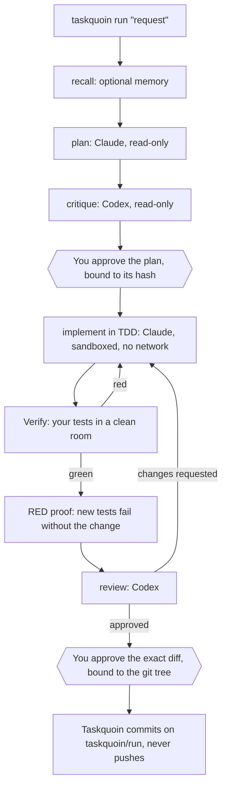

पूरे ट्यूटोरियल में तीन विचार चलते हैं:

- **एजेंट प्रस्ताव देते हैं, Taskquoin कार्य करता है।** एजेंट कभी commit नहीं करते। commit Taskquoin स्वयं उस ट्री से बनाता है जिसे सत्यापित, समीक्षित और स्वीकृत किया गया है ([ADR-0011](../adr/0011-agents-never-commit.md))।
- **आपकी स्वीकृति एक hash से बँधी है।** आप ठीक वही स्वीकृत करते हैं जो आपने पढ़ा, "रन" को नहीं ([ADR-0013](../adr/0013-tree-based-governance.md))।
- **टेस्ट क्लीन रूम में चलते हैं।** मॉडल कभी Taskquoin को नहीं बताता कि टेस्ट पास हुए; Taskquoin उन्हें स्वयं चलाता है ([ADR-0014](../adr/0014-verify-in-a-clean-room.md))।

## चरण 1: असफल टेस्ट वाला प्रोजेक्ट बनाएँ

प्रोजेक्ट एक-फ़ंक्शन वाला कैलकुलेटर है। टेस्ट मौजूद है; फ़ंक्शन नहीं।

```shell
$ mkdir calc && cd calc
$ git init -q -b main
```

`package.json` बनाएँ:

```json
{
  "name": "calc",
  "private": true,
  "scripts": { "test": "node --test" }
}
```

`sum.test.js` बनाएँ:

```js
const test = require('node:test');
const assert = require('node:assert');

test('sum', () => {
  const sum = require('./sum.js');
  assert.strictEqual(sum(2, 3), 5);
});
```

`.gitignore` बनाएँ (डिपेंडेंसी और बिल्ड आउटपुट कभी Taskquoin के diff का हिस्सा नहीं होते):

```text
node_modules/
```

इसे commit करें (नीचे कमांड का आउटपुट अंग्रेज़ी में दिखाया गया है):

```shell
$ git add .
$ git commit -m "calc: a failing test for sum"
$ npm test
not ok 1 - sum
  error: Cannot find module './sum.js'
```

टेस्ट अपेक्षा के अनुसार लाल है। किसी प्रोजेक्ट के लिए Taskquoin की एकमात्र पूर्वशर्त साफ़ वर्किंग ट्री वाली git रिपॉज़िटरी है: यदि आपके पास बिना commit किए बदलाव हैं तो `taskquoin run` शुरू होने से मना कर देता है, क्योंकि वह अपने बदलावों को आपके बदलावों से कभी नहीं मिलाता।

## चरण 2: Taskquoin को इनिशियलाइज़ करें

```shell
$ taskquoin init
```

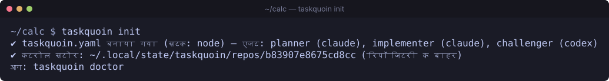

`init` ने तीन काम किए:

1. स्टैक पहचाना (`node`; वह `npm test`, PHPUnit, pytest, `go test`, Maven और अन्य भी जानता है) और रिपॉज़िटरी की रूट में `taskquoin.yaml` लिखा।
2. आपकी मशीन पर AI टूल खोजे और एजेंट चुने: यहाँ `planner` और `implementer` Claude Code पर हैं और `challenger` Codex पर। यदि कोई टूल नहीं है तो फ़ाइल यह बताती है; केवल Claude Code होने पर समीक्षक भी Claude होता है। केवल OpenCode होने पर `init` पूरी तरह OpenCode वाला कॉन्फ़िगरेशन लिखता है।
3. रिपॉज़िटरी के बाहर, `${XDG_STATE_HOME:-~/.local/state}/taskquoin/` के अंतर्गत एक **नियंत्रण स्टोर** बनाया। रन की स्थिति, स्वीकृतियाँ और स्वीकार किए गए जोखिम यहीं रहते हैं। एजेंट यहाँ नहीं लिख सकते, और यही स्वीकृति को जाली बनाए जाने से बचाता है ([ADR-0005](../adr/0005-control-plane-outside-workspace.md))।

`init` किसी मौजूदा `taskquoin.yaml` को कभी अधिलेखित नहीं करता। यदि आपने `init` तब चलाया जब अन्य AI उपलब्ध थे (आपके परिवेश में कोई API कुंजी, कोई लोकल Ollama), तो वह उन्हें सूचीबद्ध करता है और फ़ाइल में **टिप्पणियों** के रूप में प्रस्तावित करता है: उन्हें अनकमेंट करना आपका निर्णय है, क्योंकि इसका अर्थ है कि उस प्रोजेक्ट का कोड उन्हें भेजा जाएगा।

### जनरेट की गई `taskquoin.yaml`

इसे खोलें। यह छोटी है और आप इसे पूरी पढ़ सकते हैं। यह रही, खंड दर खंड।

```yaml
# Taskquoin project configuration — see docs/architecture.md. Protected: agents can never edit this file.
version: 1
stack: node
```

`version` स्कीमा संस्करण है। `stack` क्लीन रूम के डिफ़ॉल्ट चुनता है: आपके टेस्ट के लिए कौन-सी डिपेंडेंसी डायरेक्टरी रीड-ओनली माउंट होती हैं (`node` के लिए: `node_modules`)। पहली टिप्पणी एक वचन है: **एजेंट इस फ़ाइल को कभी संपादित नहीं कर सकते।** यदि कोई रन के दौरान इसे छूता है, तो रन रुक जाता है और कुछ भी commit नहीं होता।

```yaml
agents:
  planner:
    runtime: claude
    description: "Read-only planner: turns a request into a minimal, test-first implementation plan."
    prompt: You plan; you never modify files. Read the repository, then produce the plan requested.
    capabilities:
      fs.read:
        - "**"
    maxTurns: 30
    skills:
      - planning-contract
```

**एजेंट** एक भूमिका है जो किसी रनटाइम से जुड़ी होती है (`claude`, `codex`, `opencode`, या जज के लिए `api`)। `capabilities` वह है जो एजेंट को करने की अनुमति है: planner सब कुछ पढ़ सकता है (`fs.read: "**"`) और कुछ नहीं, इसलिए उसके पास न शेल है न लिखने का टूल। `skills` hash से पिन किए गए निर्देश हैं (`planning-contract` प्रथम-पक्ष है)। `maxTurns` एजेंट के टर्न की सीमा तय करता है।

```yaml
  implementer:
    runtime: claude
    description: Implements an approved task with strict TDD (RED → GREEN → REFACTOR).
    prompt: "You implement exactly the approved task. Write a failing test first, make it pass with the simplest change, then refactor. Never commit: Taskquoin verifies and commits."
    capabilities:
      fs.read:
        - "**"
      fs.write:
        - "**"
      shell.run:
        - npm test
        - npm test -- *
        - node --test *
    maxTurns: 40
    skills:
      - tdd
```

implementer फ़ाइलें लिख सकता है और टेस्ट कमांड की एक छोटी अनुमत सूची (`shell.run`) चला सकता है ताकि वह टेस्ट-पहले तरीके से काम कर सके। ये कमांड रनटाइम के अपने OS सैंडबॉक्स के भीतर, बिना नेटवर्क के चलती हैं। फिर भी उसका टेस्ट रन केवल उसकी अपनी प्रतिक्रिया के लिए है: जो परिणाम मायने रखता है वह वह है जो Taskquoin Verify में बनाता है।

```yaml
  challenger:
    runtime: codex
    description: Independent, read-only adversarial reviewer of plans and diffs.
    prompt: "You are an independent reviewer. Challenge the plan or diff: correctness, security, missing tests, over-engineering. Report blocking and non-blocking findings with file:line. Do not modify files."
    capabilities:
      fs.read:
        - "**"
    skills:
      - code-review
```

**challenger** योजना की आलोचना करता है और diff की समीक्षा करता है। वह जानबूझकर implementer से अलग वेंडर का है, और रीड-ओनली है: वह जिसकी आलोचना करता है उसे "ठीक" कर पाने में सक्षम नहीं होना चाहिए।

```yaml
policy:
  mandatory:
    - fs.write
    - net.egress
    - config.modify
    - connector.write
    - vcs.commit
    - vcs.push
connectors: {}
memory:
  claudeMem:
    enabled: true
```

`policy.mandatory` उन प्रतिबंधों की सूची देता है जिन्हें एजेंट के शुरू होने के लिए किसी तंत्र द्वारा **लागू किया जाना अनिवार्य** है: अपने दायरे के बाहर कोई लेखन नहीं, कोई नेटवर्क नहीं, संरक्षित कॉन्फ़िगरेशन में कोई बदलाव नहीं, कोई रिमोट लेखन नहीं, कोई commit नहीं, कोई push नहीं। यदि आपके पास का रनटाइम संस्करण इनमें से किसी को लागू नहीं कर सकता, तो एजेंट को केवल सलाह जैसे नियम के साथ शुरू करने के बजाय अस्वीकार कर दिया जाता है ([ADR-0002](../adr/0002-enforcement-classes.md), [ADR-0003](../adr/0003-hooks-enforce-prose-asks.md))। `connectors` खाली है: कोई रिमोट सिस्टम जुड़ा नहीं है ([ADR-0012](../adr/0012-remote-connectors-by-exception.md))। `memory.claudeMem` वैकल्पिक है: सक्षम होने पर हर पूर्ण रन का एक संरचित सारांश आपके लोकल [claude-mem](https://github.com/thedotmack/claude-mem) वर्कर को भेजा जाता है, और रन की शुरुआत में एक संक्षिप्त स्मरण पढ़ा जाता है। यदि आप claude-mem नहीं चलाते तो इसे `false` कर दें। (इस ट्यूटोरियल की स्क्रीन `false` का उपयोग करती हैं।)

> [!TIP]
> यदि आपके टेस्ट को किसी अनदेखी फ़ाइल की ज़रूरत है जो डिपेंडेंसी डायरेक्टरी नहीं है, जैसे बना हुआ `dist/` या `.env.test`, तो उसे स्पष्ट रूप से जोड़ें। तब वह क्लीन रूम में रीड-ओनली माउंट होती है और एजेंट के लिए फ़्रीज़ हो जाती है:
>
```yaml
verify:
  inherit:
    - dist
```
>
> जिस प्रोजेक्ट के टेस्ट `npm test` से नहीं चलते, वह `verify.command` सेट कर सकता है।

आप अन्य AI को जज के रूप में (कोई भी OpenAI-संगत प्रदाता) या OpenCode को planner और implementer के रूप में भी उपयोग कर सकते हैं; देखें [ADR-0016](../adr/0016-judges-by-api.md) और [ADR-0017](../adr/0017-opencode-without-commands.md)।

## चरण 3: कॉन्फ़िगरेशन को commit करें

`taskquoin.yaml` आपके प्रोजेक्ट का हिस्सा है, इसलिए इसे commit करें। इससे Taskquoin को वह साफ़ वर्किंग ट्री भी मिलता है जिसकी उसे ज़रूरत है:

```shell
$ git add taskquoin.yaml
$ git commit -m "chore: taskquoin"
```

## चरण 4: doctor से मशीन जाँचें

```shell
$ taskquoin doctor
```

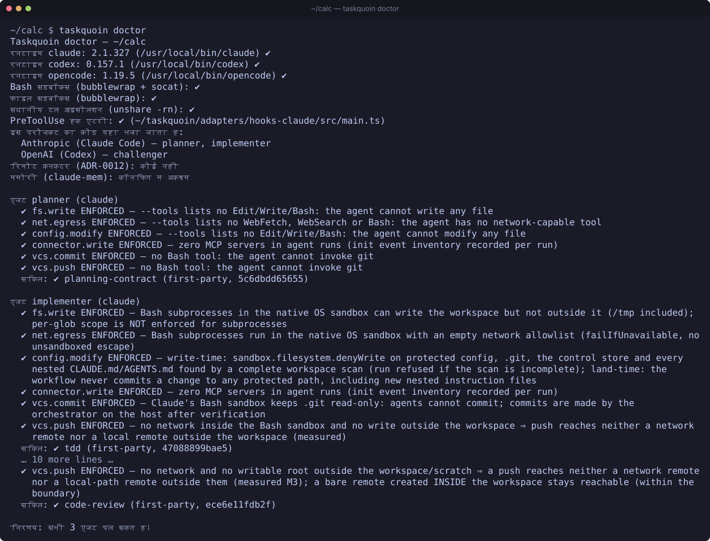

`doctor` Taskquoin का ईमानदार हिस्सा है। इसे ऊपर से नीचे पढ़ें:

- पहला ब्लॉक मिले हुए रनटाइम को संस्करणों के साथ सूचीबद्ध करता है, और जब संस्करण वही हो जिसे Taskquoin ने मापा है तो चेक का निशान दिखाता है, फिर सैंडबॉक्स (bubblewrap और socat) और hook।
- **This project's code is sent to** हर उस वेंडर को सूचीबद्ध करता है जो आपका कोड पाएगा, एजेंट के अनुसार। Taskquoin आपकी मशीन पर चलता है; केवल वे AI कुछ देखते हैं जिन्हें आप कॉन्फ़िगर करते हैं ([ADR-0010](../adr/0010-local-first-no-leak.md))।
- फिर, हर एजेंट के लिए, हर अनिवार्य प्रतिबंध अपनी श्रेणी और **उसे लागू करने वाले तंत्र** के साथ, उदाहरण के लिए `net.egress ENFORCED — Bash subprocesses run in the native OS sandbox with an empty network allowlist`। चेक का निशान मतलब उस रनटाइम संस्करण के लिए प्रमाणित है; क्रॉस का मतलब एजेंट शुरू नहीं होगा।
- अंतिम पंक्ति फ़ैसला है: `Verdict: all 3 agents can run.` या `Verdict: 2 of 3 agents can run — refused agents will not be started.`

डेमो में एक पंक्ति पर क्रॉस है (आउटपुट अंग्रेज़ी में दिखाया गया है):

```text
Agent challenger (codex)
  …
  ✖ connector.write — mandatory restriction "connector.write" (deny-all) on codex 0.157.1: claimed ENFORCED but the mechanism is not measured (inferred). Execution refused (ADR-0002).
```

Codex कहता है कि वह `connector.write` (रिमोट कनेक्टर पर कोई लेखन नहीं) लागू करता है, लेकिन Taskquoin के पास इस दावे को मापने का कोई तरीका नहीं है, इसलिए वह इसे लागू हुआ नहीं गिनता। challenger अस्वीकृत हो जाता है: रन `failed at challenge` के रूप में `gate refused agent challenger` के साथ समाप्त होता। इसके लिए आपको एक निर्णय लेना है।

## ऐसा जोखिम स्वीकार करें जिसे आप समझते हैं

**स्वीकृत जोखिम** आपका हस्ताक्षरित, दिनांकित और सीमित-दायरे वाला निर्णय है कि किसी एक ऐसे प्रतिबंध के बावजूद एजेंट चलाया जाए जिसे मापा नहीं जा सकता। यह स्वामी का निर्णय है, डेवलपर का नहीं और एजेंट का तो कभी नहीं:

```shell
$ taskquoin accept-risk challenger connector.write \
    --reason "Codex reviews read-only; no connector configured" \
    --expires 2026-12-31 --as you
```

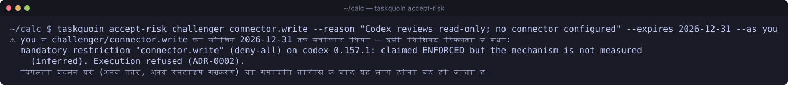

चारों विकल्प आवश्यक हैं: `--reason`, `--expires` (भविष्य की एक वास्तविक तारीख, `YYYY-MM-DD`) और `--as` (आपका नाम), साथ ही एजेंट और capability। ध्यान दें कि यह स्वीकृति क्या है:

- **ठीक उसी विफलता से बँधी।** यह विफलता संदेश का डाइजेस्ट सहेजती है। यदि रनटाइम संस्करण या तंत्र बदलता है तो विफलता वही नहीं रहती, और स्वीकृति लागू होना बंद हो जाती है।
- **दिनांकित।** यह समाप्ति तिथि के बाद भी लागू होना बंद कर देती है।
- **रिपॉज़िटरी के बाहर संग्रहीत**, नियंत्रण स्टोर में। `taskquoin.yaml` संपादित करके कोई इसे नहीं जोड़ सकता, और कोई एजेंट इसे नहीं लिख सकता।
- **संकीर्ण।** यह केवल इसी एजेंट और इसी capability पर लागू होती है। जो capability विफल नहीं हो रही उसके लिए यह अस्वीकृत होती है, और API जजों के लिए उपलब्ध नहीं है (उनकी हमेशा जाँच होती है)।

`doctor` फिर चलाएँ। वह पंक्ति अब क्रॉस की जगह चेतावनी है, और फ़ैसला `all 3 agents can run` है (आउटपुट अंग्रेज़ी में दिखाया गया है):

```text
  ⚠ connector.write accepted risk (approved by you until 2026-12-31: Codex reviews read-only; no connector configured) — mandatory restriction "connector.write" (deny-all) on codex 0.157.1: claimed ENFORCED but the mechanism is not measured (inferred). Execution refused (ADR-0002).
```

`taskquoin check challenger` एक एजेंट के लिए यही विवरण दिखाता है:

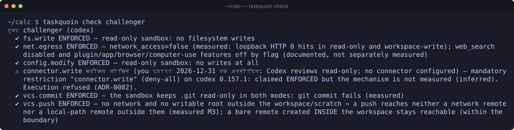

> [!IMPORTANT]
> जोखिम तभी स्वीकार करें जब आप उसे समझते हों और स्थिति आपके कारण से मेल खाती हो: यहाँ Codex रीड-ओनली समीक्षा करता है और आपके प्रोजेक्ट में कोई कनेक्टर नहीं है, इसलिए "कनेक्टर पर लेखन" वैसे भी नहीं हो सकता। किसी लाल पंक्ति को हटाने के लिए जोखिम स्वीकार न करें। विशेष रूप से:
>
> - ऐसे एजेंट पर जो वास्तव में लिखता है या कमांड चलाता है, `fs.write`, `net.egress`, `vcs.commit` या `vcs.push` के लिए कभी नहीं, जब तक आप क्षतिपूर्ति करने वाले नियंत्रण का नाम न बता सकें;
> - अस्पष्ट कारण के साथ कभी नहीं: वह स्वीकृति में दर्ज होता है और `doctor` उसे दिखाता है;
> - छोटी समाप्ति को प्राथमिकता दें: स्वीकृति अपग्रेड के बाद दोबारा जाँचने की याद दिलाती है;
> - यदि कोई तंत्र *विफल मापा गया* है, तो उसके बजाय अपग्रेड करें या रनटाइम बदलें।

`taskquoin accept-risk` स्वयं चलाना जानबूझकर है: यदि कंसोल या कोई एजेंट इसे कर सकता, तो यह नियंत्रण निरर्थक हो जाता।

## चरण 5: रन शुरू करें

```shell
$ taskquoin run "Add a sum function"
```

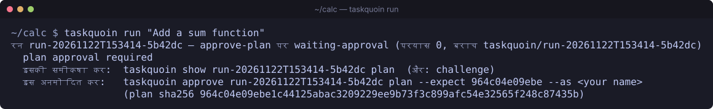

एजेंटों के काम करते समय आपका टर्मिनल शांत रहता है, फिर वह प्रिंट करता है कि कहाँ रुका। क्रम से, Taskquoin ने यह किया:

1. **Preflight।** Taskquoin ने जाँचा कि कॉन्फ़िगरेशन हर भूमिका परिभाषित करता है, स्किल उपयोग योग्य हैं, रीड-ओनली भूमिकाएँ वास्तव में रीड-ओनली हैं, और API जजों के पास उनकी कुंजियाँ हैं। वर्किंग ट्री साफ़ होना चाहिए। हर एजेंट भी पहली बार उपयोग से ठीक पहले उसी गेट से गुज़रता है जिससे `doctor` गुज़रता है: अस्वीकृत एजेंट रन को `failed` पर समाप्त करता है।
2. **ब्रांच।** उसने ब्रांच `taskquoin/run-20261122T132108-d17040` बनाई और उस पर स्विच किया। आपकी `main` अछूती है।
3. **Recall।** उसने मेमोरी वर्कर से, यदि सक्षम है, प्रासंगिक नोट माँगे। जब कोई नहीं होता तो जर्नल `recall no-memory` दिखाता है।
4. **योजना।** `planner` (Claude, रीड-ओनली) ने रिपॉज़िटरी पढ़ी और एक योजना लिखी: लक्ष्य, पहले लिखा जाने वाला टेस्ट, फ़ाइलें, चरण, जोखिम।
5. **आलोचना।** `challenger` (Codex, रीड-ओनली) ने उस योजना को स्वतंत्र रूप से चुनौती दी और `VERDICT:` पंक्ति पर समाप्त किया।
6. **गेट।** वर्कफ़्लो `approve-plan` पर रुक गया। वह जितना आप चाहें उतना इंतज़ार करेगा।

रन आईडी (`run-20261122T132108-d17040`) एक टाइमस्टैम्प और एक यादृच्छिक प्रत्यय है। आप इसे आगे की हर कमांड में उपयोग करते हैं। बिना आर्गुमेंट के `taskquoin status` रन की सूची देता है (आउटपुट अंग्रेज़ी में दिखाया गया है):

```shell
$ taskquoin status
run-20261122T132108-d17040  waiting-approval approve-plan    Add a sum function
```

## चरण 6: योजना पढ़ें और स्वीकृत करें

`status <run>` एक रन का इतिहास दिखाता है और, गेट पर, उसे स्वीकृत करने वाली सटीक कमांड:

```shell
$ taskquoin status run-20261122T132108-d17040
```

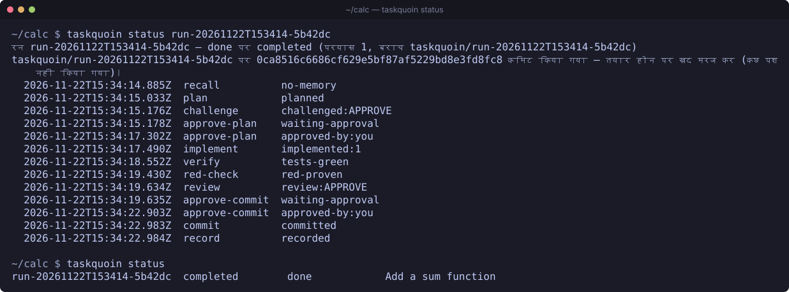

इतिहास की हर पंक्ति वर्कफ़्लो का एक चरण है, उसके परिणाम के साथ (`planned`, `challenged:APPROVE`, `waiting-approval`)।

अब **वह पढ़ें जिसे आप स्वीकृत करने वाले हैं**:

```shell
$ taskquoin show run-20261122T132108-d17040 plan
```

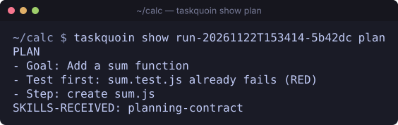

कमांड का आउटपुट अंग्रेज़ी में दिखाया गया है, जैसा CLI उसे प्रिंट करता है:

```shell
$ taskquoin show run-20261122T132108-d17040 challenge
Review: plan checked.
VERDICT: APPROVE
```

बिना artifact के `show <run>` अब तक संग्रहीत सब कुछ बाइट में उसके आकार के साथ सूचीबद्ध करता है। असली एजेंट की योजना में छुई जाने वाली फ़ाइलें, पहले लिखे जाने वाले टेस्ट और जोखिम भी होते हैं। challenge स्वतंत्र दूसरी राय है: उसमें अवरोधक और गैर-अवरोधक निष्कर्ष हो सकते हैं। यदि योजना गलत है तो उसे स्वीकृत न करें: अधिक सटीक अनुरोध के साथ नया run शुरू करें।

### hash क्यों

जो पंक्ति मायने रखती है वह `status` की अंतिम पंक्ति है (आउटपुट अंग्रेज़ी में दिखाया गया है):

```text
Approve it:  taskquoin approve run-20261122T132108-d17040 plan --expect 964c04e09ebe --as <your name>
             (plan sha256 964c04e09ebe1c44125abac3209229ee9b73f3c899afc54e32565f248c87435b)
```

`964c04e09ebe` उस योजना फ़ाइल के SHA-256 की शुरुआत है जो आपने अभी पढ़ी। स्वीकृति का अर्थ "मैं इस रन को स्वीकृत करता हूँ" नहीं है; इसका अर्थ है "मैं **उस योजना को स्वीकृत करता हूँ जिसका hash 964c04e09ebe है**"। यदि आपके पढ़ने और स्वीकृत करने के बीच योजना बदल सकती (दोबारा प्रयास, कोई और प्रक्रिया, कोई समझौता किया गया टूल), तो hash मेल नहीं खाता और Taskquoin मना कर देता। commit भी यही दर्ज करता है, इसलिए कोई भी बाद में ऑडिट कर सकता है कि किसी व्यक्ति ने क्या स्वीकृत किया।

> [!NOTE]
> `--expect` पासवर्ड नहीं है। यह इस बात का प्रमाण है कि आपने उस artifact को देखा जिस पर सिस्टम कार्य करने वाला है: आप पढ़ने के बाद उसे `status` से कॉपी करते हैं। [कंसोल](../getting-started/console.md) में आप पुष्टि के लिए उसे दोबारा टाइप करते हैं।

स्वीकृत करें:

```shell
$ taskquoin approve run-20261122T132108-d17040 plan --expect 964c04e09ebe --as you
```

`--as` आपका नाम है; यह commit में `Plan-Approved-By` के रूप में दर्ज होता है। योजना स्वीकृत करने से वर्कफ़्लो फिर चल पड़ता है, जो अगले गेट तक जारी रहता है।

### गलत hash अस्वीकृत होता है

ऐसा hash आज़माएँ जो लंबित वाला नहीं है (आउटपुट अंग्रेज़ी में दिखाया गया है):

```shell
$ taskquoin approve run-20261122T132108-d17040 plan --expect 000000000000 --as you
taskquoin approve: expected 000000000000 does not match the pending artifact 964c04e09ebe… — re-read it before approving
```

कुछ भी स्वीकृत नहीं हुआ और रन अपरिवर्तित है। यही तब होता है जब आप ऐसा गेट स्वीकृत करते हैं जिसकी रन प्रतीक्षा नहीं कर रहा। नीचे का स्क्रीनशॉट रन पूरा होने के बाद लिया गया था, इसलिए वह अस्वीकृति का वही रूप दिखाता है:

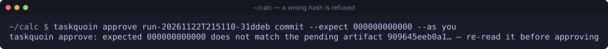

अस्वीकृति का एग्ज़िट कोड 1 है। गलत टाइप की गई कमांड (`--expect` या `--as` का न होना) 2 के साथ बाहर निकलती है।

## चरण 7: क्रियान्वयन, Verify और समीक्षा

`approve … plan` के बाद Taskquoin आपके बिना काम करता है:

1. **TDD में क्रियान्वयन।** `implementer` (Claude) ब्रांच पर, रनटाइम के सैंडबॉक्स में, बिना नेटवर्क और बिना commit करने के तरीके के काम करता है। वह पहले टेस्ट लिखता या समायोजित करता है, फिर वह सबसे सरल कोड जो उन्हें पास कराए।
2. **Verify, क्लीन रूम में।** Taskquoin implementer द्वारा छोड़ा गया ठीक वही ट्री लेता है और आपके टेस्ट (`npm test`) स्वयं आपकी रिपॉज़िटरी के बाहर एक अस्थायी प्रति में चलाता है: कोई नेटवर्क नहीं, `.git` रीड-ओनली, आपका HOME छिपा हुआ, गोपनीय फ़ाइलें मास्क की हुईं, और केवल स्टैक की डिपेंडेंसी डायरेक्टरी (और आपका `verify.inherit`) रीड-ओनली माउंट। जो टेस्ट पास होता था पर किसी बिना commit की चीज़ पर निर्भर था, वह यहाँ विफल होता है, और यही उद्देश्य है।
3. **RED proof।** फिर Taskquoin प्रोडक्शन बदलाव हटाता है और बदले हुए टेस्ट दोबारा चलाता है। उन्हें **विफल** होना चाहिए। जो टेस्ट बदलाव के बिना भी पास हो जाता है वह कुछ भी परखता नहीं। प्रमाण यांत्रिक है: यह नहीं दिखाता कि टेस्ट सही व्यवहार जाँचता है (उसके लिए समीक्षा और आप हैं)।
4. **समीक्षा।** `challenger` योजना के विरुद्ध diff की समीक्षा करता है, verify और RED लॉग के साथ। वह `VERDICT:` पंक्ति पर समाप्त करता है।

यदि टेस्ट लाल हैं, या RED proof विफल रहा, या समीक्षा बदलाव माँगती है, तो Taskquoin प्रतिक्रिया को स्वचालित पुनर्कार्य के लिए implementer को भेजता है (अधिकतम 3 क्रियान्वयन प्रयास, अस्वीकृत समीक्षा के बाद अधिकतम 2 पुनर्कार्य चरण)। फिर रन दूसरे गेट पर रुकता है।

## चरण 8: commit पढ़ें और स्वीकृत करें

रन अब फिर प्रतीक्षा कर रहा है। उसे देखें (आउटपुट अंग्रेज़ी में दिखाया गया है):

```shell
$ taskquoin status run-20261122T132108-d17040
Run run-20261122T132108-d17040 — waiting-approval at approve-commit (attempt 1, branch taskquoin/run-20261122T132108-d17040)
  commit approval required (bound to the exact tree)
  Review it:   taskquoin show run-20261122T132108-d17040 diff-1  (and: verify-1, red-1, review-1)
  Approve it:  taskquoin approve run-20261122T132108-d17040 commit --expect 909645eeb0a1 --as <your name>
               (git tree 909645eeb0a1716e60fd724784ede536fbea048f)
```

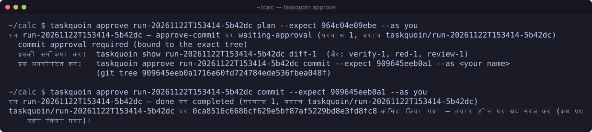

इस बार hash वह **git ट्री** है जो Verify और समीक्षा से गुज़रा। प्रयास 1 के चारों artifact पढ़ें। संख्या प्रयास की है; पुनर्कार्य के बाद सबसे ऊँची वाली पढ़ें।

### `diff-1`: सटीक बदलाव

```shell
$ taskquoin show run-20261122T132108-d17040 diff-1
```

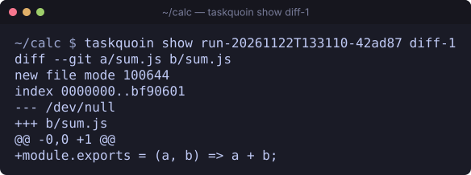

यही commit होगा, इससे अधिक कुछ नहीं। यदि एजेंट कोई संरक्षित फ़ाइल (आपका CI, `.claude/`, `AGENTS.md`, `taskquoin.yaml`) बदलता, तो रन `protected configuration changed` के साथ रुक जाता। जो फ़ाइलें आपका `.gitignore` छिपाता है पर एजेंट ने बनाई हैं, वे `ignored-1` में सूचीबद्ध होती हैं; वे diff में नहीं हैं, सत्यापित नहीं हैं, और commit नहीं होतीं।

### `verify-1`: आपके टेस्ट, Taskquoin द्वारा चलाए गए

```shell
$ taskquoin show run-20261122T132108-d17040 verify-1
```

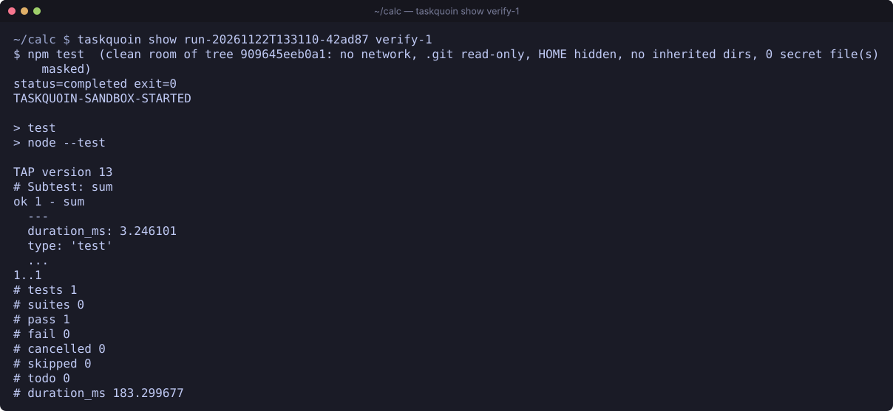

हेडर बताता है कि क्लीन रूम कैसा था (`no network, .git read-only, HOME hidden, … 0 secret file(s) masked`) और किस ट्री के लिए (`909645eeb0a1`, वही hash जिसे आप स्वीकृत करेंगे)। `exit=0` और `# pass 1` टेस्ट रनर से आते हैं, किसी मॉडल के दावे से नहीं।

### `red-1`: प्रमाण कि टेस्ट मायने रखता है

कमांड का आउटपुट अंग्रेज़ी में दिखाया गया है, जैसा CLI उसे प्रिंट करता है:

```shell
$ taskquoin show run-20261122T132108-d17040 red-1
TASKQUOIN RED PROOF — tests run on base + test changes only (tree 9848f565e24c); they must FAIL.
RESULT: they failed as required (RED proven).

$ npm test  (clean room of tree 9848f565e24c: no network, .git read-only, HOME hidden, no inherited dirs, 0 secret file(s) masked)
status=failed exit=1
…
not ok 1 - sum
  error: Cannot find module './sum.js'
  code: 'MODULE_NOT_FOUND'
```

यहाँ नई प्रोडक्शन फ़ाइल `sum.js` हटा दी गई, टेस्ट उसे लोड नहीं कर सका और विफल हो गया। यही विफलता RED proof है। Taskquoin *नई* फ़ाइल में किसी फ़ीचर से होने वाली इम्पोर्ट त्रुटि को अपेक्षित RED मानता है। यदि केवल टेस्ट फ़ाइलें बदली हों (केवल टेस्ट जोड़ना), तो प्रमाण "not applicable" के रूप में दर्ज होता है।

### `review-1`: दूसरी राय

कमांड का आउटपुट अंग्रेज़ी में दिखाया गया है, जैसा CLI उसे प्रिंट करता है:

```shell
$ taskquoin show run-20261122T132108-d17040 review-1
Review: diff checked against the plan.
VERDICT: APPROVE
```

निष्कर्ष पढ़ें, केवल फ़ैसला नहीं। `ignored-1` सूची में तभी दिखता है जब पढ़ने को कुछ हो।

### commit स्वीकृत करें

यदि आप संतुष्ट हैं, तो `status` से मिले hash के साथ स्वीकृत करें (आउटपुट अंग्रेज़ी में दिखाया गया है):

```shell
$ taskquoin approve run-20261122T132108-d17040 commit --expect 909645eeb0a1 --as you
Run run-20261122T132108-d17040 — completed at done (attempt 1, branch taskquoin/run-20261122T132108-d17040)
Committed a3c6b801de5f4356750f53870557e2fdd19958ee on taskquoin/run-20261122T132108-d17040 — merge it yourself when ready (nothing was pushed).
```

`approve … commit` तब चलाना होगा जब रिपॉज़िटरी रन की ब्रांच (`taskquoin/<run>`) पर हो; अन्यथा वह `switch to taskquoin/<run> first` उत्तर देता है। Taskquoin commit से पहले वर्किंग ट्री फिर पढ़ता है। यदि आपके देखने के बाद कुछ बदल गया है, तो आपकी स्वीकृति लागू नहीं रहती: वह दोबारा verify करता है, दोबारा समीक्षा करता है और आपसे नया ट्री स्वीकृत करने को कहता है।

फिर Taskquoin commit को **स्वीकृत git ट्री से ही** बनाता है, `git add` से नहीं। वह ऐसा दिखता है:

```shell
$ git log -1 taskquoin/run-20261122T132108-d17040
```

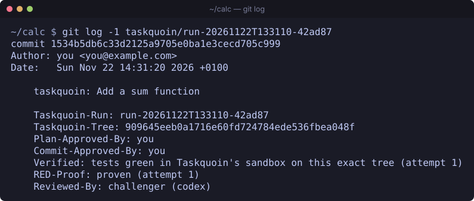

कमांड का आउटपुट अंग्रेज़ी में दिखाया गया है, जैसा CLI उसे प्रिंट करता है:

```text
taskquoin: Add a sum function

Taskquoin-Run: run-20261122T132108-d17040
Taskquoin-Tree: 909645eeb0a1716e60fd724784ede536fbea048f
Plan-Approved-By: you
Commit-Approved-By: you
Verified: tests green in Taskquoin's sandbox on this exact tree (attempt 1)
RED-Proof: proven (attempt 1)
Reviewed-By: challenger (codex)
```

trailer commit में ही मौजूद ऑडिट ट्रेल हैं:

| Trailer | अर्थ |
|---|---|
| `Taskquoin-Run` | वह रन जिसने यह commit बनाया |
| `Taskquoin-Tree` | वह git ट्री जिसे सत्यापित, समीक्षित और स्वीकृत किया गया। यही इस commit का ट्री है |
| `Plan-Approved-By` | योजना वाले गेट पर `--as` से दिया गया नाम |
| `Commit-Approved-By` | commit वाले गेट पर `--as` से दिया गया नाम |
| `Verified` | टेस्ट ठीक इसी ट्री पर क्लीन रूम में हरे थे |
| `RED-Proof` | बदले हुए टेस्ट बदलाव के बिना विफल हुए (`proven`, या केवल-टेस्ट बदलावों के लिए `not applicable`) |
| `Reviewed-By` | वे एजेंट जिन्होंने समीक्षा की और स्वीकृत किया; API जज अपनी पंक्ति जोड़ता है |

अंत में `taskquoin status <run>` `recall` से `commit` और `record` तक पूरा जर्नल दिखाता है।

## चरण 9: परिणाम मर्ज करें

Taskquoin **कभी push नहीं करता** और आपकी ब्रांच में कभी मर्ज नहीं करता। commit `taskquoin/<run>` पर है, वही ब्रांच जिस पर आप हैं। इसे स्वयं मर्ज करें, या इससे pull request खोलें:

```shell
$ git switch main
$ git merge --ff-only taskquoin/run-20261122T132108-d17040
$ npm test
```

> [!WARNING]
> Taskquoin आपकी रिपॉज़िटरी के commit hook नहीं चलाता, क्योंकि उनमें वह कोड हो सकता है जिसे एजेंट ने बदला हो। मर्ज करते समय अपने hook, linter और CI स्वयं चलाएँ।

`taskquoin/<run>` ब्रांच आपकी हैं: जब उनकी ज़रूरत न हो तो उन्हें हटा दें (`git branch -d taskquoin/<run>`)।

## Dashboard में किसी रन को देखना

जब कोई रन चल रहा हो, उसी रिपॉज़िटरी में दूसरा टर्मिनल खोलें और Dashboard शुरू करें। यह केवल पढ़ता है: यह पाइपलाइन, आपकी प्रतीक्षा कर रही स्वीकृति (उसके hash की शुरुआत के साथ), एजेंट और लॉग दिखाता है।

```shell
$ taskquoin dashboard
```

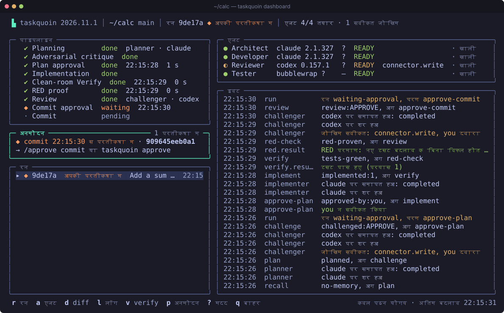

diff पढ़ने के लिए `d` दबाएँ: `/` खोजता है, `n` और `N` मिलान के बीच कूदते हैं, और किसी फ़ाइल को तब पढ़ा हुआ माना जाता है जब आप उसके अंत तक स्क्रॉल कर चुके हों।

स्वीकृति केंद्र खोलने के लिए `p` दबाएँ। कोई भी कुंजी अपने आप स्वीकृति नहीं देती: आप अपना नाम लिखते हैं, फिर hash के 12 अक्षर दोबारा टाइप करते हैं। `q` से बाहर निकलें; स्वीकृत रन चलता रहता है। [Dashboard गाइड (अंग्रेज़ी में)](../guides/dashboard.md).

## जब चीज़ें योजना के अनुसार न चलें

Taskquoin के त्रुटि संदेश आपकी भाषा का अनुसरण करते हैं, लेकिन रन इंजन के संदेश (`failed`, `needs-human`, `interrupted`) हमेशा अंग्रेज़ी में होते हैं। तालिका वे बातें बताती है जो आपके सामने सबसे अधिक आएँगी।

| आप क्या देखते हैं | इसका अर्थ | क्या करें |
|---|---|---|
| `taskquoin run: the working tree has uncommitted changes` | Taskquoin अपने बदलावों को आपके बदलावों से कभी नहीं मिलाता | अपने बदलाव commit या stash करें |
| `failed … gate refused agent X` | इस मशीन पर किसी एजेंट को प्रमाणित नहीं किया जा सकता | `taskquoin doctor` कारण बताता है: रनटाइम संस्करण, गायब सैंडबॉक्स, कोई जोखिम जो आपने स्वीकार नहीं किया |
| `needs-human … tests still failing after 3 attempts` | तीन प्रयासों में हरे टेस्ट नहीं मिले | रन ब्रांच पर स्वयं आगे बढ़ें, या अधिक सटीक अनुरोध के साथ नया run शुरू करें |
| `needs-human … no failing test demonstrates the change` | टेस्ट प्रोडक्शन बदलाव के बिना भी पास होते हैं, इसलिए वे उसे परखते नहीं | `red-N` पढ़ें; ऐसा टेस्ट लिखें (या माँगें) जो बदलाव से पहले विफल हो। नए टेस्ट के बिना रीफ़ैक्टर या दस्तावेज़ बदलाव यहीं समाप्त होता है: उसे ब्रांच से स्वयं commit करें |
| `needs-human … RED proof inconclusive` | प्रमाण ठीक से नहीं चल सका (टाइमआउट, सैंडबॉक्स, ऐसा ट्री जो दोबारा नहीं बन सका)। यह प्रमाण नहीं है | `red-N` पढ़ें। आपका वर्किंग फ़ोल्डर अछूता है |
| `needs-human … review still requests changes after N attempts` | समीक्षक मना करता रहा | `review-N` पढ़ें और निर्णय लें; काम ब्रांच में है |
| `needs-human … dependencies changed during the run` | `node_modules` (या `vendor`, `.venv`) रन के दौरान बदल गया, इसलिए उसके साथ कुछ भी सत्यापित नहीं हुआ | दोबारा इंस्टॉल करें (`npm ci`) और नया run शुरू करें। रन के दौरान `npm install` न चलाएँ |
| `needs-human … protected configuration changed` | एजेंट ने संरक्षित कॉन्फ़िगरेशन (CI, `.claude/`, `AGENTS.md`, `taskquoin.yaml`) को छुआ | कुछ भी commit नहीं हुआ; ब्रांच का निरीक्षण करें |
| टेस्ट आपके यहाँ पास होते हैं पर Verify में विफल | वे किसी अनदेखी फ़ाइल का उपयोग करते हैं जो क्लीन रूम में नहीं है | उसे `verify.inherit` में जोड़ें |
| `does not match the pending artifact` | आपका दिया hash लंबित वाला नहीं है | `show` से पढ़ें, hash `status` से कॉपी करें |
| `switch to taskquoin/<run> first` | आप रन की ब्रांच पर नहीं हैं | `git switch taskquoin/<run>` |
| `taskquoin.yaml changed since the run started` | रन के बीच में कॉन्फ़िगरेशन बदल गया | नया run शुरू करें |
| `interrupted` | किसी तकनीकी त्रुटि (git, डिस्क, किसी जज का HTTP 503) ने रन रोक दिया | `taskquoin resume <run>` |

### जब टेस्ट लाल ही रहें

यदि Verify विफल होता है, तो Taskquoin implementer को विफल लॉग और समीक्षा देता है और फिर प्रयास करता है, अधिकतम तीन क्रियान्वयन प्रयास तक (OpenCode implementer, जिसके पास अपनी कमांड नहीं होती, को अधिक पुनर्कार्य मिलते हैं)। यदि टेस्ट फिर भी लाल हैं, तो रन स्थिति `needs-human` और कारण `tests still failing after 3 attempts` के साथ समाप्त होता है। कोई commit नहीं है और कोई स्वीकृति प्रॉम्प्ट नहीं।

सब कुछ सुरक्षित रहता है: `taskquoin show <run> verify-3` में अंतिम लॉग है, और ब्रांच `taskquoin/<run>` में एजेंट का काम है। आप उस ब्रांच पर स्वयं आगे बढ़ सकते हैं, या अधिक सटीक अनुरोध के साथ नया run शुरू कर सकते हैं। `needs-human` वाला रन अपने आप फिर शुरू नहीं होता।

### `resume`: रुकावट के बाद

रन तब `interrupted` होता है जब वर्कफ़्लो के बाहर की कोई चीज़ उसे तोड़ दे (किसी जज तक पहुँचते समय नेटवर्क त्रुटि, भरी हुई डिस्क, आपकी मशीन का स्लीप में जाना)। स्थिति हर चरण पर सहेजी जाती है, और जजों के उत्तर एक-एक करके सहेजे जाते हैं, इसलिए पुनः आरंभ करने पर किसी जज को दो बार न बुलाया जाता है, न उसे दो बार भुगतान होता है:

```shell
$ taskquoin resume run-20261122T132108-d17040
```

`resume` केवल उसी रन को स्वीकार करता है जिसकी स्थिति `interrupted` है। किसी भी अन्य स्थिति के लिए वह यह बता देता है, उदाहरण के लिए `taskquoin resume: only an interrupted run can be resumed (status completed)`। यदि स्थिति `needs-human` या `failed` है, तो नया run शुरू करें।

### एक मोटा नियम

यदि आपको पता नहीं कि क्या करना है, तो `taskquoin status <run>` चलाएँ: वह स्थिति, जर्नल और ठीक अगली कमांड प्रिंट करता है। `taskquoin doctor` मशीन के बारे में हर प्रश्न का उत्तर देता है।

## और जानें

- [इंटरैक्टिव कंसोल](../getting-started/console.md): वही वर्कफ़्लो, `/run` और `/approve` के साथ
- [इंस्टॉलेशन](../getting-started/installation.md)
- [ADR-0011, agents never commit](../adr/0011-agents-never-commit.md)
- [ADR-0013, tree-based governance](../adr/0013-tree-based-governance.md)
- [ADR-0014, Verify in a clean room](../adr/0014-verify-in-a-clean-room.md)
- [ADR-0002, enforcement classes](../adr/0002-enforcement-classes.md)
- [ADR-0005, control plane outside the workspace](../adr/0005-control-plane-outside-workspace.md)
- [ADR-0016, judges by API](../adr/0016-judges-by-api.md) और [ADR-0017, OpenCode without commands](../adr/0017-opencode-without-commands.md)
