# Run pertama Anda yang diatur tata kelola

> Tutorial ini adalah terjemahan dari halaman acuan berbahasa Inggris ([first-run.md](../getting-started/first-run.md)). Ini adalah terjemahan mesin yang diperiksa lewat pengujian perintah oleh para maintainer, bukan oleh peninjau penutur asli. Keluaran CLI di dalam blok kode tetap ditampilkan dalam bahasa Inggris; tangkapan layar yang dilokalkan memperlihatkan keluaran sebenarnya dalam bahasa ini.

Tutorial ini membawa Anda dari folder kosong hingga commit terverifikasi yang dibuat oleh Taskquoin, satu perintah demi satu perintah. Anda akan membuat proyek kecil dengan tes yang gagal, membiarkan Taskquoin merencanakan dan mengimplementasikan perbaikan dengan agen AI, lalu menyetujui pekerjaan itu dua kali: sekali setelah Anda membaca rencananya, sekali setelah Anda membaca diff yang persis. Pada setiap langkah Anda melihat apa yang dilakukan Taskquoin, mengapa ia berhenti, dan apa yang Anda tandatangani.

- [Apa yang akan Anda bangun](#apa-yang-akan-anda-bangun)
- [Langkah 1: buat proyek dengan tes yang gagal](#langkah-1-buat-proyek-dengan-tes-yang-gagal)
- [Langkah 2: inisialisasi Taskquoin](#langkah-2-inisialisasi-taskquoin)
- [Langkah 3: commit konfigurasi](#langkah-3-commit-konfigurasi)
- [Langkah 4: periksa mesin dengan doctor](#langkah-4-periksa-mesin-dengan-doctor)
- [Terima risiko yang Anda pahami](#terima-risiko-yang-anda-pahami)
- [Langkah 5: mulai run](#langkah-5-mulai-run)
- [Langkah 6: baca dan setujui rencana](#langkah-6-baca-dan-setujui-rencana)
- [Langkah 7: implementasi, Verify, dan review](#langkah-7-implementasi-verify-dan-review)
- [Langkah 8: baca dan setujui commit](#langkah-8-baca-dan-setujui-commit)
- [Langkah 9: merge hasilnya](#langkah-9-merge-hasilnya)
- [Mengikuti sebuah run di Dashboard](#mengikuti-sebuah-run-di-dashboard)
- [Ketika semuanya tidak berjalan sesuai rencana](#ketika-semuanya-tidak-berjalan-sesuai-rencana)
- [Pelajari lebih lanjut](#pelajari-lebih-lanjut)

> [!NOTE]
> Tangkapan layar berasal dari repositori demo dengan agen AI simulasi (test double dari rangkaian tes Taskquoin sendiri); semua perintah adalah CLI Taskquoin yang sebenarnya. Dengan Claude Code dan Codex sungguhan, kata-kata dalam rencana dan review adalah milik agen itu sendiri, dan sebuah run memakan waktu beberapa menit, bukan beberapa detik. Selebihnya identik.

Sebelum mulai, [instal Taskquoin](../getting-started/installation.md) dan pastikan Node 22.18+, git, `bubblewrap`, dan `socat` tersedia, serta setidaknya Claude Code (dan idealnya Codex) sudah terpasang dan sudah masuk (sign in).

## Apa yang akan Anda bangun

Sebuah run adalah alur kerja yang tetap. Kedua belah ketupat adalah dua persetujuan manusia; tidak ada yang melewatinya tanpa Anda.

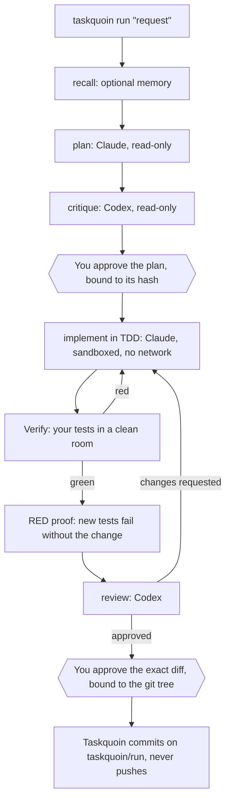

Tiga gagasan mengalir di seluruh tutorial ini:

- **Agen mengusulkan, Taskquoin bertindak.** Agen tidak pernah melakukan commit. Commit dibuat oleh Taskquoin dari tree yang telah diverifikasi, ditinjau, dan disetujui ([ADR-0011](../adr/0011-agents-never-commit.md)).
- **Persetujuan Anda terikat pada sebuah hash.** Anda menyetujui persis apa yang Anda baca, bukan "run-nya" ([ADR-0013](../adr/0013-tree-based-governance.md)).
- **Tes berjalan di clean room.** Model tidak pernah memberi tahu Taskquoin bahwa tes lulus; Taskquoin menjalankannya sendiri ([ADR-0014](../adr/0014-verify-in-a-clean-room.md)).

## Langkah 1: buat proyek dengan tes yang gagal

Proyeknya adalah kalkulator dengan satu fungsi. Tesnya ada; fungsinya belum.

```shell
$ mkdir calc && cd calc
$ git init -q -b main
```

Buat `package.json`:

```json
{
  "name": "calc",
  "private": true,
  "scripts": { "test": "node --test" }
}
```

Buat `sum.test.js`:

```js
const test = require('node:test');
const assert = require('node:assert');

test('sum', () => {
  const sum = require('./sum.js');
  assert.strictEqual(sum(2, 3), 5);
});
```

Buat `.gitignore` (dependensi dan keluaran build tidak pernah menjadi bagian dari diff Taskquoin):

```text
node_modules/
```

Commit:

```shell
$ git add .
$ git commit -m "calc: a failing test for sum"
$ npm test
not ok 1 - sum
  error: Cannot find module './sum.js'
```

Tesnya merah, seperti yang diharapkan. Repositori git dengan working tree yang bersih adalah satu-satunya prasyarat Taskquoin untuk sebuah proyek: `taskquoin run` menolak berjalan jika ada perubahan yang belum di-commit, karena ia tidak pernah mencampur perubahannya dengan perubahan Anda.

## Langkah 2: inisialisasi Taskquoin

```shell
$ taskquoin init
```

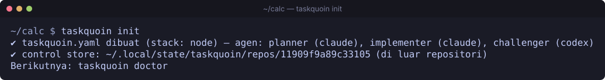

`init` melakukan tiga hal:

1. Ia mendeteksi stack (`node`; ia juga mengenal `npm test`, PHPUnit, pytest, `go test`, Maven, dan lainnya) dan menulis `taskquoin.yaml` di root repositori.
2. Ia mencari alat AI di mesin Anda dan memilih agen: di sini `planner` dan `implementer` pada Claude Code serta `challenger` pada Codex. Jika sebuah alat tidak ada, file akan menyebutkannya; jika hanya ada Claude Code, reviewer-nya juga Claude. Jika hanya ada OpenCode, `init` menulis konfigurasi yang seluruhnya OpenCode.
3. Ia membuat **control store** di luar repositori, di bawah `${XDG_STATE_HOME:-~/.local/state}/taskquoin/`. Di sinilah status run, persetujuan, dan penerimaan risiko disimpan. Agen tidak dapat menulis ke sana, dan itulah yang membuat persetujuan tidak dapat dipalsukan ([ADR-0005](../adr/0005-control-plane-outside-workspace.md)).

`init` tidak pernah menimpa `taskquoin.yaml` yang sudah ada. Jika Anda menjalankan `init` saat ada AI lain yang tersedia (kunci API di lingkungan Anda, Ollama lokal), ia mencantumkannya dan mengusulkannya sebagai **komentar** di dalam file: mengaktifkan komentar itu adalah keputusan Anda, karena berarti kode proyek tersebut akan dikirim ke AI tersebut.

### `taskquoin.yaml` yang dihasilkan

Bukalah. File ini pendek, dan Anda dapat membacanya seluruhnya. Berikut bagian demi bagian.

```yaml
# Taskquoin project configuration — see docs/architecture.md. Protected: agents can never edit this file.
version: 1
stack: node
```

`version` adalah versi skema. `stack` memilih nilai bawaan untuk clean room: direktori dependensi mana yang di-mount hanya-baca untuk tes Anda (untuk `node`: `node_modules`). Komentar pertama adalah sebuah janji: **agen tidak pernah dapat mengedit file ini.** Jika ada yang menyentuhnya selama run, run berhenti dan tidak ada yang di-commit.

```yaml
agents:
  planner:
    runtime: claude
    description: "Read-only planner: turns a request into a minimal, test-first implementation plan."
    prompt: You plan; you never modify files. Read the repository, then produce the plan requested.
    capabilities:
      fs.read:
        - "**"
    maxTurns: 30
    skills:
      - planning-contract
```

Sebuah **agen** adalah peran yang terikat pada sebuah runtime (`claude`, `codex`, `opencode`, atau `api` untuk juri). `capabilities` adalah apa yang boleh dilakukan agen: planner dapat membaca semuanya (`fs.read: "**"`) dan tidak ada yang lain, jadi ia tidak punya shell dan tidak punya alat tulis. `skills` adalah instruksi yang dipatok dengan hash (`planning-contract` adalah bawaan resmi). `maxTurns` membatasi jumlah giliran agen.

```yaml
  implementer:
    runtime: claude
    description: Implements an approved task with strict TDD (RED → GREEN → REFACTOR).
    prompt: "You implement exactly the approved task. Write a failing test first, make it pass with the simplest change, then refactor. Never commit: Taskquoin verifies and commits."
    capabilities:
      fs.read:
        - "**"
      fs.write:
        - "**"
      shell.run:
        - npm test
        - npm test -- *
        - node --test *
    maxTurns: 40
    skills:
      - tdd
```

Implementer dapat menulis file dan menjalankan daftar izin kecil berisi perintah tes (`shell.run`) sehingga dapat bekerja dengan tes lebih dahulu. Perintah-perintah itu berjalan di dalam sandbox OS milik runtime itu sendiri, tanpa jaringan. Meski begitu, tes yang dijalankannya hanya untuk umpan baliknya sendiri: hasil yang dihitung adalah yang dihasilkan Taskquoin di Verify.

```yaml
  challenger:
    runtime: codex
    description: Independent, read-only adversarial reviewer of plans and diffs.
    prompt: "You are an independent reviewer. Challenge the plan or diff: correctness, security, missing tests, over-engineering. Report blocking and non-blocking findings with file:line. Do not modify files."
    capabilities:
      fs.read:
        - "**"
    skills:
      - code-review
```

**Challenger** mengkritik rencana dan meninjau diff. Ia sengaja berasal dari vendor yang berbeda dari implementer, dan ia hanya-baca: ia tidak boleh bisa "memperbaiki" apa yang dikritiknya.

```yaml
policy:
  mandatory:
    - fs.write
    - net.egress
    - config.modify
    - connector.write
    - vcs.commit
    - vcs.push
connectors: {}
memory:
  claudeMem:
    enabled: true
```

`policy.mandatory` mencantumkan pembatasan yang **harus** ditegakkan oleh sebuah mekanisme agar agen dapat dimulai: tidak menulis di luar cakupannya, tidak ada jaringan, tidak mengubah konfigurasi yang dilindungi, tidak menulis ke remote, tidak commit, tidak push. Jika versi runtime yang Anda miliki tidak dapat menegakkan salah satunya, agen ditolak alih-alih dimulai dengan aturan yang hanya berupa saran ([ADR-0002](../adr/0002-enforcement-classes.md), [ADR-0003](../adr/0003-hooks-enforce-prose-asks.md)). `connectors` kosong: tidak ada sistem remote yang terhubung ([ADR-0012](../adr/0012-remote-connectors-by-exception.md)). `memory.claudeMem` bersifat opsional: jika diaktifkan, ringkasan terstruktur dari setiap run yang selesai dikirim ke worker [claude-mem](https://github.com/thedotmack/claude-mem) lokal Anda, dan sebuah recall singkat dibaca di awal run. Setel ke `false` jika Anda tidak menjalankan claude-mem. (Tangkapan layar dalam tutorial ini memakai `false`.)

> [!TIP]
> Jika tes Anda memerlukan file yang diabaikan dan bukan direktori dependensi, seperti `dist/` hasil build atau `.env.test`, tambahkan secara eksplisit. File itu kemudian di-mount hanya-baca di clean room dan dibekukan bagi agen:
>
> ```yaml
> verify:
>   inherit:
>     - dist
> ```
>
> Proyek yang tesnya tidak dijalankan oleh `npm test` dapat menyetel `verify.command`.

Anda juga dapat memakai AI lain sebagai juri (penyedia mana pun yang kompatibel dengan OpenAI) atau OpenCode sebagai planner dan implementer; lihat [ADR-0016](../adr/0016-judges-by-api.md) dan [ADR-0017](../adr/0017-opencode-without-commands.md).

## Langkah 3: commit konfigurasi

`taskquoin.yaml` adalah bagian dari proyek Anda, jadi commit file itu. Ini juga memberi Taskquoin working tree bersih yang dibutuhkannya:

```shell
$ git add taskquoin.yaml
$ git commit -m "chore: taskquoin"
```

## Langkah 4: periksa mesin dengan doctor

```shell
$ taskquoin doctor
```

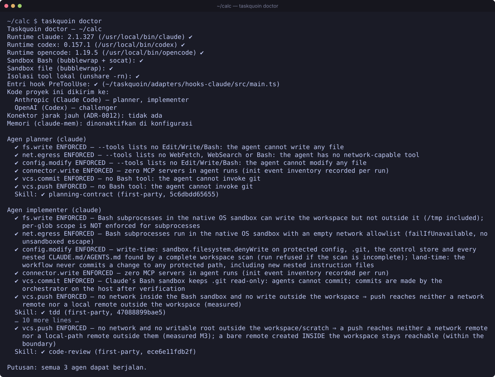

`doctor` adalah bagian Taskquoin yang jujur. Bacalah dari atas ke bawah:

- Blok pertama mencantumkan runtime yang ditemukan, lengkap dengan versi dan tanda centang bila versinya adalah yang telah diukur Taskquoin, lalu sandbox (bubblewrap dan socat) dan hook.
- **This project's code is sent to** mencantumkan setiap vendor yang akan menerima kode Anda, per agen. Taskquoin berjalan di mesin Anda; hanya AI yang Anda konfigurasikan yang melihat apa pun ([ADR-0010](../adr/0010-local-first-no-leak.md)).
- Kemudian, per agen, setiap pembatasan wajib beserta kelasnya dan **mekanisme yang menegakkannya**, misalnya `net.egress ENFORCED — Bash subprocesses run in the native OS sandbox with an empty network allowlist`. Tanda centang berarti ia tersertifikasi untuk versi runtime itu; tanda silang berarti agen tidak akan dimulai.
- Baris terakhir adalah vonisnya: `Verdict: all 3 agents can run.` atau `Verdict: 2 of 3 agents can run — refused agents will not be started.`

Dalam demo, satu baris bertanda silang:

```text
Agent challenger (codex)
  …
  ✖ connector.write — mandatory restriction "connector.write" (deny-all) on codex 0.157.1: claimed ENFORCED but the mechanism is not measured (inferred). Execution refused (ADR-0002).
```

Codex mengatakan ia menegakkan `connector.write` (tidak menulis ke konektor remote), tetapi Taskquoin tidak punya cara untuk mengukur klaim itu, sehingga tidak menghitungnya sebagai ditegakkan. Challenger ditolak: sebuah run akan berakhir sebagai `failed at challenge` dengan `gate refused agent challenger`. Untuk yang satu ini, ada keputusan yang harus Anda ambil.

## Terima risiko yang Anda pahami

**Risiko yang diterima** adalah keputusan Anda yang ditandatangani, bertanggal, dan terbatas cakupannya untuk menjalankan sebuah agen meskipun ada satu pembatasan yang tidak dapat diukur. Ini keputusan pemilik, bukan pengembang, dan tidak pernah keputusan agen:

```shell
$ taskquoin accept-risk challenger connector.write \
    --reason "Codex reviews read-only; no connector configured" \
    --expires 2026-12-31 --as you
```

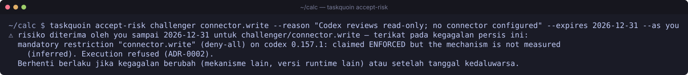

Keempat opsi wajib diisi: `--reason`, `--expires` (tanggal nyata di masa depan, `YYYY-MM-DD`), dan `--as` (nama Anda), ditambah agen dan capability-nya. Perhatikan seperti apa penerimaan itu:

- **Terikat pada kegagalan yang persis.** Ia menyimpan digest dari pesan kegagalan. Jika versi runtime berubah, atau mekanismenya berubah, kegagalan itu tidak lagi sama, dan penerimaan berhenti berlaku.
- **Bertanggal.** Ia juga berhenti berlaku setelah tanggal kedaluwarsa.
- **Disimpan di luar repositori**, di control store. Tidak seorang pun dapat menambahkannya dengan mengedit `taskquoin.yaml`, dan tidak ada agen yang dapat menulisnya.
- **Sempit.** Ia hanya berlaku untuk agen ini dan capability ini. Ia ditolak untuk capability yang tidak gagal, dan tidak tersedia untuk juri API (mereka selalu diperiksa).

Jalankan `doctor` lagi. Baris itu kini berupa peringatan, bukan silang, dan vonisnya adalah `all 3 agents can run`:

```text
  ⚠ connector.write accepted risk (approved by you until 2026-12-31: Codex reviews read-only; no connector configured) — mandatory restriction "connector.write" (deny-all) on codex 0.157.1: claimed ENFORCED but the mechanism is not measured (inferred). Execution refused (ADR-0002).
```

`taskquoin check challenger` menampilkan detail yang sama untuk satu agen:

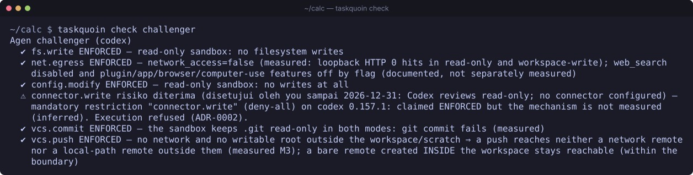

> [!IMPORTANT]
> Terima risiko hanya jika Anda memahaminya dan situasinya sesuai dengan alasan Anda: di sini Codex meninjau secara hanya-baca dan proyek Anda tidak punya konektor, sehingga "penulisan konektor" memang tidak mungkin terjadi. Jangan menerima risiko hanya untuk menghilangkan baris merah. Secara khusus:
>
> - jangan pernah untuk `fs.write`, `net.egress`, `vcs.commit`, atau `vcs.push` pada agen yang benar-benar menulis atau menjalankan perintah, kecuali Anda dapat menyebutkan kontrol kompensasinya;
> - jangan pernah dengan alasan yang samar: alasan itu dicatat dalam persetujuan dan ditampilkan oleh `doctor`;
> - pilih kedaluwarsa yang singkat: penerimaan adalah pengingat untuk memeriksa ulang setelah pembaruan;
> - jika sebuah mekanisme *terukur gagal*, perbarui atau ganti runtime sebagai gantinya.

Menjalankan `taskquoin accept-risk` sendiri memang disengaja: jika konsol atau agen dapat melakukannya, kontrol ini tidak akan berarti apa-apa.

## Langkah 5: mulai run

```shell
$ taskquoin run "Add a sum function"
```

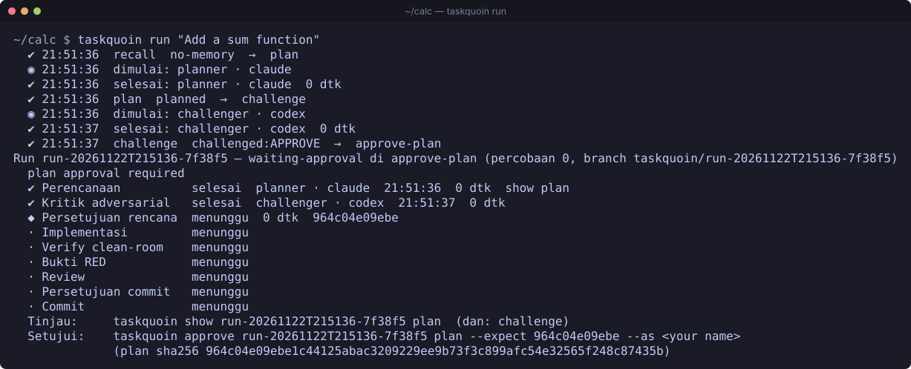

Terminal Anda sunyi saat agen bekerja, lalu mencetak di mana ia berhenti. Berurutan, Taskquoin melakukan ini:

1. **Preflight.** Taskquoin memeriksa bahwa konfigurasi mendefinisikan setiap peran, bahwa skill dapat dipakai, bahwa peran hanya-baca benar-benar hanya-baca, dan bahwa juri API memiliki kuncinya. Working tree harus bersih. Setiap agen juga melewati gerbang yang sama seperti `doctor` tepat sebelum pertama kali dipakai: agen yang ditolak mengakhiri run sebagai `failed`.
2. **Branch.** Ia membuat branch `taskquoin/run-20261122T132108-d17040` dan berpindah ke sana. `main` Anda tidak tersentuh.
3. **Recall.** Ia meminta worker memori, jika diaktifkan, untuk catatan yang relevan. Jurnal menampilkan `recall no-memory` bila tidak ada.
4. **Plan.** `planner` (Claude, hanya-baca) membaca repositori dan menulis rencana: tujuan, tes yang ditulis lebih dahulu, file, langkah, risiko.
5. **Critique.** `challenger` (Codex, hanya-baca) menantang rencana itu secara independen dan menutup dengan baris `VERDICT:`.
6. **Gate.** Alur kerja berhenti di `approve-plan`. Ia akan menunggu selama yang Anda mau.

Id run (`run-20261122T132108-d17040`) adalah cap waktu dan akhiran acak. Anda memakainya di setiap perintah berikutnya. `taskquoin status` tanpa argumen mencantumkan run-run:

```shell
$ taskquoin status
run-20261122T132108-d17040  waiting-approval approve-plan    Add a sum function
```

## Langkah 6: baca dan setujui rencana

`status <run>` menampilkan riwayat satu run dan, di sebuah gerbang, perintah persis untuk menyetujuinya:

```shell
$ taskquoin status run-20261122T132108-d17040
```

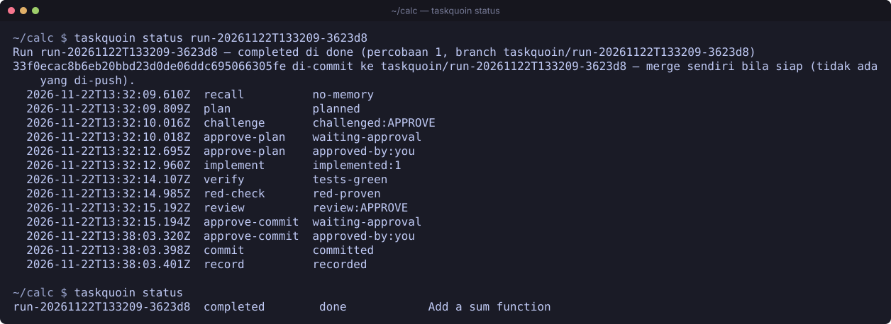

Setiap baris riwayat adalah satu langkah alur kerja beserta hasilnya (`planned`, `challenged:APPROVE`, `waiting-approval`).

Sekarang **baca apa yang akan Anda setujui**:

```shell
$ taskquoin show run-20261122T132108-d17040 plan
```

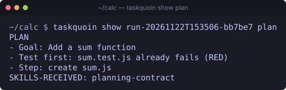

```shell
$ taskquoin show run-20261122T132108-d17040 challenge
Review: plan checked.
VERDICT: APPROVE
```

`show <run>` tanpa artefak mencantumkan semua yang tersimpan sejauh ini, dengan ukurannya dalam byte. Rencana dari agen sungguhan juga mencakup file yang akan disentuh, tes yang ditulis lebih dahulu, dan risiko. Challenge adalah pendapat kedua yang independen: ia dapat mencantumkan temuan yang memblokir dan yang tidak memblokir. Jika rencananya salah, jangan setujui: mulai run baru dengan permintaan yang lebih tepat.

### Mengapa hash

Baris yang penting adalah baris terakhir dari `status`:

```text
Approve it:  taskquoin approve run-20261122T132108-d17040 plan --expect 964c04e09ebe --as <your name>
             (plan sha256 964c04e09ebe1c44125abac3209229ee9b73f3c899afc54e32565f248c87435b)
```

`964c04e09ebe` adalah awal dari SHA-256 file rencana yang baru Anda baca. Menyetujui tidak berarti "saya menyetujui run ini"; artinya "saya menyetujui **rencana yang hash-nya 964c04e09ebe**". Jika rencana dapat berubah antara saat Anda membaca dan saat Anda menyetujui (percobaan ulang, proses lain, alat yang dibobol), hash tidak akan cocok lagi dan Taskquoin akan menolak. Hash itu juga yang dicatat dalam commit, sehingga siapa pun dapat mengaudit di kemudian hari apa yang disetujui seseorang.

> [!NOTE]
> `--expect` bukan kata sandi. Ia adalah bukti bahwa Anda telah melihat artefak yang akan ditindaklanjuti sistem: Anda menyalinnya dari `status` setelah membaca. Di [konsol](../getting-started/console.md), Anda mengetik ulang untuk mengonfirmasi.

Setujui:

```shell
$ taskquoin approve run-20261122T132108-d17040 plan --expect 964c04e09ebe --as you
```

`--as` adalah nama Anda; ia dicatat sebagai `Plan-Approved-By` dalam commit. Menyetujui rencana melanjutkan alur kerja, yang berjalan sampai gerbang berikutnya.

### Hash yang salah ditolak

Coba hash yang bukan yang sedang menunggu:

```shell
$ taskquoin approve run-20261122T132108-d17040 plan --expect 000000000000 --as you
taskquoin approve: expected 000000000000 does not match the pending artifact 964c04e09ebe… — re-read it before approving
```

Tidak ada yang disetujui dan run tidak berubah. Hal yang sama terjadi jika Anda menyetujui gerbang yang tidak sedang ditunggu run. Tangkapan layar di bawah diambil setelah run selesai, sehingga menunjukkan varian penolakan tersebut:

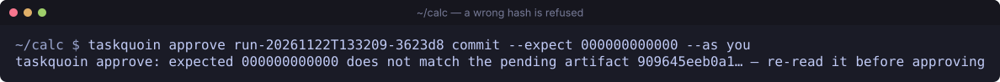

Kode keluar sebuah penolakan adalah 1. Perintah yang salah ketik (tanpa `--expect` atau `--as`) keluar dengan 2.

## Langkah 7: implementasi, Verify, dan review

Setelah `approve … plan`, Taskquoin bekerja tanpa Anda:

1. **Implementasi dengan TDD.** `implementer` (Claude) bekerja di branch, di dalam sandbox runtime, tanpa jaringan dan tanpa cara untuk commit. Ia menulis atau menyesuaikan tes lebih dahulu, lalu kode paling sederhana yang membuatnya lulus.
2. **Verify, di clean room.** Taskquoin mengambil tree persis yang ditinggalkan implementer dan menjalankan tes Anda (`npm test`) sendiri, dalam salinan sekali pakai di luar repositori Anda: tanpa jaringan, `.git` hanya-baca, HOME Anda disembunyikan, file rahasia ditutupi, dan hanya direktori dependensi stack (serta `verify.inherit` Anda) yang di-mount hanya-baca. Tes yang lulus tetapi bergantung pada sesuatu yang belum di-commit akan gagal di sini, dan itulah tujuannya.
3. **RED proof.** Taskquoin kemudian menghapus perubahan kode produksi dan menjalankan tes yang diubah lagi. Tes itu harus **gagal**. Tes yang lulus tanpa perubahan itu tidak menguji apa pun. Buktinya bersifat mekanis: ia tidak menunjukkan bahwa tes menegaskan perilaku yang benar (itulah gunanya review, dan Anda).
4. **Review.** `challenger` meninjau diff terhadap rencana, beserta log verify dan RED. Ia menutup dengan baris `VERDICT:`.

Jika tes merah, atau RED proof gagal, atau review meminta perubahan, Taskquoin mengirim umpan balik ke implementer untuk pengerjaan ulang otomatis (hingga 3 percobaan implementasi, dengan paling banyak 2 putaran pengerjaan ulang setelah review ditolak). Run kemudian berhenti di gerbang kedua.

## Langkah 8: baca dan setujui commit

Run kini menunggu lagi. Lihatlah:

```shell
$ taskquoin status run-20261122T132108-d17040
Run run-20261122T132108-d17040 — waiting-approval at approve-commit (attempt 1, branch taskquoin/run-20261122T132108-d17040)
  commit approval required (bound to the exact tree)
  Review it:   taskquoin show run-20261122T132108-d17040 diff-1  (and: verify-1, red-1, review-1)
  Approve it:  taskquoin approve run-20261122T132108-d17040 commit --expect 909645eeb0a1 --as <your name>
               (git tree 909645eeb0a1716e60fd724784ede536fbea048f)
```

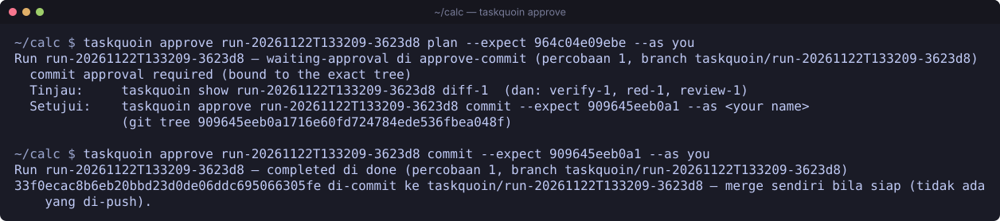

Kali ini hash-nya adalah **git tree** yang lolos Verify dan review. Baca keempat artefak dari percobaan 1. Angkanya adalah nomor percobaan; setelah pengerjaan ulang, Anda membaca yang tertinggi.

### `diff-1`: perubahan yang persis

```shell
$ taskquoin show run-20261122T132108-d17040 diff-1
```

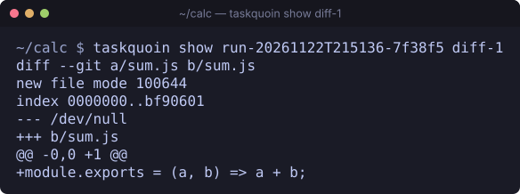

Inilah yang akan di-commit, tidak lebih. Jika agen mengubah file yang dilindungi (CI Anda, `.claude/`, `AGENTS.md`, `taskquoin.yaml`), run akan berhenti dengan `protected configuration changed`. File yang disembunyikan oleh `.gitignore` Anda tetapi dibuat oleh agen dicantumkan di `ignored-1`; file itu tidak ada di diff, tidak diverifikasi, dan tidak di-commit.

### `verify-1`: tes Anda, dijalankan oleh Taskquoin

```shell
$ taskquoin show run-20261122T132108-d17040 verify-1
```

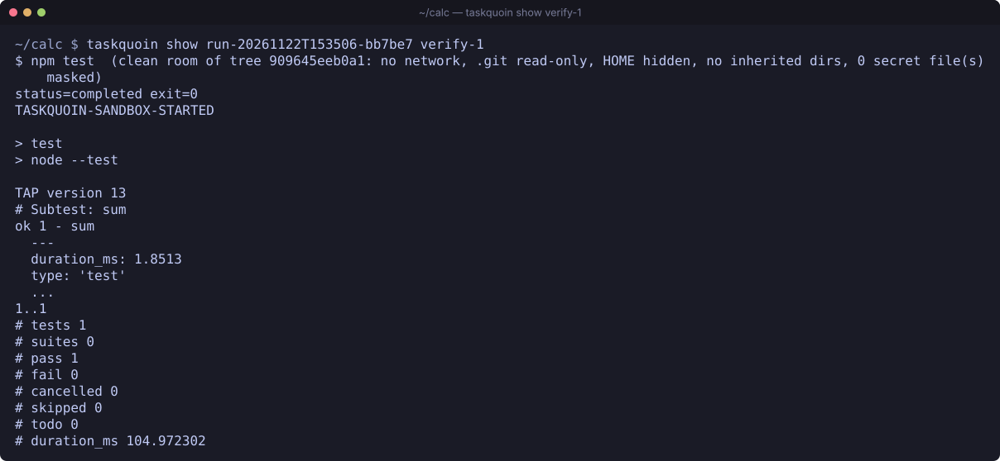

Header menyebutkan seperti apa clean room itu (`no network, .git read-only, HOME hidden, … 0 secret file(s) masked`) dan untuk tree yang mana (`909645eeb0a1`, hash yang sama yang akan Anda setujui). `exit=0` dan `# pass 1` berasal dari test runner, bukan dari klaim sebuah model.

### `red-1`: bukti bahwa tes itu bermakna

```shell
$ taskquoin show run-20261122T132108-d17040 red-1
TASKQUOIN RED PROOF — tests run on base + test changes only (tree 9848f565e24c); they must FAIL.
RESULT: they failed as required (RED proven).

$ npm test  (clean room of tree 9848f565e24c: no network, .git read-only, HOME hidden, no inherited dirs, 0 secret file(s) masked)
status=failed exit=1
…
not ok 1 - sum
  error: Cannot find module './sum.js'
  code: 'MODULE_NOT_FOUND'
```

Di sini file produksi baru `sum.js` dihapus, tes tidak dapat memuatnya, dan gagal. Kegagalan itu adalah RED proof. Taskquoin memperlakukan galat impor dari sebuah fitur di file *baru* sebagai RED yang diharapkan. Jika hanya file tes yang berubah (penambahan tes murni), buktinya dicatat sebagai "not applicable".

### `review-1`: pendapat kedua

```shell
$ taskquoin show run-20261122T132108-d17040 review-1
Review: diff checked against the plan.
VERDICT: APPROVE
```

Bacalah temuannya, bukan hanya vonisnya. `ignored-1` muncul di daftar hanya jika ada sesuatu untuk dibaca.

### Setujui commit

Jika Anda puas, setujui dengan hash dari `status`:

```shell
$ taskquoin approve run-20261122T132108-d17040 commit --expect 909645eeb0a1 --as you
Run run-20261122T132108-d17040 — completed at done (attempt 1, branch taskquoin/run-20261122T132108-d17040)
Committed a3c6b801de5f4356750f53870557e2fdd19958ee on taskquoin/run-20261122T132108-d17040 — merge it yourself when ready (nothing was pushed).
```

`approve … commit` harus dijalankan saat repositori berada di branch run (`taskquoin/<run>`); jika tidak, ia menjawab `switch to taskquoin/<run> first`. Taskquoin membaca ulang working tree sebelum commit. Jika ada yang berubah sejak Anda melihatnya, persetujuan Anda tidak lagi berlaku: ia memverifikasi ulang, meninjau ulang, dan meminta Anda menyetujui tree yang baru.

Taskquoin kemudian membangun commit **dari git tree yang disetujui itu sendiri**, bukan dari `git add`. Tampilannya seperti ini:

```shell
$ git log -1 taskquoin/run-20261122T132108-d17040
```

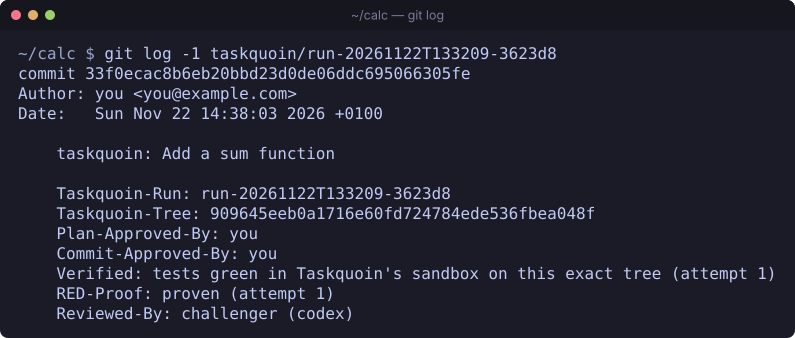

```text
taskquoin: Add a sum function

Taskquoin-Run: run-20261122T132108-d17040
Taskquoin-Tree: 909645eeb0a1716e60fd724784ede536fbea048f
Plan-Approved-By: you
Commit-Approved-By: you
Verified: tests green in Taskquoin's sandbox on this exact tree (attempt 1)
RED-Proof: proven (attempt 1)
Reviewed-By: challenger (codex)
```

Trailer adalah jejak audit, di dalam commit itu sendiri:

| Trailer | Arti |
|---|---|
| `Taskquoin-Run` | Run yang membuat commit ini |
| `Taskquoin-Tree` | Git tree yang diverifikasi, ditinjau, dan disetujui. Ini adalah tree dari commit ini |
| `Plan-Approved-By` | Nama yang diberikan dengan `--as` di gerbang rencana |
| `Commit-Approved-By` | Nama yang diberikan dengan `--as` di gerbang commit |
| `Verified` | Tes hijau di clean room pada tree yang persis ini |
| `RED-Proof` | Tes yang diubah gagal tanpa perubahan itu (`proven`, atau `not applicable` untuk perubahan yang hanya tes) |
| `Reviewed-By` | Agen yang meninjau dan menyetujui; juri API menambahkan barisnya sendiri |

`taskquoin status <run>` di akhir menampilkan seluruh jurnal, dari `recall` hingga `commit` dan `record`.

## Langkah 9: merge hasilnya

Taskquoin **tidak pernah push** dan tidak pernah merge ke branch Anda. Commit berada di `taskquoin/<run>`, branch tempat Anda berada. Merge sendiri, atau buka pull request dari sana:

```shell
$ git switch main
$ git merge --ff-only taskquoin/run-20261122T132108-d17040
$ npm test
```

> [!WARNING]
> Taskquoin tidak menjalankan hook commit repositori Anda, karena hook itu dapat berisi kode yang diubah agen. Jalankan hook, linter, dan CI Anda sendiri saat Anda melakukan merge.

Branch `taskquoin/<run>` adalah milik Anda: hapus bila tidak diperlukan lagi (`git branch -d taskquoin/<run>`).

## Mengikuti sebuah run di Dashboard

Selagi sebuah run bekerja, buka terminal kedua di repositori yang sama dan jalankan Dashboard. Ia hanya membaca: menampilkan pipeline, persetujuan yang menunggu Anda (dengan awal hash-nya), agen, dan log.

```shell
$ taskquoin dashboard
```

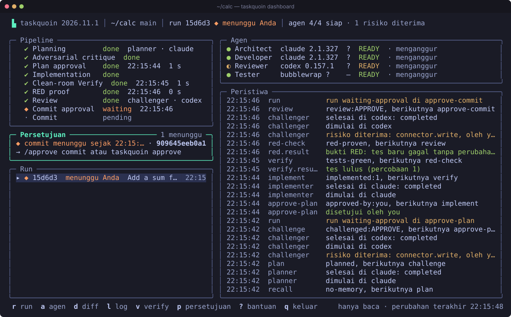

Tekan `d` untuk membaca diff: `/` mencari, `n` dan `N` melompat antar hasil, dan sebuah berkas dianggap sudah dibaca setelah Anda menggulir sampai akhirnya.

Tekan `p` untuk membuka pusat persetujuan. Tidak ada tombol yang menyetujui sendiri: Anda mengetik nama Anda, lalu mengetik ulang 12 karakter hash. Keluar dengan `q`; run yang sudah disetujui tetap berjalan. [Panduan Dashboard (dalam bahasa Inggris)](../guides/dashboard.md).

## Ketika semuanya tidak berjalan sesuai rencana

Pesan galat Taskquoin mengikuti bahasa Anda, tetapi pesan mesin run (`failed`, `needs-human`, `interrupted`) selalu dalam bahasa Inggris. Tabel berikut mencantumkan yang paling sering Anda temui.

| Yang Anda lihat | Artinya | Yang harus dilakukan |
|---|---|---|
| `taskquoin run: the working tree has uncommitted changes` | Taskquoin tidak pernah mencampur perubahannya dengan perubahan Anda | Commit atau stash perubahan Anda |
| `failed … gate refused agent X` | Sebuah agen tidak dapat disertifikasi di mesin ini | `taskquoin doctor` menjelaskan alasannya: versi runtime, sandbox yang tidak ada, risiko yang belum Anda terima |
| `needs-human … tests still failing after 3 attempts` | Tiga percobaan tidak menghasilkan tes hijau | Ambil alih di branch run, atau mulai run baru dengan permintaan yang lebih tepat |
| `needs-human … no failing test demonstrates the change` | Tes lulus bahkan tanpa perubahan produksi, jadi tidak menguji perubahan itu | Baca `red-N`; tulis (atau minta) tes yang gagal sebelum perubahan. Refactor atau perubahan dokumentasi tanpa tes baru berakhir di sini: commit sendiri dari branch |
| `needs-human … RED proof inconclusive` | Bukti tidak dapat berjalan dengan benar (timeout, sandbox, tree yang tidak dapat dibangun ulang). Itu bukan bukti | Baca `red-N`. Folder kerja Anda tidak tersentuh |
| `needs-human … review still requests changes after N attempts` | Reviewer terus menolak | Baca `review-N` dan putuskan; pekerjaannya ada di branch |
| `needs-human … dependencies changed during the run` | `node_modules` (atau `vendor`, `.venv`) berubah selama run, sehingga tidak ada yang diverifikasi dengannya | Instal ulang (`npm ci`) dan mulai run baru. Jangan jalankan `npm install` selama run |
| `needs-human … protected configuration changed` | Agen menyentuh konfigurasi yang dilindungi (CI, `.claude/`, `AGENTS.md`, `taskquoin.yaml`) | Tidak ada yang di-commit; periksa branch |
| Tes lulus di tempat Anda tetapi gagal di Verify | Tes memakai file yang diabaikan yang tidak ada di clean room | Tambahkan ke `verify.inherit` |
| `does not match the pending artifact` | Hash yang Anda berikan bukan yang sedang menunggu | Baca dengan `show`, salin hash dari `status` |
| `switch to taskquoin/<run> first` | Anda tidak berada di branch run | `git switch taskquoin/<run>` |
| `taskquoin.yaml changed since the run started` | Konfigurasi berubah di tengah run | Mulai run baru |
| `interrupted` | Galat teknis (git, disk, HTTP 503 dari juri) menghentikan run | `taskquoin resume <run>` |

### Ketika tes tetap merah

Jika Verify gagal, Taskquoin memberikan log yang gagal dan review kepada implementer lalu mencoba lagi, hingga tiga percobaan implementasi (implementer OpenCode, yang tidak punya perintah sendiri, mendapat lebih banyak pengerjaan ulang). Jika tes masih merah, run berakhir dengan status `needs-human` dan alasan `tests still failing after 3 attempts`. Tidak ada commit dan tidak ada permintaan persetujuan.

Semuanya disimpan: `taskquoin show <run> verify-3` berisi log terakhir, dan branch `taskquoin/<run>` menyimpan pekerjaan agen. Anda dapat melanjutkan secara manual di branch itu, atau memulai run baru dengan permintaan yang lebih tepat. Run `needs-human` tidak dilanjutkan secara otomatis.

### `resume`: setelah gangguan

Sebuah run berstatus `interrupted` ketika sesuatu di luar alur kerja merusaknya (galat jaringan saat menjangkau juri, disk penuh, mesin Anda masuk mode tidur). Status disimpan di setiap langkah, dan jawaban juri disimpan satu per satu, sehingga melanjutkan tidak pernah memanggil, atau membayar, juri dua kali:

```shell
$ taskquoin resume run-20261122T132108-d17040
```

`resume` hanya menerima run yang statusnya `interrupted`. Untuk status lain, ia memberi tahu Anda, misalnya `taskquoin resume: only an interrupted run can be resumed (status completed)`. Jika statusnya `needs-human` atau `failed`, mulai run baru.

### Aturan praktis

Jika Anda tidak tahu harus berbuat apa, jalankan `taskquoin status <run>`: ia mencetak status, jurnal, dan perintah berikutnya yang persis. `taskquoin doctor` menjawab pertanyaan apa pun tentang mesin.

## Pelajari lebih lanjut

- [Konsol interaktif](../getting-started/console.md): alur kerja yang sama, dengan `/run` dan `/approve`
- [Instalasi](../getting-started/installation.md)
- [ADR-0011, agen tidak pernah commit](../adr/0011-agents-never-commit.md)
- [ADR-0013, tata kelola berbasis tree](../adr/0013-tree-based-governance.md)
- [ADR-0014, Verify di clean room](../adr/0014-verify-in-a-clean-room.md)
- [ADR-0002, kelas penegakan](../adr/0002-enforcement-classes.md)
- [ADR-0005, control plane di luar workspace](../adr/0005-control-plane-outside-workspace.md)
- [ADR-0016, juri lewat API](../adr/0016-judges-by-api.md) dan [ADR-0017, OpenCode tanpa perintah](../adr/0017-opencode-without-commands.md)
