# Il tuo primo run governato

> Questo tutorial è la traduzione della [pagina di riferimento in inglese](../getting-started/first-run.md). È una
> traduzione automatica, verificata dai test dei maintainer sui comandi e non da un revisore madrelingua.

Questo tutorial ti porta da una cartella vuota a un commit verificato fatto da Taskquoin, un comando alla volta.
Creerai un piccolo progetto con un test che fallisce, lascerai che Taskquoin pianifichi e implementi una correzione con
agenti AI e approverai il lavoro due volte: una volta dopo aver letto il piano, una dopo aver letto il diff esatto. A
ogni passo vedi cosa fa Taskquoin, perché si ferma e cosa stai firmando.

- [Cosa costruirai](#cosa-costruirai)
- [Passo 1: crea un progetto con un test che fallisce](#passo-1-crea-un-progetto-con-un-test-che-fallisce)
- [Passo 2: inizializza Taskquoin](#passo-2-inizializza-taskquoin)
- [Passo 3: fai il commit della configurazione](#passo-3-fai-il-commit-della-configurazione)
- [Passo 4: controlla la macchina con doctor](#passo-4-controlla-la-macchina-con-doctor)
- [Accetta un rischio che comprendi](#accetta-un-rischio-che-comprendi)
- [Passo 5: avvia il run](#passo-5-avvia-il-run)
- [Passo 6: leggi e approva il piano](#passo-6-leggi-e-approva-il-piano)
- [Passo 7: implementazione, Verify e review](#passo-7-implementazione-verify-e-review)
- [Passo 8: leggi e approva il commit](#passo-8-leggi-e-approva-il-commit)
- [Passo 9: fai il merge del risultato](#passo-9-fai-il-merge-del-risultato)
- [Quando le cose non vanno come previsto](#quando-le-cose-non-vanno-come-previsto)
- [Per saperne di più](#per-saperne-di-più)

> [!NOTE]
> Le schermate provengono da un repository dimostrativo con agenti AI simulati (i test double della suite di test di
> Taskquoin); ogni comando è la vera CLI di Taskquoin. Con Claude Code e Codex reali, la formulazione del piano e della
> review è quella degli agenti stessi, e un run richiede qualche minuto invece di pochi secondi. Tutto il resto è
> identico.

Prima di iniziare, [installa Taskquoin](../getting-started/installation.md) e assicurati che Node 22.18+, git, `bubblewrap` e `socat` siano
disponibili e che almeno Claude Code (e idealmente Codex) sia installato e con l'accesso effettuato.

Nota: i blocchi che riportano l'output della CLI sono mostrati in inglese; le schermate localizzate mostrano l'output
nella tua lingua.

## Cosa costruirai

Un run è un workflow fisso. I due rombi sono le due approvazioni umane; nulla va oltre senza di te.

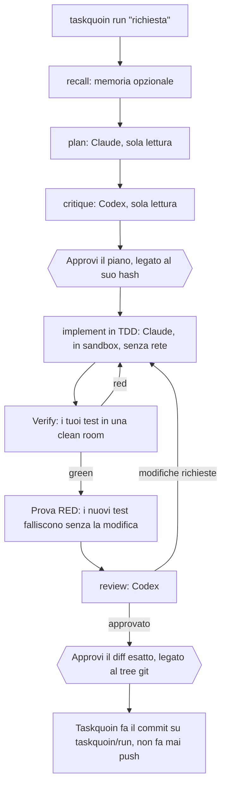

Tre idee attraversano tutto il tutorial:

- **Gli agenti propongono, Taskquoin agisce.** Gli agenti non fanno mai commit. Il commit è costruito da Taskquoin a
  partire dal tree che è stato verificato, rivisto e approvato
  ([ADR-0011](../adr/0011-agents-never-commit.md)).
- **La tua approvazione è legata a un hash.** Approvi esattamente ciò che hai letto, non "il run"
  ([ADR-0013](../adr/0013-tree-based-governance.md)).
- **I test girano in una clean room.** Il modello non dice mai a Taskquoin che i test passano; Taskquoin li esegue da
  sé ([ADR-0014](../adr/0014-verify-in-a-clean-room.md)).

## Passo 1: crea un progetto con un test che fallisce

Il progetto è una calcolatrice con una sola funzione. Il test esiste; la funzione no.

```shell
$ mkdir calc && cd calc
$ git init -q -b main
```

Crea `package.json`:

```json
{
  "name": "calc",
  "private": true,
  "scripts": { "test": "node --test" }
}
```

Crea `sum.test.js`:

```js
const test = require('node:test');
const assert = require('node:assert');

test('sum', () => {
  const sum = require('./sum.js');
  assert.strictEqual(sum(2, 3), 5);
});
```

Crea `.gitignore` (le dipendenze e l'output di build non fanno mai parte di un diff di Taskquoin):

```text
node_modules/
```

Fai il commit:

```shell
$ git add .
$ git commit -m "calc: a failing test for sum"
$ npm test
not ok 1 - sum
  error: Cannot find module './sum.js'
```

Il test è rosso, come previsto. Un repository git con working tree pulito è l'unico prerequisito che Taskquoin richiede
a un progetto: `taskquoin run` rifiuta di partire se hai modifiche non committate, perché non mescola mai le sue
modifiche con le tue.

## Passo 2: inizializza Taskquoin

```shell
$ taskquoin init
```

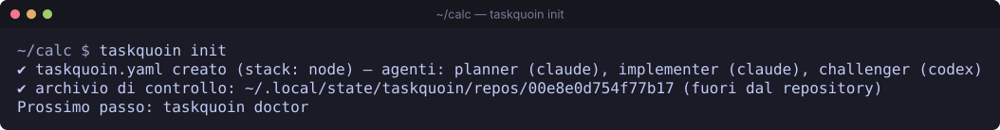

`init` ha fatto tre cose:

1. Ha rilevato lo stack (`node`; conosce anche `npm test`, PHPUnit, pytest, `go test`, Maven e altri) e ha scritto
   `taskquoin.yaml` nella radice del repository.
2. Ha cercato strumenti AI sulla tua macchina e ha scelto gli agenti: qui `planner` e `implementer` su Claude Code e
   `challenger` su Codex. Se uno strumento manca, il file lo dice; con solo Claude Code anche il reviewer è Claude. Con
   solo OpenCode, `init` scrive una configurazione interamente OpenCode.
3. Ha creato un **control store** fuori dal repository, sotto `${XDG_STATE_HOME:-~/.local/state}/taskquoin/`. Qui
   risiedono lo stato dei run, le approvazioni e le accettazioni di rischio. Gli agenti non possono scriverci, ed è ciò
   che rende un'approvazione non falsificabile ([ADR-0005](../adr/0005-control-plane-outside-workspace.md)).

`init` non sovrascrive mai un `taskquoin.yaml` esistente. Se hai eseguito `init` con altre AI disponibili (una chiave
API nel tuo ambiente, un Ollama locale), le elenca e le propone come **commenti** nel file: decommentarle è una tua
decisione, perché significa che il codice di quel progetto verrà inviato a loro.

### Il `taskquoin.yaml` generato

Aprilo. È breve e puoi leggerlo tutto. Eccolo, sezione per sezione.

```yaml
# Taskquoin project configuration — see docs/architecture.md. Protected: agents can never edit this file.
version: 1
stack: node
```

`version` è la versione dello schema. `stack` seleziona i default per la clean room: quali directory di dipendenze
vengono montate in sola lettura per i tuoi test (per `node`: `node_modules`). Il primo commento è una promessa: **gli
agenti non possono mai modificare questo file.** Se uno lo tocca durante un run, il run si ferma e nulla viene
committato.

```yaml
agents:
  planner:
    runtime: claude
    description: "Read-only planner: turns a request into a minimal, test-first implementation plan."
    prompt: You plan; you never modify files. Read the repository, then produce the plan requested.
    capabilities:
      fs.read:
        - "**"
    maxTurns: 30
    skills:
      - planning-contract
```

Un **agente** è un ruolo legato a un runtime (`claude`, `codex`, `opencode`, oppure `api` per un judge).
`capabilities` è ciò che l'agente può fare: il planner può leggere tutto (`fs.read: "**"`) e nient'altro, quindi non ha
shell né strumento di scrittura. Le `skills` sono istruzioni fissate tramite hash (`planning-contract` è di prima
parte). `maxTurns` limita i turni dell'agente.

```yaml
  implementer:
    runtime: claude
    description: Implements an approved task with strict TDD (RED → GREEN → REFACTOR).
    prompt: "You implement exactly the approved task. Write a failing test first, make it pass with the simplest change, then refactor. Never commit: Taskquoin verifies and commits."
    capabilities:
      fs.read:
        - "**"
      fs.write:
        - "**"
      shell.run:
        - npm test
        - npm test -- *
        - node --test *
    maxTurns: 40
    skills:
      - tdd
```

L'implementer può scrivere file ed eseguire una piccola allowlist di comandi di test (`shell.run`) per lavorare
test-first. Quei comandi girano dentro la sandbox del sistema operativo del runtime, senza rete. Anche così, la sua
esecuzione dei test serve solo come feedback per lui: il risultato che conta è quello che Taskquoin produce in Verify.

```yaml
  challenger:
    runtime: codex
    description: Independent, read-only adversarial reviewer of plans and diffs.
    prompt: "You are an independent reviewer. Challenge the plan or diff: correctness, security, missing tests, over-engineering. Report blocking and non-blocking findings with file:line. Do not modify files."
    capabilities:
      fs.read:
        - "**"
    skills:
      - code-review
```

Il **challenger** critica il piano e rivede il diff. È di un vendor diverso dall'implementer di proposito, ed è in sola
lettura: non deve poter "correggere" ciò che critica.

```yaml
policy:
  mandatory:
    - fs.write
    - net.egress
    - config.modify
    - connector.write
    - vcs.commit
    - vcs.push
connectors: {}
memory:
  claudeMem:
    enabled: true
```

`policy.mandatory` elenca le restrizioni che **devono** essere imposte da un meccanismo perché un agente possa partire:
nessuna scrittura fuori dal suo ambito, nessuna rete, nessuna modifica alla configurazione protetta, nessuna scrittura
remota, nessun commit, nessun push. Se la versione del runtime che hai non può imporne una, l'agente viene rifiutato
invece di essere avviato con una regola che è solo un consiglio ([ADR-0002](../adr/0002-enforcement-classes.md),
[ADR-0003](../adr/0003-hooks-enforce-prose-asks.md)). `connectors` è vuoto: nessun sistema remoto è connesso
([ADR-0012](../adr/0012-remote-connectors-by-exception.md)). `memory.claudeMem` è opzionale: se abilitato, un riepilogo
strutturato di ogni run terminato viene inviato al tuo worker locale
[claude-mem](https://github.com/thedotmack/claude-mem), e un breve recall viene letto all'inizio di un run.
Impostalo a `false` se non usi claude-mem. (Le schermate di questo tutorial usano `false`.)

> [!TIP]
> Se i tuoi test hanno bisogno di un file ignorato che non è una directory di dipendenze, come un `dist/` compilato o
> un `.env.test`, aggiungilo esplicitamente. Viene poi montato in sola lettura nella clean room e congelato per
> l'agente:
>
> ```yaml
> verify:
>   inherit:
>     - dist
> ```
>
> Un progetto i cui test non vengono eseguiti da `npm test` può impostare `verify.command`.

Puoi anche usare altre AI come judge (qualsiasi provider compatibile con OpenAI) oppure OpenCode come planner e
implementer; vedi [ADR-0016](../adr/0016-judges-by-api.md) e
[ADR-0017](../adr/0017-opencode-without-commands.md).

## Passo 3: fai il commit della configurazione

`taskquoin.yaml` fa parte del tuo progetto, quindi fai il commit. Questo restituisce anche a Taskquoin il working tree
pulito di cui ha bisogno:

```shell
$ git add taskquoin.yaml
$ git commit -m "chore: taskquoin"
```

## Passo 4: controlla la macchina con doctor

```shell
$ taskquoin doctor
```

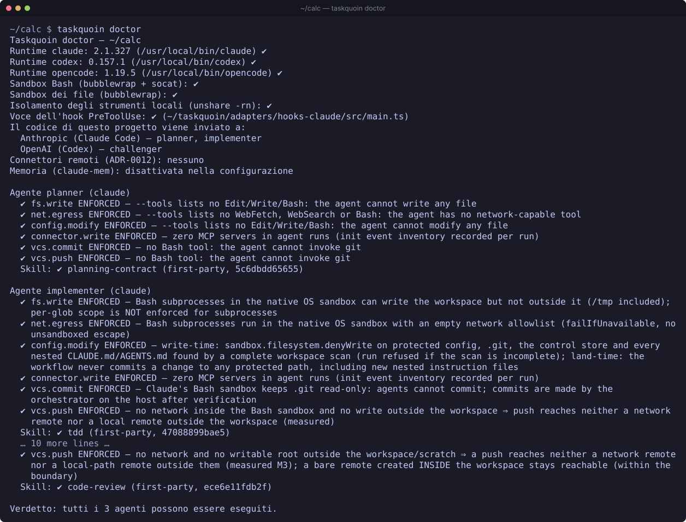

`doctor` è la parte onesta di Taskquoin. Leggilo dall'alto in basso:

- Il primo blocco elenca i runtime trovati, con le versioni e un segno di spunta quando la versione è quella che
  Taskquoin ha misurato, poi le sandbox (bubblewrap e socat) e l'hook.
- **This project's code is sent to** elenca ogni vendor che riceverà il tuo codice, per agente. Taskquoin gira sulla
  tua macchina; solo le AI che configuri vedono qualcosa ([ADR-0010](../adr/0010-local-first-no-leak.md)).
- Poi, per agente, ogni restrizione obbligatoria con la sua classe e **il meccanismo che la impone**, per esempio
  `net.egress ENFORCED — Bash subprocesses run in the native OS sandbox with an empty network allowlist`. Un segno di
  spunta significa che è certificata per quella versione del runtime; una croce significa che l'agente non partirà.
- L'ultima riga è il verdetto: `Verdict: all 3 agents can run.` oppure `Verdict: 2 of 3 agents can run — refused agents will not be started.`

Nella demo, una riga ha una croce (output mostrato in inglese):

```text
Agent challenger (codex)
  …
  ✖ connector.write — mandatory restriction "connector.write" (deny-all) on codex 0.157.1: claimed ENFORCED but the mechanism is not measured (inferred). Execution refused (ADR-0002).
```

Codex dichiara di imporre `connector.write` (nessuna scrittura sui connector remoti), ma Taskquoin non ha modo di
misurare questa affermazione, quindi non la conta come imposta. Il challenger viene rifiutato: un run finirebbe come
`failed at challenge` con `gate refused agent challenger`. Per questo caso devi prendere una decisione.

## Accetta un rischio che comprendi

Un **rischio accettato** è la tua decisione firmata, datata e circoscritta di eseguire un agente nonostante una
restrizione che non può essere misurata. È una scelta del proprietario, non dello sviluppatore e mai dell'agente:

```shell
$ taskquoin accept-risk challenger connector.write \
    --reason "Codex reviews read-only; no connector configured" \
    --expires 2026-12-31 --as you
```

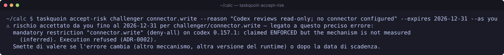

Tutte e quattro le opzioni sono obbligatorie: `--reason`, `--expires` (una vera data futura, `YYYY-MM-DD`) e `--as` (il
tuo nome), più l'agente e la capability. Nota che cos'è l'accettazione:

- **Legata all'errore esatto.** Memorizza un digest del messaggio di errore. Se la versione del runtime cambia, o
  cambia il meccanismo, l'errore non è più lo stesso e l'accettazione smette di applicarsi.
- **Datata.** Smette di applicarsi anche dopo la data di scadenza.
- **Memorizzata fuori dal repository**, nel control store. Nessuno può aggiungerne una modificando `taskquoin.yaml` e
  nessun agente può scriverla.
- **Ristretta.** Si applica solo a questo agente e a questa capability. Viene rifiutata per una capability che non sta
  fallendo e non è disponibile per i judge API (vengono sempre controllati).

Esegui di nuovo `doctor`. La riga ora è un avviso invece di una croce e il verdetto è `all 3 agents can run`:

```text
  ⚠ connector.write accepted risk (approved by you until 2026-12-31: Codex reviews read-only; no connector configured) — mandatory restriction "connector.write" (deny-all) on codex 0.157.1: claimed ENFORCED but the mechanism is not measured (inferred). Execution refused (ADR-0002).
```

`taskquoin check challenger` mostra lo stesso dettaglio per un solo agente:

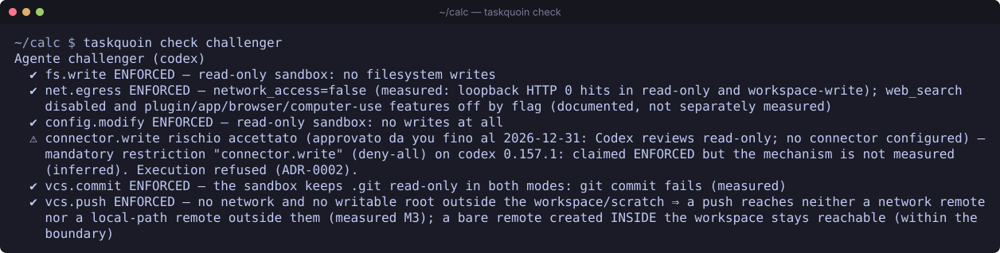

> [!IMPORTANT]
> Accetta un rischio solo quando lo comprendi e la situazione corrisponde alla tua motivazione: qui Codex fa review in
> sola lettura e il tuo progetto non ha connector, quindi una "scrittura su connector" non può comunque avvenire. Non
> accettare un rischio per far sparire una riga rossa. In particolare:
>
> - mai per `fs.write`, `net.egress`, `vcs.commit` o `vcs.push` su un agente che scrive o esegue comandi davvero, a
>   meno che tu non sappia nominare il controllo compensativo;
> - mai con una motivazione vaga: viene registrata nell'approvazione e mostrata da `doctor`;
> - preferisci una scadenza breve: l'accettazione è un promemoria per ricontrollare dopo un aggiornamento;
> - se un meccanismo è *misurato come fallimentare*, aggiorna o cambia runtime.

Eseguire tu stesso `taskquoin accept-risk` è voluto: se la console o un agente potessero farlo, il controllo non
significherebbe nulla.

## Passo 5: avvia il run

```shell
$ taskquoin run "Add a sum function"
```

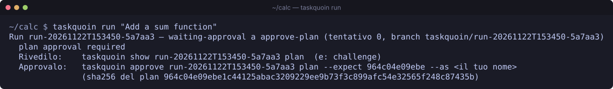

Il terminale resta silenzioso mentre gli agenti lavorano, poi stampa dove si è fermato. In ordine, Taskquoin ha fatto
questo:

1. **Preflight.** Taskquoin ha verificato che la configurazione definisca ogni ruolo, che le skill siano utilizzabili,
   che i ruoli in sola lettura lo siano davvero e che i judge API abbiano le loro chiavi. Il working tree deve essere
   pulito. Ogni agente passa inoltre lo stesso gate di `doctor` subito prima del primo utilizzo: un agente rifiutato
   termina il run come `failed`.
2. **Branch.** Ha creato il branch `taskquoin/run-20261122T132108-d17040` e vi è passato. Il tuo `main` è intatto.
3. **Recall.** Ha chiesto al worker di memoria, se abilitato, le note rilevanti. Il journal mostra `recall no-memory`
   quando non ce ne sono.
4. **Plan.** Il `planner` (Claude, sola lettura) ha letto il repository e ha scritto un piano: obiettivo, il test da
   scrivere per primo, file, passi, rischi.
5. **Critique.** Il `challenger` (Codex, sola lettura) ha messo in discussione quel piano in modo indipendente e ha
   concluso con una riga `VERDICT:`.
6. **Gate.** Il workflow si è fermato a `approve-plan`. Aspetterà quanto vuoi.

L'id del run (`run-20261122T132108-d17040`) è un timestamp con un suffisso casuale. Lo usi in ogni comando successivo.
`taskquoin status` senza argomenti elenca i run:

```shell
$ taskquoin status
run-20261122T132108-d17040  waiting-approval approve-plan    Add a sum function
```

## Passo 6: leggi e approva il piano

`status <run>` mostra la cronologia di un run e, a un gate, il comando esatto che lo approva:

```shell
$ taskquoin status run-20261122T132108-d17040
```

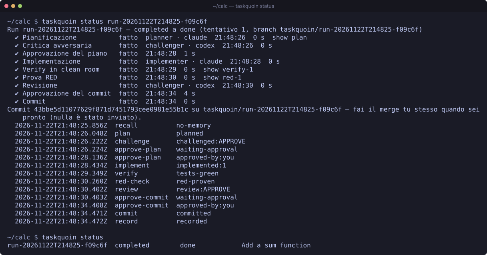

Ogni riga della cronologia è un passo del workflow con il suo esito (`planned`, `challenged:APPROVE`,
`waiting-approval`).

Ora **leggi ciò che stai per approvare**:

```shell
$ taskquoin show run-20261122T132108-d17040 plan
```

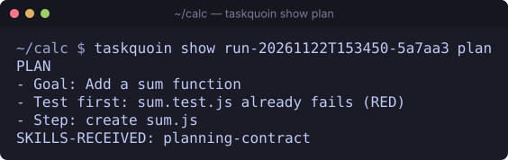

```shell
$ taskquoin show run-20261122T132108-d17040 challenge
Review: plan checked.
VERDICT: APPROVE
```

`show <run>` senza artefatto elenca tutto ciò che è stato memorizzato finora, con la dimensione in byte. Il piano di un
agente reale copre anche i file da toccare, i test da scrivere per primi e i rischi. La challenge è il secondo parere
indipendente: può elencare rilievi bloccanti e non bloccanti. Se il piano è sbagliato, non approvarlo: avvia un nuovo
run con una richiesta più precisa.

### Perché l'hash

La riga che conta è l'ultima di `status`:

```text
Approve it:  taskquoin approve run-20261122T132108-d17040 plan --expect 964c04e09ebe --as <your name>
             (plan sha256 964c04e09ebe1c44125abac3209229ee9b73f3c899afc54e32565f248c87435b)
```

`964c04e09ebe` è l'inizio dello SHA-256 del file del piano che hai appena letto. Approvare non significa "approvo
questo run"; significa "approvo **il piano il cui hash è 964c04e09ebe**". Se il piano potesse cambiare tra la tua
lettura e la tua approvazione (un retry, un altro processo, uno strumento compromesso), l'hash non coinciderebbe più e
Taskquoin rifiuterebbe. È anche ciò che il commit registra, così chiunque può verificare in seguito cosa ha approvato
una persona.

> [!NOTE]
> `--expect` non è una password. È la prova che hai guardato l'artefatto su cui il sistema sta per agire: lo copi da
> `status` dopo la lettura. Nella [console](../getting-started/console.md) lo riscrivi per confermare.

Approva:

```shell
$ taskquoin approve run-20261122T132108-d17040 plan --expect 964c04e09ebe --as you
```

`--as` è il tuo nome; viene registrato come `Plan-Approved-By` nel commit. Approvare il piano riprende il workflow, che
prosegue fino al gate successivo.

### Un hash sbagliato viene rifiutato

Prova un hash che non è quello in attesa (output mostrato in inglese):

```shell
$ taskquoin approve run-20261122T132108-d17040 plan --expect 000000000000 --as you
taskquoin approve: expected 000000000000 does not match the pending artifact 964c04e09ebe… — re-read it before approving
```

Nulla è stato approvato e il run è invariato. Lo stesso accade se approvi un gate che il run non sta aspettando. La
schermata qui sotto è stata catturata dopo che il run era terminato, quindi mostra quella variante del rifiuto:

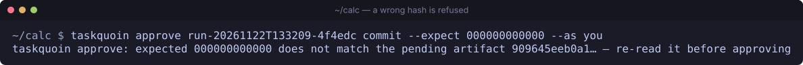

Il codice di uscita di un rifiuto è 1. Un comando scritto male (manca `--expect` o `--as`) esce con 2.

## Passo 7: implementazione, Verify e review

Dopo `approve … plan`, Taskquoin lavora senza di te:

1. **Implementazione in TDD.** L'`implementer` (Claude) lavora sul branch, nella sandbox del runtime, senza rete e
   senza possibilità di fare commit. Scrive o adatta prima i test, poi il codice più semplice che li fa passare.
2. **Verify, in una clean room.** Taskquoin prende il tree esatto lasciato dall'implementer ed esegue lui stesso i tuoi
   test (`npm test`), in una copia usa e getta fuori dal tuo repository: senza rete, `.git` in sola lettura, la tua
   HOME nascosta, i file segreti mascherati e solo le directory di dipendenze dello stack (e il tuo `verify.inherit`)
   montate in sola lettura. Un test che passa ma dipendeva da qualcosa di non committato qui fallisce, ed è proprio lo
   scopo.
3. **Prova RED.** Taskquoin poi rimuove la modifica di produzione ed esegue di nuovo i test modificati. Devono
   **fallire**. Un test che passa senza la modifica non testa nulla. La prova è meccanica: non dimostra che il test
   asserisca il comportamento giusto (per questo ci sono la review e tu).
4. **Review.** Il `challenger` rivede il diff rispetto al piano, con i log di verify e RED. Conclude con una riga
   `VERDICT:`.

Se i test sono rossi, o la prova RED fallisce, o la review chiede modifiche, Taskquoin invia il feedback
all'implementer per una rielaborazione automatica (fino a 3 tentativi di implementazione, con al massimo 2 giri di
rielaborazione dopo una review rifiutata). Il run poi si ferma al secondo gate.

## Passo 8: leggi e approva il commit

Il run ora è di nuovo in attesa. Guardalo (output mostrato in inglese):

```shell
$ taskquoin status run-20261122T132108-d17040
Run run-20261122T132108-d17040 — waiting-approval at approve-commit (attempt 1, branch taskquoin/run-20261122T132108-d17040)
  commit approval required (bound to the exact tree)
  Review it:   taskquoin show run-20261122T132108-d17040 diff-1  (and: verify-1, red-1, review-1)
  Approve it:  taskquoin approve run-20261122T132108-d17040 commit --expect 909645eeb0a1 --as <your name>
               (git tree 909645eeb0a1716e60fd724784ede536fbea048f)
```

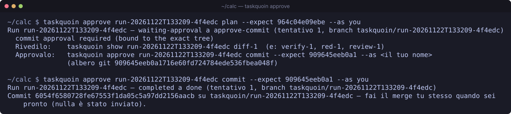

Questa volta l'hash è il **git tree** che ha superato Verify e la review. Leggi i quattro artefatti del tentativo 1. Il
numero è il tentativo; dopo una rielaborazione leggi quello più alto.

### `diff-1`: la modifica esatta

```shell
$ taskquoin show run-20261122T132108-d17040 diff-1
```

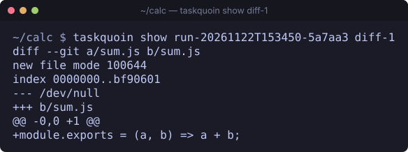

Questo è ciò che verrà committato, niente di più. Se l'agente avesse modificato un file protetto (la tua CI,
`.claude/`, `AGENTS.md`, `taskquoin.yaml`) il run si sarebbe fermato con `protected configuration changed`. I file che il
tuo `.gitignore` nasconde ma che l'agente ha creato sono elencati in `ignored-1`; non sono nel diff, non sono
verificati e non vengono committati.

### `verify-1`: i tuoi test, eseguiti da Taskquoin

```shell
$ taskquoin show run-20261122T132108-d17040 verify-1
```

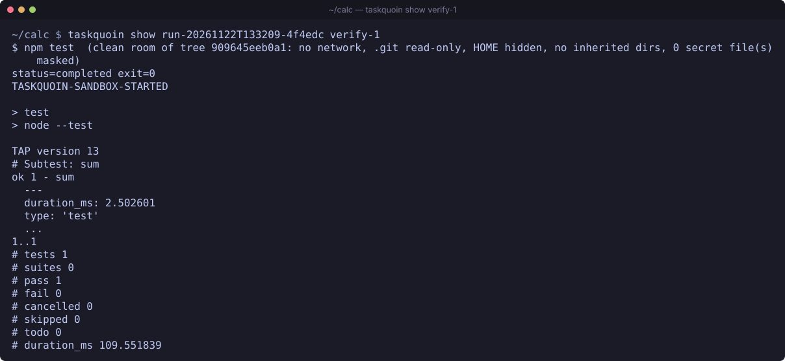

L'intestazione dice cos'era la clean room (`no network, .git read-only, HOME hidden, … 0 secret file(s) masked`) e per
quale tree (`909645eeb0a1`, lo stesso hash che approverai). `exit=0` e `# pass 1` provengono dal test runner, non
dall'affermazione di un modello.

### `red-1`: la prova che il test conta

```shell
$ taskquoin show run-20261122T132108-d17040 red-1
TASKQUOIN RED PROOF — tests run on base + test changes only (tree 9848f565e24c); they must FAIL.
RESULT: they failed as required (RED proven).

$ npm test  (clean room of tree 9848f565e24c: no network, .git read-only, HOME hidden, no inherited dirs, 0 secret file(s) masked)
status=failed exit=1
…
not ok 1 - sum
  error: Cannot find module './sum.js'
  code: 'MODULE_NOT_FOUND'
```

Qui il nuovo file di produzione `sum.js` è stato rimosso, il test non è riuscito a caricarlo ed è fallito. Quel
fallimento è la prova RED. Taskquoin tratta un errore di import di una funzionalità in un file *nuovo* come il RED
atteso. Se sono cambiati solo file di test (una pura aggiunta di test), la prova è registrata come "not applicable".

### `review-1`: il secondo parere

```shell
$ taskquoin show run-20261122T132108-d17040 review-1
Review: diff checked against the plan.
VERDICT: APPROVE
```

Leggi i rilievi, non solo il verdetto. `ignored-1` compare nell'elenco solo quando c'è qualcosa da leggere.

### Approva il commit

Se sei soddisfatto, approva con l'hash di `status`:

```shell
$ taskquoin approve run-20261122T132108-d17040 commit --expect 909645eeb0a1 --as you
Run run-20261122T132108-d17040 — completed at done (attempt 1, branch taskquoin/run-20261122T132108-d17040)
Committed a3c6b801de5f4356750f53870557e2fdd19958ee on taskquoin/run-20261122T132108-d17040 — merge it yourself when ready (nothing was pushed).
```

`approve … commit` va eseguito mentre il repository è sul branch del run (`taskquoin/<run>`); altrimenti risponde
`switch to taskquoin/<run> first`. Taskquoin rilegge il working tree prima di fare il commit. Se qualcosa è cambiato da
quando hai guardato, la tua approvazione non si applica più: ri-verifica, ri-rivede e ti chiede di approvare il nuovo
tree.

Taskquoin costruisce poi il commit **dal git tree approvato stesso**, non da `git add`. Si presenta così:

```shell
$ git log -1 taskquoin/run-20261122T132108-d17040
```

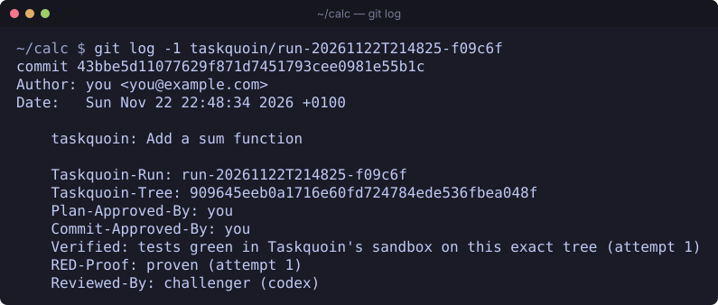

```text
taskquoin: Add a sum function

Taskquoin-Run: run-20261122T132108-d17040
Taskquoin-Tree: 909645eeb0a1716e60fd724784ede536fbea048f
Plan-Approved-By: you
Commit-Approved-By: you
Verified: tests green in Taskquoin's sandbox on this exact tree (attempt 1)
RED-Proof: proven (attempt 1)
Reviewed-By: challenger (codex)
```

I trailer sono la traccia di audit, nel commit stesso:

| Trailer | Significato |
|---|---|
| `Taskquoin-Run` | Il run che ha prodotto questo commit |
| `Taskquoin-Tree` | Il git tree che è stato verificato, rivisto e approvato. È il tree di questo commit |
| `Plan-Approved-By` | Il nome dato con `--as` al gate del piano |
| `Commit-Approved-By` | Il nome dato con `--as` al gate del commit |
| `Verified` | I test erano verdi nella clean room su questo tree esatto |
| `RED-Proof` | I test modificati fallivano senza la modifica (`proven`, oppure `not applicable` per modifiche solo ai test) |
| `Reviewed-By` | Gli agenti che hanno rivisto e approvato; un judge API aggiunge la propria riga |

`taskquoin status <run>` alla fine mostra l'intero journal, da `recall` a `commit` e `record`.

## Passo 9: fai il merge del risultato

Taskquoin **non fa mai push** e non fa mai merge nel tuo branch. Il commit è su `taskquoin/<run>`, il branch su cui
sei. Fai tu il merge, oppure apri una pull request da esso:

```shell
$ git switch main
$ git merge --ff-only taskquoin/run-20261122T132108-d17040
$ npm test
```

> [!WARNING]
> Taskquoin non esegue gli hook di commit del tuo repository, perché potrebbero contenere codice modificato
> dall'agente. Esegui tu i tuoi hook, linter e CI quando fai il merge.

I branch `taskquoin/<run>` sono tuoi: eliminali quando non ti servono più (`git branch -d taskquoin/<run>`).

## Quando le cose non vanno come previsto

I messaggi di errore di Taskquoin seguono la tua lingua, ma i messaggi del motore del run (`failed`, `needs-human`,
`interrupted`) sono sempre in inglese. La tabella elenca ciò che incontrerai più spesso.

| Cosa vedi | Cosa significa | Cosa fare |
|---|---|---|
| `taskquoin run: the working tree has uncommitted changes` | Taskquoin non mescola mai le sue modifiche con le tue | Fai il commit o lo stash delle tue modifiche |
| `failed … gate refused agent X` | Un agente non può essere certificato su questa macchina | `taskquoin doctor` dice perché: versione del runtime, sandbox mancante, un rischio non accettato |
| `needs-human … tests still failing after 3 attempts` | Tre tentativi non hanno dato test verdi | Prosegui a mano sul branch del run, oppure avvia un nuovo run con una richiesta più precisa |
| `needs-human … no failing test demonstrates the change` | I test passano anche senza la modifica di produzione, quindi non la testano | Leggi `red-N`; scrivi (o chiedi) un test che fallisca prima della modifica. Un refactor o una modifica alla documentazione senza nuovo test finisce qui: fai il commit tu stesso dal branch |
| `needs-human … RED proof inconclusive` | La prova non ha potuto girare correttamente (timeout, sandbox, un tree non ricostruibile). Non è una prova | Leggi `red-N`. La tua cartella di lavoro è intatta |
| `needs-human … review still requests changes after N attempts` | Il reviewer ha continuato a rifiutare | Leggi `review-N` e decidi; il branch contiene il lavoro |
| `needs-human … dependencies changed during the run` | `node_modules` (o `vendor`, `.venv`) è cambiato durante il run, quindi nulla è verificato con esso | Reinstalla (`npm ci`) e avvia un nuovo run. Non eseguire `npm install` durante un run |
| `needs-human … protected configuration changed` | L'agente ha toccato la configurazione protetta (CI, `.claude/`, `AGENTS.md`, `taskquoin.yaml`) | Nulla è stato committato; ispeziona il branch |
| I test passano per te ma falliscono in Verify | Usano un file ignorato assente dalla clean room | Aggiungilo a `verify.inherit` |
| `does not match the pending artifact` | L'hash che hai dato non è quello in attesa | Leggi con `show`, copia l'hash da `status` |
| `switch to taskquoin/<run> first` | Non sei sul branch del run | `git switch taskquoin/<run>` |
| `taskquoin.yaml changed since the run started` | La configurazione è cambiata a metà run | Avvia un nuovo run |
| `interrupted` | Un errore tecnico (git, disco, un HTTP 503 di un judge) ha fermato il run | `taskquoin resume <run>` |

### Quando i test restano rossi

Se Verify fallisce, Taskquoin dà all'implementer il log dei fallimenti e la review e riprova, fino a tre tentativi di
implementazione (un implementer OpenCode, che non ha comandi propri, ottiene più rielaborazioni). Se i test sono ancora
rossi, il run termina con lo stato `needs-human` e il motivo `tests still failing after 3 attempts`. Non c'è alcun
commit né richiesta di approvazione.

Tutto viene conservato: `taskquoin show <run> verify-3` contiene l'ultimo log e il branch `taskquoin/<run>` contiene il
lavoro dell'agente. Puoi continuare a mano su quel branch, oppure avviare un nuovo run con una richiesta più precisa.
Un run `needs-human` non viene ripreso automaticamente.

### `resume`: dopo un'interruzione

Un run è `interrupted` quando qualcosa fuori dal workflow lo ha interrotto (un errore di rete verso un judge, un disco
pieno, la tua macchina che va in sospensione). Lo stato è salvato a ogni passo e le risposte dei judge sono salvate una
a una, quindi riprendere non chiama né paga mai un judge due volte:

```shell
$ taskquoin resume run-20261122T132108-d17040
```

`resume` accetta solo un run il cui stato è `interrupted`. Per qualsiasi altro stato te lo dice, per esempio
`taskquoin resume: only an interrupted run can be resumed (status completed)`. Se lo stato è `needs-human` o `failed`,
avvia un nuovo run.

### Una regola pratica

Se non sai cosa fare, esegui `taskquoin status <run>`: stampa lo stato, il journal e il prossimo comando esatto.
`taskquoin doctor` risponde a qualsiasi domanda sulla macchina.

## Per saperne di più

- [La console interattiva](../getting-started/console.md): lo stesso workflow, con `/run` e `/approve`
- [Installazione](../getting-started/installation.md)
- [ADR-0011, agents never commit](../adr/0011-agents-never-commit.md)
- [ADR-0013, tree-based governance](../adr/0013-tree-based-governance.md)
- [ADR-0014, Verify in a clean room](../adr/0014-verify-in-a-clean-room.md)
- [ADR-0002, enforcement classes](../adr/0002-enforcement-classes.md)
- [ADR-0005, control plane outside the workspace](../adr/0005-control-plane-outside-workspace.md)
- [ADR-0016, judges by API](../adr/0016-judges-by-api.md) e [ADR-0017, OpenCode without commands](../adr/0017-opencode-without-commands.md)
