# 最初のガバナンス付き実行

> このチュートリアルは、英語のリファレンスページ（[first-run.md](../getting-started/first-run.md)）の翻訳です。機械翻訳であり、ネイティブのレビュアーではなく、メンテナーによるコマンドのテストで確認されています。コードブロック内の CLI 出力は英語のまま掲載しています。ローカライズされたスクリーンショットには、実際の表示言語での出力が写っています。

このチュートリアルでは、空のフォルダーから、Taskquoin が作成した検証済みのコミットまでを、1 コマンドずつ進めます。失敗するテストを持つ小さなプロジェクトを作り、Taskquoin に AI エージェントで修正の計画と実装をさせ、作業を 2 回承認します。1 回目は計画を読んだとき、2 回目は差分そのものを読んだときです。各ステップで、Taskquoin が何をするか、なぜ止まるのか、そして何に署名しているのかが分かります。

- [作るもの](#作るもの)
- [ステップ 1: 失敗するテストを持つプロジェクトを作る](#ステップ-1-失敗するテストを持つプロジェクトを作る)
- [ステップ 2: Taskquoin を初期化する](#ステップ-2-taskquoin-を初期化する)
- [ステップ 3: 設定をコミットする](#ステップ-3-設定をコミットする)
- [ステップ 4: doctor でマシンを確認する](#ステップ-4-doctor-でマシンを確認する)
- [理解したリスクを受け入れる](#理解したリスクを受け入れる)
- [ステップ 5: 実行を開始する](#ステップ-5-実行を開始する)
- [ステップ 6: 計画を読んで承認する](#ステップ-6-計画を読んで承認する)
- [ステップ 7: 実装、Verify、レビュー](#ステップ-7-実装verifyレビュー)
- [ステップ 8: コミットを読んで承認する](#ステップ-8-コミットを読んで承認する)
- [ステップ 9: 結果をマージする](#ステップ-9-結果をマージする)
- [Dashboard で実行を追う](#dashboard-で実行を追う)
- [想定どおりに進まないとき](#想定どおりに進まないとき)
- [詳しくは](#詳しくは)

> [!NOTE]
> スクリーンショットは、シミュレートされた AI エージェント（Taskquoin 自身のテストスイートのテストダブル）を使ったデモ用リポジトリのものです。コマンドはすべて本物の Taskquoin CLI です。実際の Claude Code と Codex を使うと、計画やレビューの文面はエージェント自身のものになり、実行には数秒ではなく数分かかります。それ以外はすべて同じです。

始める前に、[Taskquoin をインストール](../getting-started/installation.md)し、Node 22.18+、git、`bubblewrap`、`socat` が使えること、そして少なくとも Claude Code（できれば Codex も）がインストールされ、サインイン済みであることを確認してください。

## 作るもの

実行（run）は固定されたワークフローです。2 つのひし形は人間による 2 回の承認で、あなたなしにはどちらも先へ進みません。

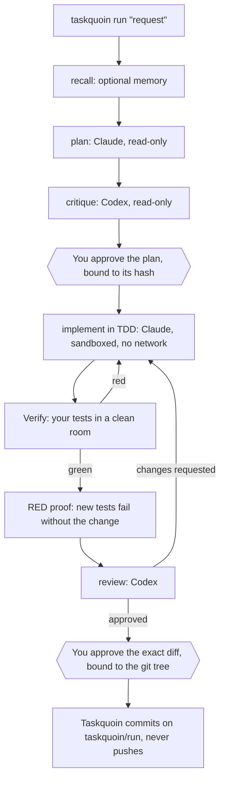

チュートリアル全体を貫く考え方は 3 つあります。

- **エージェントは提案し、Taskquoin が実行する。** エージェントは決してコミットしません。コミットは、検証・レビュー・承認されたツリーから Taskquoin が作成します（[ADR-0011](../adr/0011-agents-never-commit.md)）。
- **承認はハッシュに結び付けられる。** 承認するのは「実行」ではなく、あなたが読んだものそのものです（[ADR-0013](../adr/0013-tree-based-governance.md)）。
- **テストはクリーンルームで実行される。** モデルが Taskquoin にテスト合格を伝えることはありません。Taskquoin 自身がテストを実行します（[ADR-0014](../adr/0014-verify-in-a-clean-room.md)）。

## ステップ 1: 失敗するテストを持つプロジェクトを作る

プロジェクトは関数 1 つだけの電卓です。テストはありますが、関数はまだありません。

```shell
$ mkdir calc && cd calc
$ git init -q -b main
```

`package.json` を作成します。

```json
{
  "name": "calc",
  "private": true,
  "scripts": { "test": "node --test" }
}
```

`sum.test.js` を作成します。

```js
const test = require('node:test');
const assert = require('node:assert');

test('sum', () => {
  const sum = require('./sum.js');
  assert.strictEqual(sum(2, 3), 5);
});
```

`.gitignore` を作成します（依存関係とビルド成果物は Taskquoin の差分に含まれることはありません）。

```text
node_modules/
```

コミットします。

```shell
$ git add .
$ git commit -m "calc: a failing test for sum"
$ npm test
not ok 1 - sum
  error: Cannot find module './sum.js'
```

テストは想定どおり失敗（red）しています。Taskquoin がプロジェクトに求める前提条件は、作業ツリーがクリーンな git リポジトリであることだけです。未コミットの変更があると `taskquoin run` は開始を拒否します。Taskquoin は自分の変更をあなたの変更と混ぜないからです。

## ステップ 2: Taskquoin を初期化する

```shell
$ taskquoin init
```

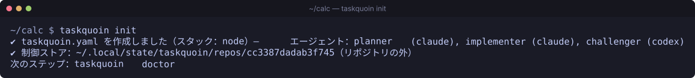

`init` は次の 3 つを行いました。

1. スタックを検出し（`node`。`npm test`、PHPUnit、pytest、`go test`、Maven なども認識します）、リポジトリのルートに `taskquoin.yaml` を書き出しました。
2. マシン上の AI ツールを探し、エージェントを選びました。ここでは `planner` と `implementer` が Claude Code、`challenger` が Codex です。ツールが見つからない場合はファイルにそう書かれ、Claude Code だけの場合はレビュアーも Claude になります。OpenCode だけの場合、`init` はすべて OpenCode の設定を書き出します。
3. リポジトリの外、`${XDG_STATE_HOME:-~/.local/state}/taskquoin/` の下に**コントロールストア**を作成しました。実行の状態、承認、リスクの受け入れはここに置かれます。エージェントはここに書き込めず、それが承認を偽造不可能にしています（[ADR-0005](../adr/0005-control-plane-outside-workspace.md)）。

`init` は既存の `taskquoin.yaml` を決して上書きしません。ほかの AI が利用できる状態（環境内の API キー、ローカルの Ollama など）で `init` を実行した場合は、それらを一覧表示し、ファイル内の**コメント**として提案します。コメントを外すかどうかはあなたの判断です。外すと、そのプロジェクトのコードがそれらへ送信されることになるからです。

### 生成された `taskquoin.yaml`

開いてみてください。短いので、全体を読めます。セクションごとに見ていきます。

```yaml
# Taskquoin project configuration — see docs/architecture.md. Protected: agents can never edit this file.
version: 1
stack: node
```

`version` はスキーマのバージョンです。`stack` はクリーンルームの既定値を選びます。つまり、テスト用に読み取り専用でマウントされる依存関係ディレクトリです（`node` の場合は `node_modules`）。最初のコメントは約束です。**エージェントはこのファイルを決して編集できません。** 実行中にエージェントが触れた場合、実行は停止し、何もコミットされません。

```yaml
agents:
  planner:
    runtime: claude
    description: "Read-only planner: turns a request into a minimal, test-first implementation plan."
    prompt: You plan; you never modify files. Read the repository, then produce the plan requested.
    capabilities:
      fs.read:
        - "**"
    maxTurns: 30
    skills:
      - planning-contract
```

**エージェント**は、ランタイム（`claude`、`codex`、`opencode`、または審査役用の `api`）に結び付けられた役割です。`capabilities` はエージェントに許可されていることです。planner はすべてを読めます（`fs.read: "**"`）が、それ以外は何もできません。つまり、シェルも書き込みツールも持ちません。`skills` はハッシュで固定された指示です（`planning-contract` は自社提供です）。`maxTurns` はエージェントのターン数の上限です。

```yaml
  implementer:
    runtime: claude
    description: Implements an approved task with strict TDD (RED → GREEN → REFACTOR).
    prompt: "You implement exactly the approved task. Write a failing test first, make it pass with the simplest change, then refactor. Never commit: Taskquoin verifies and commits."
    capabilities:
      fs.read:
        - "**"
      fs.write:
        - "**"
      shell.run:
        - npm test
        - npm test -- *
        - node --test *
    maxTurns: 40
    skills:
      - tdd
```

implementer はファイルを書き込め、少数の許可リスト内のテストコマンド（`shell.run`）を実行できるので、テストファーストで作業できます。これらのコマンドはランタイム自身の OS サンドボックス内で、ネットワークなしで実行されます。それでも、そのテスト実行は本人へのフィードバックにすぎません。有効なのは、Taskquoin が Verify で得る結果です。

```yaml
  challenger:
    runtime: codex
    description: Independent, read-only adversarial reviewer of plans and diffs.
    prompt: "You are an independent reviewer. Challenge the plan or diff: correctness, security, missing tests, over-engineering. Report blocking and non-blocking findings with file:line. Do not modify files."
    capabilities:
      fs.read:
        - "**"
    skills:
      - code-review
```

**challenger** は計画を批評し、差分をレビューします。意図的に implementer とは別のベンダーであり、読み取り専用です。批判した内容を自分で「修正」できてはいけないからです。

```yaml
policy:
  mandatory:
    - fs.write
    - net.egress
    - config.modify
    - connector.write
    - vcs.commit
    - vcs.push
connectors: {}
memory:
  claudeMem:
    enabled: true
```

`policy.mandatory` は、エージェントを起動するために、ある仕組みで**強制されていなければならない**制限を列挙します。スコープ外への書き込み禁止、ネットワーク禁止、保護された設定の変更禁止、リモートへの書き込み禁止、コミット禁止、プッシュ禁止です。お使いのランタイムのバージョンがそのいずれかを強制できない場合、助言にすぎないルールのまま起動するのではなく、そのエージェントは拒否されます（[ADR-0002](../adr/0002-enforcement-classes.md)、[ADR-0003](../adr/0003-hooks-enforce-prose-asks.md)）。`connectors` は空で、リモートのシステムは接続されていません（[ADR-0012](../adr/0012-remote-connectors-by-exception.md)）。`memory.claudeMem` は任意です。有効にすると、完了した各実行の構造化された要約がローカルの [claude-mem](https://github.com/thedotmack/claude-mem) ワーカーに送られ、実行の開始時に短いリコールが読み込まれます。claude-mem を使っていない場合は `false` にしてください（このチュートリアルのスクリーンショットでは `false` を使っています）。

> [!TIP]
> テストが、依存関係ディレクトリではない無視対象のファイル（ビルド済みの `dist/` や `.env.test` など）を必要とする場合は、明示的に追加してください。そのファイルはクリーンルームで読み取り専用でマウントされ、エージェントに対しては固定されます。
>
> ```yaml
> verify:
>   inherit:
>     - dist
> ```
>
> テストが `npm test` で実行されないプロジェクトでは、`verify.command` を設定できます。

ほかの AI を審査役として使うこと（OpenAI 互換のプロバイダーなら何でも）や、OpenCode を planner と implementer として使うこともできます。[ADR-0016](../adr/0016-judges-by-api.md) と [ADR-0017](../adr/0017-opencode-without-commands.md) を参照してください。

## ステップ 3: 設定をコミットする

`taskquoin.yaml` はプロジェクトの一部なので、コミットします。これにより、Taskquoin が必要とするクリーンな作業ツリーも用意できます。

```shell
$ git add taskquoin.yaml
$ git commit -m "chore: taskquoin"
```

## ステップ 4: doctor でマシンを確認する

```shell
$ taskquoin doctor
```

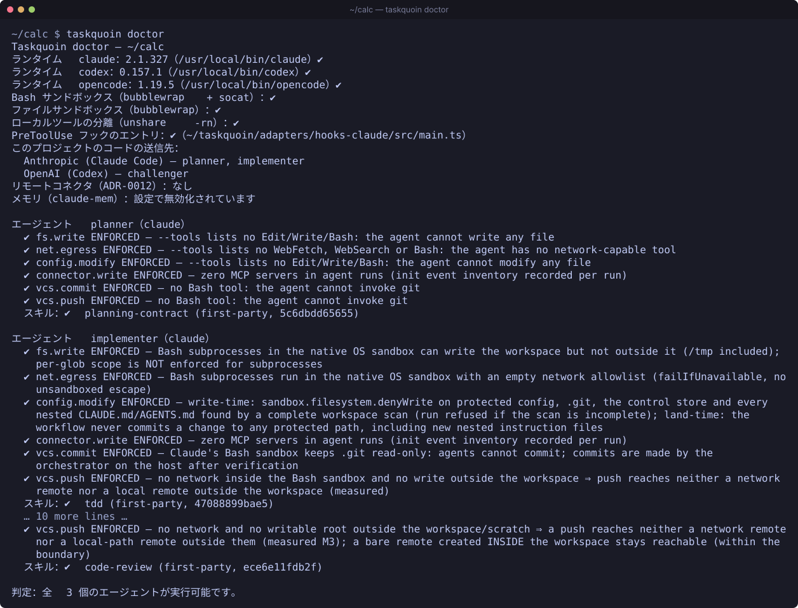

`doctor` は Taskquoin の正直な部分です。上から順に読んでください。

- 最初のブロックには、見つかったランタイムがバージョンとともに並びます。バージョンが Taskquoin の計測済みのものであればチェックマークが付きます。続いてサンドボックス（bubblewrap と socat）とフックが表示されます。
- **This project's code is sent to** は、エージェントごとに、あなたのコードを受け取るすべてのベンダーを列挙します。Taskquoin はあなたのマシン上で動き、あなたが設定した AI だけが何かを目にします（[ADR-0010](../adr/0010-local-first-no-leak.md)）。
- 次に、エージェントごとに、各必須制限がそのクラスと**それを強制する仕組み**とともに表示されます。たとえば `net.egress ENFORCED — Bash subprocesses run in the native OS sandbox with an empty network allowlist` です。チェックマークはそのランタイムバージョンで認証済みであることを、バツ印はそのエージェントが起動しないことを意味します。
- 最後の行は判定です。`Verdict: all 3 agents can run.` または `Verdict: 2 of 3 agents can run — refused agents will not be started.` です。

デモでは、1 行がバツ印になっています。

```text
Agent challenger (codex)
  …
  ✖ connector.write — mandatory restriction "connector.write" (deny-all) on codex 0.157.1: claimed ENFORCED but the mechanism is not measured (inferred). Execution refused (ADR-0002).
```

Codex は `connector.write`（リモートコネクターへの書き込み禁止）を強制していると言っていますが、Taskquoin にはその主張を計測する手段がないため、強制されているとは数えません。challenger は拒否されます。実行は `failed at challenge` と `gate refused agent challenger` で終わります。この件については、あなたが判断する必要があります。

## 理解したリスクを受け入れる

**受け入れたリスク**とは、計測できない制限が 1 つあるにもかかわらずエージェントを実行する、あなたの署名付き・日付付き・範囲限定の判断です。これはオーナーの判断であり、開発者のものでも、ましてやエージェントのものでもありません。

```shell
$ taskquoin accept-risk challenger connector.write \
    --reason "Codex reviews read-only; no connector configured" \
    --expires 2026-12-31 --as you
```

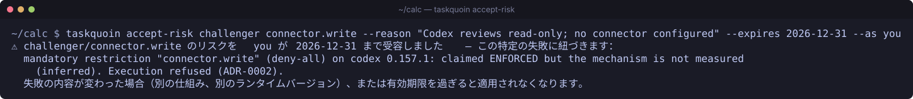

4 つのオプションはすべて必須です。`--reason`、`--expires`（未来の実在する日付、`YYYY-MM-DD`）、`--as`（あなたの名前）に加えて、エージェントとケイパビリティを指定します。受け入れの性質に注目してください。

- **正確な失敗に結び付けられる。** 失敗メッセージのダイジェストを保存します。ランタイムのバージョンや仕組みが変わると、その失敗はもはや同じものではなくなり、受け入れは適用されなくなります。
- **期限がある。** 有効期限を過ぎると、やはり適用されなくなります。
- **リポジトリの外に保存される。** コントロールストアに保存されます。`taskquoin.yaml` を編集して追加することはできず、どのエージェントも書き込めません。
- **範囲が狭い。** このエージェントとこのケイパビリティにのみ適用されます。失敗していないケイパビリティに対しては拒否され、API 審査役には利用できません（常にチェックされます）。

もう一度 `doctor` を実行します。その行はバツ印ではなく警告になり、判定は `all 3 agents can run` になります。

```text
  ⚠ connector.write accepted risk (approved by you until 2026-12-31: Codex reviews read-only; no connector configured) — mandatory restriction "connector.write" (deny-all) on codex 0.157.1: claimed ENFORCED but the mechanism is not measured (inferred). Execution refused (ADR-0002).
```

`taskquoin check challenger` で、1 つのエージェントについて同じ詳細を確認できます。

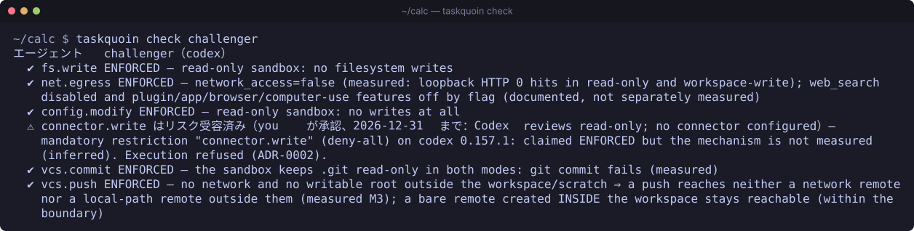

> [!IMPORTANT]
> リスクを受け入れるのは、それを理解し、状況が理由と一致している場合だけにしてください。ここでは Codex は読み取り専用でレビューし、プロジェクトにはコネクターがないので、「コネクターへの書き込み」はそもそも起こりえません。赤い行を消すためにリスクを受け入れてはいけません。特に次の点に注意してください。
>
> - 実際に書き込みやコマンド実行を行うエージェントについて、`fs.write`、`net.egress`、`vcs.commit`、`vcs.push` は、代替の統制手段を挙げられない限り、決して受け入れないでください。
> - 曖昧な理由では決して受け入れないでください。理由は承認に記録され、`doctor` に表示されます。
> - 短い有効期限を推奨します。受け入れは、アップグレード後に再確認するためのリマインダーです。
> - 仕組みが*失敗していると計測された*場合は、代わりにランタイムをアップグレードするか変更してください。

`taskquoin accept-risk` を自分で実行するのは意図的な設計です。コンソールやエージェントが実行できてしまうなら、この統制は無意味になります。

## ステップ 5: 実行を開始する

```shell
$ taskquoin run "Add a sum function"
```

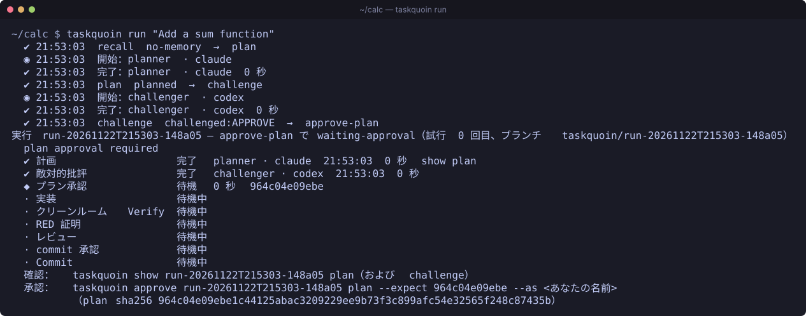

エージェントが作業している間、ターミナルは静かで、停止した場所が表示されます。Taskquoin は次の順序で処理しました。

1. **Preflight。** Taskquoin は、設定がすべてのロールを定義していること、スキルが使えること、読み取り専用のロールが本当に読み取り専用であること、API 審査役がキーを持っていることを確認しました。作業ツリーはクリーンでなければなりません。各エージェントは、最初に使われる直前に `doctor` と同じゲートも通過します。拒否されたエージェントがいると、実行は `failed` で終わります。
2. **Branch。** ブランチ `taskquoin/run-20261122T132108-d17040` を作成して切り替えました。`main` には手を触れていません。
3. **Recall。** 有効な場合、メモリワーカーに関連するノートを尋ねました。何もない場合、ジャーナルには `recall no-memory` と表示されます。
4. **Plan。** `planner`（Claude、読み取り専用）がリポジトリを読み、計画を書きました。目標、最初に書くテスト、ファイル、手順、リスクです。
5. **Critique。** `challenger`（Codex、読み取り専用）がその計画を独立して批評し、`VERDICT:` の行で締めくくりました。
6. **Gate。** ワークフローは `approve-plan` で停止しました。あなたが望む限り待ち続けます。

実行 id（`run-20261122T132108-d17040`）は、タイムスタンプとランダムなサフィックスです。以降のすべてのコマンドで使います。引数なしの `taskquoin status` は実行の一覧を表示します。

```shell
$ taskquoin status
run-20261122T132108-d17040  waiting-approval approve-plan    Add a sum function
```

## ステップ 6: 計画を読んで承認する

`status <run>` は 1 つの実行の履歴を表示し、ゲートでは、それを承認する正確なコマンドを表示します。

```shell
$ taskquoin status run-20261122T132108-d17040
```

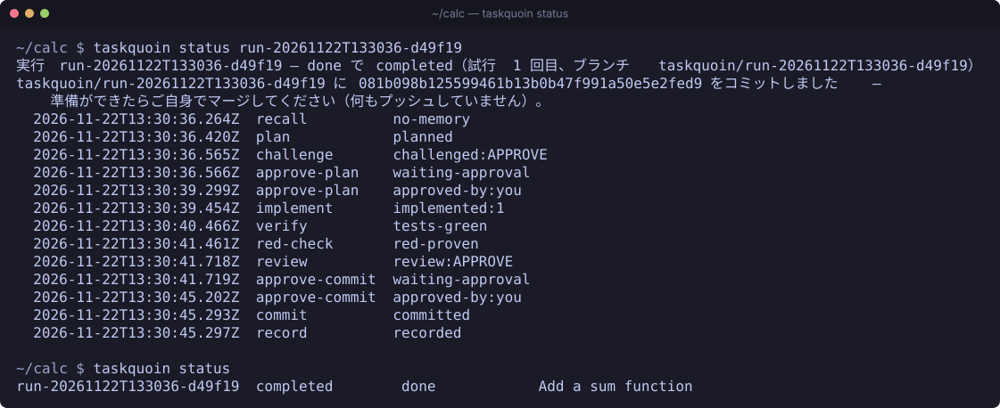

履歴の各行はワークフローの 1 ステップとその結果です（`planned`、`challenged:APPROVE`、`waiting-approval`）。

では、**承認しようとしているものを読みましょう**。

```shell
$ taskquoin show run-20261122T132108-d17040 plan
```

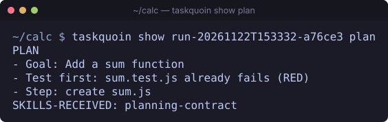

```shell
$ taskquoin show run-20261122T132108-d17040 challenge
Review: plan checked.
VERDICT: APPROVE
```

アーティファクトを指定しない `show <run>` は、これまでに保存されたすべてを、バイト単位のサイズとともに一覧表示します。実際のエージェントによる計画には、変更するファイル、最初に書くテスト、リスクも含まれます。challenge は独立したセカンドオピニオンで、ブロッキングおよび非ブロッキングの指摘が並ぶことがあります。計画が間違っていれば承認せず、より正確な依頼で新しい実行を開始してください。

### なぜハッシュなのか

重要なのは `status` の最後の行です。

```text
Approve it:  taskquoin approve run-20261122T132108-d17040 plan --expect 964c04e09ebe --as <your name>
             (plan sha256 964c04e09ebe1c44125abac3209229ee9b73f3c899afc54e32565f248c87435b)
```

`964c04e09ebe` は、いま読んだ計画ファイルの SHA-256 の先頭部分です。承認とは「この実行を承認する」ことではなく、「**ハッシュが 964c04e09ebe の計画**を承認する」ことです。あなたが読んでから承認するまでの間に計画が変わりうる場合（リトライ、別のプロセス、侵害されたツール）、ハッシュは一致しなくなり、Taskquoin は拒否します。ハッシュはコミットにも記録されるので、誰かが何を承認したかを後から誰でも監査できます。

> [!NOTE]
> `--expect` はパスワードではありません。システムがこれから処理するアーティファクトを、あなたが確かに見たことの証明です。読んだ後に `status` からコピーします。[コンソール](../getting-started/console.md)では、確認のためにそれを入力し直します。

承認します。

```shell
$ taskquoin approve run-20261122T132108-d17040 plan --expect 964c04e09ebe --as you
```

`--as` はあなたの名前で、コミットに `Plan-Approved-By` として記録されます。計画を承認するとワークフローが再開し、次のゲートまで進みます。

### 間違ったハッシュは拒否される

保留中のものではないハッシュを試してみましょう。

```shell
$ taskquoin approve run-20261122T132108-d17040 plan --expect 000000000000 --as you
taskquoin approve: expected 000000000000 does not match the pending artifact 964c04e09ebe… — re-read it before approving
```

何も承認されず、実行は変わりません。実行が待っていないゲートを承認しようとした場合も同じです。下のスクリーンショットは実行が完了した後に撮ったもので、その場合の拒否が写っています。

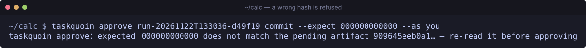

拒否の終了コードは 1 です。コマンドの打ち間違い（`--expect` や `--as` の欠落）は 2 で終了します。

## ステップ 7: 実装、Verify、レビュー

`approve … plan` の後、Taskquoin はあなたなしで作業します。

1. **TDD による実装。** `implementer`（Claude）がブランチ上で、ランタイムのサンドボックス内で、ネットワークなし、コミット手段なしで作業します。まずテストを書くか調整し、次にそれを通す最もシンプルなコードを書きます。
2. **クリーンルームでの Verify。** Taskquoin は implementer が残したツリーそのものを取り、リポジトリの外にある使い捨てのコピーの中で、あなたのテスト（`npm test`）を自分で実行します。ネットワークなし、`.git` は読み取り専用、HOME は非表示、シークレットファイルはマスクされ、スタックの依存関係ディレクトリ（と `verify.inherit`）だけが読み取り専用でマウントされます。コミットされていないものに依存して通っていたテストはここで失敗します。それが狙いです。
3. **RED proof。** 次に Taskquoin は本番コードの変更を取り除き、変更されたテストをもう一度実行します。テストは**失敗**しなければなりません。変更がなくても通るテストは、何もテストしていません。この証明は機械的です。テストが正しい振る舞いを検証していることを示すものではありません（それはレビューと、あなたの役目です）。
4. **レビュー。** `challenger` が、verify と RED のログとともに、計画に照らして差分をレビューします。`VERDICT:` の行で締めくくります。

テストが red の場合、RED proof が失敗した場合、またはレビューが変更を求めた場合、Taskquoin はフィードバックを implementer に送って自動的にやり直させます（実装は最大 3 回、レビューで拒否された後のやり直しは最大 2 ラウンド）。そのうえで、実行は 2 つ目のゲートで停止します。

## ステップ 8: コミットを読んで承認する

実行は再び待機状態になりました。確認しましょう。

```shell
$ taskquoin status run-20261122T132108-d17040
Run run-20261122T132108-d17040 — waiting-approval at approve-commit (attempt 1, branch taskquoin/run-20261122T132108-d17040)
  commit approval required (bound to the exact tree)
  Review it:   taskquoin show run-20261122T132108-d17040 diff-1  (and: verify-1, red-1, review-1)
  Approve it:  taskquoin approve run-20261122T132108-d17040 commit --expect 909645eeb0a1 --as <your name>
               (git tree 909645eeb0a1716e60fd724784ede536fbea048f)
```

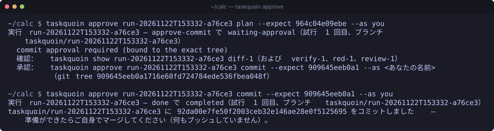

今回のハッシュは、Verify とレビューを通過した **git ツリー**です。試行 1 の 4 つのアーティファクトを読んでください。数字は試行の番号で、やり直しがあった場合は最大の番号のものを読みます。

### `diff-1`: 正確な変更内容

```shell
$ taskquoin show run-20261122T132108-d17040 diff-1
```

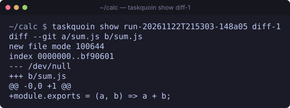

これがコミットされるものであり、それ以上はありません。エージェントが保護されたファイル（CI、`.claude/`、`AGENTS.md`、`taskquoin.yaml`）を変更していた場合、実行は `protected configuration changed` で停止していたはずです。`.gitignore` で隠されているがエージェントが作成したファイルは `ignored-1` に一覧されます。それらは差分に含まれず、検証されず、コミットもされません。

### `verify-1`: Taskquoin が実行したあなたのテスト

```shell
$ taskquoin show run-20261122T132108-d17040 verify-1
```

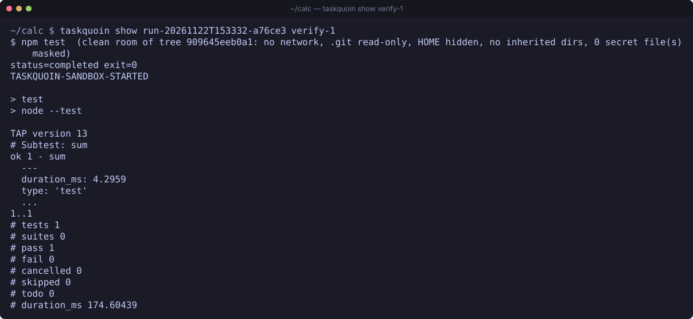

ヘッダーには、クリーンルームがどのようなものだったか（`no network, .git read-only, HOME hidden, … 0 secret file(s) masked`）と、どのツリーに対するものか（`909645eeb0a1`、あなたがこれから承認するのと同じハッシュ）が示されます。`exit=0` と `# pass 1` はテストランナーから得たもので、モデルの主張ではありません。

### `red-1`: テストに意味があることの証明

```shell
$ taskquoin show run-20261122T132108-d17040 red-1
TASKQUOIN RED PROOF — tests run on base + test changes only (tree 9848f565e24c); they must FAIL.
RESULT: they failed as required (RED proven).

$ npm test  (clean room of tree 9848f565e24c: no network, .git read-only, HOME hidden, no inherited dirs, 0 secret file(s) masked)
status=failed exit=1
…
not ok 1 - sum
  error: Cannot find module './sum.js'
  code: 'MODULE_NOT_FOUND'
```

ここでは、新しい本番ファイル `sum.js` が取り除かれ、テストはそれを読み込めず、失敗しました。その失敗が RED proof です。Taskquoin は、*新しい*ファイルにある機能のインポートエラーを、期待どおりの RED として扱います。テストファイルだけが変更された場合（純粋なテストの追加）、証明は「not applicable」として記録されます。

### `review-1`: セカンドオピニオン

```shell
$ taskquoin show run-20261122T132108-d17040 review-1
Review: diff checked against the plan.
VERDICT: APPROVE
```

判定だけでなく、指摘を読んでください。`ignored-1` は、読むべきものがあるときだけ一覧に現れます。

### コミットを承認する

問題なければ、`status` のハッシュで承認します。

```shell
$ taskquoin approve run-20261122T132108-d17040 commit --expect 909645eeb0a1 --as you
Run run-20261122T132108-d17040 — completed at done (attempt 1, branch taskquoin/run-20261122T132108-d17040)
Committed a3c6b801de5f4356750f53870557e2fdd19958ee on taskquoin/run-20261122T132108-d17040 — merge it yourself when ready (nothing was pushed).
```

`approve … commit` は、リポジトリがその実行のブランチ（`taskquoin/<run>`）にある間に実行する必要があります。そうでない場合は `switch to taskquoin/<run> first` と答えます。Taskquoin はコミットの前に作業ツリーを読み直します。あなたが見た後に何かが変わっていれば、承認はもはや適用されません。再検証と再レビューを行い、新しいツリーの承認を求めます。

その後、Taskquoin は `git add` ではなく、**承認された git ツリーそのもの**からコミットを作成します。次のようになります。

```shell
$ git log -1 taskquoin/run-20261122T132108-d17040
```

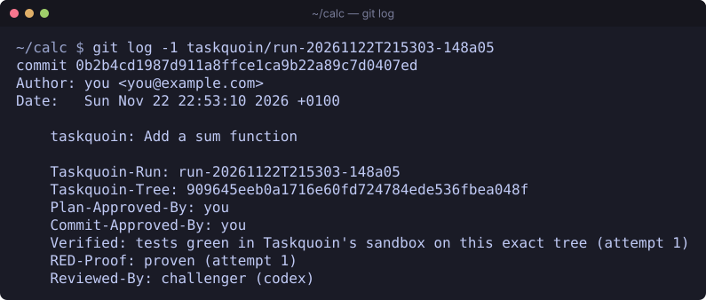

```text
taskquoin: Add a sum function

Taskquoin-Run: run-20261122T132108-d17040
Taskquoin-Tree: 909645eeb0a1716e60fd724784ede536fbea048f
Plan-Approved-By: you
Commit-Approved-By: you
Verified: tests green in Taskquoin's sandbox on this exact tree (attempt 1)
RED-Proof: proven (attempt 1)
Reviewed-By: challenger (codex)
```

トレーラーは、コミット自体に含まれる監査証跡です。

| トレーラー | 意味 |
|---|---|
| `Taskquoin-Run` | このコミットを作成した実行 |
| `Taskquoin-Tree` | 検証・レビュー・承認された git ツリー。このコミットのツリーです |
| `Plan-Approved-By` | 計画ゲートで `--as` に指定した名前 |
| `Commit-Approved-By` | コミットゲートで `--as` に指定した名前 |
| `Verified` | このツリーそのものに対して、クリーンルームでテストが成功した |
| `RED-Proof` | 変更されたテストが、変更なしでは失敗した（`proven`、テストのみの変更では `not applicable`） |
| `Reviewed-By` | レビューして承認したエージェント。API 審査役は自分の行を追加します |

最後に `taskquoin status <run>` を実行すると、`recall` から `commit` と `record` まで、ジャーナル全体が表示されます。

## ステップ 9: 結果をマージする

Taskquoin は**決してプッシュせず**、あなたのブランチへマージもしません。コミットは、いまいるブランチ `taskquoin/<run>` にあります。自分でマージするか、そこからプルリクエストを作成してください。

```shell
$ git switch main
$ git merge --ff-only taskquoin/run-20261122T132108-d17040
$ npm test
```

> [!WARNING]
> Taskquoin は、リポジトリのコミットフックを実行しません。フックにはエージェントが変更したコードが含まれている可能性があるからです。マージするときは、フック、リンター、CI を自分で実行してください。

`taskquoin/<run>` ブランチはあなたのものです。不要になったら削除してください（`git branch -d taskquoin/<run>`）。

## Dashboard で実行を追う

実行が動いている間、同じリポジトリで 2 つ目のターミナルを開き、Dashboard を起動します。読み取り専用で、パイプライン、あなたを待っている承認（ハッシュの先頭付き）、エージェント、ログを表示します。

```shell
$ taskquoin dashboard
```

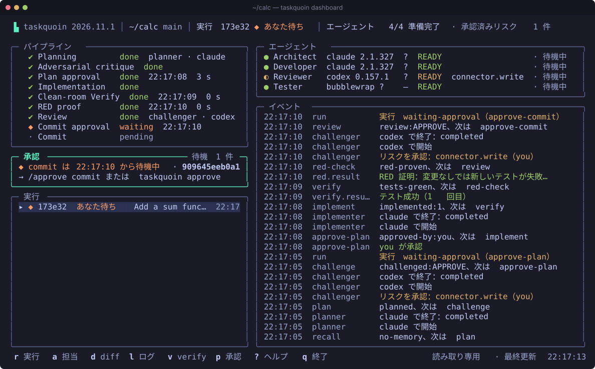

`d` で diff を読みます。`/` で検索、`n` と `N` で一致箇所を移動し、ファイルの末尾までスクロールすると、そのファイルは読了として数えられます。

`p` で承認センターを開きます。単独で承認するキーはありません。名前を入力し、ハッシュの 12 文字を打ち直します。`q` で終了します。承認済みの実行は続行します。 [Dashboard ガイド（英語）](../guides/dashboard.md).

## 想定どおりに進まないとき

Taskquoin のエラーメッセージはあなたの言語に従いますが、実行エンジンのメッセージ（`failed`、`needs-human`、`interrupted`）は常に英語です。表に、よく遭遇するものをまとめます。

| 表示されるもの | 意味 | 対処 |
|---|---|---|
| `taskquoin run: the working tree has uncommitted changes` | Taskquoin は自分の変更をあなたの変更と混ぜません | 変更をコミットするか stash する |
| `failed … gate refused agent X` | このマシンではエージェントを認証できない | `taskquoin doctor` が理由を教えます。ランタイムのバージョン、サンドボックスの欠如、受け入れていないリスクなどです |
| `needs-human … tests still failing after 3 attempts` | 3 回試してもテストが green にならなかった | 実行のブランチで引き継ぐか、より正確な依頼で新しい実行を開始する |
| `needs-human … no failing test demonstrates the change` | 本番コードの変更がなくてもテストが通るので、変更をテストしていない | `red-N` を読む。変更前に失敗するテストを書く（または依頼する）。新しいテストのないリファクタリングやドキュメントの変更はここで終わります。ブランチから自分でコミットしてください |
| `needs-human … RED proof inconclusive` | 証明が適切に実行できなかった（タイムアウト、サンドボックス、再構築できなかったツリー）。これは証明ではありません | `red-N` を読む。作業フォルダーには手が加えられていません |
| `needs-human … review still requests changes after N attempts` | レビュアーが拒否し続けた | `review-N` を読んで判断する。作業はブランチにあります |
| `needs-human … dependencies changed during the run` | `node_modules`（または `vendor`、`.venv`）が実行中に変化したため、それを使って検証されたものはない | 再インストール（`npm ci`）して新しい実行を開始する。実行中に `npm install` を実行しないでください |
| `needs-human … protected configuration changed` | エージェントが保護された設定（CI、`.claude/`、`AGENTS.md`、`taskquoin.yaml`）に触れた | 何もコミットされていません。ブランチを調べてください |
| 自分の環境ではテストが通るが Verify では失敗する | クリーンルームにない、無視対象のファイルを使っている | `verify.inherit` に追加する |
| `does not match the pending artifact` | 指定したハッシュが保留中のものではない | `show` で読み、`status` からハッシュをコピーする |
| `switch to taskquoin/<run> first` | 実行のブランチにいない | `git switch taskquoin/<run>` |
| `taskquoin.yaml changed since the run started` | 実行の途中で設定が変わった | 新しい実行を開始する |
| `interrupted` | 技術的なエラー（git、ディスク、審査役の HTTP 503）で実行が止まった | `taskquoin resume <run>` |

### テストが red のままのとき

Verify が失敗すると、Taskquoin は失敗ログとレビューを implementer に渡して再試行し、実装は最大 3 回まで試みます（独自のコマンドを持たない OpenCode の implementer は、より多くのやり直しが認められます）。それでもテストが red のままなら、実行はステータス `needs-human`、理由 `tests still failing after 3 attempts` で終わります。コミットも承認プロンプトもありません。

すべては保存されています。`taskquoin show <run> verify-3` に最後のログがあり、ブランチ `taskquoin/<run>` にエージェントの作業があります。そのブランチで手作業で続けるか、より正確な依頼で新しい実行を開始できます。`needs-human` の実行は自動的には再開されません。

### `resume`: 中断の後で

実行は、ワークフローの外の何かが原因で壊れたとき（審査役への接続でのネットワークエラー、ディスクの空き不足、マシンのスリープなど）に `interrupted` になります。状態は各ステップで保存され、審査役の回答も 1 件ずつ保存されるので、再開しても審査役を 2 度呼び出すことも、2 度支払うこともありません。

```shell
$ taskquoin resume run-20261122T132108-d17040
```

`resume` が受け付けるのは、ステータスが `interrupted` の実行だけです。それ以外のステータスではその旨が表示されます。たとえば `taskquoin resume: only an interrupted run can be resumed (status completed)` です。ステータスが `needs-human` または `failed` の場合は、新しい実行を開始してください。

### 困ったときの目安

どうすればよいか分からないときは、`taskquoin status <run>` を実行してください。ステータス、ジャーナル、そして次に実行すべき正確なコマンドが表示されます。マシンに関する疑問には `taskquoin doctor` が答えます。

## 詳しくは

- [対話型コンソール](../getting-started/console.md): 同じワークフローを `/run` と `/approve` で
- [インストール](../getting-started/installation.md)
- [ADR-0011、エージェントは決してコミットしない](../adr/0011-agents-never-commit.md)
- [ADR-0013、ツリーに基づくガバナンス](../adr/0013-tree-based-governance.md)
- [ADR-0014、クリーンルームでの Verify](../adr/0014-verify-in-a-clean-room.md)
- [ADR-0002、強制クラス](../adr/0002-enforcement-classes.md)
- [ADR-0005、ワークスペース外のコントロールプレーン](../adr/0005-control-plane-outside-workspace.md)
- [ADR-0016、API による審査役](../adr/0016-judges-by-api.md)と [ADR-0017、コマンドなしの OpenCode](../adr/0017-opencode-without-commands.md)
