# 첫 번째 거버넌스 실행

> 이 튜토리얼은 영어 참조 페이지([first-run.md](../getting-started/first-run.md))를 번역한 것입니다. 기계 번역이며, 원어민 검토자가 아니라 유지관리자들이 명령어에 대해 수행한 테스트로 확인되었습니다. 코드 블록 안의 CLI 출력은 영어 그대로 표시합니다. 현지화된 스크린샷에는 해당 언어로 실제 출력된 내용이 담겨 있습니다.

이 튜토리얼은 빈 폴더에서 시작해 Taskquoin이 만든 검증된 커밋까지, 명령어를 하나씩 따라가며 안내합니다. 실패하는 테스트가 있는 작은 프로젝트를 만들고, Taskquoin이 AI 에이전트로 수정 계획을 세우고 구현하게 하며, 작업을 두 번 승인합니다. 한 번은 계획을 읽은 뒤, 한 번은 정확한 diff를 읽은 뒤입니다. 각 단계에서 Taskquoin이 무엇을 하는지, 왜 멈추는지, 그리고 무엇에 서명하는지 볼 수 있습니다.

- [만들 것](#만들-것)
- [1단계: 실패하는 테스트가 있는 프로젝트 만들기](#1단계-실패하는-테스트가-있는-프로젝트-만들기)
- [2단계: Taskquoin 초기화](#2단계-taskquoin-초기화)
- [3단계: 설정 커밋하기](#3단계-설정-커밋하기)
- [4단계: doctor로 컴퓨터 점검하기](#4단계-doctor로-컴퓨터-점검하기)
- [이해한 위험 수락하기](#이해한-위험-수락하기)
- [5단계: 실행 시작하기](#5단계-실행-시작하기)
- [6단계: 계획 읽고 승인하기](#6단계-계획-읽고-승인하기)
- [7단계: 구현, Verify, 리뷰](#7단계-구현-verify-리뷰)
- [8단계: 커밋 읽고 승인하기](#8단계-커밋-읽고-승인하기)
- [9단계: 결과 병합하기](#9단계-결과-병합하기)
- [Dashboard에서 실행 따라가기](#dashboard에서-실행-따라가기)
- [계획대로 되지 않을 때](#계획대로-되지-않을-때)
- [더 알아보기](#더-알아보기)

> [!NOTE]
> 스크린샷은 시뮬레이션된 AI 에이전트(Taskquoin 자체 테스트 스위트의 테스트 더블)를 사용하는 데모 저장소에서 가져온 것이며, 모든 명령어는 실제 Taskquoin CLI입니다. 실제 Claude Code와 Codex를 쓰면 계획과 리뷰의 문구는 에이전트 자신의 것이 되고, 실행에는 몇 초가 아니라 몇 분이 걸립니다. 그 밖의 모든 것은 동일합니다.

시작하기 전에 [Taskquoin을 설치](../getting-started/installation.md)하고, Node 22.18+, git, `bubblewrap`, `socat`을 사용할 수 있는지, 그리고 최소한 Claude Code(가능하면 Codex도)가 설치되어 로그인되어 있는지 확인하세요.

## 만들 것

실행(run)은 고정된 워크플로입니다. 두 개의 마름모는 사람의 두 번의 승인입니다. 당신 없이는 어느 것도 그 뒤로 넘어가지 않습니다.

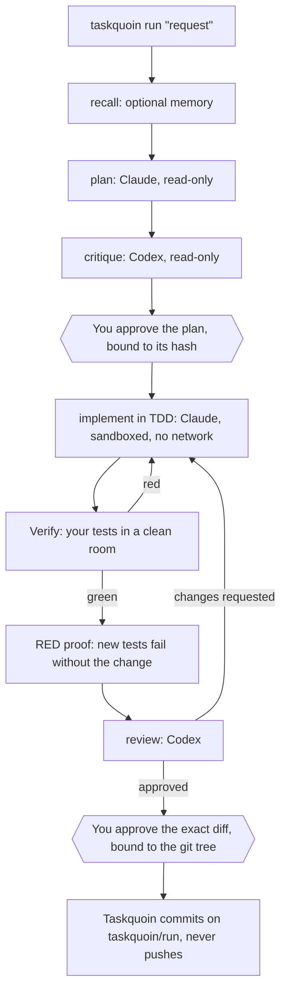

튜토리얼 전체에 걸쳐 세 가지 생각이 흐릅니다.

- **에이전트는 제안하고, Taskquoin이 실행합니다.** 에이전트는 절대 커밋하지 않습니다. 커밋은 검증, 리뷰, 승인을 거친 트리에서 Taskquoin이 만듭니다([ADR-0011](../adr/0011-agents-never-commit.md)).
- **승인은 해시에 묶입니다.** 승인하는 것은 "그 실행"이 아니라, 당신이 읽은 바로 그것입니다([ADR-0013](../adr/0013-tree-based-governance.md)).
- **테스트는 클린 룸에서 실행됩니다.** 모델이 Taskquoin에 테스트가 통과했다고 알려주는 일은 없습니다. 테스트는 Taskquoin이 직접 실행합니다([ADR-0014](../adr/0014-verify-in-a-clean-room.md)).

## 1단계: 실패하는 테스트가 있는 프로젝트 만들기

이 프로젝트는 함수가 하나뿐인 계산기입니다. 테스트는 있지만 함수는 아직 없습니다.

```shell
$ mkdir calc && cd calc
$ git init -q -b main
```

`package.json`을 만듭니다.

```json
{
  "name": "calc",
  "private": true,
  "scripts": { "test": "node --test" }
}
```

`sum.test.js`를 만듭니다.

```js
const test = require('node:test');
const assert = require('node:assert');

test('sum', () => {
  const sum = require('./sum.js');
  assert.strictEqual(sum(2, 3), 5);
});
```

`.gitignore`를 만듭니다(의존성과 빌드 결과물은 Taskquoin diff에 절대 포함되지 않습니다).

```text
node_modules/
```

커밋합니다.

```shell
$ git add .
$ git commit -m "calc: a failing test for sum"
$ npm test
not ok 1 - sum
  error: Cannot find module './sum.js'
```

테스트는 예상대로 빨간색(red)입니다. Taskquoin이 프로젝트에 요구하는 전제 조건은 작업 트리가 깨끗한 git 저장소 하나뿐입니다. 커밋되지 않은 변경 사항이 있으면 `taskquoin run`은 시작을 거부합니다. Taskquoin은 자신의 변경을 당신의 변경과 섞지 않기 때문입니다.

## 2단계: Taskquoin 초기화

```shell
$ taskquoin init
```

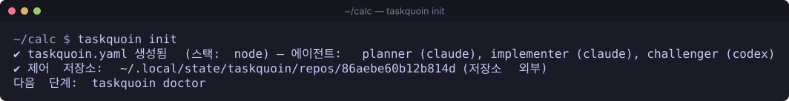

`init`은 세 가지를 했습니다.

1. 스택을 감지하고(`node`. `npm test`, PHPUnit, pytest, `go test`, Maven 등도 알고 있습니다) 저장소 루트에 `taskquoin.yaml`을 썼습니다.
2. 컴퓨터에서 AI 도구를 찾아 에이전트를 골랐습니다. 여기서는 `planner`와 `implementer`가 Claude Code, `challenger`가 Codex입니다. 도구가 없으면 파일에 그렇게 적히고, Claude Code만 있으면 리뷰어도 Claude가 됩니다. OpenCode만 있으면 `init`은 전부 OpenCode로 된 설정을 씁니다.
3. 저장소 바깥, `${XDG_STATE_HOME:-~/.local/state}/taskquoin/` 아래에 **컨트롤 스토어**를 만들었습니다. 실행 상태, 승인, 위험 수락이 여기에 저장됩니다. 에이전트는 여기에 쓸 수 없으며, 그래서 승인을 위조할 수 없습니다([ADR-0005](../adr/0005-control-plane-outside-workspace.md)).

`init`은 기존 `taskquoin.yaml`을 절대 덮어쓰지 않습니다. 다른 AI를 사용할 수 있는 상태(환경 변수의 API 키, 로컬 Ollama)에서 `init`을 실행했다면, 그것들을 나열하고 파일 안에 **주석**으로 제안합니다. 주석을 해제할지는 당신이 결정합니다. 해제하면 그 프로젝트의 코드가 해당 AI로 전송되기 때문입니다.

### 생성된 `taskquoin.yaml`

열어 보세요. 짧아서 전체를 읽을 수 있습니다. 섹션별로 살펴봅니다.

```yaml
# Taskquoin project configuration — see docs/architecture.md. Protected: agents can never edit this file.
version: 1
stack: node
```

`version`은 스키마 버전입니다. `stack`은 클린 룸의 기본값을 정합니다. 즉, 테스트를 위해 읽기 전용으로 마운트되는 의존성 디렉터리입니다(`node`의 경우 `node_modules`). 첫 번째 주석은 약속입니다. **에이전트는 이 파일을 절대 편집할 수 없습니다.** 실행 중에 에이전트가 건드리면 실행이 멈추고 아무것도 커밋되지 않습니다.

```yaml
agents:
  planner:
    runtime: claude
    description: "Read-only planner: turns a request into a minimal, test-first implementation plan."
    prompt: You plan; you never modify files. Read the repository, then produce the plan requested.
    capabilities:
      fs.read:
        - "**"
    maxTurns: 30
    skills:
      - planning-contract
```

**에이전트**는 런타임(`claude`, `codex`, `opencode`, 또는 심판용 `api`)에 묶인 역할입니다. `capabilities`는 에이전트에게 허용된 일입니다. planner는 모든 것을 읽을 수 있고(`fs.read: "**"`) 그 외에는 아무것도 할 수 없으므로 셸도 쓰기 도구도 없습니다. `skills`는 해시로 고정된 지침입니다(`planning-contract`는 자체 제공입니다). `maxTurns`는 에이전트의 턴 수를 제한합니다.

```yaml
  implementer:
    runtime: claude
    description: Implements an approved task with strict TDD (RED → GREEN → REFACTOR).
    prompt: "You implement exactly the approved task. Write a failing test first, make it pass with the simplest change, then refactor. Never commit: Taskquoin verifies and commits."
    capabilities:
      fs.read:
        - "**"
      fs.write:
        - "**"
      shell.run:
        - npm test
        - npm test -- *
        - node --test *
    maxTurns: 40
    skills:
      - tdd
```

implementer는 파일을 쓰고, 허용 목록에 있는 소수의 테스트 명령어(`shell.run`)를 실행할 수 있어서 테스트 우선으로 작업할 수 있습니다. 이 명령어들은 런타임 자체의 OS 샌드박스 안에서 네트워크 없이 실행됩니다. 그래도 그 테스트 실행은 자기 피드백용일 뿐이며, 중요한 결과는 Taskquoin이 Verify에서 내놓는 것입니다.

```yaml
  challenger:
    runtime: codex
    description: Independent, read-only adversarial reviewer of plans and diffs.
    prompt: "You are an independent reviewer. Challenge the plan or diff: correctness, security, missing tests, over-engineering. Report blocking and non-blocking findings with file:line. Do not modify files."
    capabilities:
      fs.read:
        - "**"
    skills:
      - code-review
```

**challenger**는 계획을 비판하고 diff를 리뷰합니다. 의도적으로 implementer와 다른 벤더이며, 읽기 전용입니다. 비판한 것을 스스로 "고칠" 수 있어서는 안 되기 때문입니다.

```yaml
policy:
  mandatory:
    - fs.write
    - net.egress
    - config.modify
    - connector.write
    - vcs.commit
    - vcs.push
connectors: {}
memory:
  claudeMem:
    enabled: true
```

`policy.mandatory`는 에이전트가 시작되려면 어떤 메커니즘으로 **반드시 강제되어야** 하는 제한을 나열합니다. 범위 밖 쓰기 금지, 네트워크 금지, 보호된 설정 변경 금지, 원격 쓰기 금지, 커밋 금지, 푸시 금지입니다. 사용 중인 런타임 버전이 이 중 하나를 강제할 수 없으면, 조언일 뿐인 규칙으로 시작하는 대신 그 에이전트는 거부됩니다([ADR-0002](../adr/0002-enforcement-classes.md), [ADR-0003](../adr/0003-hooks-enforce-prose-asks.md)). `connectors`는 비어 있습니다. 연결된 원격 시스템이 없습니다([ADR-0012](../adr/0012-remote-connectors-by-exception.md)). `memory.claudeMem`은 선택 사항입니다. 활성화하면 완료된 각 실행의 구조화된 요약이 로컬 [claude-mem](https://github.com/thedotmack/claude-mem) 워커로 전송되고, 실행을 시작할 때 짧은 recall을 읽어 옵니다. claude-mem을 쓰지 않는다면 `false`로 설정하세요. (이 튜토리얼의 스크린샷은 `false`를 사용합니다.)

> [!TIP]
> 테스트에 의존성 디렉터리가 아닌 무시된 파일(빌드된 `dist/`나 `.env.test` 등)이 필요하다면 명시적으로 추가하세요. 그러면 그 파일은 클린 룸에서 읽기 전용으로 마운트되고 에이전트에게는 고정됩니다.
>
> ```yaml
> verify:
>   inherit:
>     - dist
> ```
>
> 테스트가 `npm test`로 실행되지 않는 프로젝트는 `verify.command`를 설정할 수 있습니다.

다른 AI를 심판으로(OpenAI 호환 제공자라면 무엇이든), 또는 OpenCode를 planner와 implementer로 사용할 수도 있습니다. [ADR-0016](../adr/0016-judges-by-api.md)과 [ADR-0017](../adr/0017-opencode-without-commands.md)을 참고하세요.

## 3단계: 설정 커밋하기

`taskquoin.yaml`은 프로젝트의 일부이므로 커밋합니다. 이렇게 하면 Taskquoin에 필요한 깨끗한 작업 트리도 갖추어집니다.

```shell
$ git add taskquoin.yaml
$ git commit -m "chore: taskquoin"
```

## 4단계: doctor로 컴퓨터 점검하기

```shell
$ taskquoin doctor
```

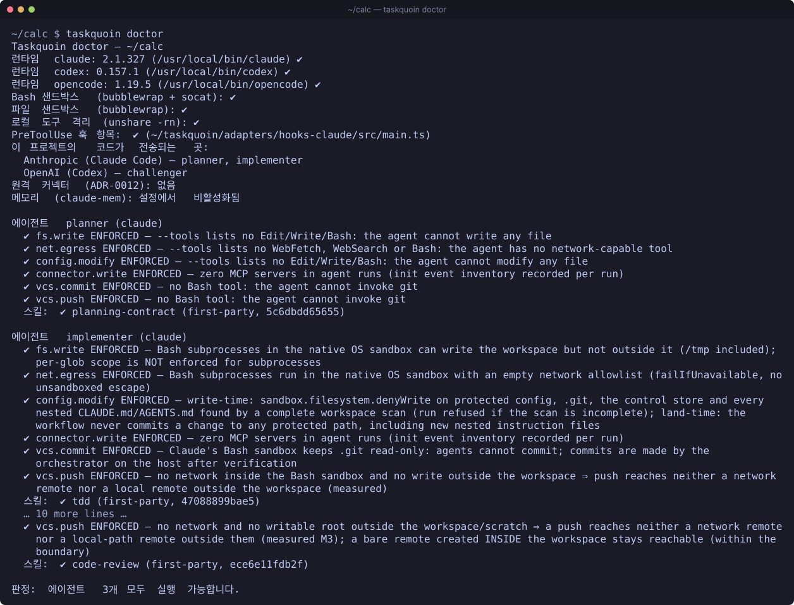

`doctor`는 Taskquoin에서 정직한 부분입니다. 위에서 아래로 읽으세요.

- 첫 번째 블록은 발견된 런타임을 버전과 함께 나열하고, 그 버전이 Taskquoin이 측정한 버전이면 체크 표시를 붙입니다. 이어서 샌드박스(bubblewrap과 socat)와 훅이 나옵니다.
- **This project's code is sent to**는 에이전트별로 당신의 코드를 받게 될 모든 벤더를 나열합니다. Taskquoin은 당신의 컴퓨터에서 실행되며, 당신이 설정한 AI만 무언가를 봅니다([ADR-0010](../adr/0010-local-first-no-leak.md)).
- 그다음 에이전트별로 각 필수 제한이 그 클래스와 **그것을 강제하는 메커니즘**과 함께 나옵니다. 예: `net.egress ENFORCED — Bash subprocesses run in the native OS sandbox with an empty network allowlist`. 체크 표시는 해당 런타임 버전에서 인증되었다는 뜻이고, X 표시는 그 에이전트가 시작되지 않는다는 뜻입니다.
- 마지막 줄은 판정입니다. `Verdict: all 3 agents can run.` 또는 `Verdict: 2 of 3 agents can run — refused agents will not be started.`

데모에서는 한 줄이 X 표시입니다.

```text
Agent challenger (codex)
  …
  ✖ connector.write — mandatory restriction "connector.write" (deny-all) on codex 0.157.1: claimed ENFORCED but the mechanism is not measured (inferred). Execution refused (ADR-0002).
```

Codex는 `connector.write`(원격 커넥터에 쓰기 금지)를 강제한다고 말하지만, Taskquoin은 그 주장을 측정할 방법이 없으므로 강제된 것으로 치지 않습니다. 그래서 challenger는 거부됩니다. 실행은 `failed at challenge`와 `gate refused agent challenger`로 끝납니다. 이 항목에 대해서는 당신이 결정해야 합니다.

## 이해한 위험 수락하기

**수락된 위험**은 측정할 수 없는 제한 하나가 있음에도 에이전트를 실행하겠다는, 서명되고 날짜가 있고 범위가 한정된 당신의 결정입니다. 이것은 소유자의 결정이며, 개발자의 것도, 에이전트의 것은 더더욱 아닙니다.

```shell
$ taskquoin accept-risk challenger connector.write \
    --reason "Codex reviews read-only; no connector configured" \
    --expires 2026-12-31 --as you
```

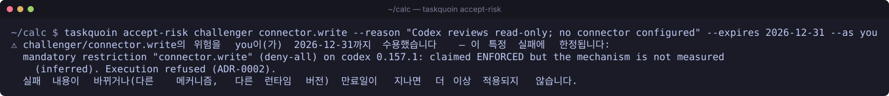

네 가지 옵션이 모두 필요합니다. `--reason`, `--expires`(미래의 실제 날짜, `YYYY-MM-DD`), `--as`(당신의 이름), 그리고 에이전트와 capability입니다. 수락이 어떤 성질을 가지는지 살펴보세요.

- **정확한 실패에 묶입니다.** 실패 메시지의 다이제스트를 저장합니다. 런타임 버전이나 메커니즘이 바뀌면 그 실패는 더 이상 같은 것이 아니며, 수락은 적용되지 않게 됩니다.
- **기한이 있습니다.** 만료일이 지나면 역시 적용되지 않습니다.
- **저장소 바깥에 저장됩니다.** 컨트롤 스토어에 저장됩니다. `taskquoin.yaml`을 편집해서 추가할 수 없고, 어떤 에이전트도 쓸 수 없습니다.
- **범위가 좁습니다.** 이 에이전트와 이 capability에만 적용됩니다. 실패하지 않는 capability에 대해서는 거부되며, API 심판에게는 사용할 수 없습니다(항상 검사됩니다).

`doctor`를 다시 실행하세요. 그 줄은 이제 X 표시 대신 경고이고, 판정은 `all 3 agents can run`입니다.

```text
  ⚠ connector.write accepted risk (approved by you until 2026-12-31: Codex reviews read-only; no connector configured) — mandatory restriction "connector.write" (deny-all) on codex 0.157.1: claimed ENFORCED but the mechanism is not measured (inferred). Execution refused (ADR-0002).
```

`taskquoin check challenger`는 한 에이전트에 대해 같은 세부 정보를 보여 줍니다.

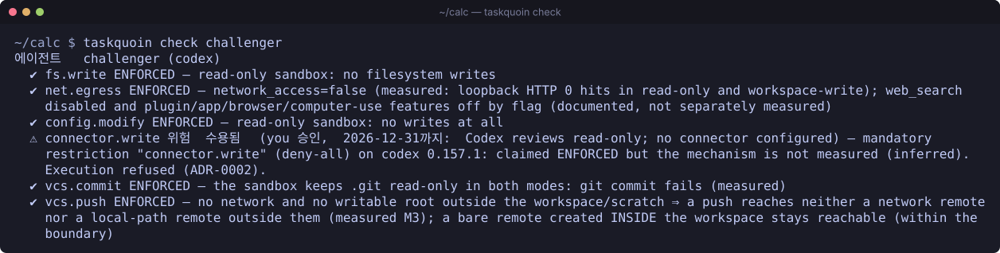

> [!IMPORTANT]
> 위험을 이해하고 상황이 당신의 사유와 일치할 때만 수락하세요. 여기서는 Codex가 읽기 전용으로 리뷰하고 프로젝트에 커넥터가 없으므로 "커넥터 쓰기"는 어차피 일어날 수 없습니다. 빨간 줄을 없애려고 위험을 수락하지 마세요. 특히 다음에 유의하세요.
>
> - 실제로 쓰기나 명령 실행을 하는 에이전트에 대해 `fs.write`, `net.egress`, `vcs.commit`, `vcs.push`는, 보완 통제 수단을 댈 수 없다면 절대 수락하지 마세요.
> - 모호한 사유로는 절대 수락하지 마세요. 사유는 승인에 기록되고 `doctor`가 보여 줍니다.
> - 짧은 만료 기한을 권장합니다. 수락은 업그레이드 후 다시 확인하라는 알림입니다.
> - 메커니즘이 *실패하는 것으로 측정*되었다면, 대신 런타임을 업그레이드하거나 바꾸세요.

`taskquoin accept-risk`를 직접 실행하는 것은 의도된 설계입니다. 콘솔이나 에이전트가 할 수 있다면 이 통제는 아무 의미가 없습니다.

## 5단계: 실행 시작하기

```shell
$ taskquoin run "Add a sum function"
```

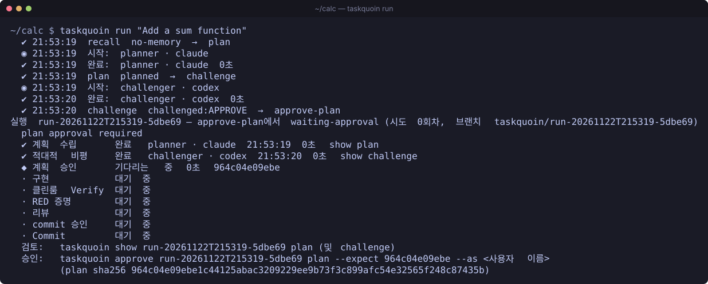

에이전트가 작업하는 동안 터미널은 조용하다가, 멈춘 지점을 출력합니다. Taskquoin은 다음 순서로 처리했습니다.

1. **Preflight.** Taskquoin은 설정이 모든 역할을 정의하는지, 스킬을 사용할 수 있는지, 읽기 전용 역할이 정말 읽기 전용인지, API 심판이 키를 가지고 있는지 확인했습니다. 작업 트리는 깨끗해야 합니다. 각 에이전트는 처음 사용되기 직전에 `doctor`와 같은 게이트도 통과합니다. 거부된 에이전트가 있으면 실행은 `failed`로 끝납니다.
2. **Branch.** 브랜치 `taskquoin/run-20261122T132108-d17040`를 만들고 전환했습니다. `main`은 그대로입니다.
3. **Recall.** 활성화되어 있다면 메모리 워커에 관련 노트를 요청했습니다. 노트가 없으면 저널에 `recall no-memory`가 표시됩니다.
4. **Plan.** `planner`(Claude, 읽기 전용)가 저장소를 읽고 계획을 썼습니다. 목표, 먼저 쓸 테스트, 파일, 단계, 위험입니다.
5. **Critique.** `challenger`(Codex, 읽기 전용)가 그 계획을 독립적으로 검토하고 `VERDICT:` 줄로 마무리했습니다.
6. **Gate.** 워크플로가 `approve-plan`에서 멈췄습니다. 원하는 만큼 기다립니다.

실행 id(`run-20261122T132108-d17040`)는 타임스탬프와 임의의 접미사입니다. 이후 모든 명령어에서 사용합니다. 인수 없는 `taskquoin status`는 실행 목록을 보여 줍니다.

```shell
$ taskquoin status
run-20261122T132108-d17040  waiting-approval approve-plan    Add a sum function
```

## 6단계: 계획 읽고 승인하기

`status <run>`은 하나의 실행의 기록을 보여 주고, 게이트에서는 그것을 승인하는 정확한 명령어를 보여 줍니다.

```shell
$ taskquoin status run-20261122T132108-d17040
```

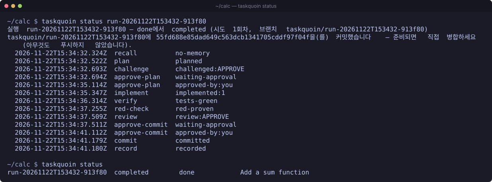

기록의 각 줄은 워크플로의 한 단계와 그 결과입니다(`planned`, `challenged:APPROVE`, `waiting-approval`).

이제 **승인하려는 내용을 읽으세요**.

```shell
$ taskquoin show run-20261122T132108-d17040 plan
```

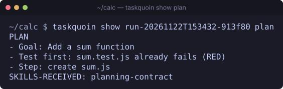

```shell
$ taskquoin show run-20261122T132108-d17040 challenge
Review: plan checked.
VERDICT: APPROVE
```

아티팩트를 지정하지 않은 `show <run>`은 지금까지 저장된 모든 것을 바이트 단위 크기와 함께 나열합니다. 실제 에이전트의 계획에는 수정할 파일, 먼저 쓸 테스트, 위험도 포함됩니다. challenge는 독립적인 두 번째 의견이며, 차단 및 비차단 지적 사항이 나열될 수 있습니다. 계획이 잘못되었다면 승인하지 말고, 더 정확한 요청으로 새 실행을 시작하세요.

### 왜 해시인가

중요한 줄은 `status`의 마지막 줄입니다.

```text
Approve it:  taskquoin approve run-20261122T132108-d17040 plan --expect 964c04e09ebe --as <your name>
             (plan sha256 964c04e09ebe1c44125abac3209229ee9b73f3c899afc54e32565f248c87435b)
```

`964c04e09ebe`는 방금 읽은 계획 파일의 SHA-256 앞부분입니다. 승인은 "이 실행을 승인한다"는 뜻이 아니라 "**해시가 964c04e09ebe인 계획**을 승인한다"는 뜻입니다. 읽은 뒤 승인하기 전에 계획이 바뀔 수 있다면(재시도, 다른 프로세스, 침해된 도구), 해시가 더 이상 일치하지 않고 Taskquoin이 거부합니다. 해시는 커밋에도 기록되므로, 누군가 무엇을 승인했는지 나중에 누구나 감사할 수 있습니다.

> [!NOTE]
> `--expect`는 비밀번호가 아닙니다. 시스템이 곧 처리할 아티팩트를 당신이 보았다는 증명입니다. 읽은 뒤 `status`에서 복사합니다. [콘솔](../getting-started/console.md)에서는 확인을 위해 다시 입력합니다.

승인합니다.

```shell
$ taskquoin approve run-20261122T132108-d17040 plan --expect 964c04e09ebe --as you
```

`--as`는 당신의 이름이며, 커밋에 `Plan-Approved-By`로 기록됩니다. 계획을 승인하면 워크플로가 재개되어 다음 게이트까지 계속됩니다.

### 잘못된 해시는 거부됩니다

대기 중인 것이 아닌 해시를 시도해 보세요.

```shell
$ taskquoin approve run-20261122T132108-d17040 plan --expect 000000000000 --as you
taskquoin approve: expected 000000000000 does not match the pending artifact 964c04e09ebe… — re-read it before approving
```

아무것도 승인되지 않았고 실행은 변하지 않았습니다. 실행이 기다리고 있지 않은 게이트를 승인하려 해도 마찬가지입니다. 아래 스크린샷은 실행이 완료된 뒤에 찍은 것이므로, 그 경우의 거부를 보여 줍니다.

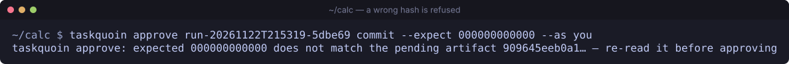

거부의 종료 코드는 1입니다. 잘못 입력한 명령어(`--expect`나 `--as` 누락)는 2로 종료됩니다.

## 7단계: 구현, Verify, 리뷰

`approve … plan` 이후 Taskquoin은 당신 없이 작업합니다.

1. **TDD 구현.** `implementer`(Claude)가 브랜치에서 런타임의 샌드박스 안에서, 네트워크 없이, 커밋할 방법 없이 작업합니다. 먼저 테스트를 쓰거나 조정하고, 그다음 그것을 통과시키는 가장 단순한 코드를 씁니다.
2. **클린 룸에서 Verify.** Taskquoin은 implementer가 남긴 정확한 트리를 가져와 저장소 바깥의 일회용 복사본에서 당신의 테스트(`npm test`)를 직접 실행합니다. 네트워크 없음, `.git`은 읽기 전용, HOME은 숨김, 비밀 파일은 마스킹되고, 스택의 의존성 디렉터리(와 `verify.inherit`)만 읽기 전용으로 마운트됩니다. 커밋되지 않은 무언가에 의존해 통과하던 테스트는 여기서 실패하며, 그것이 요점입니다.
3. **RED 증명.** 그다음 Taskquoin은 프로덕션 코드 변경을 제거하고 변경된 테스트를 다시 실행합니다. 테스트는 **실패해야** 합니다. 변경이 없어도 통과하는 테스트는 아무것도 테스트하지 않습니다. 이 증명은 기계적입니다. 테스트가 올바른 동작을 검증한다는 것을 보여 주지는 않습니다(그것은 리뷰와 당신의 몫입니다).
4. **리뷰.** `challenger`가 verify 및 RED 로그와 함께 계획에 비추어 diff를 리뷰합니다. `VERDICT:` 줄로 마무리합니다.

테스트가 red이거나, RED 증명이 실패하거나, 리뷰가 변경을 요구하면 Taskquoin은 피드백을 implementer에게 보내 자동으로 재작업하게 합니다(구현은 최대 3번 시도하며, 리뷰가 거부된 뒤에는 최대 2라운드까지 재작업합니다). 그다음 실행은 두 번째 게이트에서 멈춥니다.

## 8단계: 커밋 읽고 승인하기

실행이 다시 대기 중입니다. 살펴보세요.

```shell
$ taskquoin status run-20261122T132108-d17040
Run run-20261122T132108-d17040 — waiting-approval at approve-commit (attempt 1, branch taskquoin/run-20261122T132108-d17040)
  commit approval required (bound to the exact tree)
  Review it:   taskquoin show run-20261122T132108-d17040 diff-1  (and: verify-1, red-1, review-1)
  Approve it:  taskquoin approve run-20261122T132108-d17040 commit --expect 909645eeb0a1 --as <your name>
               (git tree 909645eeb0a1716e60fd724784ede536fbea048f)
```

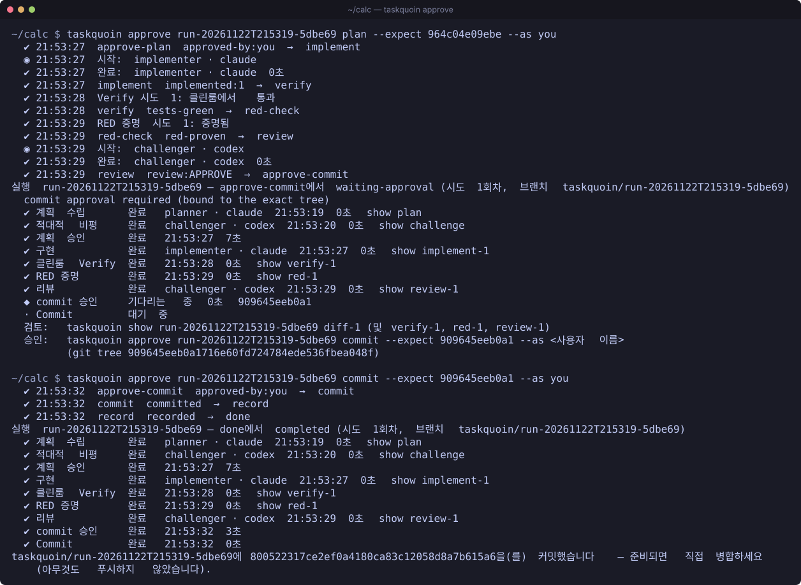

이번에 해시는 Verify와 리뷰를 통과한 **git 트리**입니다. 시도 1의 네 가지 아티팩트를 읽으세요. 숫자는 시도 번호이며, 재작업 후에는 가장 큰 번호를 읽습니다.

### `diff-1`: 정확한 변경 내용

```shell
$ taskquoin show run-20261122T132108-d17040 diff-1
```

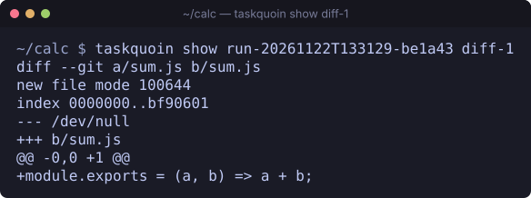

이것이 커밋될 내용이며, 그 이상은 없습니다. 에이전트가 보호된 파일(CI, `.claude/`, `AGENTS.md`, `taskquoin.yaml`)을 변경했다면 실행은 `protected configuration changed`로 멈췄을 것입니다. `.gitignore`가 숨기지만 에이전트가 만든 파일은 `ignored-1`에 나열됩니다. 이 파일들은 diff에 없고, 검증되지 않으며, 커밋되지 않습니다.

### `verify-1`: Taskquoin이 실행한 당신의 테스트

```shell
$ taskquoin show run-20261122T132108-d17040 verify-1
```

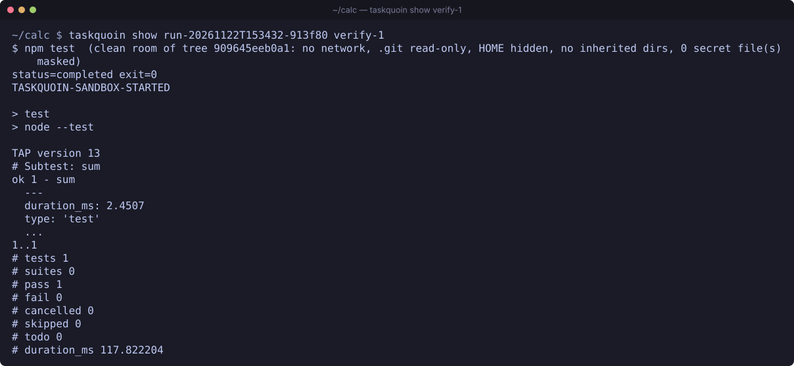

헤더에는 클린 룸이 어떤 것이었는지(`no network, .git read-only, HOME hidden, … 0 secret file(s) masked`)와 어떤 트리에 대한 것인지(`909645eeb0a1`, 곧 승인할 것과 같은 해시)가 나옵니다. `exit=0`과 `# pass 1`은 테스트 러너에서 나온 것이지 모델의 주장이 아닙니다.

### `red-1`: 테스트가 의미 있다는 증명

```shell
$ taskquoin show run-20261122T132108-d17040 red-1
TASKQUOIN RED PROOF — tests run on base + test changes only (tree 9848f565e24c); they must FAIL.
RESULT: they failed as required (RED proven).

$ npm test  (clean room of tree 9848f565e24c: no network, .git read-only, HOME hidden, no inherited dirs, 0 secret file(s) masked)
status=failed exit=1
…
not ok 1 - sum
  error: Cannot find module './sum.js'
  code: 'MODULE_NOT_FOUND'
```

여기서는 새 프로덕션 파일 `sum.js`가 제거되었고, 테스트는 그것을 불러올 수 없어서 실패했습니다. 그 실패가 RED 증명입니다. Taskquoin은 *새* 파일에 있는 기능의 import 오류를 기대한 RED로 취급합니다. 테스트 파일만 바뀐 경우(순수한 테스트 추가)에는 증명이 "not applicable"로 기록됩니다.

### `review-1`: 두 번째 의견

```shell
$ taskquoin show run-20261122T132108-d17040 review-1
Review: diff checked against the plan.
VERDICT: APPROVE
```

판정만이 아니라 지적 사항을 읽으세요. `ignored-1`은 읽을 내용이 있을 때만 목록에 나타납니다.

### 커밋 승인하기

만족스럽다면 `status`의 해시로 승인합니다.

```shell
$ taskquoin approve run-20261122T132108-d17040 commit --expect 909645eeb0a1 --as you
Run run-20261122T132108-d17040 — completed at done (attempt 1, branch taskquoin/run-20261122T132108-d17040)
Committed a3c6b801de5f4356750f53870557e2fdd19958ee on taskquoin/run-20261122T132108-d17040 — merge it yourself when ready (nothing was pushed).
```

`approve … commit`은 저장소가 해당 실행의 브랜치(`taskquoin/<run>`)에 있는 동안 실행해야 합니다. 그렇지 않으면 `switch to taskquoin/<run> first`라고 답합니다. Taskquoin은 커밋하기 전에 작업 트리를 다시 읽습니다. 당신이 본 뒤로 무언가 바뀌었다면 승인은 더 이상 적용되지 않습니다. 다시 검증하고 다시 리뷰한 뒤, 새 트리를 승인하라고 요청합니다.

그다음 Taskquoin은 `git add`가 아니라 **승인된 git 트리 자체에서** 커밋을 만듭니다. 다음과 같은 모습입니다.

```shell
$ git log -1 taskquoin/run-20261122T132108-d17040
```

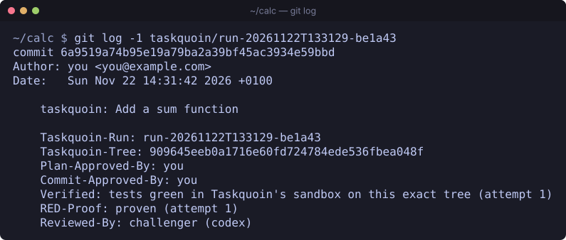

```text
taskquoin: Add a sum function

Taskquoin-Run: run-20261122T132108-d17040
Taskquoin-Tree: 909645eeb0a1716e60fd724784ede536fbea048f
Plan-Approved-By: you
Commit-Approved-By: you
Verified: tests green in Taskquoin's sandbox on this exact tree (attempt 1)
RED-Proof: proven (attempt 1)
Reviewed-By: challenger (codex)
```

트레일러는 커밋 자체에 들어 있는 감사 추적입니다.

| 트레일러 | 의미 |
|---|---|
| `Taskquoin-Run` | 이 커밋을 만든 실행 |
| `Taskquoin-Tree` | 검증, 리뷰, 승인된 git 트리. 이 커밋의 트리입니다 |
| `Plan-Approved-By` | 계획 게이트에서 `--as`로 준 이름 |
| `Commit-Approved-By` | 커밋 게이트에서 `--as`로 준 이름 |
| `Verified` | 이 정확한 트리에 대해 클린 룸에서 테스트가 green이었음 |
| `RED-Proof` | 변경된 테스트가 변경 없이는 실패했음(`proven`, 테스트만 바뀐 경우 `not applicable`) |
| `Reviewed-By` | 리뷰하고 승인한 에이전트. API 심판은 자기 줄을 추가합니다 |

마지막에 `taskquoin status <run>`을 실행하면 `recall`부터 `commit`과 `record`까지 전체 저널이 표시됩니다.

## 9단계: 결과 병합하기

Taskquoin은 **절대 푸시하지 않으며** 당신의 브랜치에 병합하지도 않습니다. 커밋은 현재 있는 브랜치 `taskquoin/<run>`에 있습니다. 직접 병합하거나 그 브랜치에서 풀 리퀘스트를 여세요.

```shell
$ git switch main
$ git merge --ff-only taskquoin/run-20261122T132108-d17040
$ npm test
```

> [!WARNING]
> Taskquoin은 저장소의 커밋 훅을 실행하지 않습니다. 훅에 에이전트가 수정한 코드가 들어 있을 수 있기 때문입니다. 병합할 때 훅, 린터, CI를 직접 실행하세요.

`taskquoin/<run>` 브랜치는 당신의 것입니다. 필요 없으면 삭제하세요(`git branch -d taskquoin/<run>`).

## Dashboard에서 실행 따라가기

실행이 진행되는 동안 같은 저장소에서 두 번째 터미널을 열고 Dashboard를 시작하세요. 읽기만 합니다. 파이프라인, 당신을 기다리는 승인(해시의 앞부분 포함), 에이전트, 로그를 보여 줍니다.

```shell
$ taskquoin dashboard
```

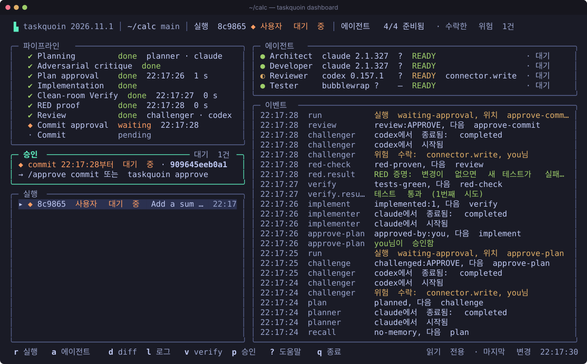

`d`를 눌러 diff를 읽습니다. `/`는 검색, `n`과 `N`은 일치 항목 사이 이동이며, 파일 끝까지 스크롤하면 그 파일은 읽은 것으로 칩니다.

`p`를 눌러 승인 센터를 엽니다. 어떤 키도 혼자서 승인하지 않습니다. 이름을 입력한 다음 해시의 12자를 다시 입력합니다. `q`로 종료하며, 승인된 실행은 계속됩니다. [Dashboard 가이드(영어)](../guides/dashboard.md).

## 계획대로 되지 않을 때

Taskquoin의 오류 메시지는 당신의 언어를 따르지만, 실행 엔진의 메시지(`failed`, `needs-human`, `interrupted`)는 항상 영어입니다. 표에 가장 흔히 만나는 경우를 정리했습니다.

| 보이는 내용 | 의미 | 할 일 |
|---|---|---|
| `taskquoin run: the working tree has uncommitted changes` | Taskquoin은 자신의 변경을 당신의 변경과 섞지 않습니다 | 변경 사항을 커밋하거나 stash하세요 |
| `failed … gate refused agent X` | 이 컴퓨터에서 에이전트를 인증할 수 없습니다 | `taskquoin doctor`가 이유를 알려 줍니다. 런타임 버전, 없는 샌드박스, 수락하지 않은 위험 등입니다 |
| `needs-human … tests still failing after 3 attempts` | 세 번 시도해도 테스트가 green이 되지 않았습니다 | 실행 브랜치에서 직접 이어받거나, 더 정확한 요청으로 새 실행을 시작하세요 |
| `needs-human … no failing test demonstrates the change` | 프로덕션 변경이 없어도 테스트가 통과하므로, 그 변경을 테스트하지 않는 것입니다 | `red-N`을 읽으세요. 변경 전에 실패하는 테스트를 작성하세요(또는 요청하세요). 새 테스트가 없는 리팩터링이나 문서 변경은 여기서 끝납니다. 브랜치에서 직접 커밋하세요 |
| `needs-human … RED proof inconclusive` | 증명이 제대로 실행되지 못했습니다(타임아웃, 샌드박스, 다시 만들 수 없던 트리). 증명이 아닙니다 | `red-N`을 읽으세요. 작업 폴더는 그대로입니다 |
| `needs-human … review still requests changes after N attempts` | 리뷰어가 계속 거부했습니다 | `review-N`을 읽고 결정하세요. 작업은 브랜치에 있습니다 |
| `needs-human … dependencies changed during the run` | `node_modules`(또는 `vendor`, `.venv`)가 실행 중에 바뀌어서, 그것으로 검증된 것이 없습니다 | 다시 설치(`npm ci`)하고 새 실행을 시작하세요. 실행 중에는 `npm install`을 실행하지 마세요 |
| `needs-human … protected configuration changed` | 에이전트가 보호된 설정(CI, `.claude/`, `AGENTS.md`, `taskquoin.yaml`)을 건드렸습니다 | 아무것도 커밋되지 않았습니다. 브랜치를 검사하세요 |
| 내 환경에서는 테스트가 통과하지만 Verify에서 실패함 | 클린 룸에 없는 무시된 파일을 사용합니다 | `verify.inherit`에 추가하세요 |
| `does not match the pending artifact` | 준 해시가 대기 중인 것이 아닙니다 | `show`로 읽고 `status`에서 해시를 복사하세요 |
| `switch to taskquoin/<run> first` | 실행의 브랜치에 있지 않습니다 | `git switch taskquoin/<run>` |
| `taskquoin.yaml changed since the run started` | 실행 도중 설정이 바뀌었습니다 | 새 실행을 시작하세요 |
| `interrupted` | 기술적 오류(git, 디스크, 심판의 HTTP 503)로 실행이 멈췄습니다 | `taskquoin resume <run>` |

### 테스트가 계속 red일 때

Verify가 실패하면 Taskquoin은 실패 로그와 리뷰를 implementer에게 주고 다시 시도하며, 구현은 최대 세 번 시도합니다(자체 명령어가 없는 OpenCode implementer는 재작업을 더 많이 받습니다). 그래도 테스트가 red이면 실행은 상태 `needs-human`과 이유 `tests still failing after 3 attempts`로 끝납니다. 커밋도 승인 프롬프트도 없습니다.

모든 것이 보존됩니다. `taskquoin show <run> verify-3`에 마지막 로그가 있고, 브랜치 `taskquoin/<run>`에 에이전트의 작업이 있습니다. 그 브랜치에서 직접 이어서 하거나 더 정확한 요청으로 새 실행을 시작할 수 있습니다. `needs-human` 실행은 자동으로 재개되지 않습니다.

### `resume`: 중단 이후

워크플로 바깥의 무언가가 실행을 망가뜨리면(심판에 닿는 네트워크 오류, 가득 찬 디스크, 컴퓨터가 절전 모드로 들어감) 실행은 `interrupted`가 됩니다. 상태는 매 단계 저장되고 심판의 답변도 하나씩 저장되므로, 재개해도 심판을 두 번 호출하거나 두 번 비용을 내는 일은 없습니다.

```shell
$ taskquoin resume run-20261122T132108-d17040
```

`resume`은 상태가 `interrupted`인 실행만 받아들입니다. 다른 상태에서는 그렇다고 알려 줍니다. 예를 들어 `taskquoin resume: only an interrupted run can be resumed (status completed)`입니다. 상태가 `needs-human`이나 `failed`이면 새 실행을 시작하세요.

### 경험칙

어떻게 해야 할지 모르겠다면 `taskquoin status <run>`을 실행하세요. 상태, 저널, 그리고 정확한 다음 명령어를 출력합니다. 컴퓨터에 관한 모든 질문에는 `taskquoin doctor`가 답합니다.

## 더 알아보기

- [대화형 콘솔](../getting-started/console.md): `/run`과 `/approve`로 같은 워크플로
- [설치](../getting-started/installation.md)
- [ADR-0011, 에이전트는 절대 커밋하지 않는다](../adr/0011-agents-never-commit.md)
- [ADR-0013, 트리 기반 거버넌스](../adr/0013-tree-based-governance.md)
- [ADR-0014, 클린 룸에서 Verify](../adr/0014-verify-in-a-clean-room.md)
- [ADR-0002, 강제 클래스](../adr/0002-enforcement-classes.md)
- [ADR-0005, 워크스페이스 바깥의 컨트롤 플레인](../adr/0005-control-plane-outside-workspace.md)
- [ADR-0016, API 심판](../adr/0016-judges-by-api.md)과 [ADR-0017, 명령어 없는 OpenCode](../adr/0017-opencode-without-commands.md)
