# Je eerste gecontroleerde run

> Deze tutorial is een vertaling van de Engelse referentiepagina [first-run.md](../getting-started/first-run.md). Het is een machinevertaling, gecontroleerd door de tests van de maintainers op commando's, niet door een moedertaalspreker.

Deze tutorial brengt je van een lege map naar een geverifieerde commit van Taskquoin, commando voor commando. Je maakt
een klein project met een falende test, laat Taskquoin met AI-agents een oplossing plannen en implementeren, en keurt
het werk twee keer goed: één keer nadat je het plan hebt gelezen, één keer nadat je de exacte diff hebt gelezen. Bij
elke stap zie je wat Taskquoin doet, waarom het stopt en wat je ondertekent.

- [Wat je gaat bouwen](#wat-je-gaat-bouwen)
- [Stap 1: maak een project met een falende test](#stap-1-maak-een-project-met-een-falende-test)
- [Stap 2: initialiseer Taskquoin](#stap-2-initialiseer-taskquoin)
- [Stap 3: commit de configuratie](#stap-3-commit-de-configuratie)
- [Stap 4: controleer de machine met doctor](#stap-4-controleer-de-machine-met-doctor)
- [Accepteer een risico dat je begrijpt](#accepteer-een-risico-dat-je-begrijpt)
- [Stap 5: start de run](#stap-5-start-de-run)
- [Stap 6: lees en keur het plan goed](#stap-6-lees-en-keur-het-plan-goed)
- [Stap 7: implementatie, Verify en review](#stap-7-implementatie-verify-en-review)
- [Stap 8: lees en keur de commit goed](#stap-8-lees-en-keur-de-commit-goed)
- [Stap 9: merge het resultaat](#stap-9-merge-het-resultaat)
- [Een run volgen in het Dashboard](#een-run-volgen-in-het-dashboard)
- [Als het niet gaat zoals gepland](#als-het-niet-gaat-zoals-gepland)
- [Meer informatie](#meer-informatie)

> [!NOTE]
> De schermen komen uit een demorepository met gesimuleerde AI-agents (de testdoubles van Taskquoins eigen testsuite);
> elk commando is de echte Taskquoin-CLI. Met echte Claude Code en Codex zijn de formulering van het plan en de review
> van de agents zelf, en duurt een run enkele minuten in plaats van seconden. Al het andere is identiek.

Voordat je begint: [installeer Taskquoin](../getting-started/installation.md) en zorg dat Node 22.18+, git, `bubblewrap` en `socat`
beschikbaar zijn en dat minstens Claude Code (en bij voorkeur ook Codex) is geïnstalleerd en ingelogd.

## Wat je gaat bouwen

Een run is een vaste workflow. De twee ruiten zijn de twee menselijke goedkeuringen; zonder jou gaat niets verder.

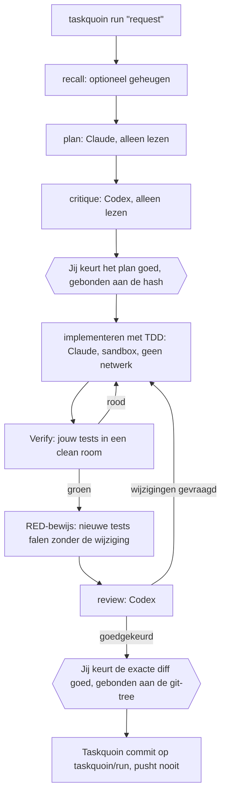

Drie ideeën lopen door de hele tutorial:

- **Agents stellen voor, Taskquoin handelt.** Agents committen nooit. De commit wordt door Taskquoin gebouwd uit de
  tree die is geverifieerd, gereviewd en goedgekeurd ([ADR-0011](../adr/0011-agents-never-commit.md)).
- **Jouw goedkeuring is gebonden aan een hash.** Je keurt precies goed wat je hebt gelezen, niet "de run"
  ([ADR-0013](../adr/0013-tree-based-governance.md)).
- **Tests draaien in een clean room.** Het model vertelt Taskquoin nooit dat tests slagen; Taskquoin draait ze zelf
  ([ADR-0014](../adr/0014-verify-in-a-clean-room.md)).

## Stap 1: maak een project met een falende test

Het project is een rekenmachine met één functie. De test bestaat; de functie niet.

```shell
$ mkdir calc && cd calc
$ git init -q -b main
```

Maak `package.json`:

```json
{
  "name": "calc",
  "private": true,
  "scripts": { "test": "node --test" }
}
```

Maak `sum.test.js`:

```js
const test = require('node:test');
const assert = require('node:assert');

test('sum', () => {
  const sum = require('./sum.js');
  assert.strictEqual(sum(2, 3), 5);
});
```

Maak `.gitignore` (dependencies en buildoutput maken nooit deel uit van een Taskquoin-diff):

```text
node_modules/
```

Commit het:

Hieronder wordt de uitvoer van de CLI in het Engels getoond.

```shell
$ git add .
$ git commit -m "calc: a failing test for sum"
$ npm test
not ok 1 - sum
  error: Cannot find module './sum.js'
```

De test is rood, zoals verwacht. Een git-repository met een schone werkmap is de enige voorwaarde die Taskquoin aan een
project stelt: `taskquoin run` weigert te starten als je niet-gecommitte wijzigingen hebt, omdat het zijn wijzigingen
nooit met de jouwe vermengt.

## Stap 2: initialiseer Taskquoin

```shell
$ taskquoin init
```

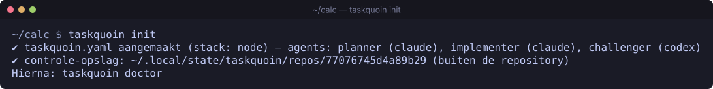

`init` deed drie dingen:

1. Het detecteerde de stack (`node`; het kent ook `npm test`, PHPUnit, pytest, `go test`, Maven en andere) en schreef
   `taskquoin.yaml` in de root van de repository.
2. Het zocht naar AI-tools op je machine en koos agents: hier `planner` en `implementer` op Claude Code en
   `challenger` op Codex. Ontbreekt een tool, dan staat dat in het bestand; met alleen Claude Code is de reviewer ook
   Claude. Met alleen OpenCode schrijft `init` een volledig OpenCode-configuratie.
3. Het maakte een **control store** buiten de repository, onder `${XDG_STATE_HOME:-~/.local/state}/taskquoin/`. Hier
   staan de runstatus, goedkeuringen en risico-acceptaties. Agents kunnen daar niet schrijven, waardoor een goedkeuring
   niet te vervalsen is ([ADR-0005](../adr/0005-control-plane-outside-workspace.md)).

`init` overschrijft nooit een bestaande `taskquoin.yaml`. Als je `init` draaide terwijl andere AI's beschikbaar waren
(een API-sleutel in je omgeving, een lokale Ollama), toont het ze en stelt ze voor als **commentaar** in het bestand:
ze activeren is jouw beslissing, want dan wordt de code van dat project naar hen gestuurd.

### De gegenereerde `taskquoin.yaml`

Open het bestand. Het is kort en je kunt het helemaal lezen. Hier is het, sectie voor sectie.

```yaml
# Taskquoin project configuration — see docs/architecture.md. Protected: agents can never edit this file.
version: 1
stack: node
```

`version` is de schemaversie. `stack` bepaalt de standaardwaarden voor de clean room: welke dependency-mappen alleen-lezen
worden gemount voor je tests (voor `node`: `node_modules`). De eerste commentaarregel is een belofte: **agents kunnen
dit bestand nooit bewerken.** Raakt er een tijdens een run aan, dan stopt de run en wordt niets gecommit.

```yaml
agents:
  planner:
    runtime: claude
    description: "Read-only planner: turns a request into a minimal, test-first implementation plan."
    prompt: You plan; you never modify files. Read the repository, then produce the plan requested.
    capabilities:
      fs.read:
        - "**"
    maxTurns: 30
    skills:
      - planning-contract
```

Een **agent** is een rol gekoppeld aan een runtime (`claude`, `codex`, `opencode`, of `api` voor een judge).
`capabilities` is wat de agent mag doen: de planner kan alles lezen (`fs.read: "**"`) en verder niets, dus heeft hij
geen shell en geen schrijftool. `skills` zijn instructies die met een hash zijn vastgezet (`planning-contract` is
first-party). `maxTurns` begrenst het aantal beurten van de agent.

```yaml
  implementer:
    runtime: claude
    description: Implements an approved task with strict TDD (RED → GREEN → REFACTOR).
    prompt: "You implement exactly the approved task. Write a failing test first, make it pass with the simplest change, then refactor. Never commit: Taskquoin verifies and commits."
    capabilities:
      fs.read:
        - "**"
      fs.write:
        - "**"
      shell.run:
        - npm test
        - npm test -- *
        - node --test *
    maxTurns: 40
    skills:
      - tdd
```

De implementer kan bestanden schrijven en een kleine allowlist van testcommando's (`shell.run`) uitvoeren, zodat hij
test-first kan werken. Die commando's draaien in de eigen OS-sandbox van de runtime, zonder netwerk. Toch is zijn
testrun alleen voor zijn eigen feedback: het resultaat dat telt is dat van Taskquoin in Verify.

```yaml
  challenger:
    runtime: codex
    description: Independent, read-only adversarial reviewer of plans and diffs.
    prompt: "You are an independent reviewer. Challenge the plan or diff: correctness, security, missing tests, over-engineering. Report blocking and non-blocking findings with file:line. Do not modify files."
    capabilities:
      fs.read:
        - "**"
    skills:
      - code-review
```

De **challenger** bekritiseert het plan en reviewt de diff. Hij komt bewust van een andere leverancier dan de
implementer, en hij is alleen-lezen: hij mag niet kunnen "repareren" wat hij bekritiseert.

```yaml
policy:
  mandatory:
    - fs.write
    - net.egress
    - config.modify
    - connector.write
    - vcs.commit
    - vcs.push
connectors: {}
memory:
  claudeMem:
    enabled: true
```

`policy.mandatory` somt de beperkingen op die door een mechanisme **moeten** worden afgedwongen voordat een agent mag
starten: niet schrijven buiten zijn bereik, geen netwerk, geen wijziging van beschermde configuratie, geen schrijfactie
naar een extern systeem, geen commit, geen push. Kan de runtimeversie die je hebt er een niet afdwingen, dan wordt de
agent geweigerd in plaats van gestart met een regel die slechts advies is ([ADR-0002](../adr/0002-enforcement-classes.md),
[ADR-0003](../adr/0003-hooks-enforce-prose-asks.md)). `connectors` is leeg: er is geen extern systeem gekoppeld
([ADR-0012](../adr/0012-remote-connectors-by-exception.md)). `memory.claudeMem` is optioneel: als het is ingeschakeld,
wordt een gestructureerde samenvatting van elke afgeronde run naar je lokale
[claude-mem](https://github.com/thedotmack/claude-mem)-worker gestuurd en wordt aan het begin van een run een korte
recall gelezen. Zet het op `false` als je claude-mem niet draait. (De schermen in deze tutorial gebruiken `false`.)

> [!TIP]
> Als je tests een genegeerd bestand nodig hebben dat geen dependency-map is, zoals een gebouwde `dist/` of een
> `.env.test`, voeg het dan expliciet toe. Het wordt dan alleen-lezen gemount in de clean room en bevroren voor de agent:
>
> ```yaml
> verify:
>   inherit:
>     - dist
> ```
>
> Een project waarvan de tests niet door `npm test` worden gedraaid, kan `verify.command` instellen.

Je kunt ook andere AI's als judges gebruiken (elke OpenAI-compatibele provider) of OpenCode als planner en
implementer; zie [ADR-0016](../adr/0016-judges-by-api.md) en [ADR-0017](../adr/0017-opencode-without-commands.md).

## Stap 3: commit de configuratie

`taskquoin.yaml` hoort bij je project, dus commit het. Zo krijgt Taskquoin ook de schone werkmap die het nodig heeft:

```shell
$ git add taskquoin.yaml
$ git commit -m "chore: taskquoin"
```

## Stap 4: controleer de machine met doctor

```shell
$ taskquoin doctor
```

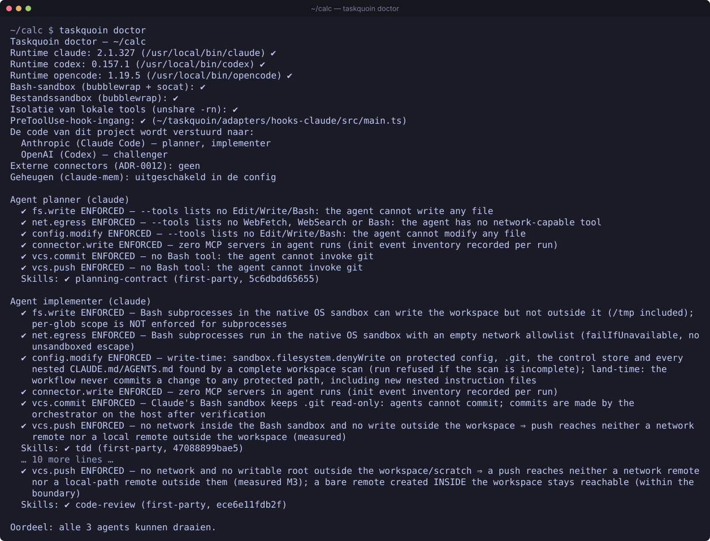

`doctor` is het eerlijke deel van Taskquoin. Lees het van boven naar beneden:

- Het eerste blok toont de gevonden runtimes, met versies en een vinkje wanneer de versie er een is die Taskquoin heeft
  gemeten, daarna de sandboxes (bubblewrap en socat) en de hook.
- **This project's code is sent to** toont elke leverancier die je code ontvangt, per agent. Taskquoin draait op je
  machine; alleen de AI's die je configureert zien iets ([ADR-0010](../adr/0010-local-first-no-leak.md)).
- Daarna, per agent, elke verplichte beperking met zijn klasse en **het mechanisme dat hem afdwingt**, bijvoorbeeld
  `net.egress ENFORCED — Bash subprocesses run in the native OS sandbox with an empty network allowlist`. Een vinkje
  betekent dat het is gecertificeerd voor die runtimeversie; een kruisje betekent dat de agent niet start.
- De laatste regel is het oordeel: `Verdict: all 3 agents can run.` of `Verdict: 2 of 3 agents can run — refused agents will not be started.`

In de demo is één regel een kruisje. De uitvoer van de CLI wordt hieronder in het Engels getoond:

```text
Agent challenger (codex)
  …
  ✖ connector.write — mandatory restriction "connector.write" (deny-all) on codex 0.157.1: claimed ENFORCED but the mechanism is not measured (inferred). Execution refused (ADR-0002).
```

Codex zegt `connector.write` (geen schrijfacties naar externe connectors) af te dwingen, maar Taskquoin kan die bewering
niet meten, dus telt het die niet als afgedwongen. De challenger wordt geweigerd: een run zou eindigen als
`failed at challenge` met `gate refused agent challenger`. Hier moet jij een beslissing nemen.

## Accepteer een risico dat je begrijpt

Een **geaccepteerd risico** is jouw ondertekende, gedateerde en afgebakende beslissing om een agent toch te draaien ondanks
één beperking die niet te meten is. Het is de keuze van de eigenaar, niet van de developer en nooit van de agent:

```shell
$ taskquoin accept-risk challenger connector.write \
    --reason "Codex reviews read-only; no connector configured" \
    --expires 2026-12-31 --as you
```

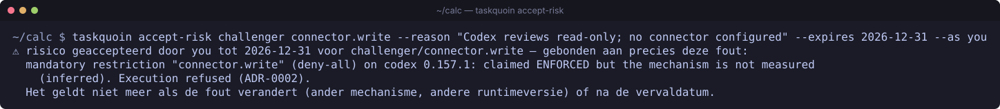

Alle vier de opties zijn verplicht: `--reason`, `--expires` (een echte toekomstige datum, `YYYY-MM-DD`) en `--as` (jouw
naam), plus de agent en de capability. Let op wat de acceptatie is:

- **Gebonden aan de exacte fout.** Ze bewaart een digest van de foutmelding. Verandert de runtimeversie of het
  mechanisme, dan is de fout niet meer dezelfde en geldt de acceptatie niet meer.
- **Gedateerd.** Ze vervalt ook na de einddatum.
- **Buiten de repository opgeslagen**, in de control store. Niemand kan er een toevoegen door `taskquoin.yaml` te
  bewerken, en geen agent kan ze schrijven.
- **Smal.** Ze geldt alleen voor deze agent en deze capability. Ze wordt geweigerd voor een capability die niet faalt,
  en is niet beschikbaar voor API-judges (die worden altijd gecontroleerd).

Draai `doctor` opnieuw. De regel is nu een waarschuwing in plaats van een kruisje, en het oordeel is `all 3 agents can run`:

```text
  ⚠ connector.write accepted risk (approved by you until 2026-12-31: Codex reviews read-only; no connector configured) — mandatory restriction "connector.write" (deny-all) on codex 0.157.1: claimed ENFORCED but the mechanism is not measured (inferred). Execution refused (ADR-0002).
```

`taskquoin check challenger` toont hetzelfde detail voor één agent:

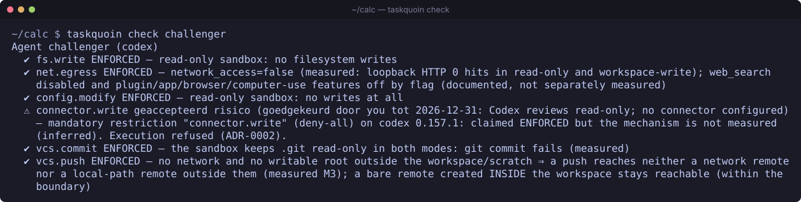

> [!IMPORTANT]
> Accepteer een risico alleen als je het begrijpt en de situatie bij je reden past: hier reviewt Codex alleen-lezen en
> heeft je project geen connector, dus een "connector write" kan sowieso niet gebeuren. Accepteer geen risico om een
> rode regel te laten verdwijnen. In het bijzonder:
>
> - nooit voor `fs.write`, `net.egress`, `vcs.commit` of `vcs.push` bij een agent die echt schrijft of commando's
>   uitvoert, tenzij je de compenserende maatregel kunt benoemen;
> - nooit met een vage reden: die wordt in de goedkeuring vastgelegd en door `doctor` getoond;
> - kies liever een korte einddatum: de acceptatie is een herinnering om na een upgrade opnieuw te controleren;
> - als een mechanisme *als falend is gemeten*, upgrade dan of wissel van runtime.

Zelf `taskquoin accept-risk` uitvoeren is bewust: als de console of een agent het kon doen, zou de controle niets
betekenen.

## Stap 5: start de run

```shell
$ taskquoin run "Add a sum function"
```

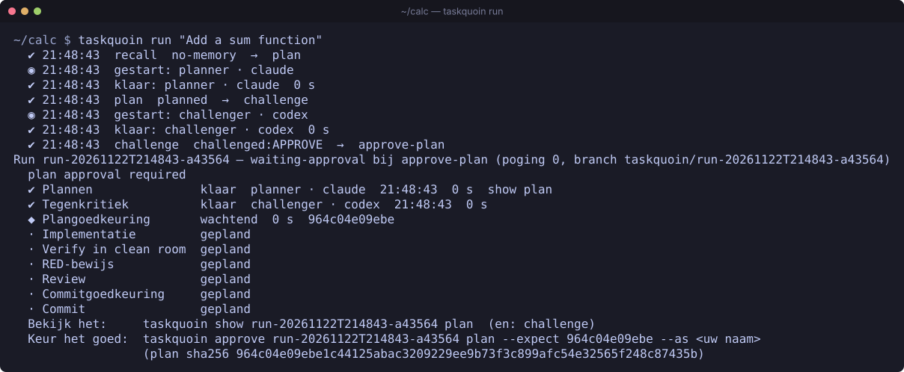

Je terminal blijft stil terwijl de agents werken en meldt dan waar het is gestopt. In volgorde deed Taskquoin dit:

1. **Preflight.** Taskquoin controleerde dat de configuratie elke rol definieert, dat de skills bruikbaar zijn, dat de
   alleen-lezen rollen echt alleen-lezen zijn en dat API-judges hun sleutels hebben. De werkmap moet schoon zijn. Elke
   agent passeert ook dezelfde gate als `doctor` vlak voordat hij voor het eerst wordt gebruikt: een geweigerde agent
   laat de run eindigen als `failed`.
2. **Branch.** Het maakte de branch `taskquoin/run-20261122T132108-d17040` en schakelde ernaartoe. Je `main` blijft
   onaangeroerd.
3. **Recall.** Het vroeg de geheugenworker, indien ingeschakeld, om relevante notities. Het journaal toont
   `recall no-memory` als er geen zijn.
4. **Plan.** De `planner` (Claude, alleen lezen) las de repository en schreef een plan: doel, de eerst te schrijven
   test, bestanden, stappen, risico's.
5. **Critique.** De `challenger` (Codex, alleen lezen) bekritiseerde dat plan onafhankelijk en sloot af met een
   `VERDICT:`-regel.
6. **Gate.** De workflow stopte bij `approve-plan`. Hij wacht zo lang als je wilt.

De run-id (`run-20261122T132108-d17040`) is een tijdstempel met een willekeurig achtervoegsel. Je gebruikt hem in elk
volgend commando. `taskquoin status` zonder argument toont de runs. De uitvoer van de CLI wordt hieronder in het Engels getoond:

```shell
$ taskquoin status
run-20261122T132108-d17040  waiting-approval approve-plan    Add a sum function
```

## Stap 6: lees en keur het plan goed

`status <run>` toont de geschiedenis van één run en, bij een gate, het exacte commando dat hem goedkeurt:

```shell
$ taskquoin status run-20261122T132108-d17040
```

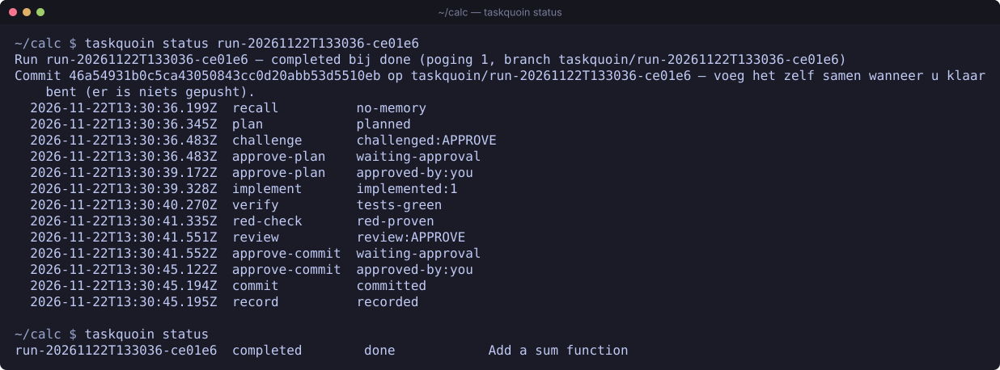

Elke geschiedenisregel is een stap van de workflow met zijn uitkomst (`planned`, `challenged:APPROVE`,
`waiting-approval`).

**Lees nu wat je op het punt staat goed te keuren**:

```shell
$ taskquoin show run-20261122T132108-d17040 plan
```

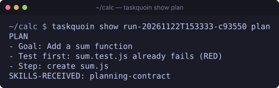

```shell
$ taskquoin show run-20261122T132108-d17040 challenge
Review: plan checked.
VERDICT: APPROVE
```

`show <run>` zonder artifact toont alles wat tot nu toe is opgeslagen, met de grootte in bytes. Een plan van een echte
agent bevat ook de te wijzigen bestanden, de eerst te schrijven tests en de risico's. De challenge is de onafhankelijke
tweede mening: ze kan blokkerende en niet-blokkerende bevindingen opsommen. Is het plan fout, keur het dan niet goed:
start een nieuwe run met een preciezere opdracht.

### Waarom de hash

De regel die telt is de laatste van `status`:

```text
Approve it:  taskquoin approve run-20261122T132108-d17040 plan --expect 964c04e09ebe --as <your name>
             (plan sha256 964c04e09ebe1c44125abac3209229ee9b73f3c899afc54e32565f248c87435b)
```

`964c04e09ebe` is het begin van de SHA-256 van het planbestand dat je zojuist las. Goedkeuren betekent niet "ik keur
deze run goed"; het betekent "ik keur **het plan met hash 964c04e09ebe** goed". Als het plan tussen je lezen en je
goedkeuren zou kunnen veranderen (een retry, een ander proces, een gecompromitteerde tool), zou de hash niet meer
kloppen en zou Taskquoin weigeren. De hash staat ook in de commit, zodat iedereen achteraf kan nagaan wat iemand heeft
goedgekeurd.

> [!NOTE]
> `--expect` is geen wachtwoord. Het is een bewijs dat je hebt gekeken naar het artifact waarop het systeem gaat
> handelen: je kopieert het uit `status` nadat je hebt gelezen. In de [console](../getting-started/console.md) tik je het opnieuw in om te
> bevestigen.

Keur goed:

```shell
$ taskquoin approve run-20261122T132108-d17040 plan --expect 964c04e09ebe --as you
```

`--as` is je naam; die wordt in de commit vastgelegd als `Plan-Approved-By`. Het plan goedkeuren hervat de workflow,
die doorloopt tot de volgende gate.

### Een verkeerde hash wordt geweigerd

Probeer een hash die niet de openstaande is:

```shell
$ taskquoin approve run-20261122T132108-d17040 plan --expect 000000000000 --as you
taskquoin approve: expected 000000000000 does not match the pending artifact 964c04e09ebe… — re-read it before approving
```

Er is niets goedgekeurd en de run is ongewijzigd. Hetzelfde gebeurt als je een gate goedkeurt waarop de run niet wacht.
De onderstaande schermafbeelding is gemaakt nadat de run was voltooid, en toont dus die variant van de weigering:

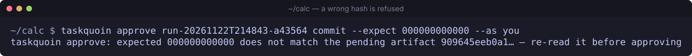

De exitcode van een weigering is 1. Een verkeerd getypt commando (een ontbrekende `--expect` of `--as`) eindigt met 2.

## Stap 7: implementatie, Verify en review

Na `approve … plan` werkt Taskquoin zonder jou:

1. **Implementatie met TDD.** De `implementer` (Claude) werkt op de branch, in de sandbox van de runtime, zonder netwerk
   en zonder mogelijkheid om te committen. Hij schrijft of past eerst tests aan, daarna de eenvoudigste code die ze
   laat slagen.
2. **Verify, in een clean room.** Taskquoin neemt exact de tree die de implementer achterliet en draait je tests
   (`npm test`) zelf, in een wegwerpkopie buiten je repository: geen netwerk, `.git` alleen-lezen, je HOME verborgen,
   geheime bestanden gemaskeerd, en alleen de dependency-mappen van de stack (en je `verify.inherit`) alleen-lezen
   gemount. Een slagende test die van iets niet-gecommits afhing, faalt hier, en dat is de bedoeling.
3. **RED-bewijs.** Taskquoin verwijdert daarna de productiewijziging en draait de gewijzigde tests opnieuw. Ze moeten
   **falen**. Een test die zonder de wijziging slaagt, test niets. Het bewijs is mechanisch: het toont niet aan dat de
   test het juiste gedrag controleert (daar dienen de review en jijzelf voor).
4. **Review.** De `challenger` reviewt de diff tegen het plan, met de verify- en RED-logs. Hij sluit af met een
   `VERDICT:`-regel.

Zijn de tests rood, mislukt het RED-bewijs of vraagt de review om wijzigingen, dan stuurt Taskquoin de feedback naar de
implementer voor automatische herwerking (maximaal 3 implementatiepogingen, met hoogstens 2 herwerkrondes na een
geweigerde review). De run stopt dan bij de tweede gate.

## Stap 8: lees en keur de commit goed

De run wacht nu opnieuw. Bekijk hem. De uitvoer van de CLI wordt hieronder in het Engels getoond:

```shell
$ taskquoin status run-20261122T132108-d17040
Run run-20261122T132108-d17040 — waiting-approval at approve-commit (attempt 1, branch taskquoin/run-20261122T132108-d17040)
  commit approval required (bound to the exact tree)
  Review it:   taskquoin show run-20261122T132108-d17040 diff-1  (and: verify-1, red-1, review-1)
  Approve it:  taskquoin approve run-20261122T132108-d17040 commit --expect 909645eeb0a1 --as <your name>
               (git tree 909645eeb0a1716e60fd724784ede536fbea048f)
```

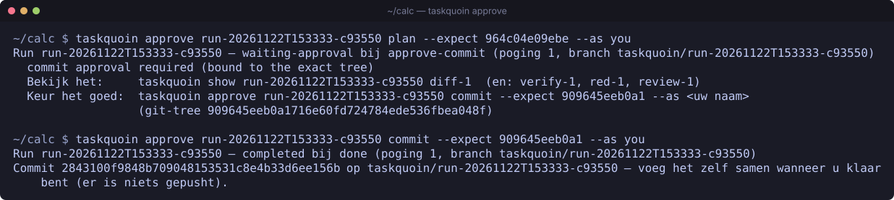

Deze keer is de hash de **git-tree** die Verify en de review heeft doorstaan. Lees de vier artifacts van poging 1. Het
nummer is de poging; na een herwerking lees je het hoogste.

### `diff-1`: de exacte wijziging

```shell
$ taskquoin show run-20261122T132108-d17040 diff-1
```

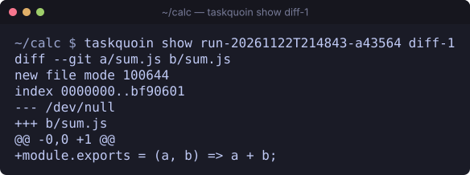

Dit wordt gecommit, niets meer. Als de agent een beschermd bestand had gewijzigd (je CI, `.claude/`, `AGENTS.md`,
`taskquoin.yaml`), was de run gestopt met `protected configuration changed`. Bestanden die je `.gitignore` verbergt maar
die de agent heeft gemaakt, staan in `ignored-1`; ze zitten niet in de diff, zijn niet geverifieerd en worden niet
gecommit.

### `verify-1`: jouw tests, gedraaid door Taskquoin

```shell
$ taskquoin show run-20261122T132108-d17040 verify-1
```

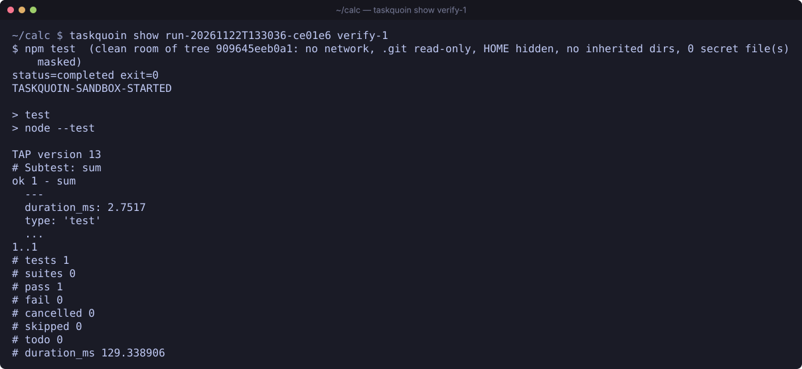

De kop zegt wat de clean room was (`no network, .git read-only, HOME hidden, … 0 secret file(s) masked`) en voor welke
tree (`909645eeb0a1`, dezelfde hash die je gaat goedkeuren). `exit=0` en `# pass 1` komen van de testrunner, niet van
een bewering van een model.

### `red-1`: het bewijs dat de test ertoe doet

De uitvoer van de CLI wordt hieronder in het Engels getoond:

```shell
$ taskquoin show run-20261122T132108-d17040 red-1
TASKQUOIN RED PROOF — tests run on base + test changes only (tree 9848f565e24c); they must FAIL.
RESULT: they failed as required (RED proven).

$ npm test  (clean room of tree 9848f565e24c: no network, .git read-only, HOME hidden, no inherited dirs, 0 secret file(s) masked)
status=failed exit=1
…
not ok 1 - sum
  error: Cannot find module './sum.js'
  code: 'MODULE_NOT_FOUND'
```

Hier is het nieuwe productiebestand `sum.js` verwijderd, kon de test het niet laden en faalde. Die mislukking is het
RED-bewijs. Taskquoin beschouwt een importfout van een feature in een *nieuw* bestand als de verwachte RED. Zijn alleen
testbestanden gewijzigd (een pure testtoevoeging), dan wordt het bewijs vastgelegd als "not applicable".

### `review-1`: de tweede mening

```shell
$ taskquoin show run-20261122T132108-d17040 review-1
Review: diff checked against the plan.
VERDICT: APPROVE
```

Lees de bevindingen, niet alleen het oordeel. `ignored-1` verschijnt alleen in de lijst als er iets te lezen is.

### Keur de commit goed

Ben je tevreden, keur dan goed met de hash uit `status`:

```shell
$ taskquoin approve run-20261122T132108-d17040 commit --expect 909645eeb0a1 --as you
Run run-20261122T132108-d17040 — completed at done (attempt 1, branch taskquoin/run-20261122T132108-d17040)
Committed a3c6b801de5f4356750f53870557e2fdd19958ee on taskquoin/run-20261122T132108-d17040 — merge it yourself when ready (nothing was pushed).
```

`approve … commit` moet worden uitgevoerd terwijl de repository op de branch van de run staat (`taskquoin/<run>`);
anders antwoordt het `switch to taskquoin/<run> first`. Taskquoin leest de werkmap opnieuw voordat het commit. Is er
sinds je keek iets veranderd, dan geldt je goedkeuring niet meer: het verifieert opnieuw, reviewt opnieuw en vraagt je
de nieuwe tree goed te keuren.

Taskquoin bouwt de commit daarna **uit de goedgekeurde git-tree zelf**, niet met `git add`. Zo ziet dat eruit:

```shell
$ git log -1 taskquoin/run-20261122T132108-d17040
```

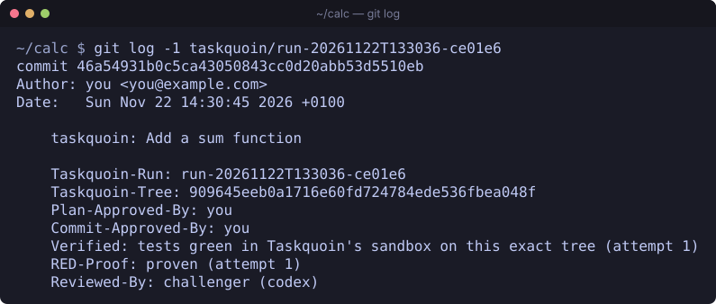

```text
taskquoin: Add a sum function

Taskquoin-Run: run-20261122T132108-d17040
Taskquoin-Tree: 909645eeb0a1716e60fd724784ede536fbea048f
Plan-Approved-By: you
Commit-Approved-By: you
Verified: tests green in Taskquoin's sandbox on this exact tree (attempt 1)
RED-Proof: proven (attempt 1)
Reviewed-By: challenger (codex)
```

De trailers zijn het auditspoor, in de commit zelf:

| Trailer | Betekenis |
|---|---|
| `Taskquoin-Run` | De run die deze commit maakte |
| `Taskquoin-Tree` | De git-tree die is geverifieerd, gereviewd en goedgekeurd. Het is de tree van deze commit |
| `Plan-Approved-By` | De naam die met `--as` bij de plan-gate is opgegeven |
| `Commit-Approved-By` | De naam die met `--as` bij de commit-gate is opgegeven |
| `Verified` | De tests waren groen in de clean room op exact deze tree |
| `RED-Proof` | De gewijzigde tests faalden zonder de wijziging (`proven`, of `not applicable` bij wijzigingen die alleen tests betreffen) |
| `Reviewed-By` | De agents die hebben gereviewd en goedgekeurd; een API-judge voegt zijn eigen regel toe |

`taskquoin status <run>` toont aan het eind het hele journaal, van `recall` tot `commit` en `record`.

## Stap 9: merge het resultaat

Taskquoin **pusht nooit** en merget nooit in je branch. De commit staat op `taskquoin/<run>`, de branch waarop je zit.
Merge hem zelf, of open er een pull request van:

```shell
$ git switch main
$ git merge --ff-only taskquoin/run-20261122T132108-d17040
$ npm test
```

> [!WARNING]
> Taskquoin draait de commit-hooks van je repository niet, omdat ze code kunnen bevatten die de agent heeft gewijzigd.
> Draai je hooks, linters en CI zelf wanneer je merget.

`taskquoin/<run>`-branches zijn van jou: verwijder ze als je ze niet nodig hebt (`git branch -d taskquoin/<run>`).

## Een run volgen in het Dashboard

Terwijl een run werkt, opent u een tweede terminal in dezelfde repository en start u het Dashboard. Het leest alleen: het toont de pipeline, de goedkeuring die op u wacht (met het begin van de hash), de agents en het logboek.

```shell
$ taskquoin dashboard
```

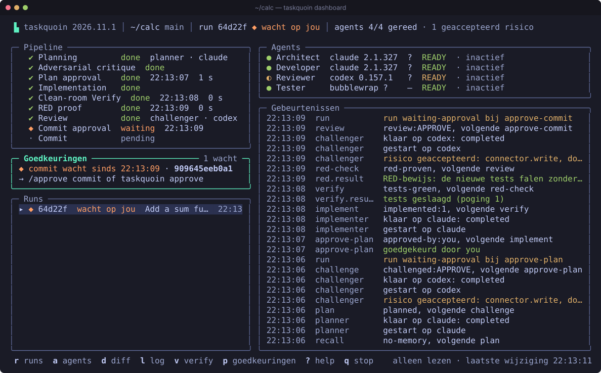

Druk op `d` om de diff te lezen: met `/` zoekt u, met `n` en `N` springt u tussen treffers, en een bestand telt als gelezen zodra u tot het einde bent gescrold.

Druk op `p` om het goedkeuringscentrum te openen. Geen enkele toets keurt zelf goed: u typt uw naam en typt daarna de 12 tekens van de hash opnieuw. Sluit af met `q`; een goedgekeurde run gaat door. [Dashboard-gids (in het Engels)](../guides/dashboard.md).

## Als het niet gaat zoals gepland

De foutmeldingen van Taskquoin volgen jouw taal, maar de meldingen van de run-engine (`failed`, `needs-human`,
`interrupted`) zijn altijd Engels. De tabel toont wat je het vaakst tegenkomt.

| Wat je ziet | Wat het betekent | Wat te doen |
|---|---|---|
| `taskquoin run: the working tree has uncommitted changes` | Taskquoin vermengt zijn wijzigingen nooit met de jouwe | Commit of stash je wijzigingen |
| `failed … gate refused agent X` | Een agent kan op deze machine niet worden gecertificeerd | `taskquoin doctor` zegt waarom: runtimeversie, ontbrekende sandbox, een risico dat je niet hebt geaccepteerd |
| `needs-human … tests still failing after 3 attempts` | Drie pogingen leverden geen groene tests op | Neem het over op de runbranch, of start een nieuwe run met een preciezere opdracht |
| `needs-human … no failing test demonstrates the change` | De tests slagen ook zonder de productiewijziging, dus testen ze die niet | Lees `red-N`; schrijf (of vraag om) een test die vóór de wijziging faalt. Een refactor of documentatiewijziging zonder nieuwe test eindigt hier: commit hem zelf vanaf de branch |
| `needs-human … RED proof inconclusive` | Het bewijs kon niet goed draaien (timeout, sandbox, een tree die niet kon worden herbouwd). Het is geen bewijs | Lees `red-N`. Je werkmap is onaangeroerd |
| `needs-human … review still requests changes after N attempts` | De reviewer bleef weigeren | Lees `review-N` en beslis; de branch bevat het werk |
| `needs-human … dependencies changed during the run` | `node_modules` (of `vendor`, `.venv`) veranderde tijdens de run, dus er is niets mee geverifieerd | Installeer opnieuw (`npm ci`) en start een nieuwe run. Draai geen `npm install` tijdens een run |
| `needs-human … protected configuration changed` | De agent raakte beschermde configuratie aan (CI, `.claude/`, `AGENTS.md`, `taskquoin.yaml`) | Er is niets gecommit; inspecteer de branch |
| Tests slagen bij jou maar falen in Verify | Ze gebruiken een genegeerd bestand dat in de clean room ontbreekt | Voeg het toe aan `verify.inherit` |
| `does not match the pending artifact` | De hash die je gaf is niet de openstaande | Lees met `show`, kopieer de hash uit `status` |
| `switch to taskquoin/<run> first` | Je zit niet op de branch van de run | `git switch taskquoin/<run>` |
| `taskquoin.yaml changed since the run started` | De configuratie veranderde tijdens de run | Start een nieuwe run |
| `interrupted` | Een technische fout (git, schijf, een HTTP 503 van een judge) stopte de run | `taskquoin resume <run>` |

### Als de tests rood blijven

Faalt Verify, dan geeft Taskquoin de implementer het falende log en de review en probeert het opnieuw, tot drie
implementatiepogingen (een OpenCode-implementer, die geen eigen commando heeft, krijgt meer herwerkingen). Zijn de tests
nog steeds rood, dan eindigt de run met de status `needs-human` en de reden `tests still failing after 3 attempts`. Er is
geen commit en geen goedkeuringsprompt.

Alles blijft bewaard: `taskquoin show <run> verify-3` bevat het laatste log en de branch `taskquoin/<run>` bevat het werk
van de agent. Je kunt met de hand op die branch verdergaan, of een nieuwe run starten met een preciezere opdracht. Een
`needs-human`-run wordt niet automatisch hervat.

### `resume`: na een onderbreking

Een run is `interrupted` wanneer iets buiten de workflow hem brak (een netwerkfout richting een judge, een volle schijf,
je machine die in slaap valt). De status wordt bij elke stap bewaard en de antwoorden van judges worden één voor één
opgeslagen, zodat hervatten nooit een judge twee keer aanroept, of betaalt:

```shell
$ taskquoin resume run-20261122T132108-d17040
```

`resume` accepteert alleen een run met status `interrupted`. Bij elke andere status zegt het dat, bijvoorbeeld
`taskquoin resume: only an interrupted run can be resumed (status completed)`. Is de status `needs-human` of `failed`,
start dan een nieuwe run.

### Een vuistregel

Weet je niet wat je moet doen, draai dan `taskquoin status <run>`: het toont de status, het journaal en het exacte
volgende commando. `taskquoin doctor` beantwoordt elke vraag over de machine.

## Meer informatie

- [De interactieve console](../getting-started/console.md): dezelfde workflow, met `/run` en `/approve`
- [Installatie](../getting-started/installation.md)
- [ADR-0011, agents never commit](../adr/0011-agents-never-commit.md)
- [ADR-0013, tree-based governance](../adr/0013-tree-based-governance.md)
- [ADR-0014, Verify in a clean room](../adr/0014-verify-in-a-clean-room.md)
- [ADR-0002, enforcement classes](../adr/0002-enforcement-classes.md)
- [ADR-0005, control plane outside the workspace](../adr/0005-control-plane-outside-workspace.md)
- [ADR-0016, judges by API](../adr/0016-judges-by-api.md) en [ADR-0017, OpenCode without commands](../adr/0017-opencode-without-commands.md)
