# Twój pierwszy nadzorowany przebieg

> Ten samouczek jest tłumaczeniem angielskiej strony referencyjnej ([first-run.md](../getting-started/first-run.md)). Jest to tłumaczenie maszynowe, sprawdzane przez testy maintainerów pod kątem poleceń, a nie przez native speakera.

Ten samouczek prowadzi od pustego folderu do zweryfikowanego commita utworzonego przez Taskquoin, polecenie po poleceniu. Utworzysz
mały projekt z niedziałającym testem, pozwolisz Taskquoin zaplanować i zaimplementować poprawkę z pomocą agentów AI, a następnie
dwukrotnie zatwierdzisz pracę: raz po przeczytaniu planu, raz po przeczytaniu dokładnego diffa. Na każdym kroku widzisz, co robi
Taskquoin, dlaczego się zatrzymuje i pod czym się podpisujesz.

- [Co zbudujesz](#co-zbudujesz)
- [Krok 1: utwórz projekt z niedziałającym testem](#krok-1-utwórz-projekt-z-niedziałającym-testem)
- [Krok 2: zainicjuj Taskquoin](#krok-2-zainicjuj-taskquoin)
- [Krok 3: zatwierdź konfigurację](#krok-3-zatwierdź-konfigurację)
- [Krok 4: sprawdź maszynę za pomocą doctor](#krok-4-sprawdź-maszynę-za-pomocą-doctor)
- [Zaakceptuj ryzyko, które rozumiesz](#zaakceptuj-ryzyko-które-rozumiesz)
- [Krok 5: uruchom przebieg](#krok-5-uruchom-przebieg)
- [Krok 6: przeczytaj i zatwierdź plan](#krok-6-przeczytaj-i-zatwierdź-plan)
- [Krok 7: implementacja, Verify i przegląd](#krok-7-implementacja-verify-i-przegląd)
- [Krok 8: przeczytaj i zatwierdź commit](#krok-8-przeczytaj-i-zatwierdź-commit)
- [Krok 9: scal wynik](#krok-9-scal-wynik)
- [Gdy coś nie idzie zgodnie z planem](#gdy-coś-nie-idzie-zgodnie-z-planem)
- [Dowiedz się więcej](#dowiedz-się-więcej)

> [!NOTE]
> Zrzuty ekranu pochodzą z repozytorium demonstracyjnego z symulowanymi agentami AI (dublerami testowymi z własnego zestawu testów
> Taskquoin); każde polecenie to prawdziwe CLI Taskquoin. Z prawdziwymi Claude Code i Codex sformułowania planu i przeglądu
> pochodzą od samych agentów, a przebieg trwa kilka minut zamiast sekund. Wszystko inne jest identyczne.

Zanim zaczniesz, [zainstaluj Taskquoin](../getting-started/installation.md) i upewnij się, że dostępne są Node 22.18+, git, `bubblewrap` i `socat` oraz że
co najmniej Claude Code (a najlepiej także Codex) jest zainstalowany i zalogowany.

## Co zbudujesz

Przebieg (run) to stały przepływ pracy. Dwa romby to dwa zatwierdzenia przez człowieka; bez Ciebie nic nie przejdzie dalej.

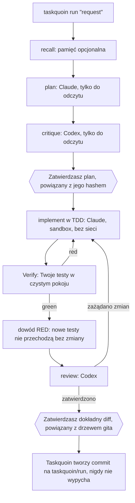

Przez cały samouczek przewijają się trzy idee:

- **Agenci proponują, Taskquoin działa.** Agenci nigdy nie tworzą commitów. Commit buduje Taskquoin z drzewa, które zostało
  zweryfikowane, przejrzane i zatwierdzone ([ADR-0011](../adr/0011-agents-never-commit.md)).
- **Twoje zatwierdzenie jest powiązane z hashem.** Zatwierdzasz dokładnie to, co przeczytałeś, a nie „przebieg"
  ([ADR-0013](../adr/0013-tree-based-governance.md)).
- **Testy działają w czystym pokoju.** Model nigdy nie mówi Taskquoin, że testy przechodzą; Taskquoin uruchamia je sam
  ([ADR-0014](../adr/0014-verify-in-a-clean-room.md)).

## Krok 1: utwórz projekt z niedziałającym testem

Projekt to kalkulator z jedną funkcją. Test istnieje; funkcja nie.

```shell
$ mkdir calc && cd calc
$ git init -q -b main
```

Utwórz `package.json`:

```json
{
  "name": "calc",
  "private": true,
  "scripts": { "test": "node --test" }
}
```

Utwórz `sum.test.js`:

```js
const test = require('node:test');
const assert = require('node:assert');

test('sum', () => {
  const sum = require('./sum.js');
  assert.strictEqual(sum(2, 3), 5);
});
```

Utwórz `.gitignore` (zależności i wyniki budowania nigdy nie są częścią diffa Taskquoin):

```text
node_modules/
```

Zatwierdź to:

```shell
$ git add .
$ git commit -m "calc: a failing test for sum"
$ npm test
not ok 1 - sum
  error: Cannot find module './sum.js'
```

Test jest czerwony, zgodnie z oczekiwaniami. Repozytorium git z czystym drzewem roboczym to jedyny warunek wstępny, jaki Taskquoin stawia
projektowi: `taskquoin run` odmawia startu, gdy masz niezatwierdzone zmiany, ponieważ nigdy nie miesza swoich zmian z Twoimi.

## Krok 2: zainicjuj Taskquoin

```shell
$ taskquoin init
```

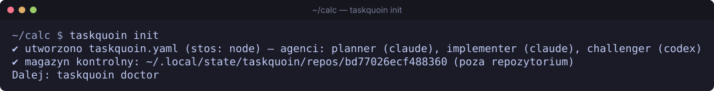

`init` zrobił trzy rzeczy:

1. Wykrył stos (`node`; zna też `npm test`, PHPUnit, pytest, `go test`, Maven i inne) i zapisał
   `taskquoin.yaml` w katalogu głównym repozytorium.
2. Poszukał narzędzi AI na Twojej maszynie i wybrał agentów: tutaj `planner` i `implementer` na Claude Code oraz
   `challenger` na Codex. Jeśli brakuje narzędzia, plik o tym informuje; mając tylko Claude Code, recenzentem jest także Claude.
   Mając tylko OpenCode, `init` zapisuje konfigurację w całości opartą na OpenCode.
3. Utworzył **magazyn kontrolny** poza repozytorium, w `${XDG_STATE_HOME:-~/.local/state}/taskquoin/`. To tam
   znajdują się stan przebiegów, zatwierdzenia i akceptacje ryzyka. Agenci nie mogą tam pisać, dzięki czemu zatwierdzenia
   nie da się sfałszować ([ADR-0005](../adr/0005-control-plane-outside-workspace.md)).

`init` nigdy nie nadpisuje istniejącego `taskquoin.yaml`. Jeśli uruchomiłeś `init`, mając dostępne inne AI (klucz API w
środowisku, lokalny Ollama), wypisze je i zaproponuje jako **komentarze** w pliku: odkomentowanie ich jest Twoją
decyzją, bo oznacza, że kod tego projektu zostanie do nich wysłany.

### Wygenerowany `taskquoin.yaml`

Otwórz go. Jest krótki i możesz przeczytać go w całości. Oto on, sekcja po sekcji.

```yaml
# Taskquoin project configuration — see docs/architecture.md. Protected: agents can never edit this file.
version: 1
stack: node
```

`version` to wersja schematu. `stack` wybiera ustawienia domyślne czystego pokoju: które katalogi zależności są
montowane tylko do odczytu dla Twoich testów (dla `node`: `node_modules`). Pierwszy komentarz jest obietnicą: **agenci nigdy nie mogą edytować
tego pliku.** Jeśli któryś go dotknie podczas przebiegu, przebieg się zatrzymuje i nic nie zostaje zatwierdzone.

```yaml
agents:
  planner:
    runtime: claude
    description: "Read-only planner: turns a request into a minimal, test-first implementation plan."
    prompt: You plan; you never modify files. Read the repository, then produce the plan requested.
    capabilities:
      fs.read:
        - "**"
    maxTurns: 30
    skills:
      - planning-contract
```

**Agent** to rola powiązana ze środowiskiem uruchomieniowym (`claude`, `codex`, `opencode` lub `api` dla sędziego). `capabilities` to
to, co agentowi wolno: planner może czytać wszystko (`fs.read: "**"`) i nic więcej, więc nie ma powłoki ani narzędzia
zapisu. `skills` to instrukcje przypięte hashem (`planning-contract` jest własnością producenta). `maxTurns` ogranicza
liczbę tur agenta.

```yaml
  implementer:
    runtime: claude
    description: Implements an approved task with strict TDD (RED → GREEN → REFACTOR).
    prompt: "You implement exactly the approved task. Write a failing test first, make it pass with the simplest change, then refactor. Never commit: Taskquoin verifies and commits."
    capabilities:
      fs.read:
        - "**"
      fs.write:
        - "**"
      shell.run:
        - npm test
        - npm test -- *
        - node --test *
    maxTurns: 40
    skills:
      - tdd
```

Implementer może zapisywać pliki i uruchamiać krótką listę dozwolonych poleceń testowych (`shell.run`), aby pracować najpierw od testu.
Te polecenia działają w sandboksie systemu operacyjnego samego środowiska uruchomieniowego, bez sieci. Mimo to jego uruchomienie testów służy tylko
jego własnej informacji zwrotnej: liczy się wynik, który Taskquoin wytwarza w Verify.

```yaml
  challenger:
    runtime: codex
    description: Independent, read-only adversarial reviewer of plans and diffs.
    prompt: "You are an independent reviewer. Challenge the plan or diff: correctness, security, missing tests, over-engineering. Report blocking and non-blocking findings with file:line. Do not modify files."
    capabilities:
      fs.read:
        - "**"
    skills:
      - code-review
```

**Challenger** krytykuje plan i recenzuje diff. Celowo pochodzi od innego dostawcy niż implementer
i jest tylko do odczytu: nie może mieć możliwości „naprawiania" tego, co krytykuje.

```yaml
policy:
  mandatory:
    - fs.write
    - net.egress
    - config.modify
    - connector.write
    - vcs.commit
    - vcs.push
connectors: {}
memory:
  claudeMem:
    enabled: true
```

`policy.mandatory` wymienia ograniczenia, które **muszą** być egzekwowane przez jakiś mechanizm, aby agent mógł wystartować: zakaz zapisu
poza zakresem, zakaz sieci, zakaz zmiany chronionej konfiguracji, zakaz zapisu zdalnego, zakaz commitów, zakaz push. Jeśli
posiadana wersja środowiska uruchomieniowego nie potrafi wyegzekwować któregoś z nich, agent jest odrzucany zamiast uruchamiany z regułą, która jest tylko
radą ([ADR-0002](../adr/0002-enforcement-classes.md), [ADR-0003](../adr/0003-hooks-enforce-prose-asks.md)).
`connectors` jest puste: żaden zdalny system nie jest podłączony ([ADR-0012](../adr/0012-remote-connectors-by-exception.md)).
`memory.claudeMem` jest opcjonalne: gdy włączone, ustrukturyzowane podsumowanie każdego zakończonego przebiegu jest wysyłane do Twojego lokalnego
workera [claude-mem](https://github.com/thedotmack/claude-mem), a krótkie przypomnienie jest czytane na początku przebiegu. Ustaw
`false`, jeśli nie używasz claude-mem. (Zrzuty ekranu w tym samouczku używają `false`.)

> [!TIP]
> Jeśli Twoje testy potrzebują ignorowanego pliku, który nie jest katalogiem zależności, takiego jak zbudowany `dist/` lub `.env.test`, dodaj
> go jawnie. Zostanie wtedy zamontowany tylko do odczytu w czystym pokoju i zamrożony dla agenta:
>
> ```yaml
> verify:
>   inherit:
>     - dist
> ```
>
> Projekt, którego testów nie uruchamia `npm test`, może ustawić `verify.command`.

Możesz też używać innych AI jako sędziów (dowolny dostawca zgodny z OpenAI) lub OpenCode jako plannera i implementera; zobacz
[ADR-0016](../adr/0016-judges-by-api.md) i [ADR-0017](../adr/0017-opencode-without-commands.md).

## Krok 3: zatwierdź konfigurację

`taskquoin.yaml` jest częścią Twojego projektu, więc go zatwierdź (commit). To także daje Taskquoin potrzebne czyste drzewo robocze:

```shell
$ git add taskquoin.yaml
$ git commit -m "chore: taskquoin"
```

## Krok 4: sprawdź maszynę za pomocą doctor

```shell
$ taskquoin doctor
```

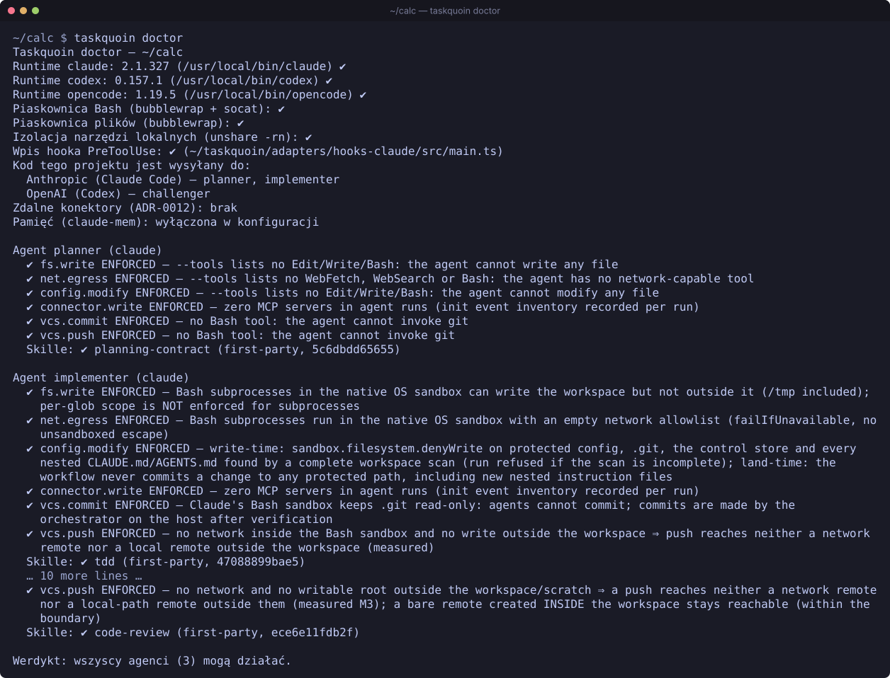

`doctor` to uczciwa część Taskquoin. Czytaj od góry do dołu:

- Pierwszy blok wymienia znalezione środowiska uruchomieniowe z wersjami i znacznikiem wyboru, gdy wersja jest tą, którą Taskquoin
  zmierzył, następnie sandboksy (bubblewrap i socat) oraz hook.
- **This project's code is sent to** wymienia każdego dostawcę, który otrzyma Twój kod, osobno dla każdego agenta. Taskquoin działa na Twojej
  maszynie; tylko skonfigurowane przez Ciebie AI cokolwiek widzą ([ADR-0010](../adr/0010-local-first-no-leak.md)).
- Następnie, dla każdego agenta, każde obowiązkowe ograniczenie z jego klasą i **mechanizmem, który je egzekwuje**, na przykład
  `net.egress ENFORCED — Bash subprocesses run in the native OS sandbox with an empty network allowlist`. Znacznik wyboru
  oznacza, że jest certyfikowane dla tej wersji środowiska; krzyżyk oznacza, że agent nie wystartuje.
- Ostatnia linia to werdykt: `Verdict: all 3 agents can run.` lub `Verdict: 2 of 3 agents can run — refused agents will not be started.`

W demo jedna linia ma krzyżyk. Komunikaty CLI poniżej są pokazane po angielsku; zlokalizowane zrzuty ekranu pokazują je w Twoim języku.

```text
Agent challenger (codex)
  …
  ✖ connector.write — mandatory restriction "connector.write" (deny-all) on codex 0.157.1: claimed ENFORCED but the mechanism is not measured (inferred). Execution refused (ADR-0002).
```

Codex twierdzi, że egzekwuje `connector.write` (brak zapisów do zdalnych konektorów), ale Taskquoin nie ma jak zmierzyć tego
twierdzenia, więc nie uznaje go za egzekwowane. Challenger zostaje odrzucony: przebieg zakończyłby się jako `failed at challenge` z
`gate refused agent challenger`. W tej sprawie musisz podjąć decyzję.

## Zaakceptuj ryzyko, które rozumiesz

**Zaakceptowane ryzyko** to Twoja podpisana, datowana i ograniczona zakresem decyzja o uruchomieniu agenta mimo jednego ograniczenia, którego nie da się
zmierzyć. To decyzja właściciela, nie dewelopera i nigdy agenta:

```shell
$ taskquoin accept-risk challenger connector.write \
    --reason "Codex reviews read-only; no connector configured" \
    --expires 2026-12-31 --as you
```

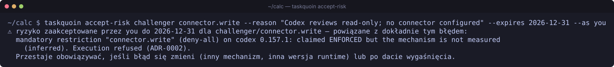

Wszystkie cztery opcje są wymagane: `--reason`, `--expires` (prawdziwa przyszła data, `YYYY-MM-DD`) i `--as` (Twoje imię), a także
agent i uprawnienie. Zwróć uwagę, czym jest to zaakceptowanie:

- **Powiązane z dokładnie tym błędem.** Zapisuje skrót (digest) komunikatu o błędzie. Jeśli wersja środowiska uruchomieniowego się zmieni lub
  zmieni się mechanizm, błąd nie jest już tym samym i akceptacja przestaje obowiązywać.
- **Datowane.** Przestaje też obowiązywać po dacie wygaśnięcia.
- **Przechowywane poza repozytorium**, w magazynie kontrolnym. Nikt nie może go dodać przez edycję `taskquoin.yaml`, a żaden agent
  nie może go zapisać.
- **Wąskie.** Dotyczy tylko tego agenta i tego uprawnienia. Jest odrzucane dla uprawnienia, które nie zawodzi,
  i niedostępne dla sędziów API (są zawsze sprawdzani).

Uruchom `doctor` ponownie. Linia jest teraz ostrzeżeniem zamiast krzyżykiem, a werdykt brzmi `all 3 agents can run`:

```text
  ⚠ connector.write accepted risk (approved by you until 2026-12-31: Codex reviews read-only; no connector configured) — mandatory restriction "connector.write" (deny-all) on codex 0.157.1: claimed ENFORCED but the mechanism is not measured (inferred). Execution refused (ADR-0002).
```

`taskquoin check challenger` pokazuje te same szczegóły dla jednego agenta:

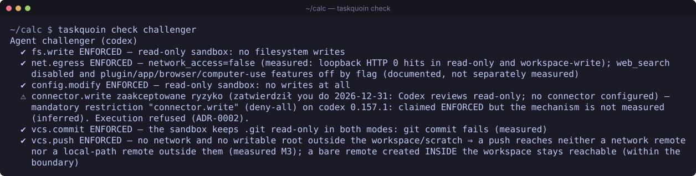

> [!IMPORTANT]
> Akceptuj ryzyko tylko wtedy, gdy je rozumiesz, a sytuacja odpowiada Twojemu uzasadnieniu: tutaj Codex recenzuje tylko do odczytu, a
> Twój projekt nie ma konektora, więc „zapis przez konektor" i tak nie może się zdarzyć. Nie akceptuj ryzyka, żeby pozbyć się czerwonej
> linii. W szczególności:
>
> - nigdy dla `fs.write`, `net.egress`, `vcs.commit` ani `vcs.push` u agenta, który naprawdę zapisuje lub uruchamia polecenia,
>   chyba że potrafisz wskazać kontrolę kompensującą;
> - nigdy z mglistym uzasadnieniem: jest zapisywane w zatwierdzeniu i pokazywane przez `doctor`;
> - wybieraj krótki termin ważności: akceptacja jest przypomnieniem, by sprawdzić ponownie po aktualizacji;
> - jeśli mechanizm jest *zmierzony jako zawodzący*, zaktualizuj lub zmień środowisko uruchomieniowe.

Samodzielne uruchomienie `taskquoin accept-risk` jest celowe: gdyby mogła to zrobić konsola lub agent, ta kontrola nic by
nie znaczyła.

## Krok 5: uruchom przebieg

```shell
$ taskquoin run "Add a sum function"
```

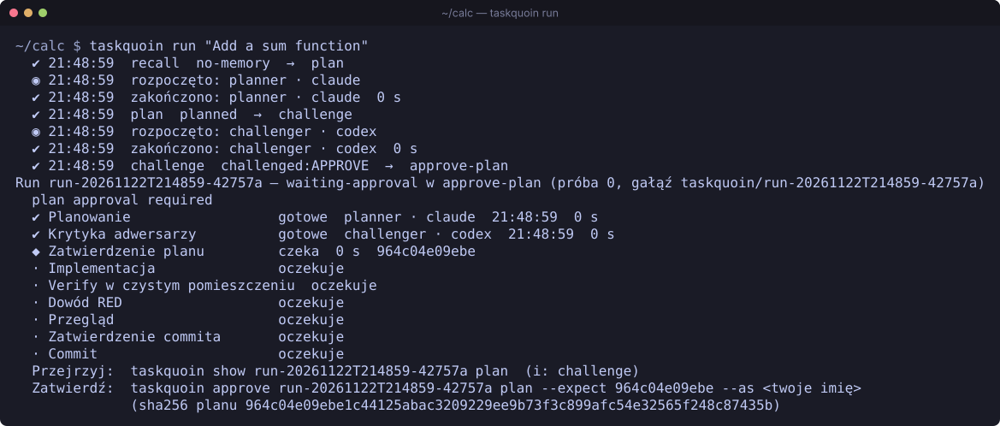

Twój terminal milczy, gdy agenci pracują, a potem wypisuje, gdzie się zatrzymał. Po kolei Taskquoin zrobił to:

1. **Preflight.** Taskquoin sprawdził, czy konfiguracja definiuje każdą rolę, czy skille są użyteczne, czy
   role tylko do odczytu naprawdę są tylko do odczytu oraz czy sędziowie API mają swoje klucze. Drzewo robocze musi być czyste. Każdy
   agent przechodzi też tę samą bramkę co `doctor` tuż przed pierwszym użyciem: odrzucony agent kończy przebieg jako `failed`.
2. **Gałąź.** Utworzył gałąź `taskquoin/run-20261122T132108-d17040` i na nią przełączył. Twoja `main` pozostaje
   nietknięta.
3. **Recall.** Zapytał worker pamięci, jeśli włączony, o istotne notatki. Dziennik pokazuje `recall no-memory`, gdy
   ich nie ma.
4. **Plan.** `planner` (Claude, tylko do odczytu) przeczytał repozytorium i napisał plan: cel, test do napisania najpierw,
   pliki, kroki, ryzyka.
5. **Critique.** `challenger` (Codex, tylko do odczytu) niezależnie zakwestionował ten plan i zakończył linią
   `VERDICT:`.
6. **Bramka.** Przepływ zatrzymał się na `approve-plan`. Będzie czekał tak długo, jak zechcesz.

Identyfikator przebiegu (`run-20261122T132108-d17040`) to znacznik czasu i losowy sufiks. Używasz go w każdym kolejnym poleceniu.
`taskquoin status` bez argumentu wypisuje przebiegi (dane wyjściowe CLI poniżej są pokazane po angielsku):

```shell
$ taskquoin status
run-20261122T132108-d17040  waiting-approval approve-plan    Add a sum function
```

## Krok 6: przeczytaj i zatwierdź plan

`status <run>` pokazuje historię jednego przebiegu, a na bramce dokładne polecenie, które ją zatwierdza:

```shell
$ taskquoin status run-20261122T132108-d17040
```

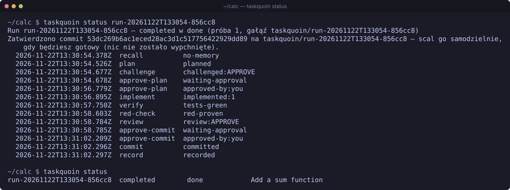

Każda linia historii to krok przepływu z jego wynikiem (`planned`, `challenged:APPROVE`, `waiting-approval`).

Teraz **przeczytaj to, co masz zamiar zatwierdzić**:

```shell
$ taskquoin show run-20261122T132108-d17040 plan
```

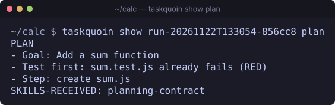

```shell
$ taskquoin show run-20261122T132108-d17040 challenge
Review: plan checked.
VERDICT: APPROVE
```

`show <run>` bez artefaktu wypisuje wszystko, co dotąd zapisano, z rozmiarem w bajtach. Plan od prawdziwego agenta obejmuje też
pliki do zmiany, testy do napisania najpierw i ryzyka. Challenge to niezależna druga opinia: może
wymieniać uwagi blokujące i niewarunkujące. Jeśli plan jest błędny, nie zatwierdzaj go: rozpocznij nowy przebieg z bardziej
precyzyjnym żądaniem.

### Dlaczego hash

Najważniejsza jest ostatnia linia `status`:

```text
Approve it:  taskquoin approve run-20261122T132108-d17040 plan --expect 964c04e09ebe --as <your name>
             (plan sha256 964c04e09ebe1c44125abac3209229ee9b73f3c899afc54e32565f248c87435b)
```

`964c04e09ebe` to początek SHA-256 pliku planu, który właśnie przeczytałeś. Zatwierdzenie nie znaczy „zatwierdzam ten
przebieg"; znaczy „zatwierdzam **plan, którego hash to 964c04e09ebe**". Gdyby plan mógł się zmienić między Twoim czytaniem a
zatwierdzeniem (ponowna próba, inny proces, skompromitowane narzędzie), hash przestałby pasować i Taskquoin odmówi.
To także jest zapisywane w commicie, więc każdy może później sprawdzić, co zatwierdziła dana osoba.

> [!NOTE]
> `--expect` nie jest hasłem. To dowód, że obejrzałeś artefakt, na którym system zaraz zadziała: kopiujesz go
> z `status` po przeczytaniu. W [konsoli](../getting-started/console.md) przepisujesz go, aby potwierdzić.

Zatwierdź:

```shell
$ taskquoin approve run-20261122T132108-d17040 plan --expect 964c04e09ebe --as you
```

`--as` to Twoje imię; jest zapisywane jako `Plan-Approved-By` w commicie. Zatwierdzenie planu wznawia przepływ, który
trwa do następnej bramki.

### Błędny hash zostaje odrzucony

Spróbuj hasha, który nie jest oczekującym:

```shell
$ taskquoin approve run-20261122T132108-d17040 plan --expect 000000000000 --as you
taskquoin approve: expected 000000000000 does not match the pending artifact 964c04e09ebe… — re-read it before approving
```

Nic nie zostało zatwierdzone, a przebieg się nie zmienił. To samo dzieje się, gdy zatwierdzasz bramkę, na którą przebieg nie czeka. Poniższy
zrzut ekranu zrobiono po zakończeniu przebiegu, więc pokazuje ten wariant odmowy:

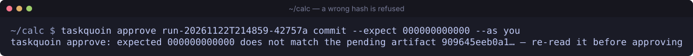

Kod wyjścia odmowy to 1. Błędnie wpisane polecenie (brak `--expect` lub `--as`) kończy się kodem 2.

## Krok 7: implementacja, Verify i przegląd

Po `approve … plan` Taskquoin pracuje bez Ciebie:

1. **Implementacja w TDD.** `implementer` (Claude) pracuje na gałęzi, w sandboksie środowiska, bez sieci
   i bez możliwości commitowania. Najpierw pisze lub dostosowuje testy, potem najprostszy kod, który sprawia, że przechodzą.
2. **Verify, w czystym pokoju.** Taskquoin bierze dokładne drzewo pozostawione przez implementera i uruchamia Twoje testy (`npm test`)
   samodzielnie, w jednorazowej kopii poza Twoim repozytorium: bez sieci, `.git` tylko do odczytu, Twój HOME ukryty, pliki sekretów
   zamaskowane, a tylko katalogi zależności stosu (i Twoje `verify.inherit`) zamontowane tylko do odczytu. Test, który przechodził
   dzięki czemuś niezatwierdzonemu, tutaj zawodzi, i o to chodzi.
3. **Dowód RED.** Taskquoin następnie usuwa zmianę produkcyjną i uruchamia zmienione testy ponownie. Muszą **zawieść**. Test,
   który przechodzi bez zmiany, niczego nie testuje. Dowód jest mechaniczny: nie wykazuje, że test sprawdza
   właściwe zachowanie (od tego jest przegląd i Ty).
4. **Przegląd.** `challenger` recenzuje diff względem planu, z logami verify i RED. Kończy linią
   `VERDICT:`.

Jeśli testy są czerwone, dowód RED zawodzi lub przegląd żąda zmian, Taskquoin wysyła uwagi do
implementera w celu automatycznej poprawki (do 3 prób implementacji, z co najwyżej 2 rundami poprawek po odrzuconym
przeglądzie). Następnie przebieg zatrzymuje się na drugiej bramce.

## Krok 8: przeczytaj i zatwierdź commit

Przebieg znów czeka. Spójrz na niego (dane wyjściowe CLI poniżej są pokazane po angielsku):

```shell
$ taskquoin status run-20261122T132108-d17040
Run run-20261122T132108-d17040 — waiting-approval at approve-commit (attempt 1, branch taskquoin/run-20261122T132108-d17040)
  commit approval required (bound to the exact tree)
  Review it:   taskquoin show run-20261122T132108-d17040 diff-1  (and: verify-1, red-1, review-1)
  Approve it:  taskquoin approve run-20261122T132108-d17040 commit --expect 909645eeb0a1 --as <your name>
               (git tree 909645eeb0a1716e60fd724784ede536fbea048f)
```

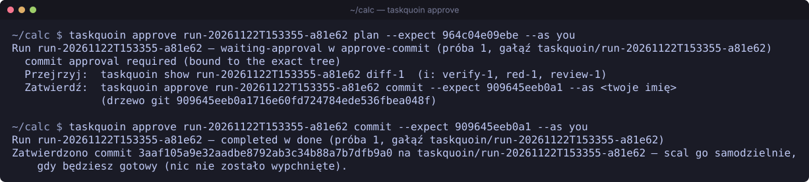

Tym razem hash to **drzewo gita**, które przeszło Verify i przegląd. Przeczytaj cztery artefakty próby 1. Numer to numer próby;
po poprawce czytasz najwyższy.

### `diff-1`: dokładna zmiana

```shell
$ taskquoin show run-20261122T132108-d17040 diff-1
```

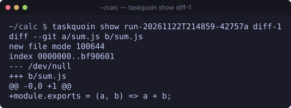

To jest to, co zostanie zatwierdzone, nic więcej. Gdyby agent zmienił chroniony plik (Twoje CI, `.claude/`,
`AGENTS.md`, `taskquoin.yaml`), przebieg zatrzymałby się z `protected configuration changed`. Pliki, które Twój
`.gitignore` ukrywa, a które agent utworzył, są wymienione w `ignored-1`; nie ma ich w diffie, nie są zweryfikowane ani
zatwierdzone.

### `verify-1`: Twoje testy, uruchomione przez Taskquoin

```shell
$ taskquoin show run-20261122T132108-d17040 verify-1
```

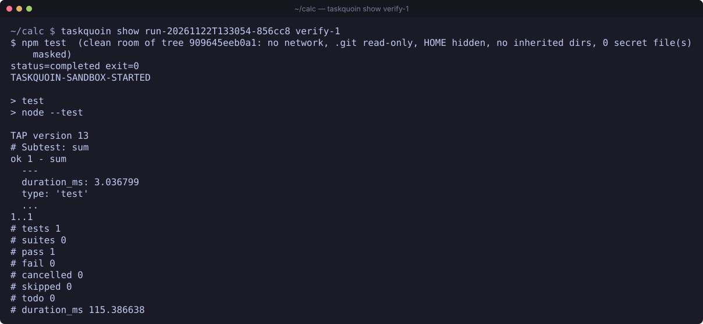

Nagłówek mówi, czym był czysty pokój (`no network, .git read-only, HOME hidden, … 0 secret file(s) masked`) i dla
którego drzewa (`909645eeb0a1`, ten sam hash, który zatwierdzisz). `exit=0` i `# pass 1` pochodzą od narzędzia testowego, a nie
z deklaracji modelu.

### `red-1`: dowód, że test ma znaczenie

Dane wyjściowe CLI poniżej są pokazane po angielsku.

```shell
$ taskquoin show run-20261122T132108-d17040 red-1
TASKQUOIN RED PROOF — tests run on base + test changes only (tree 9848f565e24c); they must FAIL.
RESULT: they failed as required (RED proven).

$ npm test  (clean room of tree 9848f565e24c: no network, .git read-only, HOME hidden, no inherited dirs, 0 secret file(s) masked)
status=failed exit=1
…
not ok 1 - sum
  error: Cannot find module './sum.js'
  code: 'MODULE_NOT_FOUND'
```

Tutaj nowy plik produkcyjny `sum.js` został usunięty, test nie mógł go załadować i zawiódł. Ta porażka to dowód
RED. Taskquoin traktuje błąd importu funkcji z *nowego* pliku jako oczekiwane RED. Jeśli zmieniły się tylko pliki testów
(czyste dodanie testu), dowód jest zapisywany jako „not applicable".

### `review-1`: druga opinia

```shell
$ taskquoin show run-20261122T132108-d17040 review-1
Review: diff checked against the plan.
VERDICT: APPROVE
```

Czytaj uwagi, nie tylko werdykt. `ignored-1` pojawia się na liście tylko wtedy, gdy jest coś do przeczytania.

### Zatwierdź commit

Jeśli jesteś zadowolony, zatwierdź hashem ze `status`:

```shell
$ taskquoin approve run-20261122T132108-d17040 commit --expect 909645eeb0a1 --as you
Run run-20261122T132108-d17040 — completed at done (attempt 1, branch taskquoin/run-20261122T132108-d17040)
Committed a3c6b801de5f4356750f53870557e2fdd19958ee on taskquoin/run-20261122T132108-d17040 — merge it yourself when ready (nothing was pushed).
```

`approve … commit` trzeba uruchomić, gdy repozytorium jest na gałęzi przebiegu (`taskquoin/<run>`); w przeciwnym razie odpowiada
`switch to taskquoin/<run> first`. Taskquoin ponownie czyta drzewo robocze przed commitem. Jeśli cokolwiek zmieniło się od
Twojego przeglądu, Twoje zatwierdzenie przestaje obowiązywać: ponownie weryfikuje, ponownie recenzuje i prosi o zatwierdzenie nowego drzewa.

Taskquoin następnie buduje commit **z samego zatwierdzonego drzewa gita**, a nie z `git add`. Wygląda to tak:

```shell
$ git log -1 taskquoin/run-20261122T132108-d17040
```

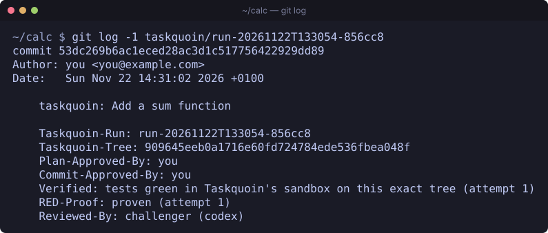

```text
taskquoin: Add a sum function

Taskquoin-Run: run-20261122T132108-d17040
Taskquoin-Tree: 909645eeb0a1716e60fd724784ede536fbea048f
Plan-Approved-By: you
Commit-Approved-By: you
Verified: tests green in Taskquoin's sandbox on this exact tree (attempt 1)
RED-Proof: proven (attempt 1)
Reviewed-By: challenger (codex)
```

Trailery to ślad audytowy, w samym commicie:

| Trailer | Znaczenie |
|---|---|
| `Taskquoin-Run` | Przebieg, który utworzył ten commit |
| `Taskquoin-Tree` | Drzewo gita, które zostało zweryfikowane, przejrzane i zatwierdzone. To drzewo tego commita |
| `Plan-Approved-By` | Imię podane przez `--as` na bramce planu |
| `Commit-Approved-By` | Imię podane przez `--as` na bramce commita |
| `Verified` | Testy były zielone w czystym pokoju na dokładnie tym drzewie |
| `RED-Proof` | Zmienione testy zawiodły bez zmiany (`proven` lub `not applicable` dla zmian wyłącznie w testach) |
| `Reviewed-By` | Agenci, którzy zrecenzowali i zatwierdzili; sędzia API dodaje własną linię |

`taskquoin status <run>` na końcu pokazuje cały dziennik, od `recall` do `commit` i `record`.

## Krok 9: scal wynik

Taskquoin **nigdy nie wypycha** i nigdy nie scala do Twojej gałęzi. Commit jest na `taskquoin/<run>`, gałęzi, na której
jesteś. Scal go sam lub otwórz z niej pull request:

```shell
$ git switch main
$ git merge --ff-only taskquoin/run-20261122T132108-d17040
$ npm test
```

> [!WARNING]
> Taskquoin nie uruchamia hooków commita Twojego repozytorium, ponieważ mogłyby zawierać kod zmodyfikowany przez agenta. Uruchom swoje
> hooki, lintery i CI samodzielnie przy scalaniu.

Gałęzie `taskquoin/<run>` są Twoje: usuń je, gdy nie są potrzebne (`git branch -d taskquoin/<run>`).

## Gdy coś nie idzie zgodnie z planem

Komunikaty o błędach Taskquoin są w Twoim języku, ale komunikaty silnika przebiegu (`failed`, `needs-human`,
`interrupted`) są zawsze po angielsku. Tabela wymienia to, z czym spotkasz się najczęściej.

| Co widzisz | Co to znaczy | Co zrobić |
|---|---|---|
| `taskquoin run: the working tree has uncommitted changes` | Taskquoin nigdy nie miesza swoich zmian z Twoimi | Zatwierdź lub odłóż (stash) swoje zmiany |
| `failed … gate refused agent X` | Agenta nie da się certyfikować na tej maszynie | `taskquoin doctor` mówi dlaczego: wersja środowiska, brakujący sandbox, ryzyko, którego nie zaakceptowałeś |
| `needs-human … tests still failing after 3 attempts` | Trzy próby nie dały zielonych testów | Przejmij pracę na gałęzi przebiegu lub rozpocznij nowy przebieg z bardziej precyzyjnym żądaniem |
| `needs-human … no failing test demonstrates the change` | Testy przechodzą nawet bez zmiany produkcyjnej, więc jej nie testują | Przeczytaj `red-N`; napisz (lub poproś o) test, który zawodzi przed zmianą. Refaktoryzacja lub zmiana dokumentacji bez nowego testu kończy się tutaj: zatwierdź ją sam z gałęzi |
| `needs-human … RED proof inconclusive` | Dowód nie mógł się poprawnie wykonać (timeout, sandbox, drzewo, którego nie dało się odbudować). To nie jest dowód | Przeczytaj `red-N`. Twój folder roboczy jest nietknięty |
| `needs-human … review still requests changes after N attempts` | Recenzent wciąż odmawiał | Przeczytaj `review-N` i zdecyduj; gałąź zawiera pracę |
| `needs-human … dependencies changed during the run` | `node_modules` (lub `vendor`, `.venv`) zmieniły się podczas przebiegu, więc nic nie jest z nimi zweryfikowane | Zainstaluj ponownie (`npm ci`) i rozpocznij nowy przebieg. Nie uruchamiaj `npm install` podczas przebiegu |
| `needs-human … protected configuration changed` | Agent dotknął chronionej konfiguracji (CI, `.claude/`, `AGENTS.md`, `taskquoin.yaml`) | Nic nie zostało zatwierdzone; sprawdź gałąź |
| Testy przechodzą u Ciebie, ale zawodzą w Verify | Używają ignorowanego pliku, którego nie ma w czystym pokoju | Dodaj go do `verify.inherit` |
| `does not match the pending artifact` | Podany hash nie jest oczekującym | Przeczytaj przez `show`, skopiuj hash ze `status` |
| `switch to taskquoin/<run> first` | Nie jesteś na gałęzi przebiegu | `git switch taskquoin/<run>` |
| `taskquoin.yaml changed since the run started` | Konfiguracja zmieniła się w trakcie przebiegu | Rozpocznij nowy przebieg |
| `interrupted` | Błąd techniczny (git, dysk, HTTP 503 sędziego) zatrzymał przebieg | `taskquoin resume <run>` |

### Gdy testy pozostają czerwone

Jeśli Verify zawodzi, Taskquoin daje implementerowi log błędów i przegląd i próbuje ponownie, do trzech
prób implementacji (implementer OpenCode, który nie ma własnego polecenia, dostaje więcej poprawek). Jeśli testy są
wciąż czerwone, przebieg kończy się statusem `needs-human` i powodem `tests still failing after 3 attempts`. Nie ma
commita ani prośby o zatwierdzenie.

Wszystko jest zachowane: `taskquoin show <run> verify-3` zawiera ostatni log, a gałąź `taskquoin/<run>` trzyma
pracę agenta. Możesz kontynuować ręcznie na tej gałęzi lub rozpocząć nowy przebieg z bardziej precyzyjnym żądaniem. Przebieg `needs-human`
nie jest wznawiany automatycznie.

### `resume`: po przerwaniu

Przebieg jest `interrupted`, gdy coś spoza przepływu go przerwało (błąd sieci przy łączeniu z sędzią, pełny dysk, uśpienie
maszyny). Stan jest zapisywany na każdym kroku, a odpowiedzi sędziów są zapisywane pojedynczo, więc wznowienie nigdy nie
wywołuje ani nie opłaca sędziego dwa razy:

```shell
$ taskquoin resume run-20261122T132108-d17040
```

`resume` przyjmuje tylko przebieg o statusie `interrupted`. Dla każdego innego statusu informuje o tym, na przykład
`taskquoin resume: only an interrupted run can be resumed (status completed)`. Jeśli status to `needs-human` lub
`failed`, rozpocznij nowy przebieg.

### Praktyczna zasada

Jeśli nie wiesz, co robić, uruchom `taskquoin status <run>`: wypisuje status, dziennik i dokładne następne
polecenie. `taskquoin doctor` odpowiada na każde pytanie o maszynę.

## Dowiedz się więcej

- [Interaktywna konsola](../getting-started/console.md): ten sam przepływ, z `/run` i `/approve`
- [Instalacja](../getting-started/installation.md)
- [ADR-0011, agenci nigdy nie commitują](../adr/0011-agents-never-commit.md)
- [ADR-0013, nadzór oparty na drzewie](../adr/0013-tree-based-governance.md)
- [ADR-0014, Verify w czystym pokoju](../adr/0014-verify-in-a-clean-room.md)
- [ADR-0002, klasy egzekwowania](../adr/0002-enforcement-classes.md)
- [ADR-0005, płaszczyzna kontrolna poza przestrzenią roboczą](../adr/0005-control-plane-outside-workspace.md)
- [ADR-0016, sędziowie przez API](../adr/0016-judges-by-api.md) i [ADR-0017, OpenCode bez poleceń](../adr/0017-opencode-without-commands.md)
