# Sua primeira execução governada

> Este tutorial é uma tradução da página de referência em inglês: [first-run.md](../getting-started/first-run.md). É uma
> tradução automática, verificada pelos testes dos mantenedores sobre os comandos, e não por um revisor nativo.

Este tutorial leva você de uma pasta vazia até um commit verificado, feito pelo Taskquoin, um comando de cada vez. Você
vai criar um projeto minúsculo com um teste que falha, deixar o Taskquoin planejar e implementar a correção com agentes
de IA e aprovar o trabalho duas vezes: uma depois de ler o plano e outra depois de ler o diff exato. Em cada etapa você
vê o que o Taskquoin faz, por que ele para e o que você está assinando.

- [O que você vai construir](#o-que-você-vai-construir)
- [Passo 1: crie um projeto com um teste que falha](#passo-1-crie-um-projeto-com-um-teste-que-falha)
- [Passo 2: inicialize o Taskquoin](#passo-2-inicialize-o-taskquoin)
- [Passo 3: faça o commit da configuração](#passo-3-faça-o-commit-da-configuração)
- [Passo 4: verifique a máquina com doctor](#passo-4-verifique-a-máquina-com-doctor)
- [Aceite um risco que você entende](#aceite-um-risco-que-você-entende)
- [Passo 5: inicie a execução](#passo-5-inicie-a-execução)
- [Passo 6: leia e aprove o plano](#passo-6-leia-e-aprove-o-plano)
- [Passo 7: implementação, Verify e revisão](#passo-7-implementação-verify-e-revisão)
- [Passo 8: leia e aprove o commit](#passo-8-leia-e-aprove-o-commit)
- [Passo 9: faça o merge do resultado](#passo-9-faça-o-merge-do-resultado)
- [Quando as coisas não saem como planejado](#quando-as-coisas-não-saem-como-planejado)
- [Saiba mais](#saiba-mais)

> [!NOTE]
> As telas vêm de um repositório de demonstração com agentes de IA simulados (os dublês de teste da própria suíte de
> testes do Taskquoin); todos os comandos são a CLI real do Taskquoin. Com o Claude Code e o Codex reais, o texto do
> plano e da revisão é dos próprios agentes, e uma execução leva alguns minutos em vez de segundos. Todo o resto é
> idêntico.

Antes de começar, [instale o Taskquoin](../getting-started/installation.md) e confirme que Node 22.18+, git, `bubblewrap` e `socat` estão
disponíveis e que pelo menos o Claude Code (e, idealmente, o Codex) está instalado e com login feito.

## O que você vai construir

Uma execução é um fluxo de trabalho fixo. Os dois losangos são as duas aprovações humanas; nada passa por eles sem você.

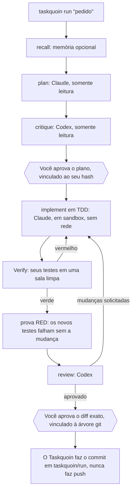

Três ideias percorrem todo o tutorial:

- **Os agentes propõem, o Taskquoin age.** Os agentes nunca fazem commit. O commit é construído pelo Taskquoin a partir
  da árvore que foi verificada, revisada e aprovada ([ADR-0011](../adr/0011-agents-never-commit.md)).
- **Sua aprovação é vinculada a um hash.** Você aprova exatamente o que leu, não "a execução"
  ([ADR-0013](../adr/0013-tree-based-governance.md)).
- **Os testes rodam em uma sala limpa.** O modelo nunca diz ao Taskquoin que os testes passam; o Taskquoin os executa
  por conta própria ([ADR-0014](../adr/0014-verify-in-a-clean-room.md)).

## Passo 1: crie um projeto com um teste que falha

O projeto é uma calculadora de uma única função. O teste existe; a função não.

```shell
$ mkdir calc && cd calc
$ git init -q -b main
```

Crie `package.json`:

```json
{
  "name": "calc",
  "private": true,
  "scripts": { "test": "node --test" }
}
```

Crie `sum.test.js`:

```js
const test = require('node:test');
const assert = require('node:assert');

test('sum', () => {
  const sum = require('./sum.js');
  assert.strictEqual(sum(2, 3), 5);
});
```

Crie `.gitignore` (dependências e artefatos de build nunca fazem parte de um diff do Taskquoin):

```text
node_modules/
```

A saída da CLI é mostrada em inglês neste tutorial (as capturas de tela localizadas mostram a saída traduzida).

Faça o commit:

```shell
$ git add .
$ git commit -m "calc: a failing test for sum"
$ npm test
not ok 1 - sum
  error: Cannot find module './sum.js'
```

O teste está vermelho, como esperado. Um repositório git com a árvore de trabalho limpa é a única pré-condição que o
Taskquoin exige de um projeto: `taskquoin run` se recusa a começar quando há alterações não commitadas, porque ele
nunca mistura as alterações dele com as suas.

## Passo 2: inicialize o Taskquoin

```shell
$ taskquoin init
```

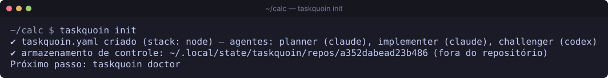

O `init` fez três coisas:

1. Detectou a stack (`node`; ele também conhece `npm test`, PHPUnit, pytest, `go test`, Maven e outros) e escreveu
   `taskquoin.yaml` na raiz do repositório.
2. Procurou ferramentas de IA na sua máquina e escolheu os agentes: aqui, `planner` e `implementer` no Claude Code e
   `challenger` no Codex. Se uma ferramenta estiver ausente, o arquivo avisa; com apenas o Claude Code, o revisor
   também é o Claude. Com apenas o OpenCode, o `init` escreve uma configuração toda em OpenCode.
3. Criou um **control store** fora do repositório, em `${XDG_STATE_HOME:-~/.local/state}/taskquoin/`. É onde ficam o
   estado das execuções, as aprovações e as aceitações de risco. Os agentes não conseguem escrever ali, e é isso que
   torna uma aprovação infalsificável ([ADR-0005](../adr/0005-control-plane-outside-workspace.md)).

O `init` nunca sobrescreve um `taskquoin.yaml` existente. Se você executou o `init` com outras IAs disponíveis (uma
chave de API no seu ambiente, um Ollama local), ele as lista e as propõe como **comentários** no arquivo: descomentá-las
é decisão sua, porque significa que o código desse projeto será enviado a elas.

### O `taskquoin.yaml` gerado

Abra-o. É curto e você pode ler tudo. Aqui está, seção por seção.

```yaml
# Taskquoin project configuration — see docs/architecture.md. Protected: agents can never edit this file.
version: 1
stack: node
```

`version` é a versão do esquema. `stack` seleciona os padrões da sala limpa: quais diretórios de dependências são
montados somente para leitura para os seus testes (para `node`: `node_modules`). O primeiro comentário é uma promessa:
**os agentes nunca podem editar este arquivo.** Se um deles o tocar durante uma execução, a execução para e nada é
commitado.

```yaml
agents:
  planner:
    runtime: claude
    description: "Read-only planner: turns a request into a minimal, test-first implementation plan."
    prompt: You plan; you never modify files. Read the repository, then produce the plan requested.
    capabilities:
      fs.read:
        - "**"
    maxTurns: 30
    skills:
      - planning-contract
```

Um **agente** é um papel associado a um runtime (`claude`, `codex`, `opencode` ou `api` para um juiz). `capabilities` é
o que o agente tem permissão para fazer: o planner pode ler tudo (`fs.read: "**"`) e mais nada, portanto não tem shell
nem ferramenta de escrita. `skills` são instruções fixadas por hash (`planning-contract` é nativa). `maxTurns` limita
os turnos do agente.

```yaml
  implementer:
    runtime: claude
    description: Implements an approved task with strict TDD (RED → GREEN → REFACTOR).
    prompt: "You implement exactly the approved task. Write a failing test first, make it pass with the simplest change, then refactor. Never commit: Taskquoin verifies and commits."
    capabilities:
      fs.read:
        - "**"
      fs.write:
        - "**"
      shell.run:
        - npm test
        - npm test -- *
        - node --test *
    maxTurns: 40
    skills:
      - tdd
```

O implementer pode escrever arquivos e executar uma pequena lista de comandos de teste permitidos (`shell.run`) para
trabalhar começando pelo teste. Esses comandos rodam dentro do sandbox de SO do próprio runtime, sem rede. Mesmo assim,
a execução de testes dele serve só de retorno para ele mesmo: o resultado que conta é o que o Taskquoin produz no
Verify.

```yaml
  challenger:
    runtime: codex
    description: Independent, read-only adversarial reviewer of plans and diffs.
    prompt: "You are an independent reviewer. Challenge the plan or diff: correctness, security, missing tests, over-engineering. Report blocking and non-blocking findings with file:line. Do not modify files."
    capabilities:
      fs.read:
        - "**"
    skills:
      - code-review
```

O **challenger** critica o plano e revisa o diff. Ele é de um fornecedor diferente do implementer de propósito, e é
somente leitura: não deve poder "consertar" aquilo que critica.

```yaml
policy:
  mandatory:
    - fs.write
    - net.egress
    - config.modify
    - connector.write
    - vcs.commit
    - vcs.push
connectors: {}
memory:
  claudeMem:
    enabled: true
```

`policy.mandatory` lista as restrições que **devem** ser aplicadas por um mecanismo para que um agente possa iniciar:
nenhuma escrita fora do seu escopo, nenhuma rede, nenhuma alteração na configuração protegida, nenhuma escrita remota,
nenhum commit, nenhum push. Se a versão do runtime que você tem não consegue aplicar uma delas, o agente é recusado em
vez de iniciado com uma regra que seria apenas um conselho ([ADR-0002](../adr/0002-enforcement-classes.md),
[ADR-0003](../adr/0003-hooks-enforce-prose-asks.md)). `connectors` está vazio: nenhum sistema remoto está conectado
([ADR-0012](../adr/0012-remote-connectors-by-exception.md)). `memory.claudeMem` é opcional: quando habilitado, um
resumo estruturado de cada execução concluída é enviado ao seu worker local do
[claude-mem](https://github.com/thedotmack/claude-mem), e um breve recall é lido no início de uma execução. Defina como
`false` se você não usa o claude-mem. (As telas deste tutorial usam `false`.)

> [!TIP]
> Se os seus testes precisam de um arquivo ignorado que não é um diretório de dependências, como um `dist/` gerado ou um
> `.env.test`, adicione-o explicitamente. Ele passa a ser montado somente para leitura na sala limpa e congelado para o
> agente:
>
> ```yaml
> verify:
>   inherit:
>     - dist
> ```
>
> Um projeto cujos testes não são executados por `npm test` pode definir `verify.command`.

Você também pode usar outras IAs como juízes (qualquer provedor compatível com OpenAI) ou o OpenCode como planner e
implementer; veja [ADR-0016](../adr/0016-judges-by-api.md) e [ADR-0017](../adr/0017-opencode-without-commands.md).

## Passo 3: faça o commit da configuração

`taskquoin.yaml` faz parte do seu projeto, então faça o commit dele. Isso também dá ao Taskquoin a árvore de trabalho
limpa de que ele precisa:

```shell
$ git add taskquoin.yaml
$ git commit -m "chore: taskquoin"
```

## Passo 4: verifique a máquina com doctor

```shell
$ taskquoin doctor
```

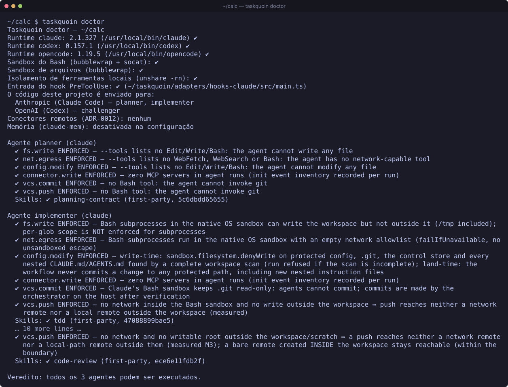

O `doctor` é a parte honesta do Taskquoin. Leia-o de cima para baixo:

- O primeiro bloco lista os runtimes encontrados, com as versões e uma marca de verificação quando a versão é a que o
  Taskquoin mediu, depois os sandboxes (bubblewrap e socat) e o hook.
- **O código deste projeto é enviado a** lista cada fornecedor que receberá o seu código, por agente. O Taskquoin roda
  na sua máquina; apenas as IAs que você configura veem alguma coisa ([ADR-0010](../adr/0010-local-first-no-leak.md)).
- Depois, por agente, cada restrição obrigatória com a sua classe e **o mecanismo que a aplica**, por exemplo
  `net.egress ENFORCED — Bash subprocesses run in the native OS sandbox with an empty network allowlist`. Uma marca de
  verificação significa que está certificada para aquela versão do runtime; um xis significa que o agente não iniciará.
- A última linha é o veredito: `Verdict: all 3 agents can run.` ou `Verdict: 2 of 3 agents can run — refused agents will not be started.`

Na demonstração, uma linha tem um xis (saída da CLI mostrada em inglês):

```text
Agent challenger (codex)
  …
  ✖ connector.write — mandatory restriction "connector.write" (deny-all) on codex 0.157.1: claimed ENFORCED but the mechanism is not measured (inferred). Execution refused (ADR-0002).
```

O Codex diz que aplica `connector.write` (nenhuma escrita em conectores remotos), mas o Taskquoin não tem como medir
essa afirmação, então não a conta como aplicada. O challenger é recusado: uma execução terminaria como
`failed at challenge` com `gate refused agent challenger`. Para este caso, você tem uma decisão a tomar.

## Aceite um risco que você entende

Um **risco aceito** é a sua decisão assinada, datada e delimitada de executar um agente apesar de uma restrição que não
pode ser medida. É uma decisão do dono, não do desenvolvedor, e nunca do agente:

```shell
$ taskquoin accept-risk challenger connector.write \
    --reason "Codex reviews read-only; no connector configured" \
    --expires 2026-12-31 --as you
```

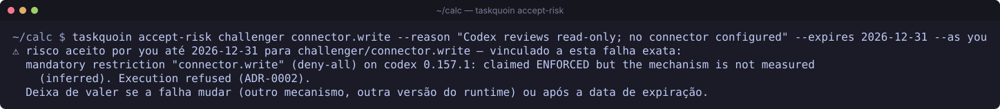

As quatro opções são obrigatórias: `--reason`, `--expires` (uma data futura real, `YYYY-MM-DD`) e `--as` (o seu nome),
além do agente e da capability. Observe o que é a aceitação:

- **Vinculada à falha exata.** Ela armazena um digest da mensagem de falha. Se a versão do runtime mudar, ou o
  mecanismo mudar, a falha deixa de ser a mesma e a aceitação deixa de valer.
- **Datada.** Ela também deixa de valer depois da data de expiração.
- **Armazenada fora do repositório**, no control store. Ninguém consegue adicionar uma editando `taskquoin.yaml`, e
  nenhum agente consegue escrevê-la.
- **Restrita.** Vale apenas para este agente e esta capability. É recusada para uma capability que não está falhando e
  não está disponível para juízes de API (eles são sempre verificados).

Execute `doctor` de novo. A linha agora é um aviso em vez de um xis, e o veredito é `all 3 agents can run`:

```text
  ⚠ connector.write accepted risk (approved by you until 2026-12-31: Codex reviews read-only; no connector configured) — mandatory restriction "connector.write" (deny-all) on codex 0.157.1: claimed ENFORCED but the mechanism is not measured (inferred). Execution refused (ADR-0002).
```

`taskquoin check challenger` mostra o mesmo detalhe para um único agente:

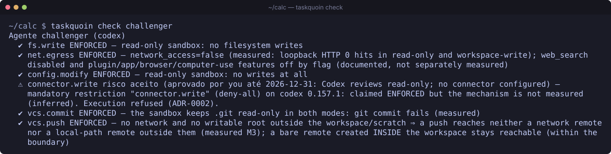

> [!IMPORTANT]
> Aceite um risco somente quando você o entende e a situação corresponde ao seu motivo: aqui o Codex revisa em modo
> somente leitura e o seu projeto não tem conector, então uma "escrita em conector" não pode acontecer de qualquer forma.
> Não aceite um risco só para fazer uma linha vermelha desaparecer. Em particular:
>
> - nunca para `fs.write`, `net.egress`, `vcs.commit` ou `vcs.push` em um agente que realmente escreve ou executa
>   comandos, a menos que você consiga nomear o controle compensatório;
> - nunca com um motivo vago: ele é registrado na aprovação e exibido pelo `doctor`;
> - prefira uma expiração curta: a aceitação é um lembrete para reverificar depois de uma atualização;
> - se um mecanismo foi *medido como falhando*, atualize ou troque de runtime.

Executar `taskquoin accept-risk` você mesmo é deliberado: se o console ou um agente pudesse fazê-lo, o controle não
significaria nada.

## Passo 5: inicie a execução

```shell
$ taskquoin run "Add a sum function"
```

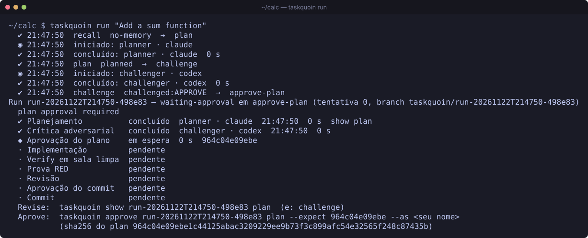

O seu terminal fica quieto enquanto os agentes trabalham e depois imprime onde parou. Em ordem, o Taskquoin fez isto:

1. **Preflight.** O Taskquoin verificou que a configuração define todos os papéis, que as skills são utilizáveis, que os
   papéis somente leitura realmente são somente leitura e que os juízes de API têm as suas chaves. A árvore de trabalho
   precisa estar limpa. Cada agente também passa pelo mesmo portão do `doctor` logo antes de ser usado pela primeira
   vez: um agente recusado encerra a execução como `failed`.
2. **Branch.** Criou o branch `taskquoin/run-20261122T132108-d17040` e passou para ele. O seu `main` não foi tocado.
3. **Recall.** Pediu ao worker de memória, se habilitado, notas relevantes. O journal mostra `recall no-memory` quando
   não há nenhuma.
4. **Plan.** O `planner` (Claude, somente leitura) leu o repositório e escreveu um plano: objetivo, o teste a escrever
   primeiro, arquivos, passos, riscos.
5. **Critique.** O `challenger` (Codex, somente leitura) questionou esse plano de forma independente e terminou com uma
   linha `VERDICT:`.
6. **Gate.** O fluxo parou em `approve-plan`. Ele espera o tempo que você quiser.

O id da execução (`run-20261122T132108-d17040`) é um timestamp e um sufixo aleatório. Você o usa em todos os comandos
seguintes. `taskquoin status` sem argumento lista as execuções (saída da CLI mostrada em inglês):

```shell
$ taskquoin status
run-20261122T132108-d17040  waiting-approval approve-plan    Add a sum function
```

## Passo 6: leia e aprove o plano

`status <run>` mostra o histórico de uma execução e, em um portão, o comando exato que o aprova:

```shell
$ taskquoin status run-20261122T132108-d17040
```

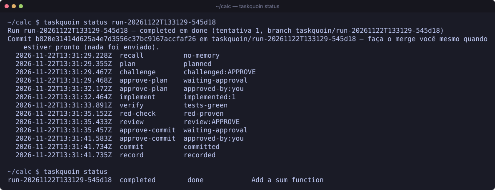

Cada linha do histórico é uma etapa do fluxo com o seu resultado (`planned`, `challenged:APPROVE`,
`waiting-approval`).

Agora **leia o que você está prestes a aprovar**:

```shell
$ taskquoin show run-20261122T132108-d17040 plan
```

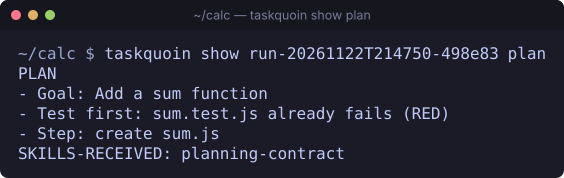

```shell
$ taskquoin show run-20261122T132108-d17040 challenge
Review: plan checked.
VERDICT: APPROVE
```

`show <run>` sem artefato lista tudo o que já foi armazenado, com o tamanho em bytes. Um plano de um agente real
também cobre os arquivos a alterar, os testes a escrever primeiro e os riscos. A crítica é a segunda opinião
independente: pode listar achados bloqueantes e não bloqueantes. Se o plano estiver errado, não o aprove: inicie uma
nova execução com um pedido mais preciso.

### Por que o hash

A linha que importa é a última do `status`:

```text
Approve it:  taskquoin approve run-20261122T132108-d17040 plan --expect 964c04e09ebe --as <your name>
             (plan sha256 964c04e09ebe1c44125abac3209229ee9b73f3c899afc54e32565f248c87435b)
```

`964c04e09ebe` é o início do SHA-256 do arquivo do plano que você acabou de ler. Aprovar não significa "aprovo esta
execução"; significa "aprovo **o plano cujo hash é 964c04e09ebe**". Se o plano pudesse mudar entre a sua leitura e a
sua aprovação (uma nova tentativa, outro processo, uma ferramenta comprometida), o hash deixaria de coincidir e o
Taskquoin recusaria. É também o que o commit registra, de modo que qualquer pessoa pode auditar depois o que alguém
aprovou.

> [!NOTE]
> `--expect` não é uma senha. É uma prova de que você olhou o artefato sobre o qual o sistema está prestes a agir: você
> o copia do `status` depois de ler. No [console](../getting-started/console.md), você o digita de novo para confirmar.

Aprove:

```shell
$ taskquoin approve run-20261122T132108-d17040 plan --expect 964c04e09ebe --as you
```

`--as` é o seu nome; ele é registrado como `Plan-Approved-By` no commit. Aprovar o plano retoma o fluxo, que continua
até o próximo portão.

### Um hash errado é recusado

Tente um hash que não é o pendente (saída da CLI mostrada em inglês):

```shell
$ taskquoin approve run-20261122T132108-d17040 plan --expect 000000000000 --as you
taskquoin approve: expected 000000000000 does not match the pending artifact 964c04e09ebe… — re-read it before approving
```

Nada foi aprovado e a execução continua igual. O mesmo acontece se você aprovar um portão que a execução não está
aguardando. A captura de tela abaixo foi feita depois que a execução já tinha terminado, então mostra essa variante da
recusa:

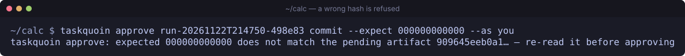

O código de saída de uma recusa é 1. Um comando digitado errado (um `--expect` ou `--as` ausente) sai com 2.

## Passo 7: implementação, Verify e revisão

Depois de `approve … plan`, o Taskquoin trabalha sem você:

1. **Implementação em TDD.** O `implementer` (Claude) trabalha no branch, no sandbox do runtime, sem rede e sem
   nenhuma forma de fazer commit. Ele escreve ou ajusta os testes primeiro e depois o código mais simples que os faz
   passar.
2. **Verify, em uma sala limpa.** O Taskquoin pega a árvore exata que o implementer deixou e executa você mesmo os seus
   testes (`npm test`), em uma cópia descartável fora do seu repositório: sem rede, `.git` somente leitura, o seu HOME
   oculto, arquivos secretos mascarados e apenas os diretórios de dependências da stack (e o seu `verify.inherit`)
   montados somente para leitura. Um teste que passa mas dependia de algo não commitado falha aqui, e esse é o ponto.
3. **Prova RED.** O Taskquoin então remove a mudança de produção e executa de novo os testes alterados. Eles devem
   **falhar**. Um teste que passa sem a mudança não testa nada. A prova é mecânica: ela não mostra que o teste
   verifica o comportamento certo (é para isso que servem a revisão e você).
4. **Revisão.** O `challenger` revisa o diff em relação ao plano, com os logs de verify e RED. Ele termina com uma
   linha `VERDICT:`.

Se os testes estiverem vermelhos, ou a prova RED falhar, ou a revisão pedir mudanças, o Taskquoin envia o feedback ao
implementer para um retrabalho automático (até 3 tentativas de implementação, com no máximo 2 rodadas de retrabalho
após uma revisão recusada). A execução então para no segundo portão.

## Passo 8: leia e aprove o commit

A execução agora está esperando de novo. Veja-a (saída da CLI mostrada em inglês):

```shell
$ taskquoin status run-20261122T132108-d17040
Run run-20261122T132108-d17040 — waiting-approval at approve-commit (attempt 1, branch taskquoin/run-20261122T132108-d17040)
  commit approval required (bound to the exact tree)
  Review it:   taskquoin show run-20261122T132108-d17040 diff-1  (and: verify-1, red-1, review-1)
  Approve it:  taskquoin approve run-20261122T132108-d17040 commit --expect 909645eeb0a1 --as <your name>
               (git tree 909645eeb0a1716e60fd724784ede536fbea048f)
```

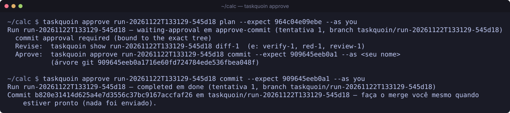

Desta vez o hash é a **árvore git** que passou pelo Verify e pela revisão. Leia os quatro artefatos da tentativa 1. O
número é a tentativa; depois de um retrabalho, você lê o mais alto.

### `diff-1`: a mudança exata

```shell
$ taskquoin show run-20261122T132108-d17040 diff-1
```

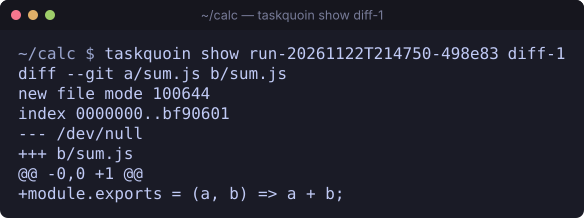

Isto é o que será commitado, nada além. Se o agente tivesse alterado um arquivo protegido (o seu CI, `.claude/`,
`AGENTS.md`, `taskquoin.yaml`), a execução teria parado com `protected configuration changed`. Os arquivos que o seu
`.gitignore` oculta mas que o agente criou são listados em `ignored-1`; eles não estão no diff, não são verificados e
não são commitados.

### `verify-1`: seus testes, executados pelo Taskquoin

```shell
$ taskquoin show run-20261122T132108-d17040 verify-1
```

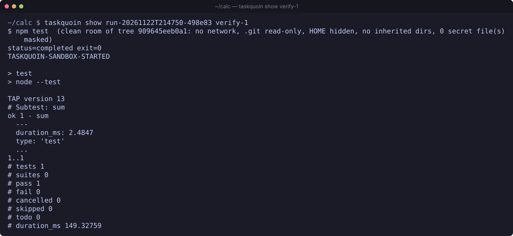

O cabeçalho diz o que era a sala limpa (`no network, .git read-only, HOME hidden, … 0 secret file(s) masked`) e para
qual árvore (`909645eeb0a1`, o mesmo hash que você vai aprovar). `exit=0` e `# pass 1` vêm do executor de testes, não
da afirmação de um modelo.

### `red-1`: a prova de que o teste importa

```shell
$ taskquoin show run-20261122T132108-d17040 red-1
TASKQUOIN RED PROOF — tests run on base + test changes only (tree 9848f565e24c); they must FAIL.
RESULT: they failed as required (RED proven).

$ npm test  (clean room of tree 9848f565e24c: no network, .git read-only, HOME hidden, no inherited dirs, 0 secret file(s) masked)
status=failed exit=1
…
not ok 1 - sum
  error: Cannot find module './sum.js'
  code: 'MODULE_NOT_FOUND'
```

Aqui o novo arquivo de produção `sum.js` foi removido, o teste não conseguiu carregá-lo e falhou. Essa falha é a prova
RED. O Taskquoin trata um erro de importação de uma funcionalidade em um arquivo *novo* como o RED esperado. Se apenas
arquivos de teste mudaram (uma adição pura de testes), a prova é registrada como "not applicable".

### `review-1`: a segunda opinião

```shell
$ taskquoin show run-20261122T132108-d17040 review-1
Review: diff checked against the plan.
VERDICT: APPROVE
```

Leia os achados, não apenas o veredito. `ignored-1` só aparece na lista quando há algo para ler.

### Aprove o commit

Se estiver satisfeito, aprove com o hash do `status`:

```shell
$ taskquoin approve run-20261122T132108-d17040 commit --expect 909645eeb0a1 --as you
Run run-20261122T132108-d17040 — completed at done (attempt 1, branch taskquoin/run-20261122T132108-d17040)
Committed a3c6b801de5f4356750f53870557e2fdd19958ee on taskquoin/run-20261122T132108-d17040 — merge it yourself when ready (nothing was pushed).
```

`approve … commit` deve ser executado enquanto o repositório está no branch da execução (`taskquoin/<run>`); caso
contrário responde `switch to taskquoin/<run> first`. O Taskquoin relê a árvore de trabalho antes de fazer o commit. Se
algo mudou desde que você olhou, a sua aprovação deixa de valer: ele reverifica, revisa de novo e pede que você aprove
a nova árvore.

O Taskquoin então constrói o commit **a partir da própria árvore git aprovada**, não de um `git add`. Fica assim:

```shell
$ git log -1 taskquoin/run-20261122T132108-d17040
```

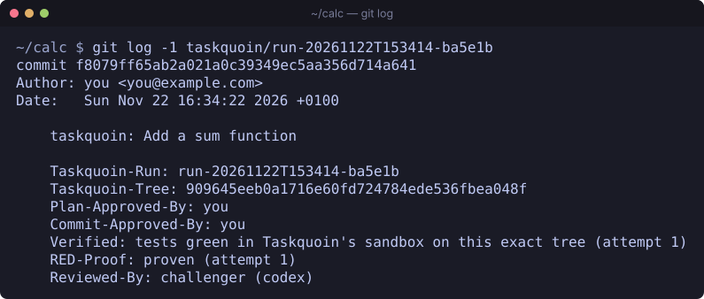

```text
taskquoin: Add a sum function

Taskquoin-Run: run-20261122T132108-d17040
Taskquoin-Tree: 909645eeb0a1716e60fd724784ede536fbea048f
Plan-Approved-By: you
Commit-Approved-By: you
Verified: tests green in Taskquoin's sandbox on this exact tree (attempt 1)
RED-Proof: proven (attempt 1)
Reviewed-By: challenger (codex)
```

Os trailers são a trilha de auditoria, no próprio commit:

| Trailer | Significado |
|---|---|
| `Taskquoin-Run` | A execução que fez este commit |
| `Taskquoin-Tree` | A árvore git que foi verificada, revisada e aprovada. É a árvore deste commit |
| `Plan-Approved-By` | O nome informado com `--as` no portão do plano |
| `Commit-Approved-By` | O nome informado com `--as` no portão do commit |
| `Verified` | Os testes estavam verdes na sala limpa nesta árvore exata |
| `RED-Proof` | Os testes alterados falharam sem a mudança (`proven`, ou `not applicable` para mudanças só de teste) |
| `Reviewed-By` | Os agentes que revisaram e aprovaram; um juiz de API acrescenta a sua própria linha |

`taskquoin status <run>` no final mostra o journal completo, de `recall` até `commit` e `record`.

## Passo 9: faça o merge do resultado

O Taskquoin **nunca faz push** e nunca faz merge no seu branch. O commit está em `taskquoin/<run>`, o branch em que
você está. Faça o merge você mesmo, ou abra um pull request a partir dele:

```shell
$ git switch main
$ git merge --ff-only taskquoin/run-20261122T132108-d17040
$ npm test
```

> [!WARNING]
> O Taskquoin não executa os hooks de commit do seu repositório, porque eles poderiam conter código que o agente
> modificou. Execute você mesmo os seus hooks, linters e CI ao fazer o merge.

Os branches `taskquoin/<run>` são seus: apague-os quando não precisar mais deles (`git branch -d taskquoin/<run>`).

## Quando as coisas não saem como planejado

As mensagens de erro do Taskquoin seguem o seu idioma, mas as mensagens do motor de execução (`failed`, `needs-human`,
`interrupted`) são sempre em inglês. A tabela lista o que você mais vai encontrar.

| O que você vê | O que significa | O que fazer |
|---|---|---|
| `taskquoin run: the working tree has uncommitted changes` | O Taskquoin nunca mistura as alterações dele com as suas | Faça commit ou stash das suas alterações |
| `failed … gate refused agent X` | Um agente não pode ser certificado nesta máquina | `taskquoin doctor` diz o motivo: versão do runtime, sandbox ausente, um risco que você não aceitou |
| `needs-human … tests still failing after 3 attempts` | Três tentativas não deram testes verdes | Assuma no branch da execução, ou inicie uma nova execução com um pedido mais preciso |
| `needs-human … no failing test demonstrates the change` | Os testes passam mesmo sem a mudança de produção, então não a testam | Leia `red-N`; escreva (ou peça) um teste que falhe antes da mudança. Um refactor ou uma mudança de documentação sem novo teste termina aqui: faça o commit você mesmo a partir do branch |
| `needs-human … RED proof inconclusive` | A prova não pôde rodar direito (timeout, sandbox, uma árvore que não pôde ser reconstruída). Não é uma prova | Leia `red-N`. A sua pasta de trabalho não foi tocada |
| `needs-human … review still requests changes after N attempts` | O revisor continuou recusando | Leia `review-N` e decida; o branch tem o trabalho |
| `needs-human … dependencies changed during the run` | `node_modules` (ou `vendor`, `.venv`) mudou durante a execução, então nada é verificado com ele | Reinstale (`npm ci`) e inicie uma nova execução. Não execute `npm install` durante uma execução |
| `needs-human … protected configuration changed` | O agente tocou na configuração protegida (CI, `.claude/`, `AGENTS.md`, `taskquoin.yaml`) | Nada foi commitado; inspecione o branch |
| Os testes passam para você mas falham no Verify | Eles usam um arquivo ignorado ausente da sala limpa | Adicione-o a `verify.inherit` |
| `does not match the pending artifact` | O hash informado não é o pendente | Leia com `show`, copie o hash do `status` |
| `switch to taskquoin/<run> first` | Você não está no branch da execução | `git switch taskquoin/<run>` |
| `taskquoin.yaml changed since the run started` | A configuração mudou no meio da execução | Inicie uma nova execução |
| `interrupted` | Um erro técnico (git, disco, um HTTP 503 de um juiz) interrompeu a execução | `taskquoin resume <run>` |

### Quando os testes continuam vermelhos

Se o Verify falhar, o Taskquoin dá ao implementer o log da falha e a revisão e tenta de novo, até três tentativas de
implementação (um implementer OpenCode, que não tem comando próprio, recebe mais retrabalhos). Se os testes continuarem
vermelhos, a execução termina com o status `needs-human` e o motivo `tests still failing after 3 attempts`. Não há
commit nem pedido de aprovação.

Tudo é mantido: `taskquoin show <run> verify-3` tem o último log, e o branch `taskquoin/<run>` guarda o trabalho do
agente. Você pode continuar à mão nesse branch, ou iniciar uma nova execução com um pedido mais preciso. Uma execução
`needs-human` não é retomada automaticamente.

### `resume`: depois de uma interrupção

Uma execução fica `interrupted` quando algo fora do fluxo a quebrou (um erro de rede ao alcançar um juiz, um disco
cheio, a sua máquina entrando em suspensão). O estado é salvo a cada etapa e as respostas dos juízes são salvas uma a
uma, então retomar nunca chama, nem paga, um juiz duas vezes:

```shell
$ taskquoin resume run-20261122T132108-d17040
```

`resume` só aceita uma execução cujo status seja `interrupted`. Para qualquer outro status ele avisa, por exemplo
`taskquoin resume: only an interrupted run can be resumed (status completed)`. Se o status for `needs-human` ou
`failed`, inicie uma nova execução.

### Uma regra prática

Se você não sabe o que fazer, execute `taskquoin status <run>`: ele imprime o status, o journal e o próximo comando
exato. `taskquoin doctor` responde a qualquer pergunta sobre a máquina.

## Saiba mais

- [O console interativo](../getting-started/console.md): o mesmo fluxo, com `/run` e `/approve`
- [Instalação](../getting-started/installation.md)
- [ADR-0011, agents never commit](../adr/0011-agents-never-commit.md)
- [ADR-0013, tree-based governance](../adr/0013-tree-based-governance.md)
- [ADR-0014, Verify in a clean room](../adr/0014-verify-in-a-clean-room.md)
- [ADR-0002, enforcement classes](../adr/0002-enforcement-classes.md)
- [ADR-0005, control plane outside the workspace](../adr/0005-control-plane-outside-workspace.md)
- [ADR-0016, judges by API](../adr/0016-judges-by-api.md) e [ADR-0017, OpenCode without commands](../adr/0017-opencode-without-commands.md)
