# Ваш первый управляемый запуск

Этот учебник является переводом [английской справочной страницы](../getting-started/first-run.md). Это машинный перевод: его проверяют тесты сопровождающих на командах, а не носитель языка.

Этот учебник проведёт вас от пустой папки до проверенного коммита, сделанного Taskquoin, команда за командой. Вы создадите крошечный проект с падающим тестом, позволите Taskquoin спланировать и реализовать исправление с помощью ИИ-агентов и дважды подтвердите работу: один раз после чтения плана, другой после чтения точного диффа. На каждом шаге вы видите, что делает Taskquoin, почему он останавливается и под чем вы ставите подпись.

- [Что вы построите](#что-вы-построите)
- [Шаг 1: создайте проект с падающим тестом](#шаг-1-создайте-проект-с-падающим-тестом)
- [Шаг 2: инициализируйте Taskquoin](#шаг-2-инициализируйте-taskquoin)
- [Шаг 3: закоммитьте конфигурацию](#шаг-3-закоммитьте-конфигурацию)
- [Шаг 4: проверьте машину с помощью doctor](#шаг-4-проверьте-машину-с-помощью-doctor)
- [Примите риск, который вы понимаете](#примите-риск-который-вы-понимаете)
- [Шаг 5: запустите run](#шаг-5-запустите-run)
- [Шаг 6: прочтите и одобрите план](#шаг-6-прочтите-и-одобрите-план)
- [Шаг 7: реализация, Verify и ревью](#шаг-7-реализация-verify-и-ревью)
- [Шаг 8: прочтите и одобрите коммит](#шаг-8-прочтите-и-одобрите-коммит)
- [Шаг 9: слейте результат](#шаг-9-слейте-результат)
- [Когда всё идёт не по плану](#когда-всё-идёт-не-по-плану)
- [Узнайте больше](#узнайте-больше)

> [!NOTE]
> Скриншоты сделаны на демонстрационном репозитории с имитацией ИИ-агентов (тестовые двойники из собственного набора тестов Taskquoin); каждая команда — настоящий CLI Taskquoin. С настоящими Claude Code и Codex формулировки плана и ревью принадлежат самим агентам, а запуск занимает несколько минут вместо секунд. Всё остальное идентично.

Прежде чем начать, [установите Taskquoin](../getting-started/installation.md) и убедитесь, что доступны Node 22.18+, git, `bubblewrap` и `socat`, а также что установлен и авторизован как минимум Claude Code (а лучше и Codex).

## Что вы построите

Запуск — это фиксированный рабочий процесс. Два ромба — два подтверждения человеком; без вас дальше них ничто не движется.

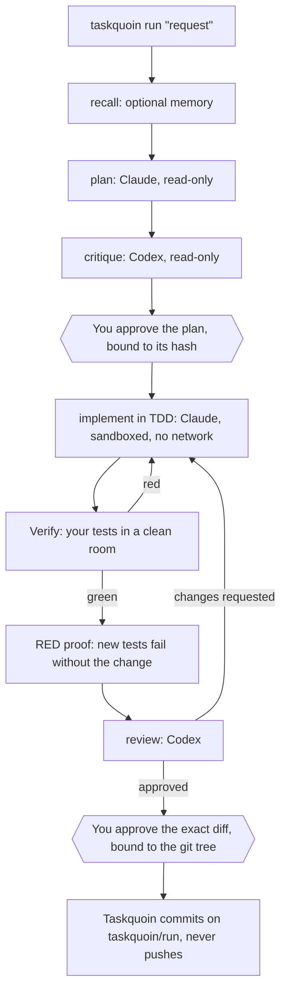

Через весь учебник проходят три идеи:

- **Агенты предлагают, Taskquoin действует.** Агенты никогда не делают коммиты. Коммит строит сам Taskquoin из дерева, которое было проверено, просмотрено и одобрено ([ADR-0011](../adr/0011-agents-never-commit.md)).
- **Ваше подтверждение привязано к хешу.** Вы одобряете ровно то, что прочли, а не «запуск» ([ADR-0013](../adr/0013-tree-based-governance.md)).
- **Тесты выполняются в чистой комнате.** Модель никогда не сообщает Taskquoin, что тесты проходят: Taskquoin запускает их сам ([ADR-0014](../adr/0014-verify-in-a-clean-room.md)).

## Шаг 1: создайте проект с падающим тестом

Проект — калькулятор из одной функции. Тест есть, функции нет.

```shell
$ mkdir calc && cd calc
$ git init -q -b main
```

Создайте `package.json`:

```json
{
  "name": "calc",
  "private": true,
  "scripts": { "test": "node --test" }
}
```

Создайте `sum.test.js`:

```js
const test = require('node:test');
const assert = require('node:assert');

test('sum', () => {
  const sum = require('./sum.js');
  assert.strictEqual(sum(2, 3), 5);
});
```

Создайте `.gitignore` (зависимости и результаты сборки никогда не входят в дифф Taskquoin):

```text
node_modules/
```

Зафиксируйте это в коммите (вывод команд ниже показан на английском):

```shell
$ git add .
$ git commit -m "calc: a failing test for sum"
$ npm test
not ok 1 - sum
  error: Cannot find module './sum.js'
```

Тест красный, как и ожидалось. Единственное требование Taskquoin к проекту — git-репозиторий с чистым рабочим деревом: `taskquoin run` отказывается стартовать при незакоммиченных изменениях, потому что он никогда не смешивает свои изменения с вашими.

## Шаг 2: инициализируйте Taskquoin

```shell
$ taskquoin init
```

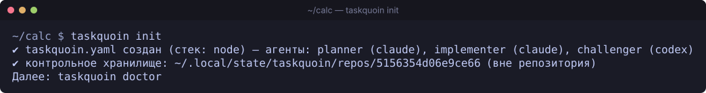

`init` сделал три вещи:

1. Определил стек (`node`; он также знает `npm test`, PHPUnit, pytest, `go test`, Maven и другие) и записал `taskquoin.yaml` в корень репозитория.
2. Поискал ИИ-инструменты на вашей машине и выбрал агентов: здесь `planner` и `implementer` работают на Claude Code, а `challenger` — на Codex. Если инструмента нет, файл сообщает об этом; при наличии только Claude Code ревьюером тоже будет Claude. При наличии только OpenCode `init` записывает конфигурацию целиком на OpenCode.
3. Создал **хранилище управления** вне репозитория, в `${XDG_STATE_HOME:-~/.local/state}/taskquoin/`. Там живут состояние запусков, подтверждения и принятые риски. Агенты не могут туда писать, и именно поэтому подтверждение нельзя подделать ([ADR-0005](../adr/0005-control-plane-outside-workspace.md)).

`init` никогда не перезаписывает существующий `taskquoin.yaml`. Если вы запускали `init` при наличии других ИИ (ключ API в окружении, локальный Ollama), он перечисляет их и предлагает в файле в виде **комментариев**: раскомментировать их — ваше решение, ведь это означает, что код проекта будет отправлен им.

### Сгенерированный `taskquoin.yaml`

Откройте его. Он короткий, и вы можете прочесть его целиком. Вот он, раздел за разделом.

```yaml
# Taskquoin project configuration — see docs/architecture.md. Protected: agents can never edit this file.
version: 1
stack: node
```

`version` — версия схемы. `stack` выбирает значения по умолчанию для чистой комнаты: какие каталоги зависимостей монтируются для ваших тестов только для чтения (для `node`: `node_modules`). Первый комментарий — обещание: **агенты никогда не могут редактировать этот файл.** Если агент коснётся его во время запуска, запуск остановится, и ничего не будет закоммичено.

```yaml
agents:
  planner:
    runtime: claude
    description: "Read-only planner: turns a request into a minimal, test-first implementation plan."
    prompt: You plan; you never modify files. Read the repository, then produce the plan requested.
    capabilities:
      fs.read:
        - "**"
    maxTurns: 30
    skills:
      - planning-contract
```

**Агент** — это роль, привязанная к рантайму (`claude`, `codex`, `opencode` или `api` для судьи). `capabilities` — то, что агенту разрешено делать: planner может читать всё (`fs.read: "**"`) и больше ничего, то есть у него нет ни оболочки, ни инструмента записи. `skills` — инструкции, закреплённые по хешу (`planning-contract` входит в поставку). `maxTurns` ограничивает число ходов агента.

```yaml
  implementer:
    runtime: claude
    description: Implements an approved task with strict TDD (RED → GREEN → REFACTOR).
    prompt: "You implement exactly the approved task. Write a failing test first, make it pass with the simplest change, then refactor. Never commit: Taskquoin verifies and commits."
    capabilities:
      fs.read:
        - "**"
      fs.write:
        - "**"
      shell.run:
        - npm test
        - npm test -- *
        - node --test *
    maxTurns: 40
    skills:
      - tdd
```

Implementer может записывать файлы и запускать небольшой белый список тестовых команд (`shell.run`), чтобы работать по принципу «тест вперёд». Эти команды выполняются внутри собственной песочницы ОС рантайма, без сети. Тем не менее его запуск тестов нужен лишь ему самому для обратной связи: значение имеет результат, который Taskquoin получает на этапе Verify.

```yaml
  challenger:
    runtime: codex
    description: Independent, read-only adversarial reviewer of plans and diffs.
    prompt: "You are an independent reviewer. Challenge the plan or diff: correctness, security, missing tests, over-engineering. Report blocking and non-blocking findings with file:line. Do not modify files."
    capabilities:
      fs.read:
        - "**"
    skills:
      - code-review
```

**Challenger** критикует план и ревьюит дифф. Он намеренно от другого вендора, чем implementer, и работает только на чтение: он не должен иметь возможности «исправить» то, что критикует.

```yaml
policy:
  mandatory:
    - fs.write
    - net.egress
    - config.modify
    - connector.write
    - vcs.commit
    - vcs.push
connectors: {}
memory:
  claudeMem:
    enabled: true
```

`policy.mandatory` перечисляет ограничения, которые **должны** обеспечиваться реальным механизмом, чтобы агент мог стартовать: никакой записи вне его области, никакой сети, никаких изменений защищённой конфигурации, никакой записи в удалённые системы, никаких коммитов, никаких push. Если имеющаяся у вас версия рантайма не может обеспечить одно из них, агент получает отказ, а не стартует с правилом, которое является лишь советом ([ADR-0002](../adr/0002-enforcement-classes.md), [ADR-0003](../adr/0003-hooks-enforce-prose-asks.md)). `connectors` пуст: ни одна удалённая система не подключена ([ADR-0012](../adr/0012-remote-connectors-by-exception.md)). `memory.claudeMem` необязателен: когда он включён, структурированная сводка каждого завершённого запуска отправляется вашему локальному воркеру [claude-mem](https://github.com/thedotmack/claude-mem), а в начале запуска считывается краткая справка. Установите `false`, если вы не используете claude-mem. (На скриншотах этого учебника стоит `false`.)

> [!TIP]
> Если вашим тестам нужен игнорируемый файл, не являющийся каталогом зависимостей, например собранный `dist/` или `.env.test`, добавьте его явно. Тогда он монтируется в чистой комнате только для чтения и замораживается для агента:
>
```yaml
verify:
  inherit:
    - dist
```
>
> Проект, тесты которого запускаются не через `npm test`, может задать `verify.command`.

Вы также можете использовать другие ИИ в роли судей (любой OpenAI-совместимый провайдер) или OpenCode в роли planner и implementer; см. [ADR-0016](../adr/0016-judges-by-api.md) и [ADR-0017](../adr/0017-opencode-without-commands.md).

## Шаг 3: закоммитьте конфигурацию

`taskquoin.yaml` — часть вашего проекта, поэтому закоммитьте его. Это заодно даёт Taskquoin нужное ему чистое рабочее дерево:

```shell
$ git add taskquoin.yaml
$ git commit -m "chore: taskquoin"
```

## Шаг 4: проверьте машину с помощью doctor

```shell
$ taskquoin doctor
```

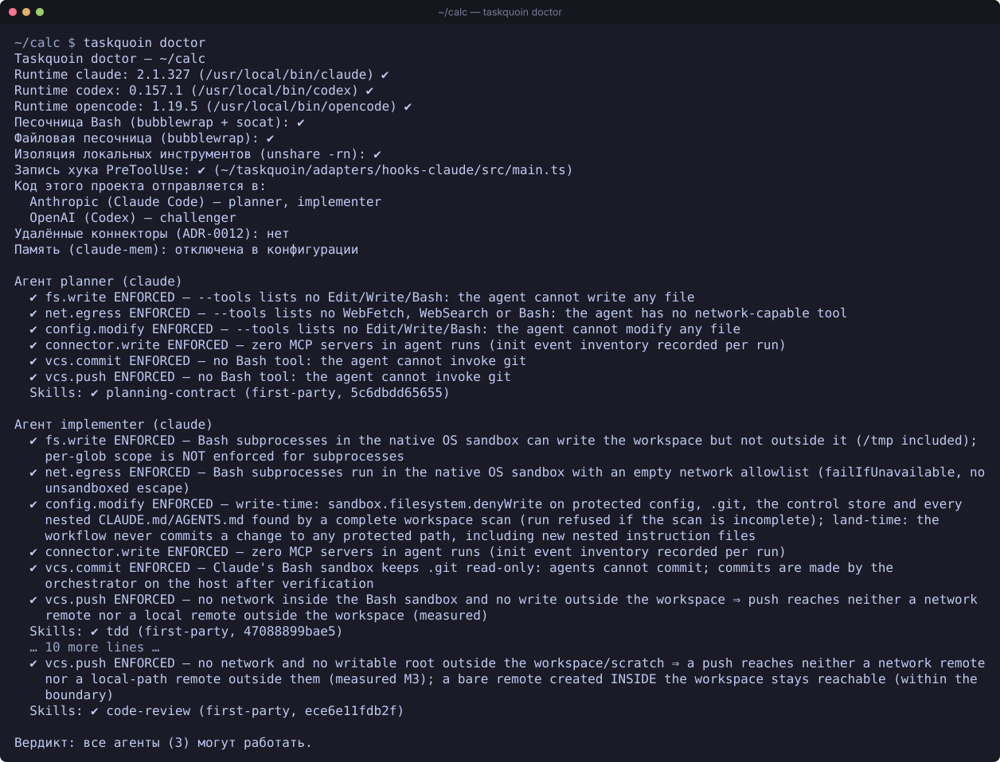

`doctor` — честная часть Taskquoin. Читайте его сверху вниз:

- Первый блок перечисляет найденные рантаймы с версиями и галочкой, когда версия совпадает с той, которую Taskquoin измерил, затем песочницы (bubblewrap и socat) и хук.
- **This project's code is sent to** перечисляет каждого вендора, который получит ваш код, по агентам. Taskquoin работает на вашей машине; что-либо видят только настроенные вами ИИ ([ADR-0010](../adr/0010-local-first-no-leak.md)).
- Затем по каждому агенту — каждое обязательное ограничение с его классом и **механизмом, который его обеспечивает**, например `net.egress ENFORCED — Bash subprocesses run in the native OS sandbox with an empty network allowlist`. Галочка означает, что ограничение сертифицировано для этой версии рантайма; крестик — что агент не запустится.
- Последняя строка — вердикт: `Verdict: all 3 agents can run.` или `Verdict: 2 of 3 agents can run — refused agents will not be started.`

В демонстрации одна строка помечена крестиком (вывод показан на английском):

```text
Agent challenger (codex)
  …
  ✖ connector.write — mandatory restriction "connector.write" (deny-all) on codex 0.157.1: claimed ENFORCED but the mechanism is not measured (inferred). Execution refused (ADR-0002).
```

Codex заявляет, что обеспечивает `connector.write` (запрет записи в удалённые коннекторы), но Taskquoin не может измерить это утверждение, поэтому не считает ограничение обеспеченным. Challenger получает отказ: запуск закончился бы как `failed at challenge` с `gate refused agent challenger`. Здесь вам нужно принять решение.

## Примите риск, который вы понимаете

**Принятый риск** — это ваше подписанное, датированное решение с ограниченной областью запустить агента, несмотря на одно ограничение, которое невозможно измерить. Это решение владельца, а не разработчика и тем более не агента:

```shell
$ taskquoin accept-risk challenger connector.write \
    --reason "Codex reviews read-only; no connector configured" \
    --expires 2026-12-31 --as you
```

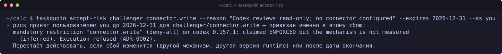

Все четыре параметра обязательны: `--reason`, `--expires` (реальная будущая дата в формате `YYYY-MM-DD`) и `--as` (ваше имя), а также агент и capability. Обратите внимание, чем является принятие:

- **Привязано к конкретному сбою.** Сохраняется дайджест сообщения о сбое. Если версия рантайма или механизм изменились, сбой уже не тот же самый, и принятие перестаёт действовать.
- **Датировано.** Оно также перестаёт действовать после даты истечения.
- **Хранится вне репозитория**, в хранилище управления. Никто не может добавить его правкой `taskquoin.yaml`, и ни один агент не может его записать.
- **Узко.** Оно относится только к этому агенту и этой capability. Для capability, которая не даёт сбоя, оно отклоняется, и оно недоступно для API-судей (их всегда проверяют).

Снова запустите `doctor`. Строка теперь предупреждение, а не крестик, и вердикт — `all 3 agents can run` (вывод показан на английском):

```text
  ⚠ connector.write accepted risk (approved by you until 2026-12-31: Codex reviews read-only; no connector configured) — mandatory restriction "connector.write" (deny-all) on codex 0.157.1: claimed ENFORCED but the mechanism is not measured (inferred). Execution refused (ADR-0002).
```

`taskquoin check challenger` показывает те же подробности для одного агента:

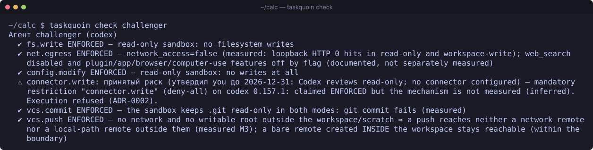

> [!IMPORTANT]
> Принимайте риск только тогда, когда вы его понимаете и ситуация соответствует вашей причине: здесь Codex ревьюит только на чтение, а в вашем проекте нет коннектора, так что «запись в коннектор» всё равно невозможна. Не принимайте риск ради того, чтобы убрать красную строку. В частности:
>
> - никогда для `fs.write`, `net.egress`, `vcs.commit` или `vcs.push` у агента, который действительно пишет или запускает команды, если вы не можете назвать компенсирующий контроль;
> - никогда с расплывчатой причиной: она записывается в подтверждение и показывается `doctor`;
> - предпочитайте короткий срок: принятие — это напоминание перепроверить после обновления;
> - если механизм *измерен как не работающий*, лучше обновите или смените рантайм.

Запускать `taskquoin accept-risk` самому — это сознательное решение: если бы это могли сделать консоль или агент, контроль ничего бы не стоил.

## Шаг 5: запустите run

```shell
$ taskquoin run "Add a sum function"
```

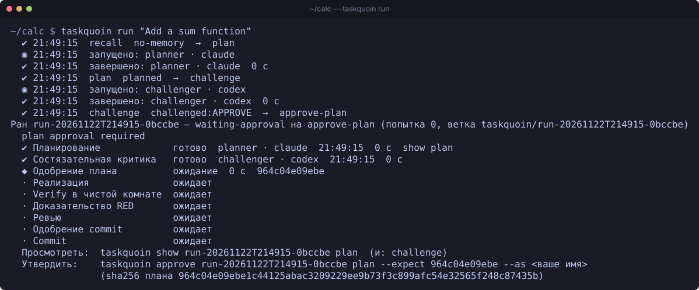

Терминал молчит, пока работают агенты, а затем печатает, где остановился. По порядку Taskquoin сделал следующее:

1. **Preflight.** Taskquoin проверил, что конфигурация определяет каждую роль, что навыки пригодны к использованию, что роли только для чтения действительно только для чтения и что у API-судей есть ключи. Рабочее дерево должно быть чистым. Каждый агент также проходит тот же гейт, что и `doctor`, непосредственно перед первым использованием: отказанный агент завершает запуск как `failed`.
2. **Ветка.** Он создал ветку `taskquoin/run-20261122T132108-d17040` и переключился на неё. Ваша `main` не тронута.
3. **Recall.** Он запросил у воркера памяти, если тот включён, релевантные заметки. Когда их нет, в журнале появляется `recall no-memory`.
4. **План.** `planner` (Claude, только чтение) прочёл репозиторий и написал план: цель, тест, который нужно написать первым, файлы, шаги, риски.
5. **Критика.** `challenger` (Codex, только чтение) независимо оспорил этот план и завершил строкой `VERDICT:`.
6. **Гейт.** Рабочий процесс остановился на `approve-plan`. Он будет ждать столько, сколько вам нужно.

Идентификатор запуска (`run-20261122T132108-d17040`) — это метка времени со случайным суффиксом. Вы используете его во всех следующих командах. `taskquoin status` без аргумента выводит список запусков (вывод показан на английском):

```shell
$ taskquoin status
run-20261122T132108-d17040  waiting-approval approve-plan    Add a sum function
```

## Шаг 6: прочтите и одобрите план

`status <run>` показывает историю одного запуска и, на гейте, точную команду, которая его одобряет:

```shell
$ taskquoin status run-20261122T132108-d17040
```

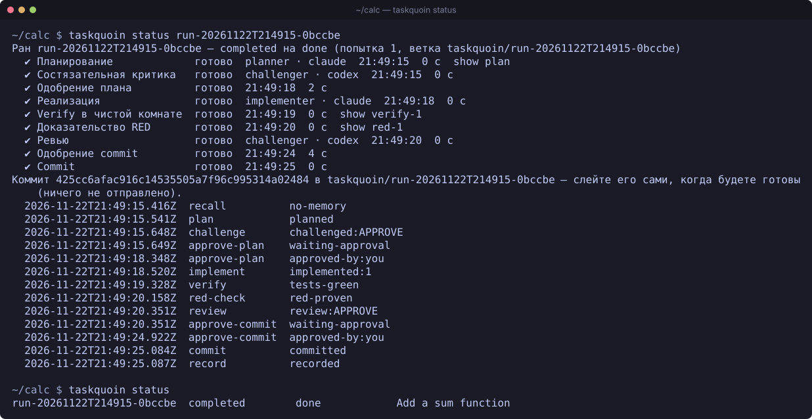

Каждая строка истории — шаг рабочего процесса с его итогом (`planned`, `challenged:APPROVE`, `waiting-approval`).

Теперь **прочтите то, что собираетесь одобрить**:

```shell
$ taskquoin show run-20261122T132108-d17040 plan
```

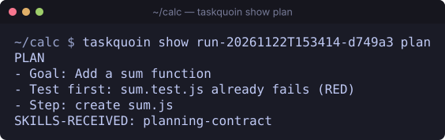

Вывод команд показан на английском, как его печатает CLI:

```shell
$ taskquoin show run-20261122T132108-d17040 challenge
Review: plan checked.
VERDICT: APPROVE
```

`show <run>` без артефакта перечисляет всё сохранённое к этому моменту с размером в байтах. План от настоящего агента также охватывает файлы, которые нужно изменить, тесты, которые нужно написать первыми, и риски. Challenge — независимое второе мнение: в нём могут быть блокирующие и неблокирующие замечания. Если план неверен, не одобряйте его: запустите новый run с более точным запросом.

### Зачем нужен хеш

Важна последняя строка `status` (вывод показан на английском):

```text
Approve it:  taskquoin approve run-20261122T132108-d17040 plan --expect 964c04e09ebe --as <your name>
             (plan sha256 964c04e09ebe1c44125abac3209229ee9b73f3c899afc54e32565f248c87435b)
```

`964c04e09ebe` — начало SHA-256 файла плана, который вы только что прочли. Одобрение означает не «я одобряю этот запуск», а «я одобряю **план с хешем 964c04e09ebe**». Если бы план мог измениться между вашим чтением и подтверждением (повторная попытка, другой процесс, скомпрометированный инструмент), хеш перестал бы совпадать, и Taskquoin отказал бы. Именно его записывает коммит, так что любой может позже проверить, что одобрил человек.

> [!NOTE]
> `--expect` — не пароль. Это доказательство того, что вы посмотрели артефакт, над которым система собирается действовать: вы копируете его из `status` после чтения. В [консоли](../getting-started/console.md) вы вводите его заново для подтверждения.

Одобрите:

```shell
$ taskquoin approve run-20261122T132108-d17040 plan --expect 964c04e09ebe --as you
```

`--as` — ваше имя; оно записывается как `Plan-Approved-By` в коммите. Одобрение плана возобновляет рабочий процесс, который продолжается до следующего гейта.

### Неверный хеш отклоняется

Попробуйте хеш, не совпадающий с ожидающим (вывод показан на английском):

```shell
$ taskquoin approve run-20261122T132108-d17040 plan --expect 000000000000 --as you
taskquoin approve: expected 000000000000 does not match the pending artifact 964c04e09ebe… — re-read it before approving
```

Ничего не было одобрено, запуск не изменился. То же происходит, если вы одобряете гейт, которого запуск не ждёт. Скриншот ниже сделан после завершения запуска, поэтому на нём показан именно этот вариант отказа:

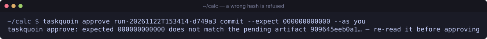

Код выхода при отказе — 1. Ошибка в команде (пропущен `--expect` или `--as`) завершается с кодом 2.

## Шаг 7: реализация, Verify и ревью

После `approve … plan` Taskquoin работает без вас:

1. **Реализация по TDD.** `implementer` (Claude) работает на ветке, в песочнице рантайма, без сети и без возможности коммитить. Сначала он пишет или правит тесты, затем самый простой код, который их проходит.
2. **Verify, в чистой комнате.** Taskquoin берёт точное дерево, которое оставил implementer, и сам запускает ваши тесты (`npm test`) во временной копии вне вашего репозитория: без сети, `.git` только для чтения, ваш HOME скрыт, секретные файлы замаскированы, и только каталоги зависимостей стека (и ваш `verify.inherit`) смонтированы только для чтения. Проходящий тест, зависевший от чего-то незакоммиченного, здесь падает, и в этом смысл.
3. **RED proof.** Затем Taskquoin убирает изменение в продакшен-коде и снова запускает изменённые тесты. Они должны **упасть**. Тест, проходящий без изменения, ничего не проверяет. Доказательство механическое: оно не показывает, что тест проверяет правильное поведение (для этого нужны ревью и вы).
4. **Ревью.** `challenger` просматривает дифф относительно плана вместе с логами verify и RED. Он завершает строкой `VERDICT:`.

Если тесты красные, или RED proof не удался, или ревью требует изменений, Taskquoin отправляет обратную связь implementer для автоматической доработки (до 3 попыток реализации, не более 2 раундов доработки после отклонённого ревью). Затем запуск останавливается на втором гейте.

## Шаг 8: прочтите и одобрите коммит

Запуск снова ждёт. Посмотрите на него (вывод показан на английском):

```shell
$ taskquoin status run-20261122T132108-d17040
Run run-20261122T132108-d17040 — waiting-approval at approve-commit (attempt 1, branch taskquoin/run-20261122T132108-d17040)
  commit approval required (bound to the exact tree)
  Review it:   taskquoin show run-20261122T132108-d17040 diff-1  (and: verify-1, red-1, review-1)
  Approve it:  taskquoin approve run-20261122T132108-d17040 commit --expect 909645eeb0a1 --as <your name>
               (git tree 909645eeb0a1716e60fd724784ede536fbea048f)
```

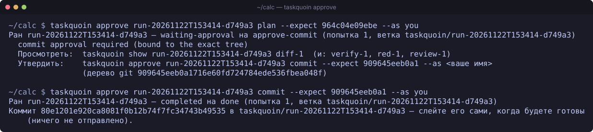

На этот раз хеш — это **git-дерево**, прошедшее Verify и ревью. Прочтите четыре артефакта попытки 1. Число — номер попытки; после доработки читайте наибольший.

### `diff-1`: точное изменение

```shell
$ taskquoin show run-20261122T132108-d17040 diff-1
```

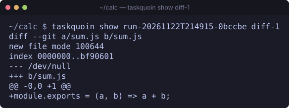

Именно это будет закоммичено, и ничего больше. Если бы агент изменил защищённый файл (ваш CI, `.claude/`, `AGENTS.md`, `taskquoin.yaml`), запуск остановился бы с `protected configuration changed`. Файлы, которые скрывает ваш `.gitignore`, но создал агент, перечислены в `ignored-1`; они не входят в дифф, не проверяются и не коммитятся.

### `verify-1`: ваши тесты, запущенные Taskquoin

```shell
$ taskquoin show run-20261122T132108-d17040 verify-1
```

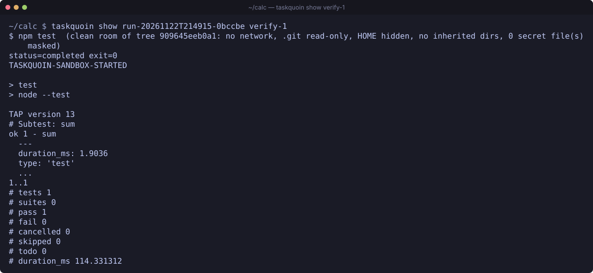

Заголовок говорит, какой была чистая комната (`no network, .git read-only, HOME hidden, … 0 secret file(s) masked`) и для какого дерева (`909645eeb0a1`, тот же хеш, который вы одобрите). `exit=0` и `# pass 1` приходят от тестового раннера, а не из заявления модели.

### `red-1`: доказательство того, что тест важен

Вывод команд показан на английском, как его печатает CLI:

```shell
$ taskquoin show run-20261122T132108-d17040 red-1
TASKQUOIN RED PROOF — tests run on base + test changes only (tree 9848f565e24c); they must FAIL.
RESULT: they failed as required (RED proven).

$ npm test  (clean room of tree 9848f565e24c: no network, .git read-only, HOME hidden, no inherited dirs, 0 secret file(s) masked)
status=failed exit=1
…
not ok 1 - sum
  error: Cannot find module './sum.js'
  code: 'MODULE_NOT_FOUND'
```

Здесь новый продакшен-файл `sum.js` был удалён, тест не смог его загрузить и упал. Этот сбой и есть RED proof. Taskquoin считает ошибку импорта из-за функциональности в *новом* файле ожидаемым RED. Если изменялись только тестовые файлы (чистое добавление тестов), доказательство записывается как «not applicable».

### `review-1`: второе мнение

Вывод команд показан на английском, как его печатает CLI:

```shell
$ taskquoin show run-20261122T132108-d17040 review-1
Review: diff checked against the plan.
VERDICT: APPROVE
```

Читайте замечания, а не только вердикт. `ignored-1` появляется в списке только тогда, когда есть что читать.

### Одобрите коммит

Если вас всё устраивает, одобрите с хешем из `status` (вывод показан на английском):

```shell
$ taskquoin approve run-20261122T132108-d17040 commit --expect 909645eeb0a1 --as you
Run run-20261122T132108-d17040 — completed at done (attempt 1, branch taskquoin/run-20261122T132108-d17040)
Committed a3c6b801de5f4356750f53870557e2fdd19958ee on taskquoin/run-20261122T132108-d17040 — merge it yourself when ready (nothing was pushed).
```

`approve … commit` нужно выполнять, пока репозиторий находится на ветке запуска (`taskquoin/<run>`); иначе он отвечает `switch to taskquoin/<run> first`. Taskquoin заново считывает рабочее дерево перед коммитом. Если что-то изменилось с тех пор, как вы смотрели, ваше подтверждение больше не действует: он заново выполняет verify и ревью и просит одобрить новое дерево.

Затем Taskquoin строит коммит **из одобренного git-дерева**, а не через `git add`. Он выглядит так:

```shell
$ git log -1 taskquoin/run-20261122T132108-d17040
```

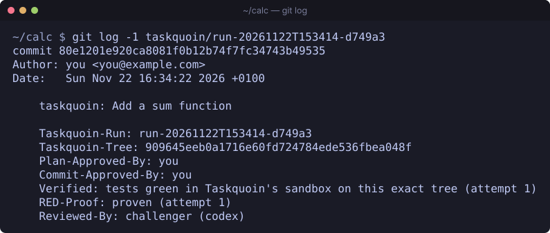

Вывод команд показан на английском, как его печатает CLI:

```text
taskquoin: Add a sum function

Taskquoin-Run: run-20261122T132108-d17040
Taskquoin-Tree: 909645eeb0a1716e60fd724784ede536fbea048f
Plan-Approved-By: you
Commit-Approved-By: you
Verified: tests green in Taskquoin's sandbox on this exact tree (attempt 1)
RED-Proof: proven (attempt 1)
Reviewed-By: challenger (codex)
```

Трейлеры — это аудиторский след прямо в коммите:

| Трейлер | Значение |
|---|---|
| `Taskquoin-Run` | Запуск, создавший этот коммит |
| `Taskquoin-Tree` | Git-дерево, которое было проверено, просмотрено и одобрено. Это дерево данного коммита |
| `Plan-Approved-By` | Имя, указанное через `--as` на гейте плана |
| `Commit-Approved-By` | Имя, указанное через `--as` на гейте коммита |
| `Verified` | Тесты были зелёными в чистой комнате на этом точном дереве |
| `RED-Proof` | Изменённые тесты падали без изменения (`proven` или `not applicable` для изменений только тестов) |
| `Reviewed-By` | Агенты, которые просмотрели и одобрили; API-судья добавляет собственную строку |

`taskquoin status <run>` в конце показывает весь журнал, от `recall` до `commit` и `record`.

## Шаг 9: слейте результат

Taskquoin **никогда не делает push** и никогда не сливает в вашу ветку. Коммит находится в `taskquoin/<run>`, ветке, на которой вы стоите. Слейте её сами или откройте из неё pull request:

```shell
$ git switch main
$ git merge --ff-only taskquoin/run-20261122T132108-d17040
$ npm test
```

> [!WARNING]
> Taskquoin не запускает коммит-хуки вашего репозитория, потому что они могут содержать код, изменённый агентом. Запускайте свои хуки, линтеры и CI сами при слиянии.

Ветки `taskquoin/<run>` принадлежат вам: удаляйте их, когда они не нужны (`git branch -d taskquoin/<run>`).

## Когда всё идёт не по плану

Сообщения об ошибках Taskquoin следуют вашему языку, но сообщения движка запуска (`failed`, `needs-human`, `interrupted`) всегда на английском. В таблице — то, с чем вы столкнётесь чаще всего.

| Что вы видите | Что это значит | Что делать |
|---|---|---|
| `taskquoin run: the working tree has uncommitted changes` | Taskquoin никогда не смешивает свои изменения с вашими | Закоммитьте или спрячьте (stash) свои изменения |
| `failed … gate refused agent X` | Агента нельзя сертифицировать на этой машине | `taskquoin doctor` скажет почему: версия рантайма, отсутствующая песочница, непринятый риск |
| `needs-human … tests still failing after 3 attempts` | Три попытки не дали зелёных тестов | Продолжите вручную на ветке запуска или начните новый run с более точным запросом |
| `needs-human … no failing test demonstrates the change` | Тесты проходят и без изменения в продакшен-коде, значит, они его не проверяют | Прочтите `red-N`; напишите (или попросите) тест, который падает до изменения. Рефакторинг или правка документации без нового теста заканчивается здесь: закоммитьте её сами с ветки |
| `needs-human … RED proof inconclusive` | Доказательство не удалось выполнить корректно (таймаут, песочница, дерево, которое не удалось восстановить). Это не доказательство | Прочтите `red-N`. Ваша рабочая папка не тронута |
| `needs-human … review still requests changes after N attempts` | Ревьюер продолжал отказывать | Прочтите `review-N` и решите; работа лежит в ветке |
| `needs-human … dependencies changed during the run` | `node_modules` (или `vendor`, `.venv`) изменились во время запуска, поэтому с ними ничего не проверено | Переустановите (`npm ci`) и начните новый run. Не запускайте `npm install` во время запуска |
| `needs-human … protected configuration changed` | Агент тронул защищённую конфигурацию (CI, `.claude/`, `AGENTS.md`, `taskquoin.yaml`) | Ничего не закоммичено; изучите ветку |
| Тесты у вас проходят, но падают в Verify | Они используют игнорируемый файл, которого нет в чистой комнате | Добавьте его в `verify.inherit` |
| `does not match the pending artifact` | Указанный вами хеш не совпадает с ожидающим | Прочтите через `show`, скопируйте хеш из `status` |
| `switch to taskquoin/<run> first` | Вы не на ветке запуска | `git switch taskquoin/<run>` |
| `taskquoin.yaml changed since the run started` | Конфигурация изменилась посреди запуска | Начните новый run |
| `interrupted` | Техническая ошибка (git, диск, HTTP 503 у судьи) остановила запуск | `taskquoin resume <run>` |

### Когда тесты остаются красными

Если Verify не проходит, Taskquoin передаёт implementer лог падения и ревью и пробует снова, до трёх попыток реализации (implementer на OpenCode, у которого нет собственной команды, получает больше доработок). Если тесты всё ещё красные, запуск заканчивается статусом `needs-human` с причиной `tests still failing after 3 attempts`. Коммита и запроса на подтверждение нет.

Всё сохраняется: `taskquoin show <run> verify-3` содержит последний лог, а ветка `taskquoin/<run>` хранит работу агента. Вы можете продолжить вручную на этой ветке или начать новый run с более точным запросом. Запуск в статусе `needs-human` автоматически не возобновляется.

### `resume`: после прерывания

Запуск становится `interrupted`, когда что-то вне рабочего процесса его сломало (сетевая ошибка при обращении к судье, переполненный диск, засыпание машины). Состояние сохраняется на каждом шаге, а ответы судей сохраняются по одному, поэтому возобновление никогда не вызывает судью дважды и не оплачивает его дважды:

```shell
$ taskquoin resume run-20261122T132108-d17040
```

`resume` принимает только запуск со статусом `interrupted`. Для любого другого статуса он сообщает об этом, например `taskquoin resume: only an interrupted run can be resumed (status completed)`. Если статус `needs-human` или `failed`, начните новый run.

### Практическое правило

Если вы не знаете, что делать, выполните `taskquoin status <run>`: он печатает статус, журнал и точную следующую команду. `taskquoin doctor` отвечает на любой вопрос о машине.

## Узнайте больше

- [Интерактивная консоль](../getting-started/console.md): тот же рабочий процесс с `/run` и `/approve`
- [Установка](../getting-started/installation.md)
- [ADR-0011, agents never commit](../adr/0011-agents-never-commit.md)
- [ADR-0013, tree-based governance](../adr/0013-tree-based-governance.md)
- [ADR-0014, Verify in a clean room](../adr/0014-verify-in-a-clean-room.md)
- [ADR-0002, enforcement classes](../adr/0002-enforcement-classes.md)
- [ADR-0005, control plane outside the workspace](../adr/0005-control-plane-outside-workspace.md)
- [ADR-0016, judges by API](../adr/0016-judges-by-api.md) и [ADR-0017, OpenCode without commands](../adr/0017-opencode-without-commands.md)
