# การรันแรกของคุณภายใต้การกำกับดูแล

> บทเรียนนี้เป็นคำแปลของหน้าอ้างอิงภาษาอังกฤษ ([first-run.md](../getting-started/first-run.md)) เป็นการแปลด้วยเครื่อง ตรวจสอบด้วยการทดสอบคำสั่งของผู้ดูแลโครงการ ไม่ได้ผ่านผู้ตรวจที่เป็นเจ้าของภาษา ผลลัพธ์ของ CLI ในบล็อกโค้ดยังคงแสดงเป็นภาษาอังกฤษ ส่วนภาพหน้าจอที่ปรับเป็นภาษานี้แสดงผลลัพธ์จริงในภาษานี้

บทเรียนนี้พาคุณไปจากโฟลเดอร์ว่างจนถึงคอมมิตที่ผ่านการตรวจสอบซึ่ง Taskquoin สร้างขึ้น ทีละคำสั่ง คุณจะสร้างโปรเจกต์เล็ก ๆ ที่มีเทสต์ล้มเหลว ให้ Taskquoin วางแผนและพัฒนาการแก้ไขด้วยเอเจนต์ AI แล้วอนุมัติงานสองครั้ง ครั้งแรกเมื่อคุณอ่านแผนแล้ว ครั้งที่สองเมื่อคุณอ่าน diff ที่แท้จริงแล้ว ในแต่ละขั้นตอนคุณจะเห็นว่า Taskquoin ทำอะไร ทำไมจึงหยุด และคุณกำลังลงนามรับรองอะไร

- [สิ่งที่คุณจะสร้าง](#สิ่งที่คุณจะสร้าง)
- [ขั้นตอนที่ 1: สร้างโปรเจกต์ที่มีเทสต์ล้มเหลว](#ขั้นตอนที่-1-สร้างโปรเจกต์ที่มีเทสต์ล้มเหลว)
- [ขั้นตอนที่ 2: เริ่มต้น Taskquoin](#ขั้นตอนที่-2-เริ่มต้น-taskquoin)
- [ขั้นตอนที่ 3: คอมมิตคอนฟิก](#ขั้นตอนที่-3-คอมมิตคอนฟิก)
- [ขั้นตอนที่ 4: ตรวจเครื่องด้วย doctor](#ขั้นตอนที่-4-ตรวจเครื่องด้วย-doctor)
- [ยอมรับความเสี่ยงที่คุณเข้าใจ](#ยอมรับความเสี่ยงที่คุณเข้าใจ)
- [ขั้นตอนที่ 5: เริ่ม run](#ขั้นตอนที่-5-เริ่ม-run)
- [ขั้นตอนที่ 6: อ่านและอนุมัติแผน](#ขั้นตอนที่-6-อ่านและอนุมัติแผน)
- [ขั้นตอนที่ 7: การพัฒนา Verify และรีวิว](#ขั้นตอนที่-7-การพัฒนา-verify-และรีวิว)
- [ขั้นตอนที่ 8: อ่านและอนุมัติคอมมิต](#ขั้นตอนที่-8-อ่านและอนุมัติคอมมิต)
- [ขั้นตอนที่ 9: merge ผลลัพธ์](#ขั้นตอนที่-9-merge-ผลลัพธ์)
- [ติดตามการรันใน Dashboard](#ติดตามการรันใน-dashboard)
- [เมื่อสิ่งต่าง ๆ ไม่เป็นไปตามแผน](#เมื่อสิ่งต่าง-ๆ-ไม่เป็นไปตามแผน)
- [เรียนรู้เพิ่มเติม](#เรียนรู้เพิ่มเติม)

> [!NOTE]
> ภาพหน้าจอมาจากรีโพสิทอรีสาธิตที่ใช้เอเจนต์ AI จำลอง (test double ของชุดทดสอบของ Taskquoin เอง) ทุกคำสั่งคือ Taskquoin CLI ตัวจริง เมื่อใช้ Claude Code และ Codex จริง ถ้อยคำของแผนและของรีวิวจะเป็นของเอเจนต์เอง และการรันหนึ่งครั้งใช้เวลาไม่กี่นาทีแทนที่จะเป็นไม่กี่วินาที ส่วนอื่น ๆ เหมือนกันทั้งหมด

ก่อนเริ่ม ให้[ติดตั้ง Taskquoin](../getting-started/installation.md) และตรวจสอบว่ามี Node 22.18+, git, `bubblewrap` และ `socat` พร้อมใช้งาน และอย่างน้อยมีการติดตั้งและลงชื่อเข้าใช้ Claude Code (และถ้าเป็นไปได้ Codex ด้วย)

## สิ่งที่คุณจะสร้าง

run คือเวิร์กโฟลว์ที่กำหนดตายตัว รูปข้าวหลามตัดสองรูปคือการอนุมัติโดยมนุษย์สองครั้ง ไม่มีอะไรผ่านไปได้หากไม่มีคุณ

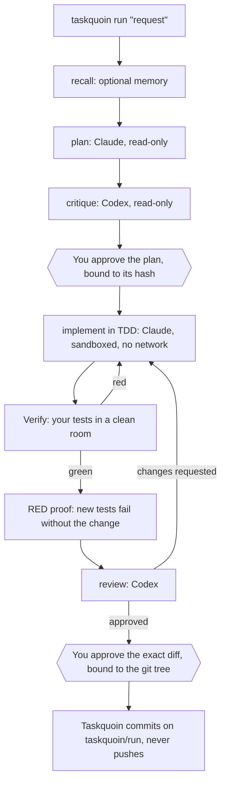

แนวคิดสามข้อที่ผ่านตลอดบทเรียนนี้:

- **เอเจนต์เสนอ Taskquoin ลงมือทำ** เอเจนต์ไม่เคยคอมมิต คอมมิตถูกสร้างโดย Taskquoin จาก tree ที่ผ่านการตรวจสอบ รีวิว และอนุมัติแล้ว ([ADR-0011](../adr/0011-agents-never-commit.md))
- **การอนุมัติของคุณผูกกับแฮช** คุณอนุมัติสิ่งที่คุณอ่านพอดี ไม่ใช่ "run" ([ADR-0013](../adr/0013-tree-based-governance.md))
- **เทสต์รันในห้องสะอาด (clean room)** โมเดลไม่เคยบอก Taskquoin ว่าเทสต์ผ่าน Taskquoin รันเทสต์เอง ([ADR-0014](../adr/0014-verify-in-a-clean-room.md))

## ขั้นตอนที่ 1: สร้างโปรเจกต์ที่มีเทสต์ล้มเหลว

โปรเจกต์นี้คือเครื่องคิดเลขที่มีฟังก์ชันเดียว มีเทสต์แล้ว แต่ยังไม่มีฟังก์ชัน

```shell
$ mkdir calc && cd calc
$ git init -q -b main
```

สร้าง `package.json`:

```json
{
  "name": "calc",
  "private": true,
  "scripts": { "test": "node --test" }
}
```

สร้าง `sum.test.js`:

```js
const test = require('node:test');
const assert = require('node:assert');

test('sum', () => {
  const sum = require('./sum.js');
  assert.strictEqual(sum(2, 3), 5);
});
```

สร้าง `.gitignore` (dependency และผลลัพธ์ของการ build จะไม่เป็นส่วนของ diff ของ Taskquoin เลย):

```text
node_modules/
```

คอมมิตไฟล์เหล่านี้:

```shell
$ git add .
$ git commit -m "calc: a failing test for sum"
$ npm test
not ok 1 - sum
  error: Cannot find module './sum.js'
```

เทสต์เป็นสีแดงตามที่คาดไว้ เงื่อนไขเบื้องต้นข้อเดียวที่ Taskquoin ต้องการจากโปรเจกต์คือรีโพสิทอรี git ที่ working tree สะอาด: `taskquoin run` จะปฏิเสธที่จะเริ่มเมื่อคุณมีการเปลี่ยนแปลงที่ยังไม่ได้คอมมิต เพราะมันไม่เคยผสมการเปลี่ยนแปลงของตัวเองเข้ากับของคุณ

## ขั้นตอนที่ 2: เริ่มต้น Taskquoin

```shell
$ taskquoin init
```

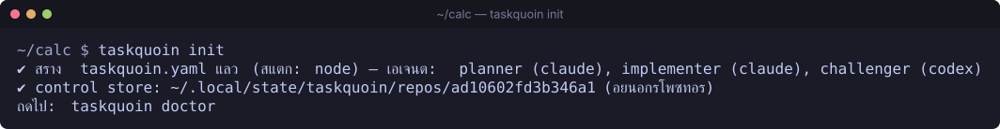

`init` ทำสามอย่าง:

1. ตรวจจับ stack (`node` และยังรู้จัก `npm test`, PHPUnit, pytest, `go test`, Maven และอื่น ๆ) แล้วเขียน `taskquoin.yaml` ที่รากของรีโพสิทอรี
2. ค้นหาเครื่องมือ AI บนเครื่องของคุณและเลือกเอเจนต์ ในที่นี้ `planner` และ `implementer` ใช้ Claude Code และ `challenger` ใช้ Codex ถ้าไม่มีเครื่องมือใดไฟล์จะระบุไว้ ถ้ามีเพียง Claude Code ผู้รีวิวก็เป็น Claude เช่นกัน ถ้ามีเพียง OpenCode `init` จะเขียนคอนฟิกที่ใช้ OpenCode ทั้งหมด
3. สร้าง **control store** นอกรีโพสิทอรี ภายใต้ `${XDG_STATE_HOME:-~/.local/state}/taskquoin/` ที่นี่คือที่เก็บสถานะของ run การอนุมัติ และการยอมรับความเสี่ยง เอเจนต์เขียนที่นี่ไม่ได้ ซึ่งเป็นสิ่งที่ทำให้การอนุมัติปลอมแปลงไม่ได้ ([ADR-0005](../adr/0005-control-plane-outside-workspace.md))

`init` ไม่เคยเขียนทับ `taskquoin.yaml` ที่มีอยู่ หากคุณรัน `init` ขณะที่มี AI อื่นให้ใช้ได้ (API key ในสภาพแวดล้อมของคุณ, Ollama ในเครื่อง) มันจะแสดงรายการและเสนอเป็น **คอมเมนต์** ในไฟล์ การเลิกคอมเมนต์เป็นการตัดสินใจของคุณ เพราะหมายความว่าโค้ดของโปรเจกต์นั้นจะถูกส่งไปให้ AI เหล่านั้น

### `taskquoin.yaml` ที่ถูกสร้างขึ้น

เปิดดูได้เลย ไฟล์สั้นและคุณอ่านได้ทั้งหมด ต่อไปนี้คือทีละส่วน

```yaml
# Taskquoin project configuration — see docs/architecture.md. Protected: agents can never edit this file.
version: 1
stack: node
```

`version` คือเวอร์ชันของสคีมา `stack` เลือกค่าเริ่มต้นของห้องสะอาด คือไดเรกทอรี dependency ใดที่จะถูก mount แบบอ่านอย่างเดียวให้เทสต์ของคุณ (สำหรับ `node` คือ `node_modules`) คอมเมนต์แรกคือคำสัญญา: **เอเจนต์ไม่สามารถแก้ไขไฟล์นี้ได้เลย** หากมีเอเจนต์ใดแตะต้องระหว่างการ run การ run จะหยุดและไม่มีอะไรถูกคอมมิต

```yaml
agents:
  planner:
    runtime: claude
    description: "Read-only planner: turns a request into a minimal, test-first implementation plan."
    prompt: You plan; you never modify files. Read the repository, then produce the plan requested.
    capabilities:
      fs.read:
        - "**"
    maxTurns: 30
    skills:
      - planning-contract
```

**เอเจนต์** คือบทบาทที่ผูกกับ runtime (`claude`, `codex`, `opencode` หรือ `api` สำหรับผู้ตัดสิน) `capabilities` คือสิ่งที่เอเจนต์ได้รับอนุญาตให้ทำ: planner อ่านได้ทุกอย่าง (`fs.read: "**"`) และไม่มีอย่างอื่น จึงไม่มี shell และไม่มีเครื่องมือเขียน `skills` คือคำสั่งที่ตรึงด้วยแฮช (`planning-contract` เป็นของฝั่งผู้พัฒนาเอง) `maxTurns` จำกัดจำนวนเทิร์นของเอเจนต์

```yaml
  implementer:
    runtime: claude
    description: Implements an approved task with strict TDD (RED → GREEN → REFACTOR).
    prompt: "You implement exactly the approved task. Write a failing test first, make it pass with the simplest change, then refactor. Never commit: Taskquoin verifies and commits."
    capabilities:
      fs.read:
        - "**"
      fs.write:
        - "**"
      shell.run:
        - npm test
        - npm test -- *
        - node --test *
    maxTurns: 40
    skills:
      - tdd
```

implementer เขียนไฟล์และรันคำสั่งเทสต์ในรายการอนุญาตเล็ก ๆ (`shell.run`) ได้ เพื่อให้ทำงานแบบเทสต์ก่อน คำสั่งเหล่านั้นรันภายใน sandbox ของระบบปฏิบัติการของ runtime เอง โดยไม่มีเครือข่าย แม้อย่างนั้น การรันเทสต์ของมันก็เป็นเพียงฟีดแบ็กสำหรับตัวมันเอง ผลที่นับคือผลที่ Taskquoin สร้างขึ้นใน Verify

```yaml
  challenger:
    runtime: codex
    description: Independent, read-only adversarial reviewer of plans and diffs.
    prompt: "You are an independent reviewer. Challenge the plan or diff: correctness, security, missing tests, over-engineering. Report blocking and non-blocking findings with file:line. Do not modify files."
    capabilities:
      fs.read:
        - "**"
    skills:
      - code-review
```

**challenger** วิพากษ์แผนและรีวิว diff โดยตั้งใจให้เป็นผู้ให้บริการคนละรายกับ implementer และเป็นแบบอ่านอย่างเดียว: มันต้องไม่สามารถ "แก้" สิ่งที่มันวิจารณ์ได้

```yaml
policy:
  mandatory:
    - fs.write
    - net.egress
    - config.modify
    - connector.write
    - vcs.commit
    - vcs.push
connectors: {}
memory:
  claudeMem:
    enabled: true
```

`policy.mandatory` ระบุข้อจำกัดที่**ต้อง**ถูกบังคับด้วยกลไกบางอย่างก่อนที่เอเจนต์จะเริ่มได้: ไม่เขียนนอกขอบเขต ไม่มีเครือข่าย ไม่เปลี่ยนคอนฟิกที่ได้รับการป้องกัน ไม่เขียนไปยัง remote ไม่คอมมิต ไม่ push หากเวอร์ชันของ runtime ที่คุณมีบังคับข้อใดข้อหนึ่งไม่ได้ เอเจนต์จะถูกปฏิเสธ แทนที่จะเริ่มด้วยกฎที่เป็นเพียงคำแนะนำ ([ADR-0002](../adr/0002-enforcement-classes.md), [ADR-0003](../adr/0003-hooks-enforce-prose-asks.md)) `connectors` ว่างเปล่า: ไม่มีระบบระยะไกลเชื่อมต่ออยู่ ([ADR-0012](../adr/0012-remote-connectors-by-exception.md)) `memory.claudeMem` เป็นตัวเลือก: เมื่อเปิดใช้ สรุปแบบมีโครงสร้างของแต่ละ run ที่เสร็จสิ้นจะถูกส่งไปยัง worker [claude-mem](https://github.com/thedotmack/claude-mem) ในเครื่องของคุณ และจะอ่าน recall สั้น ๆ ตอนเริ่ม run ตั้งเป็น `false` หากคุณไม่ได้รัน claude-mem (ภาพหน้าจอในบทเรียนนี้ใช้ `false`)

> [!TIP]
> หากเทสต์ของคุณต้องการไฟล์ที่ถูกเพิกเฉยซึ่งไม่ใช่ไดเรกทอรี dependency เช่น `dist/` ที่ build แล้วหรือ `.env.test` ให้เพิ่มอย่างชัดเจน จากนั้นไฟล์จะถูก mount แบบอ่านอย่างเดียวในห้องสะอาดและถูกตรึงไว้สำหรับเอเจนต์:
>
> ```yaml
> verify:
>   inherit:
>     - dist
> ```
>
> โปรเจกต์ที่เทสต์ไม่ได้รันด้วย `npm test` สามารถตั้ง `verify.command` ได้

คุณยังใช้ AI อื่นเป็นผู้ตัดสินได้ (ผู้ให้บริการใดก็ได้ที่เข้ากันได้กับ OpenAI) หรือใช้ OpenCode เป็น planner และ implementer ดู [ADR-0016](../adr/0016-judges-by-api.md) และ [ADR-0017](../adr/0017-opencode-without-commands.md)

## ขั้นตอนที่ 3: คอมมิตคอนฟิก

`taskquoin.yaml` เป็นส่วนหนึ่งของโปรเจกต์ของคุณ จึงควรคอมมิต ซึ่งยังให้ working tree ที่สะอาดตามที่ Taskquoin ต้องการด้วย:

```shell
$ git add taskquoin.yaml
$ git commit -m "chore: taskquoin"
```

## ขั้นตอนที่ 4: ตรวจเครื่องด้วย doctor

```shell
$ taskquoin doctor
```

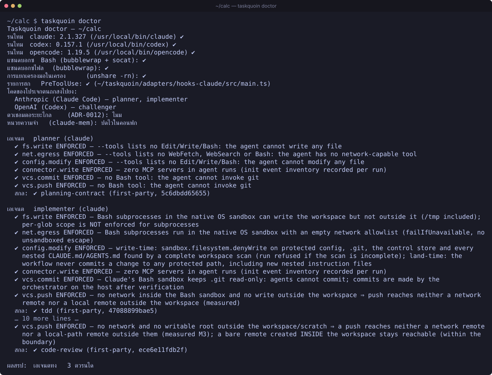

`doctor` คือส่วนที่ซื่อตรงของ Taskquoin อ่านจากบนลงล่าง:

- บล็อกแรกแสดง runtime ที่พบ พร้อมเวอร์ชันและเครื่องหมายถูกเมื่อเวอร์ชันนั้นเป็นเวอร์ชันที่ Taskquoin ได้วัดผลไว้ จากนั้นเป็น sandbox (bubblewrap และ socat) และ hook
- **This project's code is sent to** แสดงผู้ให้บริการทุกรายที่จะได้รับโค้ดของคุณ แยกตามเอเจนต์ Taskquoin ทำงานบนเครื่องของคุณ มีเพียง AI ที่คุณกำหนดค่าเท่านั้นที่เห็นอะไรก็ตาม ([ADR-0010](../adr/0010-local-first-no-leak.md))
- จากนั้น แยกตามเอเจนต์ ข้อจำกัดบังคับแต่ละข้อพร้อมคลาสของมันและ**กลไกที่บังคับใช้** เช่น `net.egress ENFORCED — Bash subprocesses run in the native OS sandbox with an empty network allowlist` เครื่องหมายถูกหมายความว่าได้รับการรับรองสำหรับ runtime เวอร์ชันนั้น เครื่องหมายกากบาทหมายความว่าเอเจนต์จะไม่เริ่มทำงาน
- บรรทัดสุดท้ายคือคำตัดสิน: `Verdict: all 3 agents can run.` หรือ `Verdict: 2 of 3 agents can run — refused agents will not be started.`

ในการสาธิต มีหนึ่งบรรทัดที่เป็นเครื่องหมายกากบาท:

```text
Agent challenger (codex)
  …
  ✖ connector.write — mandatory restriction "connector.write" (deny-all) on codex 0.157.1: claimed ENFORCED but the mechanism is not measured (inferred). Execution refused (ADR-0002).
```

Codex บอกว่ามันบังคับใช้ `connector.write` (ไม่เขียนไปยัง connector ระยะไกล) แต่ Taskquoin ไม่มีวิธีวัดข้ออ้างนั้น จึงไม่นับว่าถูกบังคับใช้ challenger จึงถูกปฏิเสธ: การ run จะจบเป็น `failed at challenge` พร้อม `gate refused agent challenger` สำหรับข้อนี้ คุณมีการตัดสินใจที่ต้องทำ

## ยอมรับความเสี่ยงที่คุณเข้าใจ

**ความเสี่ยงที่ยอมรับ** คือการตัดสินใจของคุณที่ลงนาม ระบุวันที่ และจำกัดขอบเขต เพื่อรันเอเจนต์ทั้งที่มีข้อจำกัดหนึ่งข้อที่วัดไม่ได้ เป็นการตัดสินใจของเจ้าของ ไม่ใช่ของนักพัฒนา และไม่ใช่ของเอเจนต์เด็ดขาด:

```shell
$ taskquoin accept-risk challenger connector.write \
    --reason "Codex reviews read-only; no connector configured" \
    --expires 2026-12-31 --as you
```

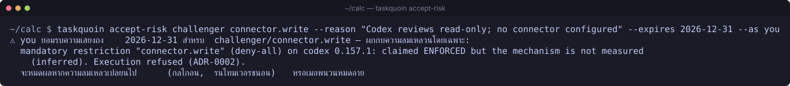

ต้องระบุตัวเลือกทั้งสี่: `--reason`, `--expires` (วันที่จริงในอนาคต `YYYY-MM-DD`) และ `--as` (ชื่อของคุณ) รวมถึงเอเจนต์และ capability สังเกตว่าการยอมรับนี้เป็นอย่างไร:

- **ผูกกับความล้มเหลวที่แน่นอน** มันเก็บ digest ของข้อความความล้มเหลว หากเวอร์ชันของ runtime เปลี่ยน หรือกลไกเปลี่ยน ความล้มเหลวก็ไม่ใช่เรื่องเดิมอีกต่อไป และการยอมรับก็หมดผล
- **มีวันที่** มันหมดผลเมื่อพ้นวันหมดอายุด้วย
- **เก็บนอกรีโพสิทอรี** ใน control store ไม่มีใครเพิ่มได้ด้วยการแก้ `taskquoin.yaml` และไม่มีเอเจนต์ใดเขียนได้
- **จำกัดแคบ** ใช้กับเอเจนต์นี้และ capability นี้เท่านั้น จะถูกปฏิเสธสำหรับ capability ที่ไม่ได้ล้มเหลว และใช้ไม่ได้กับผู้ตัดสินแบบ API (ซึ่งจะถูกตรวจเสมอ)

รัน `doctor` อีกครั้ง บรรทัดนั้นตอนนี้เป็นคำเตือนแทนที่จะเป็นกากบาท และคำตัดสินคือ `all 3 agents can run`:

```text
  ⚠ connector.write accepted risk (approved by you until 2026-12-31: Codex reviews read-only; no connector configured) — mandatory restriction "connector.write" (deny-all) on codex 0.157.1: claimed ENFORCED but the mechanism is not measured (inferred). Execution refused (ADR-0002).
```

`taskquoin check challenger` แสดงรายละเอียดเดียวกันสำหรับเอเจนต์หนึ่งตัว:

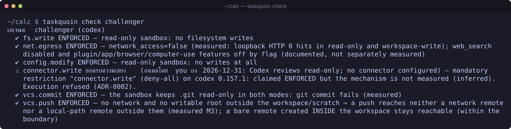

> [!IMPORTANT]
> ยอมรับความเสี่ยงก็ต่อเมื่อคุณเข้าใจมัน และสถานการณ์ตรงกับเหตุผลของคุณ: ในที่นี้ Codex รีวิวแบบอ่านอย่างเดียว และโปรเจกต์ของคุณไม่มี connector ดังนั้น "การเขียนไปยัง connector" จึงเกิดขึ้นไม่ได้อยู่แล้ว อย่ายอมรับความเสี่ยงเพียงเพื่อให้บรรทัดสีแดงหายไป โดยเฉพาะ:
>
> - ห้ามยอมรับสำหรับ `fs.write`, `net.egress`, `vcs.commit` หรือ `vcs.push` กับเอเจนต์ที่เขียนหรือรันคำสั่งจริง เว้นแต่คุณระบุมาตรการควบคุมทดแทนได้
> - ห้ามยอมรับด้วยเหตุผลคลุมเครือ: เหตุผลถูกบันทึกในการอนุมัติและแสดงโดย `doctor`
> - ควรเลือกวันหมดอายุที่สั้น: การยอมรับเป็นเครื่องเตือนให้ตรวจซ้ำหลังอัปเกรด
> - หากกลไกถูก*วัดแล้วว่าล้มเหลว* ให้อัปเกรดหรือเปลี่ยน runtime แทน

การรัน `taskquoin accept-risk` ด้วยตัวคุณเองเป็นการออกแบบโดยเจตนา: หากคอนโซลหรือเอเจนต์ทำได้ การควบคุมนี้ก็ไม่มีความหมาย

## ขั้นตอนที่ 5: เริ่ม run

```shell
$ taskquoin run "Add a sum function"
```

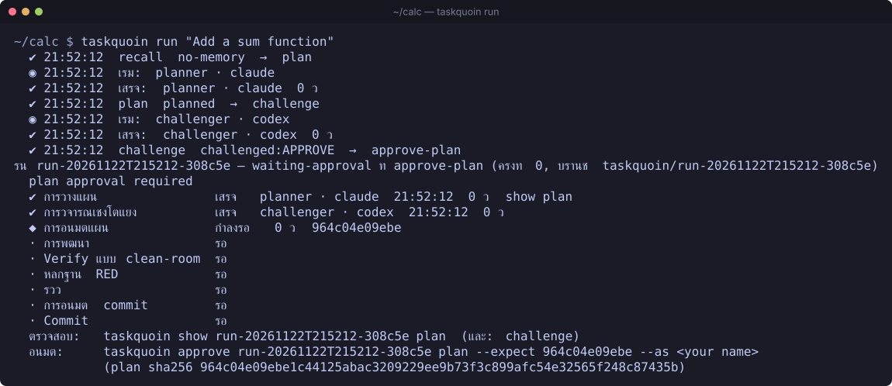

เทอร์มินัลของคุณเงียบขณะที่เอเจนต์ทำงาน แล้วจึงพิมพ์ว่าหยุดที่ใด ตามลำดับ Taskquoin ทำสิ่งนี้:

1. **Preflight** Taskquoin ตรวจว่าคอนฟิกกำหนดทุกบทบาท สกิลใช้งานได้ บทบาทแบบอ่านอย่างเดียวอ่านอย่างเดียวจริง และผู้ตัดสินแบบ API มี key ของตน working tree ต้องสะอาด เอเจนต์แต่ละตัวยังผ่านประตูเดียวกับ `doctor` ก่อนใช้ครั้งแรก: เอเจนต์ที่ถูกปฏิเสธทำให้ run จบเป็น `failed`
2. **Branch** สร้างบรานช์ `taskquoin/run-20261122T132108-d17040` และสลับไปที่นั่น `main` ของคุณไม่ถูกแตะต้อง
3. **Recall** ถามเวิร์กเกอร์หน่วยความจำ หากเปิดใช้ เพื่อขอบันทึกที่เกี่ยวข้อง บันทึกการทำงานจะแสดง `recall no-memory` เมื่อไม่มี
4. **Plan** `planner` (Claude อ่านอย่างเดียว) อ่านรีโพสิทอรีและเขียนแผน: เป้าหมาย เทสต์ที่จะเขียนก่อน ไฟล์ ขั้นตอน ความเสี่ยง
5. **Critique** `challenger` (Codex อ่านอย่างเดียว) ท้าทายแผนนั้นอย่างอิสระและปิดท้ายด้วยบรรทัด `VERDICT:`
6. **Gate** เวิร์กโฟลว์หยุดที่ `approve-plan` มันจะรอนานเท่าที่คุณต้องการ

id ของ run (`run-20261122T132108-d17040`) คือไทม์สแตมป์กับส่วนต่อท้ายแบบสุ่ม คุณใช้มันในทุกคำสั่งต่อจากนี้ `taskquoin status` โดยไม่มีอาร์กิวเมนต์จะแสดงรายการ run:

```shell
$ taskquoin status
run-20261122T132108-d17040  waiting-approval approve-plan    Add a sum function
```

## ขั้นตอนที่ 6: อ่านและอนุมัติแผน

`status <run>` แสดงประวัติของ run หนึ่ง และที่ประตูจะแสดงคำสั่งที่ใช้อนุมัติอย่างแน่นอน:

```shell
$ taskquoin status run-20261122T132108-d17040
```

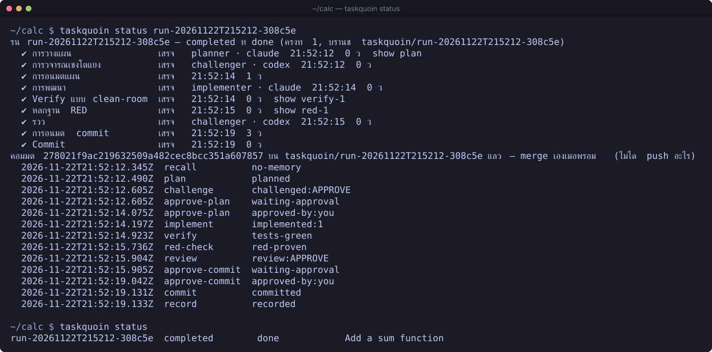

แต่ละบรรทัดของประวัติคือหนึ่งขั้นตอนของเวิร์กโฟลว์พร้อมผลลัพธ์ (`planned`, `challenged:APPROVE`, `waiting-approval`)

ตอนนี้ **อ่านสิ่งที่คุณกำลังจะอนุมัติ**:

```shell
$ taskquoin show run-20261122T132108-d17040 plan
```

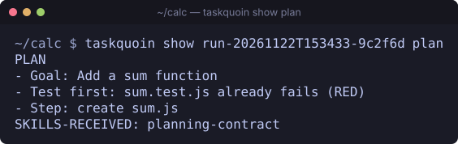

```shell
$ taskquoin show run-20261122T132108-d17040 challenge
Review: plan checked.
VERDICT: APPROVE
```

`show <run>` โดยไม่ระบุ artifact จะแสดงทุกอย่างที่เก็บไว้จนถึงตอนนี้ พร้อมขนาดเป็นไบต์ แผนจากเอเจนต์จริงยังครอบคลุมไฟล์ที่จะแก้ เทสต์ที่จะเขียนก่อน และความเสี่ยง challenge คือความเห็นที่สองอย่างอิสระ: อาจแสดงข้อค้นพบที่เป็นตัวบล็อกและไม่ใช่ตัวบล็อก หากแผนผิด อย่าอนุมัติ: เริ่ม run ใหม่ด้วยคำขอที่แม่นยำกว่า

### ทำไมต้องเป็นแฮช

บรรทัดที่สำคัญคือบรรทัดสุดท้ายของ `status`:

```text
Approve it:  taskquoin approve run-20261122T132108-d17040 plan --expect 964c04e09ebe --as <your name>
             (plan sha256 964c04e09ebe1c44125abac3209229ee9b73f3c899afc54e32565f248c87435b)
```

`964c04e09ebe` คือส่วนต้นของ SHA-256 ของไฟล์แผนที่คุณเพิ่งอ่าน การอนุมัติไม่ได้หมายความว่า "ฉันอนุมัติ run นี้" แต่หมายความว่า "ฉันอนุมัติ**แผนที่มีแฮชเป็น 964c04e09ebe**" หากแผนเปลี่ยนได้ระหว่างที่คุณอ่านกับตอนที่คุณอนุมัติ (การลองใหม่ โพรเซสอื่น เครื่องมือที่ถูกเจาะ) แฮชจะไม่ตรงกันอีกต่อไปและ Taskquoin จะปฏิเสธ มันยังเป็นสิ่งที่คอมมิตบันทึกไว้ ทำให้ใครก็ตรวจสอบย้อนหลังได้ว่าใครอนุมัติอะไร

> [!NOTE]
> `--expect` ไม่ใช่รหัสผ่าน แต่เป็นหลักฐานว่าคุณได้ดู artifact ที่ระบบกำลังจะดำเนินการ: คุณคัดลอกมันจาก `status` หลังอ่านแล้ว ใน[คอนโซล](../getting-started/console.md) คุณพิมพ์มันซ้ำเพื่อยืนยัน

อนุมัติ:

```shell
$ taskquoin approve run-20261122T132108-d17040 plan --expect 964c04e09ebe --as you
```

`--as` คือชื่อของคุณ มันถูกบันทึกเป็น `Plan-Approved-By` ในคอมมิต การอนุมัติแผนจะเดินเวิร์กโฟลว์ต่อ ซึ่งดำเนินไปจนถึงประตูถัดไป

### แฮชที่ผิดจะถูกปฏิเสธ

ลองแฮชที่ไม่ใช่แฮชที่รออยู่:

```shell
$ taskquoin approve run-20261122T132108-d17040 plan --expect 000000000000 --as you
taskquoin approve: expected 000000000000 does not match the pending artifact 964c04e09ebe… — re-read it before approving
```

ไม่มีอะไรถูกอนุมัติและ run ไม่เปลี่ยนแปลง เหตุการณ์เดียวกันเกิดขึ้นหากคุณอนุมัติประตูที่ run ไม่ได้รออยู่ ภาพหน้าจอด้านล่างถ่ายหลังจาก run เสร็จสมบูรณ์แล้ว จึงแสดงการปฏิเสธในรูปแบบนั้น:

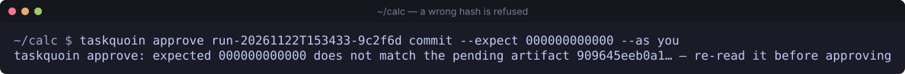

exit code ของการปฏิเสธคือ 1 คำสั่งที่พิมพ์ผิด (ขาด `--expect` หรือ `--as`) จบด้วย 2

## ขั้นตอนที่ 7: การพัฒนา Verify และรีวิว

หลัง `approve … plan` Taskquoin ทำงานโดยไม่ต้องมีคุณ:

1. **พัฒนาแบบ TDD** `implementer` (Claude) ทำงานบนบรานช์ ภายใน sandbox ของ runtime โดยไม่มีเครือข่ายและไม่มีวิธีคอมมิต มันเขียนหรือปรับเทสต์ก่อน แล้วจึงเขียนโค้ดที่ง่ายที่สุดที่ทำให้เทสต์ผ่าน
2. **Verify ในห้องสะอาด** Taskquoin นำ tree ที่ implementer ทิ้งไว้อย่างแน่นอนมารันเทสต์ของคุณ (`npm test`) เองในสำเนาใช้แล้วทิ้งนอกรีโพสิทอรีของคุณ: ไม่มีเครือข่าย `.git` อ่านอย่างเดียว HOME ของคุณถูกซ่อน ไฟล์ความลับถูกปิดบัง และมีเพียงไดเรกทอรี dependency ของ stack (และ `verify.inherit` ของคุณ) ที่ mount แบบอ่านอย่างเดียว เทสต์ที่ผ่านเพราะพึ่งสิ่งที่ยังไม่ได้คอมมิตจะล้มเหลวที่นี่ ซึ่งคือจุดประสงค์
3. **RED proof** จากนั้น Taskquoin เอาการเปลี่ยนแปลงโค้ด production ออกและรันเทสต์ที่เปลี่ยนอีกครั้ง เทสต์เหล่านั้นต้อง**ล้มเหลว** เทสต์ที่ผ่านทั้งที่ไม่มีการเปลี่ยนแปลงไม่ได้ทดสอบอะไรเลย หลักฐานนี้เป็นกลไก: มันไม่ได้แสดงว่าเทสต์ยืนยันพฤติกรรมที่ถูกต้อง (นั่นคือหน้าที่ของรีวิวและของคุณ)
4. **รีวิว** `challenger` รีวิว diff เทียบกับแผน พร้อมล็อก verify และ RED มันปิดท้ายด้วยบรรทัด `VERDICT:`

หากเทสต์เป็นสีแดง หรือ RED proof ล้มเหลว หรือรีวิวขอให้แก้ไข Taskquoin จะส่งฟีดแบ็กให้ implementer เพื่อแก้ไขใหม่อัตโนมัติ (สูงสุด 3 ครั้งในการพัฒนา และแก้ไขซ้ำได้อย่างมาก 2 รอบหลังรีวิวถูกปฏิเสธ) จากนั้น run จะหยุดที่ประตูที่สอง

## ขั้นตอนที่ 8: อ่านและอนุมัติคอมมิต

ตอนนี้ run กำลังรออีกครั้ง ลองดู:

```shell
$ taskquoin status run-20261122T132108-d17040
Run run-20261122T132108-d17040 — waiting-approval at approve-commit (attempt 1, branch taskquoin/run-20261122T132108-d17040)
  commit approval required (bound to the exact tree)
  Review it:   taskquoin show run-20261122T132108-d17040 diff-1  (and: verify-1, red-1, review-1)
  Approve it:  taskquoin approve run-20261122T132108-d17040 commit --expect 909645eeb0a1 --as <your name>
               (git tree 909645eeb0a1716e60fd724784ede536fbea048f)
```

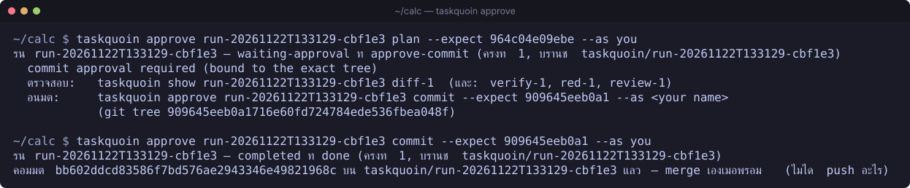

คราวนี้แฮชคือ **git tree** ที่ผ่าน Verify และรีวิว อ่าน artifact ทั้งสี่ของความพยายามที่ 1 ตัวเลขคือลำดับความพยายาม หลังการแก้ไขใหม่ให้อ่านอันที่สูงที่สุด

### `diff-1`: การเปลี่ยนแปลงที่แท้จริง

```shell
$ taskquoin show run-20261122T132108-d17040 diff-1
```

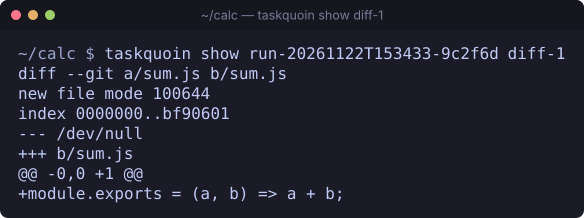

นี่คือสิ่งที่จะถูกคอมมิต ไม่มีอะไรเกินนี้ หากเอเจนต์เปลี่ยนไฟล์ที่ได้รับการป้องกัน (CI ของคุณ, `.claude/`, `AGENTS.md`, `taskquoin.yaml`) run จะหยุดด้วย `protected configuration changed` ไฟล์ที่ `.gitignore` ของคุณซ่อนแต่เอเจนต์สร้างขึ้นจะอยู่ใน `ignored-1` ไฟล์เหล่านั้นไม่อยู่ใน diff ไม่ถูกตรวจสอบ และไม่ถูกคอมมิต

### `verify-1`: เทสต์ของคุณ รันโดย Taskquoin

```shell
$ taskquoin show run-20261122T132108-d17040 verify-1
```

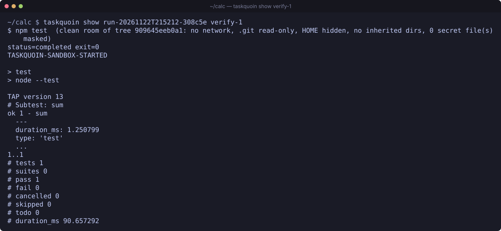

ส่วนหัวบอกว่าห้องสะอาดเป็นอย่างไร (`no network, .git read-only, HOME hidden, … 0 secret file(s) masked`) และสำหรับ tree ใด (`909645eeb0a1` แฮชเดียวกับที่คุณจะอนุมัติ) `exit=0` และ `# pass 1` มาจากตัวรันเทสต์ ไม่ใช่จากข้ออ้างของโมเดล

### `red-1`: หลักฐานว่าเทสต์มีความหมาย

```shell
$ taskquoin show run-20261122T132108-d17040 red-1
TASKQUOIN RED PROOF — tests run on base + test changes only (tree 9848f565e24c); they must FAIL.
RESULT: they failed as required (RED proven).

$ npm test  (clean room of tree 9848f565e24c: no network, .git read-only, HOME hidden, no inherited dirs, 0 secret file(s) masked)
status=failed exit=1
…
not ok 1 - sum
  error: Cannot find module './sum.js'
  code: 'MODULE_NOT_FOUND'
```

ที่นี่ไฟล์ production ใหม่ `sum.js` ถูกนำออก เทสต์โหลดมันไม่ได้ และล้มเหลว ความล้มเหลวนั้นคือ RED proof Taskquoin ถือว่าข้อผิดพลาดการ import ของฟีเจอร์ในไฟล์ *ใหม่* เป็น RED ที่คาดไว้ หากมีเพียงไฟล์เทสต์ที่เปลี่ยน (เพิ่มเทสต์ล้วน ๆ) หลักฐานจะถูกบันทึกเป็น "not applicable"

### `review-1`: ความเห็นที่สอง

```shell
$ taskquoin show run-20261122T132108-d17040 review-1
Review: diff checked against the plan.
VERDICT: APPROVE
```

อ่านข้อค้นพบ ไม่ใช่แค่คำตัดสิน `ignored-1` จะปรากฏในรายการเฉพาะเมื่อมีอะไรให้อ่าน

### อนุมัติคอมมิต

หากคุณพอใจ ให้อนุมัติด้วยแฮชจาก `status`:

```shell
$ taskquoin approve run-20261122T132108-d17040 commit --expect 909645eeb0a1 --as you
Run run-20261122T132108-d17040 — completed at done (attempt 1, branch taskquoin/run-20261122T132108-d17040)
Committed a3c6b801de5f4356750f53870557e2fdd19958ee on taskquoin/run-20261122T132108-d17040 — merge it yourself when ready (nothing was pushed).
```

ต้องรัน `approve … commit` ขณะที่รีโพสิทอรีอยู่บนบรานช์ของ run (`taskquoin/<run>`) มิฉะนั้นจะตอบว่า `switch to taskquoin/<run> first` Taskquoin อ่าน working tree ใหม่ก่อนคอมมิต หากมีอะไรเปลี่ยนไปนับแต่คุณดู การอนุมัติของคุณจะไม่มีผลอีกต่อไป: มันจะตรวจสอบใหม่ รีวิวใหม่ และขอให้คุณอนุมัติ tree ใหม่

จากนั้น Taskquoin สร้างคอมมิต**จาก git tree ที่ได้รับอนุมัติโดยตรง** ไม่ใช่จาก `git add` หน้าตาเป็นแบบนี้:

```shell
$ git log -1 taskquoin/run-20261122T132108-d17040
```

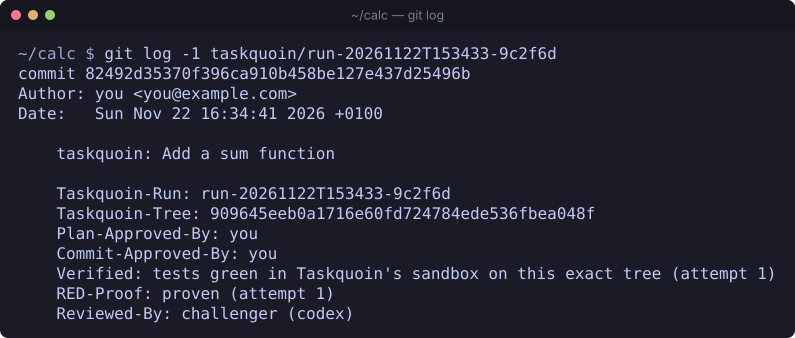

```text
taskquoin: Add a sum function

Taskquoin-Run: run-20261122T132108-d17040
Taskquoin-Tree: 909645eeb0a1716e60fd724784ede536fbea048f
Plan-Approved-By: you
Commit-Approved-By: you
Verified: tests green in Taskquoin's sandbox on this exact tree (attempt 1)
RED-Proof: proven (attempt 1)
Reviewed-By: challenger (codex)
```

trailer คือร่องรอยการตรวจสอบ อยู่ในคอมมิตเอง:

| Trailer | ความหมาย |
|---|---|
| `Taskquoin-Run` | run ที่สร้างคอมมิตนี้ |
| `Taskquoin-Tree` | git tree ที่ผ่านการตรวจสอบ รีวิว และอนุมัติ เป็น tree ของคอมมิตนี้ |
| `Plan-Approved-By` | ชื่อที่ให้ด้วย `--as` ที่ประตูของแผน |
| `Commit-Approved-By` | ชื่อที่ให้ด้วย `--as` ที่ประตูของคอมมิต |
| `Verified` | เทสต์เป็นสีเขียวในห้องสะอาดบน tree นี้พอดี |
| `RED-Proof` | เทสต์ที่เปลี่ยนล้มเหลวเมื่อไม่มีการเปลี่ยนแปลง (`proven` หรือ `not applicable` สำหรับการเปลี่ยนที่มีแต่เทสต์) |
| `Reviewed-By` | เอเจนต์ที่รีวิวและอนุมัติ ผู้ตัดสินแบบ API เพิ่มบรรทัดของตนเอง |

`taskquoin status <run>` ในตอนท้ายแสดงบันทึกการทำงานทั้งหมด ตั้งแต่ `recall` ไปจนถึง `commit` และ `record`

## ขั้นตอนที่ 9: merge ผลลัพธ์

Taskquoin **ไม่เคย push** และไม่เคย merge เข้าบรานช์ของคุณ คอมมิตอยู่บน `taskquoin/<run>` ซึ่งเป็นบรานช์ที่คุณอยู่ ให้ merge เอง หรือเปิด pull request จากบรานช์นั้น:

```shell
$ git switch main
$ git merge --ff-only taskquoin/run-20261122T132108-d17040
$ npm test
```

> [!WARNING]
> Taskquoin ไม่รัน commit hook ของรีโพสิทอรีคุณ เพราะอาจมีโค้ดที่เอเจนต์แก้ไข ให้รัน hook, linter และ CI ของคุณเองเมื่อ merge

บรานช์ `taskquoin/<run>` เป็นของคุณ: ลบเมื่อไม่ต้องการแล้ว (`git branch -d taskquoin/<run>`)

## ติดตามการรันใน Dashboard

ขณะที่การรันกำลังทำงาน ให้เปิดเทอร์มินัลที่สองในรีโพซิทอรีเดียวกันแล้วเริ่ม Dashboard ซึ่งอ่านอย่างเดียว: แสดงไปป์ไลน์ การอนุมัติที่รอคุณอยู่ (พร้อมส่วนต้นของ hash) เอเจนต์ และบันทึก

```shell
$ taskquoin dashboard
```

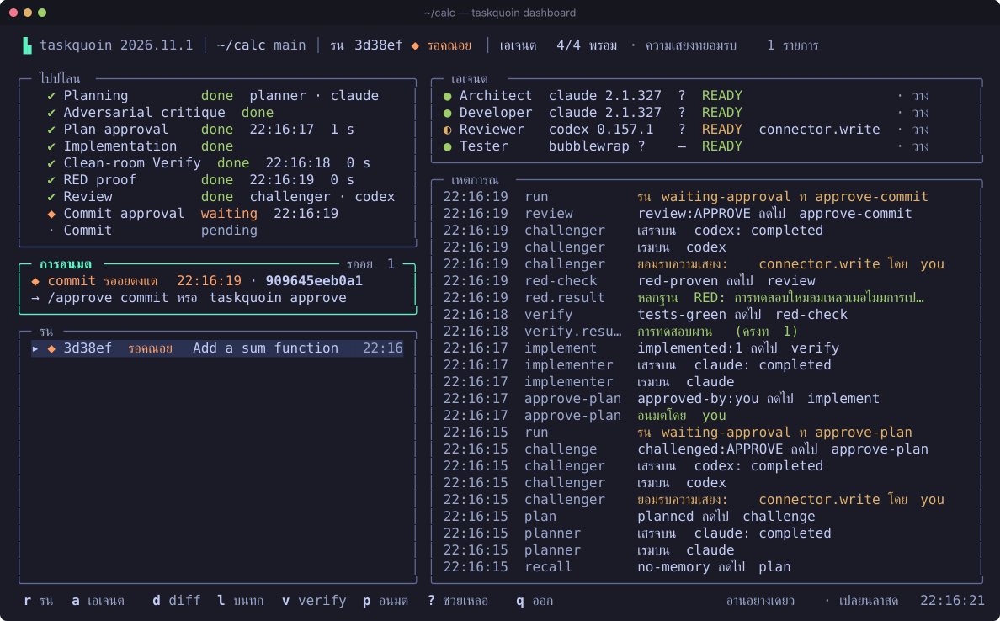

กด `d` เพื่ออ่าน diff: `/` ใช้ค้นหา, `n` และ `N` ใช้กระโดดระหว่างผลลัพธ์ และไฟล์จะนับว่าอ่านแล้วเมื่อคุณเลื่อนถึงท้ายไฟล์

กด `p` เพื่อเปิดศูนย์อนุมัติ ไม่มีปุ่มใดอนุมัติเองได้: คุณพิมพ์ชื่อของคุณ แล้วพิมพ์อักขระ 12 ตัวของ hash ซ้ำอีกครั้ง ออกด้วย `q`; การรันที่อนุมัติแล้วจะทำงานต่อ [คู่มือ Dashboard (ภาษาอังกฤษ)](../guides/dashboard.md).

## เมื่อสิ่งต่าง ๆ ไม่เป็นไปตามแผน

ข้อความแสดงข้อผิดพลาดของ Taskquoin เป็นไปตามภาษาของคุณ แต่ข้อความของเอนจินของ run (`failed`, `needs-human`, `interrupted`) เป็นภาษาอังกฤษเสมอ ตารางนี้แสดงสิ่งที่คุณจะพบบ่อยที่สุด

| สิ่งที่คุณเห็น | ความหมาย | สิ่งที่ต้องทำ |
|---|---|---|
| `taskquoin run: the working tree has uncommitted changes` | Taskquoin ไม่เคยผสมการเปลี่ยนแปลงของตัวเองกับของคุณ | คอมมิตหรือ stash การเปลี่ยนแปลงของคุณ |
| `failed … gate refused agent X` | ไม่สามารถรับรองเอเจนต์บนเครื่องนี้ได้ | `taskquoin doctor` บอกเหตุผล: เวอร์ชันของ runtime, sandbox ที่ขาด, ความเสี่ยงที่คุณยังไม่ได้ยอมรับ |
| `needs-human … tests still failing after 3 attempts` | สามครั้งแล้วเทสต์ก็ยังไม่เป็นสีเขียว | เข้าไปทำต่อบนบรานช์ของ run หรือเริ่ม run ใหม่ด้วยคำขอที่แม่นยำกว่า |
| `needs-human … no failing test demonstrates the change` | เทสต์ผ่านแม้ไม่มีการเปลี่ยนแปลง production จึงไม่ได้ทดสอบมัน | อ่าน `red-N` เขียน (หรือขอให้เขียน) เทสต์ที่ล้มเหลวก่อนการเปลี่ยนแปลง การ refactor หรือการเปลี่ยนเอกสารที่ไม่มีเทสต์ใหม่จะจบที่นี่: คอมมิตเองจากบรานช์ |
| `needs-human … RED proof inconclusive` | หลักฐานรันไม่ถูกต้อง (หมดเวลา, sandbox, tree ที่สร้างใหม่ไม่ได้) นั่นไม่ใช่หลักฐาน | อ่าน `red-N` โฟลเดอร์ทำงานของคุณไม่ถูกแตะต้อง |
| `needs-human … review still requests changes after N attempts` | ผู้รีวิวปฏิเสธต่อเนื่อง | อ่าน `review-N` แล้วตัดสินใจ งานอยู่บนบรานช์ |
| `needs-human … dependencies changed during the run` | `node_modules` (หรือ `vendor`, `.venv`) เปลี่ยนระหว่างการ run จึงไม่มีอะไรถูกตรวจสอบด้วยมัน | ติดตั้งใหม่ (`npm ci`) และเริ่ม run ใหม่ อย่ารัน `npm install` ระหว่างการ run |
| `needs-human … protected configuration changed` | เอเจนต์แตะต้องคอนฟิกที่ได้รับการป้องกัน (CI, `.claude/`, `AGENTS.md`, `taskquoin.yaml`) | ไม่มีอะไรถูกคอมมิต ตรวจสอบบรานช์ |
| เทสต์ผ่านที่เครื่องคุณแต่ล้มเหลวใน Verify | เทสต์ใช้ไฟล์ที่ถูกเพิกเฉยซึ่งไม่มีในห้องสะอาด | เพิ่มไฟล์นั้นใน `verify.inherit` |
| `does not match the pending artifact` | แฮชที่คุณให้ไม่ใช่แฮชที่รออยู่ | อ่านด้วย `show` แล้วคัดลอกแฮชจาก `status` |
| `switch to taskquoin/<run> first` | คุณไม่ได้อยู่บนบรานช์ของ run | `git switch taskquoin/<run>` |
| `taskquoin.yaml changed since the run started` | คอนฟิกเปลี่ยนกลางการ run | เริ่ม run ใหม่ |
| `interrupted` | ข้อผิดพลาดทางเทคนิค (git, ดิสก์, HTTP 503 ของผู้ตัดสิน) หยุด run | `taskquoin resume <run>` |

### เมื่อเทสต์ยังคงเป็นสีแดง

หาก Verify ล้มเหลว Taskquoin จะให้ล็อกที่ล้มเหลวและรีวิวแก่ implementer แล้วลองอีก สูงสุดสามครั้งในการพัฒนา (implementer แบบ OpenCode ซึ่งไม่มีคำสั่งของตนเอง ได้แก้ไขซ้ำมากกว่า) หากเทสต์ยังเป็นสีแดง run จะจบด้วยสถานะ `needs-human` และเหตุผล `tests still failing after 3 attempts` ไม่มีคอมมิตและไม่มีพรอมต์ขออนุมัติ

ทุกอย่างถูกเก็บไว้: `taskquoin show <run> verify-3` มีล็อกสุดท้าย และบรานช์ `taskquoin/<run>` เก็บงานของเอเจนต์ คุณทำต่อด้วยมือบนบรานช์นั้นได้ หรือเริ่ม run ใหม่ด้วยคำขอที่แม่นยำกว่า run ที่เป็น `needs-human` จะไม่ถูกเดินต่ออัตโนมัติ

### `resume`: หลังการหยุดชะงัก

run อยู่ในสถานะ `interrupted` เมื่อมีสิ่งนอกเวิร์กโฟลว์ทำให้มันพัง (ข้อผิดพลาดเครือข่ายขณะติดต่อผู้ตัดสิน ดิสก์เต็ม เครื่องของคุณเข้าสู่โหมดสลีป) สถานะถูกบันทึกทุกขั้นตอน และคำตอบของผู้ตัดสินถูกบันทึกทีละรายการ ดังนั้นการเดินต่อจะไม่เรียก หรือจ่ายเงินให้ ผู้ตัดสินซ้ำสองครั้ง:

```shell
$ taskquoin resume run-20261122T132108-d17040
```

`resume` รับเฉพาะ run ที่สถานะเป็น `interrupted` สำหรับสถานะอื่นมันจะบอกคุณ เช่น `taskquoin resume: only an interrupted run can be resumed (status completed)` หากสถานะเป็น `needs-human` หรือ `failed` ให้เริ่ม run ใหม่

### หลักปฏิบัติง่าย ๆ

หากคุณไม่รู้ว่าจะทำอะไร ให้รัน `taskquoin status <run>`: มันพิมพ์สถานะ บันทึกการทำงาน และคำสั่งถัดไปที่แน่นอน `taskquoin doctor` ตอบทุกคำถามเกี่ยวกับเครื่อง

## เรียนรู้เพิ่มเติม

- [คอนโซลแบบโต้ตอบ](../getting-started/console.md): เวิร์กโฟลว์เดียวกัน ด้วย `/run` และ `/approve`
- [การติดตั้ง](../getting-started/installation.md)
- [ADR-0011 เอเจนต์ไม่เคยคอมมิต](../adr/0011-agents-never-commit.md)
- [ADR-0013 การกำกับดูแลบนพื้นฐานของ tree](../adr/0013-tree-based-governance.md)
- [ADR-0014 Verify ในห้องสะอาด](../adr/0014-verify-in-a-clean-room.md)
- [ADR-0002 คลาสของการบังคับใช้](../adr/0002-enforcement-classes.md)
- [ADR-0005 control plane นอก workspace](../adr/0005-control-plane-outside-workspace.md)
- [ADR-0016 ผู้ตัดสินผ่าน API](../adr/0016-judges-by-api.md) และ [ADR-0017 OpenCode ที่ไม่มีคำสั่ง](../adr/0017-opencode-without-commands.md)
