# İlk yönetilen çalıştırmanız

Bu eğitim, [İngilizce başvuru sayfasının](../getting-started/first-run.md) çevirisidir. Makine çevirisidir: yerel bir okuyucu tarafından değil, bakımcıların komutlara yönelik testleriyle kontrol edilmiştir.

Bu eğitim sizi boş bir klasörden, Taskquoin tarafından yapılmış doğrulanmış bir commit'e kadar, komut komut götürür. Başarısız bir testi olan küçük bir proje oluşturacak, Taskquoin'in yapay zekâ ajanlarıyla bir düzeltmeyi planlamasına ve uygulamasına izin verecek ve işi iki kez onaylayacaksınız: bir kez planı okuduktan sonra, bir kez de tam diff'i okuduktan sonra. Her adımda Taskquoin'in ne yaptığını, neden durduğunu ve neyi imzaladığınızı görürsünüz.

- [Ne inşa edeceksiniz](#ne-inşa-edeceksiniz)
- [Adım 1: başarısız testi olan bir proje oluşturun](#adım-1-başarısız-testi-olan-bir-proje-oluşturun)
- [Adım 2: Taskquoin'i başlatın](#adım-2-taskquoini-başlatın)
- [Adım 3: yapılandırmayı commit'leyin](#adım-3-yapılandırmayı-commitleyin)
- [Adım 4: doctor ile makineyi kontrol edin](#adım-4-doctor-ile-makineyi-kontrol-edin)
- [Anladığınız bir riski kabul edin](#anladığınız-bir-riski-kabul-edin)
- [Adım 5: çalıştırmayı başlatın](#adım-5-çalıştırmayı-başlatın)
- [Adım 6: planı okuyun ve onaylayın](#adım-6-planı-okuyun-ve-onaylayın)
- [Adım 7: uygulama, Verify ve inceleme](#adım-7-uygulama-verify-ve-inceleme)
- [Adım 8: commit'i okuyun ve onaylayın](#adım-8-commiti-okuyun-ve-onaylayın)
- [Adım 9: sonucu birleştirin](#adım-9-sonucu-birleştirin)
- [Dashboard'da bir çalıştırmayı izleme](#dashboardda-bir-çalıştırmayı-izleme)
- [İşler planlandığı gibi gitmediğinde](#i̇şler-planlandığı-gibi-gitmediğinde)
- [Daha fazlası](#daha-fazlası)

> [!NOTE]
> Ekran görüntüleri, simüle edilmiş yapay zekâ ajanlarının (Taskquoin'in kendi test paketindeki test ikizleri) bulunduğu bir demo deposundan gelir; her komut gerçek Taskquoin CLI'sidir. Gerçek Claude Code ve Codex ile planın ve incelemenin ifadesi ajanların kendisine aittir ve bir çalıştırma saniyeler yerine birkaç dakika sürer. Geri kalan her şey aynıdır.

Başlamadan önce [Taskquoin'i kurun](../getting-started/installation.md) ve Node 22.18+, git, `bubblewrap` ve `socat` araçlarının hazır olduğundan, ayrıca en az Claude Code'un (tercihen Codex'in de) kurulu ve oturum açılmış olduğundan emin olun.

## Ne inşa edeceksiniz

Bir çalıştırma sabit bir iş akışıdır. İki baklava dilimi iki insan onayıdır; siz olmadan hiçbir şey onların ötesine geçmez.

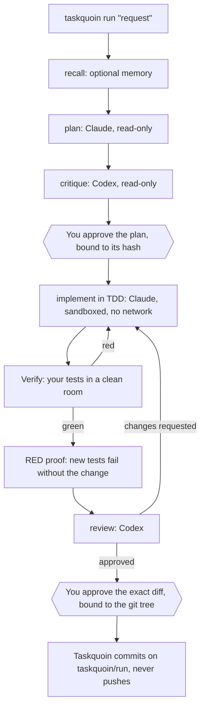

Eğitim boyunca üç fikir yinelenir:

- **Ajanlar önerir, Taskquoin eyleme geçer.** Ajanlar asla commit yapmaz. Commit, doğrulanmış, incelenmiş ve onaylanmış ağaçtan Taskquoin tarafından oluşturulur ([ADR-0011](../adr/0011-agents-never-commit.md)).
- **Onayınız bir hash'e bağlıdır.** "Çalıştırmayı" değil, tam olarak okuduğunuzu onaylarsınız ([ADR-0013](../adr/0013-tree-based-governance.md)).
- **Testler temiz odada çalışır.** Model, Taskquoin'e testlerin geçtiğini asla söylemez; Taskquoin onları kendisi çalıştırır ([ADR-0014](../adr/0014-verify-in-a-clean-room.md)).

## Adım 1: başarısız testi olan bir proje oluşturun

Proje, tek fonksiyonlu bir hesap makinesidir. Test var; fonksiyon yok.

```shell
$ mkdir calc && cd calc
$ git init -q -b main
```

`package.json` dosyasını oluşturun:

```json
{
  "name": "calc",
  "private": true,
  "scripts": { "test": "node --test" }
}
```

`sum.test.js` dosyasını oluşturun:

```js
const test = require('node:test');
const assert = require('node:assert');

test('sum', () => {
  const sum = require('./sum.js');
  assert.strictEqual(sum(2, 3), 5);
});
```

`.gitignore` dosyasını oluşturun (bağımlılıklar ve derleme çıktıları hiçbir zaman bir Taskquoin diff'inin parçası olmaz):

```text
node_modules/
```

Commit'leyin (aşağıdaki komut çıktıları İngilizce gösterilir):

```shell
$ git add .
$ git commit -m "calc: a failing test for sum"
$ npm test
not ok 1 - sum
  error: Cannot find module './sum.js'
```

Test beklendiği gibi kırmızı. Taskquoin'in bir proje için tek önkoşulu, çalışma ağacı temiz bir git deposudur: `taskquoin run`, commit edilmemiş değişiklikleriniz varsa başlamayı reddeder, çünkü kendi değişikliklerini asla sizinkilerle karıştırmaz.

## Adım 2: Taskquoin'i başlatın

```shell
$ taskquoin init
```

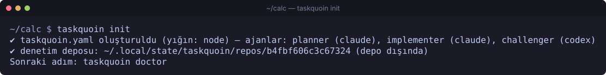

`init` üç şey yaptı:

1. Yığını algıladı (`node`; ayrıca `npm test`, PHPUnit, pytest, `go test`, Maven ve diğerlerini tanır) ve deponun köküne `taskquoin.yaml` yazdı.
2. Makinenizdeki yapay zekâ araçlarını aradı ve ajanları seçti: burada `planner` ve `implementer` Claude Code üzerinde, `challenger` ise Codex üzerinde. Bir araç eksikse dosya bunu söyler; yalnızca Claude Code varsa inceleyici de Claude olur. Yalnızca OpenCode varsa `init` tamamen OpenCode'a dayalı bir yapılandırma yazar.
3. Deponun dışında, `${XDG_STATE_HOME:-~/.local/state}/taskquoin/` altında bir **kontrol deposu** oluşturdu. Çalıştırma durumu, onaylar ve risk kabulleri burada tutulur. Ajanlar buraya yazamaz; bir onayı taklit edilemez kılan da budur ([ADR-0005](../adr/0005-control-plane-outside-workspace.md)).

`init` mevcut bir `taskquoin.yaml` dosyasının üzerine asla yazmaz. `init`'i başka yapay zekâlar varken çalıştırdıysanız (ortamınızda bir API anahtarı, yerel bir Ollama), bunları listeler ve dosyada **yorum satırı** olarak önerir: yorumdan çıkarmak sizin kararınızdır, çünkü projenin kodunun onlara gönderileceği anlamına gelir.

### Üretilen `taskquoin.yaml`

Dosyayı açın. Kısadır ve tamamını okuyabilirsiniz. İşte bölüm bölüm hali.

```yaml
# Taskquoin project configuration — see docs/architecture.md. Protected: agents can never edit this file.
version: 1
stack: node
```

`version` şema sürümüdür. `stack`, temiz oda için varsayılanları seçer: testleriniz için hangi bağımlılık dizinleri salt okunur bağlanır (`node` için: `node_modules`). İlk yorum bir sözdür: **ajanlar bu dosyayı asla düzenleyemez.** Bir ajan çalıştırma sırasında ona dokunursa çalıştırma durur ve hiçbir şey commit edilmez.

```yaml
agents:
  planner:
    runtime: claude
    description: "Read-only planner: turns a request into a minimal, test-first implementation plan."
    prompt: You plan; you never modify files. Read the repository, then produce the plan requested.
    capabilities:
      fs.read:
        - "**"
    maxTurns: 30
    skills:
      - planning-contract
```

Bir **ajan**, bir çalışma zamanına (`claude`, `codex`, `opencode` veya bir hakem için `api`) bağlı bir roldür. `capabilities`, ajanın neler yapmasına izin verildiğidir: planner her şeyi okuyabilir (`fs.read: "**"`) ve başka hiçbir şey yapamaz; yani kabuğu da yazma aracı da yoktur. `skills`, hash ile sabitlenmiş yönergelerdir (`planning-contract` birinci taraf bir beceridir). `maxTurns`, ajanın tur sayısını sınırlar.

```yaml
  implementer:
    runtime: claude
    description: Implements an approved task with strict TDD (RED → GREEN → REFACTOR).
    prompt: "You implement exactly the approved task. Write a failing test first, make it pass with the simplest change, then refactor. Never commit: Taskquoin verifies and commits."
    capabilities:
      fs.read:
        - "**"
      fs.write:
        - "**"
      shell.run:
        - npm test
        - npm test -- *
        - node --test *
    maxTurns: 40
    skills:
      - tdd
```

Implementer dosya yazabilir ve testi önce yazarak çalışabilmesi için küçük bir izinli test komutları listesi (`shell.run`) çalıştırabilir. Bu komutlar, çalışma zamanının kendi işletim sistemi korumalı alanında, ağsız çalışır. Buna rağmen onun test çalıştırması yalnızca kendi geri bildirimi içindir: sayılan sonuç, Taskquoin'in Verify aşamasında ürettiğidir.

```yaml
  challenger:
    runtime: codex
    description: Independent, read-only adversarial reviewer of plans and diffs.
    prompt: "You are an independent reviewer. Challenge the plan or diff: correctness, security, missing tests, over-engineering. Report blocking and non-blocking findings with file:line. Do not modify files."
    capabilities:
      fs.read:
        - "**"
    skills:
      - code-review
```

**Challenger** planı eleştirir ve diff'i inceler. Bilerek implementer'dan farklı bir sağlayıcıdandır ve salt okunurdur: eleştirdiği şeyi "düzeltebilmemelidir".

```yaml
policy:
  mandatory:
    - fs.write
    - net.egress
    - config.modify
    - connector.write
    - vcs.commit
    - vcs.push
connectors: {}
memory:
  claudeMem:
    enabled: true
```

`policy.mandatory`, bir ajanın başlayabilmesi için bir mekanizmayla **zorunlu kılınması gereken** kısıtlamaları listeler: kapsamı dışında yazma yok, ağ yok, korumalı yapılandırmada değişiklik yok, uzak sisteme yazma yok, commit yok, push yok. Elinizdeki çalışma zamanı sürümü bunlardan birini uygulayamıyorsa ajan, yalnızca tavsiye niteliğinde bir kuralla başlatılmak yerine reddedilir ([ADR-0002](../adr/0002-enforcement-classes.md), [ADR-0003](../adr/0003-hooks-enforce-prose-asks.md)). `connectors` boştur: hiçbir uzak sistem bağlı değildir ([ADR-0012](../adr/0012-remote-connectors-by-exception.md)). `memory.claudeMem` isteğe bağlıdır: etkinleştirildiğinde, biten her çalıştırmanın yapılandırılmış bir özeti yerel [claude-mem](https://github.com/thedotmack/claude-mem) çalışanınıza gönderilir ve bir çalıştırmanın başında kısa bir hatırlatma okunur. claude-mem çalıştırmıyorsanız `false` yapın. (Bu eğitimdeki ekranlar `false` kullanır.)

> [!TIP]
> Testleriniz, bağımlılık dizini olmayan yok sayılmış bir dosyaya, örneğin derlenmiş bir `dist/` veya bir `.env.test` dosyasına ihtiyaç duyuyorsa bunu açıkça ekleyin. Böylece temiz odada salt okunur olarak bağlanır ve ajan için dondurulur:
>
```yaml
verify:
  inherit:
    - dist
```
>
> Testleri `npm test` ile çalıştırılmayan bir proje `verify.command` ayarlayabilir.

Hakem olarak başka yapay zekâlar (OpenAI uyumlu herhangi bir sağlayıcı) veya planner ve implementer olarak OpenCode da kullanabilirsiniz; bkz. [ADR-0016](../adr/0016-judges-by-api.md) ve [ADR-0017](../adr/0017-opencode-without-commands.md).

## Adım 3: yapılandırmayı commit'leyin

`taskquoin.yaml` projenizin bir parçasıdır, bu yüzden commit'leyin. Bu aynı zamanda Taskquoin'in ihtiyaç duyduğu temiz çalışma ağacını sağlar:

```shell
$ git add taskquoin.yaml
$ git commit -m "chore: taskquoin"
```

## Adım 4: doctor ile makineyi kontrol edin

```shell
$ taskquoin doctor
```

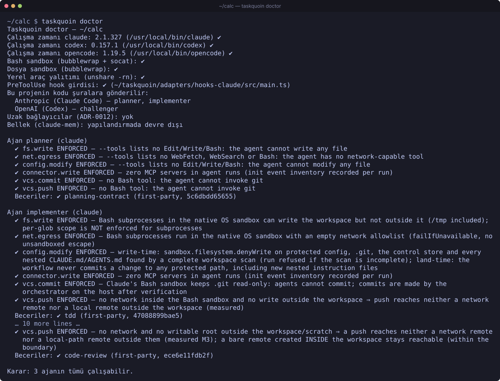

`doctor`, Taskquoin'in dürüst kısmıdır. Yukarıdan aşağıya okuyun:

- İlk blok, bulunan çalışma zamanlarını sürümleriyle ve sürüm Taskquoin'in ölçtüğü sürümse bir onay işaretiyle listeler; ardından korumalı alanları (bubblewrap ve socat) ve hook'u.
- **This project's code is sent to**, kodunuzu alacak her sağlayıcıyı ajan bazında listeler. Taskquoin makinenizde çalışır; yalnızca yapılandırdığınız yapay zekâlar bir şey görür ([ADR-0010](../adr/0010-local-first-no-leak.md)).
- Sonra her ajan için, her zorunlu kısıtlama sınıfıyla ve **onu uygulayan mekanizmayla**, örneğin `net.egress ENFORCED — Bash subprocesses run in the native OS sandbox with an empty network allowlist`. Onay işareti, o çalışma zamanı sürümü için sertifikalı olduğu anlamına gelir; çarpı, ajanın başlamayacağı anlamına gelir.
- Son satır hükümdür: `Verdict: all 3 agents can run.` veya `Verdict: 2 of 3 agents can run — refused agents will not be started.`

Demoda bir satır çarpıdır (çıktı İngilizce gösterilir):

```text
Agent challenger (codex)
  …
  ✖ connector.write — mandatory restriction "connector.write" (deny-all) on codex 0.157.1: claimed ENFORCED but the mechanism is not measured (inferred). Execution refused (ADR-0002).
```

Codex `connector.write` kısıtlamasını (uzak bağlayıcılara yazma yok) uyguladığını söyler, ancak Taskquoin bu iddiayı ölçemez, bu yüzden onu uygulanmış saymaz. Challenger reddedilir: bir çalıştırma `gate refused agent challenger` ile `failed at challenge` olarak biterdi. Bunun için vermeniz gereken bir karar var.

## Anladığınız bir riski kabul edin

**Kabul edilmiş risk**, ölçülemeyen tek bir kısıtlamaya rağmen bir ajanı çalıştırmak için verdiğiniz imzalı, tarihli ve kapsamı belli karardır. Bu sahibin kararıdır, geliştiricinin değil ve asla ajanın değil:

```shell
$ taskquoin accept-risk challenger connector.write \
    --reason "Codex reviews read-only; no connector configured" \
    --expires 2026-12-31 --as you
```

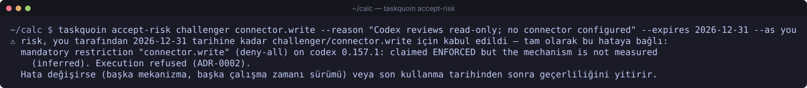

Dört seçeneğin hepsi zorunludur: `--reason`, `--expires` (gerçek bir gelecek tarih, `YYYY-MM-DD`) ve `--as` (adınız), ayrıca ajan ve capability. Kabulün ne olduğuna dikkat edin:

- **Tam hataya bağlıdır.** Hata iletisinin bir özetini saklar. Çalışma zamanı sürümü veya mekanizma değişirse hata artık aynı hata değildir ve kabul geçerliliğini yitirir.
- **Tarihlidir.** Son kullanma tarihinden sonra da geçerliliğini yitirir.
- **Deponun dışında**, kontrol deposunda saklanır. Hiç kimse `taskquoin.yaml` dosyasını düzenleyerek bir tane ekleyemez ve hiçbir ajan onu yazamaz.
- **Dardır.** Yalnızca bu ajan ve bu capability için geçerlidir. Başarısız olmayan bir capability için reddedilir ve API hakemleri için kullanılamaz (onlar her zaman denetlenir).

`doctor`'ı yeniden çalıştırın. Satır artık çarpı yerine uyarıdır ve hüküm `all 3 agents can run` olur (çıktı İngilizce gösterilir):

```text
  ⚠ connector.write accepted risk (approved by you until 2026-12-31: Codex reviews read-only; no connector configured) — mandatory restriction "connector.write" (deny-all) on codex 0.157.1: claimed ENFORCED but the mechanism is not measured (inferred). Execution refused (ADR-0002).
```

`taskquoin check challenger` aynı ayrıntıyı tek bir ajan için gösterir:

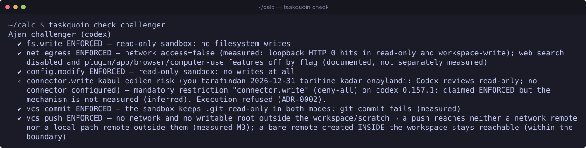

> [!IMPORTANT]
> Bir riski yalnızca onu anladığınızda ve durum gerekçenizle örtüştüğünde kabul edin: burada Codex salt okunur inceleme yapar ve projenizde bağlayıcı yoktur, yani bir "bağlayıcıya yazma" zaten gerçekleşemez. Kırmızı bir satırı yok etmek için risk kabul etmeyin. Özellikle:
>
> - gerçekten yazan veya komut çalıştıran bir ajanda `fs.write`, `net.egress`, `vcs.commit` veya `vcs.push` için asla, telafi edici kontrolü adlandıramıyorsanız;
> - belirsiz bir gerekçeyle asla: gerekçe onaya kaydedilir ve `doctor` tarafından gösterilir;
> - kısa bir bitiş tarihini tercih edin: kabul, bir yükseltmeden sonra yeniden kontrol etmek için bir hatırlatmadır;
> - bir mekanizma *başarısız olarak ölçülmüşse* bunun yerine yükseltin veya çalışma zamanını değiştirin.

`taskquoin accept-risk` komutunu kendinizin çalıştırması bilinçlidir: konsol veya bir ajan bunu yapabilseydi kontrolün hiçbir anlamı kalmazdı.

## Adım 5: çalıştırmayı başlatın

```shell
$ taskquoin run "Add a sum function"
```

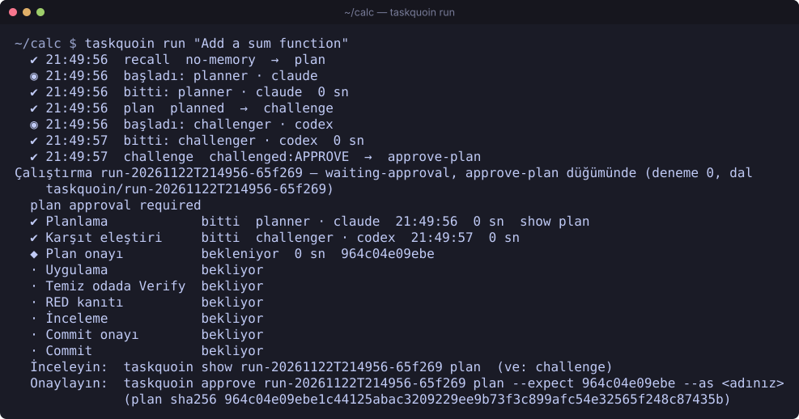

Ajanlar çalışırken terminaliniz sessizdir, sonra nerede durduğunu yazdırır. Sırasıyla Taskquoin şunu yaptı:

1. **Preflight.** Taskquoin, yapılandırmanın her rolü tanımladığını, becerilerin kullanılabilir olduğunu, salt okunur rollerin gerçekten salt okunur olduğunu ve API hakemlerinin anahtarlarının bulunduğunu kontrol etti. Çalışma ağacı temiz olmalıdır. Her ajan ayrıca ilk kullanılmadan hemen önce `doctor` ile aynı kapıdan geçer: reddedilen bir ajan çalıştırmayı `failed` olarak bitirir.
2. **Dal.** `taskquoin/run-20261122T132108-d17040` dalını oluşturdu ve ona geçti. `main` dalınıza dokunulmadı.
3. **Recall.** Etkinse bellek çalışanından ilgili notları istedi. Hiç not yoksa günlükte `recall no-memory` görünür.
4. **Plan.** `planner` (Claude, salt okunur) depoyu okudu ve bir plan yazdı: hedef, önce yazılacak test, dosyalar, adımlar, riskler.
5. **Eleştiri.** `challenger` (Codex, salt okunur) bu planı bağımsız olarak sorguladı ve bir `VERDICT:` satırıyla bitirdi.
6. **Kapı.** İş akışı `approve-plan` noktasında durdu. Siz ne kadar isterseniz o kadar bekler.

Çalıştırma kimliği (`run-20261122T132108-d17040`) bir zaman damgası ve rastgele bir sonektir. Sonraki her komutta onu kullanırsınız. Argümansız `taskquoin status` çalıştırmaları listeler (çıktı İngilizce gösterilir):

```shell
$ taskquoin status
run-20261122T132108-d17040  waiting-approval approve-plan    Add a sum function
```

## Adım 6: planı okuyun ve onaylayın

`status <run>` tek bir çalıştırmanın geçmişini ve bir kapıda onu onaylayan tam komutu gösterir:

```shell
$ taskquoin status run-20261122T132108-d17040
```

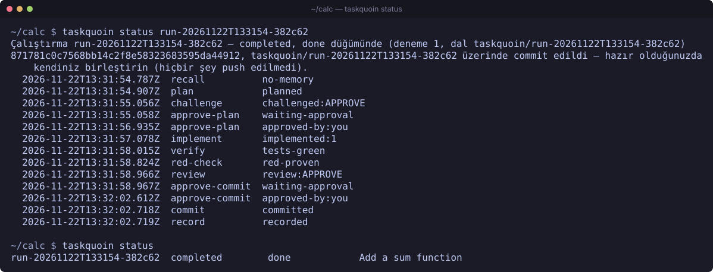

Her geçmiş satırı, sonucuyla birlikte iş akışının bir adımıdır (`planned`, `challenged:APPROVE`, `waiting-approval`).

Şimdi **onaylamak üzere olduğunuz şeyi okuyun**:

```shell
$ taskquoin show run-20261122T132108-d17040 plan
```

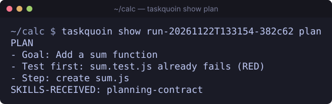

Komut çıktıları, CLI'nin yazdırdığı gibi İngilizce gösterilir:

```shell
$ taskquoin show run-20261122T132108-d17040 challenge
Review: plan checked.
VERDICT: APPROVE
```

Artefakt belirtmeden `show <run>`, şimdiye kadar saklanan her şeyi bayt cinsinden boyutuyla listeler. Gerçek bir ajanın planı ayrıca dokunulacak dosyaları, önce yazılacak testleri ve riskleri kapsar. Challenge, bağımsız ikinci görüştür: engelleyici ve engelleyici olmayan bulgular listeleyebilir. Plan yanlışsa onaylamayın: daha kesin bir istekle yeni bir run başlatın.

### Neden hash

Önemli olan satır, `status` çıktısının sonuncusudur (çıktı İngilizce gösterilir):

```text
Approve it:  taskquoin approve run-20261122T132108-d17040 plan --expect 964c04e09ebe --as <your name>
             (plan sha256 964c04e09ebe1c44125abac3209229ee9b73f3c899afc54e32565f248c87435b)
```

`964c04e09ebe`, az önce okuduğunuz plan dosyasının SHA-256 değerinin başıdır. Onaylamak "bu çalıştırmayı onaylıyorum" demek değildir; "**hash'i 964c04e09ebe olan planı** onaylıyorum" demektir. Plan okumanızla onayınız arasında değişebilseydi (bir yeniden deneme, başka bir süreç, ele geçirilmiş bir araç), hash artık eşleşmezdi ve Taskquoin reddederdi. Commit'in kaydettiği de budur, bu yüzden herkes bir kişinin neyi onayladığını daha sonra denetleyebilir.

> [!NOTE]
> `--expect` bir parola değildir. Sistemin işlem yapmak üzere olduğu artefakta baktığınızın kanıtıdır: okuduktan sonra onu `status` çıktısından kopyalarsınız. [Konsolda](../getting-started/console.md) onaylamak için onu yeniden yazarsınız.

Onaylayın:

```shell
$ taskquoin approve run-20261122T132108-d17040 plan --expect 964c04e09ebe --as you
```

`--as` adınızdır; commit'te `Plan-Approved-By` olarak kaydedilir. Planı onaylamak iş akışını sürdürür; iş akışı bir sonraki kapıya kadar devam eder.

### Yanlış hash reddedilir

Bekleyen hash olmayan bir hash deneyin (çıktı İngilizce gösterilir):

```shell
$ taskquoin approve run-20261122T132108-d17040 plan --expect 000000000000 --as you
taskquoin approve: expected 000000000000 does not match the pending artifact 964c04e09ebe… — re-read it before approving
```

Hiçbir şey onaylanmadı ve çalıştırma değişmedi. Çalıştırmanın beklemediği bir kapıyı onaylarsanız da aynısı olur. Aşağıdaki ekran görüntüsü çalıştırma tamamlandıktan sonra alındı, bu yüzden reddin bu varyantını gösterir:

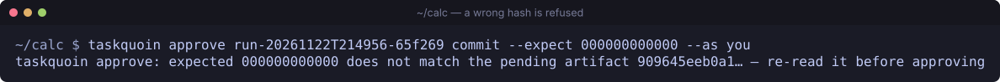

Bir reddin çıkış kodu 1'dir. Yanlış yazılmış bir komut (eksik `--expect` veya `--as`) 2 ile çıkar.

## Adım 7: uygulama, Verify ve inceleme

`approve … plan` sonrasında Taskquoin sizsiz çalışır:

1. **TDD ile uygulama.** `implementer` (Claude) dalda, çalışma zamanının korumalı alanında, ağsız ve commit yapma imkânı olmadan çalışır. Önce testleri yazar veya ayarlar, sonra onları geçirecek en basit kodu.
2. **Verify, temiz odada.** Taskquoin, implementer'ın bıraktığı tam ağacı alır ve testlerinizi (`npm test`) deponuzun dışındaki geçici bir kopyada kendisi çalıştırır: ağ yok, `.git` salt okunur, HOME'unuz gizli, gizli dosyalar maskeli ve yalnızca yığının bağımlılık dizinleri (ve `verify.inherit` içeriğiniz) salt okunur bağlı. Commit edilmemiş bir şeye bağımlı olan geçen bir test burada başarısız olur; amaç da budur.
3. **RED proof.** Taskquoin sonra üretim kodu değişikliğini kaldırır ve değişen testleri yeniden çalıştırır. Testler **başarısız olmalıdır**. Değişiklik olmadan geçen bir test hiçbir şeyi test etmez. Kanıt mekaniktir: testin doğru davranışı doğruladığını göstermez (bunun için inceleme ve siz varsınız).
4. **İnceleme.** `challenger`, diff'i plana karşı, verify ve RED günlükleriyle birlikte inceler. Bir `VERDICT:` satırıyla bitirir.

Testler kırmızıysa, RED proof başarısız olduysa veya inceleme değişiklik istiyorsa Taskquoin geri bildirimi otomatik yeniden çalışma için implementer'a gönderir (en fazla 3 uygulama denemesi, reddedilen bir incelemeden sonra en fazla 2 yeniden çalışma turu). Çalıştırma ardından ikinci kapıda durur.

## Adım 8: commit'i okuyun ve onaylayın

Çalıştırma yine bekliyor. Ona bakın (çıktı İngilizce gösterilir):

```shell
$ taskquoin status run-20261122T132108-d17040
Run run-20261122T132108-d17040 — waiting-approval at approve-commit (attempt 1, branch taskquoin/run-20261122T132108-d17040)
  commit approval required (bound to the exact tree)
  Review it:   taskquoin show run-20261122T132108-d17040 diff-1  (and: verify-1, red-1, review-1)
  Approve it:  taskquoin approve run-20261122T132108-d17040 commit --expect 909645eeb0a1 --as <your name>
               (git tree 909645eeb0a1716e60fd724784ede536fbea048f)
```

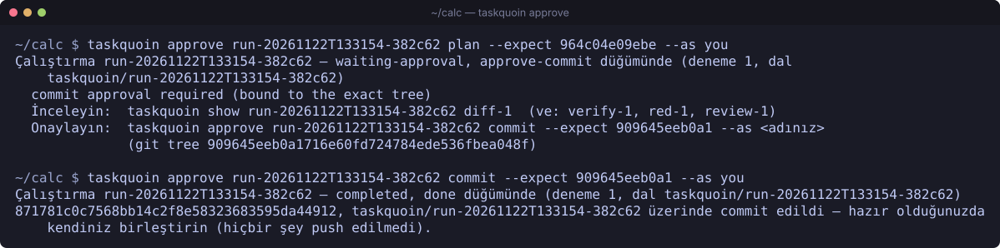

Bu kez hash, Verify'ı ve incelemeyi geçen **git ağacıdır**. 1. denemenin dört artefaktını okuyun. Sayı deneme numarasıdır; yeniden çalışmadan sonra en yüksek olanı okursunuz.

### `diff-1`: tam değişiklik

```shell
$ taskquoin show run-20261122T132108-d17040 diff-1
```

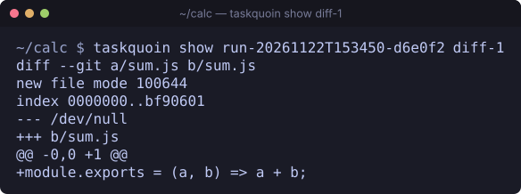

Commit'lenecek olan budur, fazlası değil. Ajan korumalı bir dosyayı (CI'nız, `.claude/`, `AGENTS.md`, `taskquoin.yaml`) değiştirseydi çalıştırma `protected configuration changed` ile durmuş olurdu. `.gitignore` dosyanızın gizlediği ama ajanın oluşturduğu dosyalar `ignored-1` içinde listelenir; diff'te değildir, doğrulanmaz ve commit'lenmez.

### `verify-1`: testleriniz, Taskquoin tarafından çalıştırıldı

```shell
$ taskquoin show run-20261122T132108-d17040 verify-1
```

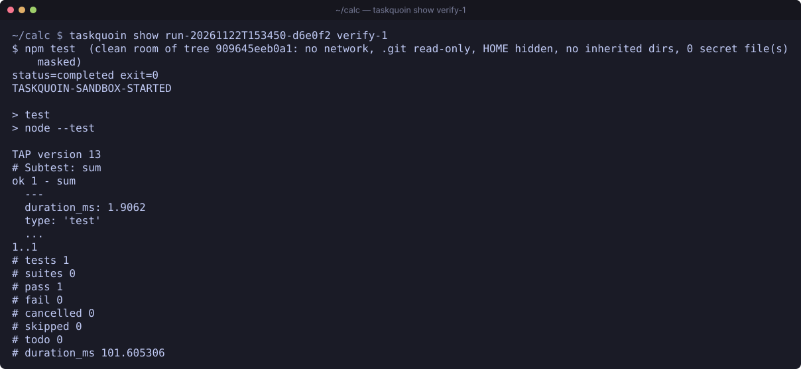

Başlık, temiz odanın ne olduğunu (`no network, .git read-only, HOME hidden, … 0 secret file(s) masked`) ve hangi ağaç için olduğunu (`909645eeb0a1`, onaylayacağınız aynı hash) söyler. `exit=0` ve `# pass 1` test çalıştırıcısından gelir, bir modelin iddiasından değil.

### `red-1`: testin önemli olduğunun kanıtı

Komut çıktıları, CLI'nin yazdırdığı gibi İngilizce gösterilir:

```shell
$ taskquoin show run-20261122T132108-d17040 red-1
TASKQUOIN RED PROOF — tests run on base + test changes only (tree 9848f565e24c); they must FAIL.
RESULT: they failed as required (RED proven).

$ npm test  (clean room of tree 9848f565e24c: no network, .git read-only, HOME hidden, no inherited dirs, 0 secret file(s) masked)
status=failed exit=1
…
not ok 1 - sum
  error: Cannot find module './sum.js'
  code: 'MODULE_NOT_FOUND'
```

Burada yeni üretim dosyası `sum.js` kaldırıldı, test onu yükleyemedi ve başarısız oldu. Bu başarısızlık RED proof'tur. Taskquoin, *yeni* bir dosyadaki bir özellikten kaynaklanan içe aktarma hatasını beklenen RED sayar. Yalnızca test dosyaları değiştiyse (salt test eklemesi) kanıt "not applicable" olarak kaydedilir.

### `review-1`: ikinci görüş

Komut çıktıları, CLI'nin yazdırdığı gibi İngilizce gösterilir:

```shell
$ taskquoin show run-20261122T132108-d17040 review-1
Review: diff checked against the plan.
VERDICT: APPROVE
```

Yalnızca hükmü değil, bulguları okuyun. `ignored-1` listede yalnızca okunacak bir şey olduğunda görünür.

### Commit'i onaylayın

Memnunsanız `status` çıktısındaki hash ile onaylayın (çıktı İngilizce gösterilir):

```shell
$ taskquoin approve run-20261122T132108-d17040 commit --expect 909645eeb0a1 --as you
Run run-20261122T132108-d17040 — completed at done (attempt 1, branch taskquoin/run-20261122T132108-d17040)
Committed a3c6b801de5f4356750f53870557e2fdd19958ee on taskquoin/run-20261122T132108-d17040 — merge it yourself when ready (nothing was pushed).
```

`approve … commit`, depo çalıştırmanın dalındayken (`taskquoin/<run>`) çalıştırılmalıdır; aksi halde `switch to taskquoin/<run> first` yanıtını verir. Taskquoin commit'ten önce çalışma ağacını yeniden okur. Bakmanızdan sonra herhangi bir şey değiştiyse onayınız artık geçerli değildir: yeniden doğrular, yeniden inceler ve yeni ağacı onaylamanızı ister.

Taskquoin ardından commit'i `git add` ile değil, **onaylanan git ağacından** kendisi oluşturur. Şöyle görünür:

```shell
$ git log -1 taskquoin/run-20261122T132108-d17040
```

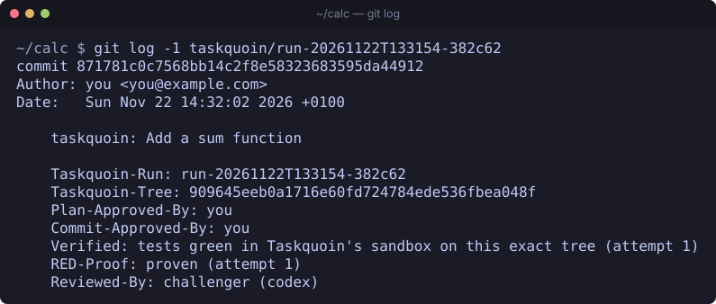

Komut çıktıları, CLI'nin yazdırdığı gibi İngilizce gösterilir:

```text
taskquoin: Add a sum function

Taskquoin-Run: run-20261122T132108-d17040
Taskquoin-Tree: 909645eeb0a1716e60fd724784ede536fbea048f
Plan-Approved-By: you
Commit-Approved-By: you
Verified: tests green in Taskquoin's sandbox on this exact tree (attempt 1)
RED-Proof: proven (attempt 1)
Reviewed-By: challenger (codex)
```

Trailer'lar, doğrudan commit içindeki denetim izidir:

| Trailer | Anlamı |
|---|---|
| `Taskquoin-Run` | Bu commit'i yapan çalıştırma |
| `Taskquoin-Tree` | Doğrulanan, incelenen ve onaylanan git ağacı. Bu commit'in ağacıdır |
| `Plan-Approved-By` | Plan kapısında `--as` ile verilen ad |
| `Commit-Approved-By` | Commit kapısında `--as` ile verilen ad |
| `Verified` | Testler tam bu ağaçta temiz odada yeşildi |
| `RED-Proof` | Değişen testler değişiklik olmadan başarısız oldu (`proven` veya yalnızca test değişiklikleri için `not applicable`) |
| `Reviewed-By` | İnceleyen ve onaylayan ajanlar; bir API hakemi kendi satırını ekler |

Sonunda `taskquoin status <run>`, `recall`'dan `commit` ve `record`'a kadar tüm günlüğü gösterir.

## Adım 9: sonucu birleştirin

Taskquoin **asla push yapmaz** ve sizin dalınıza asla birleştirmez. Commit, üzerinde bulunduğunuz `taskquoin/<run>` dalındadır. Kendiniz birleştirin veya ondan bir pull request açın:

```shell
$ git switch main
$ git merge --ff-only taskquoin/run-20261122T132108-d17040
$ npm test
```

> [!WARNING]
> Taskquoin deponuzun commit hook'larını çalıştırmaz, çünkü ajanın değiştirdiği kod içerebilirler. Birleştirirken hook'larınızı, linter'larınızı ve CI'nızı kendiniz çalıştırın.

`taskquoin/<run>` dalları sizindir: gerek kalmadığında silin (`git branch -d taskquoin/<run>`).

## Dashboard'da bir çalıştırmayı izleme

Bir çalıştırma ilerlerken aynı depoda ikinci bir terminal açın ve Dashboard'u başlatın. Yalnızca okur: iş hattını, sizi bekleyen onayı (hash'inin başıyla), ajanları ve günlüğü gösterir.

```shell
$ taskquoin dashboard
```

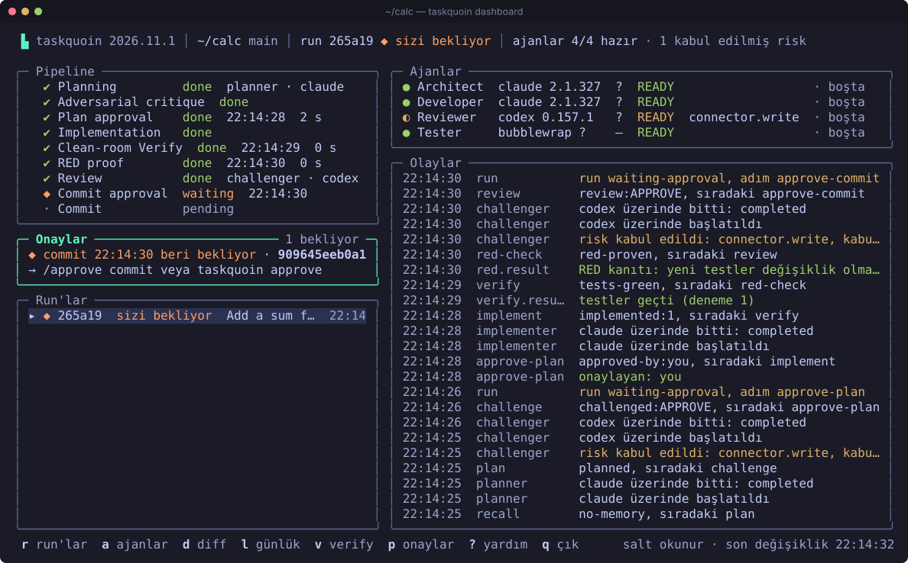

Diff'i okumak için `d` tuşuna basın: `/` arar, `n` ve `N` eşleşmeler arasında gezinir; bir dosya, sonuna kadar kaydırdığınızda okunmuş sayılır.

Onay merkezini açmak için `p` tuşuna basın. Hiçbir tuş kendi başına onaylamaz: adınızı yazarsınız, sonra hash'in 12 karakterini yeniden yazarsınız. `q` ile çıkın; onaylanmış çalıştırma devam eder. [Dashboard kılavuzu (İngilizce)](../guides/dashboard.md).

## İşler planlandığı gibi gitmediğinde

Taskquoin'in hata iletileri dilinizi izler, ancak çalıştırma motorunun iletileri (`failed`, `needs-human`, `interrupted`) her zaman İngilizcedir. Tablo en sık karşılaşacaklarınızı listeler.

| Gördüğünüz | Anlamı | Yapılacak |
|---|---|---|
| `taskquoin run: the working tree has uncommitted changes` | Taskquoin kendi değişikliklerini asla sizinkilerle karıştırmaz | Değişikliklerinizi commit'leyin veya stash'leyin |
| `failed … gate refused agent X` | Bir ajan bu makinede sertifikalandırılamaz | `taskquoin doctor` nedenini söyler: çalışma zamanı sürümü, eksik korumalı alan, kabul etmediğiniz bir risk |
| `needs-human … tests still failing after 3 attempts` | Üç deneme yeşil test vermedi | Çalıştırma dalında elle devam edin veya daha kesin bir istekle yeni bir run başlatın |
| `needs-human … no failing test demonstrates the change` | Testler üretim değişikliği olmadan da geçiyor, yani onu test etmiyorlar | `red-N` dosyasını okuyun; değişiklikten önce başarısız olan bir test yazın (veya isteyin). Yeni testi olmayan bir yeniden düzenleme veya belge değişikliği burada biter: dalda kendiniz commit'leyin |
| `needs-human … RED proof inconclusive` | Kanıt düzgün çalıştırılamadı (zaman aşımı, korumalı alan, yeniden oluşturulamayan bir ağaç). Bu bir kanıt değildir | `red-N` dosyasını okuyun. Çalışma klasörünüze dokunulmadı |
| `needs-human … review still requests changes after N attempts` | İnceleyici reddetmeyi sürdürdü | `review-N` dosyasını okuyun ve karar verin; iş dalda |
| `needs-human … dependencies changed during the run` | `node_modules` (veya `vendor`, `.venv`) çalıştırma sırasında değişti, bu yüzden onunla hiçbir şey doğrulanmadı | Yeniden kurun (`npm ci`) ve yeni bir run başlatın. Bir çalıştırma sırasında `npm install` çalıştırmayın |
| `needs-human … protected configuration changed` | Ajan korumalı yapılandırmaya (CI, `.claude/`, `AGENTS.md`, `taskquoin.yaml`) dokundu | Hiçbir şey commit edilmedi; dalı inceleyin |
| Testler sizde geçiyor ama Verify'da başarısız | Temiz odada bulunmayan yok sayılmış bir dosya kullanıyorlar | Onu `verify.inherit` içine ekleyin |
| `does not match the pending artifact` | Verdiğiniz hash bekleyen hash değil | `show` ile okuyun, hash'i `status` çıktısından kopyalayın |
| `switch to taskquoin/<run> first` | Çalıştırmanın dalında değilsiniz | `git switch taskquoin/<run>` |
| `taskquoin.yaml changed since the run started` | Yapılandırma çalıştırma sırasında değişti | Yeni bir run başlatın |
| `interrupted` | Teknik bir hata (git, disk, bir hakemin HTTP 503'ü) çalıştırmayı durdurdu | `taskquoin resume <run>` |

### Testler kırmızı kaldığında

Verify başarısız olursa Taskquoin, implementer'a başarısız günlüğü ve incelemeyi verir ve yeniden dener; en fazla üç uygulama denemesi yapılır (kendi komutu olmayan bir OpenCode implementer'ı daha fazla yeniden çalışma alır). Testler hâlâ kırmızıysa çalıştırma `needs-human` durumu ve `tests still failing after 3 attempts` nedeniyle biter. Commit ve onay istemi yoktur.

Her şey saklanır: `taskquoin show <run> verify-3` son günlüğü içerir ve `taskquoin/<run>` dalı ajanın işini tutar. O dalda elle devam edebilir veya daha kesin bir istekle yeni bir run başlatabilirsiniz. `needs-human` durumundaki bir çalıştırma otomatik olarak sürdürülmez.

### `resume`: bir kesintiden sonra

İş akışının dışındaki bir şey onu bozduğunda (bir hakeme ulaşırken ağ hatası, dolu disk, makinenizin uykuya geçmesi) bir çalıştırma `interrupted` olur. Durum her adımda kaydedilir ve hakemlerin yanıtları tek tek kaydedilir; bu yüzden sürdürmek bir hakemi asla iki kez çağırmaz veya ona iki kez ödeme yaptırmaz:

```shell
$ taskquoin resume run-20261122T132108-d17040
```

`resume` yalnızca durumu `interrupted` olan bir çalıştırmayı kabul eder. Diğer her durumda bunu size söyler, örneğin `taskquoin resume: only an interrupted run can be resumed (status completed)`. Durum `needs-human` veya `failed` ise yeni bir run başlatın.

### Bir temel kural

Ne yapacağınızı bilmiyorsanız `taskquoin status <run>` çalıştırın: durumu, günlüğü ve tam bir sonraki komutu yazdırır. `taskquoin doctor`, makineyle ilgili her soruyu yanıtlar.

## Daha fazlası

- [Etkileşimli konsol](../getting-started/console.md): aynı iş akışı, `/run` ve `/approve` ile
- [Kurulum](../getting-started/installation.md)
- [ADR-0011, agents never commit](../adr/0011-agents-never-commit.md)
- [ADR-0013, tree-based governance](../adr/0013-tree-based-governance.md)
- [ADR-0014, Verify in a clean room](../adr/0014-verify-in-a-clean-room.md)
- [ADR-0002, enforcement classes](../adr/0002-enforcement-classes.md)
- [ADR-0005, control plane outside the workspace](../adr/0005-control-plane-outside-workspace.md)
- [ADR-0016, judges by API](../adr/0016-judges-by-api.md) ve [ADR-0017, OpenCode without commands](../adr/0017-opencode-without-commands.md)
