# Ваш перший керований запуск

Цей посібник є перекладом [англійської довідкової сторінки](../getting-started/first-run.md). Це машинний переклад: його перевіряють тести супровідників на командах, а не носій мови.

Цей посібник проведе вас від порожньої теки до перевіреного коміту, зробленого Taskquoin, команда за командою. Ви створите крихітний проєкт із тестом, що падає, дозволите Taskquoin спланувати й реалізувати виправлення за допомогою ШІ-агентів і двічі підтвердите роботу: один раз після прочитання плану, вдруге після прочитання точного діфа. На кожному кроці ви бачите, що робить Taskquoin, чому він зупиняється і що саме ви підписуєте.

- [Що ви збудуєте](#що-ви-збудуєте)
- [Крок 1: створіть проєкт із тестом, що падає](#крок-1-створіть-проєкт-із-тестом-що-падає)
- [Крок 2: ініціалізуйте Taskquoin](#крок-2-ініціалізуйте-taskquoin)
- [Крок 3: закомітьте конфігурацію](#крок-3-закомітьте-конфігурацію)
- [Крок 4: перевірте машину за допомогою doctor](#крок-4-перевірте-машину-за-допомогою-doctor)
- [Прийміть ризик, який ви розумієте](#прийміть-ризик-який-ви-розумієте)
- [Крок 5: запустіть run](#крок-5-запустіть-run)
- [Крок 6: прочитайте й схваліть план](#крок-6-прочитайте-й-схваліть-план)
- [Крок 7: реалізація, Verify і рев'ю](#крок-7-реалізація-verify-і-ревю)
- [Крок 8: прочитайте й схваліть коміт](#крок-8-прочитайте-й-схваліть-коміт)
- [Крок 9: злийте результат](#крок-9-злийте-результат)
- [Коли все йде не за планом](#коли-все-йде-не-за-планом)
- [Дізнайтеся більше](#дізнайтеся-більше)

> [!NOTE]
> Знімки екрана зроблено на демонстраційному репозиторії зі змодельованими ШІ-агентами (тестові двійники з власного набору тестів Taskquoin); кожна команда є справжнім CLI Taskquoin. Зі справжніми Claude Code і Codex формулювання плану та рев'ю належать самим агентам, а виконання триває кілька хвилин замість секунд. Усе інше ідентичне.

Перш ніж почати, [установіть Taskquoin](../getting-started/installation.md) і переконайтеся, що доступні Node 22.18+, git, `bubblewrap` і `socat`, а також що принаймні Claude Code (а краще й Codex) установлено й увійдено в обліковий запис.

## Що ви збудуєте

Запуск — це фіксований робочий процес. Два ромби — це два підтвердження людиною; без вас нічого не рухається далі.

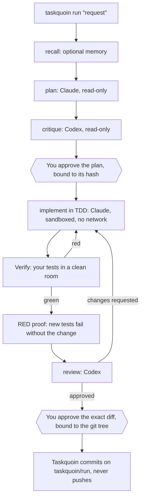

Крізь увесь посібник проходять три ідеї:

- **Агенти пропонують, Taskquoin діє.** Агенти ніколи не роблять коміти. Коміт будує сам Taskquoin із дерева, яке було перевірене, переглянуте й схвалене ([ADR-0011](../adr/0011-agents-never-commit.md)).
- **Ваше підтвердження прив'язане до гешу.** Ви схвалюєте саме те, що прочитали, а не «запуск» ([ADR-0013](../adr/0013-tree-based-governance.md)).
- **Тести виконуються в чистій кімнаті.** Модель ніколи не повідомляє Taskquoin, що тести проходять: Taskquoin запускає їх сам ([ADR-0014](../adr/0014-verify-in-a-clean-room.md)).

## Крок 1: створіть проєкт із тестом, що падає

Проєкт — калькулятор з однієї функції. Тест є, функції немає.

```shell
$ mkdir calc && cd calc
$ git init -q -b main
```

Створіть `package.json`:

```json
{
  "name": "calc",
  "private": true,
  "scripts": { "test": "node --test" }
}
```

Створіть `sum.test.js`:

```js
const test = require('node:test');
const assert = require('node:assert');

test('sum', () => {
  const sum = require('./sum.js');
  assert.strictEqual(sum(2, 3), 5);
});
```

Створіть `.gitignore` (залежності й результати збирання ніколи не входять до діфа Taskquoin):

```text
node_modules/
```

Закомітьте це (вивід команд нижче показано англійською):

```shell
$ git add .
$ git commit -m "calc: a failing test for sum"
$ npm test
not ok 1 - sum
  error: Cannot find module './sum.js'
```

Тест червоний, як і очікувалось. Єдина вимога Taskquoin до проєкту — git-репозиторій із чистим робочим деревом: `taskquoin run` відмовляється стартувати за наявності незакомічених змін, бо він ніколи не змішує свої зміни з вашими.

## Крок 2: ініціалізуйте Taskquoin

```shell
$ taskquoin init
```

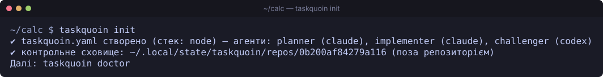

`init` зробив три речі:

1. Визначив стек (`node`; він також знає `npm test`, PHPUnit, pytest, `go test`, Maven та інші) і записав `taskquoin.yaml` у корінь репозиторію.
2. Пошукав ШІ-інструменти на вашій машині й обрав агентів: тут `planner` та `implementer` працюють на Claude Code, а `challenger` — на Codex. Якщо інструмента немає, файл про це повідомляє; за наявності лише Claude Code рев'юером теж буде Claude. За наявності лише OpenCode `init` записує конфігурацію повністю на OpenCode.
3. Створив **сховище керування** поза репозиторієм, у `${XDG_STATE_HOME:-~/.local/state}/taskquoin/`. Там живуть стан запусків, підтвердження та прийняті ризики. Агенти не можуть туди писати, і саме тому підтвердження неможливо підробити ([ADR-0005](../adr/0005-control-plane-outside-workspace.md)).

`init` ніколи не перезаписує наявний `taskquoin.yaml`. Якщо ви запускали `init` за наявності інших ШІ (ключ API в оточенні, локальний Ollama), він перелічує їх і пропонує у файлі як **коментарі**: розкоментувати їх — ваше рішення, адже це означає, що код проєкту буде надіслано їм.

### Згенерований `taskquoin.yaml`

Відкрийте його. Він короткий, і ви можете прочитати його весь. Ось він, розділ за розділом.

```yaml
# Taskquoin project configuration — see docs/architecture.md. Protected: agents can never edit this file.
version: 1
stack: node
```

`version` — версія схеми. `stack` обирає типові значення для чистої кімнати: які каталоги залежностей монтуються для ваших тестів лише для читання (для `node`: `node_modules`). Перший коментар — обіцянка: **агенти ніколи не можуть редагувати цей файл.** Якщо агент торкнеться його під час запуску, запуск зупиниться, і нічого не буде закомічено.

```yaml
agents:
  planner:
    runtime: claude
    description: "Read-only planner: turns a request into a minimal, test-first implementation plan."
    prompt: You plan; you never modify files. Read the repository, then produce the plan requested.
    capabilities:
      fs.read:
        - "**"
    maxTurns: 30
    skills:
      - planning-contract
```

**Агент** — це роль, прив'язана до рантайму (`claude`, `codex`, `opencode` або `api` для судді). `capabilities` — це те, що агентові дозволено робити: planner може читати все (`fs.read: "**"`) і більше нічого, тобто в нього немає ні оболонки, ні інструмента запису. `skills` — інструкції, закріплені за гешем (`planning-contract` постачається в комплекті). `maxTurns` обмежує кількість ходів агента.

```yaml
  implementer:
    runtime: claude
    description: Implements an approved task with strict TDD (RED → GREEN → REFACTOR).
    prompt: "You implement exactly the approved task. Write a failing test first, make it pass with the simplest change, then refactor. Never commit: Taskquoin verifies and commits."
    capabilities:
      fs.read:
        - "**"
      fs.write:
        - "**"
      shell.run:
        - npm test
        - npm test -- *
        - node --test *
    maxTurns: 40
    skills:
      - tdd
```

Implementer може записувати файли та запускати невеликий білий список тестових команд (`shell.run`), щоб працювати за принципом «тест спершу». Ці команди виконуються всередині власної пісочниці ОС рантайму, без мережі. Утім, його запуск тестів потрібен лише йому для зворотного зв'язку: важить результат, який Taskquoin отримує на етапі Verify.

```yaml
  challenger:
    runtime: codex
    description: Independent, read-only adversarial reviewer of plans and diffs.
    prompt: "You are an independent reviewer. Challenge the plan or diff: correctness, security, missing tests, over-engineering. Report blocking and non-blocking findings with file:line. Do not modify files."
    capabilities:
      fs.read:
        - "**"
    skills:
      - code-review
```

**Challenger** критикує план і рев'юїть діф. Він навмисно від іншого вендора, ніж implementer, і працює лише на читання: він не повинен мати змоги «виправити» те, що критикує.

```yaml
policy:
  mandatory:
    - fs.write
    - net.egress
    - config.modify
    - connector.write
    - vcs.commit
    - vcs.push
connectors: {}
memory:
  claudeMem:
    enabled: true
```

`policy.mandatory` перелічує обмеження, які **мають** забезпечуватися реальним механізмом, щоб агент міг стартувати: жодного запису поза його областю, жодної мережі, жодних змін захищеної конфігурації, жодного запису у віддалені системи, жодних комітів, жодних push. Якщо наявна версія рантайму не може забезпечити одне з них, агент отримує відмову, а не стартує з правилом, що є лише порадою ([ADR-0002](../adr/0002-enforcement-classes.md), [ADR-0003](../adr/0003-hooks-enforce-prose-asks.md)). `connectors` порожній: жодна віддалена система не підключена ([ADR-0012](../adr/0012-remote-connectors-by-exception.md)). `memory.claudeMem` необов'язковий: коли його ввімкнено, структурований підсумок кожного завершеного запуску надсилається вашому локальному воркеру [claude-mem](https://github.com/thedotmack/claude-mem), а на початку запуску зчитується коротка довідка. Установіть `false`, якщо ви не користуєтеся claude-mem. (На знімках екрана цього посібника стоїть `false`.)

> [!TIP]
> Якщо вашим тестам потрібен ігнорований файл, що не є каталогом залежностей, наприклад зібраний `dist/` або `.env.test`, додайте його явно. Тоді його монтують у чистій кімнаті лише для читання і заморожують для агента:
>
```yaml
verify:
  inherit:
    - dist
```
>
> Проєкт, тести якого запускаються не через `npm test`, може задати `verify.command`.

Ви також можете використовувати інші ШІ як суддів (будь-який OpenAI-сумісний провайдер) або OpenCode як planner та implementer; див. [ADR-0016](../adr/0016-judges-by-api.md) і [ADR-0017](../adr/0017-opencode-without-commands.md).

## Крок 3: закомітьте конфігурацію

`taskquoin.yaml` — частина вашого проєкту, тому закомітьте його. Це заразом дає Taskquoin потрібне йому чисте робоче дерево:

```shell
$ git add taskquoin.yaml
$ git commit -m "chore: taskquoin"
```

## Крок 4: перевірте машину за допомогою doctor

```shell
$ taskquoin doctor
```

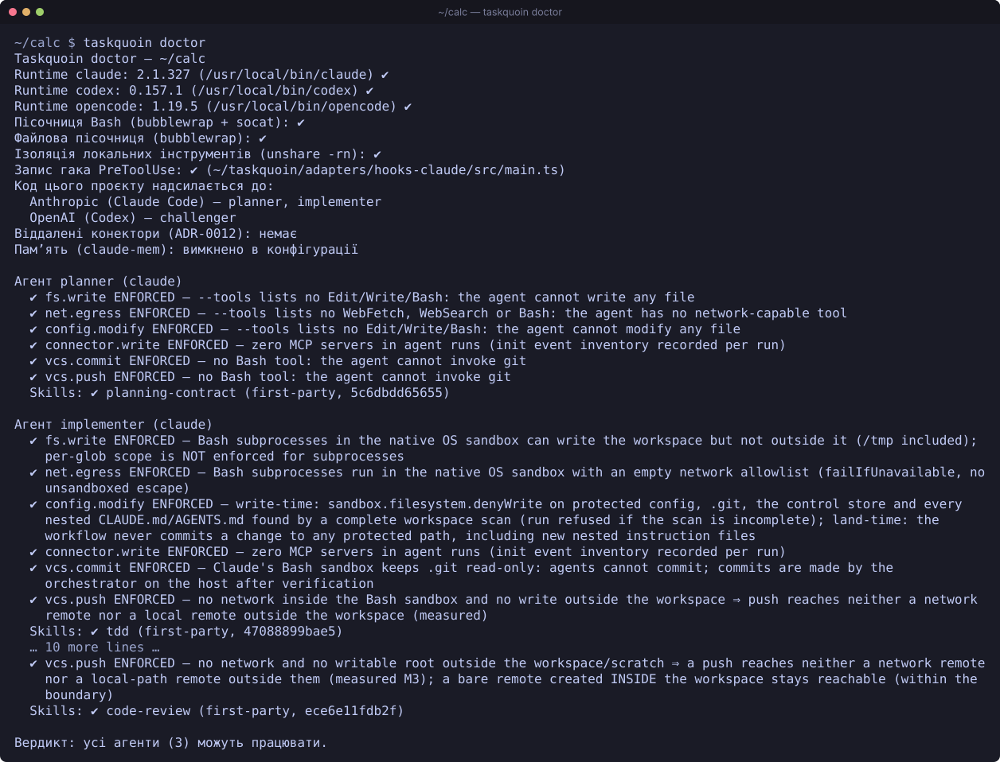

`doctor` — чесна частина Taskquoin. Читайте його згори вниз:

- Перший блок перелічує знайдені рантайми з версіями та галочкою, коли версія збігається з тією, яку Taskquoin виміряв, потім пісочниці (bubblewrap і socat) та хук.
- **This project's code is sent to** перелічує кожного вендора, який отримає ваш код, за агентами. Taskquoin працює на вашій машині; щось бачать лише налаштовані вами ШІ ([ADR-0010](../adr/0010-local-first-no-leak.md)).
- Далі для кожного агента — кожне обов'язкове обмеження з його класом і **механізмом, який його забезпечує**, наприклад `net.egress ENFORCED — Bash subprocesses run in the native OS sandbox with an empty network allowlist`. Галочка означає, що обмеження сертифіковано для цієї версії рантайму; хрестик — що агент не запуститься.
- Останній рядок — вердикт: `Verdict: all 3 agents can run.` або `Verdict: 2 of 3 agents can run — refused agents will not be started.`

У демонстрації один рядок позначено хрестиком (вивід показано англійською):

```text
Agent challenger (codex)
  …
  ✖ connector.write — mandatory restriction "connector.write" (deny-all) on codex 0.157.1: claimed ENFORCED but the mechanism is not measured (inferred). Execution refused (ADR-0002).
```

Codex заявляє, що забезпечує `connector.write` (заборона запису у віддалені конектори), але Taskquoin не може виміряти це твердження, тож не вважає обмеження забезпеченим. Challenger отримує відмову: запуск закінчився б як `failed at challenge` з `gate refused agent challenger`. Тут вам треба ухвалити рішення.

## Прийміть ризик, який ви розумієте

**Прийнятий ризик** — це ваше підписане, датоване рішення з обмеженою областю запустити агента попри одне обмеження, яке неможливо виміряти. Це рішення власника, а не розробника і тим паче не агента:

```shell
$ taskquoin accept-risk challenger connector.write \
    --reason "Codex reviews read-only; no connector configured" \
    --expires 2026-12-31 --as you
```

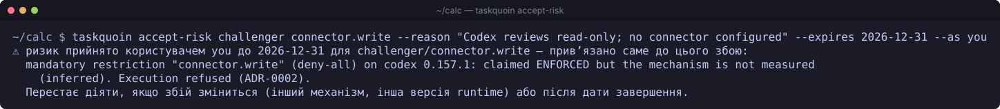

Усі чотири параметри обов'язкові: `--reason`, `--expires` (справжня майбутня дата у форматі `YYYY-MM-DD`) і `--as` (ваше ім'я), а також агент і capability. Зверніть увагу, чим є прийняття:

- **Прив'язане до конкретної помилки.** Зберігається дайджест повідомлення про помилку. Якщо версія рантайму або механізм змінилися, помилка вже не та сама, і прийняття перестає діяти.
- **Датоване.** Воно також перестає діяти після дати завершення.
- **Зберігається поза репозиторієм**, у сховищі керування. Ніхто не може додати його правкою `taskquoin.yaml`, і жоден агент не може його записати.
- **Вузьке.** Воно стосується лише цього агента й цієї capability. Для capability, яка не дає збою, його відхиляють, і воно недоступне для API-суддів (їх завжди перевіряють).

Знову запустіть `doctor`. Рядок тепер попередження, а не хрестик, і вердикт — `all 3 agents can run` (вивід показано англійською):

```text
  ⚠ connector.write accepted risk (approved by you until 2026-12-31: Codex reviews read-only; no connector configured) — mandatory restriction "connector.write" (deny-all) on codex 0.157.1: claimed ENFORCED but the mechanism is not measured (inferred). Execution refused (ADR-0002).
```

`taskquoin check challenger` показує ті самі подробиці для одного агента:

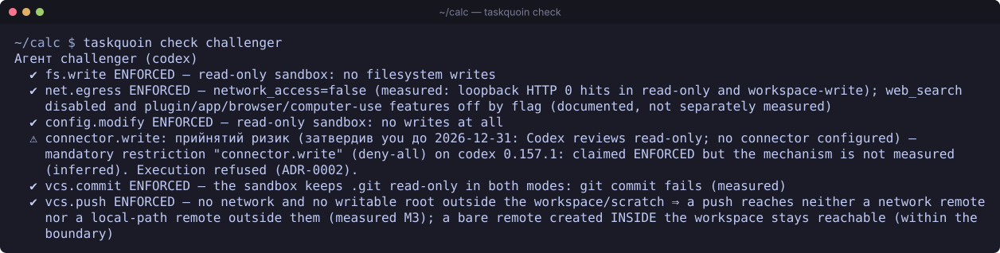

> [!IMPORTANT]
> Приймайте ризик лише тоді, коли ви його розумієте й ситуація відповідає вашій причині: тут Codex рев'юїть лише на читання, а у вашому проєкті немає конектора, тож «запис у конектор» усе одно неможливий. Не приймайте ризик, щоб прибрати червоний рядок. Зокрема:
>
> - ніколи для `fs.write`, `net.egress`, `vcs.commit` чи `vcs.push` в агента, який справді пише або запускає команди, якщо ви не можете назвати компенсувальний контроль;
> - ніколи з розпливчастою причиною: її записують у підтвердження і показує `doctor`;
> - віддавайте перевагу короткому терміну: прийняття — це нагадування перевірити ще раз після оновлення;
> - якщо механізм *виміряно як такий, що не працює*, краще оновіть або змініть рантайм.

Запускати `taskquoin accept-risk` самому — свідоме рішення: якби це могли зробити консоль чи агент, контроль нічого б не вартував.

## Крок 5: запустіть run

```shell
$ taskquoin run "Add a sum function"
```

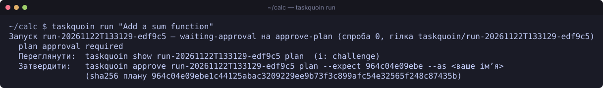

Термінал мовчить, поки працюють агенти, а потім друкує, де зупинився. По порядку Taskquoin зробив таке:

1. **Preflight.** Taskquoin перевірив, що конфігурація визначає кожну роль, що навички придатні до використання, що ролі лише для читання справді лише для читання і що в API-суддів є ключі. Робоче дерево має бути чистим. Кожен агент також проходить той самий гейт, що й `doctor`, безпосередньо перед першим використанням: агент, якому відмовлено, завершує запуск як `failed`.
2. **Гілка.** Він створив гілку `taskquoin/run-20261122T132108-d17040` і перемкнувся на неї. Ваша `main` не зачеплена.
3. **Recall.** Він запитав у воркера пам'яті, якщо той увімкнений, відповідні нотатки. Коли їх немає, у журналі з'являється `recall no-memory`.
4. **План.** `planner` (Claude, лише читання) прочитав репозиторій і написав план: мета, тест, який слід написати першим, файли, кроки, ризики.
5. **Критика.** `challenger` (Codex, лише читання) незалежно оскаржив цей план і завершив рядком `VERDICT:`.
6. **Гейт.** Робочий процес зупинився на `approve-plan`. Він чекатиме стільки, скільки вам потрібно.

Ідентифікатор запуску (`run-20261122T132108-d17040`) — це мітка часу з випадковим суфіксом. Ви використовуєте його в усіх наступних командах. `taskquoin status` без аргументу виводить перелік запусків (вивід показано англійською):

```shell
$ taskquoin status
run-20261122T132108-d17040  waiting-approval approve-plan    Add a sum function
```

## Крок 6: прочитайте й схваліть план

`status <run>` показує історію одного запуску і, на гейті, точну команду, що його схвалює:

```shell
$ taskquoin status run-20261122T132108-d17040
```

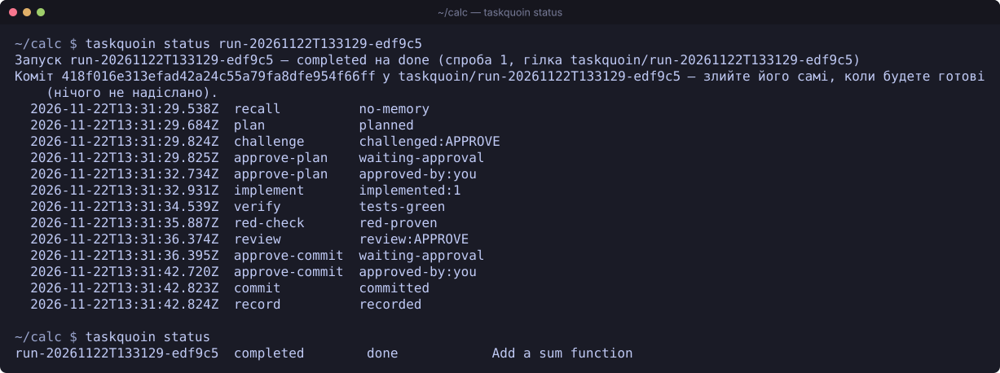

Кожен рядок історії — крок робочого процесу з його результатом (`planned`, `challenged:APPROVE`, `waiting-approval`).

Тепер **прочитайте те, що збираєтеся схвалити**:

```shell
$ taskquoin show run-20261122T132108-d17040 plan
```

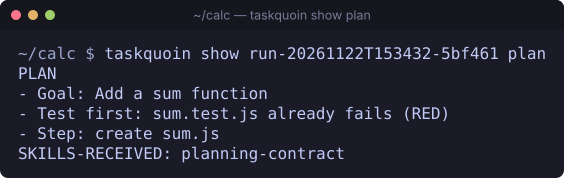

Вивід команд показано англійською, як його друкує CLI:

```shell
$ taskquoin show run-20261122T132108-d17040 challenge
Review: plan checked.
VERDICT: APPROVE
```

`show <run>` без артефакту перелічує все збережене досі з розміром у байтах. План від справжнього агента також охоплює файли, які треба змінити, тести, які треба написати першими, і ризики. Challenge — незалежна друга думка: у ньому можуть бути блокувальні та неблокувальні зауваження. Якщо план хибний, не схвалюйте його: запустіть новий run із точнішим запитом.

### Навіщо потрібен геш

Важливий останній рядок `status` (вивід показано англійською):

```text
Approve it:  taskquoin approve run-20261122T132108-d17040 plan --expect 964c04e09ebe --as <your name>
             (plan sha256 964c04e09ebe1c44125abac3209229ee9b73f3c899afc54e32565f248c87435b)
```

`964c04e09ebe` — початок SHA-256 файла плану, який ви щойно прочитали. Схвалення означає не «я схвалюю цей запуск», а «я схвалюю **план із гешем 964c04e09ebe**». Якби план міг змінитися між вашим читанням і підтвердженням (повторна спроба, інший процес, скомпрометований інструмент), геш перестав би збігатися, і Taskquoin відмовив би. Саме його записує коміт, тож будь-хто може пізніше перевірити, що схвалила людина.

> [!NOTE]
> `--expect` — не пароль. Це доказ того, що ви подивилися артефакт, над яким система збирається діяти: ви копіюєте його зі `status` після читання. У [консолі](../getting-started/console.md) ви вводите його заново для підтвердження.

Схваліть:

```shell
$ taskquoin approve run-20261122T132108-d17040 plan --expect 964c04e09ebe --as you
```

`--as` — ваше ім'я; воно записується як `Plan-Approved-By` у коміті. Схвалення плану відновлює робочий процес, який триває до наступного гейта.

### Хибний геш відхиляється

Спробуйте геш, що не збігається з очікуваним (вивід показано англійською):

```shell
$ taskquoin approve run-20261122T132108-d17040 plan --expect 000000000000 --as you
taskquoin approve: expected 000000000000 does not match the pending artifact 964c04e09ebe… — re-read it before approving
```

Нічого не схвалено, запуск не змінився. Те саме станеться, якщо ви схвалюєте гейт, якого запуск не очікує. Знімок екрана нижче зроблено після завершення запуску, тому на ньому показано саме цей варіант відмови:

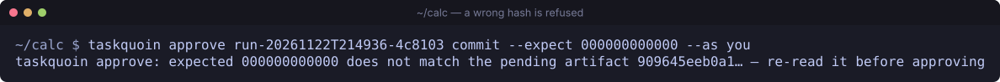

Код виходу при відмові — 1. Помилка в команді (пропущений `--expect` або `--as`) завершується з кодом 2.

## Крок 7: реалізація, Verify і рев'ю

Після `approve … plan` Taskquoin працює без вас:

1. **Реалізація за TDD.** `implementer` (Claude) працює на гілці, у пісочниці рантайму, без мережі й без можливості комітити. Спершу він пише або правит тести, потім найпростіший код, що їх проходить.
2. **Verify, у чистій кімнаті.** Taskquoin бере точне дерево, яке залишив implementer, і сам запускає ваші тести (`npm test`) у тимчасовій копії поза вашим репозиторієм: без мережі, `.git` лише для читання, ваш HOME прихований, секретні файли замасковані, і лише каталоги залежностей стека (та ваш `verify.inherit`) змонтовані лише для читання. Тест, що проходив, але залежав від чогось незакоміченого, тут падає, і в цьому сенс.
3. **RED proof.** Потім Taskquoin прибирає зміну в продакшен-коді й знову запускає змінені тести. Вони мають **впасти**. Тест, що проходить без зміни, нічого не перевіряє. Доказ механічний: він не показує, що тест перевіряє правильну поведінку (для цього потрібні рев'ю та ви).
4. **Рев'ю.** `challenger` переглядає діф відносно плану разом із логами verify і RED. Він завершує рядком `VERDICT:`.

Якщо тести червоні, або RED proof не вдався, або рев'ю вимагає змін, Taskquoin надсилає зворотний зв'язок implementer для автоматичного доопрацювання (до 3 спроб реалізації, не більше 2 раундів доопрацювання після відхиленого рев'ю). Потім запуск зупиняється на другому гейті.

## Крок 8: прочитайте й схваліть коміт

Запуск знову чекає. Подивіться на нього (вивід показано англійською):

```shell
$ taskquoin status run-20261122T132108-d17040
Run run-20261122T132108-d17040 — waiting-approval at approve-commit (attempt 1, branch taskquoin/run-20261122T132108-d17040)
  commit approval required (bound to the exact tree)
  Review it:   taskquoin show run-20261122T132108-d17040 diff-1  (and: verify-1, red-1, review-1)
  Approve it:  taskquoin approve run-20261122T132108-d17040 commit --expect 909645eeb0a1 --as <your name>
               (git tree 909645eeb0a1716e60fd724784ede536fbea048f)
```

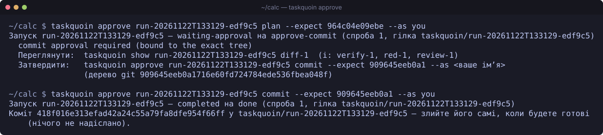

Цього разу геш — це **git-дерево**, що пройшло Verify і рев'ю. Прочитайте чотири артефакти спроби 1. Число — номер спроби; після доопрацювання читайте найбільше.

### `diff-1`: точна зміна

```shell
$ taskquoin show run-20261122T132108-d17040 diff-1
```

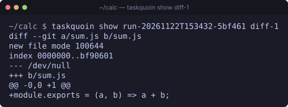

Саме це буде закомічено, і нічого більше. Якби агент змінив захищений файл (ваш CI, `.claude/`, `AGENTS.md`, `taskquoin.yaml`), запуск зупинився б із `protected configuration changed`. Файли, які ховає ваш `.gitignore`, але створив агент, перелічені в `ignored-1`; вони не входять до діфа, не перевіряються й не комітяться.

### `verify-1`: ваші тести, запущені Taskquoin

```shell
$ taskquoin show run-20261122T132108-d17040 verify-1
```

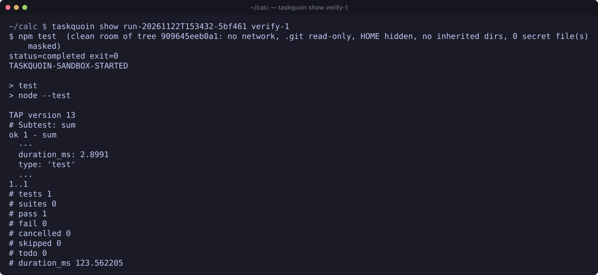

Заголовок каже, якою була чиста кімната (`no network, .git read-only, HOME hidden, … 0 secret file(s) masked`) і для якого дерева (`909645eeb0a1`, той самий геш, який ви схвалите). `exit=0` та `# pass 1` походять від тестового раннера, а не із заяви моделі.

### `red-1`: доказ того, що тест має значення

Вивід команд показано англійською, як його друкує CLI:

```shell
$ taskquoin show run-20261122T132108-d17040 red-1
TASKQUOIN RED PROOF — tests run on base + test changes only (tree 9848f565e24c); they must FAIL.
RESULT: they failed as required (RED proven).

$ npm test  (clean room of tree 9848f565e24c: no network, .git read-only, HOME hidden, no inherited dirs, 0 secret file(s) masked)
status=failed exit=1
…
not ok 1 - sum
  error: Cannot find module './sum.js'
  code: 'MODULE_NOT_FOUND'
```

Тут новий продакшен-файл `sum.js` було видалено, тест не зміг його завантажити і впав. Ця помилка і є RED proof. Taskquoin вважає помилку імпорту через функціональність у *новому* файлі очікуваним RED. Якщо змінювалися лише тестові файли (чисте додавання тестів), доказ записується як «not applicable».

### `review-1`: друга думка

Вивід команд показано англійською, як його друкує CLI:

```shell
$ taskquoin show run-20261122T132108-d17040 review-1
Review: diff checked against the plan.
VERDICT: APPROVE
```

Читайте зауваження, а не лише вердикт. `ignored-1` з'являється в переліку лише тоді, коли є що читати.

### Схваліть коміт

Якщо вас усе влаштовує, схваліть із гешем зі `status` (вивід показано англійською):

```shell
$ taskquoin approve run-20261122T132108-d17040 commit --expect 909645eeb0a1 --as you
Run run-20261122T132108-d17040 — completed at done (attempt 1, branch taskquoin/run-20261122T132108-d17040)
Committed a3c6b801de5f4356750f53870557e2fdd19958ee on taskquoin/run-20261122T132108-d17040 — merge it yourself when ready (nothing was pushed).
```

`approve … commit` треба виконувати, поки репозиторій перебуває на гілці запуску (`taskquoin/<run>`); інакше він відповідає `switch to taskquoin/<run> first`. Taskquoin заново зчитує робоче дерево перед комітом. Якщо щось змінилося відтоді, як ви дивилися, ваше підтвердження більше не діє: він заново виконує verify та рев'ю і просить схвалити нове дерево.

Потім Taskquoin будує коміт **із схваленого git-дерева**, а не через `git add`. Він виглядає так:

```shell
$ git log -1 taskquoin/run-20261122T132108-d17040
```

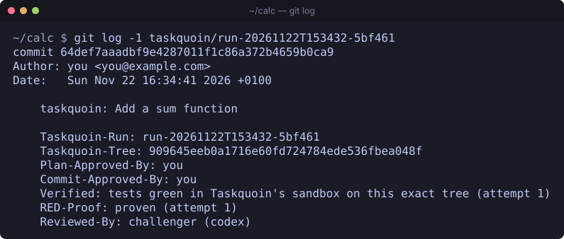

Вивід команд показано англійською, як його друкує CLI:

```text
taskquoin: Add a sum function

Taskquoin-Run: run-20261122T132108-d17040
Taskquoin-Tree: 909645eeb0a1716e60fd724784ede536fbea048f
Plan-Approved-By: you
Commit-Approved-By: you
Verified: tests green in Taskquoin's sandbox on this exact tree (attempt 1)
RED-Proof: proven (attempt 1)
Reviewed-By: challenger (codex)
```

Трейлери — це аудиторський слід просто в коміті:

| Трейлер | Значення |
|---|---|
| `Taskquoin-Run` | Запуск, що створив цей коміт |
| `Taskquoin-Tree` | Git-дерево, яке було перевірене, переглянуте й схвалене. Це дерево цього коміту |
| `Plan-Approved-By` | Ім'я, указане через `--as` на гейті плану |
| `Commit-Approved-By` | Ім'я, указане через `--as` на гейті коміту |
| `Verified` | Тести були зеленими в чистій кімнаті на цьому точному дереві |
| `RED-Proof` | Змінені тести падали без зміни (`proven` або `not applicable` для змін лише тестів) |
| `Reviewed-By` | Агенти, що переглянули й схвалили; API-суддя додає власний рядок |

`taskquoin status <run>` наприкінці показує весь журнал, від `recall` до `commit` і `record`.

## Крок 9: злийте результат

Taskquoin **ніколи не робить push** і ніколи не зливає у вашу гілку. Коміт лежить у `taskquoin/<run>`, гілці, на якій ви стоїте. Злийте її самі або відкрийте з неї pull request:

```shell
$ git switch main
$ git merge --ff-only taskquoin/run-20261122T132108-d17040
$ npm test
```

> [!WARNING]
> Taskquoin не запускає коміт-хуки вашого репозиторію, бо вони можуть містити код, змінений агентом. Запускайте свої хуки, лінтери й CI самі під час злиття.

Гілки `taskquoin/<run>` належать вам: видаляйте їх, коли вони не потрібні (`git branch -d taskquoin/<run>`).

## Коли все йде не за планом

Повідомлення про помилки Taskquoin відповідають вашій мові, але повідомлення рушія запуску (`failed`, `needs-human`, `interrupted`) завжди англійською. У таблиці — те, з чим ви зустрінетеся найчастіше.

| Що ви бачите | Що це означає | Що робити |
|---|---|---|
| `taskquoin run: the working tree has uncommitted changes` | Taskquoin ніколи не змішує свої зміни з вашими | Закомітьте або сховайте (stash) свої зміни |
| `failed … gate refused agent X` | Агента не можна сертифікувати на цій машині | `taskquoin doctor` скаже чому: версія рантайму, відсутня пісочниця, неприйнятий ризик |
| `needs-human … tests still failing after 3 attempts` | Три спроби не дали зелених тестів | Продовжіть вручну на гілці запуску або почніть новий run із точнішим запитом |
| `needs-human … no failing test demonstrates the change` | Тести проходять і без зміни в продакшен-коді, отже, вони її не перевіряють | Прочитайте `red-N`; напишіть (або попросіть) тест, що падає до зміни. Рефакторинг чи правка документації без нового тесту закінчується тут: закомітьте її самі з гілки |
| `needs-human … RED proof inconclusive` | Доказ не вдалося виконати коректно (тайм-аут, пісочниця, дерево, яке не вдалося відновити). Це не доказ | Прочитайте `red-N`. Ваша робоча тека не зачеплена |
| `needs-human … review still requests changes after N attempts` | Рев'юер далі відмовляв | Прочитайте `review-N` і вирішіть; робота лежить у гілці |
| `needs-human … dependencies changed during the run` | `node_modules` (або `vendor`, `.venv`) змінилися під час запуску, тож із ними нічого не перевірено | Перевстановіть (`npm ci`) і почніть новий run. Не запускайте `npm install` під час запуску |
| `needs-human … protected configuration changed` | Агент торкнувся захищеної конфігурації (CI, `.claude/`, `AGENTS.md`, `taskquoin.yaml`) | Нічого не закомічено; огляньте гілку |
| Тести у вас проходять, але падають у Verify | Вони використовують ігнорований файл, якого немає в чистій кімнаті | Додайте його до `verify.inherit` |
| `does not match the pending artifact` | Указаний вами геш не збігається з очікуваним | Прочитайте через `show`, скопіюйте геш зі `status` |
| `switch to taskquoin/<run> first` | Ви не на гілці запуску | `git switch taskquoin/<run>` |
| `taskquoin.yaml changed since the run started` | Конфігурація змінилася посеред запуску | Почніть новий run |
| `interrupted` | Технічна помилка (git, диск, HTTP 503 у судді) зупинила запуск | `taskquoin resume <run>` |

### Коли тести лишаються червоними

Якщо Verify не проходить, Taskquoin передає implementer лог збою та рев'ю й пробує знову, до трьох спроб реалізації (implementer на OpenCode, у якого немає власної команди, отримує більше доопрацювань). Якщо тести все ще червоні, запуск закінчується статусом `needs-human` із причиною `tests still failing after 3 attempts`. Коміту й запиту на підтвердження немає.

Усе зберігається: `taskquoin show <run> verify-3` містить останній лог, а гілка `taskquoin/<run>` зберігає роботу агента. Ви можете продовжити вручну на цій гілці або почати новий run із точнішим запитом. Запуск у статусі `needs-human` автоматично не відновлюється.

### `resume`: після переривання

Запуск стає `interrupted`, коли щось поза робочим процесом його зламало (мережева помилка під час звернення до судді, переповнений диск, засинання машини). Стан зберігається на кожному кроці, а відповіді суддів зберігаються по одній, тож відновлення ніколи не викликає судді двічі й не платить йому двічі:

```shell
$ taskquoin resume run-20261122T132108-d17040
```

`resume` приймає лише запуск зі статусом `interrupted`. Для будь-якого іншого статусу він повідомляє про це, наприклад `taskquoin resume: only an interrupted run can be resumed (status completed)`. Якщо статус `needs-human` або `failed`, почніть новий run.

### Практичне правило

Якщо ви не знаєте, що робити, виконайте `taskquoin status <run>`: він друкує статус, журнал і точну наступну команду. `taskquoin doctor` відповідає на будь-яке питання про машину.

## Дізнайтеся більше

- [Інтерактивна консоль](../getting-started/console.md): той самий робочий процес із `/run` і `/approve`
- [Установлення](../getting-started/installation.md)
- [ADR-0011, agents never commit](../adr/0011-agents-never-commit.md)
- [ADR-0013, tree-based governance](../adr/0013-tree-based-governance.md)
- [ADR-0014, Verify in a clean room](../adr/0014-verify-in-a-clean-room.md)
- [ADR-0002, enforcement classes](../adr/0002-enforcement-classes.md)
- [ADR-0005, control plane outside the workspace](../adr/0005-control-plane-outside-workspace.md)
- [ADR-0016, judges by API](../adr/0016-judges-by-api.md) і [ADR-0017, OpenCode without commands](../adr/0017-opencode-without-commands.md)
