# Lần chạy có quản trị đầu tiên của bạn

> Hướng dẫn này là bản dịch của trang tham chiếu tiếng Anh ([first-run.md](../getting-started/first-run.md)). Đây là bản dịch máy, được kiểm tra bằng các bài kiểm thử lệnh của những người bảo trì, không phải bởi người bản ngữ. Đầu ra CLI trong các khối mã được giữ nguyên bằng tiếng Anh; ảnh chụp màn hình đã bản địa hóa cho thấy đầu ra thực tế bằng ngôn ngữ này.

Hướng dẫn này đưa bạn đi từ một thư mục trống đến một commit đã được xác minh do Taskquoin tạo ra, từng lệnh một. Bạn sẽ tạo một dự án nhỏ có một bài kiểm thử thất bại, để Taskquoin lập kế hoạch và triển khai bản sửa bằng các tác tử AI, rồi phê duyệt công việc hai lần: một lần khi bạn đã đọc kế hoạch, một lần khi bạn đã đọc đúng diff. Ở mỗi bước, bạn thấy Taskquoin làm gì, vì sao nó dừng lại, và bạn đang ký vào điều gì.

- [Bạn sẽ xây dựng gì](#bạn-sẽ-xây-dựng-gì)
- [Bước 1: tạo một dự án có kiểm thử thất bại](#bước-1-tạo-một-dự-án-có-kiểm-thử-thất-bại)
- [Bước 2: khởi tạo Taskquoin](#bước-2-khởi-tạo-taskquoin)
- [Bước 3: commit cấu hình](#bước-3-commit-cấu-hình)
- [Bước 4: kiểm tra máy bằng doctor](#bước-4-kiểm-tra-máy-bằng-doctor)
- [Chấp nhận một rủi ro mà bạn hiểu](#chấp-nhận-một-rủi-ro-mà-bạn-hiểu)
- [Bước 5: bắt đầu run](#bước-5-bắt-đầu-run)
- [Bước 6: đọc và phê duyệt kế hoạch](#bước-6-đọc-và-phê-duyệt-kế-hoạch)
- [Bước 7: triển khai, Verify và review](#bước-7-triển-khai-verify-và-review)
- [Bước 8: đọc và phê duyệt commit](#bước-8-đọc-và-phê-duyệt-commit)
- [Bước 9: merge kết quả](#bước-9-merge-kết-quả)
- [Khi mọi việc không diễn ra như kế hoạch](#khi-mọi-việc-không-diễn-ra-như-kế-hoạch)
- [Tìm hiểu thêm](#tìm-hiểu-thêm)

> [!NOTE]
> Các ảnh chụp màn hình đến từ một kho mã demo với các tác tử AI mô phỏng (các test double của bộ kiểm thử của chính Taskquoin); mọi lệnh đều là CLI Taskquoin thật. Với Claude Code và Codex thật, lời lẽ của kế hoạch và của bản review là của chính các tác tử, và một lần chạy mất vài phút thay vì vài giây. Mọi thứ khác đều giống hệt.

Trước khi bắt đầu, hãy [cài đặt Taskquoin](../getting-started/installation.md) và bảo đảm Node 22.18+, git, `bubblewrap` và `socat` đã có sẵn, và ít nhất Claude Code (tốt nhất là cả Codex) đã được cài đặt và đăng nhập.

## Bạn sẽ xây dựng gì

Một run là một quy trình làm việc cố định. Hai hình thoi là hai lần phê duyệt của con người; không có gì đi qua chúng nếu thiếu bạn.

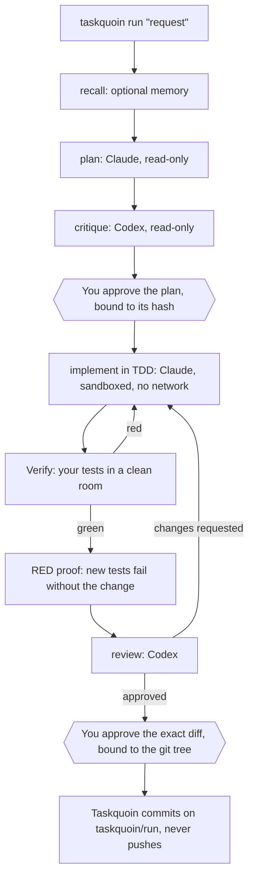

Ba ý tưởng xuyên suốt toàn bộ hướng dẫn:

- **Tác tử đề xuất, Taskquoin hành động.** Tác tử không bao giờ commit. Commit được Taskquoin tạo từ tree đã được xác minh, review và phê duyệt ([ADR-0011](../adr/0011-agents-never-commit.md)).
- **Sự phê duyệt của bạn gắn với một hash.** Bạn phê duyệt đúng những gì bạn đã đọc, chứ không phải "run" ([ADR-0013](../adr/0013-tree-based-governance.md)).
- **Kiểm thử chạy trong phòng sạch (clean room).** Mô hình không bao giờ nói với Taskquoin rằng kiểm thử đã qua; Taskquoin tự chạy chúng ([ADR-0014](../adr/0014-verify-in-a-clean-room.md)).

## Bước 1: tạo một dự án có kiểm thử thất bại

Dự án là một máy tính chỉ có một hàm. Kiểm thử đã có; hàm thì chưa.

```shell
$ mkdir calc && cd calc
$ git init -q -b main
```

Tạo `package.json`:

```json
{
  "name": "calc",
  "private": true,
  "scripts": { "test": "node --test" }
}
```

Tạo `sum.test.js`:

```js
const test = require('node:test');
const assert = require('node:assert');

test('sum', () => {
  const sum = require('./sum.js');
  assert.strictEqual(sum(2, 3), 5);
});
```

Tạo `.gitignore` (các phụ thuộc và đầu ra build không bao giờ là một phần của diff Taskquoin):

```text
node_modules/
```

Commit nó:

```shell
$ git add .
$ git commit -m "calc: a failing test for sum"
$ npm test
not ok 1 - sum
  error: Cannot find module './sum.js'
```

Kiểm thử đang đỏ, đúng như mong đợi. Một kho git có working tree sạch là điều kiện tiên quyết duy nhất của Taskquoin đối với một dự án: `taskquoin run` từ chối bắt đầu khi bạn có thay đổi chưa commit, vì nó không bao giờ trộn thay đổi của mình với thay đổi của bạn.

## Bước 2: khởi tạo Taskquoin

```shell
$ taskquoin init
```

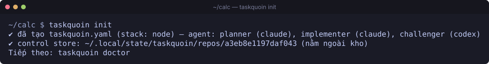

`init` đã làm ba việc:

1. Nó phát hiện stack (`node`; nó cũng biết `npm test`, PHPUnit, pytest, `go test`, Maven và các loại khác) và ghi `taskquoin.yaml` ở gốc kho.
2. Nó tìm các công cụ AI trên máy của bạn và chọn tác tử: ở đây `planner` và `implementer` dùng Claude Code, còn `challenger` dùng Codex. Nếu thiếu một công cụ, tệp sẽ ghi rõ; nếu chỉ có Claude Code thì reviewer cũng là Claude. Nếu chỉ có OpenCode, `init` ghi một cấu hình toàn OpenCode.
3. Nó tạo một **control store** bên ngoài kho, dưới `${XDG_STATE_HOME:-~/.local/state}/taskquoin/`. Đây là nơi lưu trạng thái run, các phê duyệt và các chấp nhận rủi ro. Tác tử không thể ghi vào đó, và chính điều đó làm cho một phê duyệt không thể bị giả mạo ([ADR-0005](../adr/0005-control-plane-outside-workspace.md)).

`init` không bao giờ ghi đè một `taskquoin.yaml` đã có. Nếu bạn chạy `init` khi có các AI khác khả dụng (một khóa API trong môi trường, một Ollama cục bộ), nó liệt kê chúng và đề xuất chúng dưới dạng **chú thích** trong tệp: bỏ chú thích là quyết định của bạn, vì điều đó có nghĩa là mã của dự án đó sẽ được gửi cho chúng.

### `taskquoin.yaml` được tạo ra

Hãy mở nó. Tệp ngắn và bạn có thể đọc hết. Sau đây là từng phần một.

```yaml
# Taskquoin project configuration — see docs/architecture.md. Protected: agents can never edit this file.
version: 1
stack: node
```

`version` là phiên bản của schema. `stack` chọn các giá trị mặc định cho phòng sạch: những thư mục phụ thuộc nào được mount chỉ-đọc cho kiểm thử của bạn (với `node`: `node_modules`). Chú thích đầu tiên là một lời hứa: **tác tử không bao giờ có thể sửa tệp này.** Nếu có tác tử nào chạm vào nó trong một run, run dừng lại và không có gì được commit.

```yaml
agents:
  planner:
    runtime: claude
    description: "Read-only planner: turns a request into a minimal, test-first implementation plan."
    prompt: You plan; you never modify files. Read the repository, then produce the plan requested.
    capabilities:
      fs.read:
        - "**"
    maxTurns: 30
    skills:
      - planning-contract
```

Một **tác tử** là một vai trò gắn với một runtime (`claude`, `codex`, `opencode`, hoặc `api` cho một giám khảo). `capabilities` là những gì tác tử được phép làm: planner có thể đọc mọi thứ (`fs.read: "**"`) và không gì khác, nên nó không có shell và không có công cụ ghi. `skills` là các chỉ dẫn được ghim bằng hash (`planning-contract` là của bên thứ nhất). `maxTurns` giới hạn số lượt của tác tử.

```yaml
  implementer:
    runtime: claude
    description: Implements an approved task with strict TDD (RED → GREEN → REFACTOR).
    prompt: "You implement exactly the approved task. Write a failing test first, make it pass with the simplest change, then refactor. Never commit: Taskquoin verifies and commits."
    capabilities:
      fs.read:
        - "**"
      fs.write:
        - "**"
      shell.run:
        - npm test
        - npm test -- *
        - node --test *
    maxTurns: 40
    skills:
      - tdd
```

Implementer có thể ghi tệp và chạy một danh sách cho phép nhỏ các lệnh kiểm thử (`shell.run`) để làm việc theo hướng kiểm thử trước. Các lệnh đó chạy bên trong sandbox hệ điều hành của chính runtime, không có mạng. Dù vậy, lần chạy kiểm thử của nó chỉ để phản hồi cho chính nó: kết quả có giá trị là kết quả Taskquoin tạo ra ở Verify.

```yaml
  challenger:
    runtime: codex
    description: Independent, read-only adversarial reviewer of plans and diffs.
    prompt: "You are an independent reviewer. Challenge the plan or diff: correctness, security, missing tests, over-engineering. Report blocking and non-blocking findings with file:line. Do not modify files."
    capabilities:
      fs.read:
        - "**"
    skills:
      - code-review
```

**Challenger** phê bình kế hoạch và review diff. Nó cố ý thuộc một nhà cung cấp khác với implementer, và nó chỉ-đọc: nó không được phép "sửa" những gì nó phê bình.

```yaml
policy:
  mandatory:
    - fs.write
    - net.egress
    - config.modify
    - connector.write
    - vcs.commit
    - vcs.push
connectors: {}
memory:
  claudeMem:
    enabled: true
```

`policy.mandatory` liệt kê các hạn chế **phải** được một cơ chế thực thi thì tác tử mới được khởi động: không ghi ngoài phạm vi của nó, không có mạng, không thay đổi cấu hình được bảo vệ, không ghi ra remote, không commit, không push. Nếu phiên bản runtime bạn có không thể thực thi một trong số đó, tác tử bị từ chối thay vì được khởi động với một quy tắc chỉ là lời khuyên ([ADR-0002](../adr/0002-enforcement-classes.md), [ADR-0003](../adr/0003-hooks-enforce-prose-asks.md)). `connectors` trống: không có hệ thống remote nào được kết nối ([ADR-0012](../adr/0012-remote-connectors-by-exception.md)). `memory.claudeMem` là tùy chọn: khi được bật, một bản tóm tắt có cấu trúc của mỗi run đã hoàn tất được gửi đến worker [claude-mem](https://github.com/thedotmack/claude-mem) cục bộ của bạn, và một recall ngắn được đọc khi bắt đầu run. Đặt thành `false` nếu bạn không chạy claude-mem. (Các ảnh chụp màn hình trong hướng dẫn này dùng `false`.)

> [!TIP]
> Nếu kiểm thử của bạn cần một tệp bị bỏ qua mà không phải thư mục phụ thuộc, chẳng hạn một `dist/` đã build hoặc một `.env.test`, hãy thêm nó một cách tường minh. Khi đó nó được mount chỉ-đọc trong phòng sạch và được đóng băng đối với tác tử:
>
> ```yaml
> verify:
>   inherit:
>     - dist
> ```
>
> Một dự án mà kiểm thử không chạy bằng `npm test` có thể đặt `verify.command`.

Bạn cũng có thể dùng các AI khác làm giám khảo (bất kỳ nhà cung cấp nào tương thích OpenAI) hoặc OpenCode làm planner và implementer; xem [ADR-0016](../adr/0016-judges-by-api.md) và [ADR-0017](../adr/0017-opencode-without-commands.md).

## Bước 3: commit cấu hình

`taskquoin.yaml` là một phần của dự án của bạn, vì vậy hãy commit nó. Việc này cũng cung cấp cho Taskquoin working tree sạch mà nó cần:

```shell
$ git add taskquoin.yaml
$ git commit -m "chore: taskquoin"
```

## Bước 4: kiểm tra máy bằng doctor

```shell
$ taskquoin doctor
```

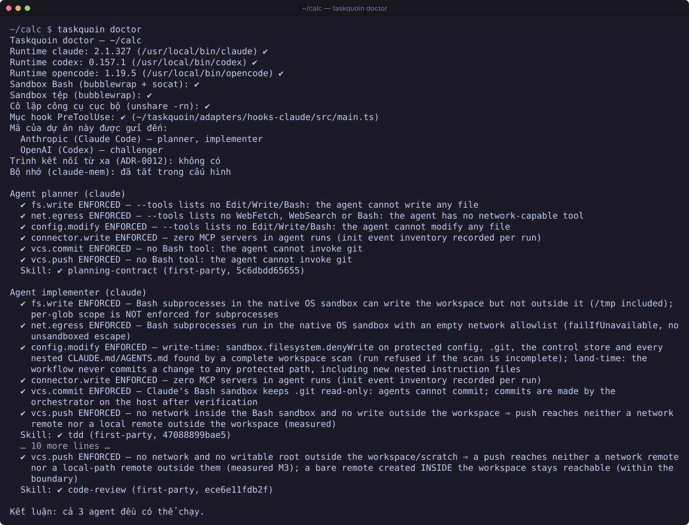

`doctor` là phần trung thực của Taskquoin. Hãy đọc từ trên xuống dưới:

- Khối đầu tiên liệt kê các runtime tìm thấy, kèm phiên bản và một dấu tích khi phiên bản đó là phiên bản Taskquoin đã đo lường, rồi đến các sandbox (bubblewrap và socat) và hook.
- **This project's code is sent to** liệt kê mọi nhà cung cấp sẽ nhận mã của bạn, theo từng tác tử. Taskquoin chạy trên máy của bạn; chỉ các AI bạn cấu hình mới thấy bất cứ điều gì ([ADR-0010](../adr/0010-local-first-no-leak.md)).
- Sau đó, theo từng tác tử, mỗi hạn chế bắt buộc cùng lớp của nó và **cơ chế thực thi nó**, ví dụ `net.egress ENFORCED — Bash subprocesses run in the native OS sandbox with an empty network allowlist`. Dấu tích nghĩa là nó đã được chứng nhận cho phiên bản runtime đó; dấu chéo nghĩa là tác tử sẽ không khởi động.
- Dòng cuối là phán quyết: `Verdict: all 3 agents can run.` hoặc `Verdict: 2 of 3 agents can run — refused agents will not be started.`

Trong bản demo, có một dòng bị dấu chéo:

```text
Agent challenger (codex)
  …
  ✖ connector.write — mandatory restriction "connector.write" (deny-all) on codex 0.157.1: claimed ENFORCED but the mechanism is not measured (inferred). Execution refused (ADR-0002).
```

Codex nói rằng nó thực thi `connector.write` (không ghi vào các connector từ xa), nhưng Taskquoin không có cách nào đo lường tuyên bố đó, nên không tính nó là đã được thực thi. Challenger bị từ chối: một run sẽ kết thúc ở trạng thái `failed at challenge` với `gate refused agent challenger`. Với điều này, bạn có một quyết định cần đưa ra.

## Chấp nhận một rủi ro mà bạn hiểu

Một **rủi ro được chấp nhận** là quyết định có chữ ký, có ngày và có phạm vi của bạn để chạy một tác tử bất chấp một hạn chế không thể đo lường. Đó là quyết định của chủ sở hữu, không phải của lập trình viên và không bao giờ của tác tử:

```shell
$ taskquoin accept-risk challenger connector.write \
    --reason "Codex reviews read-only; no connector configured" \
    --expires 2026-12-31 --as you
```

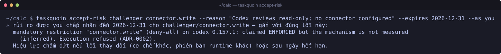

Cả bốn tùy chọn đều bắt buộc: `--reason`, `--expires` (một ngày thật trong tương lai, `YYYY-MM-DD`) và `--as` (tên của bạn), cộng với tác tử và capability. Hãy lưu ý sự chấp nhận này là gì:

- **Gắn với đúng lỗi đó.** Nó lưu một digest của thông báo lỗi. Nếu phiên bản runtime thay đổi, hoặc cơ chế thay đổi, lỗi đó không còn là lỗi cũ, và sự chấp nhận ngừng có hiệu lực.
- **Có ngày.** Nó cũng ngừng có hiệu lực sau ngày hết hạn.
- **Lưu bên ngoài kho**, trong control store. Không ai có thể thêm một cái bằng cách sửa `taskquoin.yaml`, và không tác tử nào có thể ghi nó.
- **Hẹp.** Nó chỉ áp dụng cho tác tử này và capability này. Nó bị từ chối đối với một capability không thất bại, và không có sẵn cho các giám khảo API (họ luôn bị kiểm tra).

Chạy `doctor` lần nữa. Dòng đó giờ là một cảnh báo thay vì dấu chéo, và phán quyết là `all 3 agents can run`:

```text
  ⚠ connector.write accepted risk (approved by you until 2026-12-31: Codex reviews read-only; no connector configured) — mandatory restriction "connector.write" (deny-all) on codex 0.157.1: claimed ENFORCED but the mechanism is not measured (inferred). Execution refused (ADR-0002).
```

`taskquoin check challenger` cho thấy cùng chi tiết đó cho một tác tử:

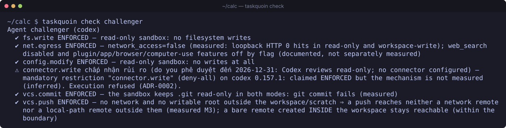

> [!IMPORTANT]
> Chỉ chấp nhận một rủi ro khi bạn hiểu nó và tình huống khớp với lý do của bạn: ở đây Codex review ở chế độ chỉ-đọc và dự án của bạn không có connector, nên một "ghi vào connector" dù sao cũng không thể xảy ra. Đừng chấp nhận rủi ro chỉ để làm một dòng đỏ biến mất. Cụ thể:
>
> - không bao giờ với `fs.write`, `net.egress`, `vcs.commit` hay `vcs.push` trên một tác tử thực sự ghi hoặc chạy lệnh, trừ khi bạn nêu được biện pháp kiểm soát bù trừ;
> - không bao giờ với một lý do mơ hồ: nó được ghi vào phê duyệt và hiển thị bởi `doctor`;
> - ưu tiên thời hạn ngắn: sự chấp nhận là lời nhắc kiểm tra lại sau khi nâng cấp;
> - nếu một cơ chế *được đo là thất bại*, hãy nâng cấp hoặc đổi runtime thay vì chấp nhận.

Tự mình chạy `taskquoin accept-risk` là có chủ ý: nếu console hay một tác tử có thể làm điều đó, thì sự kiểm soát này sẽ vô nghĩa.

## Bước 5: bắt đầu run

```shell
$ taskquoin run "Add a sum function"
```

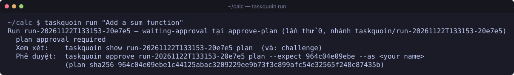

Terminal của bạn im lặng trong lúc các tác tử làm việc, rồi in ra nơi nó đã dừng. Theo thứ tự, Taskquoin đã làm như sau:

1. **Preflight.** Taskquoin kiểm tra rằng cấu hình định nghĩa mọi vai trò, các skill dùng được, các vai trò chỉ-đọc thực sự chỉ-đọc, và các giám khảo API có khóa của chúng. Working tree phải sạch. Mỗi tác tử cũng đi qua cùng cổng như `doctor` ngay trước lần dùng đầu tiên: một tác tử bị từ chối kết thúc run với trạng thái `failed`.
2. **Branch.** Nó tạo nhánh `taskquoin/run-20261122T132108-d17040` và chuyển sang đó. `main` của bạn không bị đụng đến.
3. **Recall.** Nó hỏi worker bộ nhớ, nếu được bật, các ghi chú liên quan. Nhật ký hiển thị `recall no-memory` khi không có.
4. **Plan.** `planner` (Claude, chỉ-đọc) đọc kho và viết một kế hoạch: mục tiêu, kiểm thử cần viết trước, các tệp, các bước, rủi ro.
5. **Critique.** `challenger` (Codex, chỉ-đọc) phản biện kế hoạch đó một cách độc lập và kết thúc bằng một dòng `VERDICT:`.
6. **Gate.** Quy trình dừng ở `approve-plan`. Nó sẽ chờ bao lâu tùy bạn.

Id của run (`run-20261122T132108-d17040`) là một dấu thời gian và một hậu tố ngẫu nhiên. Bạn dùng nó trong mọi lệnh tiếp theo. `taskquoin status` không có đối số sẽ liệt kê các run:

```shell
$ taskquoin status
run-20261122T132108-d17040  waiting-approval approve-plan    Add a sum function
```

## Bước 6: đọc và phê duyệt kế hoạch

`status <run>` hiển thị lịch sử của một run và, tại một cổng, đúng lệnh để phê duyệt nó:

```shell
$ taskquoin status run-20261122T132108-d17040
```

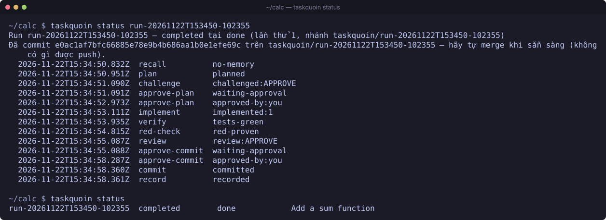

Mỗi dòng lịch sử là một bước của quy trình cùng kết quả của nó (`planned`, `challenged:APPROVE`, `waiting-approval`).

Bây giờ **hãy đọc những gì bạn sắp phê duyệt**:

```shell
$ taskquoin show run-20261122T132108-d17040 plan
```

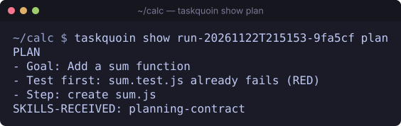

```shell
$ taskquoin show run-20261122T132108-d17040 challenge
Review: plan checked.
VERDICT: APPROVE
```

`show <run>` không kèm artifact liệt kê mọi thứ đã lưu cho đến giờ, cùng kích thước tính bằng byte. Một kế hoạch từ tác tử thật còn bao gồm các tệp cần động đến, các kiểm thử cần viết trước và các rủi ro. Challenge là ý kiến thứ hai độc lập: nó có thể liệt kê các phát hiện chặn và không chặn. Nếu kế hoạch sai, đừng phê duyệt: hãy bắt đầu một run mới với yêu cầu chính xác hơn.

### Vì sao là hash

Dòng quan trọng là dòng cuối của `status`:

```text
Approve it:  taskquoin approve run-20261122T132108-d17040 plan --expect 964c04e09ebe --as <your name>
             (plan sha256 964c04e09ebe1c44125abac3209229ee9b73f3c899afc54e32565f248c87435b)
```

`964c04e09ebe` là phần đầu của SHA-256 của tệp kế hoạch bạn vừa đọc. Phê duyệt không có nghĩa là "tôi phê duyệt run này"; nó có nghĩa là "tôi phê duyệt **kế hoạch có hash là 964c04e09ebe**". Nếu kế hoạch có thể thay đổi giữa lúc bạn đọc và lúc bạn phê duyệt (một lần thử lại, một tiến trình khác, một công cụ bị xâm nhập), hash sẽ không còn khớp và Taskquoin sẽ từ chối. Đó cũng là điều commit ghi lại, nên sau này bất kỳ ai cũng có thể kiểm toán xem một người đã phê duyệt điều gì.

> [!NOTE]
> `--expect` không phải là mật khẩu. Nó là bằng chứng rằng bạn đã xem artifact mà hệ thống sắp xử lý: bạn sao chép nó từ `status` sau khi đọc. Trong [console](../getting-started/console.md), bạn gõ lại nó để xác nhận.

Phê duyệt:

```shell
$ taskquoin approve run-20261122T132108-d17040 plan --expect 964c04e09ebe --as you
```

`--as` là tên của bạn; nó được ghi là `Plan-Approved-By` trong commit. Phê duyệt kế hoạch sẽ tiếp tục quy trình, chạy đến cổng tiếp theo.

### Một hash sai sẽ bị từ chối

Hãy thử một hash không phải là hash đang chờ:

```shell
$ taskquoin approve run-20261122T132108-d17040 plan --expect 000000000000 --as you
taskquoin approve: expected 000000000000 does not match the pending artifact 964c04e09ebe… — re-read it before approving
```

Không có gì được phê duyệt và run không thay đổi. Điều tương tự xảy ra nếu bạn phê duyệt một cổng mà run không chờ. Ảnh chụp màn hình bên dưới được chụp sau khi run đã hoàn tất, nên nó cho thấy biến thể đó của sự từ chối:

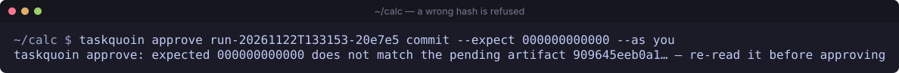

Mã thoát của một sự từ chối là 1. Một lệnh gõ sai (thiếu `--expect` hoặc `--as`) thoát với mã 2.

## Bước 7: triển khai, Verify và review

Sau `approve … plan`, Taskquoin làm việc mà không cần bạn:

1. **Triển khai theo TDD.** `implementer` (Claude) làm việc trên nhánh, trong sandbox của runtime, không có mạng và không có cách nào để commit. Nó viết hoặc điều chỉnh kiểm thử trước, rồi viết đoạn mã đơn giản nhất làm cho chúng qua.
2. **Verify, trong phòng sạch.** Taskquoin lấy đúng tree mà implementer để lại và tự chạy kiểm thử của bạn (`npm test`) trong một bản sao dùng một lần nằm ngoài kho của bạn: không có mạng, `.git` chỉ-đọc, HOME của bạn bị ẩn, các tệp bí mật bị che, và chỉ các thư mục phụ thuộc của stack (cùng `verify.inherit` của bạn) được mount chỉ-đọc. Một kiểm thử qua được nhờ phụ thuộc vào thứ chưa được commit sẽ thất bại ở đây, và đó chính là mục đích.
3. **RED proof.** Taskquoin sau đó gỡ thay đổi của mã production và chạy lại các kiểm thử đã thay đổi. Chúng phải **thất bại**. Một kiểm thử vẫn qua khi không có thay đổi thì không kiểm thử gì cả. Bằng chứng này mang tính cơ học: nó không cho thấy rằng kiểm thử khẳng định đúng hành vi (đó là việc của review, và của bạn).
4. **Review.** `challenger` review diff đối chiếu với kế hoạch, cùng các log verify và RED. Nó kết thúc bằng một dòng `VERDICT:`.

Nếu kiểm thử đỏ, hoặc RED proof thất bại, hoặc review yêu cầu thay đổi, Taskquoin gửi phản hồi cho implementer để làm lại tự động (tối đa 3 lần thử triển khai, với nhiều nhất 2 vòng làm lại sau một review bị từ chối). Sau đó run dừng ở cổng thứ hai.

## Bước 8: đọc và phê duyệt commit

Run giờ lại đang chờ. Hãy xem nó:

```shell
$ taskquoin status run-20261122T132108-d17040
Run run-20261122T132108-d17040 — waiting-approval at approve-commit (attempt 1, branch taskquoin/run-20261122T132108-d17040)
  commit approval required (bound to the exact tree)
  Review it:   taskquoin show run-20261122T132108-d17040 diff-1  (and: verify-1, red-1, review-1)
  Approve it:  taskquoin approve run-20261122T132108-d17040 commit --expect 909645eeb0a1 --as <your name>
               (git tree 909645eeb0a1716e60fd724784ede536fbea048f)
```

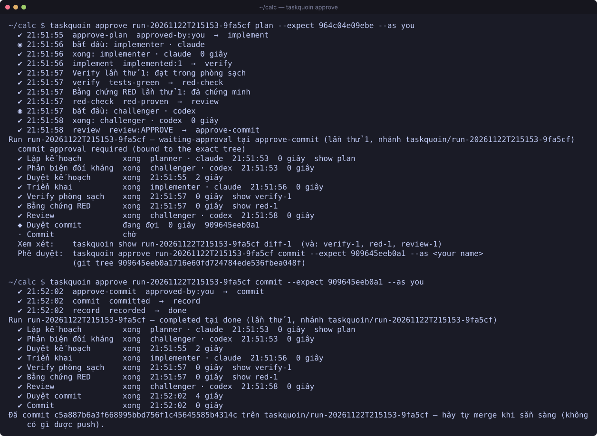

Lần này hash là **git tree** đã qua Verify và review. Hãy đọc bốn artifact của lần thử 1. Con số là số của lần thử; sau khi làm lại, bạn đọc cái cao nhất.

### `diff-1`: thay đổi chính xác

```shell
$ taskquoin show run-20261122T132108-d17040 diff-1
```

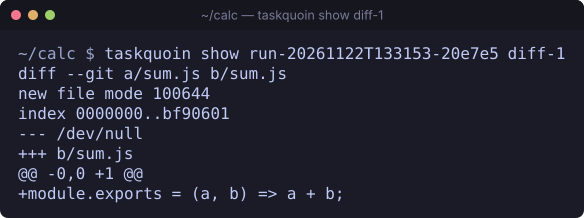

Đây là những gì sẽ được commit, không hơn. Nếu tác tử thay đổi một tệp được bảo vệ (CI của bạn, `.claude/`, `AGENTS.md`, `taskquoin.yaml`), run sẽ dừng với `protected configuration changed`. Các tệp mà `.gitignore` của bạn ẩn nhưng tác tử đã tạo được liệt kê trong `ignored-1`; chúng không nằm trong diff, không được xác minh và không được commit.

### `verify-1`: kiểm thử của bạn, do Taskquoin chạy

```shell
$ taskquoin show run-20261122T132108-d17040 verify-1
```

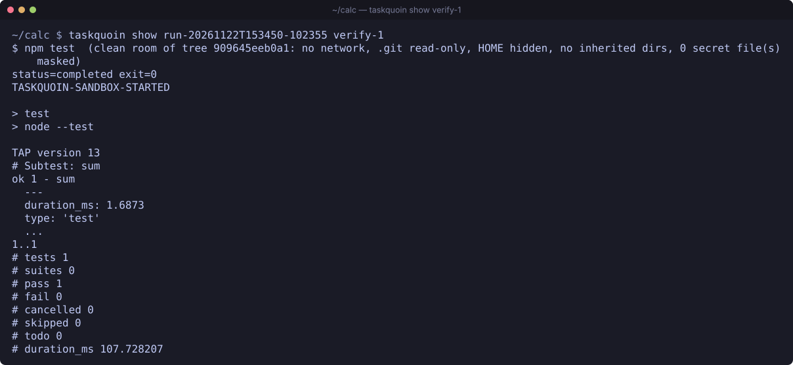

Phần đầu cho biết phòng sạch là gì (`no network, .git read-only, HOME hidden, … 0 secret file(s) masked`) và cho tree nào (`909645eeb0a1`, cùng hash bạn sắp phê duyệt). `exit=0` và `# pass 1` đến từ trình chạy kiểm thử, không phải từ tuyên bố của một mô hình.

### `red-1`: bằng chứng rằng kiểm thử có ý nghĩa

```shell
$ taskquoin show run-20261122T132108-d17040 red-1
TASKQUOIN RED PROOF — tests run on base + test changes only (tree 9848f565e24c); they must FAIL.
RESULT: they failed as required (RED proven).

$ npm test  (clean room of tree 9848f565e24c: no network, .git read-only, HOME hidden, no inherited dirs, 0 secret file(s) masked)
status=failed exit=1
…
not ok 1 - sum
  error: Cannot find module './sum.js'
  code: 'MODULE_NOT_FOUND'
```

Ở đây tệp production mới `sum.js` bị gỡ, kiểm thử không thể nạp nó, và thất bại. Sự thất bại đó là RED proof. Taskquoin coi một lỗi import của một tính năng nằm trong tệp *mới* là RED như mong đợi. Nếu chỉ các tệp kiểm thử thay đổi (chỉ thêm kiểm thử), bằng chứng được ghi là "not applicable".

### `review-1`: ý kiến thứ hai

```shell
$ taskquoin show run-20261122T132108-d17040 review-1
Review: diff checked against the plan.
VERDICT: APPROVE
```

Hãy đọc các phát hiện, không chỉ phán quyết. `ignored-1` chỉ xuất hiện trong danh sách khi có điều gì đó để đọc.

### Phê duyệt commit

Nếu bạn hài lòng, hãy phê duyệt bằng hash từ `status`:

```shell
$ taskquoin approve run-20261122T132108-d17040 commit --expect 909645eeb0a1 --as you
Run run-20261122T132108-d17040 — completed at done (attempt 1, branch taskquoin/run-20261122T132108-d17040)
Committed a3c6b801de5f4356750f53870557e2fdd19958ee on taskquoin/run-20261122T132108-d17040 — merge it yourself when ready (nothing was pushed).
```

`approve … commit` phải được chạy khi kho đang ở nhánh của run (`taskquoin/<run>`); nếu không nó trả lời `switch to taskquoin/<run> first`. Taskquoin đọc lại working tree trước khi commit. Nếu có gì thay đổi kể từ khi bạn xem, phê duyệt của bạn không còn áp dụng: nó xác minh lại, review lại và yêu cầu bạn phê duyệt tree mới.

Sau đó Taskquoin tạo commit **từ chính git tree đã được phê duyệt**, không phải từ `git add`. Nó trông như thế này:

```shell
$ git log -1 taskquoin/run-20261122T132108-d17040
```

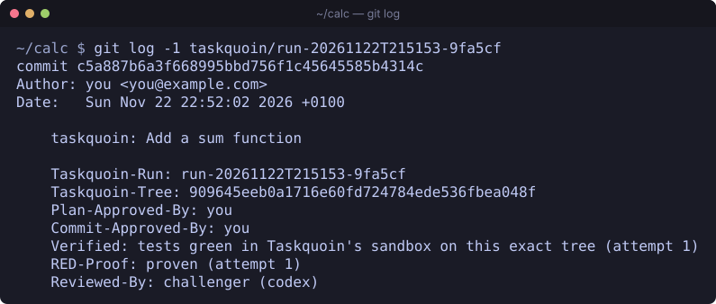

```text
taskquoin: Add a sum function

Taskquoin-Run: run-20261122T132108-d17040
Taskquoin-Tree: 909645eeb0a1716e60fd724784ede536fbea048f
Plan-Approved-By: you
Commit-Approved-By: you
Verified: tests green in Taskquoin's sandbox on this exact tree (attempt 1)
RED-Proof: proven (attempt 1)
Reviewed-By: challenger (codex)
```

Các trailer là dấu vết kiểm toán, nằm ngay trong commit:

| Trailer | Ý nghĩa |
|---|---|
| `Taskquoin-Run` | Run đã tạo commit này |
| `Taskquoin-Tree` | Git tree đã được xác minh, review và phê duyệt. Đó là tree của commit này |
| `Plan-Approved-By` | Tên được đưa vào bằng `--as` ở cổng kế hoạch |
| `Commit-Approved-By` | Tên được đưa vào bằng `--as` ở cổng commit |
| `Verified` | Kiểm thử xanh trong phòng sạch trên đúng tree này |
| `RED-Proof` | Các kiểm thử đã thay đổi thất bại khi không có thay đổi (`proven`, hoặc `not applicable` đối với các thay đổi chỉ có kiểm thử) |
| `Reviewed-By` | Các tác tử đã review và phê duyệt; một giám khảo API thêm dòng riêng của nó |

`taskquoin status <run>` ở cuối cho thấy toàn bộ nhật ký, từ `recall` đến `commit` và `record`.

## Bước 9: merge kết quả

Taskquoin **không bao giờ push** và không bao giờ merge vào nhánh của bạn. Commit nằm trên `taskquoin/<run>`, nhánh bạn đang ở. Hãy tự merge nó, hoặc mở một pull request từ đó:

```shell
$ git switch main
$ git merge --ff-only taskquoin/run-20261122T132108-d17040
$ npm test
```

> [!WARNING]
> Taskquoin không chạy các hook commit của kho bạn, vì chúng có thể chứa mã mà tác tử đã sửa. Hãy tự chạy các hook, linter và CI của bạn khi merge.

Các nhánh `taskquoin/<run>` là của bạn: hãy xóa chúng khi không cần nữa (`git branch -d taskquoin/<run>`).

## Khi mọi việc không diễn ra như kế hoạch

Các thông báo lỗi của Taskquoin theo ngôn ngữ của bạn, nhưng các thông báo của engine run (`failed`, `needs-human`, `interrupted`) luôn bằng tiếng Anh. Bảng dưới liệt kê những gì bạn sẽ gặp nhiều nhất.

| Điều bạn thấy | Ý nghĩa | Việc cần làm |
|---|---|---|
| `taskquoin run: the working tree has uncommitted changes` | Taskquoin không bao giờ trộn thay đổi của mình với thay đổi của bạn | Commit hoặc stash các thay đổi của bạn |
| `failed … gate refused agent X` | Một tác tử không thể được chứng nhận trên máy này | `taskquoin doctor` cho biết lý do: phiên bản runtime, thiếu sandbox, một rủi ro bạn chưa chấp nhận |
| `needs-human … tests still failing after 3 attempts` | Ba lần thử không cho ra kiểm thử xanh | Tiếp quản trên nhánh của run, hoặc bắt đầu một run mới với yêu cầu chính xác hơn |
| `needs-human … no failing test demonstrates the change` | Kiểm thử vẫn qua kể cả khi không có thay đổi production, nên chúng không kiểm thử thay đổi | Đọc `red-N`; viết (hoặc yêu cầu) một kiểm thử thất bại trước thay đổi. Một refactor hoặc thay đổi tài liệu không có kiểm thử mới sẽ kết thúc ở đây: hãy tự commit từ nhánh |
| `needs-human … RED proof inconclusive` | Bằng chứng không chạy được đúng cách (hết thời gian, sandbox, một tree không dựng lại được). Đó không phải là bằng chứng | Đọc `red-N`. Thư mục làm việc của bạn không bị đụng đến |
| `needs-human … review still requests changes after N attempts` | Reviewer liên tục từ chối | Đọc `review-N` và quyết định; công việc nằm trên nhánh |
| `needs-human … dependencies changed during the run` | `node_modules` (hoặc `vendor`, `.venv`) đã thay đổi trong run, nên không có gì được xác minh với nó | Cài lại (`npm ci`) và bắt đầu một run mới. Đừng chạy `npm install` trong một run |
| `needs-human … protected configuration changed` | Tác tử đã chạm vào cấu hình được bảo vệ (CI, `.claude/`, `AGENTS.md`, `taskquoin.yaml`) | Không có gì được commit; hãy kiểm tra nhánh |
| Kiểm thử qua ở máy bạn nhưng thất bại ở Verify | Chúng dùng một tệp bị bỏ qua vắng mặt trong phòng sạch | Thêm nó vào `verify.inherit` |
| `does not match the pending artifact` | Hash bạn đưa không phải là hash đang chờ | Đọc bằng `show`, sao chép hash từ `status` |
| `switch to taskquoin/<run> first` | Bạn không ở trên nhánh của run | `git switch taskquoin/<run>` |
| `taskquoin.yaml changed since the run started` | Cấu hình thay đổi giữa chừng một run | Bắt đầu một run mới |
| `interrupted` | Một lỗi kỹ thuật (git, đĩa, HTTP 503 của một giám khảo) đã dừng run | `taskquoin resume <run>` |

### Khi kiểm thử vẫn đỏ

Nếu Verify thất bại, Taskquoin đưa cho implementer log thất bại và bản review rồi thử lại, tối đa ba lần thử triển khai (một implementer OpenCode, vốn không có lệnh riêng, được làm lại nhiều hơn). Nếu kiểm thử vẫn đỏ, run kết thúc với trạng thái `needs-human` và lý do `tests still failing after 3 attempts`. Không có commit và không có lời nhắc phê duyệt.

Mọi thứ đều được giữ lại: `taskquoin show <run> verify-3` có log cuối cùng, và nhánh `taskquoin/<run>` chứa công việc của tác tử. Bạn có thể tiếp tục thủ công trên nhánh đó, hoặc bắt đầu một run mới với yêu cầu chính xác hơn. Một run `needs-human` không được tiếp tục tự động.

### `resume`: sau một sự gián đoạn

Một run ở trạng thái `interrupted` khi có điều gì đó bên ngoài quy trình làm nó hỏng (lỗi mạng khi liên hệ giám khảo, đầy đĩa, máy của bạn chuyển sang chế độ ngủ). Trạng thái được lưu ở mỗi bước, và câu trả lời của các giám khảo được lưu từng cái một, nên việc tiếp tục không bao giờ gọi, hay trả tiền cho, một giám khảo hai lần:

```shell
$ taskquoin resume run-20261122T132108-d17040
```

`resume` chỉ chấp nhận một run có trạng thái `interrupted`. Với bất kỳ trạng thái nào khác, nó sẽ báo cho bạn, ví dụ `taskquoin resume: only an interrupted run can be resumed (status completed)`. Nếu trạng thái là `needs-human` hoặc `failed`, hãy bắt đầu một run mới.

### Một quy tắc ngón tay cái

Nếu bạn không biết phải làm gì, hãy chạy `taskquoin status <run>`: nó in ra trạng thái, nhật ký và đúng lệnh tiếp theo. `taskquoin doctor` trả lời mọi câu hỏi về máy.

## Tìm hiểu thêm

- [Console tương tác](../getting-started/console.md): cùng quy trình làm việc, với `/run` và `/approve`
- [Cài đặt](../getting-started/installation.md)
- [ADR-0011, tác tử không bao giờ commit](../adr/0011-agents-never-commit.md)
- [ADR-0013, quản trị dựa trên tree](../adr/0013-tree-based-governance.md)
- [ADR-0014, Verify trong phòng sạch](../adr/0014-verify-in-a-clean-room.md)
- [ADR-0002, các lớp thực thi](../adr/0002-enforcement-classes.md)
- [ADR-0005, control plane nằm ngoài workspace](../adr/0005-control-plane-outside-workspace.md)
- [ADR-0016, giám khảo qua API](../adr/0016-judges-by-api.md) và [ADR-0017, OpenCode không có lệnh](../adr/0017-opencode-without-commands.md)
