# 你的第一次受治理运行

> 本教程翻译自英文参考页面（[first-run.md](../getting-started/first-run.md)）。它是机器翻译，经维护者对命令的测试检查，并未由母语审校者审阅。代码块中的 CLI 输出保持英文；本地化的截图展示了该语言下 CLI 的实际输出。

本教程带你从一个空文件夹出发，一条命令接一条命令地得到一个由 Taskquoin 生成的、经过验证的提交。你将创建一个带有失败测试的小项目，让 Taskquoin 借助 AI 智能体规划并实现修复，并对这项工作进行两次批准：一次是在你读完计划之后，另一次是在你读完确切的 diff 之后。在每一步中，你都能看到 Taskquoin 做了什么、为什么停下来，以及你签署的是什么。

- [你将构建什么](#你将构建什么)
- [步骤 1：创建一个带有失败测试的项目](#步骤-1创建一个带有失败测试的项目)
- [步骤 2：初始化 Taskquoin](#步骤-2初始化-taskquoin)
- [步骤 3：提交配置](#步骤-3提交配置)
- [步骤 4：用 doctor 检查机器](#步骤-4用-doctor-检查机器)
- [接受一个你理解的风险](#接受一个你理解的风险)
- [步骤 5：启动运行](#步骤-5启动运行)
- [步骤 6：阅读并批准计划](#步骤-6阅读并批准计划)
- [步骤 7：实现、Verify 与评审](#步骤-7实现verify-与评审)
- [步骤 8：阅读并批准提交](#步骤-8阅读并批准提交)
- [步骤 9：合并结果](#步骤-9合并结果)
- [在 Dashboard 中跟踪一次运行](#在-dashboard-中跟踪一次运行)
- [当事情没有按计划进行](#当事情没有按计划进行)
- [了解更多](#了解更多)

> [!NOTE]
> 截图来自一个使用模拟 AI 智能体（Taskquoin 自身测试套件中的测试替身）的演示仓库；所有命令都是真实的 Taskquoin CLI。使用真实的 Claude Code 和 Codex 时，计划和评审的措辞由智能体自己决定，一次运行需要几分钟而不是几秒钟。其余一切都相同。

开始之前，请先[安装 Taskquoin](../getting-started/installation.md)，并确认 Node 22.18+、git、`bubblewrap` 和 `socat` 可用，且至少已安装并登录 Claude Code（最好还有 Codex）。

## 你将构建什么

一次运行（run）是一个固定的工作流。两个菱形是两次人工批准；没有你，任何东西都不会越过它们。

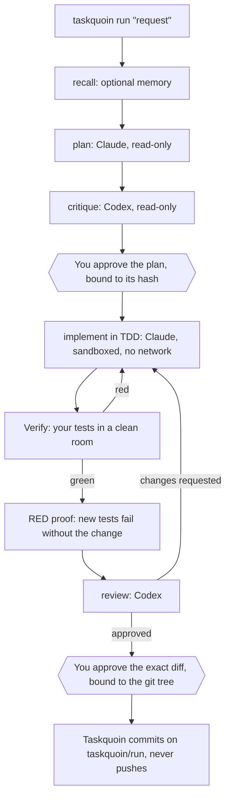

整个教程贯穿着三个理念：

- **智能体提议，Taskquoin 执行。** 智能体从不提交。提交由 Taskquoin 根据经过验证、评审和批准的树构建（[ADR-0011](../adr/0011-agents-never-commit.md)）。
- **你的批准绑定到一个哈希。** 你批准的恰恰是你读到的内容，而不是“这次运行”（[ADR-0013](../adr/0013-tree-based-governance.md)）。
- **测试在洁净室中运行。** 模型从不告诉 Taskquoin 测试通过了；测试由 Taskquoin 自己运行（[ADR-0014](../adr/0014-verify-in-a-clean-room.md)）。

## 步骤 1：创建一个带有失败测试的项目

这个项目是一个只有一个函数的计算器。测试已经存在，函数还没有。

```shell
$ mkdir calc && cd calc
$ git init -q -b main
```

创建 `package.json`：

```json
{
  "name": "calc",
  "private": true,
  "scripts": { "test": "node --test" }
}
```

创建 `sum.test.js`：

```js
const test = require('node:test');
const assert = require('node:assert');

test('sum', () => {
  const sum = require('./sum.js');
  assert.strictEqual(sum(2, 3), 5);
});
```

创建 `.gitignore`（依赖和构建产物永远不会成为 Taskquoin diff 的一部分）：

```text
node_modules/
```

提交它：

```shell
$ git add .
$ git commit -m "calc: a failing test for sum"
$ npm test
not ok 1 - sum
  error: Cannot find module './sum.js'
```

测试按预期是红的。Taskquoin 对项目只有一个前提条件：一个工作树干净的 git 仓库。当存在未提交的更改时，`taskquoin run` 会拒绝启动，因为它从不把自己的更改与你的更改混在一起。

## 步骤 2：初始化 Taskquoin

```shell
$ taskquoin init
```

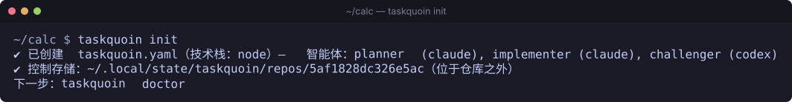

`init` 做了三件事：

1. 它检测了技术栈（`node`；它还认识 `npm test`、PHPUnit、pytest、`go test`、Maven 等），并在仓库根目录写入了 `taskquoin.yaml`。
2. 它在你的机器上查找 AI 工具并选择了智能体：这里 `planner` 和 `implementer` 使用 Claude Code，`challenger` 使用 Codex。如果缺少某个工具，文件里会注明；只有 Claude Code 时，评审者同样是 Claude。只有 OpenCode 时，`init` 会写出全部使用 OpenCode 的配置。
3. 它在仓库之外创建了一个**控制存储（control store）**，位于 `${XDG_STATE_HOME:-~/.local/state}/taskquoin/` 之下。运行状态、批准和风险接受都保存在这里。智能体无法写入这里，这正是批准无法伪造的原因（[ADR-0005](../adr/0005-control-plane-outside-workspace.md)）。

`init` 从不覆盖已有的 `taskquoin.yaml`。如果你运行 `init` 时还有其他可用的 AI（环境中的 API 密钥、本地的 Ollama），它会列出这些 AI，并以**注释**的形式在文件中提出建议：是否取消注释由你决定，因为这意味着该项目的代码会被发送给它们。

### 生成的 `taskquoin.yaml`

打开它。文件很短，你可以读完全部内容。下面按部分逐一说明。

```yaml
# Taskquoin project configuration — see docs/architecture.md. Protected: agents can never edit this file.
version: 1
stack: node
```

`version` 是 schema 版本。`stack` 选择洁净室的默认设置：即哪些依赖目录以只读方式挂载给你的测试（对 `node` 来说是 `node_modules`）。第一行注释是一个承诺：**智能体永远不能编辑这个文件。** 如果某个智能体在运行期间触碰了它，运行会停止，并且不会提交任何内容。

```yaml
agents:
  planner:
    runtime: claude
    description: "Read-only planner: turns a request into a minimal, test-first implementation plan."
    prompt: You plan; you never modify files. Read the repository, then produce the plan requested.
    capabilities:
      fs.read:
        - "**"
    maxTurns: 30
    skills:
      - planning-contract
```

**智能体**是绑定到某个运行时（`claude`、`codex`、`opencode`，或者用于评判者的 `api`）的角色。`capabilities` 是智能体被允许做的事：planner 可以读取一切（`fs.read: "**"`），除此之外什么也不能做，所以它没有 shell，也没有写入工具。`skills` 是通过哈希固定的指令（`planning-contract` 是官方自带的）。`maxTurns` 限制智能体的回合数。

```yaml
  implementer:
    runtime: claude
    description: Implements an approved task with strict TDD (RED → GREEN → REFACTOR).
    prompt: "You implement exactly the approved task. Write a failing test first, make it pass with the simplest change, then refactor. Never commit: Taskquoin verifies and commits."
    capabilities:
      fs.read:
        - "**"
      fs.write:
        - "**"
      shell.run:
        - npm test
        - npm test -- *
        - node --test *
    maxTurns: 40
    skills:
      - tdd
```

implementer 可以写文件，并运行一小份白名单内的测试命令（`shell.run`），因此能够先写测试再实现。这些命令在运行时自带的操作系统沙箱内运行，没有网络。即便如此，它自己运行测试只是为了获得反馈：真正算数的是 Taskquoin 在 Verify 中得出的结果。

```yaml
  challenger:
    runtime: codex
    description: Independent, read-only adversarial reviewer of plans and diffs.
    prompt: "You are an independent reviewer. Challenge the plan or diff: correctness, security, missing tests, over-engineering. Report blocking and non-blocking findings with file:line. Do not modify files."
    capabilities:
      fs.read:
        - "**"
    skills:
      - code-review
```

**challenger** 负责批评计划并评审 diff。它刻意使用与 implementer 不同的供应商，并且是只读的：它不应该能够“修复”它所批评的东西。

```yaml
policy:
  mandatory:
    - fs.write
    - net.egress
    - config.modify
    - connector.write
    - vcs.commit
    - vcs.push
connectors: {}
memory:
  claudeMem:
    enabled: true
```

`policy.mandatory` 列出了智能体要启动就**必须**由某种机制强制执行的限制：不得在范围之外写入、没有网络、不得更改受保护的配置、不得向远程写入、不得提交、不得推送。如果你所用的运行时版本无法强制其中任何一项，该智能体会被拒绝，而不是带着一条只是建议的规则启动（[ADR-0002](../adr/0002-enforcement-classes.md)、[ADR-0003](../adr/0003-hooks-enforce-prose-asks.md)）。`connectors` 为空：没有连接任何远程系统（[ADR-0012](../adr/0012-remote-connectors-by-exception.md)）。`memory.claudeMem` 是可选的：启用后，每次完成的运行的结构化摘要会发送到你本地的 [claude-mem](https://github.com/thedotmack/claude-mem) worker，并在运行开始时读取一段简短的回忆。如果你没有运行 claude-mem，请将其设为 `false`。（本教程中的截图使用 `false`。）

> [!TIP]
> 如果你的测试需要一个被忽略的、但不属于依赖目录的文件，例如构建出来的 `dist/` 或 `.env.test`，请显式添加它。它随后会在洁净室中以只读方式挂载，并对智能体冻结：
>
> ```yaml
> verify:
>   inherit:
>     - dist
> ```
>
> 如果项目的测试不是通过 `npm test` 运行的，可以设置 `verify.command`。

你还可以把其他 AI 用作评判者（任何兼容 OpenAI 的提供商），或者把 OpenCode 用作 planner 和 implementer；参见 [ADR-0016](../adr/0016-judges-by-api.md) 和 [ADR-0017](../adr/0017-opencode-without-commands.md)。

## 步骤 3：提交配置

`taskquoin.yaml` 是你项目的一部分，所以请提交它。这同时也为 Taskquoin 提供了它所需要的干净工作树：

```shell
$ git add taskquoin.yaml
$ git commit -m "chore: taskquoin"
```

## 步骤 4：用 doctor 检查机器

```shell
$ taskquoin doctor
```

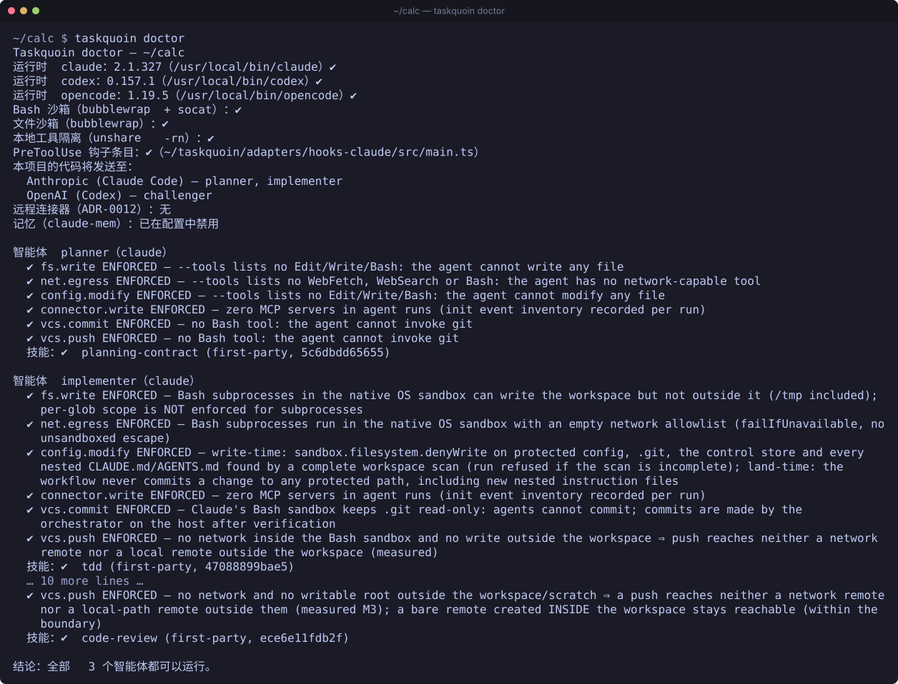

`doctor` 是 Taskquoin 中最诚实的部分。请从上到下阅读：

- 第一块列出找到的运行时及其版本；如果版本是 Taskquoin 已测量过的版本，会带有一个对勾。接着是沙箱（bubblewrap 和 socat）以及 hook。
- **This project's code is sent to** 按智能体列出每一个会收到你代码的供应商。Taskquoin 在你的机器上运行；只有你配置的 AI 才能看到任何内容（[ADR-0010](../adr/0010-local-first-no-leak.md)）。
- 然后，按智能体列出每项强制限制、它的类别以及**强制执行它的机制**，例如 `net.egress ENFORCED — Bash subprocesses run in the native OS sandbox with an empty network allowlist`。对勾表示它已针对该运行时版本获得认证；叉号表示该智能体不会启动。
- 最后一行是结论：`Verdict: all 3 agents can run.` 或 `Verdict: 2 of 3 agents can run — refused agents will not be started.`

在演示中，有一行是叉号：

```text
Agent challenger (codex)
  …
  ✖ connector.write — mandatory restriction "connector.write" (deny-all) on codex 0.157.1: claimed ENFORCED but the mechanism is not measured (inferred). Execution refused (ADR-0002).
```

Codex 声称它强制执行了 `connector.write`（不向远程连接器写入），但 Taskquoin 没有办法测量这一说法，所以不把它算作已强制执行。challenger 因此被拒绝：运行将以 `failed at challenge` 和 `gate refused agent challenger` 结束。对于这一项，你需要做一个决定。

## 接受一个你理解的风险

**接受的风险**是你经过签名、标注日期、限定范围的决定：尽管有一项无法测量的限制，仍然运行某个智能体。这是所有者的决定，不是开发者的，更不是智能体的：

```shell
$ taskquoin accept-risk challenger connector.write \
    --reason "Codex reviews read-only; no connector configured" \
    --expires 2026-12-31 --as you
```

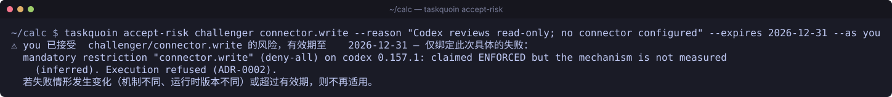

四个选项都是必需的：`--reason`、`--expires`（一个真实的未来日期，`YYYY-MM-DD`）和 `--as`（你的名字），再加上智能体和能力（capability）。请注意这种接受具有以下性质：

- **绑定到确切的失败。** 它保存失败消息的摘要。如果运行时版本或机制发生变化，该失败就不再是同一个失败，这次接受也就不再适用。
- **有日期。** 过了到期日期，它同样不再适用。
- **保存在仓库之外**，即控制存储中。没有人能通过编辑 `taskquoin.yaml` 来添加它，任何智能体也无法写入它。
- **范围狭窄。** 它只适用于这个智能体和这项能力。对于没有失败的能力，它会被拒绝；对于 API 评判者，它不可用（它们总是会被检查）。

再运行一次 `doctor`。这一行现在是警告而不是叉号，结论是 `all 3 agents can run`：

```text
  ⚠ connector.write accepted risk (approved by you until 2026-12-31: Codex reviews read-only; no connector configured) — mandatory restriction "connector.write" (deny-all) on codex 0.157.1: claimed ENFORCED but the mechanism is not measured (inferred). Execution refused (ADR-0002).
```

`taskquoin check challenger` 会显示单个智能体的同样细节：

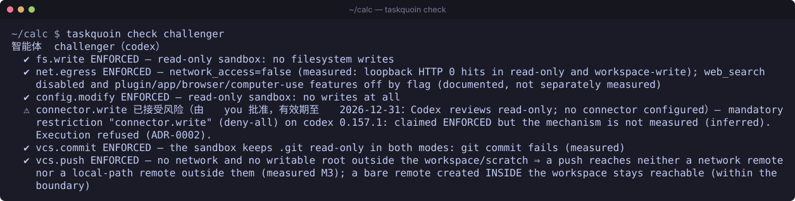

> [!IMPORTANT]
> 只有当你理解风险、并且实际情况与你的理由相符时，才接受风险：这里 Codex 以只读方式评审，而你的项目没有连接器，所以“连接器写入”无论如何都不会发生。不要为了让红色的那一行消失而接受风险。尤其要注意：
>
> - 对于确实会写入或运行命令的智能体，绝不要接受 `fs.write`、`net.egress`、`vcs.commit` 或 `vcs.push`，除非你能说出补偿性控制措施；
> - 绝不要使用含糊的理由：它会记录在批准中，并由 `doctor` 显示；
> - 优先选择较短的有效期：这次接受是提醒你在升级后重新检查；
> - 如果某个机制被*测量为失败*，请升级或更换运行时。

亲自运行 `taskquoin accept-risk` 是有意为之：如果控制台或某个智能体也能做到，这项控制就毫无意义了。

## 步骤 5：启动运行

```shell
$ taskquoin run "Add a sum function"
```

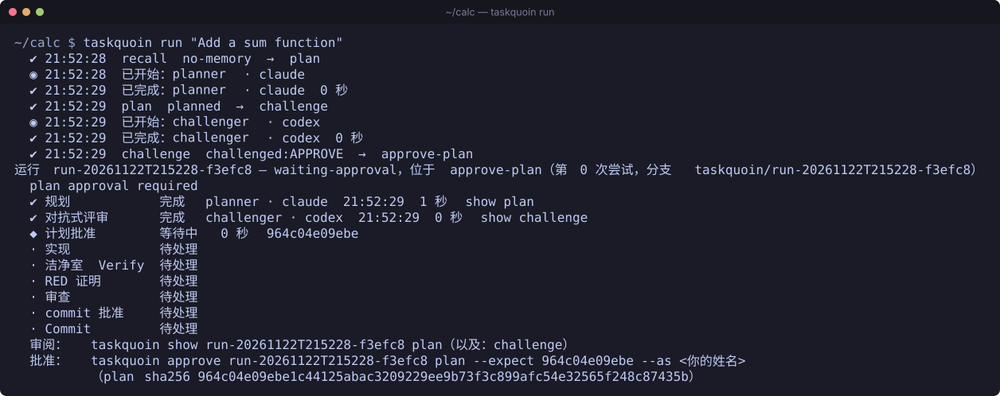

智能体工作期间，你的终端保持安静，随后会打印出它停在哪里。Taskquoin 依次做了这些事：

1. **Preflight。** Taskquoin 检查了配置定义了每个角色、技能可用、只读角色确实是只读的，以及 API 评判者有它们的密钥。工作树必须是干净的。每个智能体在首次使用之前，还要通过与 `doctor` 相同的关口：被拒绝的智能体会使运行以 `failed` 结束。
2. **Branch。** 它创建了分支 `taskquoin/run-20261122T132108-d17040` 并切换到它。你的 `main` 没有被改动。
3. **Recall。** 如果启用了记忆 worker，它会向其请求相关笔记。没有笔记时，日志中会显示 `recall no-memory`。
4. **Plan。** `planner`（Claude，只读）读取仓库并写出一份计划：目标、要先写的测试、文件、步骤、风险。
5. **Critique。** `challenger`（Codex，只读）独立地质询了这份计划，并以一行 `VERDICT:` 结束。
6. **Gate。** 工作流在 `approve-plan` 处停止。它会一直等下去，你想等多久都行。

运行 id（`run-20261122T132108-d17040`）由时间戳和一个随机后缀组成。之后的每条命令都会用到它。不带参数的 `taskquoin status` 会列出所有运行：

```shell
$ taskquoin status
run-20261122T132108-d17040  waiting-approval approve-plan    Add a sum function
```

## 步骤 6：阅读并批准计划

`status <run>` 显示一次运行的历史，并在关口处显示用于批准它的确切命令：

```shell
$ taskquoin status run-20261122T132108-d17040
```

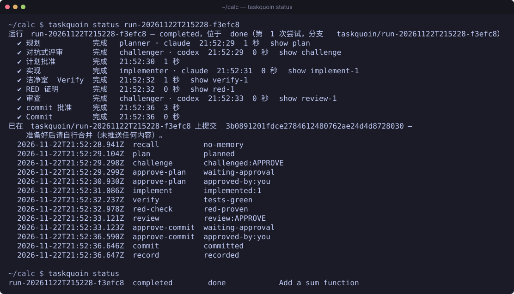

历史中的每一行是工作流的一个步骤及其结果（`planned`、`challenged:APPROVE`、`waiting-approval`）。

现在**阅读你即将批准的内容**：

```shell
$ taskquoin show run-20261122T132108-d17040 plan
```

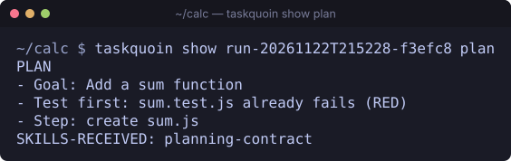

```shell
$ taskquoin show run-20261122T132108-d17040 challenge
Review: plan checked.
VERDICT: APPROVE
```

不带工件的 `show <run>` 会列出到目前为止保存的所有内容及其字节大小。真实智能体生成的计划还会涵盖要修改的文件、要先写的测试和风险。challenge 是独立的第二意见：它可能列出阻塞性和非阻塞性的发现。如果计划有误，不要批准它：用更精确的请求开始一次新的运行。

### 为什么要用哈希

关键是 `status` 的最后一行：

```text
Approve it:  taskquoin approve run-20261122T132108-d17040 plan --expect 964c04e09ebe --as <your name>
             (plan sha256 964c04e09ebe1c44125abac3209229ee9b73f3c899afc54e32565f248c87435b)
```

`964c04e09ebe` 是你刚读过的计划文件的 SHA-256 的开头部分。批准并不意味着“我批准这次运行”，而是“我批准**哈希为 964c04e09ebe 的那份计划**”。如果计划可能在你阅读和批准之间发生变化（重试、另一个进程、被入侵的工具），哈希就不再匹配，Taskquoin 会拒绝。提交中也记录了它，所以之后任何人都可以审计某个人批准了什么。

> [!NOTE]
> `--expect` 不是密码。它是你看过系统即将处理的工件的证明：你在阅读之后从 `status` 复制它。在[控制台](../getting-started/console.md)中，你需要重新输入它来确认。

批准：

```shell
$ taskquoin approve run-20261122T132108-d17040 plan --expect 964c04e09ebe --as you
```

`--as` 是你的名字；它会作为 `Plan-Approved-By` 记录在提交中。批准计划会恢复工作流，工作流会继续到下一个关口。

### 错误的哈希会被拒绝

试一个并非待处理的哈希：

```shell
$ taskquoin approve run-20261122T132108-d17040 plan --expect 000000000000 --as you
taskquoin approve: expected 000000000000 does not match the pending artifact 964c04e09ebe… — re-read it before approving
```

没有任何内容被批准，运行保持不变。如果你批准运行并没有在等待的关口，也会发生同样的事。下面的截图是在运行完成之后拍摄的，所以它展示的是这种拒绝的变体：

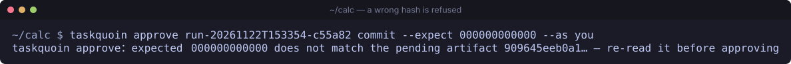

拒绝的退出码是 1。输错命令（缺少 `--expect` 或 `--as`）则以 2 退出。

## 步骤 7：实现、Verify 与评审

在 `approve … plan` 之后，Taskquoin 无需你参与就能工作：

1. **以 TDD 方式实现。** `implementer`（Claude）在该分支上、在运行时的沙箱中工作，没有网络，也无法提交。它先编写或调整测试，然后写出能让测试通过的最简单的代码。
2. **在洁净室中 Verify。** Taskquoin 取 implementer 留下的那棵确切的树，在仓库之外的一份用完即弃的副本中自己运行你的测试（`npm test`）：没有网络，`.git` 只读，你的 HOME 被隐藏，机密文件被屏蔽，只有该技术栈的依赖目录（以及你的 `verify.inherit`）以只读方式挂载。一个依赖于未提交内容才能通过的测试会在这里失败，这正是目的所在。
3. **RED 证明。** 然后 Taskquoin 移除生产代码的更改，再次运行被更改的测试。它们必须**失败**。没有这个更改也能通过的测试什么也没有测试。这个证明是机械的：它并不能说明测试断言的是正确的行为（那是评审以及你的职责）。
4. **评审。** `challenger` 结合 verify 和 RED 日志，对照计划评审 diff。它以一行 `VERDICT:` 结束。

如果测试是红的、RED 证明失败，或者评审要求修改，Taskquoin 会把反馈发送给 implementer 进行自动返工（最多 3 次实现尝试，在评审被拒绝之后最多再进行 2 轮返工）。然后运行会停在第二个关口。

## 步骤 8：阅读并批准提交

运行现在再次处于等待状态。来看一下：

```shell
$ taskquoin status run-20261122T132108-d17040
Run run-20261122T132108-d17040 — waiting-approval at approve-commit (attempt 1, branch taskquoin/run-20261122T132108-d17040)
  commit approval required (bound to the exact tree)
  Review it:   taskquoin show run-20261122T132108-d17040 diff-1  (and: verify-1, red-1, review-1)
  Approve it:  taskquoin approve run-20261122T132108-d17040 commit --expect 909645eeb0a1 --as <your name>
               (git tree 909645eeb0a1716e60fd724784ede536fbea048f)
```

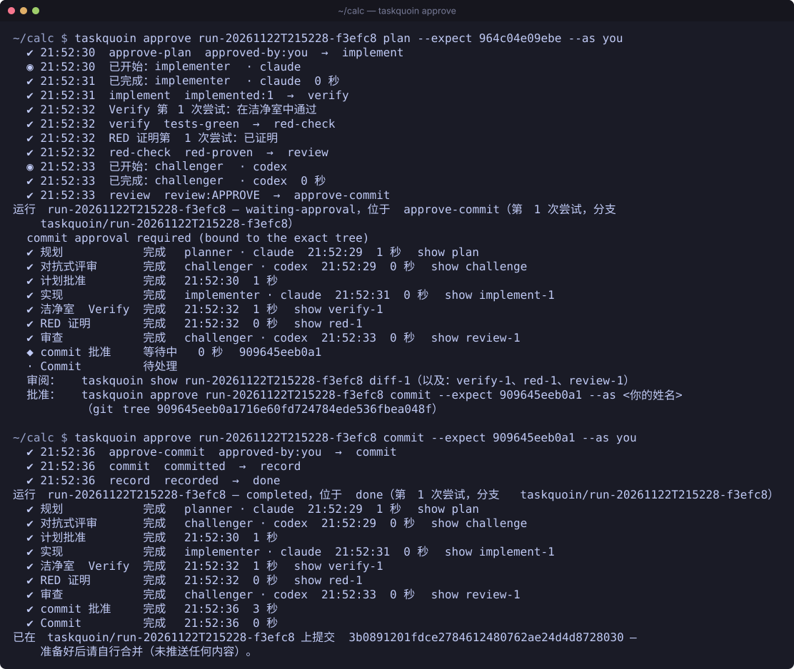

这一次，哈希是通过了 Verify 和评审的 **git 树**。请阅读第 1 次尝试的四个工件。数字是尝试的编号；返工之后，你要读编号最大的那一个。

### `diff-1`：确切的更改

```shell
$ taskquoin show run-20261122T132108-d17040 diff-1
```

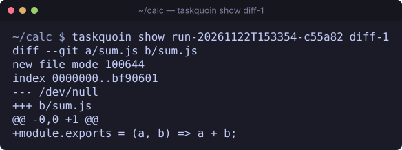

这就是将被提交的内容，仅此而已。如果智能体更改了受保护的文件（你的 CI、`.claude/`、`AGENTS.md`、`taskquoin.yaml`），运行就会以 `protected configuration changed` 停止。被你的 `.gitignore` 隐藏、但由智能体创建的文件会列在 `ignored-1` 中；它们不在 diff 中，不会被验证，也不会被提交。

### `verify-1`：你的测试，由 Taskquoin 运行

```shell
$ taskquoin show run-20261122T132108-d17040 verify-1
```

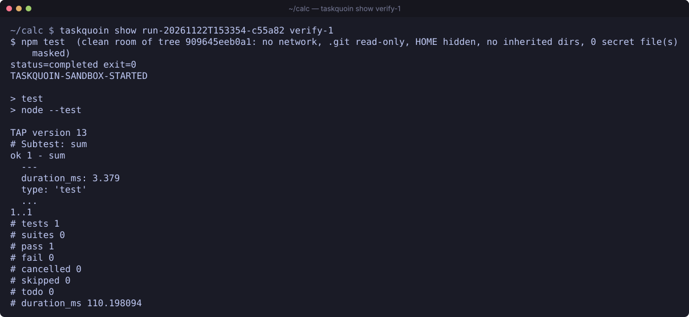

头部说明了洁净室是什么样的（`no network, .git read-only, HOME hidden, … 0 secret file(s) masked`）以及针对的是哪棵树（`909645eeb0a1`，与你即将批准的哈希相同）。`exit=0` 和 `# pass 1` 来自测试运行器，而不是来自模型的声明。

### `red-1`：证明测试有意义

```shell
$ taskquoin show run-20261122T132108-d17040 red-1
TASKQUOIN RED PROOF — tests run on base + test changes only (tree 9848f565e24c); they must FAIL.
RESULT: they failed as required (RED proven).

$ npm test  (clean room of tree 9848f565e24c: no network, .git read-only, HOME hidden, no inherited dirs, 0 secret file(s) masked)
status=failed exit=1
…
not ok 1 - sum
  error: Cannot find module './sum.js'
  code: 'MODULE_NOT_FOUND'
```

这里新的生产文件 `sum.js` 被移除了，测试无法加载它，于是失败了。这次失败就是 RED 证明。Taskquoin 把来自*新*文件中某个功能的导入错误视为预期的 RED。如果只有测试文件发生了更改（纯粹新增测试），则该证明记录为“not applicable”。

### `review-1`：第二意见

```shell
$ taskquoin show run-20261122T132108-d17040 review-1
Review: diff checked against the plan.
VERDICT: APPROVE
```

请阅读其中的发现，而不仅仅是结论。只有在有内容可读时，`ignored-1` 才会出现在列表中。

### 批准提交

如果你满意，请使用 `status` 中的哈希进行批准：

```shell
$ taskquoin approve run-20261122T132108-d17040 commit --expect 909645eeb0a1 --as you
Run run-20261122T132108-d17040 — completed at done (attempt 1, branch taskquoin/run-20261122T132108-d17040)
Committed a3c6b801de5f4356750f53870557e2fdd19958ee on taskquoin/run-20261122T132108-d17040 — merge it yourself when ready (nothing was pushed).
```

`approve … commit` 必须在仓库位于该运行的分支（`taskquoin/<run>`）上时运行；否则它会回答 `switch to taskquoin/<run> first`。Taskquoin 在提交之前会重新读取工作树。如果自你查看之后有任何变化，你的批准就不再适用：它会重新验证、重新评审，并请你批准新的树。

然后 Taskquoin **直接从被批准的 git 树**构建提交，而不是通过 `git add`。它看起来是这样的：

```shell
$ git log -1 taskquoin/run-20261122T132108-d17040
```

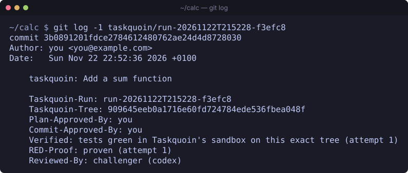

```text
taskquoin: Add a sum function

Taskquoin-Run: run-20261122T132108-d17040
Taskquoin-Tree: 909645eeb0a1716e60fd724784ede536fbea048f
Plan-Approved-By: you
Commit-Approved-By: you
Verified: tests green in Taskquoin's sandbox on this exact tree (attempt 1)
RED-Proof: proven (attempt 1)
Reviewed-By: challenger (codex)
```

这些 trailer 是审计线索，就在提交本身之中：

| Trailer | 含义 |
|---|---|
| `Taskquoin-Run` | 生成该提交的运行 |
| `Taskquoin-Tree` | 经过验证、评审和批准的 git 树。它就是该提交的树 |
| `Plan-Approved-By` | 在计划关口通过 `--as` 给出的名字 |
| `Commit-Approved-By` | 在提交关口通过 `--as` 给出的名字 |
| `Verified` | 测试在洁净室中对这棵确切的树是绿的 |
| `RED-Proof` | 被更改的测试在没有该更改时失败了（`proven`，对于仅测试的更改则是 `not applicable`） |
| `Reviewed-By` | 评审并批准的智能体；API 评判者会增加它自己的一行 |

最后运行 `taskquoin status <run>` 会显示完整的日志，从 `recall` 到 `commit` 和 `record`。

## 步骤 9：合并结果

Taskquoin **从不推送**，也从不合并到你的分支。提交位于 `taskquoin/<run>` 上，也就是你当前所在的分支。请自己合并，或者从它发起拉取请求：

```shell
$ git switch main
$ git merge --ff-only taskquoin/run-20261122T132108-d17040
$ npm test
```

> [!WARNING]
> Taskquoin 不会运行你仓库的提交 hook，因为它们可能包含被智能体修改过的代码。合并时，请自己运行你的 hook、linter 和 CI。

`taskquoin/<run>` 分支归你所有：不再需要时请删除它们（`git branch -d taskquoin/<run>`）。

## 在 Dashboard 中跟踪一次运行

运行期间，在同一仓库中打开第二个终端并启动 Dashboard。它只读取：显示流水线、等待您的审批（含其哈希的开头）、各个智能体和日志。

```shell
$ taskquoin dashboard
```

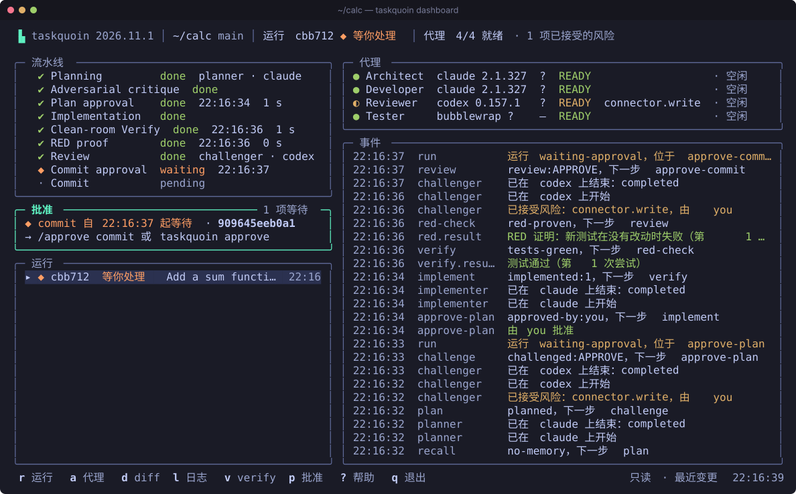

按 `d` 阅读 diff：`/` 搜索，`n` 和 `N` 在匹配项之间跳转；滚动到文件末尾后，该文件才算已读。

按 `p` 打开审批中心。没有任何按键会自行批准：您输入姓名，然后重新键入哈希的 12 个字符。按 `q` 退出；已批准的运行会继续。 [Dashboard 指南（英文）](../guides/dashboard.md).

## 当事情没有按计划进行

Taskquoin 的错误消息遵循你的语言，但运行引擎的消息（`failed`、`needs-human`、`interrupted`）始终是英文。下表列出了你最常遇到的情况。

| 你看到的内容 | 含义 | 该怎么做 |
|---|---|---|
| `taskquoin run: the working tree has uncommitted changes` | Taskquoin 从不把自己的更改与你的更改混在一起 | 提交或 stash 你的更改 |
| `failed … gate refused agent X` | 无法在这台机器上认证某个智能体 | `taskquoin doctor` 会说明原因：运行时版本、缺少沙箱、你尚未接受的风险 |
| `needs-human … tests still failing after 3 attempts` | 三次尝试仍未使测试变绿 | 在运行分支上接手，或用更精确的请求开始新的运行 |
| `needs-human … no failing test demonstrates the change` | 即使没有生产代码的更改测试也能通过，所以它们并没有测试这个更改 | 阅读 `red-N`；编写（或要求编写）一个在更改前会失败的测试。没有新测试的重构或文档更改会止步于此：请自己从该分支提交 |
| `needs-human … RED proof inconclusive` | 证明未能正常运行（超时、沙箱、无法重建的树）。它不是证明 | 阅读 `red-N`。你的工作文件夹未被改动 |
| `needs-human … review still requests changes after N attempts` | 评审者一直在拒绝 | 阅读 `review-N` 并做出决定；工作成果在该分支上 |
| `needs-human … dependencies changed during the run` | `node_modules`（或 `vendor`、`.venv`）在运行期间发生了变化，所以用它做的任何验证都不成立 | 重新安装（`npm ci`）并开始新的运行。不要在运行期间执行 `npm install` |
| `needs-human … protected configuration changed` | 智能体触碰了受保护的配置（CI、`.claude/`、`AGENTS.md`、`taskquoin.yaml`） | 没有提交任何内容；检查该分支 |
| 测试在你这里通过，但在 Verify 中失败 | 它们使用了洁净室中不存在的被忽略的文件 | 把它加入 `verify.inherit` |
| `does not match the pending artifact` | 你给出的哈希不是待处理的那个 | 用 `show` 阅读，并从 `status` 复制哈希 |
| `switch to taskquoin/<run> first` | 你不在该运行的分支上 | `git switch taskquoin/<run>` |
| `taskquoin.yaml changed since the run started` | 配置在运行中途发生了变化 | 开始新的运行 |
| `interrupted` | 一个技术错误（git、磁盘、评判者的 HTTP 503）使运行停止 | `taskquoin resume <run>` |

### 当测试一直是红的

如果 Verify 失败，Taskquoin 会把失败日志和评审交给 implementer 并再次尝试，最多三次实现尝试（没有自己命令的 OpenCode implementer 可以获得更多次返工）。如果测试仍然是红的，运行会以状态 `needs-human` 和原因 `tests still failing after 3 attempts` 结束。没有提交，也没有批准提示。

一切都会保留：`taskquoin show <run> verify-3` 有最后一份日志，分支 `taskquoin/<run>` 保存着智能体的工作成果。你可以在该分支上手动继续，或者用更精确的请求开始新的运行。`needs-human` 的运行不会自动恢复。

### `resume`：中断之后

当工作流之外的某些原因使运行中断时（连接评判者时的网络错误、磁盘已满、你的机器进入睡眠），运行就处于 `interrupted` 状态。状态在每一步都会保存，评判者的回答也会逐个保存，所以恢复运行从不会两次调用评判者，也不会两次为此付费：

```shell
$ taskquoin resume run-20261122T132108-d17040
```

`resume` 只接受状态为 `interrupted` 的运行。对于任何其他状态，它会告诉你这一点，例如 `taskquoin resume: only an interrupted run can be resumed (status completed)`。如果状态是 `needs-human` 或 `failed`，请开始新的运行。

### 一条经验法则

如果你不知道该怎么办，请运行 `taskquoin status <run>`：它会打印状态、日志以及确切的下一条命令。关于机器的任何问题，`taskquoin doctor` 都能回答。

## 了解更多

- [交互式控制台](../getting-started/console.md)：同样的工作流，使用 `/run` 和 `/approve`
- [安装](../getting-started/installation.md)
- [ADR-0011，智能体从不提交](../adr/0011-agents-never-commit.md)
- [ADR-0013，基于树的治理](../adr/0013-tree-based-governance.md)
- [ADR-0014，在洁净室中 Verify](../adr/0014-verify-in-a-clean-room.md)
- [ADR-0002，强制类别](../adr/0002-enforcement-classes.md)
- [ADR-0005，工作区之外的控制平面](../adr/0005-control-plane-outside-workspace.md)
- [ADR-0016，通过 API 的评判者](../adr/0016-judges-by-api.md)和 [ADR-0017，没有命令的 OpenCode](../adr/0017-opencode-without-commands.md)
