# 你的第一次受治理執行

> 本教學翻譯自英文參考頁面（[first-run.md](../getting-started/first-run.md)）。它是機器翻譯，經維護者對指令的測試檢查，並未由母語審校者審閱。程式碼區塊中的 CLI 輸出保持英文；在地化的螢幕截圖呈現了該語言下 CLI 的實際輸出。

本教學帶你從一個空資料夾出發，一個指令接一個指令地得到一個由 Taskquoin 產生、經過驗證的 commit。你將建立一個帶有失敗測試的小專案，讓 Taskquoin 借助 AI 代理程式規劃並實作修正，並對這項工作進行兩次核准：一次是在你讀完計畫之後，另一次是在你讀完確切的 diff 之後。在每一個步驟中，你都能看到 Taskquoin 做了什麼、為什麼停下來，以及你簽署的是什麼。

- [你將建置什麼](#你將建置什麼)
- [步驟 1：建立一個帶有失敗測試的專案](#步驟-1建立一個帶有失敗測試的專案)
- [步驟 2：初始化 Taskquoin](#步驟-2初始化-taskquoin)
- [步驟 3：commit 設定](#步驟-3commit-設定)
- [步驟 4：用 doctor 檢查機器](#步驟-4用-doctor-檢查機器)
- [接受一個你理解的風險](#接受一個你理解的風險)
- [步驟 5：啟動執行](#步驟-5啟動執行)
- [步驟 6：閱讀並核准計畫](#步驟-6閱讀並核准計畫)
- [步驟 7：實作、Verify 與審查](#步驟-7實作verify-與審查)
- [步驟 8：閱讀並核准 commit](#步驟-8閱讀並核准-commit)
- [步驟 9：合併結果](#步驟-9合併結果)
- [在 Dashboard 中追蹤一次執行](#在-dashboard-中追蹤一次執行)
- [當事情沒有按計畫進行](#當事情沒有按計畫進行)
- [了解更多](#了解更多)

> [!NOTE]
> 螢幕截圖來自一個使用模擬 AI 代理程式（Taskquoin 自身測試套件中的測試替身）的示範儲存庫；所有指令都是真實的 Taskquoin CLI。使用真實的 Claude Code 和 Codex 時，計畫和審查的措辭由代理程式自己決定，一次執行需要幾分鐘而不是幾秒鐘。其餘一切都相同。

開始之前，請先[安裝 Taskquoin](../getting-started/installation.md)，並確認 Node 22.18+、git、`bubblewrap` 和 `socat` 可用，且至少已安裝並登入 Claude Code（最好還有 Codex）。

## 你將建置什麼

一次執行（run）是一個固定的工作流程。兩個菱形是兩次人工核准；沒有你，任何東西都不會越過它們。

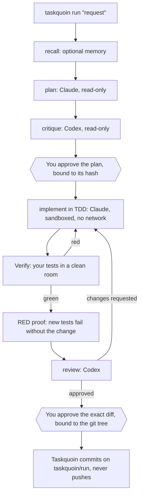

整個教學貫穿著三個理念：

- **代理程式提議，Taskquoin 執行。** 代理程式從不 commit。commit 由 Taskquoin 根據經過驗證、審查和核准的 tree 建構（[ADR-0011](../adr/0011-agents-never-commit.md)）。
- **你的核准綁定到一個雜湊。** 你核准的正是你讀到的內容，而不是「這次執行」（[ADR-0013](../adr/0013-tree-based-governance.md)）。
- **測試在無塵室中執行。** 模型從不告訴 Taskquoin 測試通過了；測試由 Taskquoin 自己執行（[ADR-0014](../adr/0014-verify-in-a-clean-room.md)）。

## 步驟 1：建立一個帶有失敗測試的專案

這個專案是一個只有一個函式的計算機。測試已經存在，函式還沒有。

```shell
$ mkdir calc && cd calc
$ git init -q -b main
```

建立 `package.json`：

```json
{
  "name": "calc",
  "private": true,
  "scripts": { "test": "node --test" }
}
```

建立 `sum.test.js`：

```js
const test = require('node:test');
const assert = require('node:assert');

test('sum', () => {
  const sum = require('./sum.js');
  assert.strictEqual(sum(2, 3), 5);
});
```

建立 `.gitignore`（相依套件和建置產物永遠不會成為 Taskquoin diff 的一部分）：

```text
node_modules/
```

commit 它：

```shell
$ git add .
$ git commit -m "calc: a failing test for sum"
$ npm test
not ok 1 - sum
  error: Cannot find module './sum.js'
```

測試如預期是紅燈。Taskquoin 對專案只有一個先決條件：一個工作樹乾淨的 git 儲存庫。當存在未 commit 的變更時，`taskquoin run` 會拒絕啟動，因為它從不把自己的變更與你的變更混在一起。

## 步驟 2：初始化 Taskquoin

```shell
$ taskquoin init
```

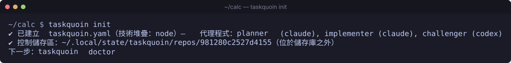

`init` 做了三件事：

1. 它偵測了技術堆疊（`node`；它還認得 `npm test`、PHPUnit、pytest、`go test`、Maven 等），並在儲存庫根目錄寫入了 `taskquoin.yaml`。
2. 它在你的機器上尋找 AI 工具並選擇了代理程式：這裡 `planner` 和 `implementer` 使用 Claude Code，`challenger` 使用 Codex。如果缺少某個工具，檔案裡會註明；只有 Claude Code 時，審查者同樣是 Claude。只有 OpenCode 時，`init` 會寫出全部使用 OpenCode 的設定。
3. 它在儲存庫之外建立了一個**控制儲存區（control store）**，位於 `${XDG_STATE_HOME:-~/.local/state}/taskquoin/` 之下。執行狀態、核准和風險接受都保存在這裡。代理程式無法寫入這裡，這正是核准無法偽造的原因（[ADR-0005](../adr/0005-control-plane-outside-workspace.md)）。

`init` 從不覆寫既有的 `taskquoin.yaml`。如果你執行 `init` 時還有其他可用的 AI（環境中的 API 金鑰、本機的 Ollama），它會列出這些 AI，並以**註解**的形式在檔案中提出建議：是否取消註解由你決定，因為這意味著該專案的程式碼會被傳送給它們。

### 產生的 `taskquoin.yaml`

打開它。檔案很短，你可以讀完全部內容。下面依部分逐一說明。

```yaml
# Taskquoin project configuration — see docs/architecture.md. Protected: agents can never edit this file.
version: 1
stack: node
```

`version` 是 schema 版本。`stack` 選擇無塵室的預設值：也就是哪些相依目錄以唯讀方式掛載給你的測試（對 `node` 來說是 `node_modules`）。第一行註解是一個承諾：**代理程式永遠不能編輯這個檔案。** 如果某個代理程式在執行期間碰觸了它，執行會停止，並且不會 commit 任何內容。

```yaml
agents:
  planner:
    runtime: claude
    description: "Read-only planner: turns a request into a minimal, test-first implementation plan."
    prompt: You plan; you never modify files. Read the repository, then produce the plan requested.
    capabilities:
      fs.read:
        - "**"
    maxTurns: 30
    skills:
      - planning-contract
```

**代理程式**是綁定到某個執行環境（`claude`、`codex`、`opencode`，或用於評審者的 `api`）的角色。`capabilities` 是代理程式被允許做的事：planner 可以讀取一切（`fs.read: "**"`），除此之外什麼也不能做，所以它沒有 shell，也沒有寫入工具。`skills` 是透過雜湊固定的指示（`planning-contract` 是官方內建的）。`maxTurns` 限制代理程式的回合數。

```yaml
  implementer:
    runtime: claude
    description: Implements an approved task with strict TDD (RED → GREEN → REFACTOR).
    prompt: "You implement exactly the approved task. Write a failing test first, make it pass with the simplest change, then refactor. Never commit: Taskquoin verifies and commits."
    capabilities:
      fs.read:
        - "**"
      fs.write:
        - "**"
      shell.run:
        - npm test
        - npm test -- *
        - node --test *
    maxTurns: 40
    skills:
      - tdd
```

implementer 可以寫入檔案，並執行一小份白名單內的測試指令（`shell.run`），因此能夠先寫測試再實作。這些指令在執行環境自帶的作業系統沙箱內執行，沒有網路。即便如此，它自己執行測試只是為了取得回饋：真正算數的是 Taskquoin 在 Verify 中得出的結果。

```yaml
  challenger:
    runtime: codex
    description: Independent, read-only adversarial reviewer of plans and diffs.
    prompt: "You are an independent reviewer. Challenge the plan or diff: correctness, security, missing tests, over-engineering. Report blocking and non-blocking findings with file:line. Do not modify files."
    capabilities:
      fs.read:
        - "**"
    skills:
      - code-review
```

**challenger** 負責批評計畫並審查 diff。它刻意使用與 implementer 不同的供應商，並且是唯讀的：它不應該能夠「修正」它所批評的東西。

```yaml
policy:
  mandatory:
    - fs.write
    - net.egress
    - config.modify
    - connector.write
    - vcs.commit
    - vcs.push
connectors: {}
memory:
  claudeMem:
    enabled: true
```

`policy.mandatory` 列出了代理程式要啟動就**必須**由某種機制強制執行的限制：不得在範圍之外寫入、沒有網路、不得變更受保護的設定、不得寫入遠端、不得 commit、不得 push。如果你所用的執行環境版本無法強制其中任何一項，該代理程式會被拒絕，而不是帶著一條只是建議的規則啟動（[ADR-0002](../adr/0002-enforcement-classes.md)、[ADR-0003](../adr/0003-hooks-enforce-prose-asks.md)）。`connectors` 為空：沒有連接任何遠端系統（[ADR-0012](../adr/0012-remote-connectors-by-exception.md)）。`memory.claudeMem` 是選用的：啟用後，每次完成的執行的結構化摘要會傳送到你本機的 [claude-mem](https://github.com/thedotmack/claude-mem) worker，並在執行開始時讀取一段簡短的回憶。如果你沒有執行 claude-mem，請將其設為 `false`。（本教學中的螢幕截圖使用 `false`。）

> [!TIP]
> 如果你的測試需要一個被忽略的、但不屬於相依目錄的檔案，例如建置出來的 `dist/` 或 `.env.test`，請明確加入它。它隨後會在無塵室中以唯讀方式掛載，並對代理程式凍結：
>
> ```yaml
> verify:
>   inherit:
>     - dist
> ```
>
> 如果專案的測試不是透過 `npm test` 執行的，可以設定 `verify.command`。

你還可以把其他 AI 用作評審者（任何相容 OpenAI 的供應商），或者把 OpenCode 用作 planner 和 implementer；請參閱 [ADR-0016](../adr/0016-judges-by-api.md) 和 [ADR-0017](../adr/0017-opencode-without-commands.md)。

## 步驟 3：commit 設定

`taskquoin.yaml` 是你專案的一部分，所以請 commit 它。這同時也為 Taskquoin 提供了它所需要的乾淨工作樹：

```shell
$ git add taskquoin.yaml
$ git commit -m "chore: taskquoin"
```

## 步驟 4：用 doctor 檢查機器

```shell
$ taskquoin doctor
```

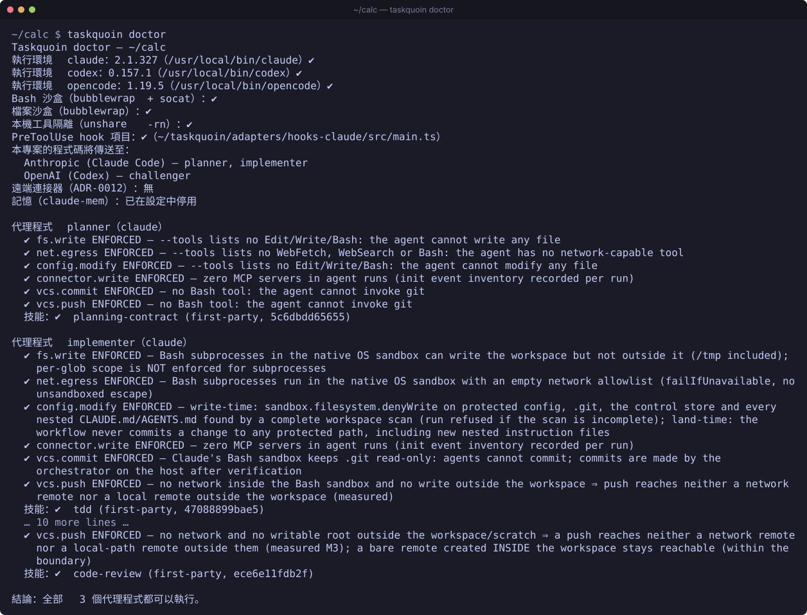

`doctor` 是 Taskquoin 中最誠實的部分。請由上而下閱讀：

- 第一塊列出找到的執行環境及其版本；如果版本是 Taskquoin 已量測過的版本，會帶有一個勾號。接著是沙箱（bubblewrap 和 socat）以及 hook。
- **This project's code is sent to** 依代理程式列出每一個會收到你程式碼的供應商。Taskquoin 在你的機器上執行；只有你設定的 AI 才能看到任何內容（[ADR-0010](../adr/0010-local-first-no-leak.md)）。
- 然後，依代理程式列出每項強制限制、它的類別以及**強制執行它的機制**，例如 `net.egress ENFORCED — Bash subprocesses run in the native OS sandbox with an empty network allowlist`。勾號表示它已針對該執行環境版本取得認證；叉號表示該代理程式不會啟動。
- 最後一行是結論：`Verdict: all 3 agents can run.` 或 `Verdict: 2 of 3 agents can run — refused agents will not be started.`

在示範中，有一行是叉號：

```text
Agent challenger (codex)
  …
  ✖ connector.write — mandatory restriction "connector.write" (deny-all) on codex 0.157.1: claimed ENFORCED but the mechanism is not measured (inferred). Execution refused (ADR-0002).
```

Codex 聲稱它強制執行了 `connector.write`（不寫入遠端連接器），但 Taskquoin 沒有辦法量測這項說法，所以不把它算作已強制執行。challenger 因此被拒絕：執行將以 `failed at challenge` 和 `gate refused agent challenger` 結束。對於這一項，你需要做一個決定。

## 接受一個你理解的風險

**接受的風險**是你經過簽署、標註日期、限定範圍的決定：儘管有一項無法量測的限制，仍然執行某個代理程式。這是擁有者的決定，不是開發者的，更不是代理程式的：

```shell
$ taskquoin accept-risk challenger connector.write \
    --reason "Codex reviews read-only; no connector configured" \
    --expires 2026-12-31 --as you
```

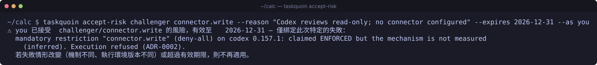

四個選項都是必要的：`--reason`、`--expires`（一個真實的未來日期，`YYYY-MM-DD`）和 `--as`（你的名字），再加上代理程式和能力（capability）。請注意這種接受具有以下性質：

- **綁定到確切的失敗。** 它儲存失敗訊息的摘要。如果執行環境版本或機制發生變化，該失敗就不再是同一個失敗，這次接受也就不再適用。
- **有日期。** 過了到期日期，它同樣不再適用。
- **儲存在儲存庫之外**，即控制儲存區中。沒有人能透過編輯 `taskquoin.yaml` 來加入它，任何代理程式也無法寫入它。
- **範圍狹窄。** 它只適用於這個代理程式和這項能力。對於沒有失敗的能力，它會被拒絕；對於 API 評審者，它不可用（它們總是會被檢查）。

再執行一次 `doctor`。這一行現在是警告而不是叉號，結論是 `all 3 agents can run`：

```text
  ⚠ connector.write accepted risk (approved by you until 2026-12-31: Codex reviews read-only; no connector configured) — mandatory restriction "connector.write" (deny-all) on codex 0.157.1: claimed ENFORCED but the mechanism is not measured (inferred). Execution refused (ADR-0002).
```

`taskquoin check challenger` 會顯示單一代理程式的同樣細節：

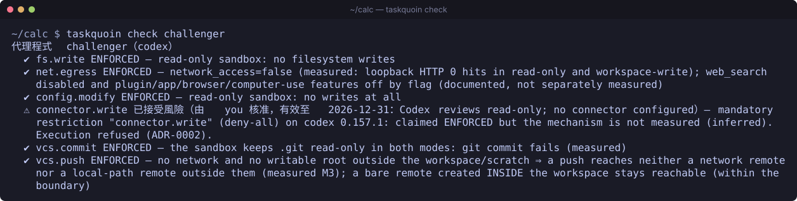

> [!IMPORTANT]
> 只有當你理解風險、並且實際情況與你的理由相符時，才接受風險：這裡 Codex 以唯讀方式審查，而你的專案沒有連接器，所以「連接器寫入」無論如何都不會發生。不要為了讓紅色的那一行消失而接受風險。尤其要注意：
>
> - 對於確實會寫入或執行指令的代理程式，絕不要接受 `fs.write`、`net.egress`、`vcs.commit` 或 `vcs.push`，除非你能說出補償性控制措施；
> - 絕不要使用含糊的理由：它會記錄在核准中，並由 `doctor` 顯示；
> - 優先選擇較短的有效期限：這次接受是提醒你在升級後重新檢查；
> - 如果某個機制被*量測為失敗*，請升級或更換執行環境。

親自執行 `taskquoin accept-risk` 是有意為之：如果主控台或某個代理程式也能做到，這項控制就毫無意義了。

## 步驟 5：啟動執行

```shell
$ taskquoin run "Add a sum function"
```

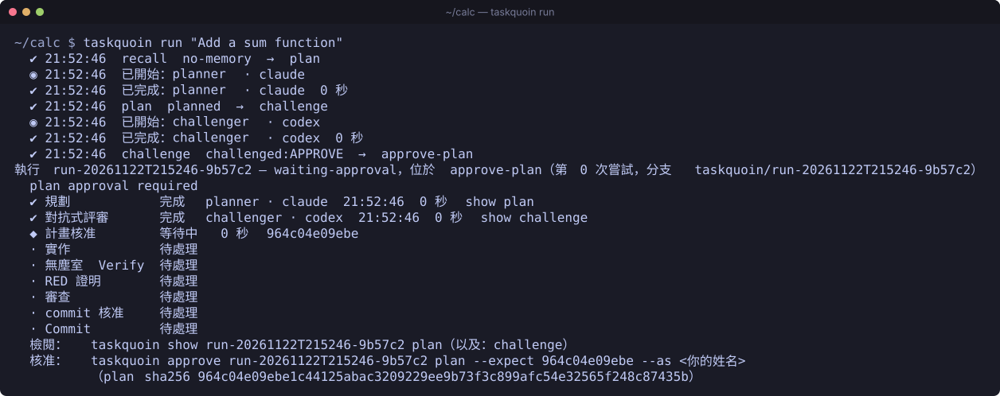

代理程式運作期間，你的終端機保持安靜，隨後會印出它停在哪裡。Taskquoin 依序做了這些事：

1. **Preflight。** Taskquoin 檢查了設定定義了每個角色、技能可用、唯讀角色確實是唯讀的，以及 API 評審者有它們的金鑰。工作樹必須是乾淨的。每個代理程式在首次使用之前，還要通過與 `doctor` 相同的關卡：被拒絕的代理程式會使執行以 `failed` 結束。
2. **Branch。** 它建立了分支 `taskquoin/run-20261122T132108-d17040` 並切換到它。你的 `main` 沒有被更動。
3. **Recall。** 如果啟用了記憶 worker，它會向其請求相關筆記。沒有筆記時，日誌中會顯示 `recall no-memory`。
4. **Plan。** `planner`（Claude，唯讀）讀取儲存庫並寫出一份計畫：目標、要先寫的測試、檔案、步驟、風險。
5. **Critique。** `challenger`（Codex，唯讀）獨立地質詢了這份計畫，並以一行 `VERDICT:` 結束。
6. **Gate。** 工作流程在 `approve-plan` 處停止。它會一直等下去，你想等多久都行。

執行 id（`run-20261122T132108-d17040`）由時間戳記和一個隨機後綴組成。之後的每個指令都會用到它。不帶引數的 `taskquoin status` 會列出所有執行：

```shell
$ taskquoin status
run-20261122T132108-d17040  waiting-approval approve-plan    Add a sum function
```

## 步驟 6：閱讀並核准計畫

`status <run>` 顯示一次執行的歷程，並在關卡處顯示用於核准它的確切指令：

```shell
$ taskquoin status run-20261122T132108-d17040
```

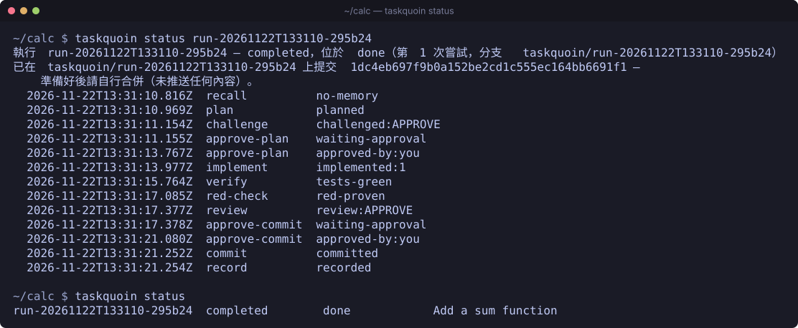

歷程中的每一行是工作流程的一個步驟及其結果（`planned`、`challenged:APPROVE`、`waiting-approval`）。

現在**閱讀你即將核准的內容**：

```shell
$ taskquoin show run-20261122T132108-d17040 plan
```

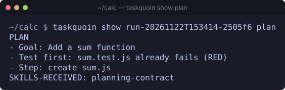

```shell
$ taskquoin show run-20261122T132108-d17040 challenge
Review: plan checked.
VERDICT: APPROVE
```

不帶工件的 `show <run>` 會列出到目前為止儲存的所有內容及其位元組大小。真實代理程式產生的計畫還會涵蓋要修改的檔案、要先寫的測試和風險。challenge 是獨立的第二意見：它可能列出阻擋性和非阻擋性的發現。如果計畫有誤，不要核准它：用更精確的請求開始一次新的執行。

### 為什麼要用雜湊

關鍵是 `status` 的最後一行：

```text
Approve it:  taskquoin approve run-20261122T132108-d17040 plan --expect 964c04e09ebe --as <your name>
             (plan sha256 964c04e09ebe1c44125abac3209229ee9b73f3c899afc54e32565f248c87435b)
```

`964c04e09ebe` 是你剛讀過的計畫檔案的 SHA-256 的開頭部分。核准並不意味著「我核准這次執行」，而是「我核准**雜湊為 964c04e09ebe 的那份計畫**」。如果計畫可能在你閱讀和核准之間發生變化（重試、另一個行程、被入侵的工具），雜湊就不再相符，Taskquoin 會拒絕。commit 中也記錄了它，所以之後任何人都可以稽核某個人核准了什麼。

> [!NOTE]
> `--expect` 不是密碼。它是你看過系統即將處理的工件的證明：你在閱讀之後從 `status` 複製它。在[主控台](../getting-started/console.md)中，你需要重新輸入它來確認。

核准：

```shell
$ taskquoin approve run-20261122T132108-d17040 plan --expect 964c04e09ebe --as you
```

`--as` 是你的名字；它會作為 `Plan-Approved-By` 記錄在 commit 中。核准計畫會恢復工作流程，工作流程會繼續到下一個關卡。

### 錯誤的雜湊會被拒絕

試一個並非待處理的雜湊：

```shell
$ taskquoin approve run-20261122T132108-d17040 plan --expect 000000000000 --as you
taskquoin approve: expected 000000000000 does not match the pending artifact 964c04e09ebe… — re-read it before approving
```

沒有任何內容被核准，執行保持不變。如果你核准執行並沒有在等待的關卡，也會發生同樣的事。下面的螢幕截圖是在執行完成之後拍攝的，所以它展示的是這種拒絕的變體：

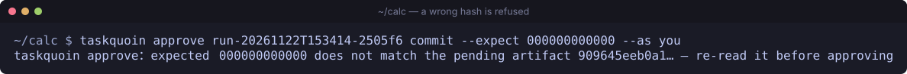

拒絕的結束碼是 1。輸錯指令（缺少 `--expect` 或 `--as`）則以 2 結束。

## 步驟 7：實作、Verify 與審查

在 `approve … plan` 之後，Taskquoin 無需你參與就能運作：

1. **以 TDD 方式實作。** `implementer`（Claude）在該分支上、在執行環境的沙箱中運作，沒有網路，也無法 commit。它先撰寫或調整測試，然後寫出能讓測試通過的最簡單的程式碼。
2. **在無塵室中 Verify。** Taskquoin 取 implementer 留下的那棵確切的 tree，在儲存庫之外的一份用完即丟的副本中自己執行你的測試（`npm test`）：沒有網路，`.git` 唯讀，你的 HOME 被隱藏，機密檔案被遮蔽，只有該技術堆疊的相依目錄（以及你的 `verify.inherit`）以唯讀方式掛載。一個依賴於未 commit 內容才能通過的測試會在這裡失敗，這正是目的所在。
3. **RED 證明。** 然後 Taskquoin 移除正式程式碼的變更，再次執行被變更的測試。它們必須**失敗**。沒有這個變更也能通過的測試什麼也沒有測試。這個證明是機械式的：它並不能說明測試斷言的是正確的行為（那是審查以及你的職責）。
4. **審查。** `challenger` 結合 verify 和 RED 日誌，對照計畫審查 diff。它以一行 `VERDICT:` 結束。

如果測試是紅燈、RED 證明失敗，或者審查要求修改，Taskquoin 會把回饋傳送給 implementer 進行自動重工（最多 3 次實作嘗試，在審查被拒絕之後最多再進行 2 輪重工）。然後執行會停在第二個關卡。

## 步驟 8：閱讀並核准 commit

執行現在再次處於等待狀態。來看一下：

```shell
$ taskquoin status run-20261122T132108-d17040
Run run-20261122T132108-d17040 — waiting-approval at approve-commit (attempt 1, branch taskquoin/run-20261122T132108-d17040)
  commit approval required (bound to the exact tree)
  Review it:   taskquoin show run-20261122T132108-d17040 diff-1  (and: verify-1, red-1, review-1)
  Approve it:  taskquoin approve run-20261122T132108-d17040 commit --expect 909645eeb0a1 --as <your name>
               (git tree 909645eeb0a1716e60fd724784ede536fbea048f)
```

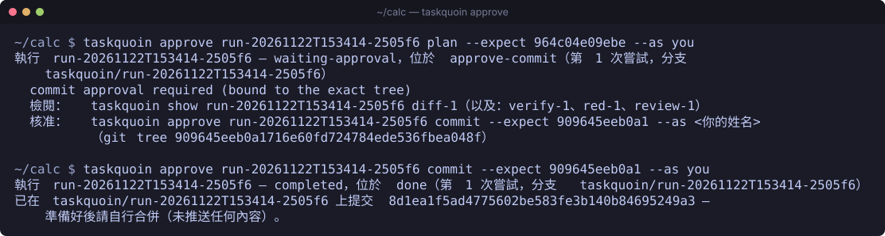

這一次，雜湊是通過了 Verify 和審查的 **git tree**。請閱讀第 1 次嘗試的四個工件。數字是嘗試的編號；重工之後，你要讀編號最大的那一個。

### `diff-1`：確切的變更

```shell
$ taskquoin show run-20261122T132108-d17040 diff-1
```

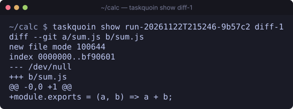

這就是將被 commit 的內容，僅此而已。如果代理程式變更了受保護的檔案（你的 CI、`.claude/`、`AGENTS.md`、`taskquoin.yaml`），執行就會以 `protected configuration changed` 停止。被你的 `.gitignore` 隱藏、但由代理程式建立的檔案會列在 `ignored-1` 中；它們不在 diff 中，不會被驗證，也不會被 commit。

### `verify-1`：你的測試，由 Taskquoin 執行

```shell
$ taskquoin show run-20261122T132108-d17040 verify-1
```

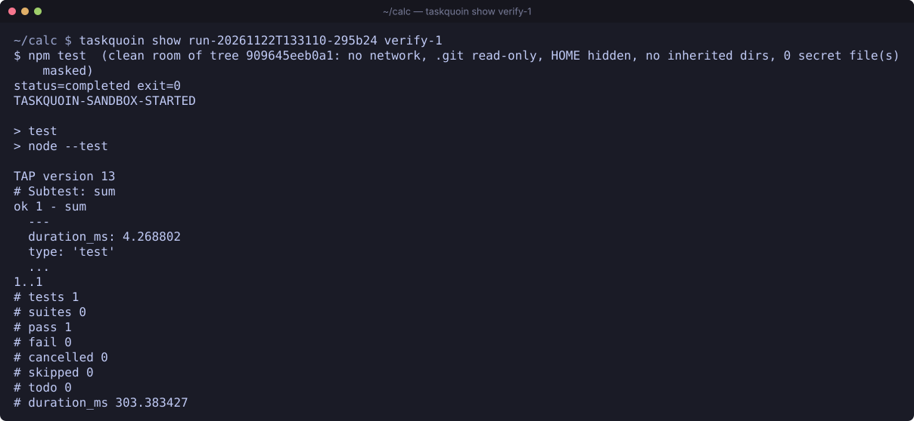

標頭說明了無塵室是什麼樣的（`no network, .git read-only, HOME hidden, … 0 secret file(s) masked`）以及針對的是哪棵 tree（`909645eeb0a1`，與你即將核准的雜湊相同）。`exit=0` 和 `# pass 1` 來自測試執行器，而不是來自模型的聲明。

### `red-1`：證明測試有意義

```shell
$ taskquoin show run-20261122T132108-d17040 red-1
TASKQUOIN RED PROOF — tests run on base + test changes only (tree 9848f565e24c); they must FAIL.
RESULT: they failed as required (RED proven).

$ npm test  (clean room of tree 9848f565e24c: no network, .git read-only, HOME hidden, no inherited dirs, 0 secret file(s) masked)
status=failed exit=1
…
not ok 1 - sum
  error: Cannot find module './sum.js'
  code: 'MODULE_NOT_FOUND'
```

這裡新的正式檔案 `sum.js` 被移除了，測試無法載入它，於是失敗了。這次失敗就是 RED 證明。Taskquoin 把來自*新*檔案中某個功能的匯入錯誤視為預期的 RED。如果只有測試檔案發生了變更（純粹新增測試），則該證明記錄為「not applicable」。

### `review-1`：第二意見

```shell
$ taskquoin show run-20261122T132108-d17040 review-1
Review: diff checked against the plan.
VERDICT: APPROVE
```

請閱讀其中的發現，而不僅僅是結論。只有在有內容可讀時，`ignored-1` 才會出現在清單中。

### 核准 commit

如果你滿意，請使用 `status` 中的雜湊進行核准：

```shell
$ taskquoin approve run-20261122T132108-d17040 commit --expect 909645eeb0a1 --as you
Run run-20261122T132108-d17040 — completed at done (attempt 1, branch taskquoin/run-20261122T132108-d17040)
Committed a3c6b801de5f4356750f53870557e2fdd19958ee on taskquoin/run-20261122T132108-d17040 — merge it yourself when ready (nothing was pushed).
```

`approve … commit` 必須在儲存庫位於該執行的分支（`taskquoin/<run>`）上時執行；否則它會回答 `switch to taskquoin/<run> first`。Taskquoin 在 commit 之前會重新讀取工作樹。如果自你查看之後有任何變化，你的核准就不再適用：它會重新驗證、重新審查，並請你核准新的 tree。

然後 Taskquoin **直接從被核准的 git tree** 建構 commit，而不是透過 `git add`。它看起來是這樣的：

```shell
$ git log -1 taskquoin/run-20261122T132108-d17040
```

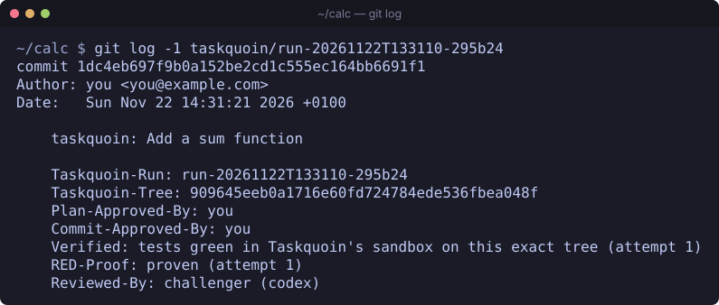

```text
taskquoin: Add a sum function

Taskquoin-Run: run-20261122T132108-d17040
Taskquoin-Tree: 909645eeb0a1716e60fd724784ede536fbea048f
Plan-Approved-By: you
Commit-Approved-By: you
Verified: tests green in Taskquoin's sandbox on this exact tree (attempt 1)
RED-Proof: proven (attempt 1)
Reviewed-By: challenger (codex)
```

這些 trailer 是稽核軌跡，就在 commit 本身之中：

| Trailer | 含義 |
|---|---|
| `Taskquoin-Run` | 產生該 commit 的執行 |
| `Taskquoin-Tree` | 經過驗證、審查和核准的 git tree。它就是該 commit 的 tree |
| `Plan-Approved-By` | 在計畫關卡透過 `--as` 給出的名字 |
| `Commit-Approved-By` | 在 commit 關卡透過 `--as` 給出的名字 |
| `Verified` | 測試在無塵室中對這棵確切的 tree 是綠燈 |
| `RED-Proof` | 被變更的測試在沒有該變更時失敗了（`proven`，對於僅測試的變更則是 `not applicable`） |
| `Reviewed-By` | 審查並核准的代理程式；API 評審者會增加它自己的一行 |

最後執行 `taskquoin status <run>` 會顯示完整的日誌，從 `recall` 到 `commit` 和 `record`。

## 步驟 9：合併結果

Taskquoin **從不 push**，也從不合併到你的分支。commit 位於 `taskquoin/<run>` 上，也就是你目前所在的分支。請自己合併，或者從它發起 pull request：

```shell
$ git switch main
$ git merge --ff-only taskquoin/run-20261122T132108-d17040
$ npm test
```

> [!WARNING]
> Taskquoin 不會執行你儲存庫的 commit hook，因為它們可能包含被代理程式修改過的程式碼。合併時，請自己執行你的 hook、linter 和 CI。

`taskquoin/<run>` 分支歸你所有：不再需要時請刪除它們（`git branch -d taskquoin/<run>`）。

## 在 Dashboard 中追蹤一次執行

執行期間，在同一個儲存庫開啟第二個終端機並啟動 Dashboard。它只讀取：顯示管線、等待您的核准（含其雜湊的開頭）、各個代理與日誌。

```shell
$ taskquoin dashboard
```

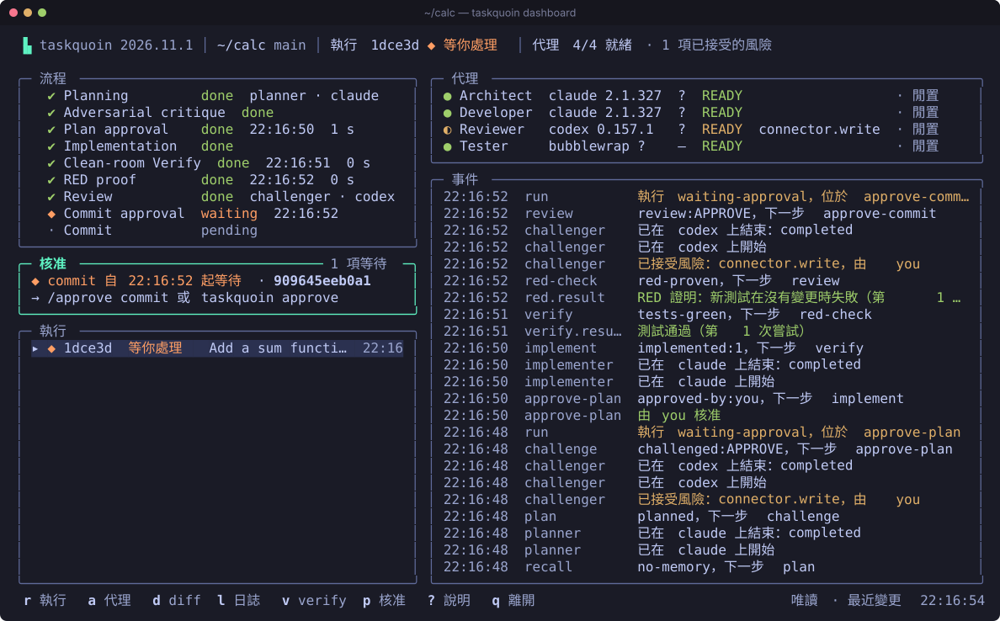

按 `d` 閱讀 diff：`/` 搜尋，`n` 與 `N` 在符合項之間跳轉；捲動到檔案末尾後，該檔案才算已讀。

按 `p` 開啟核准中心。沒有任何按鍵會自行核准：您輸入姓名，然後重新輸入雜湊的 12 個字元。按 `q` 離開；已核准的執行會繼續。 [Dashboard 指南（英文）](../guides/dashboard.md).

## 當事情沒有按計畫進行

Taskquoin 的錯誤訊息遵循你的語言，但執行引擎的訊息（`failed`、`needs-human`、`interrupted`）始終是英文。下表列出了你最常遇到的情況。

| 你看到的內容 | 含義 | 該怎麼做 |
|---|---|---|
| `taskquoin run: the working tree has uncommitted changes` | Taskquoin 從不把自己的變更與你的變更混在一起 | commit 或 stash 你的變更 |
| `failed … gate refused agent X` | 無法在這台機器上認證某個代理程式 | `taskquoin doctor` 會說明原因：執行環境版本、缺少沙箱、你尚未接受的風險 |
| `needs-human … tests still failing after 3 attempts` | 三次嘗試仍未使測試變成綠燈 | 在執行分支上接手，或用更精確的請求開始新的執行 |
| `needs-human … no failing test demonstrates the change` | 即使沒有正式程式碼的變更測試也能通過，所以它們並沒有測試這個變更 | 閱讀 `red-N`；撰寫（或要求撰寫）一個在變更前會失敗的測試。沒有新測試的重構或文件變更會止步於此：請自己從該分支 commit |
| `needs-human … RED proof inconclusive` | 證明未能正常執行（逾時、沙箱、無法重建的 tree）。它不是證明 | 閱讀 `red-N`。你的工作資料夾未被更動 |
| `needs-human … review still requests changes after N attempts` | 審查者一直在拒絕 | 閱讀 `review-N` 並做出決定；工作成果在該分支上 |
| `needs-human … dependencies changed during the run` | `node_modules`（或 `vendor`、`.venv`）在執行期間發生了變化，所以用它做的任何驗證都不成立 | 重新安裝（`npm ci`）並開始新的執行。不要在執行期間執行 `npm install` |
| `needs-human … protected configuration changed` | 代理程式碰觸了受保護的設定（CI、`.claude/`、`AGENTS.md`、`taskquoin.yaml`） | 沒有 commit 任何內容；檢查該分支 |
| 測試在你這裡通過，但在 Verify 中失敗 | 它們使用了無塵室中不存在的被忽略的檔案 | 把它加入 `verify.inherit` |
| `does not match the pending artifact` | 你給出的雜湊不是待處理的那個 | 用 `show` 閱讀，並從 `status` 複製雜湊 |
| `switch to taskquoin/<run> first` | 你不在該執行的分支上 | `git switch taskquoin/<run>` |
| `taskquoin.yaml changed since the run started` | 設定在執行中途發生了變化 | 開始新的執行 |
| `interrupted` | 一個技術錯誤（git、磁碟、評審者的 HTTP 503）使執行停止 | `taskquoin resume <run>` |

### 當測試一直是紅燈

如果 Verify 失敗，Taskquoin 會把失敗日誌和審查交給 implementer 並再次嘗試，最多三次實作嘗試（沒有自己指令的 OpenCode implementer 可以獲得更多次重工）。如果測試仍然是紅燈，執行會以狀態 `needs-human` 和原因 `tests still failing after 3 attempts` 結束。沒有 commit，也沒有核准提示。

一切都會保留：`taskquoin show <run> verify-3` 有最後一份日誌，分支 `taskquoin/<run>` 保存著代理程式的工作成果。你可以在該分支上手動繼續，或者用更精確的請求開始新的執行。`needs-human` 的執行不會自動恢復。

### `resume`：中斷之後

當工作流程之外的某些原因使執行中斷時（連接評審者時的網路錯誤、磁碟已滿、你的機器進入睡眠），執行就處於 `interrupted` 狀態。狀態在每一步都會儲存，評審者的回答也會逐一儲存，所以恢復執行從不會兩次呼叫評審者，也不會兩次為此付費：

```shell
$ taskquoin resume run-20261122T132108-d17040
```

`resume` 只接受狀態為 `interrupted` 的執行。對於任何其他狀態，它會告訴你這一點，例如 `taskquoin resume: only an interrupted run can be resumed (status completed)`。如果狀態是 `needs-human` 或 `failed`，請開始新的執行。

### 一條經驗法則

如果你不知道該怎麼辦，請執行 `taskquoin status <run>`：它會印出狀態、日誌以及確切的下一個指令。關於機器的任何問題，`taskquoin doctor` 都能回答。

## 了解更多

- [互動式主控台](../getting-started/console.md)：同樣的工作流程，使用 `/run` 和 `/approve`
- [安裝](../getting-started/installation.md)
- [ADR-0011，代理程式從不 commit](../adr/0011-agents-never-commit.md)
- [ADR-0013，以 tree 為基礎的治理](../adr/0013-tree-based-governance.md)
- [ADR-0014，在無塵室中 Verify](../adr/0014-verify-in-a-clean-room.md)
- [ADR-0002，強制類別](../adr/0002-enforcement-classes.md)
- [ADR-0005，工作區之外的控制平面](../adr/0005-control-plane-outside-workspace.md)
- [ADR-0016，透過 API 的評審者](../adr/0016-judges-by-api.md)和 [ADR-0017，沒有指令的 OpenCode](../adr/0017-opencode-without-commands.md)
